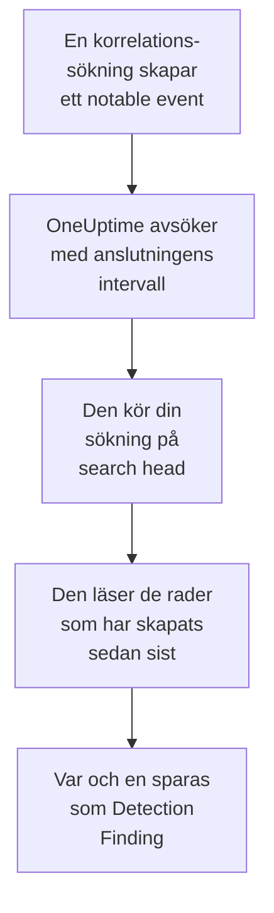

# Splunk Enterprise Security

Importera de notable events som korrelationssökningarna i [Splunk Enterprise Security](https://www.splunk.com/en_us/products/enterprise-security.html) skapar till säkerhetshändelserna i OneUptime. Där söker du i dem bredvid dina loggar, spårningar och mätvärden, korrelerar dem med alla andra källor och larmar jouren för dem som spelar roll. OneUptime läser dem genom att köra en sökning på ditt search head som en Splunk-användare som du själv skapar, och ändrar ingenting i Splunk. Eftersom det bara är en sökning importerar den vilket index som helst eller utdata från vilken sparad sökning som helst, inte bara notable events.

:::cards
- [Konfigurera anslutningen](#konfigurera-anslutningen): En token, en roll och anslutningens formulär.
- [Vad som importeras](#vad-som-importeras): Hur varje rad i sökningen blir en säkerhetshändelse.
- [Så fungerar avsökningen](#så-fungerar-avsökningen): Det fönster som varje avsökning läser, och vad ett upptaget search head gör med det.
- [Felsökning](#felsökning): Vad varje fel betyder och vad du ska ändra.
:::

## Så fungerar det



Varje minut avsöker OneUptime varje aktiverad anslutning vars avsökningsintervall har passerat. En avsökning kör din sökning via search headens REST API, över de rader som har skapats sedan förra avsökningen, och sparar varje rad som en [OCSF](https://schema.ocsf.io/) Detection Finding-händelse (klass `2004`). Identifieringsregler, monitorer och instrumentpaneler behandlar den sedan som en säkerhetshändelse från vilken annan källa som helst.

## Innan du börjar

- I OneUptime rollen Project Owner, Project Admin eller Security Admin. Security Member och Security Viewer kan se anslutningar och deras körningshistorik, men inte ändra dem.
- Ett search head med Splunk Enterprise 9.0.1 eller senare, eller Splunk Cloud Platform. OneUptime pratar med dess REST API på hanteringsporten, vanligtvis `8089`. Splunk Web, på port `8000`, erbjuder inte REST API:t.
- En Splunk-användare för OneUptime, vars roll har capabilityn `search` och kan läsa det index som sökningen läser: `notable` för notable events. Enterprise Security-rollerna `ess_analyst` och `ess_user` ger båda delarna. Anslutningen läser bara, så rollen behöver inget annat.
- Ett search head som OneUptime kan nå över HTTPS. OneUptime Cloud ansluter från internet, så search headen behöver en offentlig adress: privata adresser avvisas. En egenvärdad OneUptime ansluter från sina app- och workercontainrar och kan nå ett search head i ditt privata nätverk, om inte `DATA_SOURCE_BLOCK_PRIVATE_ADDRESSES` är `true`.

## Konfigurera anslutningen

Anslutningen autentiserar med en Splunk-autentiseringstoken, eller med ett användarnamn och ett lösenord.

:::steps
### Skapa en autentiseringstoken

1. Öppna **Settings → Tokens** i Splunk Web. Om Splunk säger att tokenautentisering är avstängd väljer du först **Enable Token Authentication**.
2. Välj **New Token**. Ange i **User** den Splunk-användare som har skapats för OneUptime, och ange i **Audience** vad token är till för, till exempel `OneUptime security events`.
3. Välj en **Expiration**, eller ingen. En token som går ut stoppar anslutningen tills du ersätter den.
4. Välj **Create** och kopiera token. Splunk visar den bara en gång.

Vill du hellre autentisera med ett lösenord hoppar du över det här steget och har användarens namn och lösenord till hands.

### Lägg till anslutningen i OneUptime

Öppna **Produkter → Security Events → Anslutningar** (`/dashboard/{projectId}/security-events/connections`), klicka på **Lägg till anslutning**, välj **Splunk Enterprise Security** och klicka på **Nästa**. Fyll i inställningarna i tabellen nedan, klicka på **Nästa** och klistra in token i **Authentication token**, eller lösenordet i **Lösenord**.

### Testa den innan du sparar

Klicka på **Testa de här inställningarna** under **Testa innan du sparar**. Testet autentiserar och kör din sökning med värdena i formuläret och sparar ingenting, så en fel port eller en saknad roll syns innan anslutningen finns. Klicka sedan på **Nästa**, ge anslutningen ett **Namn** och skapa den.
:::

| Inställning | Vad du anger |
| --- | --- |
| **Splunk management URL** | Search headens REST API, till exempel `https://splunk.example.com:8089`. Den måste använda `https`, utan frågesträng. En sökväg behålls, för en omvänd proxy som erbjuder API:t under en sökväg. |
| **Sök** | Sökningen som väljer vad som ska importeras, `index=notable` tills du ändrar den. Begränsa den, till exempel med `index=notable urgency IN (high, critical)`. OneUptime lägger själv till tidsintervallet, så sökningen kan inte ange `earliest` eller `latest` och kan inte börja med en pipe. Ett inledande `search` tas bort. |
| **Användarnamn** | Splunk-användarens namn, bara om den autentiserar med ett lösenord. |
| **Authentication token** | Token från det första steget. När en token är sparad är det den som används, och inte användarnamnet eller lösenordet. |
| **Lösenord** | Splunk-användarens lösenord, bara när ingen token används. |

**Authentication token** och **Lösenord** krypteras, returneras aldrig av API:t och visas aldrig igen. Ersätt dem med **Uppdatera inloggningsuppgifter** på anslutningen. För att byta från den ena autentiseringen till den andra anger du den nya där och slår på **Remove the stored Authentication token** eller **Remove the stored Password**.

Steget **Hämtning** har också en valfri **Beskrivning**, **Hämtningsintervall (minuter)**, ett heltal från `1` till `1440` som börjar på `5`, och **Aktiverad**, som börjar påslagen.

## Vad som importeras

Varje rad som sökningen returnerar blir en Detection Finding-händelse (OCSF-klass `2004`), med leverantören `Splunk` och produkten `Splunk Enterprise Security`. För ett notable event:

| Splunk-fält | OneUptime-kolumn |
| --- | --- |
| `event_id`, annars `_bkt` och `_cd`, annars en hash av raden | Händelse-UID, som även dubbletter tas bort efter |
| `_time`, när korrelationssökningen skapade det notable eventet | Händelsens tid |
| `rule_name`, annars `search_name`, annars `source` | Regelnamn |
| `search_name`, annars `source`, annars `rule_name` | Regel-ID |
| `rule_title`, annars `rule_description`, annars regelnamnet | Meddelande |
| `urgency`, annars `severity` | Allvarlighetsgrad |
| `status_label`, annars `status_description`, annars namnet på den granskningsstatus som `status` innehåller | Status |
| `annotations.mitre_attack`, och fält som `mitre_technique_id` och `mitre_tactic` | MITRE ATT&CK-taktiker och -tekniker |
| `user` eller `src_user`; `src`, `src_ip` eller `src_host`; `process`, `process_name` eller `parent_process` | Aktörens användare, IP, värd och process |
| `dest_user`; `dest`, `dest_ip` eller `dest_host`; `dest_port` | Målets användare, IP, värd och port |
| `file_path`, `url` eller `risk_object` | Målresurs |
| Varje användare, värd och IP, plus `dvc`, `host`, `file_hash`, `file_name`, `url`, `domain`, `query` och `risk_object` | Observables |
| Varje fält i raden, till exempel `security_domain`, `owner`, `orig_sid` och `_raw` | `attributes`, under fältets eget namn |

En rad från ett annat index importeras på samma sätt. De kolumner som dess fält inte fyller förblir tomma, och varje fält går fortfarande att söka i `attributes`.

## Så fungerar avsökningen

Varje avsökning kör en exportsökning över sitt fönster, de äldsta först:

```text
POST {Splunk management URL}/services/search/v2/jobs/export
    search=search index=notable | fields * | sort 0 _time | head 10001
    earliest_time={window start}
    latest_time={window end}
    output_mode=json
```

- **Skapandetiden är markören.** Fönstret gäller `_time`, som för ett notable event är när korrelationssökningen skapade det, inte när den hittade aktiviteten inträffade. En sökning som körs varje timme daterar sina notable events till tiden för sin körning, så inget hamnar bakom markören.
- **Den första avsökningen ser 24 timmar bakåt**, så att en ny anslutning direkt visar sina senaste notable events.
- **Varje senare avsökning börjar 1 minut före den sparade markören**, så att en rad som har skapats på gränsen mellan två fönster aldrig missas.
- **En avsökning läser högst 24 timmar förbi markören.** En anslutning vars markör har hamnat efter kommer ikapp i en serie fönster på 24 timmar, och dess **Hälsa** visar **Catching up**.
- **Dubbletter tas bort efter `event_id`**, eller Splunks egna `_bkt` och `_cd`, inom projektet, så att överlappningen, ett upprepat fönster och en import aldrig sparar en rad två gånger.

Ett search head som är äldre än 9.0.1 svarar `404` på begäran till `search/v2/jobs/export`. OneUptime skickar den då till det föråldrade `search/jobs/export`, och körningen säger det i en varning. Uppgradera search headen: aktuella versioner stänger av den slutpunkten.

### När ett fönster innehåller mer än en avsökning kan läsa

En avsökning läser högst 10 000 rader. När ett fönster innehåller fler blir körningen **Delvis**, med en varning som:

```text
Stopped after collecting 10000 records; the window holds more. Records are read oldest first, and the last one read was created at 2026-09-14T08:12:44.000Z, where the next poll can resume.
```

Sökningen sorterar fönstret efter `_time`, de äldsta först, så OneUptime flyttar markören till skapandetiden för den senast lästa raden, och nästa avsökning börjar där med samma fönsterlängd. Ett upptaget search head kommer ikapp 10 000 rader per avsökning i stället för att läsa samma rader igen. Rader som skapades i samma ögonblick läses två gånger, och dubblettkontrollen tar bort den andra kopian. Splunk sorterar hela fönstret innan det returnerar en rad, så en sökning i **Sök** som hittar mycket mer än nödvändigt gör varje avsökning långsammare. Håll den fokuserad.

När en körning inte alls kommer förbi den sparade markören gör OneUptime i stället fönstret kortare:

1. **Smalna av.** Nästa avsökning läser ett fönster som är hälften så långt, från samma startpunkt, och fortsätter att halvera tills ett fönster läses helt, ner till en minut. Körningens varning säger det: `This window holds more records than one poll can read; the next poll reads a {n} minute window from the same starting point.`
2. **Växa igen.** När ett fönster har lästs helt är nästa dubbelt så långt igen, upp till 24 timmar.
3. **Gå förbi en enda minut.** Om till och med en minut innehåller mer än en avsökning kan läsa går avsökningen förbi den, så att nyare notable events fortsätter att komma. Körningen förblir **Delvis**, och **Senaste fel** lyder `More records were created in the one minute from {cursor} to {end} than one poll can read. Polling moved past this minute so newer records keep arriving; use Import this time range in Diagnostics on this minute to recover what one run can read.` Importera den minuten med **Import this time range** för att hämta det som en körning kan läsa.

En körning som misslyckas helt, med ett fel från Splunk, behåller markören och fönsterlängden, och nästa avsökning läser samma fönster igen. Det enda undantaget är en begäran som fick tidsgräns: markören stannar, men nästa fönster är hälften så långt, eftersom ett fönster som är för tungt för att besvaras i tid skulle få tidsgräns vid varje försök. Att ändra **Hämtningsintervall (minuter)** ändrar inget av detta: det avgör hur ofta en avsökning startar, inte var dess fönster börjar.

### Kör, förhandsgranska och importera vid behov

Klicka på **Diagnostik** på en anslutning för att se dess senaste körningar och arbeta med den manuellt. Alla som kan ändra anslutningen kan starta de här åtgärderna; alla som kan se den kan läsa historiken.

- **Kör nu** startar en avsökning direkt, med den vanliga markören, även när anslutningen inte är **Aktiverad**.
- **Preview notable events** läser ett tidsintervall på upp till 7 dagar och importerar ingenting.
- **Import this time range** importerar ett intervall på upp till 7 dagar, efter att du har bekräftat, utan att flytta markören. Rader som redan har importerats hoppas över.
- **Copy diagnostics** på en körning kopierar dess rapport till supporten. Den innehåller aldrig autentiseringsuppgifter.

## Testa anslutningen

**Testa anslutningen** på en anslutnings rad och **Testa de här inställningarna** i formuläret körs i API-processen, inte i en bakgrundsworker, så att ett test svarar även när det är workerna som är problemet. Det kör de här kontrollerna i ordning:

| Kontroll | Vad den kontrollerar |
| --- | --- |
| **Konfiguration** | Varje inställning finns och är korrekt formaterad. Ingenting kontaktas när detta misslyckas. |
| **Authenticate with Splunk** | Splunk godtar token, eller användarnamnet och lösenordet, och namnger användaren och dess roller, så att du kan jämföra dem med den roll du ville ge. |
| **Run the search on Splunk** | Sökningen i **Sök** körs över de senaste 24 timmarna för en rad och säger vilken exportslutpunkt som svarade. |
| **Notable events available to import** | Hur många rader sökningen i **Sök** hittar under de senaste 24 timmarna och de senaste 7 dagarna. Inga på 7 dagar är en varning, inte ett fel. |
| **Background workers**, **Poll scheduler**, **Security event storage** | OneUptimes egen sida: en process tar jobben från Worker-kön, avsökningsjobbet körs varje minut och lagringen för säkerhetshändelser svarar. |
| **Scheduled polling** | För en sparad anslutning: avsökningen är påslagen, ingen körning har fastnat i väntan på en worker och avsökningar körs i tid. |

Varje begäran i ett test har en tidsgräns på 20 sekunder. Ett test importerar aldrig något och flyttar aldrig markören, och varje kontroll som misslyckas säger vad du ska ändra.

## Skicka säkerhetshändelser till Splunk

OneUptime kan också skicka det den hittar till Splunk, via dess HTTP Event Collector (HEC), så att dina sökningar och instrumentpaneler ser OneUptimes upptäckter bredvid dina egna. Varje säkerhetshändelse är en HEC-händelse med sourcetypen `oneuptime:security`, och fälten heter det som Splunks Common Information Model kallar dem: `src`, `src_ip`, `src_user`, `dest`, `dest_ip`, `dest_port`, `user`, `signature` och `severity`.

:::steps
### Skapa en HEC-token

Öppna **Settings → Data inputs → HTTP Event Collector** i Splunk Web och klicka på **New Token**. Namnge den, välj de index den får skriva till och dess standardindex, och kopiera tokenvärdet. På Splunk Cloud lyssnar HEC på `https://http-inputs-<stack>.splunkcloud.com`; på Splunk Enterprise på port `8088` när **Global Settings** har slagit på tokens.

### Lägg till målet

Öppna **Produkter → Security Events → Anslutningar**. Klicka på **Lägg till mål** under **Skicka till ditt SIEM**, välj Splunk under **SIEM** och klicka på **Nästa**. Fyll i **HEC-URL** och klistra in token i **HEC-token**. **Index** och **Källtyp** är valfria: lämnas de tomma går händelserna till tokenens standardindex med sourcetypen `oneuptime:security`.

### Skicka en testhändelse och börja skicka

Klicka på **Skicka en testhändelse**: en informativ händelse går till Splunk med inställningarna i formuläret, och inget sparas. Sök efter den med `sourcetype="oneuptime:security"`. Behåll sedan **Endast upptäckter** under **Vad som ska skickas**, eller välj **Alla säkerhetshändelser**, och klicka på **Börja skicka**.
:::

- **HEC-URL** måste använda `https`, med ett certifikat som OneUptime litar på: certifikatkontroller hoppas aldrig över.
- Händelser skickas i omgångar om upp till 500. En händelse som Splunk avvisar utelämnas och nämns i **Visa fel**, en upptagen collector (`503`) försöks igen, och en avvisad token eller ett avvisat index stoppar sändningen tills du rättar det.
- Notable events som OneUptime har importerat från Splunk skickas aldrig tillbaka dit.

## Felsökning

Anslutningens **Senaste fel** sparar hela felmeddelandet, med autentiseringsuppgifter maskerade, bakom ett prefix som namnger det steg som misslyckades. När en anslutning har ett fel väljer du **Visa fel** i dess kolumn **Åtgärder** för att läsa det, och **Kopiera fel** i dialogrutan för att kopiera det. Läs prefixet först.

:::details Last Error börjar med `Splunk Enterprise Security authentication request`
- `Splunk Enterprise Security authentication request failed (HTTP ...)`: Splunk vägrade säga vem anroparen är.
  - `HTTP 401`: Splunk godtog inte autentiseringsuppgifterna. Token är fel, har gått ut eller har tagits bort, tokenautentisering är avstängd på search headen, eller användarnamnet eller lösenordet är fel. Skapa en ny token och spara den med **Uppdatera inloggningsuppgifter**.
  - `HTTP 404`: **Splunk management URL** är inte REST API:t. Den pekar på Splunk Web på port `8000`, eller har en sökväg som search headen inte erbjuder.
- `Splunk Enterprise Security authentication request returned ...`: något annat än search headens REST API svarade, till exempel HTML:en från Splunk Web på port `8000` eller en proxys sida. Peka URL:en mot hanteringsporten.
:::

:::details Last Error börjar med `Splunk Enterprise Security search export` eller `Splunk Enterprise Security count search`
- `Splunk Enterprise Security search export failed (HTTP ...)`: Splunk vägrade köra sökningen.
  - `HTTP 400`: Splunk kan inte tolka sökningen. Kör sökningen från **Sök** i Splunk Web för att läsa dess fel.
  - `HTTP 403`: användarens roll saknar capabilityn `search`, eller kan inte läsa indexet. Lägg till `notable`, eller ditt index, bland de index som rollen får söka i.
  - `HTTP 404`: ingen av de två exportslutpunkterna finns på den URL:en, så det är inte hanteringsporten på ett search head.
  - `HTTP 429` eller `HTTP 5xx`: Splunk begränsar användaren, är överbelastat, eller sökningen nådde en av sina gränser. Nästa avsökning försöker igen.
- `Splunk Enterprise Security search export was rejected by Splunk on an HTTP 200`: Splunk svarade, men stoppade sökningen med ett fel. Meddelandet citerar det.
- `Splunk Enterprise Security search export returned a body that is not newline-delimited JSON.`: något annat än REST API:t svarade, till exempel Splunk Web eller en proxys inloggningssida. Det rapporteras i stället för att tas som ett tomt fönster, så att markören aldrig flyttas förbi rader som ingen har läst.
- `Splunk Enterprise Security count search ...`: samma fel, från räkningen för **Notable events available to import**, som bara ett test kör.
:::

:::details Last Error slutar med `did not complete`
`Splunk Enterprise Security search export did not complete`, och samma sak för de andra stegen, betyder att begäran inte fick något svar: en tidsgräns, ett namn som inte kan slås upp, ett certifikat som OneUptime inte litar på, eller en avvisad privat adress. Kontrollera att OneUptime-appen och workerna kan öppna en HTTPS-anslutning till hanteringsporten. Ett search head som svarar på andra begäranden men får tidsgräns på sökningen sorterar för mycket: nästa avsökning läser ett fönster som är hälften så långt, och en mer fokuserad sökning i **Sök** löser det för gott.
:::

:::details Last Polled är Never och Last Error är tom
Ingen avsökning har slutförts för den här anslutningen. Kör **Testa anslutningen**: dess kontroller **Background workers** och **Poll scheduler** namnger orsaken. På en egenvärdad installation är den vanliga orsaken `DISABLE_QUEUE_WORKERS=true` på appen, utan en separat worker-distribution som tar jobben: sätt den till `false`, eller kör worker-distributionen (Helm: `worker.enabled: true`).
:::

:::details En körning är Partial
- `Stopped after collecting 10000 records; the window holds more`: fönstret innehöll mer än de 10 000 rader som en körning läser. Ingenting går förlorat: nästa avsökning börjar efter den senast lästa raden. En anslutning som förblir **Delvis** avsökning efter avsökning håller på att komma ikapp en eftersläpning, och dess **Senast hämtad** och **Senast importerade händelse** fortsätter att flytta fram. Om den aldrig kommer ikapp hittar sökningen i **Sök** mer än 10 000 rader per avsökningsintervall: begränsa den, eller gör **Hämtningsintervall (minuter)** kortare.
- `More records were created in the one minute from ... than one poll can read`: avsökningen gick förbi den minuten. Importera den med **Import this time range** i **Diagnostik**. En import läser lika mycket som en avsökning.
:::

:::details Testet lyckas, men ingenting importeras
Läs **Notable events available to import** i testets rapport. `0` de senaste 7 dagarna betyder att sökningen i **Sök** inte hittade något i Splunk: kontrollera i Incident Review att korrelationssökningarna är aktiverade och skapar notable events, och att sökningen i **Sök** inte är snävare än avsett.
:::

## Vad du får

- **Sök.** Filtrera notable events efter brådska, status, regel, användare, värd eller vilken observable som helst i utforskaren för säkerhetshändelser, bredvid alla andra källor.
- **Korrelation.** Varje rads användare, värdar, IP-adresser och domäner indexeras som observables, så en sökning hittar allt som nämner dem.
- **Identifieringsregler.** Sigma-regler som körs enligt ett schema över dina säkerhetshändelser och öppnar larm som larmar jouren.
- **Monitorer.** Monitorer för säkerhetshändelser räknar matchande händelser, till exempel nya kritiska notable events, och öppnar incidenter eller larm över en tröskel.

Säkerhetshändelser debiteras som resten av din telemetri, per inmatad GB. Se [Priser](https://oneuptime.com/pricing).

## Nästa steg

:::cards
- [Säkerhetshändelser](/docs/telemetry/security-events): Sök, korrelera och larma på det du importerar.
- [Elastic Security](/docs/integrations/elastic-security): Importera även detektionslarmen från en Elastic-stack.
- [Roller](/docs/permissions/reference#roller): Vad Security-rollerna kan se och ändra.
- [Översikt över integrationer](/docs/integrations/index): De andra verktygen du kan ansluta.
:::
