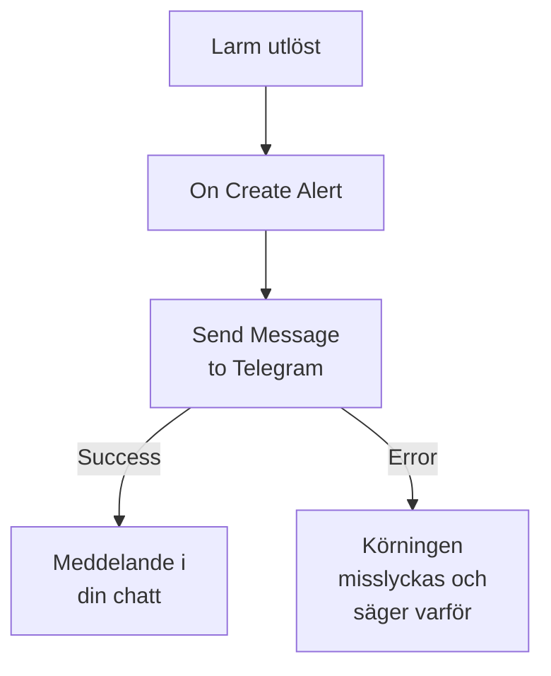

# Telegram

Skicka ett meddelande till en [Telegram](https://telegram.org)-chatt, -grupp eller -kanal när ett larm utlöses eller en incident öppnas. OneUptimes arbetsflödessteg **Send Message to Telegram** skickar det som en bot som du själv skapar, och en färdig mall bygger arbetsflödet för larm. Den här integrationen är **utgående**: boten skickar meddelanden och läser inte det som sägs i chatten.

:::cards
- [Så fungerar det](#så-fungerar-det): Vad arbetsflödet gör när ett larm utlöses.
- [Kom igång](#konfigurera-integrationen): En bot, dess chatt och sedan arbetsflödet: från mallen eller från grunden.
- [Tips](#tips): Ren text, långa meddelanden och incidenter.
- [Felsökning](#felsökning): Vad Telegrams fel betyder och vad du ska ändra.
:::

## Så fungerar det



Steget skickar **Message Text** till chatten som din bot via Telegrams Bot API. Det tar sin utgång **Success** när Telegram tar emot meddelandet, och sin utgång **Error**, med Telegrams skäl, när Telegram avvisar det. Är inget kopplat till **Error**, som i mallen, misslyckas en körning som inte kunde skicka, och dess **Steg** säger varför.

## Innan du börjar

- Ett Telegram-konto för att skapa boten och lägga till den i chatten.
- I OneUptime rätten att skapa arbetsflöden och variabler. På OneUptime Cloud kräver arbetsflöden planen **Growth** eller högre.

## Konfigurera integrationen

:::steps
### Skapa en bot

Skicka `/newbot` till [@BotFather](https://t.me/BotFather) i Telegram och svara på dess frågor. Den ger dig botens token, till exempel `123456789:ABCdefGhIJKlmnoPQRstuVWxyz`. Alla som har token kan skicka meddelanden som din bot, så var lika rädd om den som om ett lösenord.

### Hitta chattens ID

1. Lägg till boten i gruppen, eller gör den till administratör för kanalen. För att skriva till en person startar personen först en chatt med boten.
2. Skicka ett meddelande i gruppen som nämner boten, till exempel `/start@your_bot`, så att boten ser det.
3. Öppna `https://api.telegram.org/bot<token>/getUpdates` i en webbläsare, med botens token i stället för `<token>`.
4. Leta upp `"chat":{"id":` i svaret. Talet efter det är chattens ID. En grupps ID börjar med `-`, och en stor grupps med `-100`.

En offentlig kanal kan anges med sitt `@username` i stället för ett ID.

### Bygg arbetsflödet

Börja från mallen, som bygger hela arbetsflödet för larm, eller från grunden.

:::tabs
@tab Från mallen
1. Öppna **Arbetsflöden** och klicka på **Skapa arbetsflöde**.
2. Skriv `Telegram` i **Sök mallar…**, klicka på **Tell Telegram when an alert fires** och klicka sedan på **Använd den här mallen**.
3. Behåll namnet **Notify Telegram on new alert** eller ändra det, och klicka på **Nästa**.
4. Klistra in token i **Telegram Bot Token** och ID:t i **Telegram Chat ID**, och klicka på **Skapa arbetsflöde**.

Arbetsflödet öppnas i **Byggare** med två steg: **On Create Alert** och **Send Message to Telegram**, som skickar larmets nummer, titel, allvarlighetsgrad och tillstånd. Token sparas som arbetsflödets hemliga variabel `telegramBotToken`, och ID:t som `telegramChatId`.
@tab Från grunden
1. Spara token som en hemlig global variabel: gå till **Arbetsflöden → Globala variabler**, klicka på **Skapa Arbetsflöde Variabel**, ge den namnet `TELEGRAM_BOT_TOKEN` och klicka på **Nästa**. Klistra in token i **Innehåll**, slå på **Hemlighet** och klicka på **Skapa Arbetsflöde Variabel**.
2. Gå till **Arbetsflöden**, klicka på **Skapa arbetsflöde**, välj **Börja från grunden**, ge arbetsflödet ett namn och klicka på **Skapa arbetsflöde**.
3. Klicka på **Välj vad som startar det här arbetsflödet** i **Byggare** och välj **On Create Alert** under **Populära**. Klicka på utlösaren: dess **Fields to pass on** börjar med **Titel**, så klicka på **Lägg till fält** och välj de andra fält som ditt meddelande visar, till exempel **Alert Number With Prefix**.
4. Klicka på **Lägg till komponent**, sök efter `telegram` och klicka på **Send Message to Telegram**. Anslut utlösarens utgång **Success** till det.
5. Klicka på det nya steget. Klicka på **{ }** i **Telegram Bot Token** och välj `TELEGRAM_BOT_TOKEN` under **Global variables**. Ange chattens ID i **Chat ID**, skriv meddelandet i **Message Text** och infoga larmets fält med **{ }**.
:::

Ett meddelande byggt från grunden läser larmets fält med referenser som dessa:

```text
🚨 Alert {{local.components.alert-on-create-1.returnValues.model.alertNumberWithPrefix}} fired
Title: {{local.components.alert-on-create-1.returnValues.model.title}}
```

### Slå på och testa

Slå på **Aktiverad** högst upp i **Byggare**. Från och med nu skickas varje nytt larm till chatten.

För att testa utan att utlösa ett larm klickar du på **Kör arbetsflöde** och väljer ett larm du redan har under **Larm**: de senaste visas i listan, och genom att skriva dess nummer eller en del av dess titel hittar du ett annat. Klicka på **Kör arbetsflödet manuellt** och bekräfta med **Kör**. Panelen **Arbetsflödeskörning** följer körningen, och meddelandet dyker upp i chatten. Om steget i stället tar **Error** misslyckas körningen, och stegets post under **Steg** säger varför: se [Felsökning](#felsökning).
:::

## Tips

- **Ren text.** Steget skickar texten som den är skriven, utan Telegrams formatering, så `*` och `_` visas som de är.
- **Tänk på gränsen på 4 096 tecken.** Telegram tar emot meddelanden på upp till 4 096 tecken. Ett längre kortas av och slutar med "… (truncated — see OneUptime for the full text)" i stället för att avvisas.
- **Även incidenter.** Bygg samma arbetsflöde på **On Create Incident**, eller på **On Update Incident** för tillståndsändringar. För att bara skicka vissa larm sätter du ett block **If / Else** före steget.
- **Tokens form kontrolleras.** En token som inte har formen `123456789:ABCdef…` stoppar körningen innan något skickas, och token skrivs aldrig till loggen.

## Felsökning

När steget tar **Error** misslyckas körningen, och stegets post under körningens **Steg** ger Telegrams skäl. Boten måste vara med i chatten, så kontrollera det först.

:::details Telegram svarar "Bad Request: chat not found"
**Chat ID** är fel, eller så kan boten inte se chatten: lägg till boten i gruppen, gör den till administratör för kanalen, eller be personen att starta en chatt med boten. En grupps ID börjar med `-`.
:::

:::details Telegram svarar "Forbidden: bot was blocked by the user" eller "bot is not a member"
Personen har blockerat boten, eller så har boten tagits bort från gruppen eller kanalen. Lägg till den igen, eller skicka till en annan chatt.
:::

:::details Telegram svarar "Unauthorized"
Telegram godtog inte token: den har återkallats hos @BotFather eller kopierats fel. Kopiera botens aktuella token från @BotFather och ersätt variabelns värde.
:::

:::details Telegram svarar "Too Many Requests: retry after"
Telegram begränsar hur snabbt en bot skickar, särskilt till en grupp. En skur av larm kan nå gränsen: skicka färre meddelanden, till exempel bara för vissa allvarlighetsgrader.
:::

## Nästa steg

:::cards
- [Arbetsflödeskomponenter](/docs/workflows/components#telegram): Varje inställning i steget och vad dess utgångar betyder.
- [Discord](/docs/integrations/discord): Samma idé, i en Discord-kanal.
- [Arbetsflödeskörningar](/docs/workflows/runs-and-logs): Läs vad varje körning av arbetsflödet gjorde.
- [Översikt över integrationer](/docs/integrations/index): Det utgående mönstret och de andra verktygen du kan ansluta.
:::
