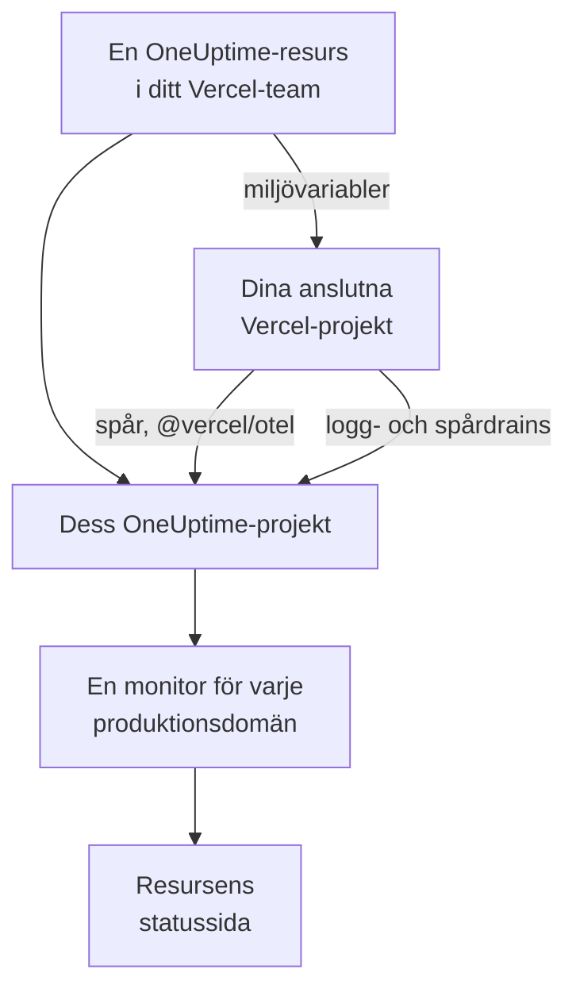

# Vercel

Lägg till OneUptime i ditt Vercel-team från [Vercel Marketplace](https://vercel.com/marketplace). Du loggar in med ditt Vercel-konto och betalar via din Vercel-faktura, och dina Vercel-projekt får spår, loggar, drifttidsövervakning och en statussida i OneUptime, utan att du behöver konfigurera något för hand.

:::cards
- [Lägg till OneUptime i ditt Vercel-team](#lägg-till-oneuptime-i-ditt-vercel-team): En resurs, en plan och dina projekt, i Vercels instrumentpanel.
- [Skicka spår med @vercel/otel](#skicka-spår-med-vercelotel): Miljövariablerna finns redan där.
- [Skicka loggar och spår med drains](#skicka-loggar-och-spår-med-drains): Vercels egna loggar och spans, på Pro och Enterprise.
- [Planer och fakturering](#planer-och-fakturering): OneUptimes planer, på din Vercel-faktura.
:::

## Så fungerar det

Varje OneUptime-resurs som du lägger till i Vercel är ett eget OneUptime-projekt. Vercel ger varje Vercel-projekt som du ansluter till resursen resursens miljövariabler, och de skickar projektets spår till OneUptime. Drains skickar Vercels loggar och spans, och varje anslutet projekts produktionsdomän får en drifttidsmonitor på resursens statussida.



Integrationen är för OneUptime Cloud (`oneuptime.com`). En självhostad OneUptime kan inte läggas till från Vercel Marketplace: se [Självhostad OneUptime](#självhostad-oneuptime).

## Innan du börjar

- **Ett Vercel-team**, på valfri plan. Logg- och spårdrains kräver Vercels Pro- eller Enterprise-plan; spår från `@vercel/otel` fungerar på alla planer.
- **En verifierad e-postadress** på ditt Vercel-konto. OneUptime loggar in dig med den och skapar ditt OneUptime-konto med den om du inte har något.
- **En betalningsmetod i Vercel**, för alla planer: monitorer och telemetri faktureras efter användning, även på Free-planen. Se [Planer och fakturering](#planer-och-fakturering).

## Lägg till OneUptime i ditt Vercel-team

:::steps
### Öppna OneUptime på Vercel Marketplace

Öppna **Integrations** i Vercels instrumentpanel, sedan **Browse Marketplace**, och hitta OneUptime under **Observability**. Klicka på **Installation** och godkänn OneUptimes villkor.

### Välj en plan

Välj **Gratis**, **Growth** eller **Scale**. Planerna är OneUptimes egna, till priserna på [oneuptime.com/pricing](https://oneuptime.com/pricing).

### Namnge resursen och välj dess inställningar

Namnge resursen efter det som den övervakar, till exempel `storefront`: dess OneUptime-projekt och dess statussida får namn efter den. Två inställningar är påslagna från början:

- **Monitor production domains**: en webbplatsmonitor för produktionsdomänen för varje Vercel-projekt som du ansluter.
- **Create a status page**: en offentlig statussida för resursen, som visar de monitorerna.

### Anslut dina projekt

Välj de Vercel-projekt som skickar till den här resursen, och de miljöer som får dess miljövariabler. Ge inte anslutningen något anpassat prefix: `@vercel/otel` läser variablerna under deras egna namn.
:::

Resursen är klar på några sekunder. Klicka på **Open in OneUptime** för att se dess projekt.

## Vad du får med varje resurs

| Vad | Var du hittar det |
| --- | --- |
| Ett OneUptime-projekt, namngivet efter resursen | Du äger det. Dina teamkamrater går med i det när de öppnar det från Vercel. |
| En intagningsnyckel med namnet `Vercel` | **Projektinställningar → Telemetri och APM → Intagningsnycklar** |
| Miljövariabler i varje anslutet Vercel-projekt | Projektets **Settings → Environment Variables** i Vercel |
| En webbplatsmonitor för varje anslutet projekt | **Monitorer**, namngiven efter Vercel-projektet |
| En offentlig statussida | **Statussidor**, namngiven efter resursen |

Miljövariablerna är desamma i alla anslutna projekt:

| Variabel | Värde |
| --- | --- |
| `OTEL_EXPORTER_OTLP_ENDPOINT` | `https://oneuptime.com/otlp` |
| `OTEL_EXPORTER_OTLP_HEADERS` | `x-oneuptime-token=` och resursens intagningsnyckel |
| `OTEL_EXPORTER_OTLP_PROTOCOL` | `http/protobuf` |
| `ONEUPTIME_TELEMETRY_INGESTION_KEY` | Bara intagningsnyckeln, som drains skickar |

En driftsättning får variablerna när den byggs: driftsätt igen när du har anslutit ett projekt.

## Skicka spår med @vercel/otel

`@vercel/otel` är Vercels OpenTelemetry-paket för Next.js och de andra ramverk som Vercel kör. Det läser `OTEL_EXPORTER_OTLP_*`-variablerna, så ett projekt som är anslutet till resursen behöver bara paketet.

:::steps
### Installera paketet

```bash
npm install @vercel/otel @opentelemetry/api @opentelemetry/api-logs
```

### Registrera paketet

Skapa `instrumentation.ts` i projektets rot, eller i `src` om projektet har en sådan mapp, och namnge tjänsten:

```ts title="instrumentation.ts"
import { registerOTel } from "@vercel/otel";

export function register(): void {
  registerOTel({ serviceName: "storefront" });
}
```

### Driftsätt

Driftsätt projektet. Dess spår visas i **Spår**, under tjänstnamnet.
:::

På Vercels Pro- och Enterprise-planer lägger du också till en spårdrain: Vercel skickar då sina egna spans för varje begäran till OneUptime, tillsammans med din applikations, och `@vercel/otel` lämnar dem åt drainen, så att inget kommer fram två gånger.

## Skicka loggar och spår med drains

En drain skickar det som Vercel registrerar om dina projekt till OneUptime: en loggdrain skickar deras bygg-, funktions-, edge- och begärandeloggar, och en spårdrain deras spans. Drains kräver Vercels Pro- eller Enterprise-plan, och Vercel fakturerar de data som de skickar på din Vercel-faktura.

:::steps
### Lägg till en drain

Öppna **Team Settings → Drains** i Vercel och klicka på **Add Drain**. Välj **Logs** eller **Traces**, och sedan OneUptime under **Native Integrations**.

### Välj projekten

Välj projekten, och för loggar källorna och miljöerna. Drainen skickar med resursens intagningsnyckel: det finns inget att skriva in.
:::

Varje Vercel-projekt är en tjänst i OneUptime, namngiven efter projektet. En logg behåller sin tid, sin nivå och sitt meddelande, och dess begäran hamnar under OpenTelemetrys namn:

| Vercel-fält | I OneUptime |
| --- | --- |
| `projectName` | Tjänsten, `service.name` |
| `timestamp`, `level`, `message` | Loggens tid, allvarlighetsgrad och brödtext |
| `deploymentId`, `environment` | `vercel.deployment.id`, `deployment.environment.name` |
| `proxy.method`, `proxy.path`, `proxy.statusCode` | `http.request.method`, `url.path`, `vercel.proxy.status_code` |
| `traceId`, `spanId` | Loggens spår, länkat till spåret i **Spår** |
| Alla andra fält | Ett attribut under `vercel.`, till exempel `vercel.source` |

## Drifttidsmonitorer och statussidan

När du ansluter ett Vercel-projekt skapar OneUptime en webbplatsmonitor för dess produktionsdomän, som kontrolleras från OneUptimes sonder, och lägger till den på resursens statussida. Ett projekt som ansluts före sin första produktionsdriftsättning har ingen domän ännu: dess monitor skapas vid den driftsättningen. Om du kopplar från projektet tas dess monitor bort.

Varje monitor är en aktiv monitor, som faktureras som alla andra och fungerar som en som du har skapat själv: se [Webbplatsövervakning](/docs/monitor/website-monitor). Om du inte vill ha några stänger du av **Monitor production domains** i resursens inställningar i Vercel. När du slår på den igen skapas de monitorer som fortfarande saknas.

## Öppna OneUptime från Vercel

Klicka på **Open in OneUptime** på resursen, eller på någon av dess länkar i Vercel, så är du inloggad i OneUptime med e-postadressen för ditt Vercel-konto. Första gången går du med i resursens projekt: som administratör om du är ägare eller medlem i Vercel-teamet, och som medlem om du har någon av teamets skrivskyddade roller.

Finns det redan ett OneUptime-konto med den e-postadressen är det det kontot som du loggar in på. Ett konto som har tvåfaktorsautentisering påslagen, eller som tillhör en OneUptime-administratör, loggar i stället in med sitt lösenord. Du är med i projektet ändå.

## Planer och fakturering

| | Så fungerar det |
| --- | --- |
| Planer | **Gratis**, **Growth** och **Scale**, till priserna på oneuptime.com: planens pris per användare, aktiva monitorer för $1 per monitor och månad, och telemetri per GB. |
| Var du betalar | På din Vercel-faktura, en gång i månaden, för varje resurs. Vercel visar månadens användning hittills på resursen, uppdaterad varje timme. |
| Provperioder | Ingen debitering medan planens provperiod pågår: varken för användarna, monitorerna eller telemetrin. |
| Byta plan | I Vercel, på resursen, eller i OneUptime under **Projektinställningar → Fakturering och fakturor → Fakturering**. En ändring på det ena stället gäller båda. |
| Obetalda fakturor | Vercel försöker med betalningen igen i 15 dagar. Därefter är projektet otillgängligt tills fakturan är betald: dess data behålls, och ingenting tas bort. |

På fakturan har varje resurs en rad för sina användare, sina aktiva monitorer, sin telemetri och eventuella påfyllningar av saldot, i användningsenheter om $0.01.

## Ta bort OneUptime

| Du | Vad som händer |
| --- | --- |
| Tar bort en resurs i Vercel | Dess projekt tas bort, efter att användningen fram till dess har fakturerats. De anslutna Vercel-projekten förlorar dess miljövariabler vid sin nästa driftsättning. |
| Avinstallerar OneUptime från teamet | Varje resurs projekt tas bort, och slutfakturan skickas. |
| Tar bort projektet i OneUptime | Resursen tas också bort i Vercel. |

> [!CAUTION]
> Att ta bort ett projekt tar bort dess monitorer, statussida, incidenter och telemetri för gott. Exportera först allt som du vill behålla.

## Självhostad OneUptime

En självhostad OneUptime kan inte läggas till från Vercel Marketplace, som bara tillhandahåller OneUptime Cloud. Dina Vercel-projekt kan ändå skicka till den:

- **Spår**: ange variablerna i [Vad du får med varje resurs](#vad-du-får-med-varje-resurs) under Vercel-projektets **Settings → Environment Variables**, med `https://YOUR-ONEUPTIME-HOST/otlp` som endpoint och en intagningsnyckel för ditt projekt.
- **Loggar**: lägg till en anpassad loggdrain i **Team Settings → Drains**, till `https://YOUR-ONEUPTIME-HOST/telemetry/vercel/v1/logs`, i JSON eller NDJSON. Lägg till headern `x-oneuptime-token` med din intagningsnyckel, och sätt drainens signeringshemlighet till samma nyckel: OneUptime tar bara emot leveranser som Vercel har signerat med den.

Samma anpassade drain fungerar på OneUptime Cloud, med `oneuptime.com` som värd.

## Felsökning

:::details Inga spår kommer fram
- Driftsätt projektet igen: en driftsättning som byggdes innan projektet anslöts har inga `OTEL_EXPORTER_OTLP_*`-variabler.
- Kontrollera variablernas namn i projektets **Settings → Environment Variables**. En anslutning som gjordes med ett anpassat prefix byter namn på dem, och då läser `@vercel/otel` dem inte längre: anslut projektet igen utan prefix.
- Kontrollera att `instrumentation.ts` anropar `registerOTel`, och, på Next.js 14 och äldre, att `experimental.instrumentationHook` är påslaget i `next.config.js`.
:::

:::details Vercel visar ett fel för drainen
Vercel visar OneUptimes svar på drainens leveranser:

- `403` med `x-vercel-signature` i meddelandet: Vercel signerade inte leveransen med nyckeln som Vercel skickar. För en anpassad drain kontrollerar du dess `x-oneuptime-token`-header och sätter dess signeringshemlighet till samma nyckel.
- `401`: OneUptime känner inte till något projekt med nyckeln som drainen skickar: den har tagits bort, eller skrivits fel på båda ställena. Använd en nyckel från **Projektinställningar → Telemetri och APM → Intagningsnycklar**.
- `422`: nyckeln har stängts av. Slå på den igen på samma sida, eller använd en annan.
:::

:::details Ett anslutet projekt har ingen monitor
- **Monitor production domains** är avstängd i resursens inställningar i Vercel.
- Projektet har ingen produktionsdomän ännu: dess monitor skapas vid dess första produktionsdriftsättning.
- Projektets plan har så många aktiva monitorer som den tillåter: uppgradera planen och stäng sedan av och slå på **Monitor production domains** igen.
:::

:::details Vercel ber dig verifiera din e-postadress
OneUptime behöver en e-postadress som Vercel har verifierat, och ett befintligt OneUptime-konto med den adressen måste också ha fått sin egen adress verifierad. Verifiera adressen och lägg sedan till resursen eller öppna OneUptime igen.
:::

## Nästa steg

:::cards
- [Spårutforskare](/docs/telemetry/traces-explorer): Hitta en långsam begäran och dess spans.
- [Loggutforskare](/docs/telemetry/logs-explorer): Sök i dina Vercel-loggar.
- [Statussidor](/docs/status-pages/index): Ge resursens statussida ditt eget varumärke, och lägg till prenumeranter.
- [Intagningsnycklar](/docs/telemetry/ingestion-keys): Byt ut eller stäng av resursens nyckel.
:::
