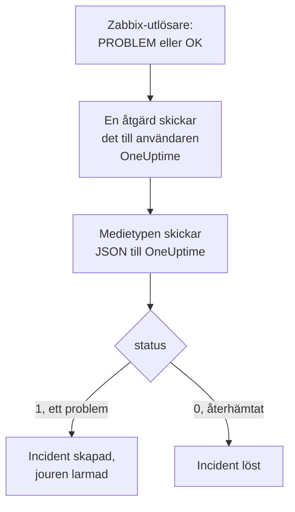

# Zabbix

Skicka [Zabbix](https://www.zabbix.com)-problem till OneUptime, så att varje problem blir en incident som larmar ditt jourteam och löses när Zabbix har återhämtat sig. Zabbix skickar varje problem via en webhook-medietyp, så det finns inget att installera på någon av sidorna.

:::cards
- [Välj hur OneUptime tar emot problem](#välj-hur-oneuptime-tar-emot-problem): En Incoming Request-monitor eller ett eget arbetsflöde.
- [Ta emot problem med en monitor](#ta-emot-problem-med-en-monitor): En incident per problem, löst vid återhämtning.
- [Konfigurera Zabbix](#konfigurera-zabbix): En medietyp, en användare och en åtgärd.
- [Felsökning](#felsökning): När problem inte kommer fram eller incidenter förblir öppna.
:::

## Så fungerar det



Zabbix skickar ett problem till en användare via användarens medier. Här är mediet en webhook-medietyp som heter **OneUptime**: dess skript skickar ett litet JSON-dokument till OneUptime med problemets händelse-ID, namn, värd, allvarlighetsgrad och status. Statusen är `1` för ett problem och `0` för återhämtningen från det.

## Innan du börjar

- En Zabbix-server som du administrerar. Den här guiden är skriven för Zabbix 6.0 LTS och 7.0 LTS. Webhook-medietyper fungerar på samma sätt från Zabbix 5.0.
- En Zabbix-server som kan nå din OneUptime via HTTPS.
- I OneUptime behörighet att skapa monitorer, eller arbetsflöden om du väljer den vägen.

## Välj hur OneUptime tar emot problem

Konfigurera OneUptime först: det ger dig URL:en som Zabbix skickar till.

| Sätt | Använd det när |
| --- | --- |
| En Incoming Request-monitor (rekommenderas) | Du vill att varje Zabbix-problem ska bli en incident som larmar jouren och löses när Zabbix har återhämtat sig. Det finns inget att bygga. |
| Ett arbetsflöde med en Webhook-utlösare | Du behöver egen logik: filtrera problem, ge dem en annan form eller anropa andra system först. Ett arbetsflöde löser inte incidenten av sig självt vid återhämtning. |

Båda får samma JSON från samma medietyp, så du kan börja med det ena och byta senare genom att ändra en enda URL i Zabbix.

## Ta emot problem med en monitor

En [Incoming Request-monitor](/docs/monitor/incoming-request-monitor) ger dig en URL, och dess kriterier avgör vad varje begäran gör.

:::steps
### Skapa monitorn

Gå till **Monitorer** och klicka på **Skapa monitor**. Välj **Incoming Request** under **Monitortyp**, ge den namnet `Zabbix` och klicka på **Nästa**.

### Deklarera en incident för varje problem

I steget **Kriterier** öppnar du det första kriteriet, det som markerar monitorn som offline. Ställ in filtret på **Begärandekropp**, **Innehåller**, `"status":"1"`. Det här kriteriet deklarerar redan en incident när filtret matchar. Fyll i incidenten:

- **Incidenttitel**: `Zabbix: {{requestBody.name}} on {{requestBody.host}}`.
- **Allvarlighetsgrad**: den incidentallvarlighetsgrad som Zabbix-problem ska ha.
- **Jourpolicyer**, under **Jour**: de policyer som ska larmas.
- **Lös incident automatiskt**, under **Fler fält**: låt den vara påslagen, som den är från början. Utan den ignoreras återhämtningar och incidenter förblir öppna.

### Skapa en incident per problem

Öppna **Inställningar** i samma kriterium och slå på **Group incidents and alerts by a payload field**. Fyll i det som nedan, så att varje problem får sin egen incident och återhämtningen från det löser den:

| Fält | Värde |
| --- | --- |
| **Open a separate incident for each…** | `requestBody.event_id` |
| **Field that signals recovery** | `requestBody.status` |
| **Value that means recovered** | `0` |

### Ta monitorn online igen

Öppna det andra kriteriet, det som markerar monitorn som online, och ställ in filtret på **Begärandekropp**, **Innehåller**, `"status":"0"`.

### Kopiera URL:en

Klicka på **Skapa monitor**. Monitorns sida **Översikt** visar dess **Heartbeat URL**. Kopiera den till Zabbix:

```text
https://oneuptime.com/heartbeat/<secret key>
```

En egenhostad installation har sin egen värd i stället för `oneuptime.com`.
:::

Monitorn läser begärans JSON precis som den är skriven: `"status":"1"`, utan blanksteg. Se [Ta emot larm från ett annat system](/docs/monitor/incoming-request-monitor#ta-emot-larm-från-ett-annat-system) för vad varje inställning gör.

## Ta emot problem med ett arbetsflöde

Använd ett [arbetsflöde](/docs/workflows/index) när du behöver egna steg mellan Zabbix och incidenten.

:::steps
### Skapa arbetsflödet

Gå till **Arbetsflöden**, klicka på **Skapa arbetsflöde** och sedan på **Börja från grunden**. Ge det namnet `Zabbix problems` och klicka på **Skapa arbetsflöde**.

### Lägg till Webhook-utlösaren

Klicka på det streckade blocket **Choose what starts this workflow** och välj **Webhook**. Klicka på utlösaren och sedan på **Kopiera URL**, och spara URL:en till Zabbix.

### Kontrollera att det är ett problem

Klicka på **Lägg till komponent**, lägg till ett **If / Else**-block och koppla utlösarens **Out**-punkt till det. Ställ in **Value to check** på `{{local.components.webhook-1.returnValues.request-body.status}}`, **Comparison** på **is equal to** och **Compare with** på `1`.

### Deklarera incidenten

Lägg till ett **Create One Incident**-block och koppla **Yes**-sidan av **If / Else**-blocket till det. Välj i **Incident Template** en mall som anger allvarlighetsgraden och de jourpolicyer som ska larmas (se [Incidentmallar](/docs/incidents/settings#incidentmallar)). Ange i **JSON Object** det som kommer från Zabbix:

```json
{
  "title": "Zabbix: {{local.components.webhook-1.returnValues.request-body.name}}",
  "description": "Host: {{local.components.webhook-1.returnValues.request-body.host}}\nSeverity: {{local.components.webhook-1.returnValues.request-body.severity}}\nZabbix event: {{local.components.webhook-1.returnValues.request-body.event_id}}"
}
```

Utan en mall behöver **JSON Object** också `incidentSeverityId`, ID:t för en av projektets allvarlighetsgrader för incidenter.

### Slå på det

Slå på **Aktiverad** högst upp i **Byggare**. Ett arbetsflöde som är avstängt svarar Zabbix med `400`.
:::

En återhämtning tar **No**-sidan av **If / Else**-blocket, där inget är kopplat, så körningen slutar där. Använd monitorn för att lösa incidenter vid återhämtning.

## Konfigurera Zabbix

Zabbix behöver tre saker: en medietyp som skickar till OneUptime, en användare att skicka den till och en åtgärd som skickar problem till den användaren.

:::steps
### Skapa medietypen OneUptime

1. Gå till **Alerts → Media types**, eller **Administration → Media types** i Zabbix 6.0, och klicka på **Create media type**.
2. Ställ in **Name** på `OneUptime` och **Type** på **Webhook**.
3. Lägg till dessa **Parameters**. Var och en för in ett Zabbix-[makro](https://www.zabbix.com/documentation/current/en/manual/appendix/macros/supported_by_location) i begäran:

   | Namn | Värde |
   | --- | --- |
   | `url` | `{ALERT.SENDTO}` |
   | `event_id` | `{EVENT.ID}` |
   | `event_name` | `{EVENT.NAME}` |
   | `event_value` | `{EVENT.VALUE}` |
   | `event_severity` | `{EVENT.SEVERITY}` |
   | `host` | `{HOST.NAME}` |
   | `event_date` | `{EVENT.DATE}` |
   | `event_time` | `{EVENT.TIME}` |

4. Klistra in detta i **Script**:

   ```javascript
   var params = JSON.parse(value);
   var request = new HttpRequest();
   request.addHeader("Content-Type: application/json");

   var payload = {
     source: "zabbix",
     event_id: params.event_id,
     name: params.event_name,
     host: params.host,
     severity: params.event_severity,
     // "1" for a problem, "0" for its recovery.
     status: params.event_value,
     date: params.event_date,
     time: params.event_time,
   };

   var response = request.post(params.url, JSON.stringify(payload));

   if (request.getStatus() < 200 || request.getStatus() >= 300) {
     throw (
       "OneUptime responded with HTTP " + request.getStatus() + ": " + response
     );
   }

   return "OK";
   ```

5. Lägg till en mall för **Problem** och en för **Problem recovery** på fliken **Message templates**. Lämna deras text tom: skriptet bygger begäran. Zabbix använder bara en medietyp för de händelsetyper den har en mall för.
6. Klicka på **Add**.

### Skapa en användare som tar emot problem

1. Gå till **Users → Users**, eller **Administration → Users** i Zabbix 6.0, och klicka på **Create user**. Ge användaren namnet `OneUptime` och ge den en användargrupp och en roll som kan ta emot aviseringar, t.ex. **User role**.
2. Klicka på **Add** på fliken **Media**. Ställ in **Type** på `OneUptime` och **Send to** på URL:en du kopierade från OneUptime. Låt **When active** och allvarlighetsgraderna vara som de är, eller avmarkera de allvarlighetsgrader som OneUptime inte ska få.
3. Klicka på **Add** och sedan på **Add** igen för att spara användaren.

### Skicka problem till OneUptime med en åtgärd

1. Gå till **Alerts → Actions → Trigger actions**, eller **Configuration → Actions** i Zabbix 6.0, och klicka på **Create action**. Ge den namnet `Notify OneUptime`.
2. Avgränsa den under **Conditions** om du vill, t.ex. med **Trigger severity is greater than or equals Warning**. Utan villkor skickas varje problem.
3. Lägg till en operation på fliken **Operations** som skickar till användaren `OneUptime` via medietypen `OneUptime`.
4. Lägg till samma operation under **Recovery operations**, så att återhämtningar också skickas.
5. Klicka på **Add** och kontrollera att åtgärden är aktiverad.
:::

## Testa det

1. Öppna **Alerts → Media types** i Zabbix och klicka på **Test** bredvid `OneUptime`. Fyll i URL:en du kopierade och exempelvärden som `event_id` `12345`, `event_name` `Test problem`, `host` `web-1` och `event_value` `1`. Klicka på **Test**: Zabbix visar skriptets svar, `OK`, eller felet det kastade.
2. Öppna monitorn i OneUptime och kontrollera att en incident skapades, eller öppna arbetsflödets **Loggar → Körningar** och kontrollera körningen.
3. Testa igen med `event_value` `0` och samma `event_id`. Med monitorn löses incidenten.

Låt sedan en riktig utlösare aktiveras, till exempel genom att sänka ett tröskelvärde en stund, och se problemet komma in.

## Koppla Zabbix allvarlighetsgrader

Zabbix skickar allvarlighetsgraden som text: `Not classified`, `Information`, `Warning`, `Average`, `High` eller `Disaster`.

- **Med monitorn** klickar du på **Lägg till kriterier** för varje grupp av allvarlighetsgrader och drar det nya kriteriet ovanför det första: kriterierna kontrolleras uppifrån, och det första som matchar avgör. Ge vart och ett två filter, `"status":"1"` och en allvarlighetsgrad som `"severity":"Disaster"`, med **Matchningsvillkor** inställt på **Alla**. Ge vart och ett en incident med egen **Allvarlighetsgrad** och **Lös incident automatiskt**, och samma grupperingsinställningar.
- **Med arbetsflödet** lägger du till ett [Switch / Case](/docs/workflows/components#switch-case)-block på `{{local.components.webhook-1.returnValues.request-body.severity}}`, med ett fall för varje allvarlighetsgrad, och ett **Create One Incident**-block med en egen mall efter varje fall.

## Felsökning

:::details Inget kommer fram till OneUptime
- Öppna **Reports → Action log** i Zabbix och kontrollera att åtgärden skickade problemet, och vad som kom tillbaka.
- Skicka en begäran själv från Zabbix-servern: `curl -i -X POST <url> -H 'Content-Type: application/json' -d '{"status":"1","event_id":"1","name":"Test","host":"test"}'`.
- Monitorn svarar `200` direkt, innan den kontrollerar något, även för en felaktig hemlig nyckel. Kontrollera monitorns tidslinje för att se om begärandena kommer fram.
- Ett arbetsflöde som är avstängt svarar `400`. Slå på **Aktiverad** högst upp i dess **Byggare**.
:::

:::details Zabbix rapporterar ett skriptfel
Öppna medietypen och använd **Test**: Zabbix visar skriptets resultat eller felet det kastade. Ett svar från OneUptime som inte är `2xx` kastas av skriptet tillsammans med statusen, så kontrollera URL:en först.
:::

:::details Incidenter skapas men löses aldrig
- Åtgärden behöver **Recovery operations**, annars skickar Zabbix aldrig återhämtningen.
- Kriteriets incident behöver **Lös incident automatiskt**, under **Fler fält**.
- **Field that signals recovery** måste vara `requestBody.status`, och **Value that means recovered** exakt `0`.
- Ett arbetsflöde löser inte incidenter vid återhämtning. Använd monitorn.
:::

:::details Incidenten visar en referens i stället för ett värde
En referens till ett fält som begäran inte har lämnas som den är skriven, klammerparenteser och allt, i stället för att tömmas. Kontrollera att Zabbix skickar `Content-Type: application/json` och att fältnamnen du använder (`name`, `host`, `severity`, `status`, `event_id`) matchar skriptets payload. För ett arbetsflöde öppnar du körningen i **Loggar → Körningar** och jämför med det utlösaren tog emot. Se [Fallgropar](/docs/workflows/variables#fallgropar).
:::

:::details Varje problem kommer två gånger
Åtgärden har förmodligen två operationer som skickar till samma användare, till exempel ett första steg och ett eskaleringssteg. Kontrollera åtgärdens **Operations**.
:::

## Säkerhet

- **Behandla URL:en som ett lösenord.** Alla som har den kan skapa incidenter. Om den läcker återställer du den: **Återställ hemlig nyckel för inkommande begäran** på monitorns sida **Inställningar**, eller **Återställ URL** i arbetsflödets **Webhook**-utlösare. Uppdatera sedan **Send to** i Zabbix-användarens medium.
- **Skicka bara det som behöver en incident.** Använd åtgärdens villkor, eller allvarlighetsgraderna i användarens medium, för att hålla problem med låg allvarlighetsgrad kvar i Zabbix.
- **Egenhostad?** Låt din Zabbix-server nå din OneUptime via HTTPS genom brandväggen.

## Nästa steg

:::cards
- [Övervakning av inkommande förfrågningar](/docs/monitor/incoming-request-monitor): Alla inställningar för monitorn som tar emot Zabbix-problem.
- [Eskaleringsregler](/docs/on-call/escalation-rules): Bestäm vem en jourpolicy larmar, och när.
- [Arbetsflödesutlösare](/docs/workflows/triggers#webhook): Så fungerar ett arbetsflödes webhook-URL.
- [Översikt över integrationer](/docs/integrations/index): De andra verktygen du kan ansluta.
:::
