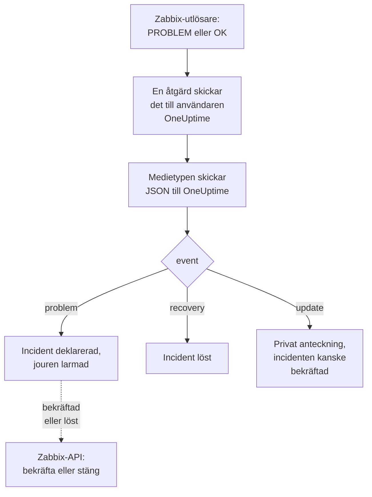

# Zabbix

Skicka [Zabbix](https://www.zabbix.com)-problem till OneUptime, så att varje problem blir en incident som larmar ditt jourteam och löses när Zabbix har återhämtat sig. Färdiga arbetsflödesmallar håller båda sidor i takt: det som görs i Zabbix noteras på incidenten, och att bekräfta eller lösa incidenten bekräftar eller stänger problemet i Zabbix. Zabbix skickar varje problem via en webhook-medietyp, så det finns inget att installera på någon av sidorna.

:::cards
- [Välj hur OneUptime tar emot problem](#välj-hur-oneuptime-tar-emot-problem): Arbetsflödesmallar eller en Incoming Request-monitor.
- [Börja från mallarna](#börja-från-mallarna): Sex mallar, vad de gör och vad de frågar efter.
- [Konfigurera Zabbix](#konfigurera-zabbix): En medietyp, en användare och en åtgärd.
- [Felsökning](#felsökning): När problem inte kommer fram eller incidenter förblir öppna.
:::

## Så fungerar det



Zabbix skickar ett problem till en användare via användarens medier. Här är mediet en webhook-medietyp som heter **OneUptime**: dess skript skickar ett litet JSON-dokument till OneUptime för varje problem, för återhämtningen från det och för varje uppdatering som någon gör av det i Zabbix, med problemets händelse-ID, namn, värd och allvarlighetsgrad. Det är med händelse-ID:t som OneUptime hittar incidenten som ett problem skapade.

## Innan du börjar

- En Zabbix-server som du administrerar. Den här guiden är skriven för Zabbix 6.0 LTS och 7.0 LTS. Webhook-medietyper fungerar på samma sätt från Zabbix 5.0. Mallarna som anropar Zabbix API behöver Zabbix 6.4 eller senare, eller [en ändring på Zabbix 6.0](#på-zabbix-60).
- En Zabbix-server som kan nå din OneUptime via HTTPS och, för mallarna som anropar Zabbix, en OneUptime som kan nå Zabbix.
- I OneUptime behörighet att skapa arbetsflöden, eller monitorer om du väljer den vägen. På OneUptime Cloud behöver arbetsflöden planen **Growth** eller högre.

## Välj hur OneUptime tar emot problem

Konfigurera OneUptime först: det ger dig URL:en som Zabbix skickar till.

| Sätt | Använd det när |
| --- | --- |
| Arbetsflödesmallarna (rekommenderas) | Du vill ha varje problem som en incident eller ett larm med dess Zabbix-allvarlighetsgrad, med jouren larmad för High och Disaster, löst vid återhämtning, med det som görs i Zabbix noterat på den, och Zabbix bekräftat eller stängt från OneUptime. |
| En Incoming Request-monitor | Du vill ha incidenter utan ett arbetsflöde, på vilken plan som helst, och en monitor vars status följer Zabbix. Inget går tillbaka till Zabbix. |

Båda får samma JSON från samma medietyp, så du kan börja med det ena och byta senare genom att ändra en enda URL i Zabbix.

## Börja från mallarna

Dialogen **Skapa ett arbetsflöde** har sex Zabbix-mallar, under **Zabbix** i kategorilistan: tre för incidenter, sedan samma tre för larm.

| Mall | Vad den gör | Vad den frågar efter |
| --- | --- | --- |
| **Incidenter** | | |
| Declare an incident for each Zabbix problem | Arbetsflödet som Zabbix skickar varje händelse till. Det deklarerar en incident för varje problem, larmar jouren för High och Disaster, noterar uppdateringar som gjorts i Zabbix och löser incidenten vid återhämtning. | Zabbix URL |
| Acknowledge or close the Zabbix problem with the incident | När incidenten bekräftas bekräftar den sitt problem. När den löses stänger den problemet, eller bekräftar det där Zabbix inte tillåter att det stängs manuellt. | Zabbix URL, Zabbix API Token |
| Copy incident private notes to the Zabbix problem | Lägger till varje privat anteckning på incidenten som ett meddelande på dess problem. | Zabbix URL, Zabbix API Token |
| **Larm** | | |
| Create an alert for each Zabbix problem | Samma som för incidenter, med ett larm för varje problem. | Zabbix URL |
| Acknowledge or close the Zabbix problem with the alert | Samma som för incidenter, utifrån larmets tillstånd. | Zabbix URL, Zabbix API Token |
| Copy alert private notes to the Zabbix problem | Lägger till varje privat anteckning på larmet som ett meddelande på dess problem. | Zabbix URL, Zabbix API Token |

Börja med **Declare an incident for each Zabbix problem**, eller **Create an alert for each Zabbix problem** för larm: incidenten eller larmet den skapar behåller problemets händelse-ID i sitt anpassade fält `zabbixEventId`, och de två andra mallarna hittar problemet med det.

### Vad mallarna frågar efter

- **Zabbix URL**: adressen du öppnar Zabbix på, till exempel `https://zabbix.example.com`, eller `https://example.com/zabbix` när Zabbix körs under en sökväg. Länkar till ett problem går dit, och mallarna som anropar Zabbix skickar sina begäranden till dess `api_jsonrpc.php`. Fältet avvisar adressen till en sida i Zabbix.
- **Zabbix API Token**: en API-token för Zabbix-användaren som arbetsflödet agerar som. [Skapa API-token](#skapa-api-token) visar hur. Den sparas som en hemlig variabel och skickas bara till Zabbix: i headern `Authorization`, eller i begärans brödtext på Zabbix 6.0.

### Ta emot problem med mallen

:::steps
1. Gå till **Arbetsflöden** och klicka på **Skapa arbetsflöde**. Under **Eller börja från en mall** väljer du **Zabbix** i kategorilistan, klickar på **Declare an incident for each Zabbix problem** och klickar på **Använd den här mallen**.
2. Fyll i **Zabbix URL**. Under **Who to page for High and Disaster problems** väljer du de jourpolicyer som ska larmas, eller ingen för att inte larma någon, och klickar på **Skapa arbetsflöde**. Arbetsflödet öppnas i **Byggare**, avstängt.
3. Klicka på utlösaren **Webhook**, sedan på **Kopiera URL**, och spara URL:en till Zabbix.
4. Slå på **Aktiverad** högst upp i **Byggare**. Ett arbetsflöde som är avstängt svarar Zabbix med `400`.
:::

Sedan [konfigurerar du Zabbix](#konfigurera-zabbix) att skicka sina problem till den URL:en.

### Vad arbetsflödet gör

Efter utlösaren **Webhook** läser steget **Check With JavaScript** `read-event-1` den `event` som medietypen skickar, och **Incident From Another Tool**, eller **Alert From Another Tool** i larmmallen, gör det den betyder, utifrån problemets händelse-ID:

| Händelse | Vad arbetsflödet gör |
| --- | --- |
| `problem` | Deklarerar en incident med titeln `Zabbix: <problem> on <host>`, med den allvarlighetsgrad som Zabbix-allvarlighetsgraden motsvarar, utanför dina statussidor. Beskrivningen länkar till problemet i Zabbix och visar värden, allvarlighetsgraden, när det började, dess driftdata och dess taggar. För ett problem med High eller Disaster larmar den jourpolicyn du valde. Ett problem som Zabbix skickar igen, med samma händelse-ID, skapar ingen andra incident. |
| `recovery` | Löser problemets incident, om den inte redan är löst. Varför står på dess tidslinje. |
| `update` | Lägger till det som gjordes i Zabbix som en privat anteckning på incidenten: vem som gjorde det, vad de gjorde och vad de skrev. När uppdateringen bekräftade problemet bekräftar den också incidenten, vilket stoppar jourens eskalering. |

Allt annat, till exempel en begäran från ett annat verktyg, lämnas orört: `read-event-1` tar **No**, och körningens **Steg** säger varför. Ett steg som misslyckas får körningen att misslyckas, och dess post under **Steg** säger varför.

### Allvarlighetsgrader

I ett nytt projekt kopplar mallen Zabbix sex allvarlighetsgrader till dessa allvarlighetsgrader för incidenter och larm:

| Zabbix-allvarlighetsgrad | Incident | Larm | Jour |
| --- | --- | --- | --- |
| Disaster | Critical Incident | High | Larmad |
| High | Critical Incident | High | Larmad |
| Average | Major Incident | Low | Inte larmad |
| Warning | Major Incident | Low | Inte larmad |
| Information | Minor Incident | Low | Inte larmad |
| Not classified | Minor Incident | Low | Inte larmad |

Med egna allvarlighetsgrader går Disaster och High till din allvarligaste, Average och Warning till den mittersta, och Information och Not classified till din minst allvarliga. Zabbix numrerar sina allvarlighetsgrader från 0 (Not classified) till 5 (Disaster), och mallen läser numret, så att byta namn på en allvarlighetsgrad i Zabbix ändrar ingenting.

- För att koppla en allvarlighetsgrad till en av dina efter namn, redigera `SEVERITY_BY_NAME` i steget `read-event-1`, till exempel `{ 2: 'Minor Incident' }` för Warning.
- För att larma även för Average-problem, ställ in **Compare with** i steget `if-page-1` **If / Else** på `3`.

### Skicka bekräftelser och anteckningar tillbaka till Zabbix

:::steps
1. [Skapa API-token](#skapa-api-token).
2. Skapa ett arbetsflöde från **Acknowledge or close the Zabbix problem with the incident**. Fyll i **Zabbix URL** och **Zabbix API Token**, klicka på **Skapa arbetsflöde** och slå på **Aktiverad**.
3. Om du även vill ha anteckningar i Zabbix gör du samma sak med **Copy incident private notes to the Zabbix problem**.
:::

Tillståndsmallen frågar först Zabbix om problemet, så ett problem som Zabbix redan har bekräftat eller löst lämnas som det är. För att stänga ett problem behöver dess utlösare **Allow manual close** i Zabbix. Utan det bekräftas problemet i stället, med ett meddelande om att incidenten löstes, och Zabbix stänger det när det har återhämtat sig. Incidenter som inget Zabbix-problem skapade, och incidenter markerade **Privat incident**, skickas aldrig till Zabbix.

### Skapa API-token

:::steps
1. Använd användaren `OneUptime` som [tar emot problemen](#skapa-en-användare-som-tar-emot-problem). Zabbix skickar inte en användare dess egna uppdateringar, så med den här användarens token kommer OneUptimes bekräftelser och meddelanden aldrig tillbaka till OneUptime som uppdateringar.
2. Kontrollera användarens roll i **Users → User roles**. Den behöver **Access to API** aktiverat, och **Acknowledge problems**, **Add problem comments** och **Close problems** tillåtna. **User role** tillåter dem om ingen har ändrat den.
3. Kontrollera användarens grupp i **Users → User groups**. Behörigheten **Read** på värdgrupperna räcker för att bekräfta problem och lägga till meddelanden. För att stänga problem behövs **Read-write**.
4. Gå till **Users → API tokens** och klicka på **Create API token**. Välj användaren `OneUptime`, avmarkera **Set expiration date and time** eller anteckna datumet, och klicka på **Add**.
5. Kopiera **Auth token**: Zabbix visar den bara en gång. Klistra in den i **Zabbix API Token**.
:::

### På Zabbix 6.0

Zabbix 6.0 läser API-token från begärans brödtext, inte från headern `Authorization`. I steget **Update Zabbix Problem** i varje mall som anropar Zabbix slår du på **Zabbix 6.0** under **Fler fält**. Zabbix 7.2 och senare avvisar en token i brödtexten, så stäng av det igen när du uppgraderar.

## Ta emot problem med en monitor

En [Incoming Request-monitor](/docs/monitor/incoming-request-monitor) ger dig en URL, och dess kriterier avgör vad varje begäran gör.

:::steps
### Skapa monitorn

Gå till **Monitorer** och klicka på **Skapa monitor**. Välj **Incoming Request** under **Monitortyp**, ge den namnet `Zabbix` och klicka på **Nästa**.

### Deklarera en incident för varje problem

I steget **Kriterier** öppnar du det första kriteriet, det som markerar monitorn som offline. Ställ in filtret på **Begärandekropp**, **Innehåller**, `"status":"1"`. Det här kriteriet deklarerar redan en incident när filtret matchar. Fyll i incidenten:

- **Incidenttitel**: `Zabbix: {{requestBody.name}} on {{requestBody.host}}`.
- **Allvarlighetsgrad**: den incidentallvarlighetsgrad som Zabbix-problem ska ha.
- **Jourpolicyer**, under **Jour**: de policyer som ska larmas.
- **Lös incident automatiskt**, under **Fler fält**: låt den vara påslagen, som den är från början. Utan den ignoreras återhämtningar och incidenter förblir öppna.

### Skapa en incident per problem

Öppna **Inställningar** i samma kriterium och slå på **Group incidents and alerts by a payload field**. Fyll i det som nedan, så att varje problem får sin egen incident och återhämtningen från det löser den:

| Fält | Värde |
| --- | --- |
| **Open a separate incident for each…** | `requestBody.event_id` |
| **Field that signals recovery** | `requestBody.status` |
| **Value that means recovered** | `0` |

### Ta monitorn online igen

Öppna det andra kriteriet, det som markerar monitorn som online, och ställ in filtret på **Begärandekropp**, **Innehåller**, `"status":"0"`.

### Kopiera URL:en

Klicka på **Skapa monitor**. Monitorns sida **Översikt** visar dess **Heartbeat URL**. Kopiera den till Zabbix:

```text
https://oneuptime.com/heartbeat/<secret key>
```

En egenhostad installation har sin egen värd i stället för `oneuptime.com`.
:::

Monitorn läser begärans JSON precis som den är skriven: `"status":"1"`, utan blanksteg. Se [Ta emot larm från ett annat system](/docs/monitor/incoming-request-monitor#ta-emot-larm-från-ett-annat-system) för vad varje inställning gör. En uppdatering som görs i Zabbix skickas också med `"status":"1"`, vilket monitorn läser som problemet igen, utan att skapa en andra incident.

## Konfigurera Zabbix

Zabbix behöver tre saker: en medietyp som skickar till OneUptime, en användare att skicka den till och en åtgärd som skickar problem till den användaren.

:::steps
### Skapa medietypen OneUptime

1. Gå till **Alerts → Media types**, eller **Administration → Media types** i Zabbix 6.0, och klicka på **Create media type**.
2. Ställ in **Name** på `OneUptime` och **Type** på **Webhook**.
3. Lägg till dessa **Parameters**. Var och en för in ett Zabbix-[makro](https://www.zabbix.com/documentation/current/en/manual/appendix/macros/supported_by_location) i begäran:

   | Namn | Värde |
   | --- | --- |
   | `url` | `{ALERT.SENDTO}` |
   | `event_id` | `{EVENT.ID}` |
   | `event_name` | `{EVENT.NAME}` |
   | `event_value` | `{EVENT.VALUE}` |
   | `event_severity` | `{EVENT.SEVERITY}` |
   | `event_nseverity` | `{EVENT.NSEVERITY}` |
   | `host` | `{HOST.NAME}` |
   | `event_date` | `{EVENT.DATE}` |
   | `event_time` | `{EVENT.TIME}` |
   | `event_opdata` | `{EVENT.OPDATA}` |
   | `event_tags` | `{EVENT.TAGSJSON}` |
   | `trigger_id` | `{TRIGGER.ID}` |
   | `event_update_status` | `{EVENT.UPDATE.STATUS}` |
   | `event_update_action` | `{EVENT.UPDATE.ACTION}` |
   | `event_update_message` | `{EVENT.UPDATE.MESSAGE}` |
   | `event_update_user` | `{USER.FULLNAME}` |

4. Klistra in detta i **Script**:

   ```javascript
   var params = JSON.parse(value);

   // Zabbix leaves a macro it has no value for as it is written, such as
   // {EVENT.UPDATE.MESSAGE} on a problem: it is sent as nothing.
   function given(text) {
     var written = String(text === undefined || text === null ? "" : text);
     return /^\{[A-Z0-9_.]+\}$/.test(written) || written === "*UNKNOWN*"
       ? ""
       : written;
   }

   var isUpdate = given(params.event_update_status) === "1";
   var payload = {
     source: "zabbix",
     // "problem", "recovery" or "update".
     event: isUpdate
       ? "update"
       : params.event_value === "0"
         ? "recovery"
         : "problem",
     event_id: params.event_id,
     name: params.event_name,
     host: params.host,
     severity: params.event_severity,
     // 0 Not classified, 1 Information, 2 Warning, 3 Average, 4 High, 5 Disaster.
     severity_number: params.event_nseverity,
     // "1" for a problem, "0" for its recovery.
     status: params.event_value,
     date: params.event_date,
     time: params.event_time,
     opdata: given(params.event_opdata),
     tags: [],
     trigger_id: params.trigger_id,
   };

   try {
     var tags = JSON.parse(given(params.event_tags) || "[]");
     payload.tags = Array.isArray(tags) ? tags : [];
   } catch (error) {
     payload.tags = [];
   }

   if (isUpdate) {
     payload.update = {
       action: given(params.event_update_action),
       message: given(params.event_update_message),
       user: given(params.event_update_user),
     };
   }

   var request = new HttpRequest();
   request.addHeader("Content-Type: application/json");

   var response = request.post(params.url, JSON.stringify(payload));

   if (request.getStatus() < 200 || request.getStatus() >= 300) {
     throw (
       "OneUptime responded with HTTP " + request.getStatus() + ": " + response
     );
   }

   return "OK";
   ```

5. Lägg till en mall för **Problem**, en för **Problem recovery** och en för **Problem update** på fliken **Message templates**. Lämna deras text tom: skriptet bygger begäran. Zabbix använder bara en medietyp för de händelsetyper den har en mall för.
6. Klicka på **Add**.

### Skapa en användare som tar emot problem

1. Gå till **Users → Users**, eller **Administration → Users** i Zabbix 6.0, och klicka på **Create user**. Ge användaren namnet `OneUptime` och ge den en användargrupp och en roll som kan ta emot aviseringar, t.ex. **User role**.
2. Klicka på **Add** på fliken **Media**. Ställ in **Type** på `OneUptime` och **Send to** på URL:en du kopierade från OneUptime. Låt **When active** och allvarlighetsgraderna vara som de är, eller avmarkera de allvarlighetsgrader som OneUptime inte ska få.
3. Klicka på **Add** och sedan på **Add** igen för att spara användaren.

### Skicka problem till OneUptime med en åtgärd

1. Gå till **Alerts → Actions → Trigger actions**, eller **Configuration → Actions** i Zabbix 6.0, och klicka på **Create action**. Ge den namnet `Notify OneUptime`.
2. Avgränsa den under **Conditions** om du vill, t.ex. med **Trigger severity is greater than or equals Warning**. Utan villkor skickas varje problem.
3. Lägg till en operation på fliken **Operations** som skickar till användaren `OneUptime` via medietypen `OneUptime`.
4. Lägg till samma operation under **Recovery operations**, så att återhämtningar också skickas, och under **Update operations**, så att bekräftelser och kommentarer som görs i Zabbix skickas.
5. Klicka på **Add** och kontrollera att åtgärden är aktiverad.
:::

För att skicka vissa problem till incidentmallen och andra till larmmallen ger du användaren `OneUptime` två medier av typen `OneUptime`: vart och ett skickar till ett arbetsflödes URL, med de allvarlighetsgrader det ska få.

## Testa det

1. Öppna **Alerts → Media types** i Zabbix och klicka på **Test** bredvid `OneUptime`. Fyll i URL:en du kopierade och exempelvärden som `event_id` `12345`, `event_name` `Test problem`, `host` `web-1`, `event_nseverity` `4` och `event_value` `1`. Klicka på **Test**: Zabbix visar skriptets svar, `OK`, eller felet det kastade.
2. Öppna arbetsflödets **Loggar → Körningar** i OneUptime och kontrollera körningen, eller öppna monitorn och kontrollera att en incident skapades.
3. Testa igen med `event_value` `0` och samma `event_id`. Incidenten löses.

Låt sedan en riktig utlösare aktiveras, till exempel genom att sänka ett tröskelvärde en stund, och se problemet komma in. För att prova en uppdatering bekräftar du problemet i Zabbix med ett meddelande: incidenten får en privat anteckning och bekräftas.

## Koppla Zabbix allvarlighetsgrader

Zabbix skickar allvarlighetsgraden som text: `Not classified`, `Information`, `Warning`, `Average`, `High` eller `Disaster`.

- **Med mallarna** kopplas allvarlighetsgraderna åt dig: se [Allvarlighetsgrader](#allvarlighetsgrader).
- **Med monitorn** klickar du på **Lägg till kriterier** för varje grupp av allvarlighetsgrader och drar det nya kriteriet ovanför det första: kriterierna kontrolleras uppifrån, och det första som matchar avgör. Ge vart och ett två filter, `"status":"1"` och en allvarlighetsgrad som `"severity":"Disaster"`, med **Matchningsvillkor** inställt på **Alla**. Ge vart och ett en incident med egen **Allvarlighetsgrad** och **Lös incident automatiskt**, och samma grupperingsinställningar.

## Felsökning

:::details Inget kommer fram till OneUptime
- Öppna **Reports → Action log** i Zabbix och kontrollera att åtgärden skickade problemet, och vad som kom tillbaka.
- Skicka en begäran själv från Zabbix-servern: `curl -i -X POST <url> -H 'Content-Type: application/json' -d '{"source":"zabbix","event":"problem","event_id":"1","name":"Test","host":"test","severity_number":"4","status":"1"}'`.
- Monitorn svarar `200` direkt, innan den kontrollerar något, även för en felaktig hemlig nyckel. Kontrollera monitorns tidslinje för att se om begärandena kommer fram.
- Ett arbetsflöde som är avstängt svarar `400`. Slå på **Aktiverad** högst upp i dess **Byggare**.
:::

:::details Zabbix rapporterar ett skriptfel
Öppna medietypen och använd **Test**: Zabbix visar skriptets resultat eller felet det kastade. Ett svar från OneUptime som inte är `2xx` kastas av skriptet tillsammans med statusen, så kontrollera URL:en först.
:::

:::details Incidenter skapas men löses aldrig
- Åtgärden behöver **Recovery operations**, annars skickar Zabbix aldrig återhämtningen.
- Med mallen öppnar du arbetsflödets **Loggar → Körningar** och återhämtningens körning: dess sista steg säger varför. En återhämtning för ett problem som inte skapade någon incident ändrar ingenting.
- Med monitorn behöver kriteriets incident **Lös incident automatiskt**, under **Fler fält**. **Field that signals recovery** måste vara `requestBody.status`, och **Value that means recovered** exakt `0`.
:::

:::details Zabbix-problemet bekräftas eller stängs inte
Öppna tillståndsmallens körning i **Loggar → Körningar**: dess sista steg säger vad Zabbix svarade.

- `Not authorized`: API-token är fel, har gått ut eller är inaktiverad, eller så är Zabbix äldre än 6.4 (se [På Zabbix 6.0](#på-zabbix-60)).
- `Cannot close problem: trigger does not allow manual closing`: slå på **Allow manual close** på utlösaren. Mallen bekräftar redan sådana problem i stället för att stänga dem.
- `No permissions to referred object or it does not exist!`: användaren ser problemet, men behöver behörigheten **Read-write** för att stänga det.
- `Zabbix has no problem with event ID`: användaren ser inte problemets värd. Ge dess användargrupp behörigheten **Read** på värdgruppen.
:::

:::details Incidenten visar en referens i stället för ett värde
En referens till ett fält som begäran inte har lämnas som den är skriven, klammerparenteser och allt, i stället för att tömmas. Kontrollera att Zabbix skickar `Content-Type: application/json` och att fältnamnen du använder (`name`, `host`, `severity`, `status`, `event_id`) matchar skriptets payload. För ett arbetsflöde öppnar du körningen i **Loggar → Körningar** och jämför med det utlösaren tog emot. Se [Fallgropar](/docs/workflows/variables#fallgropar).
:::

:::details Varje problem kommer två gånger
Åtgärden har förmodligen två operationer som skickar till samma användare, till exempel ett första steg och ett eskaleringssteg. Mallen skapar en incident per händelse-ID vad som än kommer, men varje leverans är en körning. Kontrollera åtgärdens **Operations**.
:::

## Säkerhet

- **Behandla URL:en som ett lösenord.** Alla som har den kan skapa incidenter. Om den läcker återställer du den: **Återställ URL** i arbetsflödets **Webhook**-utlösare, eller **Återställ hemlig nyckel för inkommande begäran** på monitorns sida **Inställningar**. Uppdatera sedan **Send to** i Zabbix-användarens medium.
- **Länkar går till ditt Zabbix.** Mallen länkar ett problem på den webbplats som dess **Zabbix URL** anger, vad en begäran än säger, och skriver det Zabbix skickade som text.
- **Begränsa API-token till det arbetsflödet gör.** Den är en hemlig variabel, maskerad i körningsloggar och skickad bara till Zabbix, i headern `Authorization` om inte **Zabbix 6.0** är påslaget. Ge dess användare en roll med inget mer än åtgärderna ovan, och ta bort token i **Users → API tokens** om den läcker.
- **Skicka bara det som behöver en incident.** Använd åtgärdens villkor, eller allvarlighetsgraderna i användarens medium, för att hålla problem med låg allvarlighetsgrad kvar i Zabbix.
- **Egenhostad?** Låt din Zabbix-server nå din OneUptime via HTTPS genom brandväggen. För att anropa ett Zabbix på ett privat nätverk behöver arbetsflödet [utgående nätverksåtkomst](/docs/workflows/configuration#utgående-nätverksåtkomst).

## Nästa steg

:::cards
- [Arbetsflödesmallar](/docs/workflows/authoring): Skapa ett arbetsflöde från en mall och ändra det i Byggare.
- [Övervakning av inkommande förfrågningar](/docs/monitor/incoming-request-monitor): Alla inställningar för monitorn som tar emot Zabbix-problem.
- [Eskaleringsregler](/docs/on-call/escalation-rules): Bestäm vem en jourpolicy larmar, och när.
- [Översikt över integrationer](/docs/integrations/index): De andra verktygen du kan ansluta.
:::
