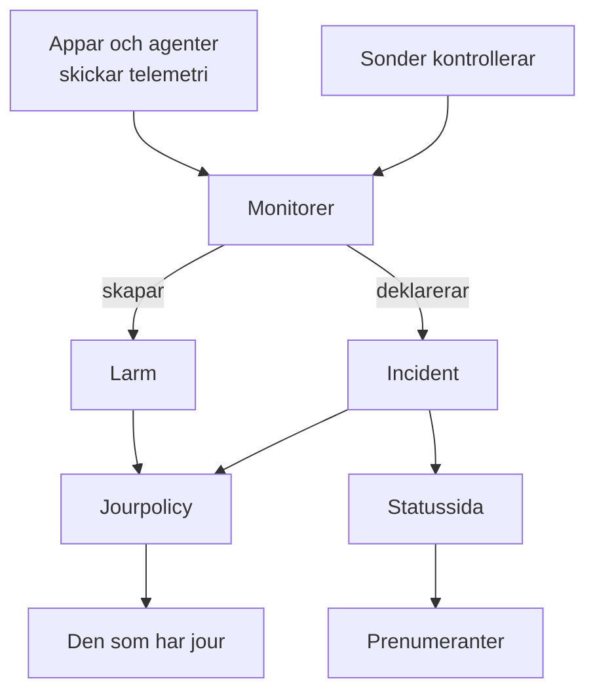
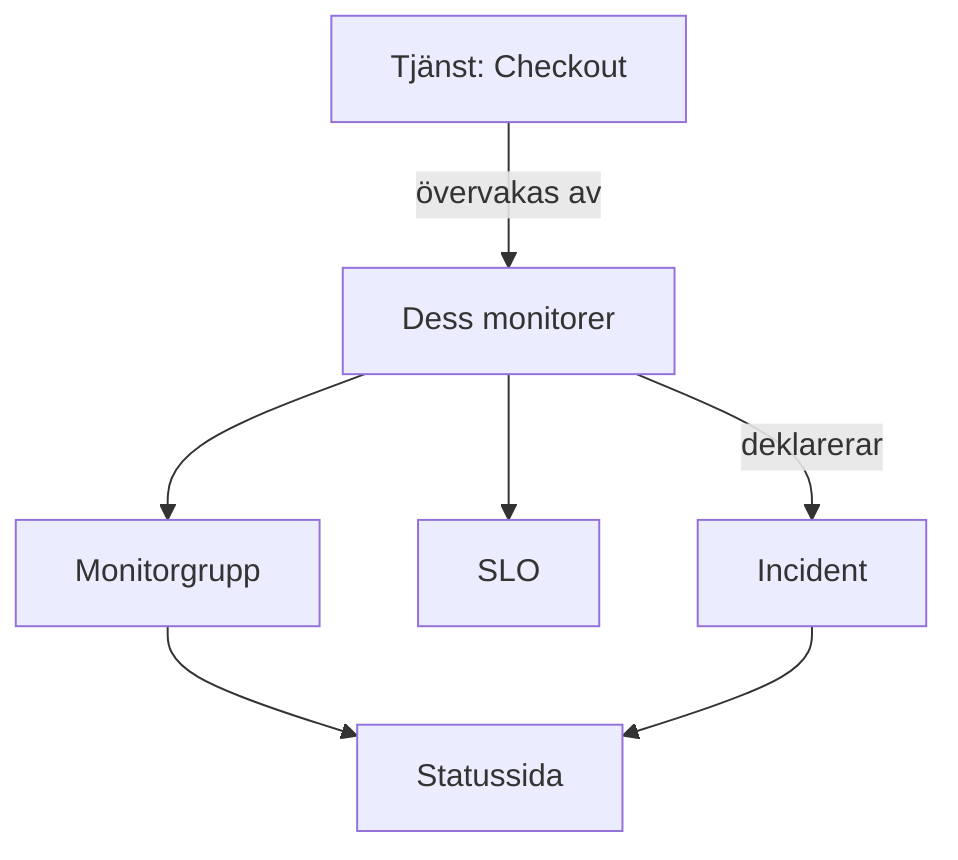

# Grundbegrepp

OneUptime har många produkter, men de vilar på en handfull idéer: projekt, monitorer, incidenter och larm, jour, statussidor och telemetri. Runt dem finns det du övervakar, det du installerar och reglerna som agerar åt dig. Den här sidan förklarar varje idé med några få meningar, visar hur de hänger ihop och länkar till sidorna som går igenom dem i detalj. Läs den en gång, så blir alla andra sidor i dokumentationen lättare att läsa. För ett ord i taget, se [Ordlista](/docs/introduction/glossary); för att välja mellan två saker som liknar varandra, se [Vilken ska jag använda?](/docs/introduction/which-one).

:::cards
- [Projekt och personer](#projekt-och-personer): Var allt finns, och vem som får göra vad.
- [Monitorer och sonder](#monitorer-och-sonder): Hur OneUptime märker att något är fel.
- [Incidenter och larm](#incidenter-och-larm): Posten som ditt team arbetar utifrån.
- [Jour](#jour): Vem som larmas, hur, och vem som står på tur.
:::

## Så hänger delarna ihop

Ett problem rör sig i en riktning genom OneUptime. Sonder och din egen telemetri matar monitorer. En monitors kriterier avgör när något är fel och vad som öppnas: en incident, ett larm eller båda. Jourpolicyer larmar personer om dem, och statussidor berättar för dina kunder om incidenter.

## Projekt och personer

Ett **projekt** rymmer allt: monitorer, incidenter, jourpolicyer, statussidor, telemetri och inställningar. De flesta företag behöver ett, och vissa har ett per miljö eller affärsområde. Inget som du skapar i ett projekt syns i ett annat.

Ditt **konto** är skilt från dina projekt. Ett konto, med en e-postadress och ett lösenord, kan tillhöra hur många projekt som helst; växla mellan dem med projektväljaren uppe till vänster. Se [Ditt konto](/docs/introduction/your-account).

Personer är med i ett projekt genom **team**, och ett teams behörigheter avgör vad dess medlemmar får göra. Varje nytt projekt börjar med tre team: Owners, med dig i, Admin och Members. På OneUptime Cloud har varje projekt sin egen plan.

:::cards
- [Användare, team och behörigheter](/docs/permissions/index): Bjud in personer och bestäm vad de får göra.
:::

## Monitorer och sonder

En **monitor** kontrollerar en sak som du kör och avgör om den fungerar. De flesta monitorer kontrolleras av **sonder**: maskiner som kör kontrollen enligt ett schema, till exempel genom att hämta en sida, anropa ett API, pinga en värd eller fråga en databas. OneUptime Cloud kör sonder i flera regioner, en självhostad installation kör sina egna, och du kan lägga till anpassade sonder i ditt nätverk. Andra monitorer läser i stället det du skickar: telemetrin från dina appar, eller data som en agent rapporterar från dina servrar, Kubernetes-kluster och övrig infrastruktur.

En monitors **kriterier** avgör vad varje resultat betyder. De kontrolleras i ordning, och det första som matchar kan ändra monitorns status, deklarera en incident, skapa ett larm eller alla tre. Varje nytt projekt har tre monitorstatusar: **Fungerar**, **Försämrad** och **Offline**.

:::cards
- [Skapa en monitor](/docs/monitor/create-monitor): Välj en typ, säg vad som ska kontrolleras och hur ofta.
- [Anpassade probes](/docs/probe/custom-probe): Kontrollera det som bara ditt eget nätverk når.
:::

## Det du övervakar

En monitor kontrollerar en sak. Runt dina monitorer håller OneUptime ett register över det du kör, och du möter de här posterna i menyn:

- En **monitorgrupp** slår ihop flera monitorer till en status, så att en statussida kan visa något som består av många delar, till exempel Checkout, som en rad.
- En **tjänst** är en applikation eller mikrotjänst som du kör. OneUptime lägger till den första gången dess telemetri kommer in, och samlar dess loggar, spår, mätvärden, undantag och incidenter på en sida.
- **Värdar**, kluster i **Kubernetes** och resten av **Infrastruktur** är maskinerna och plattformarna som du kör, ifyllda av agenterna som du installerar.
- **Inventarie** är en lista över allt detta: tjänster, värdar, kluster, enheter, molnresurser och de saker som inte skickar någon telemetri alls.

De möts där ett problem syns. En tjänsts monitorer kan slås ihop till en monitorgrupp, ett SLO mäter dem, och när en av dem fallerar deklarerar den en incident. Incidenten listar tjänsten bland resurserna som den påverkar, och statussidan visar gruppen och incidenten.

:::cards
- [Monitorgrupper](/docs/monitor/monitor-groups): Slå ihop flera monitorer till en status.
- [Tjänster](/docs/telemetry/services): Varje applikation som du kör, på en sida var.
- [Inventarie – Översikt](/docs/inventory/overview): Allt som OneUptime vet om din miljö.
:::

## Tillförlitlighetsmål

Ett **SLO** (service level objective) är ett tillförlitlighetsmål för det du övervakar, till exempel tillgängligt 99,9 % av tiden under 30 dagar. OneUptime mäter det utifrån dess monitorer var 5:e minut. Den nedtid som målet tillåter är dess felbudget: med gott om marginal kvar kan du ta risker, och med lite kvar saktar du ner och satsar på stabilitet.

:::cards
- [SLO:er – Översikt](/docs/slo/introduction): Sätt ett mål, och se hur mycket av budgeten som finns kvar.
:::

## Incidenter och larm

Båda registrerar ett problem, och båda kan larma den som har jour. Skillnaden är vem problemet drabbar.

| | Incident | Larm |
| --- | --- | --- |
| **Vad det är** | Ett problem som drabbar dina användare, till exempel ett avbrott eller en fördröjning | Ett problem som ditt team bör titta på innan användarna drabbas |
| **På statussidor** | Kan visas, och meddelar prenumeranter | Aldrig |
| **Startstatusar** | **Identifierad**, **Bekräftad**, **Löst** | **Identifierad**, **Bekräftad**, **Löst** |
| **Startallvarlighetsgrader** | Critical Incident, Major Incident, Minor Incident | **Hög**, **Låg** |

Att bekräfta en säger att någon tar hand om den, och hindrar dess jourpolicyer från att larma nästa nivå. Att lösa den stänger den. Du kan lägga till egna statusar och allvarlighetsgrader, och koppla larm till incidenten som de visade sig höra till.

En **episod** samlar relaterade incidenter, eller relaterade larm, så att ditt team hanterar dem som en. Grupperingsregler avgör vad som hör ihop.

:::cards
- [Incidenter – Översikt](/docs/incidents/index): Hur incidenter deklareras, hanteras och löses.
- [Larm – Översikt](/docs/alerts/index): Var larm kommer ifrån, och hur episoder grupperar dem.
- [Länkade larm](/docs/incidents/linked-alerts): Koppla larmen som ett avbrott utlöste till dess incident.
:::

## Jour

En **jourpolicy** avgör vem som larmas om en incident eller ett larm, och vem som står på tur om ingen svarar. Dess **eskaleringsregler** är dess nivåer: varje nivå larmar sina personer och väntar sedan på att någon bekräftar innan nästa nivå larmas. En nivå kan larma personer, team eller ett **jourschema**, en rotation som hela tiden vet vem som har jour.

Hur varje person nås bestämmer de själva. I **Användarinställningar** sparar var och en sätten som OneUptime kan nå dem på, till exempel e-post, SMS, samtal, pushaviseringar, Slack eller Microsoft Teams, och vilka som används när de larmas.

:::cards
- [Jour – Översikt](/docs/on-call/index): Hur ett larm når fram och var varje del finns.
- [Eskaleringsregler](/docs/on-call/escalation-rules): Larma personer nivå för nivå tills någon svarar.
- [Jourscheman](/docs/on-call/schedules): Rotationer, lager och överlämningar.
- [Så når OneUptime dig](/docs/notifications/index): Metoderna, reglerna och inställningarna som avgör hur varje person nås.
:::

## Statussidor och underhåll

En **statussida** visar dina kunder om dina tjänster fungerar. Du väljer vilka monitorer den visar, under namn som dina kunder förstår. Medan en incident på någon av de monitorerna är aktiv visar sidan den, och dess **prenumeranter** får besked via e-post, SMS, Slack, Microsoft Teams eller webhook. En statussida kan vara offentlig, eller privat för dem du släpper in.

**Schemalagt underhåll** meddelar planerat arbete i förväg. En händelse går igenom **Schemalagd**, **Pågående**, **Avslutad** och **Slutförd**, och statussidorna som du visar den på berättar om den för besökare och prenumeranter.

:::cards
- [Statussidor – Översikt](/docs/status-pages/index): Skapa en statussida och bestäm vad den visar.
- [Prenumeranter och meddelanden](/docs/status-pages/subscribers): Vem som får besked, och när.
- [Schemalagt underhåll – Översikt](/docs/scheduled-maintenance/index): Hur en händelse förlöper, och vad den pausar.
:::

## Telemetri

**Telemetri** är det som dina system skickar till OneUptime: loggar, mätvärden, spår, undantag och profiler. Appar skickar den med OpenTelemetry, och OneUptimes agenter skickar den från värdar, Kubernetes-kluster, Docker-värdar och övrig infrastruktur. Varje avsändare använder en **intagningsnyckel**, som skapas under **Projektinställningar → Telemetri och APM → Intagningsnycklar**. Du söker i telemetrin, visar den på instrumentpaneler och håller koll på den med telemetrimonitorer, som öppnar incidenter och larm precis som alla andra monitorer. I menyn öppnar **Loggar**, **Mätvärden**, **Spår**, **Profiler** och **Undantag** var sin sort; **AI / LLM** följer din AI:s konversationer, **Dataobserverbarhet** håller koll på tabellerna i dina databaser, och **Topologi** kartlägger hur allt hänger ihop.

:::cards
- [OpenTelemetry](/docs/telemetry/open-telemetry): Skicka loggar, mätvärden och spår från dina appar.
- [Loggövervakning](/docs/monitor/logs-monitor): Få veta när ett mönster dyker upp i dina loggar.
:::

## Säkerhet

**Säkerhetshändelser** samlar säkerhetshändelserna från dina loggar, dina säkerhetsverktyg och allt annat som du skickar. Dess detektionsregler gör om det de hittar till säkerhetsärenden, som ditt team hanterar i en kö och som playbooks svarar på. **Datasäkerhet** hittar de känsliga data som finns i dina buckets, databaser och din telemetri, och vad som är fel med hur de förvaras.

:::cards
- [Kom igång med säkerhet](/docs/telemetry/security-getting-started): Hitta hot i de data som du redan har.
- [Översikt över Datasäkerhet](/docs/data-security/index): Hitta dina känsliga data, och rätta till hur de förvaras.
:::

## Det du installerar, och nycklarna

Det mesta i OneUptime kräver inget installerat. Du installerar något bara för att nå det som OneUptime inte kan se utifrån, och varje del ansluter utåt till OneUptime med en nyckel:

- En anpassad sond kör monitorernas kontroller i ditt nätverk, med sitt eget sond-ID och sin egen nyckel.
- **OpenTelemetry Collector**, Kubernetes-agenten och Docker-agenten skickar telemetri med en **intagningsnyckel**. Infrastrukturagenten bakom en Server / VM-monitor skickar med den monitorns hemliga nyckel.
- En **Runner** kör runbook-steg i din infrastruktur, med sitt eget Runner-ID och sin egen nyckel.

En intagningsnyckel skickar bara in telemetri. En **API-nyckel** är den andra sorten: den låter ett skript, CLI:t, Terraform eller en AI-assistent läsa och ändra ditt projekt, med de behörigheter som du ger den. Ingen av dem fungerar i den andras ställe.

:::cards
- [Vilken ska jag använda?](/docs/introduction/which-one#sond-agent-collector-eller-runner): Vad du ska installera, och nyckeln som var och en tar.
- [Intagningsnycklar](/docs/telemetry/ingestion-keys): Skapa, avgränsa och rotera nycklarna som skickar telemetri.
:::

## Automatisering och AI

- **Arbetsflöden** utför åtgärder när något händer, till exempel ett meddelande i Slack när en incident deklareras.
- **Runbooks** gör om en insatsrutin till steg som ditt team kan köra manuellt eller automatiskt.
- **OneUptime AI** undersöker nya incidenter och larm och lägger ut vad den hittade på deras tidslinje, och **Fråga AI** svarar på frågor om ditt projekt. Ett nytt projekt börjar med AI påslaget; reglaget **Aktivera AI** under **Projektinställningar → AI → AI-funktioner** stänger av allt.

:::cards
- [Översikt över arbetsflöden](/docs/workflows/index): Automatisera åtgärder med utlösare och komponenter.
- [AI SRE](/docs/ai/ai-sre): Hur OneUptime AI undersöker incidenter och larm.
:::

## Etiketter och ägare

**Etiketter** är märken som du sätter på monitorer, incidenter, statussidor och de flesta andra resurser, för att filtrera och gruppera dem. Ett teams behörigheter kan begränsas till resurser med vissa etiketter. **Ägare** är de personer och team som ansvarar för en resurs: de får besked när något händer med den. Etikettregler och ägarregler lägger till etiketter och ägare på nya resurser åt dig.

:::cards
- [Etikett- och ägarregler](/docs/configuration/label-and-owner-rules): Ge nya resurser etiketter och ägare automatiskt.
:::

## Olika slags regler

Många saker i OneUptime kallas regel. Var och en fattar ett beslut åt dig när något nytt kommer in, och de finns i några familjer. De flesta av dem finns under **Regler** i sidomenyerna för **Incidenter** och **Larm**.

| Vad den avgör | Regler |
| --- | --- |
| Vem som larmas | **Jourregler** väljer vilka jourpolicyer en ny incident eller ett nytt larm kör, och en policys **Eskaleringsregler** larmar nivå för nivå |
| Vem som äger den, och hur den märks | **Ägarregler**, **Etikettregler** och **Sekretessregler** |
| Vad som hör ihop | **Grupperingsregler** öppnar episoder och lägger till i dem |
| Vad som körs på den | **Runbook-regler** startar runbooks, och **AI-regler** avgör vad OneUptime AI undersöker och åtgärdar |
| När det ska följas upp | **SLA-regler** följer svars- och lösningstider, och **Påminnelseregler** påminner ägarna medan den är öppen |

En monitors egna regler är dess kriterier. Jourreglerna under **Användarinställningar** är något helt annat: de är varje persons egna och avgör hur ett larm når den personen.

:::cards
- [Incidentinställningar och automatisering](/docs/incidents/settings#regler-som-körs-när-en-incident-skapas): Reglerna som körs när en incident skapas, i ordning.
- [Så når man mig](/docs/notifications/on-call-rules): Hur ett larm når dig.
:::

## Nästa steg

:::cards
- [Snabbstart](/docs/introduction/quickstart): Använd idéerna i praktiken på femton minuter.
- [Ordlista](/docs/introduction/glossary): Varje ord som OneUptime använder, med en eller två meningar.
- [Vilken ska jag använda?](/docs/introduction/which-one): Incident eller larm, arbetsflöde eller runbook, och de andra sakerna som liknar varandra.
- [Incidenter – Översikt](/docs/incidents/index): Vad som händer när en monitor har deklarerat en incident.
:::
