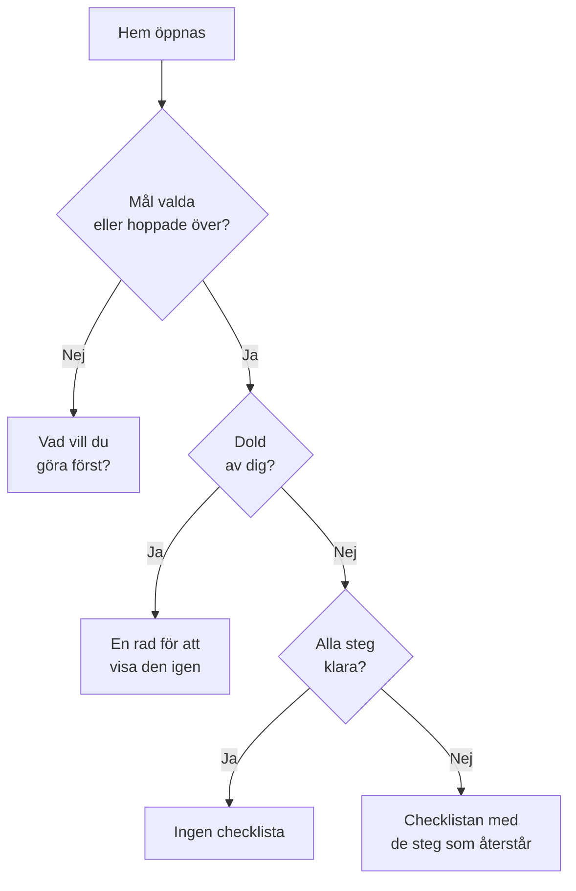

# Startsida och kortkommandon

Hem är den första sidan du ser i ett projekt. Den visar med en blick om något behöver dig just nu, och leder ett nytt projekt genom den första konfigurationen. Den här sidan förklarar vad Hem visar, hur du hittar vilken produkt, sida eller åtgärd som helst i instrumentpanelen, och kortkommandona som sparar dig turer genom menyerna.

:::cards
- [Vad Hem visar](#vad-hem-visar): Om något är fel, vad som behöver dig, vad projektet innehåller och varje produkt.
- [Hitta rätt](#hitta-rätt): Menyn Produkter och fälten högst upp på varje sida.
- [Sök](#sök-efter-en-sida-en-inställning-eller-en-åtgärd): Hitta vilken sida, inställning eller åtgärd som helst genom att skriva namnet.
- [Kortkommandon](#kortkommandon): Gå till Hem, Övervakare eller Incidenter med två tangenter.
:::

## Vad Hem visar

Öppna **Hem** i fältet högst upp, eller tryck `g` och sedan `h` var du än är. Hem är översikten över ditt projekt, en enda sida utan sidomeny. Uppifrån och ned visar den:

1. En sökruta, med **Deklarera incident** och **Skapa** bredvid.
2. En rad som säger om något är fel, ovanför fem siffror som räknar det som behöver uppmärksamhet.
3. **Välkommen till OneUptime 👋**, en checklista för ett nytt projekt, tills den är klar.
4. **Kräver uppmärksamhet**, varje problem som är öppet just nu, med namn.
5. **Ditt projekt**, vad projektet består av, och **Kommande underhåll** när något underhåll är schemalagt.
6. **Utforska OneUptime**, varje produkt, en kategori i taget.

### Sök och skapa

Sökrutan öppnar sökningen, precis som `Mod` + `K`: skriv namnet på vilken sida, monitor, incident, larm, statussida eller jourpolicy som helst. Se [Sök](#sök-efter-en-sida-en-inställning-eller-en-åtgärd). **Deklarera incident** öppnar formuläret där du deklarerar en incident. **Skapa** erbjuder **Skapa monitor**, **Schemalägg underhåll** och **Skapa meddelande**. Var och en visas bara för den som får använda den.

### Rubriken

Raden högst upp nämner det mest brådskande som är öppet, i en färg som passar:

| När | Hem visar |
| --- | --- |
| En incident är öppen | Hur många incidenter som är aktiva, i rött |
| Ingen incident är öppen, men det finns öppna larm, monitorer som inte fungerar eller SLO:er i riskzonen | Hur många problem som kräver uppmärksamhet, i orange |
| Inget är fel och ett underhåll pågår | Hur många underhållshändelser som pågår |
| Monitorer körs och inget är öppet | **Alla system fungerar** |
| Projektet har inga monitorer ännu | **Inget övervakas ännu** |

Bredvid den visar Hem när projektet senast lästes in, och **Uppdatera** läser in det igen. När du kommer tillbaka till en flik med Hem efter en minut eller mer uppdateras den av sig själv.

Så länge inget övervakas ännu slutar raden med knappen **Skapa din första övervakare**, som öppnar den guidade installationen **Veta när min webbplats eller mitt API ligger nere**. Bara den som får skapa monitorer ser den.

### De fem siffrorna

Varje siffra räknar något, säger om det behöver dig och öppnar listan bakom den, i den produkt som listan hör till.

| Siffra | Vad den räknar | När siffran är noll | Öppnar |
| --- | --- | --- | --- |
| **Aktiva incidenter** | Incidenter som inte är lösta | **Allt är i sin ordning** | **Incidenter → Aktiva incidenter** |
| **Aktiva larm** | Larm som inte är lösta | **Allt är i sin ordning** | **Larm → Aktiva larm** |
| **Icke-operativa monitorer** | Monitorer vars status inte är en fungerande status. Arkiverade monitorer, och monitorer med avstängd övervakning, räknas inte. | **Alla fungerar** | **Monitorer → Ej operativ** |
| **Pågående underhåll** | Underhållshändelser som pågår | **Inget pågår** | **Schemalagt underhåll → Pågående underhållshändelser** |
| **SLO:er i riskzonen** | Påslagna SLO:er som är i riskzonen eller har förbrukat sin felbudget | **Budgetarna är friska** | **SLOs** |

En siffra över noll visar **Kräver uppmärksamhet**, eller **Pågår** och **Budgeten förbrukas** för underhåll och SLO:er. Så länge en SLO är i riskzonen öppnar **SLO:er i riskzonen** listan **SLOs**, filtrerad på just dem. Ett projekt utan monitorer ser **Inga monitorer ännu**, och ett utan SLO:er ser **Inga SLO:er ännu**: ett tomt projekt är inte detsamma som ett friskt. De två siffrorna öppnar då listorna **Monitorer** och **SLOs**, där du skapar en.

### Välkomstchecklistan

Första gången en projektägare eller projektadministratör öppnar Hem i ett nytt projekt frågar kortet **Vad vill du göra först?** Kryssa i ett eller flera mål, till exempel **Veta när min webbplats eller mitt API ligger nere** eller **Jag tittar bara runt**, och klicka på **Fortsätt**: checklistan innehåller då de steg som målen behöver. **Hoppa över** ger de fyra steg som alla projekt får. För att svara igen senare klickar du på **Ändra** i checklistan. Ett projekt som redan använder övervakare, telemetri eller jour får inte frågan.

Varje steg bockar av sig självt när saken fungerar, inte när en post finns, och alla som konfigurerar projektet ser samma lista, på alla enheter:

| Steg | Klart när | Öppnar |
| --- | --- | --- |
| **Importera från ditt nuvarande verktyg** | En import från ett annat verktyg är slutförd. | **Importera från ett annat verktyg** |
| **Skapa din första övervakare** | Den första kontrollen kommer in. | Den guidade installationen **Veta när min webbplats eller mitt API ligger nere**, eller listan **Monitorer** för den som inte får skapa övervakare. |
| **Anslut en server eller ett kluster** | De första mätvärdena kommer in. | **Värdar** |
| **Skicka dina första loggar, mätvärden eller spår** | Projektets första loggar, mätvärden, spår, undantag eller profiler kommer in. | Den guidade installationen **Skicka loggar, mätvärden och spår och få sedan larm** |
| **Konfigurera en jourpolicy** | Ett testlarm kvitteras, ett larm når någon, eller en jourregel kör en policy som kan nå någon. | Den guidade installationen **Larma rätt person när något går sönder** |
| **Publicera en statussida** | En statussida visar en övervakare. | Den guidade installationen **Publicera en statussida**, eller listan **Statussidor** för den som inte får skapa statussidor. |
| **Bjud in ditt team** | Någon accepterar din inbjudan. | **Användare** |

Steget du ska ta först är markerat med **Nästa steg**. På OneUptime Clouds Free-plan, som har en person, säger **Bjud in ditt team** att den behöver Growth-planen, och öppnar **Fakturering**. På en egen server som ännu inte kan skicka e-post ser serverns administratörer först **Den här servern kan inte skicka e-post än**; den öppnar administratörsdashboarden.

En guidad installation gör hela jobbet på en sida, ett steg i taget, och slutar med vad den har konfigurerat och vad du gör härnäst. Sök på dess namn för att öppna den igen senare.

Under stegen visar **Så fungerar OneUptime** de fyra kärnprodukterna i den ordning ett problem går igenom dem: **Monitorer**, **Incidenter och larm**, **Jour** och **Statussidor**. Klicka på en för att öppna den. Under dem står vad som matar kretsloppet, telemetri och infrastruktur, med länkar till [Grundbegrepp](/docs/introduction/core-concepts) och [Ordlista](/docs/introduction/glossary).

Checklistan försvinner för alla när varje steg är klart. För att dölja den tidigare klickar du på **Dölj**: den döljs då bara för dig, på alla enheter, och en rad blir kvar med **Visa den** och **Så fungerar OneUptime**. Den som har bjudits in till projektet som medlem ser inte checklistan. **Så fungerar OneUptime** finns kvar ett klick bort, i alla projekt: öppna det från **Hjälp** eller med knappen bredvid **Utforska OneUptime**.

### Kräver uppmärksamhet

**Kräver uppmärksamhet** listar med namn det som siffrorna räknar: de öppna incidenterna, de öppna larmen, monitorerna som inte fungerar, SLO:erna i riskzonen och underhållet som pågår, det mest brådskande först. Varje rad visar sin allvarlighetsgrad eller status, säger när en incident eller larm började och när ett underhåll slutar, och öppnar posten. Varje typ visar upp till fem, med **Visa alla** för resten, som öppnar samma lista som dess siffra. När inget är öppet står det **Inget kräver din uppmärksamhet**.

### Inställningarnas hälsa

När något i projektets inställningar skulle hindra att folk får veta, slutar **Kräver uppmärksamhet** med **Inställning**: hur många saker som behöver en titt. Den öppnar **Inställningarnas hälsa**, som listar vad som är felinställt, det allvarligaste först, under **Larm kommer inte fram**, **Värt att åtgärda** och **Förslag**: en monitor som inte larmar någon, en jourpolicy som ingenting kör, en person som inte kan larmas, sms avstängt, ett jourschema utan någon i jour, en statussida som inte visar någon monitor. Varje fynd säger i en mening vad som är fel, med knappen som öppnar åtgärden, och en monitors fynd är de avbrott som dess kort **När den går ner** nämner. Ett fynd som ert team medvetet låter vara kan döljas med en motivering, för alla, och återställas från **Avfärdad**. Sök hittar sidan som **Inställningarnas hälsa**, och Fråga AI svarar på ”är mina inställningar okej?” utifrån den.

### Ditt projekt

**Ditt projekt** räknar projektets **Monitorer**, **Statussidor**, **Jourpolicyer**, **SLOs**, **Tjänster**, **Instrumentpaneler** och **Arbetsflöden**; arkiverade räknas inte. Varje rad öppnar sin lista. En typ som projektet saknar visar **Konfigurera** i stället för en siffra.

**Kommande underhåll** listar de tre nästa schemalagda underhållsfönstren, det närmaste först. Avsnittet visas inte när inget är schemalagt.

### Utforska OneUptime

**Utforska OneUptime** visar produkterna i menyn **Produkter**, en kategori i taget, med början i det grundläggande. Varje produkt säger vad den är till för, och öppnas när du klickar på den. Produkterna som ditt projekt döljer är inte med.

## Hitta rätt

Allt i OneUptime finns under **Produkter** i toppfältet. Menyn visar sina grupper som raderna i en enda lista och öppnas alltid med den första av dem, det grundläggande, utfälld: Övervakare, Incidenter, Larm, Jour, Statussidor, Schemalagt underhåll och SLOs. Varje annan grupp (Observerbarhet, Säkerhet, AI, Kod, Resurser, Infrastruktur, Moln, Instrumentpaneler och automatisering och Inställningar) är hopfälld till en rad i samma lista. Varje rad nämner gruppens produkter och säger hur många de är. Klicka på en rad för att fälla ut eller fälla ihop den, eller gå till den med piltangenterna och tryck på **Enter**.

- **Sökningen hittar allt.** Skriv i menyns sökruta för att hitta vilken produkt som helst efter namn, efter vad den gör eller efter ett välbekant ord som `k8s` eller `RUM`. Sökningen letar också i de hopfällda grupperna.
- **Du börjar där du är.** Gruppen för sidan du är på fälls ut av sig själv, och produkterna du nyligen har öppnat står överst.
- **Dina val ligger kvar.** Menyn kommer ihåg i din webbläsare vilka av de andra grupperna du har fällt ut eller ihop. Det grundläggande är utfällt igen varje gång du öppnar menyn, även om du fällde ihop det.
- **På en telefon** visar menyknappen produkterna på samma sätt: det grundläggande utfällt överst och varje annan grupp som en rad som öppnas med ett tryck.
- **Produkter som projektet inte använder.** En projektägare eller -administratör kan dölja dem under **Projektinställningar → Grundläggande → Produkter**. En dold produkt flyttas till **Fler produkter**, menyns sista rad: Sök hittar den fortfarande, dess sidor fungerar och dess data fortsätter att komma in. När en av dem börjar ta emot data säger Hem det till dem som kan visa den igen.
- **Fäst.** Behåll en produkt i det övre fältet, bredvid **Hem** och **Produkter**: tryck på nålen på dess kort i menyn, eller på **Fäst** bredvid dess sidrubrik. Du kan fästa fem, och de följer med dig till alla webbläsare. På en telefon kommer dina fästa produkter först i menyn.
- **Vad som används.** I varje grupp utom det grundläggande och inställningarna kommer produkterna som ditt projekt använder först, och en som du inte har konfigurerat ännu säger **Inte konfigurerad**. I OneUptime Cloud nämner en produkt som din plan inte omfattar den plan som omfattar den.

### Fälten högst upp

Två fält löper över toppen av varje sida.

| Var | Vad som finns där |
| --- | --- |
| Uppe till vänster | Projektväljaren: växla till ett annat av dina projekt, eller skapa ett nytt. |
| Uppe till höger | **Sök** och **Fråga AI**, aviseringsklockan med det som behöver dig nu (aktiva incidenter och larm, jourpolicyerna du har jour i, väntande inbjudningar), **Hjälp**, och din bild, som öppnar menyn för ditt [konto](/docs/introduction/your-account). |
| Under dem | **Hem** och **Produkter** till vänster, **Användarinställningar** till höger: hur OneUptime når dig i det här projektet. |

**Hjälp** börjar med det som hjälper dig att lära dig: **Snabbstart**, **Så fungerar OneUptime**, **Ordlista** och den här dokumentationen (**Dokumentation**). Under dem finns listan **Kortkommandon** och support via e-post och på Slack. På en surfplatta eller i ett smalt fönster utelämnas **Fråga AI** för att spara plats: den finns bland åtgärderna i **Sök**. På en telefon flyttar **Sök** och **Hjälp** in i menyknappens lista, högst upp och längst ned; klockan och din bild finns kvar.

Ett ord med en prickad linje under, som **Sonder** i formuläret för en ny monitor, berättar vad det betyder när du pekar på det, tabbar till det eller trycker på det. Dess **Läs mer** öppnar ordet i [Ordlista](/docs/introduction/glossary).

### Sidor och listor

Ovanför varje sidas rubrik visar ett spår som *Projekt › Docker › Inställningar › Ägarregler* var sidan ligger. Varje steg före det sista öppnar sin sida.

- **Listor håller sig själva aktuella.** När en incident eller ett larm skapas, kvitteras eller löses någonstans visar listorna över incidenter, larm och episoder det inom några sekunder, utan omladdning. Medan du är mitt i något på en lista, till exempel med rader markerade eller en dialogruta öppen, väntar den och kommer i kapp när du är klar.
- **På en telefon fälls filterchippen ihop** bakom **Filter**, så att listan börjar högre upp. Chippen du har satt syns fortfarande, med **Rensa alla**. Tryck på **Filter** för att se alla chipp, och igen för att fälla ihop dem.
- **Kolumner**, i menyn **⋯** på en lista, väljer vilka kolumner listan visar och i vilken ordning, och sparar dem åt dig i den här webbläsaren. En projektägare eller en projektadministratör kan också kryssa i **Visa de här kolumnerna för alla i det här projektet** där: alla som inte har valt egna kolumner för listan ser de här, och **Återställ till projektets standard** sätter tillbaka dina egna till dem.
- **Kompakta rader**, i samma meny, gör raderna i alla listor lägre, så att en lång lista visar ungefär en femtedel fler av dem. Valet sparas i den här webbläsaren.
- **På en telefon, eller i ett kort som är för smalt för sina rader, visas en lista som kort, ett per rad.** Bandet ovanför säger vilken ordning de står i, till exempel **Sorterat efter Namn**: tryck på det för att välja kolumnen det sorteras efter, och **Stigande** eller **Fallande**.
- **En incidents sidor börjar med dess nummer.** Rubriken, dess steg i spåret och webbläsarfliken visar `INC-42 Checkout is down`, och det gör även dialogrutorna som nämner den, så att incidenter med samma titel går att skilja åt. Larm, underhållshändelser och episoder gör likadant.

## Sök efter en sida, en inställning eller en åtgärd

Tryck på **Cmd+K** (Mac) eller **Ctrl+K** (Windows och Linux), eller klicka på sökikonen i toppfältet, och börja skriva. Sökningen hittar:

- **Varje sida i menyerna**, under namnet som menyn ger den: API-nycklar, Farozon, Jourscheman, Incidentallvar, dina egna Aviseringsmetoder. Varje resultat säger var det finns, till exempel *Projektinställningar › Avancerad*, så att sidor med samma namn (Anpassade fält under Incidenter, Larm och Monitorer) är lätta att skilja åt.
- **Inställningarna på en sida**, under namnet som deras kort eller reglage visar: *Kräv SSO för inloggning* hittar SSO, och *Anpassade SMTP-konfigurationer* hittar Aviseringskanaler. Skriv namnet på engelska eller på ditt eget språk.
- **Åtgärder**, efter vad du vill göra: Deklarera incident, Skapa monitor eller Delete Project, som öppnar Farozon. En åtgärd som ändrar något erbjuds bara den som får utföra den.
- **Dina monitorer, incidenter, larm, statussidor och jourpolicyer**, efter namn, och incidenter och larm även efter nummer, som `INC-42`. Varje resultat för en incident eller ett larm börjar med dess nummer, så att två med samma titel går att skilja åt.
- **Dokumentationen**, i en grupp *Dokumentation* under allt annat: de sidor och avsnitt vars ord stämmer med det du skriver, på ditt språk, även med ett stavfel. Var och en öppnas i en ny flik, så att du behåller din plats.

Sökningen läser det du skriver som du menar det:

- Versaler, accenter, mellanslag och bindestreck spelar ingen roll: *on-call*, *on call* och *oncall* hittar samma sidor, och orden kan stå i valfri ordning.
- Den känner till andra ord för många sidor, på engelska: *pager* eller *escalation* för Jourpolicyer, *rota* för Jourscheman, *2fa* för tvåfaktorsautentisering, *delete project* för Farozon.
- Lägg till produktens namn för att smalna av en sökning: *incident custom fields* hittar sidan Anpassade fält under Incidenter.
- Ett litet stavfel, som *incidnet*, hittar ändå det du menade när inget matchar exakt.

Med en tom sökruta visar sökningen sidorna du nyligen har öppnat, åtgärderna och produkterna.

## Kortkommandon

Tryck på `?` var som helst i instrumentpanelen för att se alla kortkommandon, eller öppna **Hjälp** och välj **Kortkommandon**. På en Mac är `Mod` Command-tangenten; på Windows och Linux är det Ctrl.

| Tangenter | Vad de gör |
| --- | --- |
| `Mod` + `K` | Öppna kommandopaletten: sök efter vilken sida, inställning eller åtgärd som helst. |
| `Mod` + `I` | Fråga AI om det du tittar på. |
| `/` | Sök i listan på den här sidan. |
| `?` | Visa kortkommandona. |
| `Esc` | Stäng en dialogruta eller en panel. |

### Gå till en produkt

Tryck på `g` och sedan en bokstav för att gå direkt till en produkt. Tryck på bokstaven inom en och en halv sekund efter `g`.

| Tangenter | Går till |
| --- | --- |
| `g` sedan `h` | Hem |
| `g` sedan `m` | Övervakare |
| `g` sedan `i` | Incidenter |
| `g` sedan `a` | Larm |
| `g` sedan `o` | Jour |
| `g` sedan `s` | Statussidor |
| `g` sedan `e` | Schemalagt underhåll |
| `g` sedan `d` | Instrumentpaneler |
| `g` sedan `l` | Loggar |
| `g` sedan `t` | Spår |

Kortkommandona står inte i vägen. `?`, `/` och `g` gör ingenting medan du skriver i ett fält, och inget navigerar bort medan en dialogruta är öppen, så en felaktig tangent kan inte kosta dig ett halvifyllt formulär. Alla andra produkter är en sökning bort med `Mod` + `K`.

## Nästa steg

:::cards
- [Snabbstart](/docs/introduction/quickstart): Gå igenom välkomstchecklistan, steg för steg.
- [Ditt konto](/docs/introduction/your-account): Din profil, säkerheten för din inloggning, språk och tema.
- [Fråga AI](/docs/ai/ask-ai): Vad Ask AI kan svara på och göra åt dig.
- [Grundbegrepp](/docs/introduction/core-concepts): Vad monitorer, incidenter, larm och jour är.
:::
