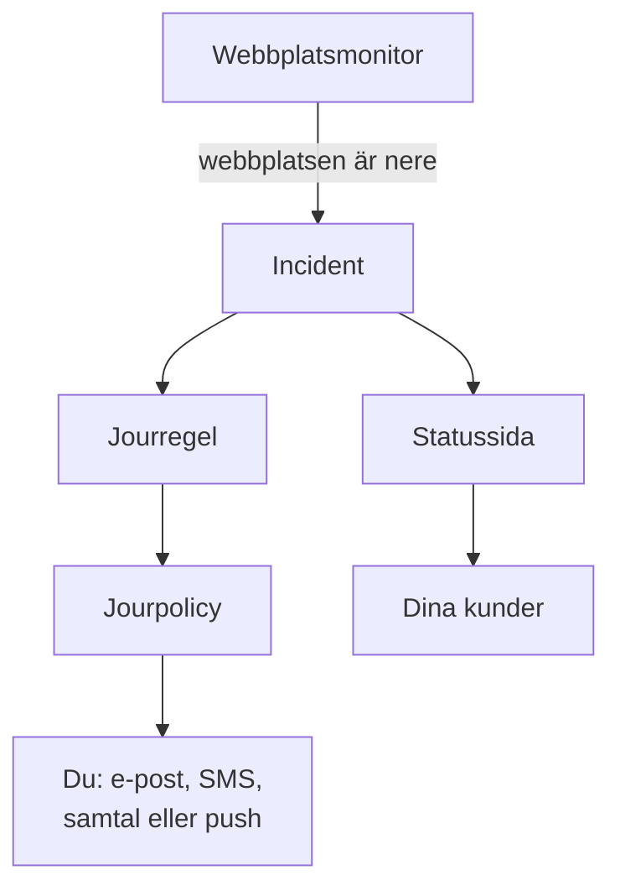

# Snabbstart

Den här guiden tar dig från ett nytt konto till en fungerande konfiguration på ungefär femton minuter: en monitor som kontrollerar din webbplats var femte minut, en jourpolicy som larmar dig när webbplatsen går ner och en statussida som informerar dina kunder. Den följer checklistan **Välkommen till OneUptime 👋** på projektets startsida, och de guidade installationer som dess steg öppnar.

Kommer du från ett annat verktyg? [Importera därifrån](/docs/introduction/getting-started#om-du-kommer-från-ett-annat-verktyg) först: dina monitorer, jourscheman och statussidor följer med.

## Innan du börjar

- **Ett konto.** På OneUptime Cloud registrerar du dig på [oneuptime.com](https://oneuptime.com/accounts/register) och öppnar länken i e-postmeddelandet du får. På din egen installation öppnar du den i webbläsaren och registrerar dig: det första kontot blir huvudadministratör. Se [Docker Compose](/docs/installation/docker-compose) för att installera en.
- **En webbplats att hålla koll på.** Vilken adress som helst som svarar över HTTP eller HTTPS, till exempel ditt företags startsida.

## Skapa ett projekt

I OneUptime ligger allt i ett projekt: dina monitorer, incidenter, jourpolicyer, statussidor och personerna som arbetar med dem.

:::steps
### Börja ett nytt projekt

Första gången du loggar in visar OneUptime **Inga projekt**. Klicka på **Skapa nytt projekt**. Om någon redan har bjudit in dig till ett projekt accepterar du i stället inbjudan på samma sida.

### Ge det ett namn

Ange ett **Projektnamn**, till exempel ditt företags namn. På OneUptime Cloud väljer du också en plan precis nedanför: Free är redan valt, och de betalda planerna börjar med en gratis provperiod.

### Skapa det

Klicka på **Skapa projekt**. Projektets startsida öppnas, med checklistan **Välkommen till OneUptime 👋** överst. Först frågar den **Vad vill du göra först?**: kryssa i **Veta när min webbplats eller mitt API ligger nere**, **Larma rätt person när något går sönder** och **Berätta för mina kunder med en statussida**, och klicka på **Fortsätt**.
:::

## Övervaka din webbplats

:::steps
### Öppna installationen för webbplatsen

Klicka på **Skapa din första övervakare** i checklistan. Den öppnar den guidade installationen **Veta när min webbplats eller mitt API ligger nere**, som kontrollerar din webbplats, väljer vem som får veta och skickar ett test, på en sida. Den som inte får skapa monitorer får i stället listan **Monitorer**.

### Ange adressen

Under **Vad ska vi kontrollera?** skriver du in hela adressen till din webbplats i **Adress till webbplats eller API**, till exempel `https://example.com`, och klickar på **Börja kontrollera**. Sonderna kontrollerar den direkt och sedan var 5:e minut: när webbplatsen inte svarar, eller svarar med ett fel, går monitorn till **Offline** och deklarerar en incident. Klicka på **Fortsätt**.

På Free-planen i OneUptime Cloud faktureras monitorer efter användning, så projektet behöver en betalningsmetod innan det kan kontrollera din webbplats: utan en ber steget dig att [lägga till en betalningsmetod](/docs/configuration/billing#betalningsmetoder).

### Välj vem som får veta

Under **Vem ska få veta?** står du redan i **Vem som larmas**. Klicka på **Spara och fortsätt**: det skapar `Default on-call policy`, som larmar dig vid varje ny incident och varje nytt larm i projektet, till att börja med via e-post. För att också larma teammedlemmar som redan finns i projektet klickar du först på **Lägg till teammedlemmar**.

### Skicka ett test till dig själv

Under **Skicka ett test** klickar du på **Skicka ett testlarm till mig**, väljer en **Allvarlighetsgrad** och klickar på **Skicka testlarm**. Öppna länken i e-postmeddelandet, där det står TEST, och bekräfta larmet där. Klicka sedan på **Klar** i dialogrutan, och på **Fortsätt**: installationen slutar med en sammanfattning av vad den har konfigurerat.
:::

För att ställa in varje alternativ själv, eller för att kontrollera något annat än en webbplats, öppnar du **Monitorer** från menyn **Produkter** och klickar på **Skapa monitor**. [Skapa en monitor](/docs/monitor/create-monitor) beskriver formuläret och varje monitortyp.

För att också kontrollera ett API, och se vad du gör när den första kontrollen aldrig kommer tillbaka, följer du [Få veta när din webbplats eller ditt API går ner](/docs/guides/website-down).

## Bli larmad när den går ner

Installationen för webbplatsen har redan skapat `Default on-call policy`, som larmar dig via e-post vid varje ny incident och varje nytt larm, så checklistan bockar av **Konfigurera en jourpolicy** som klar. Dess guidade installation lägger ändå till din telefon, de personer som larmas med dig och vad som händer när ingen svarar.

:::steps
### Öppna jourinstallationen

Tryck på `Ctrl+K` (`Cmd+K` på en Mac), skriv `get paged` och välj **Larma rätt person när något går sönder**. Så länge checklistan inte har bockat av **Konfigurera en jourpolicy** öppnar det steget samma guidade installation.

### Välj hur du nås

Under **Hur ska vi nå dig?** finns e-postadressen du loggar in med redan med. För pushaviseringar installerar du appen OneUptime On-Call från App Store eller Google Play, loggar in och klickar på **Kontrollera igen**. För att också få sms och samtal klickar du på **Slå på sms och samtal**, skriver ditt nummer i **Ditt telefonnummer** och klickar på **Skicka en kod till mig via sms**: på OneUptime Cloud betalas sms och samtal från projektets saldo, så steget ber dig fylla på saldot först. Klicka på **Fortsätt**.

### Välj vem mer som larmas

Under **Vem mer har jour?** behåller du `Default on-call policy` under **Jourpolicy**. För att larma teammedlemmar med dig lägger du till dem under **Lägg till i den första eskaleringsregeln**. Klicka på **Spara och fortsätt**.

### Bestäm vad som händer om ingen svarar

Under **Tänk om ingen svarar?** väljer du **Larma samma personer igen** så länge du är den enda personen i projektet. När teammedlemmar har tillkommit larmar **Larma någon annan** den person du väljer under **Larmas sedan**. I OneUptime Cloud erbjuder bara de betalda planerna det valet. Klicka på **Spara och fortsätt**.

### Skicka ett testlarm

Under **Skicka ett testlarm** klickar du på **Testa den här policyn**, väljer en **Allvarlighetsgrad** och klickar på **Skicka testlarm**. Bekräfta larmet från e-postmeddelandet, sms:et eller samtalet, och klicka sedan på **Klar** i dialogrutan, och på **Fortsätt**. Installationen slutar på **Larmningen är konfigurerad**.
:::

> [!NOTE]
> SMS och telefonsamtal är avstängda i ett nytt projekt. En projektägare, en Billing Admin eller någon med Manage Billing slår på dem i kortet **Aviseringskanaler** under **Projektinställningar → Aviseringar → Aviseringskanaler**.

Två jourregler utlöser policyn: en vid varje ny incident och en vid varje nytt larm. För att se den första öppnar du **Incidenter** från menyn **Produkter**, fäller ut **Regler** i sidomenyn och väljer **Jourregler**: den matchar **Alla incidenter**. För att utlösa policyn bara vid vissa incidenter, till exempel kritiska, redigerar du regeln där, eller klickar på **Skapa Incident On-Call Rule** för att lägga till en egen.

För att i stället bygga en policy fält för fält öppnar du **Jour** från menyn **Produkter** och klickar på **Skapa Jourpolicy**. Se [Eskaleringsregler](/docs/on-call/escalation-rules) och [Jourscheman](/docs/on-call/schedules) för fler nivåer, rotationer och hur länge varje nivå väntar.

För varje skärm i installationen, och vad du gör när ett larm inte kommer fram, följer du [Bli larmad via samtal, SMS eller push](/docs/guides/paging).

## Publicera en statussida

:::steps
### Öppna installationen för statussidan

Klicka på **Publicera en statussida** i checklistan. Den öppnar den guidade installationen **Publicera en statussida**, som ger sidan ett namn, lägger din monitor på den och visar vad dina kunder ser. Den som inte får skapa statussidor får i stället listan **Statussidor**. Sammanfattningen i installationen för webbplatsen öppnar samma installation, som **Visa den på en statussida**.

### Ge den ett namn och välj din monitor

Under **Ge den ett namn och välj vad den visar** behåller du det **Statussidans namn** som föreslås, eller skriver ett eget. Under **Vad den visar** bockar du för din webbplatsmonitor och klickar på **Skapa statussidan**. Från och med nu är sidan offentlig på sin länk: alla som har adressen kan öppna den.

### Öppna sidan

Under **Det här ser dina kunder** öppnar du adressen under **Offentlig länk**: din webbplats visas som i drift. Tillbaka i installationen klickar du på **Ser bra ut**. Installationen slutar med en sammanfattning av vad du kan göra härnäst.
:::

För att i stället skapa en sida för hand öppnar du **Statussidor** från menyn **Produkter** och klickar på **Skapa statussida**, och lägger sedan till din monitor med **Lägg till monitorer** på dess **Översikt**. Se [Statussidans varumärke och domäner](/docs/status-pages/branding-and-domains) för att ge sidan din egen logotyp och dina egna färger.

För att lägga statussidan på din egen domän, över HTTPS, följer du [Publicera en statussida](/docs/guides/status-page).

## Bjud in ditt team

Klicka på **Bjud in ditt team** i checklistan, eller öppna **Användare** från menyn **Produkter**, under **Inställningar**. Klicka på **Bjud in användare**, ange personens **E-post** och välj ett **Team**: medlemsteamet är valt från början. Klicka på **Bjud in**. OneUptime skickar inbjudan med e-post, och teamet avgör vad personen får göra. Se [Användare, team och behörigheter](/docs/permissions/index).

## Prova det

Deklarera en testincident för att se hela kedjan fungera.

:::steps
### Deklarera en testincident

Öppna **Incidenter** och klicka på **Deklarera incident**. Ange en **Titel**, till exempel `Test incident`, välj ett **Incidentallvar** och klicka på **Nästa**. Under **Monitorer** väljer du din webbplatsmonitor, så att incidenten visas på din statussida. Klicka på **Nästa** tills du når sammanfattningen och sedan på **Deklarera incident**.

### Se vad som händer

Inom någon minut larmar din jourpolicy dig, och incidenten visas på din statussida.

### Lös den

Klicka på **Lös** på incidentens sida. Larmen slutar, och incidenten försvinner från din statussida.
:::

> [!WARNING]
> Alla som öppnar din statussida ser testincidenten tills du löser den. Kör testet innan du delar sidans adress.

## Felsökning

:::details Jag blev inte larmad
Öppna incidenten och välj **Jourexekveringar** i dess sidomeny: där ser du om din policy kördes och vem den larmade. Kördes den inte, kontrollera att din jourregel är aktiverad och anger policyn. Kördes den, kontrollera att dina metoder under **Användarinställningar → Aviseringsmetoder** är verifierade.
:::

:::details Incidenten visas inte på min statussida
En statussida visar en incident när en av incidentens monitorer finns på sidan. Kontrollera att incidenten har din monitor bland sina berörda resurser, och att monitorn finns på statussidan.
:::

:::details Monitorn säger offline, men min webbplats fungerar
Öppna monitorn och se vad sonderna tog emot. Se felsökningsavsnittet i [Webbplatsövervakning](/docs/monitor/website-monitor).
:::

## Nästa steg

:::cards
- [Grundbegrepp](/docs/introduction/core-concepts): Idéerna bakom det du just har konfigurerat.
- [Ordlista](/docs/introduction/glossary): Varje ord som du stötte på längs vägen, med en eller två meningar.
- [Jourscheman](/docs/on-call/schedules): Dela jouren med ditt team.
- [Statussidans varumärke och domäner](/docs/status-pages/branding-and-domains): Gör statussidan till din egen.
- [OpenTelemetry](/docs/telemetry/open-telemetry): Skicka loggar, mätvärden och spår från dina appar.
:::
