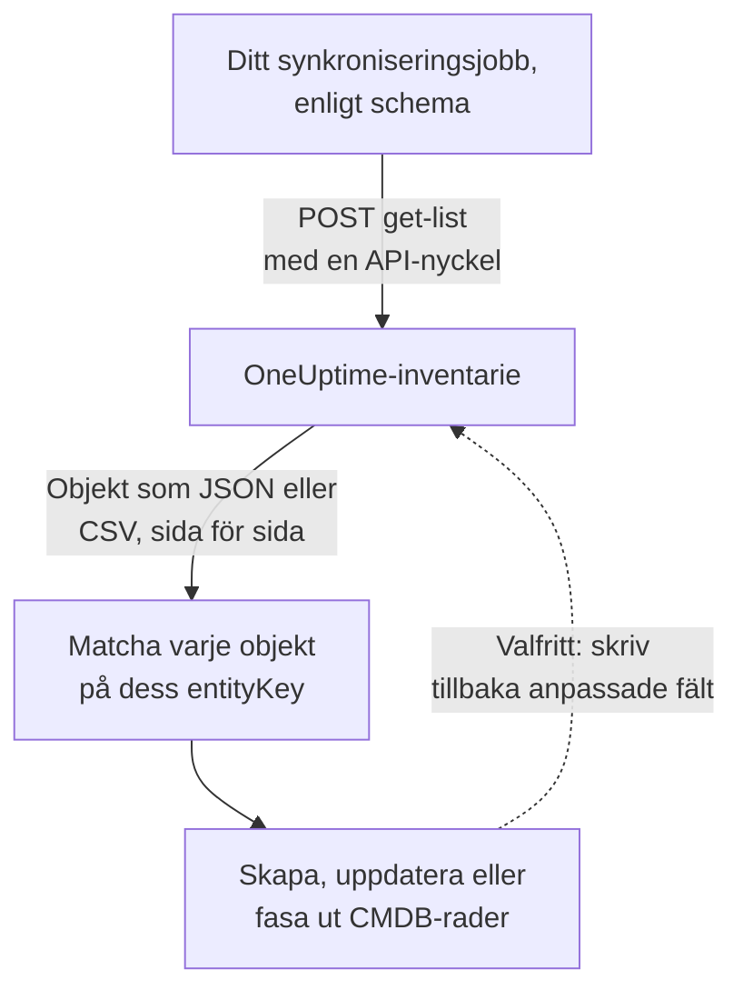

# Exportera till en CMDB

Om du redan har en CMDB eller ett tillgångsregister försöker OneUptime inte ersätta det. Det OneUptime har, och som en CMDB oftast saknar, är en bild av vad som faktiskt körs, hållen aktuell utan att någon underhåller den: upptäckt från telemetri och från de pollare som redan bevakar ditt nätverk och dina molnkonton. Den här sidan är receptet för att hämta in den bilden i ditt eget styrande system.

:::cards
- [Så fungerar en synkronisering](#så-fungerar-en-synkronisering): Ett schemalagt jobb som läser listan och matchar på en stabil nyckel.
- [Hämta katalogen](#hämta-katalogen): Begäran, sida för sida, som JSON eller CSV.
- [Tillgångsdetaljer](#tillgångsdetaljer): Samma uppgifter och nycklar för värdar och nätverksenheter.
- [Skriv tillbaka](#skriv-tillbaka): Skicka in dina tillgångsetiketter i OneUptime, och lägg till det det inte kan se.
:::

## Så fungerar en synkronisering

En synkronisering är ett jobb som du kör enligt ett schema. Det läser inventarielistan via REST-API:t med en API-nyckel, matchar varje objekt mot en rad i din CMDB via dess identitetsnyckel och skapar, uppdaterar eller fasar ut rader så att de stämmer. Det kan också skriva tillbaka värden i objektens anpassade fält.



## Vad du kan hämta

Tre REST-resurser, var och en med standardslutpunkterna i [OneUptimes API](/docs/api-reference/api-reference):

| Resurs | Slutpunkt | Vad den innehåller |
| --- | --- | --- |
| Inventarieobjekt | `/api/inventory-item` | En rad per sak i miljön |
| Definitioner av anpassade fält | `/api/inventory-item-custom-field` | Ditt projekts eget fältordförråd |
| Relationer | `/api/inventory-item-relationship` | De riktade kopplingarna mellan objekt |

De användbara kolumnerna i ett inventarieobjekt:

| Kolumn | Betydelse |
| --- | --- |
| `_id` | OneUptimes ID: använd det som din externa referens |
| `entityType` | `host`, `k8s.pod`, `network.device`, `appliance`, … |
| `entityKey` | En stabil identitetshash. Den överlever namnbyten och är därför den bättre nyckeln att matcha på |
| `displayName` | Namnet som människor läser |
| `source` | `discovered`, `inventory` eller `manual` |
| `description` | Fritext |
| `identifyingAttributes` | De attribut som gör objektet till det det är, och som aldrig ändras |
| `descriptiveAttributes` | Allt annat som har observerats på det: se [Tillgångsdetaljer](#tillgångsdetaljer), [Tillgångsattribut för värdar](#tillgångsattribut-för-värdar) och [Tillgångsattribut för nätverksenheter](#tillgångsattribut-för-nätverksenheter) nedan |
| `customFields` | Dina egna fält, efter fältnamn |
| `resourceType` / `resourceId` | En pekare till den rikare OneUptime-posten, när det finns en |
| `firstSeenAt` / `lastSeenAt` | När det observerades första och senaste gången |
| `isArchived` | Om det har tagits ur den aktiva listan |

## Innan du börjar

En synkronisering behöver en API-nyckel som får läsa inventariet. I OneUptime Cloud kräver API-nycklar planen **Growth** eller högre.

:::steps
### Skapa en API-nyckel

Öppna **Projektinställningar → Avancerad → API-nycklar** och klicka på **Skapa API-nyckel**. Ge den ett **Namn** och välj under **Åtkomst** **Tittare** för att läsa allt i projektet, eller **Välj behörigheter senare** för att bara ge den det en synkronisering behöver.

### Ge den bara det den behöver

En skrivskyddad export behöver en enda behörighet, **Read Telemetry Service**: inventariet delar telemetribehörigheterna i stället för att ha egna. Klicka på **Lägg till behörighet** på nyckelns sida och välj den. För att skriva tillbaka värden lägger du också till **Edit Telemetry Service**.

### Kopiera nyckeln

Kopiera **API-nyckel** från nyckelns sida och gör den tillgänglig för ditt jobb:

```bash
export ONEUPTIME_API_KEY="your-api-key"
```
:::

Nyckeln skickas i huvudet `ApiKey` i varje begäran och läser sitt eget projekts inventarie, så en begäran nämner inget projekt.

## Hämta katalogen

Skicka en `POST` till listslutpunkten med de kolumner du vill ha. `select` krävs: API:t returnerar bara det du ber om.

```bash
curl -X POST 'https://oneuptime.com/api/inventory-item/get-list' \
  -H "ApiKey: $ONEUPTIME_API_KEY" \
  -H 'Content-Type: application/json' \
  -d '{
    "query": { "isArchived": false },
    "select": {
      "_id": true,
      "entityType": true,
      "entityKey": true,
      "displayName": true,
      "source": true,
      "customFields": true,
      "descriptiveAttributes": true,
      "lastSeenAt": true
    },
    "sort": { "displayName": "ASC" },
    "limit": 100,
    "skip": 0
  }'
```

På en egendriven installation använder du din egen OneUptime-adress i stället för `https://oneuptime.com`. Svaret är `{ "data": [...], "count": ... }`, där `count` är hur många objekt som matchar totalt. Bläddra genom att öka `skip` med din `limit` tills du har alla; `limit` går upp till 10 000. Datum och id:n utöver `_id` kommer inslagna, som `{ "_type": "DateTime", "value": "..." }` och `{ "_type": "ObjectID", "value": "..." }`: läs dem från `value`.

### Bara nätverksenheterna

Avgränsa listan med `entityType`:

```bash
curl -X POST 'https://oneuptime.com/api/inventory-item/get-list' \
  -H "ApiKey: $ONEUPTIME_API_KEY" \
  -H 'Content-Type: application/json' \
  -d '{
    "query": { "entityType": "network.device", "isArchived": false },
    "select": { "_id": true, "entityKey": true, "displayName": true, "customFields": true },
    "limit": 100,
    "skip": 0
  }'
```

Varje nätverksenhets `descriptiveAttributes` innehåller dess värdnamn, IP-adress, serienummer, MAC-adress, märke, modell, firmware, operativsystem, roll, plats och placering: se [Tillgångsattribut för nätverksenheter](#tillgångsattribut-för-nätverksenheter) nedan. Det som pollaren vet i övrigt, som gränssnitt och grannar, finns på själva Network Device-posten: följ `resourceId` till `/api/network-device/:id/get-item`, eller hämta `/api/network-device/get-list` direkt.

### Som CSV

Varje listslutpunkt svarar i CSV i stället för JSON med `?output-type=csv`:

```bash
curl -X POST 'https://oneuptime.com/api/inventory-item/get-list?output-type=csv' \
  -H "ApiKey: $ONEUPTIME_API_KEY" \
  -H 'Content-Type: application/json' \
  -d '{ "query": {}, "select": { "displayName": true, "entityType": true, "customFields": true }, "limit": 500, "skip": 0 }' \
  -o inventory.csv
```

Listan **All Items** i instrumentpanelen exporterar på samma sätt, med de kolumner för anpassade fält som du har slagit på. Varje [tillgångsdetalj](#tillgångsdetaljer) är också en kolumn där: **Värdnamn**, **IP-adress**, **Serienummer**, **Modell** och resten är dolda från början, så slå på dem från kolumnväljaren, och exporten innehåller en kolumn per uppgift, oavsett om en rad är en värd eller en nätverksenhet.

## Tillgångsdetaljer

Värdar och nätverksenheter beskrivs med samma uppgifter, sparade under samma nycklar. En CMDB-kolumn innehåller serienumret oavsett om en rad är en server eller en switch, och ett objekts kort **Tillgångsdetaljer** i instrumentpanelen visar varje uppgift i samma ordning för båda. En uppgift som inget har rapporterat står som **Okänd** i stället för att utelämnas, så att en lucka syns.

| Uppgift | Nyckel | På en värd | På en nätverksenhet |
| --- | --- | --- | --- |
| Värdnamn | `host.name` | Värdens namn. Det är värdens identitet och står därför i `identifyingAttributes` | Enhetens eget namn: dess SNMP-`sysName`, annars det NetBIOS- eller DNS-namn som upptäckten hittade. Aldrig dess IP-adress |
| IP-adress | `host.ip` | Varje adress som collectorn rapporterar | Adressen som OneUptime pollar, när den är en IP-adress, annars adressen som dess sond slog upp DNS-namnet till |
| MAC-adress | `host.mac` | Upptäckt | Inskriven på enheten, eller inlärd från ARP-tabellen i en genomgången router |
| Serienummer | `host.serial_number` | Stämplat | ENTITY-MIB |
| Tillverkare | `device.manufacturer` | Stämplat | ENTITY-MIB, annars det `sysDescr` eller `sysObjectID` nämner |
| Modell | `device.model.name` | Stämplad | ENTITY-MIB, annars det `sysDescr` nämner |
| Firmwareversion | `device.firmware.version` | Stämplad | ENTITY-MIB, annars det `sysDescr` nämner |
| Operativsystem | `os.name` | `os.description` (eller `os.type`) | Det `sysDescr` nämner: Cisco IOS, Junos OS, Arista EOS, Linux |
| OS-version | `os.version` | Upptäckt | ENTITY-MIB, annars det `sysDescr` nämner |
| Device Type | `device.type` | Stämplad. Annars klassificerar kortet den utifrån operativsystem och namn (Server, Brandvägg, ...) | Dess roll: den du tilldelade, annars den som topologikartan ritar den som |
| Plats | `device.location` | Stämplad. Annars visar kortet dess molnzon | `sysLocation`. Kortet visar dess plats först |

[Värdtabellen](#tillgångsattribut-för-värdar) och [tabellen över nätverksenheter](#tillgångsattribut-för-nätverksenheter) nedan talar i detalj om var varje värde kommer ifrån.

## Tillgångsattribut för värdar

`descriptiveAttributes` på en värd innehåller de tillgångsuppgifter som en CMDB-rad oftast vill ha, efter deras OpenTelemetry-attributnamn:

| Fält | Nyckel | Samlas in som standard? |
| --- | --- | --- |
| IP-adresser | `host.ip` | Ja: kommaseparerade när maskinen har flera |
| MAC-adresser | `host.mac` | Ja: kommaseparerade, en per aktivt gränssnitt, som `AC-DE-48-23-45-67` |
| Arkitektur | `host.arch` | Ja |
| Maskin-ID | `host.id` | Ja: maskinens GUID på Windows, `/etc/machine-id` på Linux |
| Operativsystem | `os.type`, `os.description`, `os.version` | Ja |
| Molnplacering | `cloud.provider`, `cloud.region`, `cloud.availability_zone` | Bara med en molndetektor |
| Serienummer | `host.serial_number` | Kräver ett konfigurationssteg |
| Märke | `device.manufacturer` | Kräver ett konfigurationssteg |
| Modell | `device.model.name` | Kräver ett konfigurationssteg |
| Firmwareversion (BIOS eller UEFI) | `device.firmware.version` | Kräver ett konfigurationssteg |
| Operativsystemets namn | `os.name` | Bara från SDK:er som rapporterar det: annars nämner `os.description` operativsystemet |
| Enhetstyp | `device.type` | Valfritt: stämpla den på samma sätt (`Hypervisor`, `Workstation`) |
| Plats | `device.location` | Valfritt: stämpla den på samma sätt (`Frankfurt DC, Rack B4`) |

Allt som är markerat med Ja kommer från collectorns processor `resourcedetection` och finns redan i den konfiguration som OneUptime genererar åt dig.

Nycklarna `cloud.*` kräver en molndetektor i den processorn: `detectors: [system, env, ec2]`, eller `gcp` eller `azure` för de andra. Den medföljande konfigurationen kör bara `[system, env]`, så de tre förblir tomma tills du lägger till en.

Serienummer, märke, modell och firmware har ingen resursdetektor: de finns i maskinens firmware, läses via WMI på Windows och DMI på Linux, och stämplas därför på resursen en gång, när maskinen tas i drift. En enhetstyp eller plats som du vill ha på raden stämplas på samma sätt. [Inventarieattribut](/docs/telemetry/host-otel-collector#inventarieattribut-ip-mac-serienummer-tillverkare-modell-firmware) har det exakta utdraget för varje operativsystem. `host.manufacturer`, `host.model.name`, `host.firmware.version` och `host.bios.version` accepteras som andra stavningar och sparas under nycklarna `device.*` (och `device.serial_number` under `host.serial_number`), så en synkronisering bara läser en nyckel per uppgift.

`host.id` är värt en titt som matchningsnyckel om din CMDB redan använder en hårdvaruidentifierare: till skillnad från `entityKey` är det maskinens eget ID, så det stämmer med det som ett verktyg för slutpunktshantering rapporterar för samma maskin.

Attribut läggs till och töms aldrig: ett attribut som slutar rapporteras ligger kvar på raden, så ett värde som din synkronisering redan har läst aldrig försvinner i tysthet.

## Tillgångsattribut för nätverksenheter

En nätverksenhet (`entityType: network.device`) speglas från sin Network Device-post, och dess `descriptiveAttributes` använder samma nycklar som en värd använder för samma uppgifter, så en CMDB-kolumn innehåller serienumret oavsett om raden är en server eller en switch:

| Fält | Nyckel | Var det kommer ifrån |
| --- | --- | --- |
| Värdnamn | `host.name` | Enhetens eget namn: dess SNMP-`sysName`, annars det NetBIOS- eller omvända DNS-namn som upptäckten hittade. Utelämnas när bara dess IP-adress namnger den |
| IP-adress | `host.ip` | Adressen som OneUptime pollar, när den är en IP-adress. För en enhet som pollas på ett DNS-namn, adressen som dess sond senast slog upp namnet till |
| DNS-namn | `net.device.dns_name` | Det omvända DNS-namn som hittades vid upptäckten, eller DNS-namnet som OneUptime pollar |
| MAC-adress | `host.mac` | Inskriven på enheten, eller inlärd från ARP-tabellen i en genomgången router |
| Märke | `device.manufacturer` | ENTITY-MIB `entPhysicalMfgName`, annars tillverkaren som `sysDescr` nämner, annars leverantören av `sysObjectID` |
| Modell | `device.model.name` | ENTITY-MIB `entPhysicalModelName`, annars modellen som `sysDescr` nämner |
| Serienummer | `host.serial_number` | ENTITY-MIB `entPhysicalSerialNum` |
| Firmwareversion | `device.firmware.version` | ENTITY-MIB `entPhysicalFirmwareRev`, annars den firmware som `sysDescr` nämner på Ubiquiti-, HPE- och Aruba-enheter |
| Operativsystem | `os.name` | Operativsystemet som `sysDescr` nämner |
| Programvaru- eller OS-version | `os.version` | ENTITY-MIB `entPhysicalSoftwareRev`, annars den version som `sysDescr` nämner |
| Systembeskrivning | `os.description` | `sysDescr` |
| Enhetstyp | `device.type` | Rollen som du har tilldelat enheten, annars rollen som topologikartan klassificerar den som, under ditt projekts namn på den |
| Plats | `device.location` | `sysLocation`, såvida det inte är en agents standardvärde, som Net-SNMP:s ”Sitting on the Dock of the Bay” |
| Plats i nätverket | `oneuptime.site.name` | Den Network Site som enheten är tilldelad |
| Pollad adress | `net.device.hostname` | Adressen som OneUptime pollar: en IP-adress eller ett DNS-namn. Kvar för synkroniseringar som skrevs innan `host.name` och `host.ip` fanns |

ENTITY-MIB-raderna fylls i efter enhetens första SNMP-walk. En enhet som inte gås igenom, eftersom den bara övervakas med ping eller ännu inte har pollats, får ändå sitt namn, märke, operativsystem och sin plats från det som den senaste discovery-skanningen av dess adress läste över SNMP, och sin MAC-adress från ARP-tabellen i en genomgången router. En enhet som inte implementerar ENTITY-MIB har inget serienummer eller firmware att rapportera. Dess `sysDescr` nämner ändå modellen och operativsystemet för många plattformar: en Cisco Meraki MX rapporterar `Meraki MX85`, vilket fyller i märke och modell. En plattform vars `sysDescr` inte har någon känd form lägger inte till något, i stället för att gissa.

En Meraki-enhet hämtar det som dess egen pollning lämnar tomt från Meraki-dashboarden, när en [Meraki-anslutning](/docs/monitor/network-traffic#cisco-meraki-utan-netflow) läser dess organisation: dess serienummer, modell, firmware och märke, dess MAC-adress, dess namn, dess hanteringsadress, den gatuadress den är registrerad under och dess typ. En enhet är en av organisationens enheter när dess serienummer eller MAC-adress är Meraki-enhetens, eller när OneUptime pollar den på Meraki-enhetens hanteringsadress och den har samma namn. Ett värde som har sparats på enheten, och det som dess egen pollning läser, går först.

Ett värde som har sparats på enheten, inskrivet eller satt via API:et, ersätts aldrig av det som discovery läser. Av ett värde som enhetens egen walk läste och ett som en skanning läste används det nyaste. Det som en skanning läste används bara när skanningen hittade samma maskin på adressen: när systemnamnet, `sysObjectID` eller NetBIOS-namnet den läste motsäger enhetens används inget av det den läste där. Objektets kort **Tillgångsdetaljer** visar var varje värde kom ifrån och när.

Värdnamnet är aldrig IP-adressen. En enhet som bara dess adress namnger har `host.ip` och inget `host.name`. När dess SNMP-walk rapporterar ett systemnamn följer `host.name` vid nästa genomgång.

Dessa värden kopieras från Network Device-posten var femtonde minut, och de **ersätter** de tidigare värdena i stället för att läggas till dem, så ett värde som rensas på enheten (en borttagen MAC-adress, till exempel) också försvinner från inventarieobjektet.

Det finns ingen version för en *tillgänglig uppgradering*: SNMP har inget standardobjekt för det, så OneUptime registrerar den version som enheten kör.

## Matcha objekt mot CMDB-rader

Matcha på `entityKey`, inte på `displayName`. Den är en hash av objektets identifierande attribut, så den överlever namnbyten och nya taggar: en värd som får en ny etikett behåller samma nyckel medan dess visningsnamn ändras. `_id` är lika stabil och den enklaste främmande nyckeln om du bara pratar med ett projekt.

Datum i `customFields` är ISO-8601-strängar i UTC, och CSV-exporten skriver dem så i stället för i den vänligare form som instrumentpanelen visar, så att de importeras utan överraskningar vid tolkningen.

## Håll det aktuellt

Det finns inget ändringsflöde. Polla listslutpunkten med det intervall som passar dig, och jämför på `entityKey`. `lastSeenAt` talar om när ett objekt senast observerades, vilket oftast är det billigaste sättet att upptäcka det som har tystnat sedan din senaste körning.

För att läsa en nätverksenhet igen nu, utan att vänta på dess nästa pollning och nästa kopia, trycker du på **Uppdatera** på objektets kort **Tillgångsdetaljer**, eller skickar `POST /api/network-device/{id}/refresh` med en nyckel som har **Edit Network Device**. Dess sond pollar den inom en minut, dess Meraki-anslutning läser organisationen igen, och dess objekt kopieras så snart den nya avläsningen har kommit in.

Ett objekt som försvinner mellan två körningar har antingen löpt ut (ett upptäckt objekt som var tyst längre än sitt fönster) eller fått sin egen post raderad. Ett speglat objekt som bär värden i anpassade fält arkiveras i stället för att raderas när dess post försvinner, så fråga med `"isArchived": true` för att se vad som har fasats ut utan att förlora de tillgångsdata som hör till det.

## Skriv tillbaka

Samma slutpunkter tar emot skrivningar, så en synkronisering kan skicka in värden i `customFields`: till exempel den tillgångsetikett som din CMDB redan äger, stämplad på det motsvarande OneUptime-objektet. Nyckeln behöver **Edit Telemetry Service** för det.

Du kan också lägga till objekt för saker som OneUptime inte kan se, med `POST /api/inventory-item`, en `entityType` av `external.service`, `external.database` eller `appliance` och ett `displayName`. OneUptime räknar ut identitetsnyckeln åt dig, och de objekten löper aldrig ut. Nyckeln behöver **Create Telemetry Service** för det.

## Felsökning

:::details Varje begäran nekas med 402 Payment Required
I OneUptime Cloud fungerar API-nycklar bara medan projektet har planen **Growth** eller högre. Inget raderas: nyckeln fungerar igen som den är så snart projektet är tillbaka på planen. Se [API-nycklar och SCIM under sin plan](/docs/api-reference/api-reference#api-nycklar-och-scim-under-sin-plan).
:::

:::details Varje begäran besvaras med 422 You do not have permissions
Nyckeln har ingen behörighet som läser inventariet. En nyckel som skapats med **Välj behörigheter senare** kan ingenting förrän den får en: lägg till **Read Telemetry Service** på dess sida, som i [Innan du börjar](#innan-du-börjar).
:::

:::details Listan kommer tillbaka utan de kolumner jag behöver
Listan returnerar bara de kolumner som `select` nämner, och `_id`. Lägg till varje kolumn som du läser i `select`, inklusive `descriptiveAttributes` och `customFields`.
:::

:::details Ett objekt som jag väntade mig saknas
Arkiverade objekt utelämnas när du skickar `"isArchived": false`. Ett upptäckt objekt tas bort när det har varit tyst längre än sitt fönster, och ett speglat försvinner tillsammans med sin post. Be om `"isArchived": true` för att se de arkiverade.
:::

## Nästa steg

:::cards
- [Inventarie – Översikt](/docs/inventory/overview): Var objekt kommer ifrån och hur länge vart och ett stannar.
- [Anpassade inventariefält](/docs/inventory/custom-fields): Definiera de fält som din synkronisering läser och skriver.
- [OneUptime API-referens](/docs/api-reference/api-reference): Begäranden, statuskoder och reglerna som varje skrivning följer.
:::
