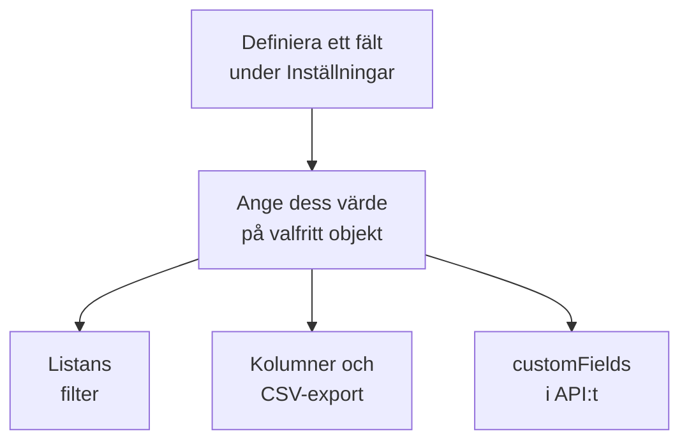

# Anpassade inventariefält

OneUptime upptäcker vad som finns i din miljö. Anpassade fält registrerar det som ingen bevakning kan berätta: serienumret på etiketten, datumet då garantin går ut, vilket team som äger en sak, om den är i drift eller ligger i en låda med reservdelar. Definiera fälten en gång för projektet och fyll sedan i dem på varje objekt.

:::cards
- [Så fungerar anpassade fält](#så-fungerar-anpassade-fält): Ett ordförråd, på varje objekt, oavsett källa.
- [Definiera fält](#definiera-fält): Skapa ett fält, välj dess typ, ange en rullgardinsmenys alternativ.
- [Filtrera listan](#filtrera-listan): Hitta det som löper ut nästa kvartal med två klick.
- [Anmärkningar och begränsningar](#anmärkningar-och-begränsningar): Namnbyten, dubbletter, datum och raderade fält.
:::

## Så fungerar anpassade fält

Ett fält definieras en gång för projektet, och varje objekt kan ha ett värde för det: de som OneUptime har upptäckt, de som det speglar och de som du har lagt till manuellt. Ett fält blir ett filter ovanför listan, en valfri kolumn och en kolumn i CSV-exporten. API:t läser och skriver samma värden, under varje objekts `customFields`.

> [!NOTE]
> I OneUptime Cloud ingår anpassade fält i planen **Growth** och högre. Under det kan fält varken definieras, listas eller ändras: API:t svarar `402 Payment Required`, och listan visar inga filter eller kolumner för anpassade fält.

## Definiera fält

:::steps
### Öppna sidan med anpassade fält

Gå till **Produkter → Resurser → Inventarie**, öppna **Inställningar** i sidomenyn och sedan **Anpassade fält**.

### Skapa ett fält

Klicka på **Skapa Inventory Item Custom Field**. Ge det ett **Fältnamn**, en valfri **Fältbeskrivning** och en **Fälttyp** från tabellen nedan.

### Ange en rullgardinsmenys alternativ

För en rullgardinstyp lägger du till dess alternativ under **Alternativ för rullgardinsmeny**. Varje alternativ kan ha en färg, som används på samma sätt i tabellcellen och i filtret: välj en av de namngivna färgerna, **Ingen färg**, eller **Anpassad färg** för en exakt färgkod. Dra ett alternativ i dess handtag för att ändra var det står i listan.
:::

| Typ | Använd den för |
| --- | --- |
| **Text** | Serienummer, tillgångsetikett, plats i racket, inköpsordernummer |
| **Tal** | Kostnad, rackenhet, antal portar |
| **Boolesk** | Under support, inom PCI-omfång |
| **Rullgardinsmeny (enkelval)** | Livscykelstatus, miljö, kritikalitet: ett svar från en fast lista |
| **Rullgardinsmeny (flerval)** | Efterlevnadsområden, taggar: flera svar från en fast lista |
| **Datum** | Inköpsdatum, garantins slut, datum för end-of-life |
| **Datum och tid** | Senast granskad, tagen ur drift |
| **Lång text** | Åtkomstinstruktioner, anteckningar: flera rader ren text |
| **Formaterad text (Markdown)** | Anteckningar med formatering och länkar, skrivna i Markdown-redigeraren |
| **Fil** | Ett garantibevis, en signerad inköpsorder, ett foto av rackets etikett: en fil |
| **Flera filer** | Handböcker, fakturor och foton: upp till 10 filer |

## Ett genomarbetat tillgångsordförråd

Ett typiskt register över hårdvarutillgångar passar direkt in i de här fälten:

| Fältnamn | Typ | Exempel |
| --- | --- | --- |
| `Serial Number` | Text | `FDO24160ABC` |
| `Asset Tag` | Text | `IT-004821` |
| `Purchase Date` | Datum | 2024-03-11 |
| `Warranty Expiry` | Datum | 2027-03-10 |
| `Lifecycle Status` | Rullgardinsmeny | I drift, Reserv, Under reparation, Utfasad |
| `Assigned Site` | Rullgardinsmeny | Datacenter London, Datacenter Frankfurt, Huvudkontor |
| `Owner Team` | Rullgardinsmeny | Nätverk, Plattform, Säkerhet |
| `Cost Centre` | Text | `CC-4410` |

Ange värdena på ett objekts sida **Anpassade fält**. Alla objekt tar emot dem, oavsett källa, så de switchar som OneUptime har upptäckt och de nätverksenheter det speglar bär samma tillgångsordförråd som de appliances du har lagt till manuellt.

## Filtrera listan

Varje anpassat fält blir ett filter ovanför listan **All Items**, och filtret erbjuder de jämförelser som passar dess typ:

| Fälttyp | Jämförelser |
| --- | --- |
| **Text**, **Lång text**, **Formaterad text (Markdown)** | är, är inte, innehåller, innehåller inte, börjar med, slutar med, är tom, är inte tom |
| **Tal** | är, är inte, är större än, är större än eller lika med, är mindre än, är mindre än eller lika med, är tom, är inte tom |
| **Boolesk**, **Rullgardinsmeny (enkelval)**, **Rullgardinsmeny (flerval)** | är, är inte, är tom, är inte tom |
| **Datum**, **Datum och tid** | är, är före, är efter, är mellan, är tom, är inte tom |
| **Fil**, **Flera filer** | är |

Ett chip för **Fil** eller **Flera filer** frågar bara om en sak: om fältet **Har filer** eller har **Inga filer**.

Filter kombineras med OCH, så ”Warranty Expiry är före 2026-10-01 OCH Lifecycle Status är I drift” är en vy av listan. Det är frågan som ett tillgångsregister finns för att besvara, och skälet att använda datumtyperna i stället för ett datum i ett textfält: ett textfält sparar gärna `2026-10-01` och kan sedan inte tala om vad som löper ut nästa kvartal.

Kolumner för anpassade fält är dolda från början: slå på dem från kolumnväljaren. De kan inte sorteras, eftersom värdena ligger tillsammans i en enda JSON-kolumn som listan inte kan sortera efter.

## Anmärkningar och begränsningar

- Värden sparas på varje objekt under fältets namn. Att byta namn på ett fält flyttar inte de värden som redan är sparade under det gamla namnet. Anpassade fält på incidenter är undantaget: byter du namn på ett av dem flyttas dess värden med (se [Byt namn på ett fält](/docs/incidents/settings#byt-namn-på-ett-fält)).
- En rullgardinsmenys alternativ kan läggas till, byta namn, dras i ny ordning och tas bort efter att objekt har fått värden. Ett alternativ som byter namn ändras på varje objekt som har det; ett borttaget alternativ stannar kvar på de objekt som har det, visat som inte längre ett alternativ, om du inte väljer ett annat åt dem (se [Ändra en rullgardinsmenys alternativ](/docs/incidents/settings#ändra-en-rullgardinsmenys-alternativ)).
- Inget gör ett värde unikt. Två objekt kan ha samma serienummer, och inget hindrar dig.
- Datum sparas som ISO-8601-tidsstämplar i UTC och visas i din egen tidszon.
- Att radera ett fält tar bort det från listan och från filterraden. De värden som redan har skrivits ligger kvar på objekten.
- Ett fält av typen **Fil** eller **Flera filer** tar filer på upp till 10 MB var, av de slag som står under [Filfält](/docs/incidents/settings#filfält), uppladdade i projektet. Bara den som får se objektet kan ladda ned dem, och en fil raderas så snart ingenting längre håller den.

## Nästa steg

:::cards
- [Inventarie – Översikt](/docs/inventory/overview): Var objekt kommer ifrån och vad varje sida visar.
- [Exportera till en CMDB](/docs/inventory/cmdb-sync): Hämta objekten och deras anpassade fält in i ett annat system.
- [Anpassade fält på incidenter](/docs/incidents/settings#anpassade-fält): Samma fälttyper på incidenter, med några extra.
:::
