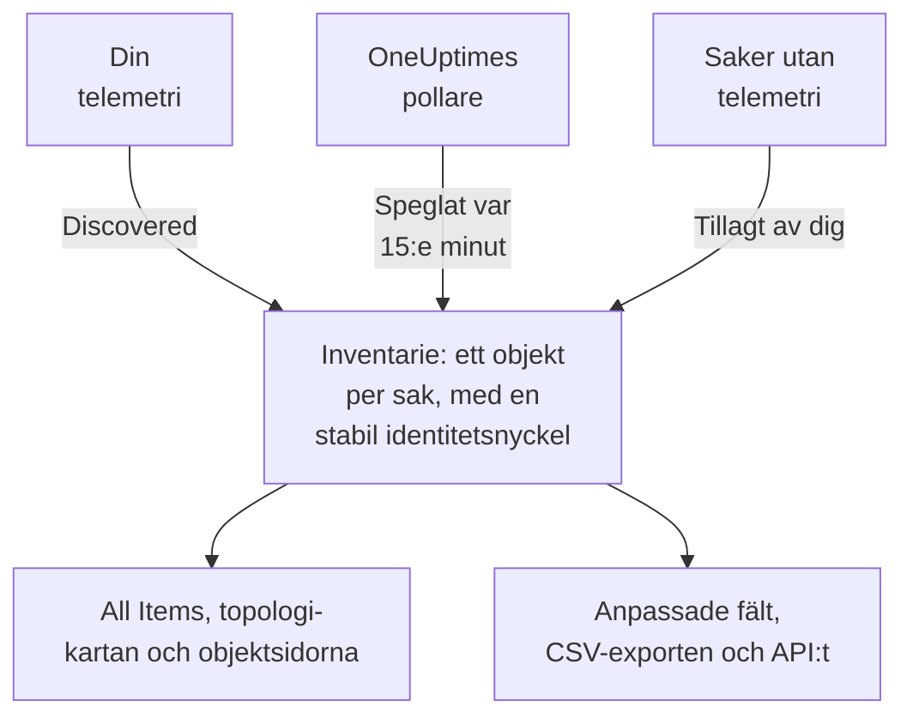

# Inventarie – Översikt

Inventariet är en enda lista över allt OneUptime vet om din miljö: tjänster, värdar, Kubernetes-objekt, virtuella maskiner, nätverksenheter, molnresurser, IoT-enheter, serverlösa funktioner och de saker som inte skickar någon telemetri alls. Det mesta fyller sig självt utifrån det OneUptime redan bevakar. Du lägger till det som bevakning inte kan berätta: vad en sak är till för, vem som äger den, när garantin går ut. Sidan [Ordlista](/docs/introduction/glossary#det-du-övervakar) förklarar vad varje slags post i den är.

:::cards
- [Så hamnar objekt i inventariet](#så-hamnar-objekt-i-inventariet): Upptäckta, speglade eller tillagda av dig.
- [Hitta rätt](#hitta-rätt): Inventariets sidor och varje objekts egna sidor.
- [Importera enheter från Esper](#importera-enheter-från-esper): Varje Android-enhet som din Esper-tenant registrerar, alltid aktuell.
- [Lägg till något manuellt](#lägg-till-något-manuellt): Ett API från tredje part, en extern databas eller en appliance.
- [Arkivera i stället för att radera](#arkivera-i-stället-för-att-radera): Sättet att städa listan som består.
:::

## Så hamnar objekt i inventariet

OneUptime bevakar redan din miljö för att övervaka den, så katalogen byggs utifrån det den observerar och inte utifrån det någon kom ihåg att skriva in. Varje objekt har en källa, och källan avgör vem som äger objektet: om du kan redigera det och om det kan försvinna av sig självt.

| Källa | I API:t | Var det kommer ifrån | Hur länge det stannar |
| --- | --- | --- | --- |
| **Upptäckt** | `discovered` | OpenTelemetry-resursattribut, lästa när telemetri kommer in: en tjänst, en värd, ett Kubernetes-objekt eller en virtuell maskin som skickar telemetri. | Registreras på nytt med varje batch. Tas bort när det har varit tyst längre än fönstret för sin typ (se nedan). |
| **Speglat** | `inventory` | En post som en OneUptime-pollare underhåller: nätverksenheter, molnresurser, IoT-enheter, serverlösa funktioner, RUM-applikationer, Docker-värdar, Podman-värdar och de Android-enheter som en Esper-anslutning importerar. Kopieras var 15:e minut. En Esper-enhet kopieras varje gång dess anslutning läses. | Så länge posten finns. Radera posten, så försvinner objektet med den. |
| **Tillagt av dig** | `manual` | Tillagt av dig, för något OneUptime inte kan se: ett API från tredje part, en databas som en leverantör sköter, en appliance i ett rack. | Tills du raderar det. Inget får det att löpa ut. |

Ett upptäckt eller speglat objekt kan inte byta namn eller få en annan typ: källan skulle skriva över ändringen vid nästa genomgång. Objektets sida **Inställningar** berättar i stället var en bestående ändring ska göras. Det du alltid kan lägga till på vilket objekt som helst, oavsett källa, är värden i anpassade fält: se [Anpassade inventariefält](/docs/inventory/custom-fields).

### Hur länge ett tyst objekt stannar

Ett upptäckt objekt har ett hjärtslag. Varje gång telemetri kommer in för det flyttas tidpunkten då det senast sågs fram, och listans kolumn **Status** visar hur nyligen det var. Detsamma gäller en Android-enhet från Esper: varje gång den checkar in hos Esper. Andra speglade objekt och de du har lagt till har inget hjärtslag, så deras status förblir tom i stället för att larma.

| Status | Vad det betyder |
| --- | --- |
| **Live** | Sett under de senaste 30 minuterna. |
| **Nyligen** | Sett under det senaste dygnet. |
| **Inaktuell** | Inte sett på mer än ett dygn. Sidan **Tystnat** listar dem. |

Var tredje timme tar OneUptime bort de upptäckta objekt som har varit tysta längre än fönstret för sin typ, även de arkiverade, och deras värden i anpassade fält försvinner med dem. Speglade objekt och de du har lagt till tas aldrig bort på det här sättet.

| Typ av objekt | Tas bort efter så här lång tid utan telemetri |
| --- | --- |
| Poddar, deployments, Proxmox-gäster och virtuella VMware-maskiner | 1 dag |
| Kubernetes-noder och -namnrymder, Proxmox-noder, VMware-värdar, -kluster och -datalager, samt de databaser och fjärrtjänster som dina traces anropar | 7 dagar |
| Tjänster, värdar, Kubernetes-, Proxmox- och Ceph-kluster, lagringsarrayer, vCenters och Docker Swarm-kluster | 30 dagar |

En relation som OneUptime har upptäckt tas bort när den inte har setts igen på 30 dagar.

## Hitta rätt

Öppna **Produkter → Resurser → Inventarie**. Sidomenyn har de här sidorna. **Efter källa**, **Inställningar**, **Hjälp** och **Avancerad** är hopfällda från början: klicka på en sektions rubrik för att öppna den.

| Sida | Vad du hittar där |
| --- | --- |
| **Översikt** | Hur många objekt du har, vad de är, hur många som har tystnat och vad som lades till senast. |
| **Alla objekt** | Alla objekt. Sök på namn, beskrivning eller identitetsnyckel, avgränsa listan efter typ, källa, status eller anpassat fält, och lägg till ett objekt manuellt. |
| **Hanterade enheter** | Dina Esper-anslutningar och varje Android-enhet som de importerar, med dess status, grupp, modell och Android-version. |
| **Topologikarta** | Hur objekten hänger ihop: tjänster, vad de anropar, och de värdar, poddar och enheter de körs på. |
| **Tystnat** | De objekt som inget har hörts från på mer än ett dygn: upptäckta objekt som inte har skickat någon telemetri och enheter som har slutat checka in hos Esper. |
| **Efter källa** | Objekten från en källa: **Upptäckt**, **Speglat** eller **Tillagt av dig**. |
| **Inställningar → Anpassade fält** | De fält ditt projekt för på varje objekt. |
| **Hjälp → Dokumentation** | En kort guide till inventariet, med de typer av objekt det känner igen. |
| **Avancerad → Arkiverad** | De objekt du har arkiverat. Återställ dem härifrån. |

Öppna ett objekt, så har dess egen sidomeny objektets **Översikt** (typ, källa och status, och varje attribut som har observerats på det), dess **Anslutningar** och dess **Anpassade fält**; dess **Loggar**, **Spår**, **Mätvärden**, **Profiler** och **Undantag**; och dess **Incidenter**, **Larm** och **Schemalagt underhåll**. Under **Avancerad** finns dess **Inställningar**, dess **Granskningsloggar** och **Ta bort objekt**. Telemetrisidorna visar det som objektet självt har skickat. Incidenterna, larmen och underhållshändelserna är de som hör till den tjänst, värd eller det Kubernetes-kluster som objektet står för; på alla andra objekt talar de sidorna om vilken resurs du ska titta på i stället.

### Tillgångsdetaljer

En värd eller en nätverksenhet har ett kort **Tillgångsdetaljer** som beskriver båda på samma sätt: värdnamn, IP-adress, MAC-adress, serienummer, tillverkare, modell, firmwareversion, operativsystem, OS-version, enhetstyp och plats. Kortet för en Android-enhet har också dess säkerhetspatchnivå, från Android-agenten eller Esper. En uppgift som inget har rapporterat står som **Okänd**, och kortet förklarar varför det är så och hur de okända fylls i: en enhet som inte rapporterar dem över SNMP, en enhet som inte har lästs ännu, eller en Meraki-enhet vars dashboard har dem.

- En värds uppgifter kommer från resursattributen i dess telemetri: dess IP- och MAC-adresser, arkitektur och operativsystem från början, och dess serienummer, märke, modell och firmware när du stämplar på dem.
- En nätverksenhets uppgifter kommer från dess SNMP-pollning, dess roll och dess plats. Det som dess pollning inte har läst kommer från discovery: den senaste skanningen av dess adress, en routers ARP-tabell eller dess sonds DNS-uppslag. En enhet utan ENTITY-MIB, som en Meraki MX, får ändå sitt märke, sin modell och sitt operativsystem från sin systembeskrivning och sin MAC-adress från sina egna portar. Dess IP-adress visas aldrig som dess värdnamn.
- En Meraki-enhet hämtar också det som dess pollning lämnar tomt från Meraki-dashboarden, bland annat dess serienummer, modell och firmware, när en [Meraki-anslutning](/docs/monitor/network-traffic#cisco-meraki-utan-netflow) läser dess organisation.

Kortet visar var varje uppgift kom ifrån och när. Den källa som de flesta uppgifterna delar, som en värds collector, en nätverksenhets egen SNMP-pollning eller den discovery-skanning som läste den, nämns en gång, under uppgifterna. Varje annan källa, som en routers ARP-tabell eller ett värde som sparats på enheten, nämns under sin uppgift. Ett värde som har sparats på en nätverksenhet ersätts aldrig av det som discovery läser, och när de två skiljer sig visar kortet båda.

En nätverksenhets kort har en knapp **Uppdatera** för den som får redigera nätverksenheter. Den läser enheten igen nu: dess sond pollar den inom en minut, och dess Meraki-anslutning läser organisationen igen. Kortet säger när den nya avläsningen har kommit in, eller att sonden inte kunde nå enheten, och objektet kopieras från enheten så snart avläsningen har kommit in.

Samma uppgifter är kolumner i listan **Alla objekt**, dolda tills du slår på dem, och de följer med i dess CSV-export. [Exportera till en CMDB](/docs/inventory/cmdb-sync#tillgångsdetaljer) listar deras nycklar.

### Anslutningar

Ett objekts sida **Anslutningar** listar dess grannar i båda riktningarna, grupperade i **Anrop**, **Anropad av**, **Körs på** och **Relaterat**. Varje grupp visar sin totalsumma (en grupp med fler än 100 000 anslutningar visar ”100 000+”), och **Visa mer** bläddrar igenom resten, så att ett upptaget kluster, en upptagen namnrymd eller nod visar varje anslutning i stället för bara de första. Sidan är inte begränsad till ett tidsintervall: den tar med relationer som har lagts till manuellt via API:t och grannar som har arkiverats. En granne som inte längre finns i inventariet visas med sin nyckel.

## Importera enheter från Esper

Anslut en Esper-tenant, så finns varje Android-enhet som den registrerar i inventariet, även de enheter vars app aldrig har startat. Varje enhet är en värd, med det som bara Esper vet om den: dess grupp, dess Android-version, byggnummer och säkerhetspatchnivå, dess serienummer och IMEI, dess batteri och lagring samt dess installerade appar. Esper skickar ingenting av sig självt, så OneUptime läser den enligt ett schema: enheterna var 15:e minut och varje enhets appar var 6:e timme.

:::steps
### Skapa en API-nyckel i Esper

Skapa en nyckel i Esper-konsolen under API Key Management. OneUptime läser bara, så det räcker med nyckeln för en användare vars Esper-roll får läsa enheter, grupper och appar. En nyckel slutar fungera så snart den ersätts eller dess användare tas bort.

### Anslut tenanten

Gå till **Produkter → Resurser → Inventarie** och sedan till **Hanterade enheter**, och klicka på **Anslut Esper**. Ange **Tenant**, namnet före `.esper.cloud` i adressen till din Esper-konsol (`acme` för `acme.esper.cloud`), och **API-nyckel**. Under **Fler fält** finns anslutningens namn och hur ofta den läses.

### Kontrollera den första läsningen

**Anslut** testar nyckeln innan något sparas: den visar hur många Android-enheter en läsning kommer att importera, eller vad som är fel och hur du åtgärdar det. Den första läsningen startar inom en minut, och anslutningens rad visar hur den gick.
:::

| Vad Esper rapporterar | Var det visas |
| --- | --- |
| Modell, tillverkare, serienummer, Android-version, byggnummer samt IP- och MAC-adresser | Enhetens kort **Tillgångsdetaljer** och kolumnerna i **Alla objekt** |
| Status, senaste incheckning, grupp, säkerhetspatchnivå, IMEI, batteri, lagring och Esper-agent | Enhetens kort **Esper** och listan **Enheter** under **Hanterade enheter** |
| Appar och deras versioner | Enhetens lista **Installerade appar** |

### En enhet, inte två

En app eller Android Agent som skickar telemetri från en enhet blir ett och samma objekt som den enhet Esper importerar, när den namnger enheten på samma sätt som Esper gör. Sätt de här resursattributen från den hanterade konfiguration som Esper fyller i på varje enhet:

| Resursattribut | Värde i hanterad konfiguration | Vad det är |
| --- | --- | --- |
| `host.name` | `${esper.deviceName}` | Enhetens namn i Esper, till exempel `ESP-ID-AAAAW`. Krävs. |
| `host.serial_number` | `${esper.serialNumber}` | Enhetens serienummer. Valfritt. |

OneUptime hittar en enhets objekt efter dess namn i Esper och sedan efter dess serienummer, och skapar ett bara när inget matchar. Android Agent sätter båda utifrån sina inställningar `device_name` och `device_serial`, och [Android-konfiguration](/docs/rum/android-setup#importera-flottan-från-esper) visar en apps hanterade konfiguration.

### När en enhet tystnar eller lämnar Esper

En enhet som inte har checkat in på 30 minuter är **Offline** och visar hur länge sedan den senast gjorde det. Objektets **Status** följer enhetens senaste incheckning, eller dess telemetri när den är nyare, så en enhet som har varit tyst i ett dygn finns på sidan **Tystnat**.

En enhet som tas bort från Esper markeras som **Borttagen**, och dess objekt arkiveras: det försvinner från listan och väntar under **Avancerad → Arkiverad**. En enhet som kommer tillbaka till Esper kommer tillbaka till listan. 30 dagar efter att den försvann raderas enheten, och dess objekt likaså, såvida inte telemetri eller du har lagt till något i det.

## Lägg till något manuellt

Lägg till ett objekt för något som OneUptime aldrig kommer att se på egen hand, så att ett beroende slutar någonstans på riktigt och saken kan bära dina anpassade fält.

:::steps
### Öppna Alla objekt

Gå till **Produkter → Resurser → Inventarie** och sedan till **Alla objekt**.

### Lägg till objektet

Klicka på **Lägg till Objekt**. Välj dess **Typ**, ge det ett **Namn** och eventuellt en **Beskrivning**. Namnet och typen utgör tillsammans objektets identitet, så två objekt av samma typ kan inte ha samma namn.

### Fyll i dess anpassade fält

Öppna det nya objektet. Dess källa står som **Tillagt av dig**, och dess sida **Anpassade fält** tar emot de värden ditt projekt följer.
:::

Tre typer kan du lägga till manuellt:

- `external.service` (**Extern tjänst**): ett API från tredje part eller ett beroende av en programvarutjänst.
- `external.database` (**Extern databas**): en databas som inte är en server OneUptime kan modellera. En databasserver, egendriven eller hanterad, från PostgreSQL till Snowflake, hör i stället hemma under **Databaser → Skapa Databas** ([Databaser](/docs/telemetry/databases)): den posten kopplas till de traces, containrar och motormätvärden som nämner samma adress, vilket ett inventarieobjekt aldrig gör, och lägger du till samma server på båda sätten blir det två okopplade poster.
- `appliance` (**Appliance**): hårdvara eller programvara utan agent.

Begränsningen förhindrar dubbletter. Ett manuellt skapat objekt av en typ som OneUptime kan observera, som en värd, skulle få nyckel efter namnet du skrev, medan det upptäckta objektet för samma maskin får nyckel efter de attribut den rapporterar. De två skulle aldrig gå ihop, så samma värd skulle stå två gånger i din lista för alltid.

## Arkivera i stället för att radera

Arkivering tar ett objekt ur listan medan det behåller sin identitet, sin historik och sina värden i anpassade fält. Det säger: Det här har jag sett, och jag vill inte ha det i min lista. Ett arkiverat objekt fortsätter att samla in telemetri.

| Källa | Arkivera | Radera |
| --- | --- | --- |
| **Upptäckt** | Förblir arkiverat. | Kommer tillbaka med nästa batch av dess telemetri. |
| **Speglat** | Förblir arkiverat. | Kommer tillbaka med nästa kopia. Radera den ursprungliga posten i stället. |
| **Tillagt av dig** | Förblir arkiverat. | Borta för gott. |

För att arkivera objekt markerar du dem i **Alla objekt** och arkiverar dem på en gång, eller öppnar ett objekt och använder kortet **Arkivera** på dess sida **Inställningar**. Arkiverade objekt finns under **Inventarie → Avancerad → Arkiverad**, där du kan markera dem och återställa dem.

> [!NOTE]
> När en speglad enhet tas bort från sin egen post tar OneUptime också bort dess objekt, såvida objektet inte bär värden i anpassade fält som du har angett. De värdena är den enda kopian och det finns ingen ångra, så objektet arkiveras i stället för att raderas. Du hittar det under **Avancerad → Arkiverad** med allt du skrev kvar.

## Relationer och topologi

OneUptime kopplar ihop objekt med riktade relationer när det observerar dem. **Inventarie → Topologikarta** ritar dem, och ett objekts sida **Anslutningar** listar dess egna. Se [Topologi](/docs/telemetry/topology).

| Relation | Till exempel |
| --- | --- |
| `runs-on` | En pod körs på en nod; en virtuell maskin körs på sin värd. |
| `member-of` | En pod, nod eller namnrymd är medlem i ett kluster. |
| `hosted-on` | En tjänst körs på en värd. |
| `part-of` | En pod är en del av sin deployment. |
| `depends-on` | En tjänst anropar en annan, utifrån de spans som går mellan dem. |

## Nästa steg

:::cards
- [Anpassade inventariefält](/docs/inventory/custom-fields): Följ serienummer, garantidatum, ägare och livscykelstatus.
- [Exportera till en CMDB](/docs/inventory/cmdb-sync): Hämta katalogen in i ditt eget styrande system.
- [Databaser](/docs/telemetry/databases): Övervaka de databasservrar dina tjänster använder.
:::
