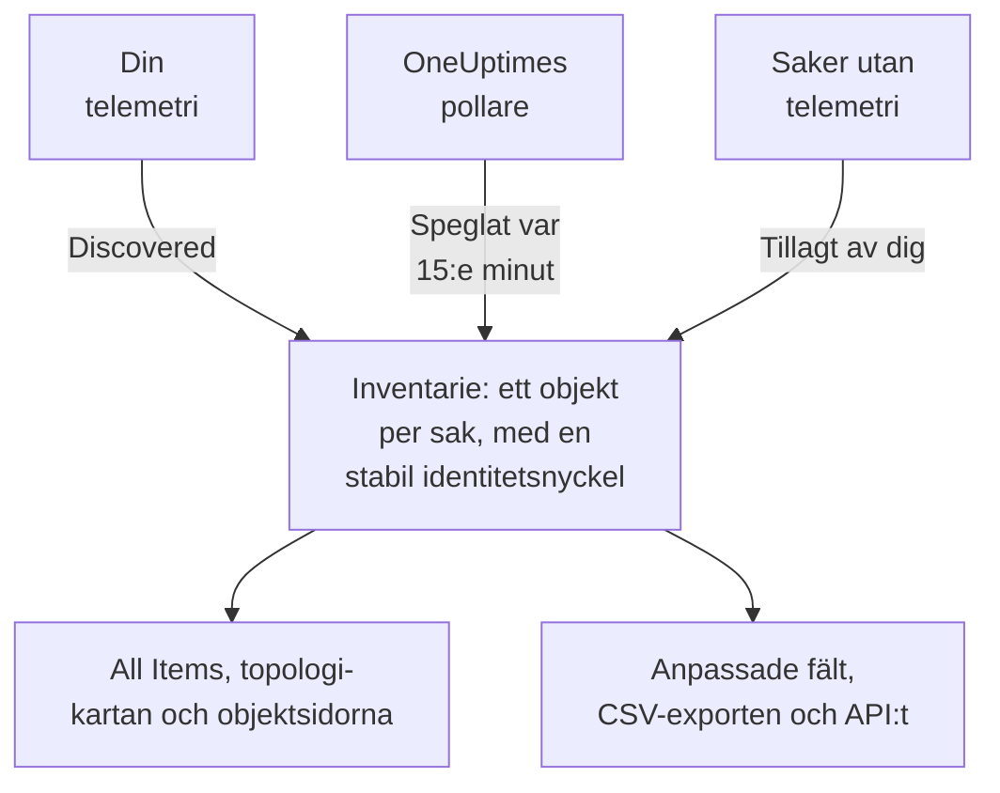

# Inventarie – Översikt

Inventariet är en enda lista över allt OneUptime vet om din miljö: tjänster, värdar, Kubernetes-objekt, virtuella maskiner, nätverksenheter, molnresurser, IoT-enheter, serverlösa funktioner och de saker som inte skickar någon telemetri alls. Det mesta fyller sig självt utifrån det OneUptime redan bevakar. Du lägger till det som bevakning inte kan berätta: vad en sak är till för, vem som äger den, när garantin går ut.

:::cards
- [Så hamnar objekt i inventariet](#så-hamnar-objekt-i-inventariet): Upptäckta, speglade eller tillagda av dig.
- [Hitta rätt](#hitta-rätt): Inventariets sidor och varje objekts egna sidor.
- [Lägg till något manuellt](#lägg-till-något-manuellt): Ett API från tredje part, en extern databas eller en appliance.
- [Arkivera i stället för att radera](#arkivera-i-stället-för-att-radera): Sättet att städa listan som består.
:::

## Så hamnar objekt i inventariet

OneUptime bevakar redan din miljö för att övervaka den, så katalogen byggs utifrån det den observerar och inte utifrån det någon kom ihåg att skriva in. Varje objekt har en källa, och källan avgör vem som äger objektet: om du kan redigera det och om det kan försvinna av sig självt.

| Källa | I API:t | Var det kommer ifrån | Hur länge det stannar |
| --- | --- | --- | --- |
| **Discovered** | `discovered` | OpenTelemetry-resursattribut, lästa när telemetri kommer in: en tjänst, en värd, ett Kubernetes-objekt eller en virtuell maskin som skickar telemetri. | Registreras på nytt med varje batch. Tas bort när det har varit tyst längre än fönstret för sin typ (se nedan). |
| **Mirrored** | `inventory` | En post som en OneUptime-pollare underhåller: nätverksenheter, molnresurser, IoT-enheter, serverlösa funktioner, RUM-applikationer, Docker-värdar och Podman-värdar. Kopieras var 15:e minut. | Så länge posten finns. Radera posten, så försvinner objektet med den. |
| **Added by you** | `manual` | Tillagt av dig, för något OneUptime inte kan se: ett API från tredje part, en databas som en leverantör sköter, en appliance i ett rack. | Tills du raderar det. Inget får det att löpa ut. |

Ett upptäckt eller speglat objekt kan inte byta namn eller få en annan typ: källan skulle skriva över ändringen vid nästa genomgång. Objektets sida **Inställningar** berättar i stället var en bestående ändring ska göras. Det du alltid kan lägga till på vilket objekt som helst, oavsett källa, är värden i anpassade fält: se [Anpassade inventariefält](/docs/inventory/custom-fields).

### Hur länge ett tyst objekt stannar

Ett upptäckt objekt har ett hjärtslag. Varje gång telemetri kommer in för det flyttas tidpunkten då det senast sågs fram, och listans kolumn **Status** visar hur nyligen det var. Speglade objekt och de du har lagt till har inget hjärtslag, så deras status förblir tom i stället för att larma.

| Status | Vad det betyder |
| --- | --- |
| **Live** | Sett under de senaste 30 minuterna. |
| **Recent** | Sett under det senaste dygnet. |
| **Inaktuell** | Inte sett på mer än ett dygn. Sidan **Gone Quiet** listar dem. |

Var tredje timme tar OneUptime bort de upptäckta objekt som har varit tysta längre än fönstret för sin typ, även de arkiverade, och deras värden i anpassade fält försvinner med dem. Speglade objekt och de du har lagt till tas aldrig bort på det här sättet.

| Typ av objekt | Tas bort efter så här lång tid utan telemetri |
| --- | --- |
| Poddar, deployments, Proxmox-gäster och virtuella VMware-maskiner | 1 dag |
| Kubernetes-noder och -namnrymder, Proxmox-noder, VMware-värdar, -kluster och -datalager, samt de databaser och fjärrtjänster som dina traces anropar | 7 dagar |
| Tjänster, värdar, Kubernetes-, Proxmox- och Ceph-kluster, lagringsarrayer, vCenters och Docker Swarm-kluster | 30 dagar |

En relation som OneUptime har upptäckt tas bort när den inte har setts igen på 30 dagar.

## Hitta rätt

Öppna **Produkter → Resurser → Inventarie**. Sidomenyn har de här sidorna. **By Source**, **Inställningar**, **Hjälp** och **Avancerad** är hopfällda från början: klicka på en sektions rubrik för att öppna den.

| Sida | Vad du hittar där |
| --- | --- |
| **Översikt** | Hur många objekt du har, vad de är, hur många som har tystnat och vad som lades till senast. |
| **All Items** | Alla objekt. Sök på namn, beskrivning eller identitetsnyckel, avgränsa listan efter typ, källa, status eller anpassat fält, och lägg till ett objekt manuellt. |
| **Topology Map** | Hur objekten hänger ihop: tjänster, vad de anropar, och de värdar, poddar och enheter de körs på. |
| **Gone Quiet** | De upptäckta objekt som inte har skickat telemetri på mer än ett dygn. |
| **By Source** | Objekten från en källa: **Discovered**, **Mirrored** eller **Added by You**. |
| **Inställningar → Anpassade fält** | De fält ditt projekt för på varje objekt. |
| **Hjälp → Dokumentation** | En kort guide till inventariet, med de typer av objekt det känner igen. |
| **Avancerad → Arkiverad** | De objekt du har arkiverat. Återställ dem härifrån. |

Öppna ett objekt, så har dess egen sidomeny objektets **Översikt** (typ, källa och status, och varje attribut som har observerats på det), dess **Anslutningar** och dess **Anpassade fält**; dess **Loggar**, **Spår**, **Mätvärden**, **Prestandaprofiler** och **Undantag**; och dess **Incidenter**, **Larm** och **Schemalagt underhåll**. Under **Avancerad** finns dess **Inställningar**, dess **Granskningsloggar** och **Delete Item**. Telemetrisidorna visar det som objektet självt har skickat. Incidenterna, larmen och underhållshändelserna är de som hör till den tjänst, värd eller det Kubernetes-kluster som objektet står för; på alla andra objekt talar de sidorna om vilken resurs du ska titta på i stället.

### Tillgångsdetaljer

En värd eller en nätverksenhet har ett kort **Tillgångsdetaljer** som beskriver båda på samma sätt: värdnamn, IP-adress, MAC-adress, serienummer, tillverkare, modell, firmwareversion, operativsystem, OS-version, enhetstyp och plats. En uppgift som inget har rapporterat står som **Okänd**, och kortet förklarar hur de okända fylls i.

- En värds uppgifter kommer från resursattributen i dess telemetri: dess IP- och MAC-adresser, arkitektur och operativsystem från början, och dess serienummer, märke, modell och firmware när du stämplar på dem.
- En nätverksenhets uppgifter kommer från dess SNMP-pollning, dess roll och dess plats. Det som dess pollning inte har läst kommer från discovery: den senaste skanningen av dess adress, en routers ARP-tabell eller dess sonds DNS-uppslag. En enhet utan ENTITY-MIB, som en Meraki MX, får ändå sitt märke och sin modell från sin systembeskrivning. Dess IP-adress visas aldrig som dess värdnamn.

Kortet visar var varje uppgift kom ifrån och när. Den källa som de flesta uppgifterna delar, som en värds collector, en nätverksenhets egen SNMP-pollning eller den discovery-skanning som läste den, nämns en gång, under uppgifterna. Varje annan källa, som en routers ARP-tabell eller ett värde som sparats på enheten, nämns under sin uppgift. Ett värde som har sparats på en nätverksenhet ersätts aldrig av det som discovery läser, och när de två skiljer sig visar kortet båda.

Samma uppgifter är kolumner i listan **All Items**, dolda tills du slår på dem, och de följer med i dess CSV-export. [Exportera till en CMDB](/docs/inventory/cmdb-sync#tillgångsdetaljer) listar deras nycklar.

### Anslutningar

Ett objekts sida **Anslutningar** listar dess grannar i båda riktningarna, grupperade i **Anrop**, **Anropad av**, **Körs på** och **Relaterat**. Varje grupp visar sin totalsumma (en grupp med fler än 100 000 anslutningar visar ”100 000+”), och **Visa mer** bläddrar igenom resten, så att ett upptaget kluster, en upptagen namnrymd eller nod visar varje anslutning i stället för bara de första. Sidan är inte begränsad till ett tidsintervall: den tar med relationer som har lagts till manuellt via API:t och grannar som har arkiverats. En granne som inte längre finns i inventariet visas med sin nyckel.

## Lägg till något manuellt

Lägg till ett objekt för något som OneUptime aldrig kommer att se på egen hand, så att ett beroende slutar någonstans på riktigt och saken kan bära dina anpassade fält.

:::steps
### Öppna All Items

Gå till **Produkter → Resurser → Inventarie** och sedan till **All Items**.

### Lägg till objektet

Klicka på **Lägg till Item**. Välj dess **Typ**, ge det ett **Namn** och eventuellt en **Beskrivning**. Namnet och typen utgör tillsammans objektets identitet, så två objekt av samma typ kan inte ha samma namn.

### Fyll i dess anpassade fält

Öppna det nya objektet. Dess källa står som **Added by you**, och dess sida **Anpassade fält** tar emot de värden ditt projekt följer.
:::

Tre typer kan du lägga till manuellt:

- `external.service` (**Extern tjänst**): ett API från tredje part eller ett beroende av en programvarutjänst.
- `external.database` (**Extern databas**): en databas som inte är en server OneUptime kan modellera. En databasserver, egendriven eller hanterad, från PostgreSQL till Snowflake, hör i stället hemma under **Databases → Skapa Databas** ([Databaser](/docs/telemetry/databases)): den posten kopplas till de traces, containrar och motormätvärden som nämner samma adress, vilket ett inventarieobjekt aldrig gör, och lägger du till samma server på båda sätten blir det två okopplade poster.
- `appliance` (**Appliance**): hårdvara eller programvara utan agent.

Begränsningen förhindrar dubbletter. Ett manuellt skapat objekt av en typ som OneUptime kan observera, som en värd, skulle få nyckel efter namnet du skrev, medan det upptäckta objektet för samma maskin får nyckel efter de attribut den rapporterar. De två skulle aldrig gå ihop, så samma värd skulle stå två gånger i din lista för alltid.

## Arkivera i stället för att radera

Arkivering tar ett objekt ur listan medan det behåller sin identitet, sin historik och sina värden i anpassade fält. Det säger: Det här har jag sett, och jag vill inte ha det i min lista. Ett arkiverat objekt fortsätter att samla in telemetri.

| Källa | Arkivera | Radera |
| --- | --- | --- |
| **Discovered** | Förblir arkiverat. | Kommer tillbaka med nästa batch av dess telemetri. |
| **Mirrored** | Förblir arkiverat. | Kommer tillbaka med nästa kopia. Radera den ursprungliga posten i stället. |
| **Added by you** | Förblir arkiverat. | Borta för gott. |

För att arkivera objekt markerar du dem i **All Items** och arkiverar dem på en gång, eller öppnar ett objekt och använder kortet **Arkivera** på dess sida **Inställningar**. Arkiverade objekt finns under **Inventarie → Avancerad → Arkiverad**, där du kan markera dem och återställa dem.

> [!NOTE]
> När en speglad enhet tas bort från sin egen post tar OneUptime också bort dess objekt, såvida objektet inte bär värden i anpassade fält som du har angett. De värdena är den enda kopian och det finns ingen ångra, så objektet arkiveras i stället för att raderas. Du hittar det under **Avancerad → Arkiverad** med allt du skrev kvar.

## Relationer och topologi

OneUptime kopplar ihop objekt med riktade relationer när det observerar dem. **Inventarie → Topology Map** ritar dem, och ett objekts sida **Anslutningar** listar dess egna. Se [Topologi](/docs/telemetry/topology).

| Relation | Till exempel |
| --- | --- |
| `runs-on` | En pod körs på en nod; en virtuell maskin körs på sin värd. |
| `member-of` | En pod, nod eller namnrymd är medlem i ett kluster. |
| `hosted-on` | En tjänst körs på en värd. |
| `part-of` | En pod är en del av sin deployment. |
| `depends-on` | En tjänst anropar en annan, utifrån de spans som går mellan dem. |

## Nästa steg

:::cards
- [Anpassade inventariefält](/docs/inventory/custom-fields): Följ serienummer, garantidatum, ägare och livscykelstatus.
- [Exportera till en CMDB](/docs/inventory/cmdb-sync): Hämta katalogen in i ditt eget styrande system.
- [Databaser](/docs/telemetry/databases): Övervaka de databasservrar dina tjänster använder.
:::
