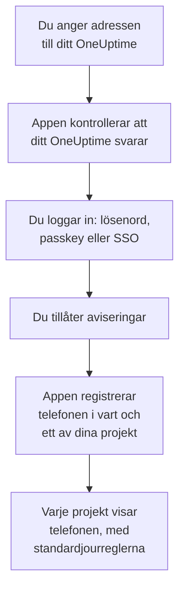
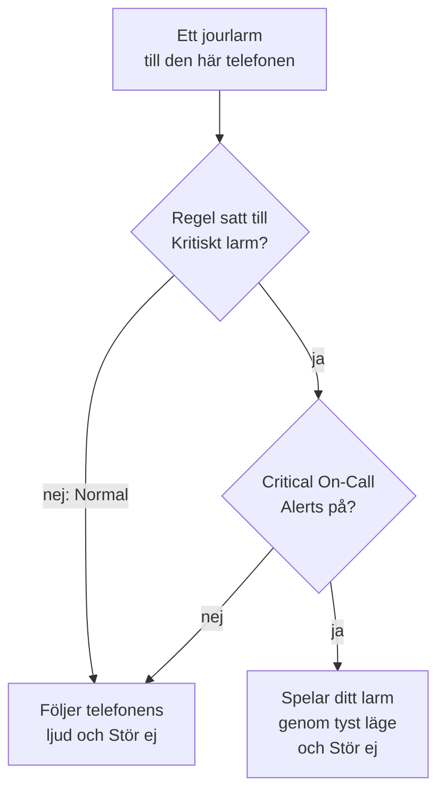

# Android-installation

Installera **OneUptime On-Call** på en Android-telefon eller -surfplatta, anslut appen till ditt OneUptime och logga in. Skicka sedan en testavisering till dig själv, och låt brådskande jourlarm ringa igenom tyst läge och Stör ej.

:::cards
- [Installera appen](#installera-appen): Från Google Play, eller APK-filen på en telefon utan Google Play.
- [Logga in](#logga-in): Adressen till ditt OneUptime, sedan ditt konto.
- [Kontrollera att larmen når telefonen](#kontrollera-att-larmen-når-telefonen): Hitta telefonen i instrumentpanelen och testa den.
- [Ring igenom tyst läge](#ring-igenom-tyst-läge): Kritiska larm och larmljudet.
- [Felsökning](#felsökning): Problem med inloggning, aviseringar och installation.
:::

## Innan du börjar

- En telefon eller surfplatta med Android 7.0 eller senare.
- Ett konto i ett OneUptime-projekt. För att bli larmad måste du också ha jour: se [Eskaleringsregler](/docs/on-call/escalation-rules).
- Adressen till ditt OneUptime: `https://oneuptime.com` på OneUptime Cloud, eller din egen, till exempel `https://oneuptime.example.com`. Appen ansluter bara över HTTPS.

## Installera appen

:::tabs
@tab Google Play
1. Öppna [OneUptime On-Call på Google Play](https://play.google.com/store/apps/details?id=com.oneuptime.oncall) på telefonen, eller sök efter OneUptime On-Call i Google Play.
2. Tryck på **Installera** och sedan på **Öppna**.

Google Play håller appen uppdaterad.
@tab APK
För en telefon utan Google Play. APK-filen byggs från samma kod för varje OneUptime-version och bifogas versionen på GitHub.

1. Öppna [den senaste APK-filen](https://github.com/OneUptime/oneuptime/releases/latest/download/oneuptime-on-call-android-app.apk) på telefonen.
2. Öppna den nedladdade filen. Om Android frågar, låt webbläsaren installera okända appar och tryck sedan på **Installera**.
3. Öppna OneUptime On-Call bland dina appar.

En APK uppdaterar sig inte själv: installera den senaste ovanpå då och då. Din inloggning och dina inställningar finns kvar.
:::

## Logga in

:::steps
### Ange adressen till ditt OneUptime
Öppna appen. Behåll `https://oneuptime.com` på **Connect your workspace** för OneUptime Cloud, eller ange adressen till ditt eget OneUptime, och tryck på **Connect**. Appen går vidare så snart `https://<your-oneuptime>/api/status` svarar.

### Logga in på ditt konto
Använd det sätt ditt konto loggar in på:

- Din e-postadress och ditt lösenord, sedan **Sign In**. **Forgot password?** mejlar dig en länk för att välja ett nytt.
- **Sign in with SSO**, om din organisation använder enkel inloggning. Välj din leverantör, eller ange din jobbmejladress och tryck på **Continue**. En säker webbläsare öppnas, och du är tillbaka i appen så snart du har loggat in.
- **Sign in with a passkey**, när du har lagt till en i instrumentpanelen: se [Lägg till en passkey](/docs/introduction/your-account#lägg-till-en-passnyckel). Webbläsaren öppnas för att bekräfta den och skickar dig sedan tillbaka.

Med tvåfaktorsautentisering påslagen anger du den sexsiffriga koden från din autentiseringsapp, eller en av dina reservkoder. En säkerhetsnyckel kan inte användas i appen. Kräver din administratör tvåfaktorsautentisering och du inte har konfigurerat den ännu, konfigurerar appen först en autentiseringsapp tillsammans med dig.

### Tillåt aviseringar
När Android frågar om OneUptime On-Call får skicka aviseringar trycker du på **Tillåt**. Android 13 och senare frågar; äldre versioner tillåter dem så länge du inte stänger av dem.

Appen registrerar sedan telefonen i vart och ett av dina projekt. Varje projekt visar den bland dina push-enheter med standardjourreglerna, så att dina larm når den från och med nu.
:::

Appen visar ett projekt i taget: tryck på projektets namn högst upp på en skärm för att byta. Ett projekt som kräver enkel inloggning står som **SSO Required** under **Settings → Manage Projects** tills du trycker på **Authenticate with SSO** där.

## Kontrollera att larmen når telefonen

:::steps
### Hitta telefonen i instrumentpanelen
Öppna **Användarinställningar → Aviseringsmetoder** och fliken **Push Notifications** i instrumentpanelen. Telefonen står under **Enheter för push-aviseringar** med sitt modellnamn. Varje projekt har sin egen lista.

### Skicka ett test
Klicka på **Testavisering** på telefonens rad. En avisering kommer fram på telefonen; tryck på den för att öppna appen.
:::

Dina jourregler avgör vilka larm som går till telefonen, och hur snabbt: se **Användarinställningar → Jourregler**. En ny telefon får samma standardregler som alla andra metoder du lägger till.

## Ring igenom tyst läge

Som standard följer ett jourlarm telefonens ljudinställningar: en ljudlös telefon förblir tyst, och Stör ej håller tillbaka larmet. Kritiska larm låter jourlarm ringa igenom båda. De är avstängda tills du slår på dem, telefon för telefon.

:::steps
### Slå på Critical On-Call Alerts
Öppna **Settings** i appen och slå på **Critical On-Call Alerts** under **Notifications**.

### Tillåt åtkomst till Stör ej
Android öppnar sin lista **Åtkomst till Stör ej**. Slå på åtkomsten för OneUptime On-Call och gå tillbaka till appen: den kontrollerar åtkomsten och säger under reglaget om larm kommer att ringa igenom.

### Välj ett larmljud
Tryck på **Alarm sound** under reglaget. Förutom telefonens eget ljud erbjuder appen Klaxon, Siren, Digital alarm, Smoke alarm och Rising alarm, som börjar mjukt och blir starkare. Tryck på spela upp bredvid ett ljud för att höra det. Ett kritiskt larm spelas med telefonens larmvolym, så håll den uppskruvad.
:::

Bara jourlarm ringer igenom, och bara från jourregler satta till **Kritiskt larm**, standardvärdet. En regel satt till **Normal** följer telefonens inställningar oavsett vad reglaget säger, så att du kan väckas av en kritisk incident och larmas tyst för en mindre. Skicka en **Testavisering** med telefonen ljudlös för att höra vad ett larm kommer att göra.

## Undvik att larm kommer fram för sent

OneUptime skickar jourlarm med hög prioritet, som Android levererar även till en telefon som har legat stilla i timmar. En telefon som begränsar appens batterianvändning kan ändå hålla tillbaka dem:

- Öppna **Inställningar → Appar → OneUptime On-Call → Batteri** och välj **Obegränsad**. Vissa telefoner kallar det **Appens batteriförbrukning**.
- Kontrollera att appens aviseringar är på, under **Inställningar → Appar → OneUptime On-Call → Aviseringar**.
- Håll OneUptime On-Call utanför alla listor för batterisparande eller sovande appar som din telefon har.

## Lås appen

Slå på **Biometrics Login** under **Settings** i appen, så frågar appen efter ditt fingeravtryck, ditt ansikte eller telefonens skärmlås varje gång den startar. Reglaget visas när telefonen har upplåsning med fingeravtryck eller ansikte konfigurerad. **Appearance** på samma skärm väljer ljust eller mörkt utseende, eller följer telefonen.

## Uppdatera, logga ut eller avinstallera

- **Uppdatera.** Google Play uppdaterar appen. För APK-filen installerar du den senaste ovanpå. Appens version står längst ner på dess skärm **Settings**.
- **Logga ut.** **Settings → Log Out** loggar ut dig och tar bort telefonen från dina push-enheter i alla projekt, tillsammans med dess jourregler. Loggar du in igen kommer den tillbaka med standardreglerna.
- **Avinstallera.** Ta bort appen som vilken annan app som helst. Var du fortfarande inloggad ligger telefonen kvar i din lista tills en push till den misslyckas: OneUptime markerar den då som **Tar inte emot aviseringar**. Ta bort den posten med **Ta bort**: installerar du appen igen och loggar in läggs telefonen till som en ny post med standardreglerna.

## Felsökning

:::details ”Could not connect to the server”
Appen nådde inte `https://<your-oneuptime>/api/status`. Kontrollera adressen, inklusive `https://`. Ligger ditt OneUptime i ett privat nätverk ansluter du först telefonen till det, till exempel via ditt VPN. Öppna adressen i telefonens webbläsare: den visar `{"status":"ok"}` när telefonen når OneUptime.
:::

:::details Inga aviseringar kommer fram
- Kontrollera i Androids inställningar att aviseringar är på för appen, och att Stör ej är av eller kritiska larm på.
- Kontrollera att telefonen står under **Push Notifications** i **Användarinställningar → Aviseringsmetoder**, och skicka en **Testavisering** till den.
- Är telefonen markerad som **Tar inte emot aviseringar**, öppnar du appen medan du är inloggad. Den registrerar telefonen igen; se [När en telefon måste registreras igen](/docs/mobile-desktop-apps/faq-troubleshooting#när-en-telefon-måste-registreras-igen).
- Kontrollera dina jourregler under **Användarinställningar → Jourregler**.
- På ett OneUptime i egen drift kontrollerar du att servern når sitt push-relä: se [Push-aviseringar](/docs/self-hosted/push-notifications#nätverksåtkomst).
:::

:::details Kritiska larm är tysta i Stör ej
Öppna **Settings** i appen: raden under **Critical On-Call Alerts** säger vad som saknas. Oftast tilläts inte åtkomst till Stör ej: tillåt den under **Inställningar → Aviseringar → Åtkomst till Stör ej** och gå tillbaka till appen. Har du valt ett larmljud måste även det ljudets aviseringskanal få åsidosätta Stör ej.
:::

:::details ”Appen installerades inte” när du installerar APK-filen
OneUptime On-Call finns redan på telefonen från en annan källa, som Google Play, och Android installerar inte den ena ovanpå den andra. Avinstallera den, installera APK-filen och logga in igen.
:::

:::details Inget reglage för Biometrics Login
Reglaget visas när upplåsning med fingeravtryck eller ansikte är konfigurerad i Androids inställningar.
:::

## Nästa steg

:::cards
- [Vanliga frågor och felsökning](/docs/mobile-desktop-apps/faq-troubleshooting): Vad du gör när en telefon slutar få larm.
- [iOS-installation](/docs/mobile-desktop-apps/ios-installation): Samma app på en iPhone eller iPad.
- [Eskaleringsregler](/docs/on-call/escalation-rules): Bestäm vem som larmas, och när.
- [Push-aviseringar](/docs/self-hosted/push-notifications): Så skickar ett OneUptime i egen drift larm till telefoner.
:::
