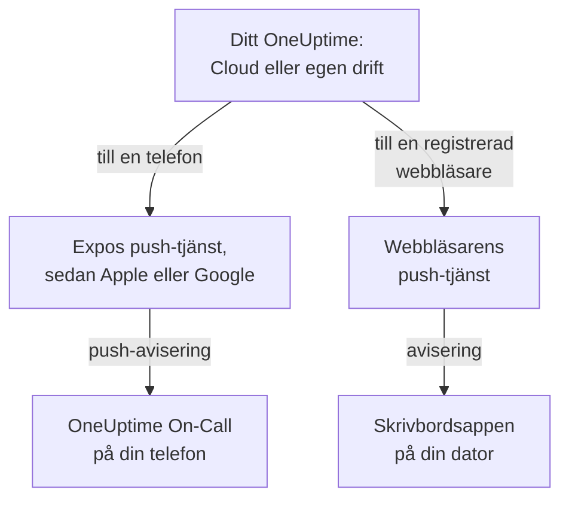

# Appar – Översikt

OneUptime har en app för din telefon och en för din dator. **OneUptime On-Call**, för iPhone, iPad och Android, larmar dig när du har jour och låter dig bekräfta och lösa var du än är. På Windows, macOS och Linux installerar du OneUptime-instrumentpanelen från webbläsaren som en skrivbordsapp med ett eget fönster. Båda fungerar med OneUptime Cloud och med ett OneUptime som du driftar själv.

:::cards
- [Välj en app](#välj-en-app): Vad varje app är till för, sida vid sida.
- [Så når apparna OneUptime](#så-når-apparna-oneuptime): Vilken väg inloggning och jourlarm tar.
- [Skaffa mobilappen](#skaffa-mobilappen): Från App Store, Google Play eller GitHub.
- [Skaffa skrivbordsappen](#skaffa-skrivbordsappen): Installera instrumentpanelen från Edge, Chrome eller Safari.
:::

## Välj en app

|  | Mobilapp | Skrivbordsapp |
| --- | --- | --- |
| Vad den är | OneUptime On-Call, en native app för iPhone, iPad och Android | OneUptime-instrumentpanelen, installerad från din webbläsare |
| Var du får den | App Store, Google Play eller en APK från GitHub | Ditt eget OneUptime: det finns inget att ladda ner |
| Jourlarm | Push-aviseringar, som kan ringa igenom tyst läge och Stör ej | Webbläsaraviseringar, när du har registrerat webbläsaren |
| Vad du kan göra | Incidenter, varningar, säkerhetsärenden, monitorer och vem som har jour; bekräfta, lösa, godkänna playbook-steg och lägga till anteckningar | Allt som instrumentpanelen gör |
| Uppdateringar | Från butiken, eller genom att installera en nyare APK | Varje gång den öppnas hämtar den instrumentpanelen från ditt OneUptime |
| Körs på | iOS 16.4 eller senare, Android 7.0 eller senare | Windows, macOS och Linux, med Edge eller Chrome, eller Safari på macOS Sonoma 14 eller senare |

Du kan använda båda: ha skrivbordsappen öppen på jobbet, och låt telefonen väcka dig på natten.

## Så når apparna OneUptime

Mobilappen loggar in på ditt OneUptime och registrerar telefonen i varje projekt du är medlem i. Därefter skickar OneUptime telefonens push-aviseringar, bland dem jourlarmen, genom Expos push-tjänst, som lämnar dem vidare till Apple eller Google för leverans. Som standard skickar ett OneUptime i egen drift dem genom OneUptimes push-relä, så det behöver inget eget konto hos Apple, Google eller Expo: se [Push-aviseringar](/docs/self-hosted/push-notifications).

Skrivbordsappen är själva instrumentpanelen, i ett eget fönster. Den visar aviseringar när du har registrerat dess webbläsare för push-aviseringar: sidorna om Windows, macOS och Linux visar hur.

## Innan du börjar

- Ett konto i ett OneUptime-projekt. För att bli larmad måste du också ha jour: se [Eskaleringsregler](/docs/on-call/escalation-rules).
- Adressen till ditt OneUptime. På OneUptime Cloud är det `https://oneuptime.com`; ett OneUptime i egen drift har en egen, till exempel `https://oneuptime.example.com`.
- Ditt OneUptime över HTTPS. Mobilappen ansluter inte över vanlig HTTP, och webbläsare visar bara aviseringar, och Edge och Chrome installerar bara appar, för HTTPS-webbplatser.

## Skaffa mobilappen

:::steps
### Installera OneUptime On-Call
Hämta den från [App Store](https://apps.apple.com/us/app/oneuptime-on-call/id6759615391) på en iPhone eller iPad, eller från [Google Play](https://play.google.com/store/apps/details?id=com.oneuptime.oncall) på Android. För en Android-telefon utan Google Play installerar du [APK-filen](https://github.com/OneUptime/oneuptime/releases/latest/download/oneuptime-on-call-android-app.apk) i stället. Samma länkar finns i instrumentpanelen under **Projektinställningar → Aviseringar → Mobilappar**.

### Anslut den till ditt OneUptime
Öppna appen, behåll `https://oneuptime.com` för OneUptime Cloud eller ange adressen till ditt eget OneUptime, och logga in med ditt lösenord, en passkey eller enkel inloggning.

### Tillåt aviseringar
Tillåt dem när telefonen frågar. Appen registrerar telefonen i vart och ett av dina projekt, och dina jourlarm når den från och med nu.
:::

Varje steg i detalj, med vad du kontrollerar efteråt: [Android-installation](/docs/mobile-desktop-apps/android-installation) och [iOS-installation](/docs/mobile-desktop-apps/ios-installation).

## Skaffa skrivbordsappen

:::steps
### Öppna din instrumentpanel
Logga in på ditt OneUptime i Microsoft Edge eller Google Chrome, eller i Safari på en Mac.

### Installera den
Klicka i Edge eller Chrome på installationsikonen till höger i adressfältet. Välj i Safari **Arkiv → Lägg till i Dock**.

### Öppna den som vilken annan app som helst
Den öppnas i ett eget fönster, från Start-menyn, Dock eller din appstartare.
:::

Varje webbläsare steg för steg: [Windows-installation](/docs/mobile-desktop-apps/windows-installation), [macOS-installation](/docs/mobile-desktop-apps/macos-installation) och [Linux-installation](/docs/mobile-desktop-apps/linux-installation).

## Nästa steg

:::cards
- [Android-installation](/docs/mobile-desktop-apps/android-installation): Installera appen på Android, logga in och kontrollera att larmen kommer fram.
- [iOS-installation](/docs/mobile-desktop-apps/ios-installation): Installera appen på en iPhone eller iPad och slå på kritiska varningar.
- [Windows-installation](/docs/mobile-desktop-apps/windows-installation): Installera instrumentpanelen från Edge eller Chrome.
- [macOS-installation](/docs/mobile-desktop-apps/macos-installation): Lägg till instrumentpanelen i Dock från Safari, Chrome eller Edge.
- [Linux-installation](/docs/mobile-desktop-apps/linux-installation): Installera instrumentpanelen från Chrome, Chromium eller Edge.
- [Vanliga frågor och felsökning](/docs/mobile-desktop-apps/faq-troubleshooting): Svar, lösningar och vad du gör när en telefon slutar få larm.
:::
