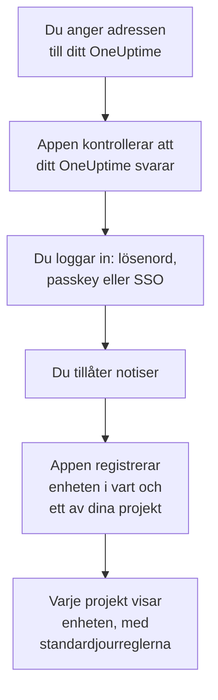
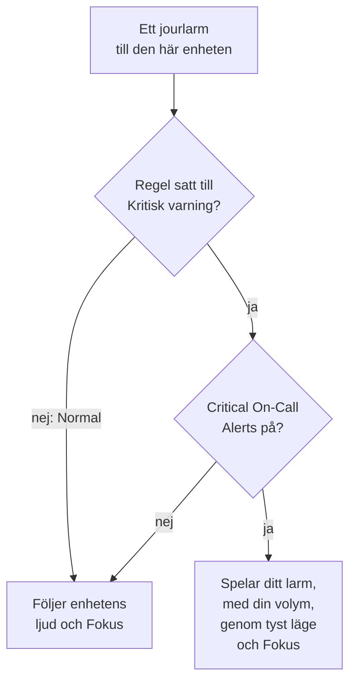

# iOS-installation

Installera **OneUptime On-Call** från App Store på en iPhone eller iPad, anslut appen till ditt OneUptime och logga in. Skicka sedan en testavisering till dig själv, och låt brådskande jourlarm ringa igenom tyst läge och Fokus.

:::cards
- [Installera appen](#installera-appen): Från App Store.
- [Logga in](#logga-in): Adressen till ditt OneUptime, sedan ditt konto.
- [Kontrollera att larmen når enheten](#kontrollera-att-larmen-når-enheten): Hitta den i instrumentpanelen och testa den.
- [Ring igenom tyst läge](#ring-igenom-tyst-läge): Kritiska larm, larmljudet och dess volym.
- [Felsökning](#felsökning): Problem med inloggning, aviseringar och kritiska larm.
:::

## Innan du börjar

- En iPhone eller iPad med iOS 16.4 eller senare, eller iPadOS 16.4 eller senare.
- Ett konto i ett OneUptime-projekt. För att bli larmad måste du också ha jour: se [Eskaleringsregler](/docs/on-call/escalation-rules).
- Adressen till ditt OneUptime: `https://oneuptime.com` på OneUptime Cloud, eller din egen, till exempel `https://oneuptime.example.com`. Appen ansluter bara över HTTPS.

## Installera appen

1. Öppna [OneUptime On-Call i App Store](https://apps.apple.com/us/app/oneuptime-on-call/id6759615391) på din iPhone eller iPad, eller sök efter OneUptime On-Call i App Store.
2. Tryck på **Hämta** och bekräfta med Face ID, Touch ID eller lösenordet till ditt Apple-konto.
3. Tryck på **Öppna**, eller öppna OneUptime On-Call från hemskärmen.

App Store håller appen uppdaterad så länge **Appuppdateringar** är på, under **Inställningar → App Store**.

## Logga in

:::steps
### Ange adressen till ditt OneUptime
Öppna appen. Behåll `https://oneuptime.com` på **Connect your workspace** för OneUptime Cloud, eller ange adressen till ditt eget OneUptime, och tryck på **Connect**. Appen går vidare så snart `https://<your-oneuptime>/api/status` svarar.

### Logga in på ditt konto
Använd det sätt ditt konto loggar in på:

- Din e-postadress och ditt lösenord, sedan **Sign In**. **Forgot password?** mejlar dig en länk för att välja ett nytt.
- **Sign in with SSO**, om din organisation använder enkel inloggning. Välj din leverantör, eller ange din jobbmejladress och tryck på **Continue**. En säker webbläsare öppnas, och du är tillbaka i appen så snart du har loggat in.
- **Sign in with a passkey**, när du har lagt till en i instrumentpanelen: se [Lägg till en passkey](/docs/introduction/your-account#lägg-till-en-passnyckel). Ett webbläsarblad öppnas för att bekräfta den och skickar dig sedan tillbaka.

Med tvåfaktorsautentisering påslagen anger du den sexsiffriga koden från din autentiseringsapp, eller en av dina reservkoder. En säkerhetsnyckel kan inte användas i appen. Kräver din administratör tvåfaktorsautentisering och du inte har konfigurerat den ännu, konfigurerar appen först en autentiseringsapp tillsammans med dig.

### Tillåt notiser
När iOS frågar om OneUptime On-Call får skicka notiser till dig trycker du på **Tillåt**.

Appen registrerar sedan din iPhone eller iPad i vart och ett av dina projekt. Varje projekt visar den bland dina push-enheter med standardjourreglerna, så att dina larm når den från och med nu.
:::

Appen visar ett projekt i taget: tryck på projektets namn högst upp på en skärm för att byta. Ett projekt som kräver enkel inloggning står som **SSO Required** under **Settings → Manage Projects** tills du trycker på **Authenticate with SSO** där.

## Kontrollera att larmen når enheten

:::steps
### Hitta enheten i instrumentpanelen
Öppna **Användarinställningar → Aviseringsmetoder** och fliken **Push Notifications** i instrumentpanelen. Din iPhone eller iPad står under **Enheter för push-aviseringar** med sitt modellnamn. Varje projekt har sin egen lista.

### Skicka ett test
Klicka på **Testavisering** på enhetens rad. En notis kommer fram på enheten; tryck på den för att öppna appen.
:::

Dina jourregler avgör vilka larm som går till enheten, och hur snabbt: se **Användarinställningar → Jourregler**. En ny enhet får samma standardregler som alla andra metoder du lägger till.

## Ring igenom tyst läge

Som standard följer ett jourlarm enhetens ljudinställningar: tyst läge håller det tyst, och ett Fokus som Stör ej håller tillbaka det. Kritiska larm låter jourlarm ringa igenom båda. De är avstängda tills du slår på dem, enhet för enhet.

:::steps
### Slå på Critical On-Call Alerts
Öppna **Settings** i appen och slå på **Critical On-Call Alerts** under **Notifications**.

### Tillåt kritiska larm
När iOS frågar om OneUptime On-Call får skicka kritiska larm trycker du på **Tillåt**. iOS lägger då till ett reglage **Kritiska larm** för appen under **Inställningar → Notiser → OneUptime On-Call**, där du kan ändra dig senare. Raden under appens reglage säger om larm kommer att ringa igenom.

### Välj ett larmljud och dess volym
Tryck på **Alarm sound** under reglaget. Förutom enhetens eget ljud för kritiska larm erbjuder appen Klaxon, Siren, Digital alarm, Smoke alarm och Rising alarm, som börjar mjukt och blir starkare. Tryck på spela upp bredvid ett ljud för att höra det. Välj sedan volymen ett larm spelas med: 25 %, 50 %, 75 % eller 100 %, standardvärdet.
:::

Bara jourlarm ringer igenom, och bara från jourregler satta till **Kritiskt larm**, standardvärdet. En regel satt till **Normal** följer enhetens inställningar oavsett vad reglaget säger, så att du kan väckas av en kritisk incident och larmas tyst för en mindre. Skicka en **Testavisering** med enheten i tyst läge för att höra vad ett larm kommer att göra. Förhandslyssningen på skärmen **Alarm sound** spelas med ringvolymen och inte alls i tyst läge; ett riktigt larm ringer igenom tyst läge med den volym du valde.

> [!NOTE]
> Kritiska larm kräver OneUptime On-Call 1.5.0 eller senare från App Store. Tidigare versioner byggdes utan Apples tillstånd för kritiska larm, så iOS erbjöd dem aldrig reglaget.

## Undvik att larm hålls tillbaka

Utan kritiska larm kan ett Fokus eller en sammanfattning hålla tillbaka larm:

- **Fokus.** Lägg till OneUptime On-Call bland de appar varje Fokus tillåter, under **Inställningar → Fokus**.
- **Schemalagd sammanfattning.** Håll OneUptime On-Call utanför den, under **Inställningar → Notiser → Schemalagd sammanfattning**: en notis i sammanfattningen väntar till sammanfattningens nästa tidpunkt.
- **Notiser.** Låt **Tillåt notiser** vara på, under **Inställningar → Notiser → OneUptime On-Call**.

## Lås appen

Slå på **Biometrics Login** under **Settings** i appen, så frågar appen efter Face ID, Touch ID eller din lösenkod varje gång den startar. Reglaget visas när Face ID eller Touch ID är konfigurerat på enheten. **Appearance** på samma skärm väljer ljust eller mörkt utseende, eller följer enheten.

## Uppdatera, logga ut eller radera appen

- **Uppdatera.** App Store uppdaterar appen; du kan också uppdatera den från ditt konto i App Store. Appens version står längst ner på dess skärm **Settings**.
- **Logga ut.** **Settings → Log Out** loggar ut dig och tar bort enheten från dina push-enheter i alla projekt, tillsammans med dess jourregler. Loggar du in igen kommer den tillbaka med standardreglerna.
- **Radera.** Håll fingret på appens symbol och tryck på **Ta bort app** och sedan **Radera app**. Var du fortfarande inloggad ligger enheten kvar i din lista tills en push till den misslyckas: OneUptime markerar den då som **Tar inte emot aviseringar**. Installerar du appen igen och loggar in kommer den posten oftast tillbaka med sina regler; använder du inte enheten längre tar du bort posten med **Ta bort**.

## Felsökning

:::details ”Could not connect to the server”
Appen nådde inte `https://<your-oneuptime>/api/status`. Kontrollera adressen, inklusive `https://`. Ligger ditt OneUptime i ett privat nätverk ansluter du först enheten till det, till exempel via ditt VPN. Öppna adressen i Safari på enheten: den visar `{"status":"ok"}` när enheten når OneUptime.
:::

:::details Inga aviseringar kommer fram
- Kontrollera att **Tillåt notiser** är på under **Inställningar → Notiser → OneUptime On-Call**, och att inget Fokus håller tillbaka larmen.
- Kontrollera att enheten står under **Push Notifications** i **Användarinställningar → Aviseringsmetoder**, och skicka en **Testavisering** till den.
- Är enheten markerad som **Tar inte emot aviseringar**, öppnar du appen medan du är inloggad. Den registrerar enheten igen; se [När en telefon måste registreras igen](/docs/mobile-desktop-apps/faq-troubleshooting#när-en-telefon-måste-registreras-igen).
- Kontrollera dina jourregler under **Användarinställningar → Jourregler**.
- På ett OneUptime i egen drift kontrollerar du att servern når sitt push-relä: se [Push-aviseringar](/docs/self-hosted/push-notifications#nätverksåtkomst).
:::

:::details Inget reglage för kritiska larm i iOS-inställningarna
Slå först på **Critical On-Call Alerts** i appen: iOS lägger till sitt reglage först när appen har bett om kritiska larm. Säger appen att den här versionen inte kan ta emot kritiska larm uppdaterar du OneUptime On-Call från App Store.
:::

:::details Kritiska larm är tysta
Öppna **Settings** i appen: raden under **Critical On-Call Alerts** säger vad som saknas. Kontrollera att **Kritiska larm** är på under **Inställningar → Notiser → OneUptime On-Call**, och att volymen på appens skärm **Alarm sound** inte står lågt.
:::

:::details Inget reglage för Biometrics Login
Reglaget visas när Face ID eller Touch ID är konfigurerat under **Inställningar → Face ID och lösenkod** eller **Inställningar → Touch ID och lösenkod**.
:::

## Nästa steg

:::cards
- [Vanliga frågor och felsökning](/docs/mobile-desktop-apps/faq-troubleshooting): Vad du gör när en telefon slutar få larm.
- [Android-installation](/docs/mobile-desktop-apps/android-installation): Samma app på Android.
- [Eskaleringsregler](/docs/on-call/escalation-rules): Bestäm vem som larmas, och när.
- [Push-aviseringar](/docs/self-hosted/push-notifications): Så skickar ett OneUptime i egen drift larm till telefoner.
:::
