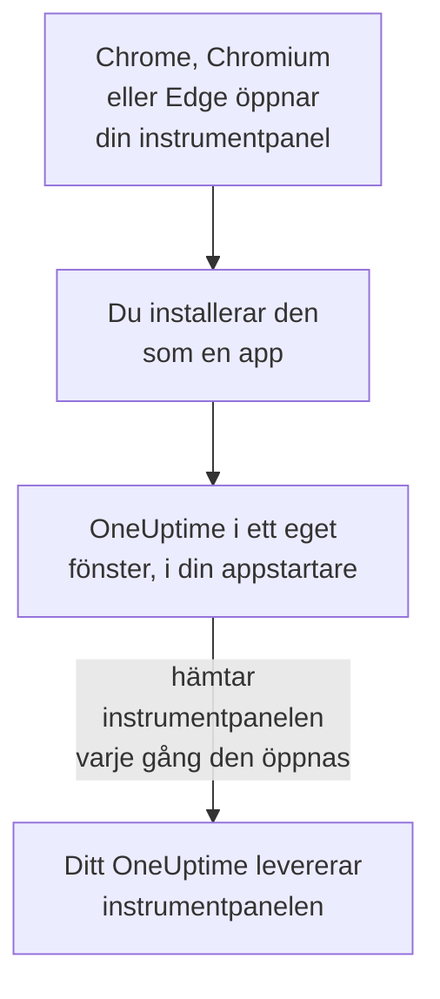

# Linux-installation

OneUptime-instrumentpanelen installeras på Linux som en app, från Google Chrome, Chromium eller Microsoft Edge. Den öppnas i ett eget fönster, med en egen post i skrivbordets appstartare, och kan visa aviseringar. Det finns inget att ladda ner: appen är instrumentpanelen i ditt OneUptime, och den är uppdaterad så snart ditt OneUptime är det.

:::cards
- [Installera appen](#installera-appen): Från Chrome, Chromium eller Edge.
- [Öppna den från din appstartare](#öppna-den-från-din-appstartare): Som vilken annan skrivbordsapp som helst.
- [Få aviseringar på den här datorn](#få-aviseringar-på-den-här-datorn): Registrera webbläsaren för push-aviseringar.
- [Felsökning](#felsökning): Ingen installationsikon, inga aviseringar, ingen post i appstartaren.
:::

## Så fungerar skrivbordsappen

Den installerade appen delar inloggning, inställningar och aviseringstillstånd med sin webbläsare. Stäng webbläsaren, så fortsätter appen i sitt eget fönster.

## Innan du börjar

- Ett Linux-skrivbord med en aktuell Google Chrome, Chromium eller Microsoft Edge.
- Adressen till ditt OneUptime, över HTTPS: `https://oneuptime.com` på OneUptime Cloud, eller din egen, till exempel `https://oneuptime.example.com`.
- Ett konto som du kan logga in på instrumentpanelen med.

## Installera appen

:::tabs
@tab Chrome
1. Öppna ditt OneUptime i Chrome eller Chromium och logga in.
2. Klicka på installationsikonen till höger i adressfältet på valfri sida i instrumentpanelen, och sedan på **Installera**. Eller öppna **⋮ → Casta, spara och dela → Installera sidan som app…**.
3. Chrome öppnar OneUptime i ett eget fönster och lägger till det i din appstartare.
@tab Edge
1. Öppna ditt OneUptime i Edge och logga in.
2. Klicka på installationsikonen till höger i adressfältet på valfri sida i instrumentpanelen, och sedan på **Installera**. Eller öppna **Inställningar med mera (…) → Fler verktyg → Appar → Installera den här webbplatsen som en app**.
3. Edge öppnar OneUptime i ett eget fönster och lägger till det i din appstartare.
:::

Installera från en sida i instrumentpanelen, efter att du har loggat in: inloggningssidan är inte appen.

## Öppna den från din appstartare

Webbläsaren lägger till en skrivbordspost för appen, en `.desktop`-fil i `~/.local/share/applications`, så att OneUptime visas i GNOME, KDE Plasma och andra appstartare. Fäst den i din docka eller panel därifrån, som vilken annan app som helst.

## Få aviseringar på den här datorn

Appen visar aviseringar genom sin webbläsare, när du har registrerat webbläsaren för push-aviseringar i varje projekt du vill få dem från.

:::steps
### Öppna dina push-enheter
Öppna **Användarinställningar → Aviseringsmetoder** och fliken **Push Notifications** i appen.

### Registrera den här webbläsaren
Klicka på **Registrera enhet**, behåll det föreslagna **Enhetsnamn**, till exempel `Chrome on Linux`, eller ändra det, och klicka på **Registrera enhet** igen. När webbläsaren frågar om OneUptime får visa aviseringar väljer du **Tillåt**.

### Skicka ett test
Klicka på **Send Test Notification** i dialogrutan **Browser Registered**. Ditt skrivbord visar den genom sin aviseringstjänst; visas ingenting, se [Felsökning](#felsökning).
:::

En webbläsare kan inte ringa igenom skrivbordets Stör ej. Använd mobilappen med kritiska larm för larm som måste väcka dig: se [Android-installation](/docs/mobile-desktop-apps/android-installation#ring-igenom-tyst-läge).

På ett OneUptime i egen drift behöver webbläsaraviseringar serverns VAPID-nycklar: se [Push-aviseringar](/docs/self-hosted/push-notifications#egeninstallerad-konfiguration).

## Uppdateringar

Det finns inget att uppdatera. Appen hämtar instrumentpanelen från ditt OneUptime varje gång den öppnas, så den ändras när ditt OneUptime uppgraderas. Har ett fönster varit öppet sedan uppgraderingen laddar du om det med Ctrl+R.

## Avinstallera

:::tabs
@tab Chrome
Öppna menyn **⋮** i appens fönster, välj objektet som avinstallerar appen och sedan **Ta bort**.
@tab Edge
Öppna `edge://apps` i Edge, välj **Detaljer** för OneUptime och sedan **Avinstallera**.
:::

Att avinstallera appen avregistrerar inte dess webbläsare: den får fortfarande aviseringar. Vill du stoppa dem tar du bort webbläsaren under **Användarinställningar → Aviseringsmetoder**, på fliken **Push Notifications**, med **Ta bort**.

## Felsökning

:::details Ingen installationsikon i adressfältet
Öppna en sida i instrumentpanelen efter inloggningen, inte inloggningssidan, och kontrollera att adressen börjar med `https://`: webbläsare installerar bara appar från säkra webbplatser. Visas ikonen fortfarande inte använder du webbläsarens meny som ovan. Andra webbläsare kanske inte installerar webbplatser som appar; använd Chrome, Chromium eller Edge.
:::

:::details Inga aviseringar visas
- Kontrollera under **Användarinställningar → Aviseringsmetoder**, på fliken **Push Notifications**, att den här webbläsaren finns i listan, och skicka en **Testavisering** till den.
- Kontrollera att skrivbordets Stör ej är av och att dess aviseringsinställningar tillåter webbläsaren.
- Blockerar webbläsaren aviseringar för OneUptime, klicka på ikonen till vänster i adressfältet, tillåt aviseringar för webbplatsen och registrera webbläsaren igen.
- På ett OneUptime i egen drift säger dialogrutan **Registrera enhet** när servern saknar VAPID-nycklar.
:::

:::details Appen saknas i appstartaren
Öppna den från webbläsaren i stället: `chrome://apps` i Chrome eller Chromium, `edge://apps` i Edge. En appstartare som bara läser skrivbordsposter vid inloggning visar den när du har loggat ut och in igen.
:::

## Nästa steg

:::cards
- [Android-installation](/docs/mobile-desktop-apps/android-installation): Bli larmad på din telefon, med kritiska larm.
- [Windows-installation](/docs/mobile-desktop-apps/windows-installation): Samma app på Windows.
- [Vanliga frågor och felsökning](/docs/mobile-desktop-apps/faq-troubleshooting): Svar om båda apparna.
- [Ditt konto](/docs/introduction/your-account): Så når OneUptime dig i varje projekt.
:::
