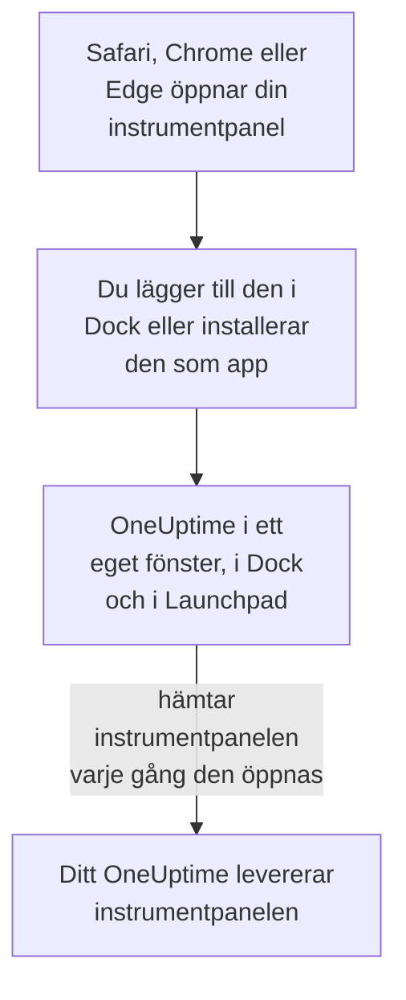

# macOS-installation

OneUptime-instrumentpanelen installeras på en Mac som en app: lägg till den i Dock från Safari, eller installera den från Google Chrome eller Microsoft Edge. Den öppnas i ett eget fönster, med en egen symbol i Dock och i Launchpad, och kan visa notiser. Det finns inget att ladda ner: appen är instrumentpanelen i ditt OneUptime, och den är uppdaterad så snart ditt OneUptime är det.

:::cards
- [Installera appen](#installera-appen): Från Safari, Chrome eller Edge.
- [Behåll den i Dock](#behåll-den-i-dock): Öppna den med ett klick, eller vid inloggning.
- [Få notiser på den här datorn](#få-notiser-på-den-här-datorn): Registrera appen för push-aviseringar.
- [Felsökning](#felsökning): Inget Lägg till i Dock, inga notiser, logga in igen.
:::

## Så fungerar skrivbordsappen

En Safari-webbapp har sin egen inloggning, egna cookies och inställningar, skilda från Safari. En app som installerats från Chrome eller Edge delar dem med den webbläsaren.

## Innan du börjar

- macOS Sonoma 14 eller senare för Safari. Chrome och Edge installerar appar på alla macOS-versioner de körs på.
- Adressen till ditt OneUptime, över HTTPS: `https://oneuptime.com` på OneUptime Cloud, eller din egen, till exempel `https://oneuptime.example.com`.
- Ett konto som du kan logga in på instrumentpanelen med.

## Installera appen

:::tabs
@tab Safari
1. Öppna ditt OneUptime i Safari och logga in.
2. Välj **Arkiv → Lägg till i Dock** på valfri sida i instrumentpanelen, eller klicka på delningsknappen i verktygsfältet och sedan på **Lägg till i Dock**.
3. Behåll namnet eller ändra det, och klicka på **Lägg till**.
4. Öppna OneUptime från Dock och logga in en gång till: webbappen delar inte Safaris inloggning.
@tab Chrome
1. Öppna ditt OneUptime i Chrome och logga in.
2. Klicka på installationsikonen till höger i adressfältet på valfri sida i instrumentpanelen, och sedan på **Installera**. Eller öppna **⋮ → Casta, spara och dela → Installera sidan som app…**.
3. Chrome öppnar OneUptime i ett eget fönster och lägger till det i Launchpad.
@tab Edge
1. Öppna ditt OneUptime i Edge och logga in.
2. Klicka på installationsikonen till höger i adressfältet på valfri sida i instrumentpanelen, och sedan på **Installera**. Eller öppna **Inställningar med mera (…) → Fler verktyg → Appar → Installera den här webbplatsen som en app**.
3. Edge öppnar OneUptime i ett eget fönster och lägger till det i Launchpad.
:::

Installera från en sida i instrumentpanelen, efter att du har loggat in: inloggningssidan är inte appen. Safari sparar webbappen i mappen Program i din hemmapp.

## Behåll den i Dock

- **Dock.** Kontrollklicka på appens symbol i Dock medan den är öppen och välj **Alternativ → Behåll i Dock**. En Safari-webbapp finns redan i Dock.
- **Öppna vid inloggning.** Kontrollklicka på symbolen i Dock och välj **Alternativ → Öppna vid inloggning**.
- **Spotlight.** Tryck på kommando-mellanslag och skriv OneUptime.

## Få notiser på den här datorn

Appen visar notiser när du har registrerat den för push-aviseringar, i varje projekt du vill få dem från. Registrera Safari-webbappen inifrån själva webbappen: den är en webbläsare i sig. En app som installerats från Chrome eller Edge registreras med sin webbläsare.

:::steps
### Öppna dina push-enheter
Öppna **Användarinställningar → Aviseringsmetoder** och fliken **Push Notifications** i appen.

### Registrera den här appen
Klicka på **Registrera enhet**, behåll det föreslagna **Enhetsnamn**, till exempel `Safari on macOS`, eller ändra det, och klicka på **Registrera enhet** igen. När macOS eller webbläsaren frågar om OneUptime får skicka notiser väljer du **Tillåt**.

### Skicka ett test
Klicka på **Send Test Notification** i dialogrutan **Browser Registered**. Visas ingenting, titta på datorns notisinställningar: se [Felsökning](#felsökning).
:::

En webbläsare kan inte ringa igenom ett Fokus som Stör ej. Använd mobilappen med kritiska larm för larm som måste väcka dig: se [iOS-installation](/docs/mobile-desktop-apps/ios-installation#ring-igenom-tyst-läge).

På ett OneUptime i egen drift behöver webbläsaraviseringar serverns VAPID-nycklar: se [Push-aviseringar](/docs/self-hosted/push-notifications#egeninstallerad-konfiguration).

## Uppdateringar

Det finns inget att uppdatera. Appen hämtar instrumentpanelen från ditt OneUptime varje gång den öppnas, så den ändras när ditt OneUptime uppgraderas. Har ett fönster varit öppet sedan uppgraderingen laddar du om det med kommando-R.

## Avinstallera

:::tabs
@tab Safari
Öppna din hemmapp i Finder, sedan dess mapp Program, och dra OneUptime till papperskorgen.
@tab Chrome
Öppna menyn **⋮** i appens fönster, välj objektet som avinstallerar appen och sedan **Ta bort**.
@tab Edge
Öppna `edge://apps` i Edge, välj **Detaljer** för OneUptime och sedan **Avinstallera**.
:::

Att avinstallera appen avregistrerar den inte: dess webbläsare får fortfarande notiser. Vill du stoppa dem tar du bort den under **Användarinställningar → Aviseringsmetoder**, på fliken **Push Notifications**, med **Ta bort**.

## Felsökning

:::details Inget Lägg till i Dock i Safari
Safari lägger till webbappar i Dock från och med macOS Sonoma 14. Uppdatera macOS, eller installera appen från Chrome eller Edge i stället.
:::

:::details Inga notiser visas
- Kontrollera under **Användarinställningar → Aviseringsmetoder**, på fliken **Push Notifications**, att appen eller dess webbläsare finns i listan, och skicka en **Testavisering**.
- Öppna **Systeminställningar → Notiser** på datorn och kontrollera att OneUptime, eller webbläsaren det installerades från, får skicka notiser, och att inget Fokus håller tillbaka dem.
- Blockerar webbläsaren notiser för OneUptime, tillåt dem i dess inställningar för webbplatsen och registrera igen.
- På ett OneUptime i egen drift säger dialogrutan **Registrera enhet** när servern saknar VAPID-nycklar.
:::

:::details Appen ber dig logga in igen
En Safari-webbapp har sin egen inloggning: logga in i appen. En app som installerats från Chrome eller Edge delar sin webbläsares inloggning, så loggar du ut i webbläsaren, eller rensar dess cookies, loggas den också ut.
:::

## Nästa steg

:::cards
- [iOS-installation](/docs/mobile-desktop-apps/ios-installation): Bli larmad på din iPhone, med kritiska larm.
- [Windows-installation](/docs/mobile-desktop-apps/windows-installation): Samma app på Windows.
- [Vanliga frågor och felsökning](/docs/mobile-desktop-apps/faq-troubleshooting): Svar om båda apparna.
- [Ditt konto](/docs/introduction/your-account): Så når OneUptime dig i varje projekt.
:::
