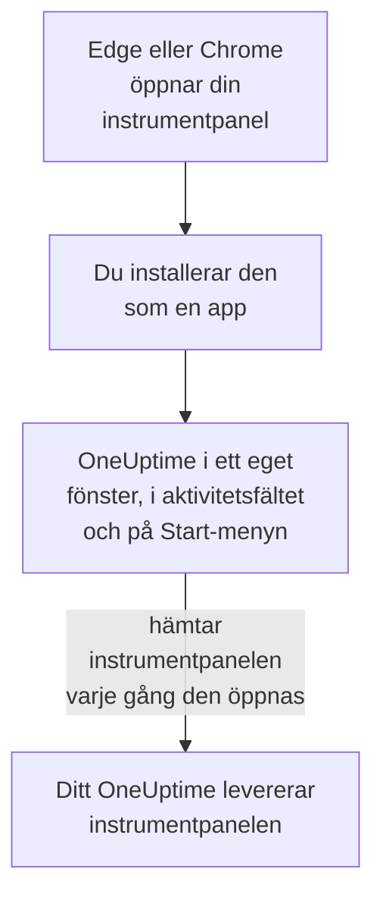

# Windows-installation

OneUptime-instrumentpanelen installeras på Windows som en app, från Microsoft Edge eller Google Chrome. Den öppnas i ett eget fönster, med en egen ikon i aktivitetsfältet och på Start-menyn, och kan visa aviseringar. Det finns inget att ladda ner: appen är instrumentpanelen i ditt OneUptime, och den är uppdaterad så snart ditt OneUptime är det.

:::cards
- [Installera appen](#installera-appen): Från Edge eller Chrome, med några få klick.
- [Fäst den och starta den med Windows](#fäst-den-och-starta-den-med-windows): Ha den ett klick bort.
- [Få aviseringar på den här datorn](#få-aviseringar-på-den-här-datorn): Registrera webbläsaren för push-aviseringar.
- [Felsökning](#felsökning): Ingen installationsikon, inga aviseringar, logga in igen.
:::

## Så fungerar skrivbordsappen

Den installerade appen delar inloggning, inställningar och aviseringstillstånd med sin webbläsare. Stäng webbläsaren, så fortsätter appen i sitt eget fönster.

## Innan du börjar

- Windows 10 eller Windows 11, med en aktuell Microsoft Edge eller Google Chrome.
- Adressen till ditt OneUptime, över HTTPS: `https://oneuptime.com` på OneUptime Cloud, eller din egen, till exempel `https://oneuptime.example.com`.
- Ett konto som du kan logga in på instrumentpanelen med.

## Installera appen

:::tabs
@tab Edge
1. Öppna ditt OneUptime i Edge och logga in.
2. Klicka på installationsikonen till höger i adressfältet på valfri sida i instrumentpanelen, och sedan på **Installera**. Eller öppna **Inställningar med mera (…) → Fler verktyg → Appar → Installera den här webbplatsen som en app**.
3. Edge öppnar OneUptime i ett eget fönster och erbjuder kanske att fästa det i aktivitetsfältet eller på Start.
@tab Chrome
1. Öppna ditt OneUptime i Chrome och logga in.
2. Klicka på installationsikonen till höger i adressfältet på valfri sida i instrumentpanelen, och sedan på **Installera**. Eller öppna **⋮ → Casta, spara och dela → Installera sidan som app…**.
3. Chrome öppnar OneUptime i ett eget fönster och lägger till det på Start-menyn.
:::

Installera från en sida i instrumentpanelen, efter att du har loggat in: inloggningssidan är inte appen. Sök efter OneUptime på Start-menyn för att öppna den senare.

## Fäst den och starta den med Windows

- **Aktivitetsfältet.** Högerklicka på appens ikon i aktivitetsfältet medan den är öppen och välj **Fäst i aktivitetsfältet**.
- **Starta med Windows.** Öppna `edge://apps` i Edge, välj **Detaljer** för OneUptime och slå på **Starta automatiskt vid inloggning på enheten**. Samma sida fäster appen i aktivitetsfältet eller på Start, eller lägger en genväg på skrivbordet.

## Få aviseringar på den här datorn

Appen visar aviseringar genom sin webbläsare, när du har registrerat webbläsaren för push-aviseringar i varje projekt du vill få dem från.

:::steps
### Öppna dina push-enheter
Öppna **Användarinställningar → Aviseringsmetoder** och fliken **Push Notifications** i appen.

### Registrera den här webbläsaren
Klicka på **Registrera enhet**, behåll det föreslagna **Enhetsnamn**, till exempel `Edge on Windows`, eller ändra det, och klicka på **Registrera enhet** igen. När webbläsaren frågar om OneUptime får visa aviseringar väljer du **Tillåt**.

### Skicka ett test
Klicka på **Send Test Notification** i dialogrutan **Browser Registered**. Visas ingenting, titta på Windows egna aviseringsinställningar: se [Felsökning](#felsökning).
:::

En webbläsare ringer inte högre än Windows tillåter: den kan inte åsidosätta Stör ej. Använd mobilappen med kritiska larm för larm som måste väcka dig: se [Android-installation](/docs/mobile-desktop-apps/android-installation#ring-igenom-tyst-läge) eller [iOS-installation](/docs/mobile-desktop-apps/ios-installation#ring-igenom-tyst-läge).

På ett OneUptime i egen drift behöver webbläsaraviseringar serverns VAPID-nycklar: se [Push-aviseringar](/docs/self-hosted/push-notifications#egeninstallerad-konfiguration).

## Uppdateringar

Det finns inget att uppdatera. Appen hämtar instrumentpanelen från ditt OneUptime varje gång den öppnas, så den ändras när ditt OneUptime uppgraderas. Har ett fönster varit öppet sedan uppgraderingen laddar du om det med Ctrl+R.

## Avinstallera

:::tabs
@tab Edge
Öppna `edge://apps`, välj **Detaljer** för OneUptime och sedan **Avinstallera**.
@tab Chrome
Öppna menyn **⋮** i appens fönster, välj objektet som avinstallerar appen och sedan **Ta bort**.
:::

Windows visar också appen under **Inställningar → Appar → Installerade appar**, där **Avinstallera** också tar bort den.

Att avinstallera appen avregistrerar inte dess webbläsare: den får fortfarande aviseringar. Vill du stoppa dem tar du bort webbläsaren under **Användarinställningar → Aviseringsmetoder**, på fliken **Push Notifications**, med **Ta bort**.

## Felsökning

:::details Ingen installationsikon i adressfältet
Öppna en sida i instrumentpanelen efter inloggningen, inte inloggningssidan, och kontrollera att adressen börjar med `https://`: webbläsare installerar bara appar från säkra webbplatser. Visas ikonen fortfarande inte använder du webbläsarens meny som ovan. Andra webbläsare kanske inte installerar webbplatser som appar; använd Edge eller Chrome.
:::

:::details Inga aviseringar visas
- Kontrollera under **Användarinställningar → Aviseringsmetoder**, på fliken **Push Notifications**, att den här webbläsaren finns i listan, och skicka en **Testavisering** till den.
- Öppna **Inställningar → System → Meddelanden** i Windows: aviseringar måste vara på, även för webbläsaren, och Stör ej av. Windows 10 kallar sidan ”Meddelanden och åtgärder”.
- Blockerar webbläsaren aviseringar för OneUptime, klicka på ikonen till vänster i adressfältet, tillåt aviseringar för webbplatsen och registrera webbläsaren igen.
- På ett OneUptime i egen drift säger dialogrutan **Registrera enhet** när servern saknar VAPID-nycklar.
:::

:::details Appen ber dig logga in igen
Appen delar sin webbläsares inloggning. Loggar du ut i webbläsaren, eller rensar dess cookies, loggas appen också ut.
:::

## Nästa steg

:::cards
- [macOS-installation](/docs/mobile-desktop-apps/macos-installation): Samma app på en Mac.
- [Android-installation](/docs/mobile-desktop-apps/android-installation): Bli larmad på din telefon.
- [Vanliga frågor och felsökning](/docs/mobile-desktop-apps/faq-troubleshooting): Svar om båda apparna.
- [Ditt konto](/docs/introduction/your-account): Så når OneUptime dig i varje projekt.
:::
