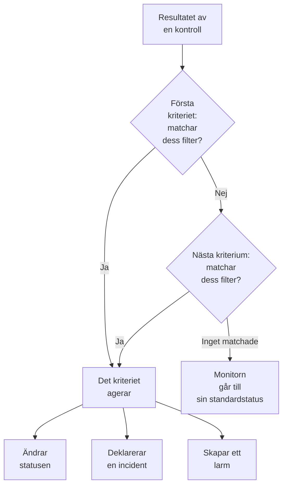
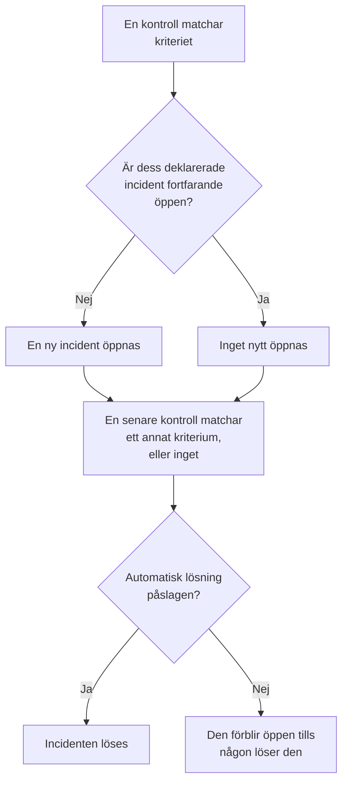

# Monitorkriterier och statusar

En monitors kriterier avgör vad varje kontroll betyder: om monitorn är uppe eller nere, och om OneUptime deklarerar en incident eller skapar ett larm. Statusar är ditt projekts lista över vad en monitor kan vara, från **Fungerar** till **Offline**. Den här sidan förklarar båda för alla monitortyper; varje typs egen sida listar de filter den erbjuder.

:::cards
- [Hur kriterier avgör](#hur-kriterier-avgör): Uppifrån och ned, och den första matchningen vinner.
- [Vad ett kriterium innehåller](#vad-ett-kriterium-innehåller): Filter, ett matchningsvillkor, åtgärder och inställningar.
- [Ändra en monitors kriterier](#ändra-en-monitors-kriterier): Redigera, lägg till, ordna om och testa kriterier.
- [Monitorstatusar](#monitorstatusar): De inbyggda statusarna och dina egna statusar.
:::

## Hur kriterier avgör

Varje gång en monitor kontrolleras bedömer dess kriterier resultatet uppifrån och ned i listan. Det första kriteriet vars filter matchar avgör vad som händer, och kriterierna under det tittas inte på för den kontrollen. Om inget matchar går monitorn till sin **Standardstatus för övervakning**.

Ordningen är en del av regeln. En ny monitor listar sina kriterier från det värsta fallet: offline, sedan en varning där typen har en (ett certifikat eller en domän som snart går ut), sedan online. Ett brett friskt kriterium, som **Is Online** satt till **Sant**, matchar nästan varje kontroll, så det kommer sist: ovanför de andra skulle det matcha först varje gång, och de andra skulle aldrig agera.

Ett kriterium som matchar men inte ändrar någon status avgör ändå kontrollen: monitorn behåller sin status, och kriterierna under det väntar på nästa kontroll. **Standardstatus för övervakning** gäller bara när inget kriterium matchar. För en ny monitor är den **Fungerar**; ändra den under **Fler fält**, under kriterierna.

> [!NOTE]
> En monitor som öppnar en incident eller ett larm per värd, container, disk eller gränssnitt bedömer alla kriterier vid varje kontroll, så två värdar kan matcha två olika kriterier samtidigt. Det är en monitor vars fråga har en **Gruppera efter**, som en mått- eller loggmonitor, eller ett kriterium som anger `*` för varje disk eller gränssnitt. En monitor för inkommande förfrågningar som grupperar incidenter efter ett payload-fält stannar ändå vid den första matchningen.

## Vad ett kriterium innehåller

Öppna ett kriterium: det har ett namn och tre avsnitt, som vart och ett kan fällas ihop till en sammanfattning på en rad.

| Del | Vad den innehåller |
| --- | --- |
| **Kriterienamn** | Namnet i listan över kriterier och i grundorsaken till varje incident och larm som kriteriet öppnar. **Lägg till kriterier** namnger ett nytt kriterium efter dess filter, och namnet följer dem tills du skriver ett eget. |
| **Filter** | Vad kontrollen måste visa, som ett eller flera filter. Kubernetes- och måttmonitorer kallar dem **Alert Rules**. |
| **Åtgärder** | Vad som händer när filtren matchar: ändra statusen, skapa ett larm, deklarera en incident eller någon kombination. |
| **Inställningar** | **Aktivera det här kriteriet**, en valfri **Beskrivning** och, på monitorer för inkommande förfrågningar, **Group incidents and alerts by a payload field**. |

### Filter

Ett filter läser en sak från kontrollen och jämför den: en **Filtertyp** (vad som läses, som **Statuskod för svar**), ett **Filtervillkor** (hur det jämförs, som **Större än**) och ett **Värde**. Monitorer som jämför mått, som Kubernetes- och måttmonitorer, frågar i stället efter ett **Villkor** och en **Tröskel**. Varje monitortyp erbjuder sina egna filtertyper, som listas på dess sida, till exempel [Webbplatsövervakning](/docs/monitor/website-monitor#övervakningskriterier).

Från två filter och uppåt visas **Matchningsvillkor** under dem: **Alla** betyder att varje filter måste matcha, **Valfri** att ett räcker. Ett nytt kriterium börjar på **Alla**.

Filter som mäter varje kontroll, som **Is Online**, **Statuskod för svar** och **Svarstid (i ms)**, erbjuder **Utvärdera dessa kriterier över en tidsperiod**. Det bedömer ett fönster av senaste kontroller i stället för bara den senaste, och börjar på de senaste 5 minuterna med **All Values**, som matchar först när varje kontroll i fönstret har matchat. Se [Utvärdering över en tidsperiod](/docs/monitor/website-monitor#utvärdering-över-en-tidsperiod).

### Åtgärder

Varje åtgärd är en brytare under **Åtgärder**:

| Brytare | Vad den gör |
| --- | --- |
| **När filter matchar, ändra övervakarstatus.** | Flyttar monitorn till den status som valts i **Ändra övervakningsstatus till**. |
| **När filter matchar, skapa ett larm.** | Skapar de larm som är inställda under **Skapa larm**. Ett larm meddelar ditt team och visas aldrig på en statussida. |
| **När filter matchar, deklarera en incident.** | Deklarerar de incidenter som är inställda under **Skapa incident**. Dina statussidor kan visa dem. |

En incident eller ett larm frågar efter en titel, en **Allvarlighetsgrad** och, hopfällda, en beskrivning, ägare, etiketter och jourpolicyer. Titlar och beskrivningar kan innehålla värden från kontrollen, som `{{monitorName}}`: se [Incident- och larmmallar](/docs/monitor/incident-alert-templating). För att larma någon när kriteriet matchar väljer du en policy under **Jour**: se [Jourpolicyer](/docs/on-call/policies).

### Inställningar

**Aktivera det här kriteriet** är påslaget för varje nytt kriterium. Stäng av det för att behålla ett kriterium utan att använda det: det hoppas över vid varje kontroll, ändrar ingen status, öppnar ingenting, och dess rubrik visar **Inaktiverad**.

**Group incidents and alerts by a payload field** öppnar en incident per värde som hittas i en inkommande förfrågan, så att en enda webhook-adress kan hålla flera incidenter öppna. Se [Slå på incidentgruppering](/docs/monitor/incoming-request-monitor#aktivera-gruppering-av-incidenter).

## När incidenter och larm öppnas och stängs

Ett kriterium som deklarerar incidenter öppnar en när det matchar. När monitorn återhämtar sig stängs incidenten av sig själv, om kriteriet säger det.

- **En i taget.** Så länge en incident som ett kriterium har deklarerat fortfarande är öppen, deklarerar samma kriterium ingen ny när det matchar igen. Larm fungerar på samma sätt. En monitor som grupperar efter värd eller payload-fält håller en öppen per värd eller värde, och ett kriterium på en monitor för inkommande e-post med **Öppna en ny incident för varje e-postmeddelande** öppnar en per e-postmeddelande.
- **Stängning.** Vid en senare kontroll där ett annat kriterium matchar, eller inget, löses en incident vars kriterium har **Lös incident automatiskt** påslaget, och likaså ett larm med **Lös larm automatiskt**. Båda finns under **Fler fält** i incidenten eller larmet, och de kriterier som en ny monitor börjar med har dem påslagna.
- **Flera sonder.** En monitor som kontrolleras av mer än en sond ändras bara när dess sonder är överens. Se [Hur kriterier utvärderas](/docs/monitor/create-monitor#så-utvärderas-kriterier).
- **En överordnad monitor som är nere.** På en monitors sida **Konfiguration → Beroenden** anger **Depends On Monitors** de monitorer den är beroende av. Så länge någon av dem har en status som står i **Suppress When Parent Status Is** (vilken offline-status som helst, om fältet lämnas tomt), öppnar monitorn inga incidenter eller larm. Dess status ändras fortfarande, och det som är öppet löses fortfarande.
- **Schemalagt underhåll.** En monitor i en underhållshändelse som pågår kontrolleras inte, så dess kriterier körs inte. Se [Schemalagt underhåll – Översikt](/docs/scheduled-maintenance/index).

För att se hur en kontroll bedömdes öppnar du monitorns **Översikt**: kortet **Monitor-sammanfattning** visar vilket kriterium som matchade och vad varje kriterium gjorde, även en incident som hoppades över eftersom en redan var öppen.

## Ändra en monitors kriterier

:::steps
### Öppna kriteriesidan

Gå till **Monitorer** och öppna monitorn. Fäll ut **Konfiguration** i dess sidomeny och klicka på **Kriterier**. Kortet **Övervakningskriterier** visar varje kriterium, vad det kontrollerar och vad det gör.

### Klicka på Redigera övervakningskriterier

Redigeraren visar varje kriterium utfällt. Klicka på ett kriteriums rubrik för att fälla ihop det till en rad: namnet, hur många filter det har och vad det gör.

### Lägg till, ändra eller ordna om kriterier

**Lägg till kriterier** lägger till ett längst ned, utfällt och namngivet efter dess filter. Dra ett kriterium i handtaget till vänster för att flytta det: den första matchningen vinner, så sätt det värsta fallet först. **Radera kriterier** tar bort ett; en monitor behåller minst ett kriterium.

### Spara kriterierna

Klicka på **Spara ändringar**. Nästa kontroll bedöms efter de nya kriterierna.

### Testa monitorn

På en monitor som sonder kontrollerar klickar du på **Testa monitor** på kortet, väljer en sond under **Välj sond** och klickar på **Kör test**. **Resultat av övervakningstest** visar vad kontrollen hittade.
:::

En manuell monitor har inga kriterier: du sätter dess status själv. Se [Uppdatera status](/docs/monitor/manual-monitor#uppdatera-status).

## Monitorstatusar

En monitor har alltid en av ditt projekts statusar. Ett nytt projekt har tre, från den friskaste till den värsta:

| Status | Plats | Färg | Vad OneUptime gör med den |
| --- | --- | --- | --- |
| **Fungerar** | 1 | Grön | Nya monitorer börjar i den, och den är en ny monitors **Standardstatus för övervakning**. Inbyggd. |
| **Försämrad** | 2 | Gul | Ingenting av sig själv: ett av dina kriterier flyttar en monitor hit. |
| **Offline** | 3 | Röd | En ny monitors offline-kriterium flyttar den hit, och OneUptime behandlar en monitor med den här statusen som nere. Inbyggd. |

Listan är en ordning. Där monitorer visas tillsammans vinner den status som står längst ned i listan: en monitorgrupp, en statussidegrupp och en statussidas samlade status visar var och en den värsta statusen bland sina monitorer.

### Var en status räknas

| Var | Vad statusen avgör |
| --- | --- |
| Listan **Monitorer** | Varje monitors aktuella status. **Ej operativ** listar monitorerna med vilken status som helst utom den fungerande, med en röd siffra bredvid. |
| Statussidor | Färgen på varje rad och dess tillgänglighet: bara statusarna i sidans **Räknas som driftstopp** räknas mot den. En ny statussida börjar med alla statusar utom den fungerande. Se [Välj vad sidan visar](/docs/status-pages/index#välja-vad-som-visas-på-sidan). |
| Monitorgrupper | Gruppens status: den värsta bland dess monitorer. Se [Monitorgrupper](/docs/monitor/monitor-groups). |
| SLO:er | Det driftstopp ett SLO räknar, utifrån dess egen lista över statusar. Se [Vilka statusar som räknas som driftstopp](/docs/slo/introduction#vilka-statusar-som-räknas-som-driftstopp). |
| Beroenden | Om en överordnad monitor håller tillbaka incidenter och larm för monitorerna som beror på den: som standard, så länge den har en offline-status. |

En status som du lägger till senare läggs inte till i listan **Räknas som driftstopp** på en befintlig statussida: lägg till den där själv.

### Lägg till en egen status

:::steps
### Öppna Monitorstatus

Gå till **Övervakare → Inställningar → Monitorstatus**. **Inställningar** är hopfällt i sidomenyn: fäll ut det först. Kortet **Monitor Statusar** listar statusarna från den friskaste till den värsta.

### Skapa statusen

Klicka på **Skapa Monitorstatus** och fyll i **Namn**, **Beskrivning** och **Färg**. Den nya statusen placeras precis ovanför offline-statusen, så att ett avbrott fortfarande räknas som det värsta.

### Sätt den på plats

Dra statusen i dess handtag. En status längre ned i listan räknas som värre än varje status ovanför den.

### Använd den i ett kriterium

En status gör ingenting förrän ett kriterium flyttar monitorer till den. Välj den i **Ändra övervakningsstatus till** på det kriterium som ska sätta den.
:::

Den fungerande statusen och offline-statusen är markerade som **Inbyggd**: du kan byta namn på dem och ändra deras färg, men inte ta bort dem. På OneUptime Cloud kräver det Growth-planen att skapa eller ändra en status. Att hantera statusar kräver rollen Project Owner, Project Admin eller Monitor Admin, eller en anpassad roll med motsvarande behörighet för monitorstatusar.

### Statustidslinjen

Varje statusändring sparas på monitorns **Statustidslinje**: när den började, hur länge den varade, och **Visa orsak** för det kriterium som satte den. **Skapa Monitor Status Händelse** lägger till en status manuellt. På en monitor som sonder kontrollerar sätter nästa kontroll som matchar ett kriterium med en status den statusen igen.

En statusändring meddelar monitorns ägare bara om de har slagit på **Övervakningsstatus ändrad** i sina aviseringsinställningar: den är avstängd från början. En monitor som går tillbaka till sin **Standardstatus för övervakning** eftersom inget kriterium matchade meddelar ingen. Se [Vad som är påslaget för en ny medlem](/docs/notifications/notification-settings#vad-som-är-påslaget-för-en-ny-medlem).

## Arkivera en monitorstatus

Arkivera en status som ditt team inte längre ska använda, i stället för att ta bort den. Arkivering ändrar ingen monitor: En monitor i statusen stannar i den tills dess status ändras, och dess statustidslinje visar den fortfarande.

- **Arkivera** finns i radens meny **⋯**. Den frågar först och listar de monitorkriterier, mallar och statussidor som är inställda på att använda statusen: De fortsätter att använda den tills du ändrar dem.
- **Ingen kan välja den igen.** Ett kriterium, en monitors statusmeny, monitorstatusen för en incident eller en underhållshändelse och en statussidas driftstoppsstatusar utelämnar den. API:et, Terraform och MCP avvisar den.
- **Arkiverade statusar listas för sig**, i det hopfällda avsnittet **Arkiverade monitorstatusar** under tabellen. **Avarkivera** återställer en som den var.
- **De inbyggda statusarna kan inte arkiveras.** Nya monitorer börjar i driftstatusen, och OneUptime behandlar en monitor i offlinestatusen som nere. Deras **Arkivera** är låst, med skälet.

## Felsökning

:::details Webbplatsen är nere, men monitorn förblir Fungerar
Ett kriterium högre upp i listan matchade först. Öppna **Konfiguration → Kriterier** och kontrollera ordningen: det friska kriteriet kommer sist. Kontrollera också att offline-kriteriet har **Aktivera det här kriteriet** påslaget, och att dess åtgärd **När filter matchar, ändra övervakarstatus.** är påslagen med en vald status.
:::

:::details Ingen incident öppnades när monitorn gick ned
Kontrollera kriteriet som matchade: **När filter matchar, deklarera en incident.** måste vara påslaget. En incident deklareras inte så länge samma kriteriums incident fortfarande är öppen, så länge en överordnad monitor i **Depends On Monitors** är nere, eller så länge monitorn är i schemalagt underhåll. Kortet **Monitor-sammanfattning** på monitorns **Översikt** säger vilket det var.
:::

:::details Incidenten förblir öppen efter att monitorn har återhämtat sig
Öppna incidentens kriterium och fäll ut **Fler fält** i dess incident: **Lös incident automatiskt** måste vara påslaget. En incident från ett kriterium som du sedan har tagit bort löses inte av monitorn: lös den manuellt.
:::

:::details Ta bort-knappen för Offline är låst
**Fungerar** och **Offline** är inbyggda: OneUptime flyttar monitorer till dem, så de kan byta namn men inte tas bort. Ta i stället bort en egen status, eller byt namn på den inbyggda.
:::

## Nästa steg

:::cards
- [Skapa en monitor](/docs/monitor/create-monitor): De tre stegen för en ny monitor.
- [Incident- och larmmallar](/docs/monitor/incident-alert-templating): Sätt in värden från kontrollen i titlar och beskrivningar.
- [Monitorgrupper](/docs/monitor/monitor-groups): Samla flera monitorer i en status.
- [Incidenter – Översikt](/docs/incidents/index): Vad som händer efter att ett kriterium har deklarerat en incident.
:::
