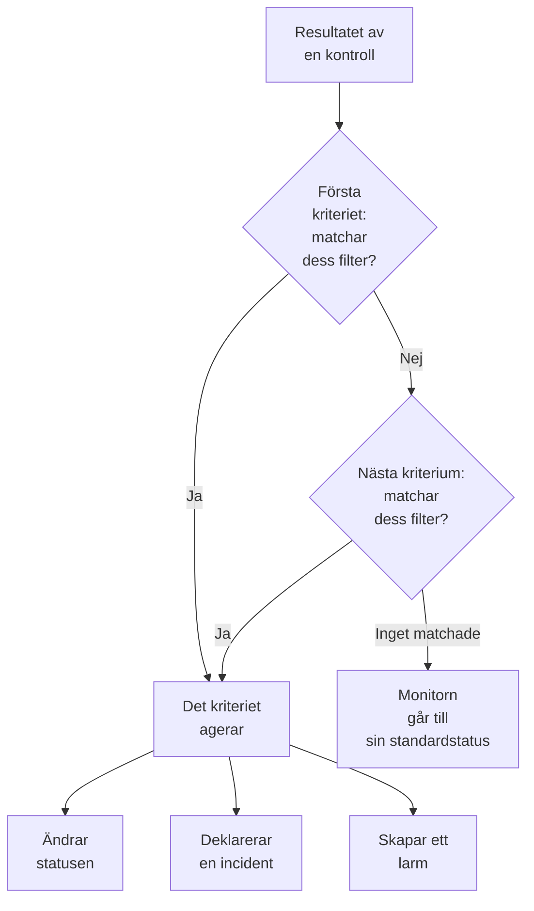
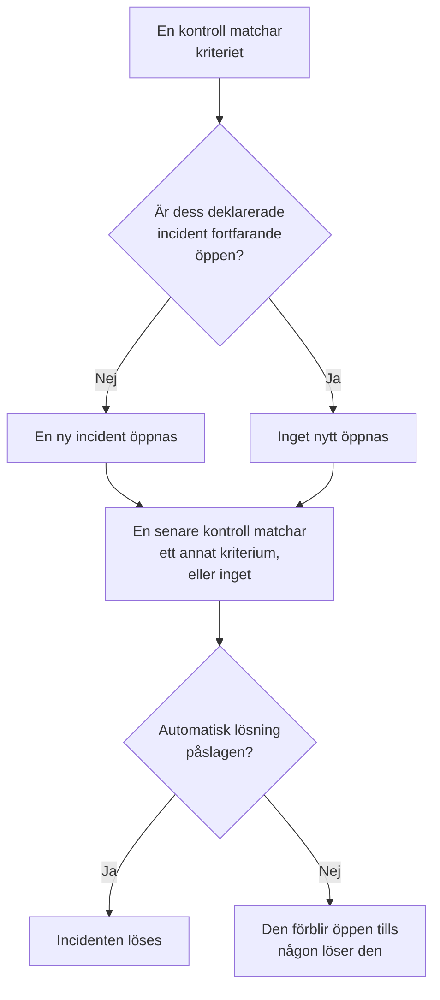

# Kriterier och statusar

En monitors kriterier avgör vad varje kontroll betyder: om monitorn är uppe eller nere, och om OneUptime deklarerar en incident eller skapar ett larm. Statusar är ditt projekts lista över vad en monitor kan vara, från **Fungerar** till **Offline**. Den här sidan förklarar båda för alla monitortyper; varje typs egen sida listar de filter den erbjuder.

:::cards
- [Hur kriterier avgör](#hur-kriterier-avgör): Uppifrån och ned, och den första matchningen vinner.
- [Vad ett kriterium innehåller](#vad-ett-kriterium-innehåller): Filter, ett matchningsvillkor, åtgärder och inställningar.
- [Bedöma ett fönster av kontroller](#bedöma-ett-fönster-av-kontroller): Räkna misslyckade kontroller, upptäck instabilitet, läs av en percentil.
- [Ändra en monitors kriterier](#ändra-en-monitors-kriterier): Redigera, lägg till, ordna om och testa kriterier.
- [Monitorstatusar](#monitorstatusar): De inbyggda statusarna och dina egna statusar.
:::

## Hur kriterier avgör

Varje gång en monitor kontrolleras bedömer dess kriterier resultatet uppifrån och ned i listan. Det första kriteriet vars filter matchar avgör vad som händer, och kriterierna under det tittas inte på för den kontrollen. Om inget matchar går monitorn till sin **Standardstatus för övervakning**. Den behåller i stället sin status så länge ett kriterium som återställer den ännu inte har matchat: se [När ett kriterium återställs](#när-ett-kriterium-återställs).

Ordningen är en del av regeln. En ny monitor listar sina kriterier från det värsta fallet: offline, sedan en varning där typen har en (ett certifikat eller en domän som snart går ut), sedan online. Ett brett friskt kriterium, som **Är online** satt till **Sant**, matchar nästan varje kontroll, så det kommer sist: ovanför de andra skulle det matcha först varje gång, och de andra skulle aldrig agera.

Ett kriterium som matchar men inte ändrar någon status avgör ändå kontrollen: monitorn behåller sin status, och kriterierna under det väntar på nästa kontroll. **Standardstatus för övervakning** gäller bara när inget kriterium matchar. För en ny monitor är den **Fungerar**; ändra den under **Fler fält**, under kriterierna.

> [!NOTE]
> En monitor som öppnar en incident eller ett larm per värd, container, disk eller gränssnitt bedömer alla kriterier vid varje kontroll, så två värdar kan matcha två olika kriterier samtidigt. Det är en monitor vars fråga har en **Gruppera efter**, som en mätvärden- eller loggmonitor, eller ett kriterium som anger `*` för varje disk eller gränssnitt. Detsamma gäller en mätvärdesmonitor som bevakar ett PromQL-uttryck: varje serie som uttrycket returnerar bedöms för sig. En monitor för inkommande förfrågningar som grupperar incidenter efter ett payload-fält stannar ändå vid den första matchningen.
>
> En sådan monitor har ändå en enda status, som sätts av det första kriterium som matchar. Ett kriterium som bara tar tillbaka den till dess **Standardstatus för övervakning** och inte öppnar någon incident eller något larm väntar på värdarna som uppfyllde ett kriterium som sätter en annan status: det matchar när var och en av dem uppfyller det, oavsett vad de andra värdarna gör. Tills dess behåller monitorn sin status, även när inget kriterium matchar, medan varje värds incidenter och larm fortfarande löses var för sig.

## Vad ett kriterium innehåller

Öppna ett kriterium: det har ett namn och tre avsnitt, som vart och ett kan fällas ihop till en sammanfattning på en rad.

| Del | Vad den innehåller |
| --- | --- |
| **Kriterienamn** | Namnet i listan över kriterier och i grundorsaken till varje incident och larm som kriteriet öppnar. **Lägg till kriterier** namnger ett nytt kriterium efter dess filter, och namnet följer dem tills du skriver ett eget. |
| **Filter** | Vad kontrollen måste visa, som ett eller flera filter. Kubernetes- och mätvärdesmonitorer kallar dem **Larmregler**. |
| **Åtgärder** | Vad som händer när filtren matchar: ändra statusen, skapa ett larm, deklarera en incident eller någon kombination. |
| **Inställningar** | **Aktivera det här kriteriet**, en valfri **Beskrivning**, när det återställs och när det utvärderas och, på övervakningar av inkommande förfrågningar, **Group incidents and alerts by a payload field**. |

### Filter

Ett filter läser en sak från kontrollen och jämför den: en **Filtertyp** (vad som läses, som **Statuskod för svar**), ett **Filtervillkor** (hur det jämförs, som **Större än**) och ett **Värde**. Monitorer som jämför mätvärden, som Kubernetes- och mätvärdesmonitorer, frågar i stället efter ett **Villkor** och en **Tröskel**. Varje monitortyp erbjuder sina egna filtertyper, som listas på dess sida, till exempel [Webbplatsövervakning](/docs/monitor/website-monitor#övervakningskriterier).

Från två filter och uppåt visas **Matchningsvillkor** under dem: **Alla** betyder att varje filter måste matcha, **Valfri** att ett räcker. Ett nytt kriterium börjar på **Alla**.

Filter som mäter varje kontroll, som **Är online**, **Statuskod för svar** och **Svarstid (i ms)**, erbjuder **Utvärdera dessa kriterier över en tidsperiod**. Det bedömer ett fönster av senaste kontroller i stället för bara den senaste, och börjar på de senaste 5 minuterna med **Alla värden**, som matchar först när varje kontroll i fönstret har matchat. Fönstret kan vara upp till 24 timmar långt och räkna kontrollerna, som [Bedöma ett fönster av kontroller](#bedöma-ett-fönster-av-kontroller) förklarar. Se [Utvärdering över en tidsperiod](/docs/monitor/website-monitor#utvärdering-över-en-tidsperiod).

### Åtgärder

Varje åtgärd är en brytare under **Åtgärder**:

| Brytare | Vad den gör |
| --- | --- |
| **När filter matchar, ändra monitorstatus.** | Flyttar monitorn till den status som valts i **Ändra övervakningsstatus till**. |
| **När filter matchar, skapa ett larm.** | Skapar de larm som är inställda under **Skapa larm**. Ett larm meddelar ditt team och visas aldrig på en statussida. |
| **När filter matchar, deklarera en incident.** | Deklarerar de incidenter som är inställda under **Skapa incident**. Dina statussidor kan visa dem. |

En incident eller ett larm frågar efter en titel, en **Allvarlighetsgrad** och, hopfällda, en beskrivning, ägare, etiketter och jourpolicyer. Titlar och beskrivningar kan innehålla värden från kontrollen, som `{{monitorName}}`: se [Incident- och larmmallar](/docs/monitor/incident-alert-templating). För att larma någon när kriteriet matchar väljer du en policy under **Jour**: se [Jourpolicyer](/docs/on-call/policies).

### Inställningar

**Aktivera det här kriteriet** är påslaget för varje nytt kriterium. Stäng av det för att behålla ett kriterium utan att använda det: det hoppas över vid varje kontroll, ändrar ingen status, öppnar ingenting, och dess rubrik visar **Inaktiverad**.

**Group incidents and alerts by a payload field** öppnar en incident per värde som hittas i en inkommande förfrågan, så att en enda webhook-adress kan hålla flera incidenter öppna. Se [Slå på incidentgruppering](/docs/monitor/incoming-request-monitor#aktivera-gruppering-av-incidenter).

**Återställ bara när ett eget villkor är uppfyllt** och **Utvärdera det här kriteriet bara vissa dagar och tider** är avstängda för ett nytt kriterium. Se [När ett kriterium återställs](#när-ett-kriterium-återställs) och [Bara vissa dagar och tider](#bara-vissa-dagar-och-tider).

## Bedöma ett fönster av kontroller

Med **Utvärdera dessa kriterier över en tidsperiod** markerat anger **Utvärdera** hur fönstrets kontroller bedöms, och **Under de senaste** hur långt fönstret är, från 2 minuter till 24 timmar. Filtrets eget villkor, till exempel **Är online** satt till **Falskt**, säger vad varje kontroll måste visa.

| Utvärdera | Matchar när |
| --- | --- |
| **Alla värden** | Varje kontroll i fönstret uppfyllde villkoret. |
| **Minst ett värde** | Minst en kontroll i fönstret uppfyllde villkoret. |
| **Genomsnitt**, **Summa**, **Maxvärde**, **Minvärde** | Det värdet av fönstrets värden uppfyller villkoret, till exempel en genomsnittlig svarstid över 300 ms. |
| **Percentil** | Percentilen som valts under **Percentil**, från p50 till p99, uppfyller villkoret: p95 över 300 ms betyder att de långsammaste 5 % av kontrollerna ligger över 300 ms. |
| **Antal** | Antalet kontroller som uppfyllde villkoret jämförs som angivet under **Kontroller som matchar**: till exempel **Större än** 30. |
| **Procentandel** | Deras andel av fönstrets kontroller jämförs som angivet under **Andel kontroller som matchar**: till exempel **Större än** 10 %. |
| **Statusbyten** | Antalet gånger kontrollerna växlade mellan att uppfylla villkoret och inte jämförs som angivet under **Antal byten**. En enhet som går ner och kommer upp igen växlar två gånger. |

En mening under fönstrets inställningar återger filtret som det är inställt: ”Kontrollera: "Är online" är falskt vid fler än 30 kontroller under den senaste perioden på 8 timmar”.

- **Varje sond för sig.** **Antal**, **Procentandel** och **Statusbyten** räknar kontrollerna från den sond som gjorde kontrollen, så en övervakning som kontrolleras från tre sonder räknar inte tre gånger så snabbt, och dess sonder måste sedan vara överens som för vilket kriterium som helst.
- **Ett fönster som ännu inte är fullt.** Tills kontrollerna når tillbaka till fönstrets början har en övervakning som just startat färre kontroller än den kommer att ha. **Antal** och **Statusbyten** matchar tidigt när de redan är förbi **Större än** eller **Större än eller lika med**, eftersom fler kontroller bara ökar dem; allt annat väntar på ett fullt fönster.
- **Ett fönster utan kontroller.** Så länge fönstret saknar kontroller, eller ännu inte är fullt, avgör **Om ingen data**: **Ignore** väntar, **Utlösare** matchar, och **Treat As Zero** bedömer det som om de saknade kontrollerna inte hade uppfyllt villkoret.

Genomsnitt och percentiler läser värdena från alla sonders kontroller, som **Genomsnitt** alltid har gjort. **Antal**, **Procentandel** och **Statusbyten** erbjuds för varje filter som erbjuds ett fönster: på Website-, API-, Ping-, IP- och Port-övervakningar, för en servers CPU, minne, diskar och last, för en nätverksenhets **SNMP-enhet är online** och svarstid, samt på DNS-, NTP-, databas-, externa statussid- och sondstatusövervakningar. En Server-övervaknings **Är online** räknas inte: den bedöms efter tiden sedan servern senast rapporterade. Metrics- och andra telemetriövervakningar bedömer i stället tidsintervallet för sin fråga, med frågans egen aggregering, som också läser percentiler.

### Exempel: en åtkomstpunkt som är nere, och en som är instabil

En Ping-övervakning kontrollerar en åtkomstpunkt på kontoret varje minut. Innan fönster kunde räkna kontroller såg en åtkomstpunkt som hela tiden föll bort ut som en som var nere, eller som ingenting alls. Dessa tre kriterier, i den här ordningen, skiljer de två åt:

| Kriterium | Filter | Utvärdera | Ändrar statusen till |
| --- | --- | --- | --- |
| Åtkomstpunkten är nere | **Är online** är **Falskt** | **Alla värden**, **Under de senaste** 5 minuter | **Offline**, och deklarerar en avbrottsincident |
| Åtkomstpunkten är instabil | **Är online** är **Falskt** | **Statusbyten**, **Större än** 5, **Under de senaste** 1 timme | **Försämrad**, och deklarerar en instabilitetsincident |
| Åtkomstpunkten är online | **Är online** är **Sant** | Inte över en tidsperiod | **Fungerar** |

För det andra slår du på **Återställ bara när ett eget villkor är uppfyllt** med **Statusbyten**, **Mindre än eller lika med** 1, **Under de senaste** 1 timme: instabilitetsincidenten förblir öppen tills åtkomstpunkten har varit stabil i en timme, i stället för att stängas den första minuten den är uppe. För att larma när den missar mer än 30 ping på 8 timmar ställer du i stället in det andra kriteriet på **Antal**, **Större än** 30, **Under de senaste** 8 timmar.

## När ett kriterium återställs

Ett kriterium slutar verka så snart dess filter slutar matcha: vid den kontrollen löses dess incident och larm, när **Lös incident automatiskt** och **Lös larm automatiskt** är påslagna, och övervakningen går vidare till nästa kriterium som matchar.

**Återställ bara när ett eget villkor är uppfyllt** håller kriteriet i kraft efter att dess filter slutar matcha, tills filtren under **Återställs när** matchar. De börjar som motsatsen till kriteriets filter, över de senaste 10 minuterna, och kan använda allt ett filter erbjuder, till exempel ett fönster som räknar kontroller. Ett kriterium är i kraft så länge övervakningen har den status det sätter eller en incident eller ett larm som det deklarerade är öppet. Medan det håller är det en matchning på sin plats i listan: ett kriterium ovanför som matchar tar ändå över.

När inget kriterium matchar behåller en övervakning som ett kriterium har flyttat från dess **Standardstatus för övervakning** den status den har, så länge den också har ett kriterium som bara för tillbaka den till den statusen och inte öppnar något. Det är återställningsmarginalen: mallarna utlöses över 90 % och kommer tillbaka vid 81 % eller lägre, så vid 89 % stannar övervakningen där den är. Dess incidenter och larm löses ändå när deras eget kriterium slutar matcha. En övervakning utan ett sådant kriterium går till sin **Standardstatus för övervakning**, som den alltid har gjort.

## Bara vissa dagar och tider

**Utvärdera det här kriteriet bara vissa dagar och tider** anger dagarna, **Starttid** och **Sluttid** samt **Tidszon**, som börjar som din. Utanför de tiderna hoppas kriteriet över som ett inaktiverat kriterium: det matchar ingenting, så det som det öppnade löses, och utvärderingsloggen säger att det var utanför sina tider. Tiderna läses på den tidszonens klocka, så 08:00 förblir 08:00 när klockan ställs om, och tider som slutar tidigare än de börjar fortsätter in i nästa morgon.

## När incidenter och larm öppnas och stängs

Ett kriterium som deklarerar incidenter öppnar en när det matchar. När monitorn återhämtar sig stängs incidenten av sig själv, om kriteriet säger det.

- **En i taget.** Så länge en incident som ett kriterium har deklarerat fortfarande är öppen, deklarerar samma kriterium ingen ny när det matchar igen. Larm fungerar på samma sätt. En monitor som grupperar efter värd eller payload-fält håller en öppen per värd eller värde, och ett kriterium på en monitor för inkommande e-post med **Öppna en ny incident för varje e-postmeddelande** öppnar en per e-postmeddelande.
- **Stängning.** Vid en senare kontroll där ett annat kriterium matchar, eller inget, löses en incident vars kriterium har **Lös incident automatiskt** påslaget, och likaså ett larm med **Lös larm automatiskt**. Båda finns under **Fler fält** i incidenten eller larmet, och de kriterier som en ny monitor börjar med har dem påslagna.
- **Flera sonder.** En monitor som kontrolleras av mer än en sond ändras bara när dess sonder är överens. Se [Hur kriterier utvärderas](/docs/monitor/create-monitor#så-utvärderas-kriterier).
- **En överordnad monitor som är nere.** På en monitors sida **Konfiguration → Beroenden** anger **Beror på monitorer** de monitorer den är beroende av. Så länge någon av dem har en status som står i **Undertryck när överordnad status är** (vilken offline-status som helst, om fältet lämnas tomt), öppnar monitorn inga incidenter eller larm. Dess status ändras fortfarande, och det som är öppet löses fortfarande.
- **Schemalagt underhåll.** En monitor i en underhållshändelse som pågår kontrolleras inte, så dess kriterier körs inte. Se [Schemalagt underhåll – Översikt](/docs/scheduled-maintenance/index).

För att se hur en kontroll bedömdes öppnar du monitorns **Översikt**: kortet **Monitor-sammanfattning** visar vilket kriterium som matchade och vad varje kriterium gjorde, även en incident som hoppades över eftersom en redan var öppen.

## Vem som får besked när den går ner

**När den går ner** berättar med några få meningar vad som händer när övervakningen fallerar och vem som får besked: statusen den sätter, incidenten eller larmet den öppnar, vem som får e-post och vem den larmar, med namn. Allt som skulle hindra någon från att få besked står på en egen rad, med en länk till sidan där det åtgärdas. Du hittar det i en monitors **Översikt**, under kriterierna på sidan **Kriterier**, i kriteriesteget i **Skapa monitor** för den monitor du håller på att skapa, och i den guidade konfigurationen för webbplatser.

Det tar fram kedjan som en riktig incident eller ett riktigt larm gör: med projektets ägarregler, sekretessregler, etikettregler och jourregler, incidentregeln för larm som gör ett larm till en incident, och vem den första eskaleringsregeln i varje jourpolicy når just nu. En jourregel som frågar vem som äger ett larm (**Ägare av larm**) matchas mot de ägare larmet kommer att ha: de personer och team som kriterierna anger, ägarna till nätverksenheten som övervakningen bevakar, och dem som ägarregler lägger till. En platshållare i titeln som bara en kontroll fyller i visas som den är skriven. **Visa kedjan** öppnar den rad för rad:

| Rad | Vad den säger |
| --- | --- |
| **Status** | Statusen som kriterierna sätter. |
| **Öppnar** | Incidenten eller larmet, dess allvarlighetsgrad inom parentes och dess titel. |
| **E-post** | Vem e-postmeddelandet om skapandet når: dess ägare, de ägare som ägarregler lägger till, eller Projektägarna när det inte finns några. Den som larmet når först får inte också e-post som ägare. |
| **Ägarregler** | Ägarreglerna som lägger till dess ägare. |
| **Privat** | Varför den är privat: en sekretessregel eller kriterierna. En privat incident visas inte på någon statussida och meddelar inga prenumeranter, och bara dess ägare, Projektägarna och Projektadministratörerna kan se den. |
| **Etikettregler** | Etikettreglerna vars etiketter ändrar vilka jourregler som larmar. |
| **Jourregler** | Jourreglerna som matchar den. För en regel som matchar vem som äger ett larm står det vilken ägare som får den att matcha. |
| **Jourpolicy** | Varje policy som de reglerna kör: vem dess första eskaleringsregel når just nu och hur, och vem den inte når, och varför. |
| **Statussidor** | Statussidorna som visar den, var och en med den monitorgrupp som sidan visar monitorn genom. |
| **Incidentregel** | För ett larm: incidentregeln för larm som skapar en incident av det, genast eller när larmet har varit öppet en tid, och den incidenten, beskriven som vilken incident som helst. |

### Vad som hindrar att någon får besked

| Vad som hindrar det | Länk |
| --- | --- |
| Inga kriterier ändrar statusen eller öppnar en incident eller ett larm. | **Öppna kriterier** |
| Ingen larmas: ingen jourregel matchar, eller så har projektet ingen jourpolicy än. | **Ställ in larm** |
| Monitorn öppnar larm, och bara incidenter har jourregler. | **Ställ in larm** |
| En jourpolicy har inga eskaleringsregler. | **Öppna jourpolicy** |
| En jourpolicy når ingen just nu. | **Öppna jourpolicy** |
| Någon som en policy larmar kan inte nås: personen har avböjt, har ingen verifierad metod eller har ingen regel för allvarlighetsgraden i ett projekt utan reservlösning. | **Öppna beredskap** |
| SMS, samtal, WhatsApp eller Telegram är avstängda i projektet. | **Öppna aviseringskanaler** |
| Projektet har inget saldo kvar för SMS och samtal (OneUptime Cloud). | **Öppna fakturering** |
| Servern kan inte skicka e-post eller SMS eller ringa samtal än. | **Öppna administratörspanelen**, för serverns administratörer |

Ett larm som en incidentregel för larm gör om till en incident som larmar någon är inget avbrott: då kontrolleras incidentens egna policyer i stället.

Ägare som inte får e-post listas efter avbrotten, var och en med orsaken och platsen där de anges: någon som inte är medlem i projektet, ett team där ingen är medlem (**Öppna team**), eller ett team från ett annat projekt, angivet i kriterierna (**Öppna kriterier**), på nätverksenheten som monitorn bevakar (**Öppna nätverksenhet**) eller av en ägarregel (**Öppna ägarregler**). E-postmeddelandet skickas ändå, till de ägare det når eller till Projektägarna, så de är inga avbrott. Inställningarnas hälsa listar dem också, som något som är värt att åtgärda.

### Kontrollera igen, och vad du kan se

Svaret är högst en minut gammalt, och **Kontrollera igen** tar fram det på nytt. När en ny kontroll misslyckas behåller kortet det senaste svaret och säger under varför.

Kortet nämner bara det du får läsa. En jourpolicy, en regel, en statussida eller en monitorgrupp som du inte kan se behåller sin plats utan sitt namn, och en privat incident eller ett privat larm som du inte kommer att kunna se säger bara att det öppnas och att det är privat.

## Vad en incident eller ett larm behåller av kontrollen

En incident eller ett larm som en monitor öppnar behåller kontrollen som öppnade den, så att du kan se varför långt efter att monitorns egna loggar är borta. Under rotorsaken nämner **Utvärderingsdetaljer** kriteriet som matchade och, för varje filter som matchade, vad kontrollen hittade. **Visa detaljer** lägger till resten av bevisen, filtren som inte matchade och själva kontrollen: förfrågan, när den kördes, från vilken sond och vad som kom tillbaka. Det ett filter hittade kan vara:

- **Fältet.** Var ett filter **Svarstext** matchade i ett JSON-innehåll, till exempel `checks[1].status`, eller headern där ett filter **Värde för svarshuvud** matchade.
- **Värdena.** Vad varje värde som ett **JavaScript-uttryck** läser innehöll när det utvärderades, till exempel `responseBody.status = "down"`.
- **Ett utdrag.** En kort bit av svaret runt träffen, med träffen markerad: aldrig hela innehållet.

Hemligheter och personuppgifter maskeras innan något sparas: headers som `Authorization`, `Cookie` och `Set-Cookie`, fält vars namn säger `password`, `token`, `key`, `session` eller `email`, och text som ser ut som en bearer-token, en JWT, ett kortnummer eller en e-postadress. Förfrågans URL är den som monitorn konfigurerades med, så `{{monitorSecrets.NAME}}` förblir ett namn, och ett hemligt frågevärde maskeras. Monitorns **Övervakningsloggar**, och varje värde som en rotorsak citerar, maskeras på samma sätt. En incident eller ett larm som öppnades för hand, eller innan utvärderingsdetaljer sparades, har inga.

> [!TIP]
> När svaren från en webbplats- eller API-monitor är känsliga i sig själva stänger du av **Behåll svarsinnehåll** på kortet **Svarsinnehåll** på dess sida **Avancerad → Inställningar**. Dess övervakningsloggar, incidenter och larm behåller då vilka filter som matchade, statuskoden och svarstiden, och ingen del av svaret. En monitor för inkommande förfrågningar har samma reglage för förfrågningarna den tar emot: **Behåll förfrågans innehåll**, på kortet **Förfrågans innehåll**. Reglaget gäller de kontroller som körs, och de incidenter och larm som öppnas, efter att du ändrar det. Den senaste förfrågan i översikten för en monitor för inkommande förfrågningar följer reglaget direkt.

## Ändra en monitors kriterier

:::steps
### Öppna kriteriesidan

Gå till **Monitorer** och öppna monitorn. Fäll ut **Konfiguration** i dess sidomeny och klicka på **Kriterier**. Kortet **Kriterier** visar varje kriterium, vad det kontrollerar och vad det gör.

### Klicka på Redigera övervakningskriterier

Redigeraren visar varje kriterium utfällt. Klicka på ett kriteriums rubrik för att fälla ihop det till en rad: namnet, hur många filter det har och vad det gör.

### Lägg till, ändra eller ordna om kriterier

**Lägg till kriterier** lägger till ett längst ned, utfällt och namngivet efter dess filter. Dra ett kriterium i handtaget till vänster för att flytta det: den första matchningen vinner, så sätt det värsta fallet först. **Radera kriterier** tar bort ett; en monitor behåller minst ett kriterium.

### Spara kriterierna

Klicka på **Spara ändringar**. Nästa kontroll bedöms efter de nya kriterierna.

### Testa monitorn

På en monitor som sonder kontrollerar klickar du på **Testa monitor** på kortet: testet börjar på en sond som kontrollerar monitorn. Välj en annan under **Välj sond** om du vill, och klicka sedan på **Kör test**. **Resultat av övervakningstest** visar vad kontrollen hittade. Det säger också vilket kriterium svaret uppfyller och vad som skulle följa: statusen, incidenten eller larmet, och vem som får besked.
:::

En manuell monitor har inga kriterier: du sätter dess status själv. Se [Uppdatera status](/docs/monitor/manual-monitor#uppdatera-status).

## Monitorstatusar

En monitor har alltid en av ditt projekts statusar. Ett nytt projekt har tre, från den friskaste till den värsta:

| Status | Plats | Färg | Vad OneUptime gör med den |
| --- | --- | --- | --- |
| **Fungerar** | 1 | Grön | Nya monitorer börjar i den, och den är en ny monitors **Standardstatus för övervakning**. Inbyggd. |
| **Försämrad** | 2 | Gul | Ingenting av sig själv: ett av dina kriterier flyttar en monitor hit. |
| **Offline** | 3 | Röd | En ny monitors offline-kriterium flyttar den hit, och OneUptime behandlar en monitor med den här statusen som nere. Inbyggd. |

Listan är en ordning. Där monitorer visas tillsammans vinner den status som står längst ned i listan: en monitorgrupp, en statussidegrupp och en statussidas samlade status visar var och en den värsta statusen bland sina monitorer.

### Var en status räknas

| Var | Vad statusen avgör |
| --- | --- |
| Listan **Monitorer** | Varje monitors aktuella status. **Ej operativ** listar monitorerna med vilken status som helst utom den fungerande, med en röd siffra bredvid. Monitorer med avstängd övervakning är utelämnade: ingenting kontrollerar dem, och **Inaktiverad** listar dem. **Inaktiverad** ligger under **Alla monitorer** i sidomenyn, med en grå siffra: att stänga av övervakningen är ett val, inte ett fel. Bredvid **Ej operativ**, under **Uppmärksamhet krävs**, listar **Sonder frånkopplade** monitorerna vars aktiverade sonder alla är frånkopplade, och **Ingen sond aktiverad** monitorerna som ingen aktiverad sond kontrollerar: deras sonder är alla inaktiverade, eller så har de inga. |
| Statussidor | Färgen på varje rad och dess tillgänglighet: bara statusarna i sidans **Räknas som driftstopp** räknas mot den. En ny statussida börjar med alla statusar utom den fungerande. Se [Välj vad sidan visar](/docs/status-pages/index#välja-vad-som-visas-på-sidan). |
| Monitorgrupper | Gruppens status: den värsta bland dess monitorer. Se [Monitorgrupper](/docs/monitor/monitor-groups). |
| SLO:er | Det driftstopp ett SLO räknar, utifrån dess egen lista över statusar. Se [Vilka statusar som räknas som driftstopp](/docs/slo/introduction#vilka-statusar-som-räknas-som-driftstopp). |
| Beroenden | Om en överordnad monitor håller tillbaka incidenter och larm för monitorerna som beror på den: som standard, så länge den har en offline-status. |

En status som du lägger till senare läggs inte till i listan **Räknas som driftstopp** på en befintlig statussida: lägg till den där själv.

### Lägg till en egen status

:::steps
### Öppna Monitorstatus

Gå till **Monitorer → Inställningar → Monitorstatus**. **Inställningar** är hopfällt i sidomenyn: fäll ut det först. Kortet **Monitorstatusar** listar statusarna från den friskaste till den värsta.

### Skapa statusen

Klicka på **Skapa Monitorstatus** och fyll i **Namn**, **Beskrivning** och **Färg**. Den nya statusen placeras precis ovanför offline-statusen, så att ett avbrott fortfarande räknas som det värsta.

### Sätt den på plats

Dra statusen i dess handtag. En status längre ned i listan räknas som värre än varje status ovanför den.

### Använd den i ett kriterium

En status gör ingenting förrän ett kriterium flyttar monitorer till den. Välj den i **Ändra övervakningsstatus till** på det kriterium som ska sätta den.
:::

Den fungerande statusen och offline-statusen är markerade som **Inbyggd**: du kan byta namn på dem och ändra deras färg, men inte ta bort dem. På OneUptime Cloud kräver det Growth-planen att skapa eller ändra en status. Att hantera statusar kräver rollen Projektägare, Projektadministratör eller Monitoradministratör, eller en anpassad roll med motsvarande behörighet för monitorstatusar.

### Statustidslinjen

Varje statusändring sparas på monitorns **Statustidslinje**: när den började, hur länge den varade, och **Visa orsak** för det kriterium som satte den. **Skapa Statushändelse för monitor** lägger till en status manuellt. På en monitor som sonder kontrollerar sätter nästa kontroll som matchar ett kriterium med en status den statusen igen.

En statusändring meddelar monitorns ägare bara om de har slagit på **Övervakningsstatus ändrad** i sina aviseringsinställningar: den är avstängd från början. En monitor som går tillbaka till sin **Standardstatus för övervakning** eftersom inget kriterium matchade meddelar ingen. Se [Vad som är påslaget för en ny medlem](/docs/notifications/notification-settings#vad-som-är-påslaget-för-en-ny-medlem).

## Arkivera en monitorstatus

Arkivera en status som ditt team inte längre ska använda, i stället för att ta bort den. Arkivering ändrar ingen monitor: En monitor i statusen stannar i den tills dess status ändras, och dess statustidslinje visar den fortfarande.

- **Arkivera** finns i radens meny **⋯**. Den frågar först och listar de monitorkriterier, mallar och statussidor som är inställda på att använda statusen: De fortsätter att använda den tills du ändrar dem.
- **Ingen kan välja den igen.** Ett kriterium, en monitors statusmeny, monitorstatusen för en incident eller en underhållshändelse och en statussidas driftstoppsstatusar utelämnar den. API:et, Terraform och MCP avvisar den.
- **Arkiverade statusar listas för sig**, i det hopfällda avsnittet **Arkiverade monitorstatusar** under tabellen. **Avarkivera** återställer en som den var.
- **De inbyggda statusarna kan inte arkiveras.** Nya monitorer börjar i driftstatusen, och OneUptime behandlar en monitor i offlinestatusen som nere. Deras **Arkivera** är låst, med skälet.

## Felsökning

:::details Webbplatsen är nere, men monitorn förblir Fungerar
Ett kriterium högre upp i listan matchade först. Öppna **Konfiguration → Kriterier** och kontrollera ordningen: det friska kriteriet kommer sist. Kontrollera också att offline-kriteriet har **Aktivera det här kriteriet** påslaget, och att dess åtgärd **När filter matchar, ändra monitorstatus.** är påslagen med en vald status.
:::

:::details Ingen incident öppnades när monitorn gick ned
Kontrollera kriteriet som matchade: **När filter matchar, deklarera en incident.** måste vara påslaget. En incident deklareras inte så länge samma kriteriums incident fortfarande är öppen, så länge en överordnad monitor i **Beror på monitorer** är nere, eller så länge monitorn är i schemalagt underhåll. Kortet **Monitor-sammanfattning** på monitorns **Översikt** säger vilket det var.
:::

:::details Incidenten förblir öppen efter att monitorn har återhämtat sig
Öppna incidentens kriterium och fäll ut **Fler fält** i dess incident: **Lös incident automatiskt** måste vara påslaget. En incident från ett kriterium som du sedan har tagit bort löses inte av monitorn: lös den manuellt.
:::

:::details Ta bort-knappen för Offline är låst
**Fungerar** och **Offline** är inbyggda: OneUptime flyttar monitorer till dem, så de kan byta namn men inte tas bort. Ta i stället bort en egen status, eller byt namn på den inbyggda.
:::

## Nästa steg

:::cards
- [Skapa en monitor](/docs/monitor/create-monitor): De tre stegen för en ny monitor.
- [Incident- och larmmallar](/docs/monitor/incident-alert-templating): Sätt in värden från kontrollen i titlar och beskrivningar.
- [Monitorgrupper](/docs/monitor/monitor-groups): Samla flera monitorer i en status.
- [Incidenter – Översikt](/docs/incidents/index): Vad som händer efter att ett kriterium har deklarerat en incident.
:::
