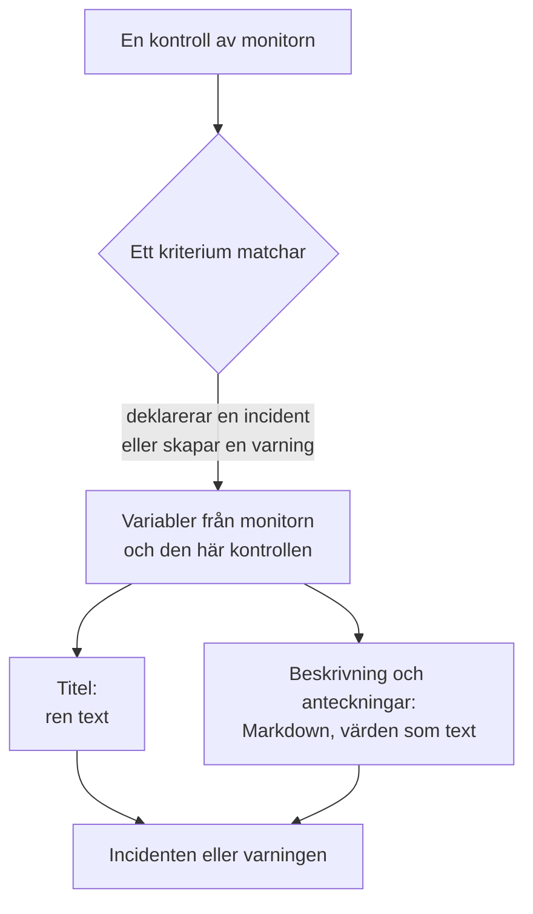

# Incident- och varningsmallar

När en monitors kriterier deklarerar en incident eller skapar en varning fyller de i titeln, beskrivningen och åtgärdsanteckningarna utifrån en mall som du skriver själv. Sätt in platshållare `{{variable}}`, som `{{monitorName}}` eller `{{responseStatusCode}}`, så säger varje incident vad som gick fel, med värdena från kontrollen som öppnade den.

:::cards
- [Var du skriver en mall](#var-du-skriver-en-mall): Titeln, beskrivningen och åtgärdsanteckningarna för ett kriteriums incident eller varning.
- [Grundläggande användning](#grundläggande-användning): Platshållare, sökvägar in i objekt och listor.
- [Variabler som alla monitorer har](#variabler-som-alla-monitorer-har): Monitorns namn och resursen som överskred gränsen.
- [Variabler per monitortyp](#variabler-per-monitortyp): Vad varje typ av kontroll rapporterar.
:::

## Så fungerar mallar

En mall fylls i en gång, när kriteriet skapar incidenten eller varningen. OneUptime samlar variablerna från monitorn och från kontrollen som matchade, sätter in varje värde där dess platshållare står och sparar resultatet. Ändrar du mallen senare ändras de incidenter och varningar som skapas därefter, inte de som redan är öppna.



- **Titeln är ren text.** Var den än visas läses den exakt som mallen återgav den.
- **Beskrivningen och åtgärdsanteckningarna är Markdown.** Den Markdown du skriver återges, och varje värde som det övervakade systemet skickade sätts in som text, så ingenting i det kan lägga till en länk, en bild eller ett omnämnande. Se [Värden i beskrivningar och åtgärdsanteckningar](#värden-i-beskrivningar-och-åtgärdsanteckningar).
- **En grupperad monitor fyller i varje incident för sin egen serie.** En monitor som öppnar en incident per värd, podd eller enhet fyller i varje mall med den seriens värden, och lägger till seriens namn i titeln när din mall inte redan nämner det.

## Var du skriver en mall

:::steps
### Öppna monitorns kriterier

Gå till **Monitorer**, öppna monitorn och klicka på **Kriterier** i dess sidomeny. Klicka på **Redigera Övervakningskriterier**.

### Slå på incidenten eller varningen

Slå på **När filter matchar, deklarera en incident.** eller **När filter matchar, skapa en varning.** under **Åtgärder** i ett kriterium. Formuläret för incidenten eller varningen öppnas nedanför.

### Skriv titeln

Skriv titeln i **Incidenttitel** eller **Larmtitel**, till exempel `{{monitorName}} is down`. **Learn about dynamic templates** bredvid öppnar **Dynamic Template Variables**: varje variabel som den här monitortypen har, med vad den innehåller. Klicka på en variabel för att kopiera den.

### Skriv beskrivningen och åtgärdsanteckningarna

Öppna **Beskrivning** för **Incidentbeskrivning** eller **Larmbeskrivning**, och **Fler fält** för **Åtgärdsanteckningar**. Dessa redigerare erbjuder själva variablerna: **Mallvariabler** listar dem under redigeraren, **Infoga variabel** i verktygsfältet öppnar samma lista, och när du skriver `{{` öppnas den vid markören.

### Spara kriterierna

Klicka på **Spara ändringar**. Nästa incident eller varning som det här kriteriet skapar använder de nya mallarna.
:::

## Grundläggande användning

En platshållare är en variabels namn inom dubbla klammerparenteser. När incidenten skapas ersätter OneUptime den med variabelns värde och låter texten runt omkring stå som du skrev den.

```text title="Title template"
{{monitorName}} returned {{responseStatusCode}} in {{responseTimeInMs}} ms
```

Om monitorn heter `Checkout API`, svarets statuskod är `502` och svaret tog `842` millisekunder, får incidenten titeln:

```text title="Title as created"
Checkout API returned 502 in 842 ms
```

### Sökvägar in i objekt och listor

En variabel som innehåller ett objekt eller en lista läses med en sökväg, på samma sätt som i [JavaScript-uttryck](/docs/monitor/javascript-expression):

| Skriv | För att läsa | Exempel |
| --- | --- | --- |
| `{{object.field}}` | Ett fält i ett objekt, på valfritt djup | `{{responseBody.error.message}}` |
| `{{list[0]}}` eller `{{list.0}}` | Ett element i en lista, räknat från 0 | `{{diskMetrics[0].usagePercent}}` |
| `{{list[last]}}` | Det sista elementet i en lista | `{{processes[last].name}}` |
| `{{object}}` | Hela objektet eller hela listan, som JSON | `{{responseBody}}` |

Ett fältnamn kan innehålla ett bindestreck, som i `{{responseHeaders.content-type}}`. Ett negativt index, som `[-1]`, läser ingenting: använd `[last]`.

### När ett värde saknas

En platshållare vars sökväg inte leder någonstans blir kvar i texten som du skrev den, med klammerparenteser och allt: om svaret inte har något fält `error` visas `{{responseBody.error.id}}` som det är i titeln. Detsamma gäller en variabel som den här kontrollen inte rapporterade, som `failureCause` på en kontroll som inte misslyckades. Ett värde som kontrollen rapporterade som tom text ersätts med ingenting.

För att skriva en mall som fungerar oavsett om monitorn är grupperad eller inte använder du variablerna för [berörd resurs](#berörd-resurs): de finns alltid och är tomma när monitorn inte är grupperad.

### Värden i beskrivningar och åtgärdsanteckningar

En beskrivning och åtgärdsanteckningar är Markdown: de visas på incidentens eller varningens sida, i e-post och i dess Slack- och Microsoft Teams-kanaler. Värdena som en mall sätter in där är det som det övervakade systemet skickade - en svarskropp eller ett svarshuvud, en inkommande förfrågan eller ett inkommande e-postmeddelande, etiketterna för en enhet eller en serie -, så varje värde sätts in som text. Det läses exakt som det skickades, var mallen än placerar det, och en länk, en bild, en HTML-tagg eller ett Slack-omnämnande som `<!channel>` i det visas som text i stället för att verka. En naken webbadress i ett värde blir ändå en länk, en som visar vart den leder. Den Markdown du skriver i själva mallen återges som du skrev den.

Ett värde kan ha vilken storlek som helst - en svarskropp eller en logg på många megabyte - och aviseringen går ändå ut med det. Varje kanal bär det den tar emot, och en beskrivning som är för lång för den kapas vid en radbrytning om det finns en, och slutar med "… (truncated — see OneUptime for the full text)":

- **E-post**: varje beskrivning, anteckning eller grundorsak bär upp till ungefär 256 KB av e-postens text, och anteckningen i slutet av en längre text länkar till incidenten eller varningen. Ett helt e-postmeddelande - texten och skärmbilderna - håller sig under 3 MB, vilket alla e-postservrar och Microsoft Graph tar emot: en skärmbild som inte får plats bredvid texten utelämnas, med en anteckning i stället.
- **Incidentens eller varningens sida** visar allt. En beskrivning på över 128 KB som skulle ta lång tid att formatera visas som ren text, rad för rad.
- **Slack** bär högst det Slack visar av ett meddelande (ungefär 30 000 tecken). **Microsoft Teams** bär ungefär 40 000 tecken i ett meddelande från OneUptime-appen och ungefär 12 000 via en inkommande webhook (prenumeranter på statussidor, arbetsflöden) - mätt när meddelandet skickas, så en tabell räknas som den HTML den blir.
- **SMS, telefonsamtal, push-aviseringar, WhatsApp och Telegram** bär det som deras leverantörer tar emot: se [Så larmar nivåerna personer](/docs/on-call/escalation-rules#så-larmar-nivåerna-personer).

Varje kanal återger texten på en tid som växer med längden. En del som skulle ta en renderare mycket längre tid - en rad på över 64 KB, ett långt stycke med enkla rader, ett stycke fullt av `*`, `_` eller `[` som aldrig stängs, citat eller listor som är nästlade mer än sexton nivåer och, på incidentens eller varningens sida, en tabell eller lista på mer än tusen rader - läses som ren text där den står, och resten av beskrivningen återges som vanligt.

## Avancerad användning

### Gå igenom en lista

`{{#each path}}` upprepar texten fram till `{{/each}}` en gång för varje element i listan vid `path`:

```text title="Loop syntax"
{{#each arrayPath}}
  ...text with {{field}} placeholders for each item...
{{/each}}
```

Inne i loopen:

- `{{field}}` och `{{field.nested}}` läser det aktuella elementet. Ett namn som elementet inte har slås upp i det omslutande elementet och sedan i hela mallens variabler.
- `{{@index}}` är elementets position, räknat från 0.
- `{{this}}` är själva elementet, för en lista med enkla värden som strängar.
- En loop över en sökväg som inte är en lista, eller över en tom lista, skriver ingenting.
- Loopar kan nästlas: en `{{#each}}` inuti en annan läser den inre listan för varje yttre element.

Till exempel en [Övervakning av inkommande förfrågningar](/docs/monitor/incoming-request-monitor) som tar emot den här varningsaviseringen:

```json title="Request body"
{
  "receiver": "payments",
  "alerts": [
    { "status": "firing", "labels": { "alertname": "HighLatency" } },
    { "status": "resolved", "labels": { "alertname": "DiskFull" } }
  ]
}
```

och har den här beskrivningsmallen:

```text title="Description template"
Alerts for {{requestBody.receiver}}:
{{#each requestBody.alerts}}
- {{@index}}: {{labels.alertname}} ({{status}})
{{/each}}
```

skapar en incident vars beskrivning lyder som nedan. Varje element behåller radbrytningarna runt sig, så en tom rad skiljer elementen åt, och beskrivningen visar fortfarande en enda lista:

```text title="Description as created"
Alerts for payments:

- 0: HighLatency (firing)

- 1: DiskFull (resolved)
```

### Värden från en grupperad monitor

En metrikbaserad monitor med attribut i **Group by** öppnar en incident per serie, och varje attributs värde är en variabel under attributets namn. Gruppering efter `host.name` ger `{{host.name}}`, och gruppering efter `resource.k8s.pod.name` ger `{{resource.k8s.pod.name}}`. `{{seriesLabels}}` innehåller alla, som ett objekt.

En grupperad [Loggövervakning](/docs/monitor/logs-monitor) fungerar på samma sätt: varje grupperingsattributs värde är en variabel under sin nyckel.

## Variabler som alla monitorer har

### Monitor

| Variabel | Vad den innehåller | Exempel |
| --- | --- | --- |
| `monitorName` | Monitorns namn. | `Checkout API` |
| `monitorId` | Monitorns ID. | `a0f78958-da0a-4775-9fd9-c9fc63d3456f` |
| `monitorType` | Monitorns typ. | `Website`, `Synthetic Monitor` |

### Berörd resurs

Dessa beskriver serien som en grupperad monitor öppnade incidenten för: en podd, en container, en värd, en disk. De är tomma för en monitor som inte är grupperad, så en mall kan använda dem på vilken monitor som helst.

| Variabel | Vad den innehåller |
| --- | --- |
| `seriesResourceSuffix` | Seriens identitet, med en avgränsare först, att sätta i slutet av en titel. |
| `seriesResourceSummary` | Samma identitet utan avgränsaren, att sätta i en mening. |
| `seriesResourceBlock` | Varje etikett för serien, som en Markdown-lista. Bäst i en beskrivning. |
| `seriesDebugCommands` | Skrivskyddade kommandon för just den här resursen, som `kubectl` eller `docker`, som en Markdown-lista. |

## Variabler per monitortyp

### Webbplats- och API-monitorer

| Variabel | Vad den innehåller | Typ |
| --- | --- | --- |
| `responseBody` | Svarskroppen: ett objekt när den är JSON, annars texten. | `JSON` eller `string` |
| `responseHeaders` | Svarshuvudena, efter namn med gemener. | `Dictionary<string>` |
| `responseStatusCode` | HTTP-statuskoden. | `number` |
| `responseTimeInMs` | Svarstiden, i millisekunder. | `number` |
| `isOnline` | Om monitorn räknade svaret som online. | `boolean` |

### Monitorer för inkommande förfrågningar

| Variabel | Vad den innehåller | Typ |
| --- | --- | --- |
| `requestBody` | Förfrågans kropp: ett objekt när den är JSON. | `JSON` eller `string` |
| `requestHeaders` | Förfrågans huvuden, efter namn med gemener. | `Dictionary<string>` |
| `requestMethod` | HTTP-metoden, som `POST`. | `string` |
| `incomingRequestReceivedAt` | När förfrågan togs emot, som en ISO 8601-tidsstämpel. | `string` |

När kriteriet har **Group incidents and alerts by a payload field** påslaget är grupperingsnyckeln också en variabel, uppkallad efter det **sista segmentet** av grupperingssökvägen: gruppering efter `requestBody.alerts[*].labels.alertname` ger `{{alertname}}`, och gruppering efter `requestBody.alerts[*].fingerprint` ger `{{fingerprint}}`. Hela `requestBody` finns fortfarande bredvid.

> [!NOTE]
> `[*]` fungerar bara i fälten för grupperingssökvägen. I en mall läser den ingenting, så platshållaren blir kvar som den skrevs. `{{requestBody.alerts[0].annotations.summary}}` läser alltid den första varningen i payloaden, inte den som incidenten öppnades för: använd grupperingsvariabeln och payloadens gemensamma fält, som `commonLabels` och `commonAnnotations`. Se [Övervakning av inkommande förfrågningar](/docs/monitor/incoming-request-monitor).

### Monitorer för inkommande e-post

| Variabel | Vad den innehåller | Typ |
| --- | --- | --- |
| `emailSubject` | E-postens ämne. | `string` |
| `emailFrom` | Avsändarens e-postadress. | `string` |
| `emailTo` | Vem e-posten skickades till, med monitorns egen adress maskerad. | `string` |
| `emailBody` | E-postens kropp som ren text. | `string` |
| `emailReceivedAt` | När e-posten togs emot, som en ISO 8601-tidsstämpel i UTC. | `string` |

I en titel kapas var och en till en rad på högst 150 tecken. Beskrivningar och åtgärdsanteckningar får hela värdet. Se [Övervakning av inkommande e-post](/docs/monitor/incoming-email-monitor#mallvariabler).

### Ping-, IP- och portmonitorer

| Variabel | Vad den innehåller | Typ |
| --- | --- | --- |
| `isOnline` | Om målet svarade. | `boolean` |
| `responseTimeInMs` | Svarstiden, i millisekunder. För en port DNS-uppslaget och TCP-anslutningen tillsammans. | `number` |
| `failureCause` | Varför kontrollen misslyckades, när den gjorde det. | `string` |
| `isTimeout` | Om kontrollen fick timeout. | `boolean` |

### NTP-monitorer

| Variabel | Vad den innehåller | Typ |
| --- | --- | --- |
| `isOnline` | Om tidsservern svarade på probens förfrågan. | `boolean` |
| `isSynchronized` | Om den svarade med stratum 1 till 15, utan leap-larmet och med riktiga tidsstämplar. | `boolean` |
| `stratum` | Det stratum servern rapporterade: 1 för en primär server, 16 när den inte är synkroniserad, 0 för en kiss-o'-death. | `number` |
| `clockOffsetInMs` | Hur långt serverns klocka är från probens, i millisekunder. Positivt betyder att servern ligger före. | `number` |
| `referenceId` | Vad servern synkroniserar mot: en källa som `GPS` på stratum 1, eller adressen till servern ovanför den. | `string` |
| `leapIndicator` | 0 till 2 när allt är i ordning, 3 när servern säger att klockan inte är synkroniserad. | `number` |
| `kissCode` | Med stratum 0 den kod på fyra bokstäver som servern skickade i stället för tiden, som `RATE`. | `string` |
| `responseTimeInMs` | Tiden från förfrågan till svar, i millisekunder. | `number` |
| `roundTripDelayInMs` | Utbytets tur och retur över nätverket, utan serverns egen behandlingstid. | `number` |
| `rootDelayInMs` | Tur och retur från servern till dess referensklocka, i millisekunder. | `number` |
| `rootDispersionInMs` | Serverns egen uppskattning av sitt största fel, i millisekunder. | `number` |
| `serverTime` | Serverns klocka när den skickade svaret, som en ISO 8601-tidsstämpel. | `string` |
| `referenceTime` | När serverns klocka senast ställdes eller korrigerades, som en ISO 8601-tidsstämpel. | `string` |
| `serverAddress` | Adressen som förfrågan gick till. | `string` |
| `port` | UDP-porten som förfrågan gick till. | `number` |
| `failureCause` | Varför servern inte svarade, eller varför den inte är synkroniserad. | `string` |
| `isTimeout` | Om servern inte svarade i tid. | `boolean` |

### SSL-certifikatmonitorer

| Variabel | Vad den innehåller | Typ |
| --- | --- | --- |
| `isOnline` | Om certifikatkontrollen lyckades. | `boolean` |
| `isSelfSigned` | Om certifikatet är självsignerat. | `boolean` |
| `createdAt` | När certifikatet utfärdades, som en ISO 8601-tidsstämpel. | `string` |
| `expiresAt` | När certifikatet går ut, som en ISO 8601-tidsstämpel. | `string` |
| `commonName` | Certifikatets common name (CN). | `string` |
| `organizationalUnit` | Dess organisationsenhet (OU). | `string` |
| `organization` | Dess organisation (O). | `string` |
| `locality` | Dess ort (L). | `string` |
| `state` | Dess delstat eller provins (ST). | `string` |
| `country` | Dess land (C). | `string` |
| `serialNumber` | Dess serienummer. | `string` |
| `fingerprint` | Dess SHA-1-fingeravtryck. | `string` |
| `fingerprint256` | Dess SHA-256-fingeravtryck. | `string` |
| `failureCause` | Varför kontrollen misslyckades, när den gjorde det. | `string` |

### DNS-monitorer

| Variabel | Vad den innehåller | Typ |
| --- | --- | --- |
| `isOnline` | Om frågan besvarades. | `boolean` |
| `responseTimeInMs` | Frågetiden, i millisekunder. | `number` |
| `isTimeout` | Om frågan fick timeout. | `boolean` |
| `isDnssecValid` | Resultatet av DNSSEC-valideringen. | `boolean` |
| `records` | Posterna som returnerades, var och en som `{type, value, ttl}`. | `Array<Object>` |
| `recordValues` | Bara posternas värden. | `Array<string>` |
| `failureCause` | Varför frågan misslyckades, när den gjorde det. | `string` |

### DNSSEC-monitorer

| Variabel | Vad den innehåller | Typ |
| --- | --- | --- |
| `isOnline` | Om kontrollen slutfördes. | `boolean` |
| `domainName` | Zonen som kontrollerades. | `string` |
| `isZoneSigned` | Om zonen har DNSKEY-poster. | `boolean` |
| `isParentDsPresent` | Om föräldrazonen har DS-poster för den. | `boolean` |
| `isChainValid` | Om förtroendekedjan validerar. | `boolean` |
| `resolverConsensusAd` | Om varje resolver returnerade AD-flaggan. | `boolean` |
| `isNameserverConsistent` | Om varje auktoritativ namnserver returnerade samma SOA-serienummer. | `boolean` |
| `earliestSignatureExpiration` | När den första RRSIG-signaturen går ut, som en ISO 8601-tidsstämpel. | `string` |
| `daysUntilSignatureExpiry` | Dagar tills den signaturen går ut. | `number` |
| `dnskeyCount` | Antalet DNSKEY-poster. | `number` |
| `dsRecordCount` | Antalet DS-poster hos föräldern. | `number` |
| `rrsigCount` | Antalet RRSIG-poster som sågs. | `number` |
| `responseTimeInMs` | Hur lång tid kontrollen tog, i millisekunder. | `number` |
| `failureCause` | Varför kontrollen misslyckades, när den gjorde det. | `string` |

### Domänmonitorer

| Variabel | Vad den innehåller | Typ |
| --- | --- | --- |
| `isOnline` | Om uppslaget av registreringen lyckades. | `boolean` |
| `domainName` | Domänen som slogs upp. | `string` |
| `lookupMethod` | Protokollet som svarade: RDAP eller WHOIS. | `string` |
| `registrar` | Registraren. | `string` |
| `createdDate` | När domänen registrerades. | `string` |
| `updatedDate` | När registreringen senast ändrades. | `string` |
| `expiresDate` | När registreringen går ut. | `string` |
| `nameServers` | Domänens namnservrar. | `Array<string>` |
| `domainStatus` | Registrets statuskoder, som `clientTransferProhibited`. | `Array<string>` |
| `dnssec` | Registrets DNSSEC-status. | `string` |
| `responseTimeInMs` | Hur lång tid uppslaget tog, i millisekunder. | `number` |
| `failureCause` | Varför uppslaget misslyckades, när det gjorde det. | `string` |

### Server- / VM-monitorer

| Variabel | Vad den innehåller | Typ |
| --- | --- | --- |
| `hostname` | Serverns värdnamn. | `string` |
| `requestReceivedAt` | När serverns rapport togs emot, som en ISO 8601-tidsstämpel. | `string` |
| `cpuUsagePercent` | CPU som används, från 0 till 100. | `number` |
| `cpuCores` | Antalet CPU-kärnor. | `number` |
| `memoryUsagePercent` | Minne som används, från 0 till 100. | `number` |
| `memoryFreePercent` | Ledigt minne, från 0 till 100. | `number` |
| `memoryTotalBytes` | Totalt minne, i byte. | `number` |
| `diskMetrics` | En post per monterad disk. | `Array<Object>` |
| `diskMetrics[].diskPath` | Diskens monteringspunkt. | `string` |
| `diskMetrics[].usagePercent` | Utrymme som används på disken, från 0 till 100. | `number` |
| `diskMetrics[].freePercent` | Ledigt utrymme på disken, från 0 till 100. | `number` |
| `diskMetrics[].totalBytes` | Diskens storlek, i byte. | `number` |
| `processes` | De processer som körs, som agenten rapporterade. | `Array<Object>` |
| `processes[].pid` | Process-ID:t. | `number` |
| `processes[].name` | Processnamnet. | `string` |
| `processes[].command` | Kommandot som processen startades med. | `string` |
| `failureCause` | Varför kontrollen misslyckades, när den gjorde det. | `string` |

### Syntetiska monitorer

En syntetisk monitor kör sitt skript en gång för varje webbläsare och skärmstorlek den är inställd att använda, som Chromium på en datorskärm och Firefox på en mobilskärm. `syntheticResponses` innehåller en post per körning: läs en körning efter dess position, som i `{{syntheticResponses[0].browserType}}`, eller alla körningar med `{{#each syntheticResponses}}`.

| Variabel | Vad den innehåller | Typ |
| --- | --- | --- |
| `failureCause` | Varför kontrollen misslyckades, när den gjorde det. | `string` |
| `syntheticResponses` | En post per webbläsare och skärmstorlek som skriptet kördes på. | `Array<Object>` |
| `syntheticResponses[].executionTimeInMs` | Hur lång tid körningen tog, i millisekunder. | `number` |
| `syntheticResponses[].result` | Vad skriptet returnerade. | `string`, `number`, `boolean` eller `JSON` |
| `syntheticResponses[].scriptError` | Felet som körningen slutade med, om något. | `string` |
| `syntheticResponses[].logMessages` | Vad körningen loggade. | `Array<string>` |
| `syntheticResponses[].screenshots` | Skärmbilderna som körningen tog, efter namn, var och en som base64-text. Se [Visa en skärmbild](#visa-en-skärmbild). | `Object` |
| `syntheticResponses[].browserType` | Körningens webbläsare. | `string` |
| `syntheticResponses[].screenSizeType` | Körningens skärmstorlek. | `string` |

#### Visa en skärmbild

Varje post i `screenshots` är en skärmbild som skriptet tog, under namnet som skriptet gav den (`screenshots["login-page"] = await page.screenshot()`), som base64-text. För att visa en i en incidents eller varnings beskrivning eller åtgärdsanteckningar skriver du en bild runt den:

```text title="Description template"
{{syntheticResponses[0].scriptError}}


```

Skärmbilden visas då på incidentens eller varningens sida, på de statussidor som visar incidenten, i e-postaviseringarna om den och i Slack- och Microsoft Teams-meddelandena om den. I ett e-postmeddelande bifogas den och visas i själva meddelandet, vilket Gmail, Outlook och Apple Mail alla visar, så den som har jouren kan se hur sidan såg ut utan att öppna OneUptime.

- Skärmbilder i PNG, JPEG, GIF och WebP visas. `image/png` fungerar också för en JPEG-skärmbild (`page.screenshot({ type: "jpeg" })`).
- Ett e-postmeddelande bär högst 2 MB bilder, och högst 20. En bild som inte får plats ersätts av en anteckning med dess alt-text, så ge varje bild en alt-text. En JPEG-skärmbild är mycket mindre än en PNG, och en skärmbild av den misslyckade körningen säger oftast mer än alla skärmbilder av alla körningar.
- I Slack och Microsoft Teams visas skärmbilden där beskrivningen har den: en bild på en egen rad tar den radens plats, och en bild mitt i en mening, en lista eller en tabell lämnar sin alt-text där och visas efter den. Slack visar skärmbilder i PNG, JPEG och GIF, högst 10 och 10 MB per meddelande; OneUptime-appen laddar upp varje bild privat till din Slack-arbetsyta och visar den i meddelandet. Teams visar skärmbilder i PNG, JPEG och GIF på upp till 1 MB vardera inne i meddelandets kort, högst 10 och 2 MB per meddelande.
- Uppladdning till Slack kräver appens behörighet `files:write`. Om din arbetsyta anslöt Slack innan OneUptime bad om den ansluter du Slack igen under **Projektinställningar → Arbetsyta → Slack** (på en egen server lägger du först till behörigheten i din Slack-app - se [Slack-integration](/docs/self-hosted/slack-integration#bilder-i-meddelanden)).
- En skärmbild som en chatt inte kan visa - en WebP, en över de gränserna, en som Slack eller Teams avvisar, eller vilken skärmbild som helst i ett meddelande som skickas via en inkommande webhook - visas som sin alt-text, eller "[image]" när den saknar en, så ge varje bild en alt-text. Bildens base64 når aldrig chatten.
- Bara en bild som du skriver i mallen visas. En bild i ett värde som den övervakade sidan eller det övervakade skriptet rapporterade - ett felmeddelande, en loggrad - visas fortfarande som text (se [Värden i beskrivningar och åtgärdsanteckningar](#värden-i-beskrivningar-och-åtgärdsanteckningar)).
- OneUptime AI läser texten runt en skärmbild, inte skärmbilden. Det som en utredning, ett utkast till postmortem eller anteckning, ett AI-steg i en runbook eller ett AI-steg i ett arbetsflöde ger modellen har en kort anteckning i bildens ställe, som `[image omitted: PNG, 340 KB]`: en modell läser text, inte bilder, och en skärmbilds base64 skulle vara hundratusentals tokens vid varje anrop. Utredningens aktivitet talar om vad som utelämnades.

För att visa skärmbilden från varje misslyckad körning lägger du bilden i en loop. Här sparar skriptet varje skärmbild som `screenshots["failure"]`:

```text title="Description template"
### What the page looked like
{{#each syntheticResponses}}
**{{browserType}} / {{screenSizeType}}**: {{scriptError}}


{{/each}}
```

### Monitorer för anpassad JavaScript-kod

| Variabel | Vad den innehåller | Typ |
| --- | --- | --- |
| `result` | Vad skriptet returnerade. Läs ett fält med en sökväg, som i `{{result.status}}`. | `string`, `number`, `boolean` eller `JSON` |
| `executionTimeInMs` | Hur länge skriptet kördes, i millisekunder. | `number` |
| `scriptError` | Felet som skriptet slutade med, om något. | `string` |
| `logMessages` | Vad skriptet loggade med `console.log`. | `Array<string>` |
| `failureCause` | Varför kontrollen misslyckades, när den gjorde det. | `string` |

### Nätverksenhetsmonitorer

| Variabel | Vad den innehåller | Typ |
| --- | --- | --- |
| `isOnline` | Om enheten kan nås, via ping **eller** SNMP. Sätts vid varje avsökning. | `boolean` |
| `responseTimeInMs` | Svarstiden för SNMP-**genomgången**, i millisekunder. Aldrig pingens tur och retur. | `number` |
| `failureCause` | Varför SNMP-genomgången misslyckades, när den gjorde det. | `string` |
| `isTimeout` | Om SNMP-genomgången fick timeout. | `boolean` |
| `oidResponses` | De OID:er som efterfrågades, var och en som `{oid, name, value, type}`. | `Array<Object>` |
| `{{OID_NAME}}` | Värdet för en namngiven OID, efter dess namn, som i `{{sysUpTime}}`. | `string` eller `number` |
| `sysName` | Enhetens namn, från SNMP-systemgruppen. | `string` |
| `sysDescr` | Enhetens beskrivning, från SNMP-systemgruppen. | `string` |
| `sysObjectId` | Leverantörens registrerade enterprise-OID: enhetens fingeravtryck. | `string` |
| `sysLocation` | Enhetens placering, från SNMP-systemgruppen. | `string` |
| `downInterfaces` | Gränssnitt som är administrativt uppe men operativt nere, var och en som `{name, alias, interfaceIndex}`. Kräver gränssnittsövervakning. | `Array<Object>` |
| `interfacesTotal` | Antalet gränssnitt som gicks igenom. | `number` |
| `interfacesUp` | Gränssnitt som är administrativt och operativt uppe. | `number` |
| `interfacesDown` | Gränssnitt som är administrativt uppe men operativt nere. | `number` |
| `interfaceWalkFailure` | Felet, när genomgången av gränssnitt misslyckades. | `string` |
| `tables` | Enhetens SNMP-tabeller, efter nyckel: `rowCount`, `rows`, `unhealthyRowCount` och `unhealthyRows` för var och en, som i `{{tables.ipsec_tunnels.unhealthyRowCount}}`. | `Object` |
| `snmpTable` | SNMP-tabellen som en varning per rad gäller. | `string` |
| `snmpTableRow` | Raden som en varning per rad gäller: en tunnel, en radio, en granne. | `string` |
| `trapOid` | Trapens OID. Bara när en SNMP-trap utlöste kontrollen. | `string` |
| `trapSourceIp` | Adressen som trapen kom från. Bara när en SNMP-trap utlöste kontrollen. | `string` |
| `trapVarbinds` | Trapens varbinds, var och en som `{oid, value}`. Bara när en SNMP-trap utlöste kontrollen. | `Array<Object>` |

En nätverksenhet pingas vid varje avsökning och gås bara igenom via SNMP när den har inloggningsuppgifter, så **`isOnline` är den enda variabeln ovan som en enhet med bara ping fyller i**: alla andra kommer från SNMP-genomgången och blir kvar som de skrevs utan den. Börja med `{{isOnline}}` och enhetens namn i mallar som kan användas för enheter utan inloggningsuppgifter. Se [Nätverksenhets-övervakning](/docs/monitor/network-device-monitor#vad-en-avsökning-faktiskt-gör) för vad varje typ av avsökning samlar in.

### Monitorer för databashälsa

| Variabel | Vad den innehåller | Typ |
| --- | --- | --- |
| `isOnline` | Om proben kunde ansluta och köra basfrågan. Saknade mätvärden gör den aldrig falsk. | `boolean` |
| `responseTimeInMs` | Tiden det tog att ansluta och köra basfrågan, i millisekunder. | `number` |
| `failureCause` | Varför kontrollen misslyckades, när den gjorde det. | `string` |
| `connectionError` | Anslutningsfelet, utan inloggningsuppgifter eller anslutningssträngen. | `string` |
| `engineVersion` | Versionen som databasservern rapporterade. | `string` |
| `collectedGroups` | Mätvärdesgrupperna som gav värden vid den här kontrollen. | `Array<string>` |
| `unavailableGroups` | Grupperna som inte kunde samlas in, var och en som `{group, reason, message, remediation}`. | `Array<Object>` |
| `collectionIssueSummary` | En rad om varje otillgänglig grupp, klar för en titel. Tom när allt samlades in. | `string` |
| `metrics` | De insamlade värdena, efter serienamn. | `Object` |

Serienamnen i `metrics` innehåller punkter, som `oneuptime.monitor.database.connections.used.percent`, och en sökväg läser varje punkt som ett steg in i ett objekt, så en mall kan inte plocka ut ett enskilt värde ur `metrics`. Sätt in `{{metrics}}` i sin helhet, som JSON, eller använd `{{collectionIssueSummary}}`. Ett mätvärde som inte samlades in saknas i `metrics`; det är inte noll. För att agera på ett värde jämför du det i kriteriet med ett [JavaScript-uttryck](/docs/monitor/javascript-expression).

### Monitorer för externa statussidor

| Variabel | Vad den innehåller | Typ |
| --- | --- | --- |
| `overallStatus` | Statussidans samlade status, som `major_outage`. | `string` |
| `activeIncidentCount` | Antalet öppna incidenter på statussidan. | `number` |
| `componentStatuses` | Dess komponenter, var och en som `{name, status, description, groupName}`. | `Array<Object>` |
| `provider` | Typen av statussida: Atlassian Statuspage, incident.io, RSS eller Atom. | `string` |
| `componentGroup` | Komponentgruppen som monitorn bevakar, om den bevakar en. | `string` |
| `componentName` | Komponenten som monitorn bevakar, om den bevakar en. | `string` |
| `isOnline` | Om statussidan svarade. | `boolean` |
| `responseTimeInMs` | Hur lång tid statussidan tog på sig att svara, i millisekunder. | `number` |
| `failureCause` | Varför kontrollen misslyckades, när den gjorde det. | `string` |

### Mätvärdes- och infrastrukturmonitorer

Metrics-, Kubernetes-, Docker-, Host-, Podman-, Docker Swarm-, Proxmox-, VMware-, Ceph- och Storage Array-monitorer har en egen variabel:

| Variabel | Vad den innehåller | Typ |
| --- | --- | --- |
| `metricName` | Namnet på mätvärdet som monitorns första fråga läser, som `container.cpu.time`. | `string` |

Grupperade har de också värdet för varje attribut i **Group by**, och `seriesLabels`: se [Värden från en grupperad monitor](#värden-från-en-grupperad-monitor). En IoT Device-monitor har ingen `metricName`, men en grupperad, som dess mallar är, har `{{device.id}}`.

### Andra monitortyper

Logs-, Traces-, Exceptions-, Security Events-, AI / LLM- och SQL Query-monitorer har inga egna variabler. Använd [variablerna som alla monitorer har](#variabler-som-alla-monitorer-har), och på en grupperad Logs-monitor [gruppvärdena](#värden-från-en-grupperad-monitor).

## Exempel

### Ett långsamt API

```text title="Title"
{{monitorName}} is slow: {{responseTimeInMs}} ms
```

```text title="Description"
### API error
Status: **{{responseStatusCode}}**
Latency: **{{responseTimeInMs}} ms**
Message: `{{responseBody.error.message}}`
```

### Ett certifikat som snart går ut

```text title="Title"
Certificate for {{commonName}} expires {{expiresAt}}
```

### En server som håller på att få slut på utrymme

```text title="Description"
### {{hostname}}
CPU: **{{cpuUsagePercent}}%**
Memory: **{{memoryUsagePercent}}%**

**Disks:**
{{#each diskMetrics}}
- {{diskPath}}: {{usagePercent}}% used ({{freePercent}}% free)
{{/each}}

**Processes:**
{{#each processes}}
- [{{pid}}] {{name}}: {{command}}
{{/each}}
```

### En ping-, IP- eller portkontroll som misslyckades

```text title="Description"
{{monitorName}} could not be reached: {{failureCause}}
Timed out: {{isTimeout}}
Response time: {{responseTimeInMs}} ms
```

### Varje körning av en syntetisk monitor

```text title="Description"
### Synthetic monitor results
{{#each syntheticResponses}}
- **{{browserType}} / {{screenSizeType}}**: {{result}} in {{executionTimeInMs}} ms
  - Script error: {{scriptError}}
  - First log line: {{logMessages[0]}}
{{/each}}
```

### En kontroll med anpassad kod

```text title="Description"
The script ran for {{executionTimeInMs}} ms and returned {{result}}.
Last log line: {{logMessages[last]}}
```

### En nätverksenhet

De här förutsätter att enheten har SNMP-inloggningsuppgifter: på en enhet med bara ping blir allt utom `{{isOnline}}` kvar som det skrevs.

```text title="Title"
{{sysName}}: {{interfacesDown}} interfaces down
```

```text title="Description"
### {{sysName}} ({{sysLocation}})
Online: {{isOnline}}
SNMP walk: {{responseTimeInMs}} ms

{{#each downInterfaces}}
- {{name}} ({{alias}}) is down
{{/each}}
```

### Varningar från Alertmanager eller Grafana

```text title="Title"
[{{requestBody.status}}] {{requestBody.receiver}}
```

```text title="Description"
### Alerts from {{requestBody.receiver}}
{{#each requestBody.alerts}}
**Alert {{@index}}**: {{labels.alertname}}
- Status: {{status}}
- Summary: {{annotations.summary}}
- Source: {{generatorURL}}
{{/each}}
```

## Felsökning

:::details Titeln visar platshållaren, med klammerparenteser och allt
Sökvägen leder inte till något värde i den här kontrollen. Kontrollera variabelns namn och skiftläge mot tabellerna ovan, eller öppna **Learn about dynamic templates** i kriteriet: den listar variablerna för den här monitortypen. En sökväg in i en svars- eller förfrågningskropp måste stämma med kroppen som den skickades, och `[*]` och negativa index som `[-1]` läser ingenting: använd `[0]` eller `[last]`.
:::

:::details Ett värde visas som JSON
Sökvägen stannar vid ett objekt eller en lista, så hela innehållet sätts in som JSON. Lägg till fältet du vill ha i sökvägen, som i `{{responseBody.error.message}}`, eller gå igenom en lista med `{{#each}}`.
:::

:::details En loop skriver ingenting
Sökvägen efter `#each` är inte en lista i den här kontrollen, eller så är listan tom. Kontrollera sökvägen mot payloaden, och att varje `{{#each}}` har sin `{{/each}}`.
:::

:::details Markdown i ett värde visas som text
Det är avsiktligt: ett värde som det övervakade systemet skickade sätts in som text, så att det aldrig kan lägga till en länk, en bild eller ett omnämnande i beskrivningen. Skriv formateringen i mallen runt värdet i stället. Se [Värden i beskrivningar och åtgärdsanteckningar](#värden-i-beskrivningar-och-åtgärdsanteckningar).
:::

:::details En skärmbild visas inte i Slack, Microsoft Teams eller e-post
Kontrollera bildens format och storlek mot [Visa en skärmbild](#visa-en-skärmbild). I Slack behöver OneUptime-appen behörigheten `files:write`: anslut Slack igen under **Projektinställningar → Arbetsyta → Slack** om din arbetsyta anslöt den innan OneUptime bad om den.
:::

## Nästa steg

:::cards
- [JavaScript-uttryck](/docs/monitor/javascript-expression): Samma platshållare, i ett kriteriums villkor.
- [Deklarera en incident](/docs/incidents/declaring-incidents): Vad som händer efter att ett kriterium har deklarerat en.
- [Syntetisk övervakning](/docs/monitor/synthetic-monitor): Ta skärmbilderna som en beskrivning kan visa.
- [Övervakning av inkommande förfrågningar](/docs/monitor/incoming-request-monitor): Gör webhooks till incidenter uppkallade efter varje varning.
:::
