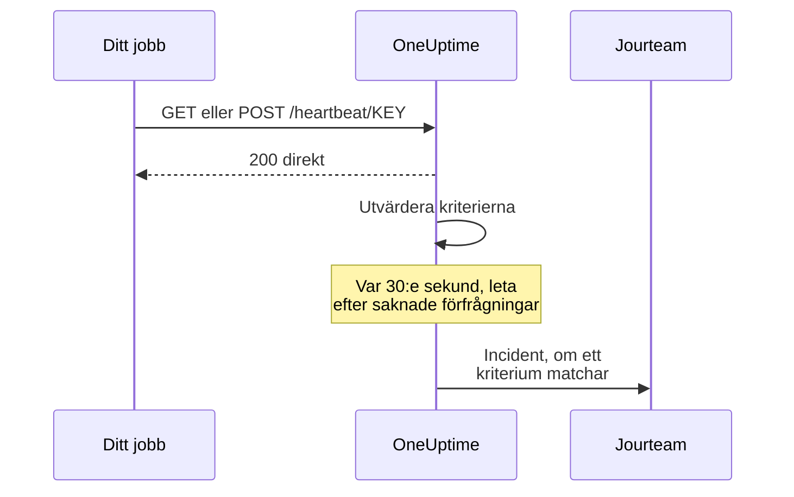

# Övervakning av inkommande förfrågningar

En monitor för inkommande förfrågningar ger dig en URL som andra system skickar HTTP-förfrågningar till. OneUptime utvärderar varje förfrågan mot dina kriterier och kan ändra monitorns status, deklarera incidenter och kalla in den som har jour.

Den täcker två olika uppgifter:

- **Heartbeat-övervakning** — ett cron-jobb, en worker eller en enhet anropar URL:en enligt ett schema, och OneUptime skapar en incident när anropen slutar komma.
- **Ta emot larm från ett annat system** — Prometheus Alertmanager, Grafana eller något annat som kan skicka JSON med POST skickar in larm, och OneUptime gör vart och ett till en incident med eskalering till jouren och automatisk lösning när problemet är över.

Båda använder samma monitortyp. Det som skiljer dem åt är kriterierna du konfigurerar.

:::cards
- [Skapa monitorn](#skapa-en-monitor-för-inkommande-förfrågningar): Få en heartbeat-URL i några få steg.
- [Skicka ett heartbeat](#skicka-ett-heartbeat): Från curl, cron, Node.js, Python eller Go.
- [Larma när anropen slutar](#markera-som-offline-om-inget-heartbeat-kommit-på-10-minuter-ett-dödmansgrepp): Gör monitorn till ett dödmansgrepp.
- [Ta emot larm](#ta-emot-larm-från-ett-annat-system): En incident per larm från Alertmanager eller Grafana.
- [Prenumerera på SNS eller Event Grid](#prenumerera-på-amazon-sns-eller-azure-event-grid): Bekräfta prenumerationen med ett klick.
:::

## Så fungerar det

Ingenting kontrollerar ditt system utifrån: ditt system anropar monitorns URL, OneUptime svarar direkt och utvärderar sedan förfrågan mot monitorns kriterier. Ett kriterium som letar efter förfrågningar som har *slutat* komma kontrolleras dessutom på nytt i bakgrunden var 30:e sekund, så att även tystnad kan skapa en incident.



Använd den för att:

- Övervaka cron-jobb och schemalagda uppgifter
- Kontrollera att bakgrunds-workers körs
- Övervaka tjänster bakom brandväggar som inte kan nås utifrån
- Ta emot larm från Prometheus Alertmanager, Grafana och andra larmsystem
- Följa heartbeat-signaler från alla system som kan tala HTTP

## Skapa en monitor för inkommande förfrågningar

:::steps
### Starta en ny monitor

Gå till **Monitorer** och klicka på **Skapa monitor**.

### Välj Inkommande begäran

Under **Monitortyp** väljer du **Inkommande begäran** — den är en av de vanliga typerna överst. Ange ett **Namn** och klicka sedan på **Nästa**.

### Gå igenom kriterierna

Steget **Kriterier** börjar med [standardkriterierna](#vad-du-får-från-början). För ett heartbeat klickar du på **Lägg till kriterier** och ger det nya kriteriet ett filter **Inkommande begäran** / **Inte mottaget inom (minuter)** som ändrar statusen till offline och deklarerar en incident, med **Lös incident automatiskt** påslaget. Dra det sedan överst i listan — se [Exempel på kriterier](#exempel-på-kriterier) för varför.

### Skapa monitorn

Klicka på **Skapa monitor**. Monitorn öppnas på sidan **Översikt**, där kortet **Send the first heartbeat** visar **Heartbeat URL** med en kopieringsknapp och ett exempelkommando med `curl`.

### Skicka den första förfrågan

Konfigurera din tjänst så att den skickar förfrågningar till den URL:en (se [Skicka ett heartbeat](#skicka-ett-heartbeat)). När den första förfrågan kommer ger kortet plats åt monitorns historik, och ett kort **Heartbeat URL** visar URL:en och när den senaste förfrågan kom.
:::

> [!NOTE]
> URL:en innehåller monitorns hemliga nyckel, så bara personer som kan redigera monitorer kan se den. Du hittar den när som helst igen på monitorns sida **Dokumentation**, i avsnittet **Konfiguration** i sidomenyn.

## Förfrågans URL

Din monitor har en unik URL i det här formatet:

```text
https://oneuptime.com/heartbeat/YOUR_SECRET_KEY
```

Ersätt `https://oneuptime.com` med URL:en till din OneUptime-instans om du självhostar.

Skicka **GET**- eller **POST**-förfrågningar till den här URL:en. HEAD godtas och behandlas som GET; PUT, PATCH och DELETE returnerar 404. Den hemliga nyckeln i sökvägen är inloggningsuppgiften: det krävs ingen header eller token, om inte projektet [kräver en hemlighet vid varje begäran](#kräv-en-hemlighet-vid-varje-begäran). Frågesträngar ignoreras: skicka det som kriterierna ska läsa i kroppen eller i headerna.

> [!WARNING]
> Alla som känner till den här URL:en kan markera monitorn som frisk, så behandla den som en hemlighet. Om den läcker öppnar du monitorns sida **Inställningar** och klickar på **Återställ hemlig nyckel för inkommande begäran**, och sedan uppdaterar du varje avsändare. Monitorns översikt visar den senaste förfrågan så som dess loggar behåller den: med hemligheter och personuppgifter maskerade, och utan headers eller brödtext när **Behåll förfrågans innehåll** är avstängt. Maskeringen hittar bara de namn och mönster den känner till, så skicka inte API-nycklar eller token till den här slutpunkten.

> [!IMPORTANT]
> OneUptime svarar `200` med ett tomt JSON-objekt (`{}`) direkt och behandlar förfrågan via en kö. Svaret skrivs innan någon validering sker, så en `200` är **inte** en bekräftelse på att förfrågan godtogs — en felaktig hemlig nyckel, en borttagen monitor och en inaktiverad monitor returnerar också `200`. Kontrollera monitorns egen tidslinje för att bekräfta att förfrågningarna kommer fram. Ett projekt som kräver en hemlighet vid varje begäran besvarar en begäran utan hemlighet med `401`, och en tjänst som kontrollerar URL:en innan den levererar något får det svar den väntar sig: se [Tjänster som kontrollerar URL:en först](#tjänster-som-kontrollerar-urlen-först).

### Skicka en förfrågningskropp

Om du vill använda fält i kroppen — `{{requestBody.status}}` i en incidenttitel, en JSON-sökväg i gruppering av incidenter eller ett kriterium med ett JavaScript-uttryck — skickar du `Content-Type: application/json`. Det är formatet som den här dokumentationen utgår från genomgående. Kroppen måste vara ett JSON-objekt eller en JSON-matris: ogiltig JSON, eller ett ensamt värde som `"error"`, avvisas med en `500`.

| Innehållstyp | Vad kriterier och mallar ser |
| --- | --- |
| `application/json` | Den tolkade JSON:en. |
| `application/x-www-form-urlencoded` | Det tolkade formuläret. Nycklar inom hakparenteser nästlas (`alerts[0][status]=firing`), och alla värden är strängar. |
| `text/plain` | Den tolkade JSON:en, när texten är ett JSON-objekt eller en JSON-matris: så skickar Amazon SNS sina meddelanden. All annan text är själva texten, så `backup failed: error 42` gör monitorn offline med standardkriterierna. |
| `application/cloudevents+json`, eller en annan `+json`-typ | Den tolkade JSON:en: så levererar Azure Event Grid CloudEvents. |
| Allt annat, eller ingen | En tom kropp (`{}`), så ingen hänvisning till `requestBody` löses upp, och en mall skriver ut den ordagrant. |

Kroppar på upp till 50 MB godtas; en större avvisas med en `413`. Komprimera inte kroppen med `Content-Encoding: gzip`: då lagras den inte som JSON, och sökvägar in i den löses inte upp.

### Skicka ett heartbeat

Varje exempel skickar en förfrågan. Ersätt `YOUR_SECRET_KEY` med nyckeln från din monitors URL.

:::tabs
@tab curl
```bash
# Simple GET request
curl https://oneuptime.com/heartbeat/YOUR_SECRET_KEY

# POST request with a JSON body
curl -X POST https://oneuptime.com/heartbeat/YOUR_SECRET_KEY \
  -H "Content-Type: application/json" \
  -d '{"status": "healthy", "version": "1.2.3"}'
```
@tab Cron
```bash
# Send a heartbeat every 5 minutes
*/5 * * * * curl -fsS https://oneuptime.com/heartbeat/YOUR_SECRET_KEY > /dev/null

# Or ping only when the job succeeds, so a failed run counts as a missed heartbeat
0 2 * * * /usr/local/bin/backup.sh && curl -fsS https://oneuptime.com/heartbeat/YOUR_SECRET_KEY > /dev/null
```
@tab Node.js
```javascript title="heartbeat.mjs"
// Node.js 18 or later: fetch is built in. Run with `node heartbeat.mjs`.
const response = await fetch(
  "https://oneuptime.com/heartbeat/YOUR_SECRET_KEY",
  {
    method: "POST",
    headers: { "Content-Type": "application/json" },
    body: JSON.stringify({ status: "healthy", version: "1.2.3" }),
  },
);

console.log(response.status); // 200
```
@tab Python
```python title="heartbeat.py"
# Python 3, standard library only. Run with `python3 heartbeat.py`.
import json
import urllib.request

request = urllib.request.Request(
    "https://oneuptime.com/heartbeat/YOUR_SECRET_KEY",
    data=json.dumps({"status": "healthy", "version": "1.2.3"}).encode(),
    headers={"Content-Type": "application/json"},
    method="POST",
)

with urllib.request.urlopen(request, timeout=10) as response:
    print(response.status)  # 200
```
@tab Go
```go title="heartbeat.go"
// Run with `go run heartbeat.go`.
package main

import (
	"bytes"
	"fmt"
	"net/http"
)

func main() {
	body := []byte(`{"status": "healthy", "version": "1.2.3"}`)

	resp, err := http.Post(
		"https://oneuptime.com/heartbeat/YOUR_SECRET_KEY",
		"application/json",
		bytes.NewReader(body),
	)
	if err != nil {
		panic(err)
	}
	defer resp.Body.Close()

	fmt.Println(resp.StatusCode) // 200
}
```
@tab PowerShell
```powershell
# Windows PowerShell 5.1 or PowerShell 7
Invoke-RestMethod -Method Post `
  -Uri "https://oneuptime.com/heartbeat/YOUR_SECRET_KEY" `
  -ContentType "application/json" `
  -Body '{"status": "healthy", "version": "1.2.3"}'
```
:::

## Kräv en hemlighet vid varje begäran

Alla som har en monitors URL kan skicka begäranden till den. En Projektägare eller Projektadministratör kan låta varje monitor för inkommande begäranden i projektet även kräva en av projektets egna hemligheter, oavsett vem som satte upp monitorn: slå på **Kräv en hemlighet vid varje begäran**. En begäran utan hemlighet avvisas med `401` och orsaken, innan den räknas som heartbeat, sparas som monitorns senaste begäran eller når några kriterier. En begäran med hemlighet går vidare till monitorns egna kriterier, som tidigare.

Projektägare och Projektadministratörer hanterar hemligheterna och reglaget, och det gör även en anpassad roll med behörigheterna Create, Read, Edit och Delete Incoming Request Secret: Read visar hemligheternas värden, och Edit slår också på och av reglaget.

:::steps
### Skapa en hemlighet

Gå till **Monitorer → Inställningar → Hemligheter för inkommande begäranden** och skapa en hemlighet. Ge den ett namn så genererar OneUptime värdet; kopiera det från listan.

### Skicka den från varje avsändare

Skicka hemligheten i headern `X-OneUptime-Secret`, eller som Bearer-token i headern `Authorization`, beroende på vad din avsändare kan ange. En avsändare som inte själv kan ange en header kan i stället signera varje begäran med hemligheten: se [Signera begäranden med hemligheten](#signera-begäranden-med-hemligheten).

### Hitta avsändarna du har missat

Så snart projektet har en hemlighet kontrollerar OneUptime varje begäran, utan att avvisa någon ännu. **Begäranden utan hemlighet** på samma sida listar varje monitor för inkommande begäranden som har fått en begäran utan giltig hemlighet de senaste 24 timmarna, och varför: ingen hemlighet skickades, eller en felaktig. Åtgärda de avsändarna. En monitor vars avsändare är åtgärdade visar en senare tid under **Senast med hemlighet** än under **Senast utan hemlighet**, och försvinner från listan inom 24 timmar.

### Slå på kravet

Slå på **Kräv en hemlighet vid varje begäran**. Kravet går inte att slå på så länge projektet saknar hemlighet, så att ingen avsändare avvisas av misstag. Innan kravet slås på visas hur många monitorer för inkommande begäranden som har fått en begäran utan giltig hemlighet de senaste 24 timmarna, om några: deras avsändare avvisas från och med då.
:::

```bash
curl -X POST https://oneuptime.com/heartbeat/YOUR_SECRET_KEY \
  -H "X-OneUptime-Secret: YOUR_PROJECT_SECRET"

# Or as a bearer token
curl -X POST https://oneuptime.com/heartbeat/YOUR_SECRET_KEY \
  -H "Authorization: Bearer YOUR_PROJECT_SECRET"
```

OneUptime sparar aldrig hemligheten: den tar bort headern från begäran och maskerar en Bearer-token som är en av projektets hemligheter innan den sparar något.

En adress som skickar mer än 10 olika felaktiga hemligheter till en monitor på 15 minuter avvisas sedan med `429` för varje hemlighet den skickar, rätt eller fel, fram till den tid som dess header `Retry-After` anger, högst 15 minuter. Avsändare på andra adresser påverkas inte, och en avsändare som fortsätter att skicka en gammal hemlighet får fortsatt den `401` som säger vad som är fel.

> [!TIP]
> För att byta ut en hemlighet utan att avvisa någon skapar du en andra, flyttar dina avsändare till den och tar sedan bort den gamla när dess **Senast använd** slutar ändras. Alla projektets hemligheter godtas om de inte är begränsade till andra monitorer, och den sista som täcker en monitor kan inte tas bort medan kravet är på.

### Signera begäranden med hemligheten

En avsändare kan signera varje begäran med hemligheten i stället för att skicka den, vilket är säkrare: inget hemligt skickas, och en begäran som någon har fångat upp kan inte skickas igen senare. Föredra det överallt där en avsändare kan signera. OneUptime kontrollerar de här signaturerna, var och en en HMAC-SHA256 i hex med hemligheten som nyckel:

| Avsändare | Header | Vad som signeras |
| --- | --- | --- |
| Din egen kod | `X-OneUptime-Signature: t=<time>,v1=<signature>` | `<time>.<body>` |
| GitHub-webhooks | `X-Hub-Signature-256` | Bodyn |
| Slack | `X-Slack-Signature`, med `X-Slack-Request-Timestamp` | `v0:<time>:<body>` |
| Stripe | `Stripe-Signature` | `<time>.<body>` |

`<time>` är tidpunkten då begäran signerades, i sekunder sedan 1970. En signatur som ligger mer än 5 minuter från OneUptimes klocka avvisas, och det gör även en signerad begäran som skickas en andra gång; GitHubs signatur har ingen tid, så OneUptime kommer ihåg var och en i ett dygn. För GitHub ger du webhooken en av projektets hemligheter som secret. Slack och Stripe skapar sin egen signeringshemlighet: skapa projektets hemlighet med det värdet, under **Fler fält**.

```bash
body='{"status":"healthy"}'
t=$(date +%s)
sig=$(printf '%s.%s' "$t" "$body" | openssl dgst -sha256 -hmac "YOUR_PROJECT_SECRET" | sed 's/^.* //')

curl -X POST https://oneuptime.com/heartbeat/YOUR_SECRET_KEY \
  -H "Content-Type: application/json" \
  -H "X-OneUptime-Signature: t=$t,v1=$sig" \
  -d "$body"
```

En hemlighet i URL:ens query string godtas inte: proxyer och åtkomstloggar sparar hela URL:er, bredvid monitorns egen nyckel. En sonds ingress för inkommande förfrågningar vidarebefordrar en signerad begärans body som den kom, så signaturen håller även den vägen.

### Begränsa en hemlighet till vissa monitorer

En hemlighet godtas av varje monitor för inkommande begäranden i projektet om du inte begränsar den, som ett projekt gör där varje hyresgäst skickar sin egen hemlighet: välj under **Fler fält** antingen **Specifika monitorer** eller **Monitorer med etiketter**. Alla andra monitorer avvisar den med `401`, som de avvisar en felaktig hemlighet, och **Begäranden utan hemlighet** anger orsaken som **Hemlighet inte för den här monitorn**. Så länge kravet är på behåller projektet minst en hemlighet som täcker en monitor.

## Övervakningskriterier

Du kan konfigurera kriterier som avgör när din tjänst anses vara online, försämrad eller offline. Varje kriteriefilter har en **Filtertyp** (vad som granskas), ett **Filtervillkor** (hur det jämförs) och ett **Värde**.

### Vad du får från början

En ny monitor för inkommande förfrågningar skapas med två kriterier som läser förfrågans kropp:

| Kriterium | Filtertyp | Filtervillkor | Värde | Effekt |
| -------- | ------------ | ---------------- | ------- | -------------------------------------------- |
| Offline  | Begärandekropp | Innehåller | `error` | Markerar monitorn som offline, öppnar en incident |
| Online   | Begärandekropp | Innehåller inte | `error` | Markerar monitorn som online |

Det passar det vanliga fallet där avsändaren rapporterar sin egen hälsa i nyttolasten: en förfrågan vars kropp nämner `error` tar ned monitorn, och nästa förfrågan utan ordet tar upp monitorn igen och löser incidenten. En förfrågan helt utan kropp räknas som "innehåller inte `error`", så ett vanligt heartbeat-anrop håller monitorn online.

Ändra värdet till det som din avsändare faktiskt skickar (`"status":"firing"`, `FAILED` och så vidare) — jämförelsen är en sökning efter en delsträng i hela kroppen, nycklar inräknade, som skiljer på versaler och gemener, så även `{"error":null}` matchar `error`.

> [!NOTE]
> De här standardinställningarna är **inte** ett dödmansgrepp: ingenting här utlöses när förfrågningarna slutar komma. Om du vill larmas vid tystnad lägger du till ett kriterium **Inkommande begäran** / **Inte mottaget inom (minuter)** enligt beskrivningen nedan.

### Tillgängliga filtertyper

| Filtertyp | Kontrollerar | Anteckningar |
| --------------------- | ------------------------------------------------------ | -------------------------------------------------------------------------------------------- |
| Inkommande begäran | Om en förfrågan har tagits emot inom ett tidsfönster | Den enda kontrollen som kan utlösas när ingenting kommer |
| Begärandekropp | Förfrågans kropp | Sökning efter en delsträng. Objekt som kropp jämförs som kompakt JSON |
| Begärandehuvud | Namnen på förfrågans headers | Exakt jämförelse med ett helt headernamn, utan hänsyn till versaler och gemener |
| Värde för begärandehuvud | Värdena i förfrågans headers | Exakt jämförelse med ett helt headervärde, utan hänsyn till versaler och gemener |
| JavaScript-uttryck | Alla uttryck över `requestBody` och `requestHeaders` | Det flexiblaste alternativet — se [JavaScript-uttryck](/docs/monitor/javascript-expression) |

### Filtervillkor

Varje filtertyp har sina egna villkor:

| Filtertyp | Villkor |
| --- | --- |
| **Inkommande begäran** | **Mottaget inom (minuter)** — en förfrågan har tagits emot inom det angivna antalet minuter. **Inte mottaget inom (minuter)** — ingen förfrågan har tagits emot inom det angivna antalet minuter. |
| **Begärandekropp**, **Begärandehuvud**, **Värde för begärandehuvud** | **Innehåller** och **Innehåller inte** |
| **JavaScript-uttryck** | **Utvärderas till sant** |

> [!NOTE]
> Headernamn och headervärden jämförs med gemener och mot hela namnet eller hela värdet, inte som delsträng: `application/json` matchar inte `application/json; charset=utf-8`. Bara **Begärandekropp** söker efter en delsträng. Headers som din proxy eller OneUptimes egen lastbalanserare lägger till (`x-forwarded-for`, `x-real-ip`) lagras också.

Objekt som kropp jämförs som kompakt JSON utan mellanslag, så ett filter **Begärandekropp** / **Innehåller** måste skrivas `"status":"firing"` — kopierar du `"status": "firing"` från en snyggt formaterad nyttolast matchar det aldrig.

### Exempel på kriterier

#### Markera som offline om inget heartbeat kommit på 10 minuter (ett dödmansgrepp)

| Fält | Värde |
| --- | --- |
| **Filtertyp** | Inkommande begäran |
| **Filtervillkor** | Inte mottaget inom (minuter) |
| **Värde** | `10` |

#### Markera som försämrad utifrån innehållet i förfrågans kropp

| Fält | Värde |
| --- | --- |
| **Filtertyp** | Begärandekropp |
| **Filtervillkor** | Innehåller |
| **Värde** | `"status":"degraded"` |

> [!IMPORTANT]
> Lägg dödmansgreppet **ovanför** standardkriterierna. Kriterierna kontrolleras uppifrån, och det första som matchar avgör. Bakgrundskontrollen läser den senaste förfrågan igen, så standardkriteriet för online — "Begärandekropp Innehåller inte `error`" — fortsätter att matcha den, och ett kriterium under det kommer aldrig till tals. **Lägg till kriterier** lägger till ett kriterium längst ned: dra upp det.

> [!WARNING]
> En monitor utvärderas bara på nytt i bakgrunden om minst ett av dess kriterier kontrollerar **Inkommande begäran**. En monitor vars kriterier bara kontrollerar kroppen, Begärandehuvud eller ett JavaScript-uttryck utvärderas när en förfrågan kommer och vid ingen annan tidpunkt — så den kan aldrig bli offline av sig själv. Om du vill ha ett larm för uteblivna heartbeats behöver du ett kriterium med **Inkommande begäran**.

Bakgrundskontrollen räknar hela minuter och utlöses så fort *mer* än värdet har gått: "Inte mottaget inom (minuter): 10" utlöses ungefär 11 minuter efter den senaste förfrågan (kontrollen körs var 30:e sekund). En monitor som aldrig har tagit emot en förfrågan behandlas som om tidpunkten då den skapades var den senaste förfrågan, så samma kriterium på en helt ny monitor utlöses ungefär 11 minuter efter att du skapat den, även om avsändaren aldrig kopplades in. Bara minuter då OneUptime tog emot räknas: minuter då OneUptime själv startar om, uppgraderas eller hämtar ikapp räknas inte, som [När OneUptime inte tar emot data](/docs/monitor/when-oneuptime-is-not-receiving) förklarar.

## Ta emot larm från ett annat system

Alertmanager, Grafana och liknande verktyg skickar med POST ett JSON-dokument som beskriver ett eller flera larm. Som standard öppnar ett kriterium **en** incident, så en nyttolast med fem larm skulle ge en enda incident. Gruppering av incidenter ändrar det: den hämtar ut ett värde ur nyttolasten och öppnar **en separat incident per distinkt värde**, som alla kan vara öppna samtidigt.

```mermaid title="Gruppering av incidenter: en incident per larm i nyttolasten"
flowchart TB
    payload["Webhook-nyttolast"] --> keys["En nyckel per larm"]
    keys --> state{"Larmet löst?"}
    state -->|Nej| open["Öppna eller behåll dess incident"]
    state -->|Ja| resolve["Lös dess incident"]
```

### Aktivera gruppering av incidenter

:::steps
1. Öppna kriteriet och fäll ut **Inställningar**.
2. Slå på **Group incidents and alerts by a payload field**.
3. Fyll i **Open a separate incident for each…**. Om varje incident ska lösa sig själv fyller du också i fältet och värdet under **Auto-resolve each incident when…** (se nedan). Spara sedan monitorn.
:::

| Fält | Exempel | Vad det gör |
| ---------------------------------- | ---------------------------------------- | ---------------------------------------------------------------------- |
| Open a separate incident for each… | `requestBody.alerts[*].labels.alertname` | Sökvägen vars distinkta värden delar upp incidenterna |
| Field that signals recovery | `requestBody.alerts[*].status` | Sökvägen som kontrolleras för att avgöra att ett larm är över |
| Value that means recovered | `resolved` | Det exakta värde som markerar att problemet är över |
| Max incidents per request | `100` (standard) | Säkerhetstak så att ett fält med många värden inte kan öppna ett obegränsat antal incidenter |

Grupperingen hör till det kriterium där den är påslagen. Monitorns andra kriterier grupperar inte: när ett av dem matchar en förfrågan öppnar det sin incident och sitt larm som det skulle göra på en monitor där inget kriterium grupperar.

### Syntax för sökvägar

Sökvägar måste börja med det bokstavliga prefixet `requestBody.`. En sökväg utan det — `alerts[*].labels.alertname` — hittar inget värde i någon förfrågan. Omslaget `{{ }}` är valfritt: `requestBody.status` och `{{requestBody.status}}` beter sig likadant.

- `[*]` breder ut sig över en matris — en incident per **distinkt** värde. Två element som ger samma värde slås ihop till en incident, och den incidentens tillstånd (aktivt/löst) tas från det **första** matchande elementet. **Bara den första `[*]` i en sökväg är ett jokertecken**; `requestBody.groups[*].alerts[*].name` matchar ingenting.
- `[0]` och `[last]` väljer ett enda element och får komma efter en `[*]`.
- Objekt- och matrisvärden, tomma strängar och null-värden hoppas över. `0` och `false` är giltiga nycklar.
- Kroppen måste vara ett JSON-objekt; en nyttolast vars översta nivå är en matris grupperas inte.

### Förfrågningar utan fältet

En förfrågan som matchar ett grupperat kriterium men saknar värde på dess sökväg — fältet saknas eller är tomt, innehåller ett objekt eller en lista, eller kroppen är inte ett JSON-objekt — öppnar ändå kriteriets incident och larm: en för hela monitorn, som kriteriet skulle göra utan gruppering. Detsamma gör ett grupperat kriterium som matchar för att förfrågningarna slutade komma. En titel som nämner grupperingsvariabeln, som `{{alertname}}`, visar den som den är skriven, eftersom det inte finns något värde att sätta in.

Den incidenten löses, om **Lös incident automatiskt** är påslaget, när en senare förfrågan utan fältet meddelar att problemet är över, eller när en senare förfrågan matchar ett annat kriterium. Ett sådant meddelande öppnar inget nytt.

När vissa element i en matris har ett värde och andra inte, öppnar varje värde sin egen incident, och elementen utan värde öppnar ingenting själva.

Kortet **Monitor-sammanfattning** på monitorns **Översikt** visar vad varje förfrågan gjorde, även när ett kriterium hanterade den för hela monitorn eller inte öppnade något nytt.

### Lösning sker utifrån händelser

En webhook beskriver bara det som finns i den nyttolasten, så OneUptime löser aldrig en incident för att dess nyckel slutade dyka upp. En incident löses bara när en nyttolast uttryckligen säger att den nyckeln är över. Två saker måste båda vara sanna:

1. **Field that signals recovery** och **Value that means recovered** är ifyllda och matchar nyttolasten. Jämförelsen är exakt och skiljer på versaler och gemener — `Resolved` matchar inte `resolved`.
2. Kriteriets incident har **Lös incident automatiskt** påslaget, under **Fler fält** i incidentformuläret. Utan det ignoreras matchande meddelanden om att problemet är över, och incidenterna förblir öppna. (Detsamma gäller larm och **Lös larm automatiskt**.) Standardkriteriet för offline börjar med det påslaget; en incident som du själv lägger till i ett kriterium börjar med det avslaget.

Ett larm som du själv lägger till i ett kriterium börjar också med **Lös larm automatiskt** avslaget, så en återhämtning lämnar larmet öppet tills det är påslaget. **Auto-resolve each incident when…** visar vilka av kriteriets incidenter och larm en återhämtning löser, och namnger var och en som den skulle lämna öppen, med en knapp som slår på den tillhörande inställningen. Kortet **Monitor-sammanfattning** på monitorns **Översikt** namnger varje incident och larm som en återhämtning lämnade öppet, och varför.

**Max incidents per request** begränsar uthämtningen, inte bara skapandet. Nycklar bortom taket är också osynliga för lösningen, så i en nyttolast med fler distinkta nycklar än taket stänger ett larm som rapporterar `resolved` bortom taket inte sin incident.

> [!NOTE]
> En monitor med ett kriterium som grupperar efter ett fält i innehållet utvärderar varje förfrågan den tar emot, en i taget och i den ordning de kom, så en skur av larm och återhämtningar öppnar och löser varje värdes incident och larm. Upp till 1 000 förfrågningar, eller 16 MB av dem, väntar på att utvärderas; därutöver hoppas de äldsta väntande över, och kortet **Monitor-sammanfattning** säger hur många. En monitor utan gruppering utvärderar bara den nyaste av förfrågningarna som väntar på den.

> [!NOTE]
> Om **Field that signals recovery** innehåller `[*]` men **Open a separate incident for each…** inte gör det, är en förfrågan över först när varje element i matrisen säger det. Med `requestBody.alerts[*].status` och `resolved` löses en incident grupperad efter `requestBody.groupLabels.alertname` när alla larm i en förfrågan är lösta, och den förblir öppen så länge ett fortfarande är aktivt.

> [!WARNING]
> En sökväg för lösning utan `[*]` utvärderas mot hela nyttolasten, så en `status: resolved` på nyttolastens nivå löser varje nyckel i den nyttolasten — även larm vars egen status fortfarande är aktiv.

### Namnge incidenterna

Grupperingsnyckeln görs tillgänglig för incident- och larmmallar som en variabel som är uppkallad efter **sökvägens sista segment**:

| Sökväg | Variabel |
| ---------------------------------------- | ----------------- |
| `requestBody.alerts[*].labels.alertname` | `{{alertname}}`   |
| `requestBody.alerts[*].fingerprint`      | `{{fingerprint}}` |
| `requestBody.commonLabels.severity`      | `{{severity}}`    |

Hela nyttolasten finns tillgänglig vid sidan av, så både en incidenttitel `{{alertname}}` och en beskrivning som hänvisar till `{{requestBody.commonAnnotations.summary}}` fungerar. Se [Incident- och larmmallar](/docs/monitor/incident-alert-templating).

> [!WARNING]
> Variabelns namn är en del av den identitet som OneUptime använder för att koppla ett meddelande om att problemet är över till en öppen incident. Om du ändrar grupperingssökvägen till en med ett annat sista segment blir alla incidenter som är öppna under den gamla sökvägen föräldralösa — de kan inte längre lösas automatiskt utan måste stängas för hand.

`[*]` fungerar **bara** i de två fälten för grupperingssökvägar. På andra ställen löses den inte upp, och en platshållare som inte löses upp skrivs ut **ordagrant** i stället för att tömmas — en titel `{{requestBody.alerts[*].labels.alertname}}` visas med klammerparenteserna kvar. En titel `{{requestBody.alerts[0].annotations.summary}}` löses upp, men läser alltid det första larmet i nyttolasten, inte det som den här incidenten öppnades för. Föredra grupperingsvariabeln plus nyttolastens gemensamma fält `commonAnnotations`.

### Genomarbetat exempel

En fullständig Alertmanager-konfiguration finns under [Prometheus Alertmanager](/docs/integrations/prometheus-alertmanager). För Grafana, se [Grafana](/docs/integrations/grafana).

## Tjänster som kontrollerar URL:en först

Vissa tjänster kontrollerar en ny slutpunkt innan de levererar något till den: de skickar den en förfrågan och levererar först när den svarar som de väntar sig. OneUptime besvarar själv dessa kontroller, så du behöver bara klistra in monitorns **Heartbeat URL** i tjänsten.

| Tjänst | Kontrollen | Det OneUptime svarar |
| --- | --- | --- |
| Azure Event Grid, Event Grid-schema | En `SubscriptionValidationEvent` | Dess `validationCode`, som `validationResponse` |
| Azure Event Grid, CloudEvents-schema | En `OPTIONS`-förfrågan som anger sitt ursprung | `WebHook-Allowed-Origin`, med det ursprunget |
| Slack Events API | En `url_verification`-förfrågan | Dess `challenge` |
| Ändringsaviseringar från Microsoft Graph | En `POST` med en `validationToken` | Token, som `text/plain` |
| Event hooks från Okta | En `GET` med `X-Okta-Verification-Challenge` | Utmaningen, som `verification` |

En kontroll besvaras bara på en monitors egen URL, och bara när förfrågan räknas: i ett projekt som kräver en hemlighet vid varje begäran avvisas en kontroll utan hemlighet med `401`, som varje förfrågan, så tjänsten måste skicka hemligheten i en header. Svaret innehåller det tjänsten skickade för att få tillbaka, och inget annat från förfrågan, och bara när det har den form tjänsten ger det.

En kontroll når monitorn som varje förfrågan, så dess kriterier utvärderar den och den visas på monitorns **Översikt**; CloudEvents-kontrollen besvaras och inget mer. En sonds ingress för inkommande förfrågningar besvarar en kontroll som den besvarar varje förfrågan, med `{}`, så skicka de här tjänsterna till OneUptimes egen URL.

## Prenumerera på Amazon SNS eller Azure Event Grid

Amazon SNS skickar ingenting till en ny slutpunkt förrän någon bekräftar prenumerationen genom att öppna en länk som SNS skickar dit. Azure Event Grid skickar också en sådan länk, till en slutpunkt som inte besvarar dess kontroll, och OneUptime besvarar den. När en länk kommer som ännu ska öppnas visar kortet **Monitor-sammanfattning** på monitorns **Översikt** vad tjänsten väntar på, ämnet och en knapp som öppnar länken i en ny flik.

| Tjänst | Förfrågan | Knapp | Länken fungerar i |
| --- | --- | --- | --- |
| Amazon SNS | `SubscriptionConfirmation`, för en ny HTTPS-prenumeration | **Bekräfta prenumeration** | Två dagar |
| Amazon SNS | `UnsubscribeConfirmation`, när prenumerationen tas bort | **Återställ prenumeration** | Två dagar |
| Azure Event Grid | `SubscriptionValidationEvent`, för en ny händelseprenumeration med webhook | **Validera prenumeration** | 10 minuter |

Knappen finns kvar tills monitorns nästa förfrågan kommer, även efter att du har öppnat länken. När länkens tid har gått ut berättar kortet i stället hur du får en ny. Om nyare förfrågningar har kommit öppnar du **Övervakningsloggar** och klickar på **Visa sammanfattning** på förfrågans rad.

Länken, och token i den, behålls omaskerade överallt där förfrågan behålls: i dess detaljer, i dess loggar och i de incidenter och larm den öppnar. Det enda länken kan göra är att starta leveranser till den här monitorn. Bara en länk till tjänstens egen adress räknas: alla andra maskeras som vanligt och får ingen knapp.

### Amazon SNS

:::steps
1. Öppna ämnet i Amazon SNS-konsolen och välj **Create subscription**. Välj `HTTPS` som protokoll och klistra in monitorns **Heartbeat URL** som slutpunkt.
2. Öppna monitorns **Översikt** och klicka på **Bekräfta prenumeration** på kortet **Monitor-sammanfattning**. I SNS-konsolen ändras prenumerationens status från **Pending confirmation** till bekräftad.
:::

SNS skickar sina meddelanden som JSON märkt `text/plain`, och monitorn läser dem som JSON, så kriterier, mallar och gruppering av incidenter kan använda deras fält, som `{{requestBody.Subject}}` och `{{requestBody.Message}}`. En aviserings egen JSON, till exempel ett CloudWatch-larms, kommer som text i `Message`.

Om kortet säger att länken inte längre kan öppnas markerar du prenumerationen i SNS-konsolen och väljer **Request confirmation**. SNS tar bort en prenumeration som inte har bekräftats inom 48 timmar; om det händer skapar du prenumerationen igen.

### Azure Event Grid

:::steps
1. Öppna resursen vars händelser du vill ha i Azure-portalen och lägg till en händelseprenumeration. Välj **Event Grid Schema** eller **Cloud Event Schema v1.0** som händelseschema, **Web Hook** som slutpunktstyp och monitorns **Heartbeat URL** som slutpunkt.
2. Skapa händelseprenumerationen. OneUptime besvarar Event Grids kontroll, så prenumerationen valideras när den skapas och dess händelser börjar komma.
:::

Event Grid validerar en slutpunkt som skickar tillbaka en kod till den, eller vars ägare öppnar länken den skickar. OneUptime skickar tillbaka koden, så kortet **Monitor-sammanfattning** erbjuder **Validera prenumeration** bara för en validering som OneUptime inte besvarade: öppna den inom 10 minuter. Länken pekar på Event Grid på port 553, som en brandvägg framför din webbläsare måste släppa igenom. Om 10 minuter hinner gå först misslyckas händelseprenumerationen: skapa den igen.

## Bästa praxis

1. **Ställ in tidsfönstret rätt** — Om ditt cron-jobb körs var 5:e minut sätter du tröskeln för "Inte mottaget inom (minuter)" till 10–15 minuter för att ge utrymme för enstaka fördröjningar, och lägger det kriteriet först.
2. **Skicka med meningsfulla data** — Skicka statusinformation i förfrågans kropp så att du kan ställa in detaljerade kriterier.
3. **Använd POST med `Content-Type: application/json`** — allt som läser i kroppen är beroende av det.
4. **Blanda inte de två uppgifterna på en monitor** — en monitor som tar emot händelsestyrda larm har ingen fast rytm, så ett kriterium "Inte mottaget inom (minuter)" på den kommer att slå fram och tillbaka. Använd en separat monitor för dödmansgreppet.
5. **Övervaka övervakningen** — Se till att tjänsten som skickar förfrågningarna hanterar fel ordentligt, så att misslyckade förfrågningar inte går obemärkta förbi.

## Felsökning

:::details Min avsändare får en 200, men ingenting visas på monitorn
`200` skickas innan förfrågan valideras, så den bevisar inte att förfrågan godtogs. Kontrollera att den hemliga nyckeln i URL:en stämmer med monitorns **Heartbeat URL**, och att monitorn inte är inaktiverad. Titta sedan på monitorns tidslinje för att se om förfrågningarna kommer fram.
:::

:::details Min avsändare får 401
Projektet kräver en hemlighet vid varje begäran, och begäran skickade ingen, eller en som inte är projektets: svaret säger vilket. Skicka en av projektets hemligheter i headern `X-OneUptime-Secret` eller som Bearer-token, som [Kräv en hemlighet vid varje begäran](#kräv-en-hemlighet-vid-varje-begäran) visar. En avvisad begäran når aldrig monitorn. Den får också `401` med en av projektets hemligheter som är begränsad till andra monitorer, och för en signerad begäran vars signatur är äldre än 5 minuter, har skickats förut, eller gjordes med en annan hemlighet eller över en body som ändrades på vägen.
:::

:::details Min avsändare får 429
Dess adress skickade mer än 10 olika felaktiga hemligheter eller signaturer till en monitor på 15 minuter, så varje begäran med en hemlighet som den skickar till den monitorn avvisas fram till tiden i dess header `Retry-After`. En avsändare som signerar med en felaktig hemlighet gör en ny felaktig signatur varje gång och hamnar snabbt här: ge den en hemlighet som monitorn godtar, som [Kräv en hemlighet vid varje begäran](#kräv-en-hemlighet-vid-varje-begäran) visar, så godtas dess begäranden när tiden har gått ut.
:::

:::details Monitorn får inga begäranden längre sedan en hemlighet krävs
Dess avsändare skickar ingen hemlighet, eller en felaktig, så varje begäran de skickar avvisas. En rad under monitorns **Heartbeat URL** säger när den senaste avvisade begäran kom, och **Begäranden utan hemlighet** listar varje monitor som har fått en de senaste 24 timmarna, och varför. Skicka en av projektets hemligheter från de avsändarna, som [Kräv en hemlighet vid varje begäran](#kräv-en-hemlighet-vid-varje-begäran) visar.
:::

:::details Monitorn blir aldrig offline när heartbeats upphör
Bara ett kriterium med **Inkommande begäran** (**Inte mottaget inom (minuter)**) kan märka tystnad. Lägg till ett om det saknas, och dra det ovanför standardkriterierna: standardkriteriet för online matchar den senaste förfrågan vid varje bakgrundskontroll, och det första kriteriet som matchar avgör.
:::

:::details Ett filter på Begärandekropp matchar aldrig
Skicka `Content-Type: application/json`, och skriv värdet som kompakt JSON — `"status":"firing"`, utan mellanslag efter kolonet. Utan en innehållstyp för JSON, formulär eller `text/plain` är kroppen tom, och ett filter på den matchar aldrig.
:::

:::details En tjänst säger att URL:en inte besvarade dess kontroll
Ge tjänsten monitorns **Heartbeat URL**, på OneUptime självt och inte på en sond. Om projektet kräver en hemlighet vid varje begäran avvisas kontrollen med `401` om inte tjänsten skickar hemligheten. Låt sedan tjänsten kontrollera URL:en igen: den besvaras direkt.
:::

:::details Ett filter på Begärandehuvud matchar aldrig
Headernamn och headervärden jämförs i sin helhet. Ange hela värdet, som `application/json; charset=utf-8`, i stället för en del av det.
:::

:::details Amazon SNS säger att prenumerationen väntar på bekräftelse
Klicka på **Bekräfta prenumeration** på kortet **Monitor-sammanfattning** på monitorns **Översikt**. Om nyare förfrågningar har kommit öppnar du **Övervakningsloggar** och klickar på **Visa sammanfattning** på bekräftelsens rad. När **Behåll förfrågans innehåll** är avstängt behåller monitorn ingen kropp och därmed ingen länk heller: slå på det i monitorns **Inställningar**, så visas den senaste förfrågan igen med sin länk.
:::

:::details Avsändaren får en 500
Förfrågan säger `Content-Type: application/json`, men kroppen är inte ett JSON-objekt eller en JSON-matris. Skicka giltig JSON, eller en annan innehållstyp.
:::

## Nästa steg

:::cards
- [Prometheus Alertmanager](/docs/integrations/prometheus-alertmanager): En komplett konfiguration för inkommande larm.
- [Grafana](/docs/integrations/grafana): Samma sak, för larm från Grafana.
- [Incident- och larmmallar](/docs/monitor/incident-alert-templating): Alla variabler som finns i titlar och beskrivningar.
- [JavaScript-uttryck](/docs/monitor/javascript-expression): Syntax för uttryck och regler för citattecken.
:::
