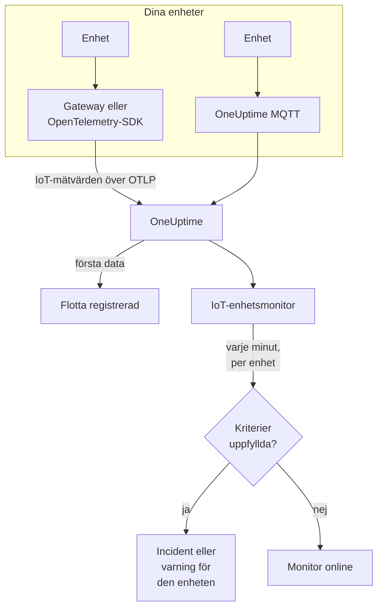

# IoT-enhets-övervakning

En IoT-enhetsmonitor bevakar en flotta av enheter och säger till när en enhet går offline, batteriet blir svagt, signalen försvagas, enheten blir överhettad eller processorn förblir upptagen. Den läser `iot_*`-mätvärdena som dina enheter skickar till OneUptime över OpenTelemetry eller MQTT, så ingenting kontrolleras utifrån och ingen probe är inblandad.

:::cards
- [Skapa monitorn](#skapa-en-iot-enhetsmonitor): Sex steg i instrumentpanelen.
- [Mallar](#färdiga-varningsmallar): Fem färdiga varningar, en incident per enhet.
- [Offlinedetektering](#offlinedetektering): Hur en död eller tyst enhet upptäcks.
- [Mätvärden](#insamlade-mätvärden): `iot_*`-serierna som monitorn läser.
:::

## Så fungerar det

Dina enheter, eller gatewayen de pratar med, skickar sina mätningar till OneUptime: över OpenTelemetry eller direkt till OneUptimes MQTT-endpoint. Varje mätning bär flottans namn, `iot.fleet.name`, och enhetens eget ID, `device.id`. Första gången data kommer in registreras flottan.

En IoT-enhetsmonitor är kopplad till en flotta. Varje minut kör den sin fråga mot flottans mätvärden och jämför resultatet med sina kriterier. Mallarna grupperar efter `device.id`, så 30 sensorer som är offline öppnar 30 incidenter, som var och en nämner sin enhet och löser sig själv när enheten återhämtar sig.



## Innan du börjar

- **Få dina enheter att skicka data.** [Guiden för IoT-enheter](/docs/telemetry/iot-devices) visar hur du skickar mätvärden med en OpenTelemetry-SDK eller -Collector, eller över MQTT.
- **Kontrollera att flottan är registrerad.** Den visas under **Produkter → Infrastruktur → IoT → All Fleets**, med namnet från det `iot.fleet.name` som enheterna skickar.
- **Registrera de enheter du förväntar dig**, under flottans **Device Registry**, för att få veta när en blir tyst: se [Offlinedetektering](#offlinedetektering).

## Skapa en IoT-enhetsmonitor

:::steps
### Starta en ny monitor

Gå till **Monitorer** och klicka på **Skapa monitor**.

### Välj IoT Device

Klicka på **Fler monitortyper** under **Monitortyp** och välj **IoT Device** under **Infrastruktur**, eller skriv `iot` i sökfältet. Ange ett **Namn** - det används i titlarna på incidenter och varningar - och klicka på **Nästa**.

### Välj flottan

Välj flottan i **IoT Fleet** under **IoT Monitor Configuration**. Varje flotta som har skickat data finns i listan.

### Välj vad som ska bevakas

Välj en av de tre flikarna:

- **Quick Setup** - klicka på en [mall](#färdiga-varningsmallar). Den sätter mätvärdet, aggregeringen, tidsintervallet, en gruppering på `device.id` och tröskelvärdena och ersätter kriterierna nedan med sina egna. Du kan fortfarande ändra **Tidsintervall**.
- **Custom Metric** - välj ett mätvärde i **IoT Metric** och sätt sedan **Aggregering** och **Tidsintervall**. [Filtren](#monitorinställningar) begränsar det till en enhet eller en enhetstyp. Ett anpassat mätvärde grupperas inte: det bedömer flottan som helhet.
- **Avancerad** - bygg frågor och formler själv under **Välj mått**, även över dina egna mätvärdesnamn, till exempel använt minne i procent av en enhets minnesstorlek. Använd **Group by** `device.id` för att bedöma varje enhet för sig.

### Kontrollera kriterierna

Öppna varje kriterium under **Monitorkriterier** och kontrollera dess **Select Metric Variable**, **Aggregering**, **Villkor** och **Threshold**. En mall fyller i dem. Med **Custom Metric** eller **Avancerad** startar monitorn med [standardkriterierna](#standardkriterier), som bara märker att ett mätvärde sjunker till noll, så sätt ditt eget tröskelvärde.

### Skapa monitorn

Klicka på **Skapa monitor**. OneUptime öppnar monitorns sida och utvärderar den varje minut. Incidenter och varningar som den skapar når dina jourregler, Slack, Microsoft Teams, e-post, SMS och webhooks som för vilken annan monitor som helst.
:::

> [!TIP]
> För att sätta upp flera mallar på en gång öppnar du flottan från **Produkter → Infrastruktur → IoT** och går till **Recommendations**. Välj de mallar du vill ha, välj vem som ska larmas, och OneUptime skapar en monitor per mall.

## Monitorinställningar

| Fält | Flik | Vad det gör |
| --- | --- | --- |
| **IoT Fleet** | Alla | Krävs. Begränsar varje fråga till `resource.iot.fleet.name`. |
| **Resursomfattning** | Custom Metric, Avancerad | Valfritt. **Enhet** eller **Fleet**: en exakt träff på attributet `iot.scope`. Att välja ett mätvärde sätter det till **Enhet**. |
| **Device ID** | Custom Metric, Avancerad | Valfritt. En enhet, via `device.id`, som `sensor-001`. |
| **Device Type** | Custom Metric, Avancerad | Valfritt. Enheterna som rapporterar denna `iot.device.type`, som `sensor` eller `gateway`. |
| **IoT Metric** | Custom Metric | Ett mätvärde från [katalogen](#insamlade-mätvärden). |
| **Aggregering** | Custom Metric | Hur stickprov kombineras: **Genomsnitt**, **Maximum**, **Minimum**, **Summa** eller **Antal**. Börjar på mätvärdets vanliga aggregering. |
| **Tidsintervall** | Alla | Det glidande fönstret som frågan läser, från **Past 1 Minute** till **Past 365 Days**. En ny monitor börjar på **Past 1 Minute**; mallar sätter sitt eget. |
| **Välj mått** | Avancerad | Frågebyggaren: **Mätvärde**, **Aggregate by**, **Filter by attributes**, **Group by**, plus **Lägg till mätvärde** och **Lägg till formel** för att kombinera frågor. |

Filtren verkar tillsammans: med ett **Device ID** och en **Device Type** matchar en enhet av en annan typ ingenting.

## Färdiga varningsmallar

**Quick Setup** erbjuder 5 mallar. Var och en bygger en komplett monitor: mätvärdesfrågan, en gruppering på `device.id`, ett kriterium som utlöser och ett som återhämtar. Tröskelvärdena är utgångspunkter som du kan redigera.

Ett kriterium utlöser bara när villkoret gäller för varje minut i fönstret - utom **Device Offline**, som utlöser vid den första mätningen under 1. Ett tröskelkriterium återhämtar sig 10 % förbi tröskeln, så ett värde som pendlar kring linjen inte växlar fram och tillbaka.

| Mall | Kategori | Allvarlighetsgrad | Bevakar | Utlöser när | Återhämtar när |
| --- | --- | --- | --- | --- | --- |
| Device Offline | Tillgänglighet | Kritisk | `iot_device_up`, Min per `device.id`, senaste 30 minuterna | En mätning är under 1, eller en registrerad enhet skickar ingenting under hela fönstret | Tillbaka på 1 |
| Low Battery | Power | Warning | `iot_battery_percent`, Avg per `device.id`, senaste 5 minuterna | Under 20 % | Vid 22 % eller mer |
| Weak Signal | Connectivity | Warning | `iot_signal_strength_dbm`, Avg per `device.id`, senaste 5 minuterna | Under -100 dBm | Vid -90 dBm eller mer |
| High Temperature | Miljö | Kritisk | `iot_temperature_celsius`, Max per `device.id`, senaste 5 minuterna | Över 70 °C | Vid 63 °C eller mindre |
| High CPU Usage | System | Warning | `iot_cpu_usage_ratio`, Avg per `device.id`, senaste 5 minuterna | Över 0.9 (90 % av processorn) | Vid 0.81 eller mindre |

**Allvarlighetsgrad** är etiketten som väljaren visar. Incidenten och varningen som en mall skapar börjar på projektets allvarligaste incident- och varningsnivå; ändra dem i kriteriet.

- **Device Offline läser 30 minuter**, så en enhet som rapporterar med några minuters mellanrum inte kallas offline mellan två rapporter. En enhet som rapporterar mer sällan än ungefär var 15:e minut behöver ett längre fönster.
- **High Temperature använder Max** inom varje minut, så en varm mätning inte döljs av svalare mätningar samma minut. Den måste ändå vara varm under varje minut i fönstret.
- **High CPU Usage jämför en kvot:** `iot_cpu_usage_ratio` går från 0 till 1, så 0.9 är 90 %.

## Offlinedetektering

**Device Offline** utlöser när en enhet rapporterar `iot_device_up = 0`. En död eller tyst enhet utlöser den på tre sätt:

| Hur | Vad som händer |
| --- | --- |
| **Gatewayen rapporterar det** | Gatewayen eller collectorn skickar `iot_device_up = 0` för en enhet som den inte längre når. |
| **MQTT Last Will** | En enhet som är ansluten till OneUptimes MQTT-endpoint registrerar en Last Will på sitt ämne `status`. När enheten dör skickar brokern `iot_device_up = 0` för den i samma ögonblick som sessionen bryts: ingen avfrågning, ingen väntan på en utebliven rapport. Se [IoT-enheter](/docs/telemetry/iot-devices). |
| **Enheten är registrerad** | En enhet i flottans **Device Registry** förväntas. När den inte skickar något under hela fönstret behandlar monitorn den som om den rapporterade `0`, så den får en egen incident, som löser sig själv när enheten rapporterar igen. |

En registrerad enhet behålls också som offline i flottans inventarium, medan en oregistrerad tas bort efter 15 minuters tystnad. Detektering av tystnad kräver regeln **Treat As Zero** för saknade data på kriteriet för `iot_device_up`, som Device Offline-monitorer skapade från mallen har. En Device Offline-monitor som skapades innan enhetsregistrering fanns måste få den satt manuellt eller skapas om från mallen.

> [!NOTE]
> En oregistrerad enhet som blir tyst utan en Last Will eller en gatewayrapport slutar bara skicka data, och en monitor som grupperar per enhet kan inte peka ut den. Registrera dina enheter, eller ge en kritisk enhet en egen monitor (**Custom Metric**, med dess **Device ID**), och sätt **Om ingen data** till **Utlösare**. Detektering av tystnad kräver också att minst en annan enhet i flottan fortfarande rapporterar: en flotta som blir helt mörk, till exempel under ett gatewayavbrott, skapar en incident för monitorn, inte en per enhet.

## Insamlade mätvärden

Varje serie bär enhetens etikett `device.id` och attributen `iot.scope`, `iot.device.type` och `iot.device.kind`.

| Mätvärde | Enhet | Beskrivning |
| --- | --- | --- |
| `iot_device_up` | — | 1 när enheten körs, 0 när den är nere eller offline. |
| `iot_battery_percent` | `%` | Återstående batteriladdning, från 0 till 100. En sjunkande nivå betyder att enheten snart slutar rapportera. |
| `iot_signal_strength_dbm` | `dBm` | Styrkan på den trådlösa signalen. Närmare 0 är starkare; en svag signal kommer före tappade anslutningar. |
| `iot_temperature_celsius` | `°C` | Enhetens temperatur. En hög mätning kan betyda överhettad hårdvara eller ett problem runt den. |
| `iot_cpu_usage_ratio` | `ratio` | Använd CPU, från 0 till 1, där 1 är full belastning. |
| `iot_memory_usage_bytes` | `bytes` | Använt minne. Jämför det med enhetens minnesstorlek för att se minnestryck. |
| `iot_uptime_seconds` | `s` | Hur länge enheten har körts. Sjunker till noll när den startar om. |

## Övervakningskriterier

Ett kriterium jämför en av monitorns frågor eller formler med ett tröskelvärde. Kriterierna för en IoT-enhetsmonitor erbjuder en **Filtertyp**, **Metric Value**: varje regel kontrollerar mätvärdets värde, med de här fälten.

| Fält | Vad det gör |
| --- | --- |
| **Filtertyp** | Alltid **Metric Value**, den enda kontrollen som den här monitorn erbjuder. |
| **Select Metric Variable** | Frågan eller formeln som ska kontrolleras, efter variabelnamnet. |
| **Aggregering** | Hur värdena i fönstret blir ett svar: **Genomsnitt**, **Summa**, **Maximum Value**, **Minimum Value**, **All Values** (varje värde måste matcha) eller **Any Value** (ett räcker). |
| **Villkor** | **Greater Than**, **Less Than**, **Greater Than Or Equal To**, **Less Than Or Equal To** eller **Equal To** — eller ett anomalivillkor: **Anomalously High**, **Anomalously Low** eller **Anomalous**. |
| **Threshold** | Värdet som det jämförs med. En enhetslista står bredvid när mätvärdet har en enhet. Visas inte för anomalivillkor. |
| **Känslighet** | Bara anomalivillkor. **Låg** (4σ), **Medel** (3σ, standard) eller **Hög** (2σ). |
| **Baslinjefönster** | Bara anomalivillkor. 14 dagar (standard), 28, 60 eller 90 dagars historik. |
| **Om ingen data** | Under **Fler fält**. Vad som händer när en serie inte har några stickprov i fönstret: **Ignore** (standard) hoppar över den, **Treat As Zero** läser den som `0`, och **Utlösare** får kriteriet att matcha. |

Anomalivillkor jämför varje värde med samma timme i veckan i baslinjen. De stannar i tillståndet "Learning", och skickar inte ut något, tills baslinjefönstret innehåller tillräckligt med historik.

### Standardkriterier

En monitor som du inte bygger från en mall börjar med två kriterier:

| Ordning | Kriterium | Matchar när | Sedan |
| --- | --- | --- | --- |
| 1 | Check if _monitor name_ is offline | Vilket värde som helst i den första frågan är `0` | Markerar monitorn som **Offline** och deklarerar incidenten "_monitor name_ is offline", som löser sig själv när monitorn återhämtar sig. |
| 2 | Check if _monitor name_ is online | Vilket värde som helst är över `0` | Markerar monitorn som **Fungerar**. |

> [!IMPORTANT]
> Tystnad matchar inget av kriterierna: en flotta som slutar skicka data lämnar monitorn som den var. För att få veta när data uteblir sätter du **Om ingen data** till **Utlösare** på ett kriterium. Tid då OneUptime själv inte tog emot något räknas aldrig som saknade data: en kontroll vars fönster innehåller den tiden väntar i stället, som [När OneUptime inte tar emot data](/docs/monitor/when-oneuptime-is-not-receiving) förklarar.

## Terraform

[OneUptimes Terraform-provider](/docs/terraform/monitor-steps) bär konfigurationen för ett steg i en IoT-enhetsmonitor i attributet `iot_monitor`: den råa JSON:en för konfigurationen `iotMonitor` (`fleetIdentifier`, `resourceFilters`, `metricViewConfig`, `rollingTime`), skriven med `jsonencode()`:

```hcl title="main.tf"
monitor_steps = [{
  iot_monitor = jsonencode({
    fleetIdentifier = "building-a-sensors"
    resourceFilters = {}
    rollingTime     = "Past 5 Minutes"
    metricViewConfig = {
      queryConfigs = [{
        metricAliasData = { metricVariable = "battery_percent", title = "Battery", description = "", legend = "" }
        metricQueryData = {
          filterData = {
            metricName     = "iot_battery_percent"
            attributes     = {}
            aggegationType = "Avg"
            aggregateBy    = {}
          }
          groupByAttributeKeys = ["device.id"]
        }
      }]
      formulaConfigs = []
    }
  })
  criteria = [ /* ... */ ]
}]
```

`fleetIdentifier` är flottans `iot.fleet.name`, inte dess OneUptime-ID.

## Felsökning

:::details Flottan finns inte i listan IoT Fleet
Flottor registrerar sig själva utifrån enheternas data. Kontrollera att enheterna skickar `iot.fleet.name`, och följ [guiden för IoT-enheter](/docs/telemetry/iot-devices) för att bekräfta att data kommer fram.
:::

:::details En incident utlöses för hela flottan i stället för en per enhet
Frågan är inte grupperad. Monitorer med **Custom Metric** bedömer flottan som helhet; använd en mall, eller **Avancerad** med **Group by** `device.id`.
:::

:::details En enhet dog, men Device Offline utlöste inte
Enheten skickade ingen Last Will och ingen gateway rapporterade den, så den blev bara tyst. Registrera den under flottans **Device Registry**, och kontrollera att **Om ingen data** på kriteriet för `iot_device_up` står på **Treat As Zero**. Se [Offlinedetektering](#offlinedetektering).
:::

:::details Device Offline utlöser för enheter som fungerar
De rapporterar mer sällan än fönstret på 30 minuter täcker, så vissa fönster innehåller ingenting från dem. Förläng **Tidsintervall**, eller låt enheterna rapportera oftare. På WebSocket-MQTT-endpointen håller du MQTT-keepalive under 5 minuter: OneUptime stänger inaktiva WebSocket-anslutningar efter 300 sekunder, vilket skickar Last Will.
:::

:::details En mall visar inga data
Mallarna läser `iot_*`-mätvärdesnamnen exakt och grupperar efter etiketten `device.id`. Jämför det dina enheter skickar, på flottans sida **Mätvärden**, med [mätvärdeskonventionerna](/docs/telemetry/iot-devices#metric-conventions).
:::

## Nästa steg

:::cards
- [IoT-enheter](/docs/telemetry/iot-devices): Skicka enhetsmätvärden över OpenTelemetry eller MQTT.
- [Metrikövervakning](/docs/monitor/metrics-monitor): Varna på vilket mätvärde som helst, inte bara IoT-mätvärden.
- [Incident- och varningsmallar](/docs/monitor/incident-alert-templating): Sätt enhetens ID i incidenttitlar.
:::
