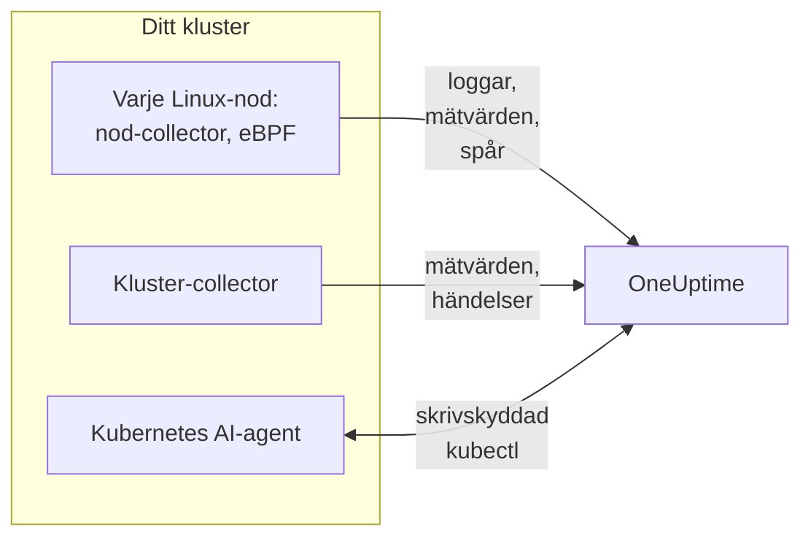

# Kubernetes-agent (Helm-installation)

OneUptimes Kubernetes-agent är ett Helm-chart som samlar in klustrets mätvärden, händelser och poddloggar, applikationsspår som fångas med eBPF och varje nods operativsystemmätvärden, och skickar dem till OneUptime. En enda `helm install` sätter upp den, utan kodändringar i dina appar. [Kubernetes-monitorer](/docs/monitor/kubernetes-monitor) varnar utifrån det den skickar.

:::cards
- [Installera agenten](#installera-agenten): Fyra steg med Helm.
- [Välj ett preset](#välj-ett-preset): Standardkluster, GKE Autopilot eller EKS Fargate.
- [Vanliga inställningar](#vanliga-inställningar): De inställningar som de flesta kluster ändrar.
- [Felsökning](#felsökning): Ett diagnosskript och de vanliga problemen.
:::

## Vad chartet installerar

Chartet kör några workloads i sitt eget namespace. Var och en skickar det den samlar in till din OneUptime-URL över OTLP, med intagningsnyckeln du ger den.



| Workload | Typ | Vad den gör | På som standard |
| --- | --- | --- | --- |
| Kluster-collector | Deployment | Klustermätvärden, Kubernetes-händelser och de fullständiga specifikationerna för poddar, noder och workloads, från Kubernetes-API:et. | Ja |
| Nod-collector | DaemonSet | Poddloggar från `/var/log/pods`, kubelet- och cAdvisor-mätvärden och nodens operativsystemmätvärden. | Ja |
| eBPF-instrumentering (OBI) | DaemonSet | HTTP-, gRPC-, SQL- och Redis-spår och förfrågningsmätvärden från varje podd, och tjänstekartan. | Ja |
| Kubernetes AI-agent | Deployment | Låter OneUptime AI köra skrivskyddad `kubectl` medan den utreder en incident eller varning i det här klustret. | Ja |
| Logg-tailer | Deployment | Poddloggar via Kubernetes-API:et, där nod-collectorn inte kan läsa dem. | Med presets `gke-autopilot` och `eks-fargate` |
| eBPF-profilerare | DaemonSet | Kontinuerliga CPU-flamgrafer för varje process. | Nej |
| kube-state-metrics | Deployment | Poddfaser, containrars vänteorsaker och resurskvoter. | Nej |

Varje agent-image körs bara på Linux, så varje workload är låst till Linux-noder.

## Innan du börjar

- **En intagningsnyckel.** Skapa en i OneUptime under **Projektinställningar → Telemetri och APM → Intagningsnycklar**. Agenten skickar den som huvudet `x-oneuptime-token`, så en projekt-API-nyckel fungerar inte här.
- **Helm 3** och `kubectl`-åtkomst till klustret. Uppgraderingar använder `--reset-then-reuse-values`, som kräver Helm 3.14 eller senare.
- **Ett namn på klustret**, unikt i ditt projekt. Chartet vägrar installera utan ett: två kluster med samma namn skulle visas som ett.
- **Utgående HTTPS** från klustret till din OneUptime-URL.

## Installera agenten

:::steps
### Lägg till Helm-repositoryt

```bash
helm repo add oneuptime https://helm-chart.oneuptime.com
helm repo update
```

### Installera chartet

Ersätt URL:en med din OneUptime-URL, och de två platshållarna med din intagningsnyckel och klustrets namn:

```bash
helm install oneuptime-agent oneuptime/kubernetes-agent \
  --namespace oneuptime-kubernetes-agent \
  --create-namespace \
  --set oneuptime.url=https://oneuptime.com \
  --set oneuptime.apiKey=<YOUR_API_KEY> \
  --set clusterName=<A_UNIQUE_NAME_FOR_THIS_CLUSTER>
```

Det här använder presetet `standard`. På GKE Autopilot eller EKS Fargate ska du i stället [välja deras preset](#välj-ett-preset).

### Kontrollera att poddarna körs

```bash
kubectl get pods -n oneuptime-kubernetes-agent
```

Varje podd bör nå `Running` inom en minut eller två.

### Hitta klustret i OneUptime

Öppna **Produkter → Infrastruktur → Kubernetes → Alla kluster**. Klustret visas under sitt namn inom några minuter, och dess noder, poddar och workloads fylls i.
:::

## Välj ett preset

Vissa Kubernetes-plattformar låter inte en workload montera en `hostPath`-volym eller köra ett DaemonSet, vilket nod-collectorn använder. Inställningen `preset` väljer det som fungerar på din:

| Preset | Används för | Poddloggar | På varje nod |
| --- | --- | --- | --- |
| `standard` (standard) | Självhanterat, **EKS on EC2**, **GKE Standard**, **AKS**, minikube, kind, k3s | Nod-collectorn läser `/var/log/pods` | Kubelet-, cAdvisor- och operativsystemmätvärden |
| `gke-autopilot` | **GKE Autopilot** | Logg-tailern läser dem via Kubernetes-API:et | Kubelet- och cAdvisor-mätvärden, utan `hostPath` |
| `eks-fargate` | **EKS Fargate** | Logg-tailern läser dem via Kubernetes-API:et | Ingenting: Fargate kör inga DaemonSets |

Om du är osäker låter du `preset` vara tomt för att få `standard`. Om installationen misslyckas med ett Pod Security-fel som nämner `hostPath` installerar du igen med `gke-autopilot`, eller `eks-fargate` på EKS Fargate.

GKE Autopilot och EKS Fargate avvisar också privilegierade poddar, som eBPF-instrumenteringen och profileringen behöver, så deras preset utelämnar båda:

:::tabs
@tab Standard
```bash
helm install oneuptime-agent oneuptime/kubernetes-agent \
  --namespace oneuptime-kubernetes-agent --create-namespace \
  --set oneuptime.url=https://oneuptime.com \
  --set oneuptime.apiKey=<YOUR_API_KEY> \
  --set clusterName=prod
```
@tab GKE Autopilot
```bash
helm install oneuptime-agent oneuptime/kubernetes-agent \
  --namespace oneuptime-kubernetes-agent --create-namespace \
  --set oneuptime.url=https://oneuptime.com \
  --set oneuptime.apiKey=<YOUR_API_KEY> \
  --set clusterName=prod-gke-autopilot \
  --set preset=gke-autopilot
```
@tab EKS Fargate
```bash
helm install oneuptime-agent oneuptime/kubernetes-agent \
  --namespace oneuptime-kubernetes-agent --create-namespace \
  --set oneuptime.url=https://oneuptime.com \
  --set oneuptime.apiKey=<YOUR_API_KEY> \
  --set clusterName=prod-eks-fargate \
  --set preset=eks-fargate
```
:::

## Märk klustret med etiketter

Etiketter som du anger vid installationen kopplas till klustret och till de tjänster och värdar som den här agenten rapporterar. `--set oneuptime.labels.<key>=<value>` blir en projektetikett med namnet `<key>:<value>`:

```bash
helm install oneuptime-agent oneuptime/kubernetes-agent \
  --namespace oneuptime-kubernetes-agent \
  --create-namespace \
  --set oneuptime.url=https://oneuptime.com \
  --set oneuptime.apiKey=<YOUR_API_KEY> \
  --set clusterName=prod \
  --set oneuptime.labels.team=payments \
  --set oneuptime.labels.env=production \
  --set oneuptime.labels.region=us-east-1
```

Eller håll dem i en values-fil:

```yaml title="values.yaml"
oneuptime:
  url: https://oneuptime.com
  apiKey: <YOUR_API_KEY>
  labels:
    team: payments
    env: production
    region: us-east-1
clusterName: prod
```

```bash
helm install oneuptime-agent oneuptime/kubernetes-agent \
  --namespace oneuptime-kubernetes-agent --create-namespace \
  -f values.yaml
```

Varje post som den här agenten skickar - loggar, mätvärden, spår och profiler - bär då `team:payments`, `env:production` och `region:us-east-1`. Varje etikett är ett resursattribut `oneuptime.label.<key>=<value>`, och OneUptime gör varje attribut som börjar med `oneuptime.label.` till en etikett. Etiketter jämförs utan hänsyn till skiftläge, så en befintlig etikett `Production` återanvänds i stället för att dupliceras. Agenten tar aldrig bort en etikett som du har lagt till i OneUptime.

## Poddloggar

`preset` sätter `logs.mode`, som du också kan sätta själv:

| `logs.mode` | Hur loggar läses | Fördelar | Se upp för |
| --- | --- | --- | --- |
| `daemonset` | En nod-collector per nod följer filerna under `/var/log/pods`. | Minst overhead, skalar med noderna, ingen belastning på Kubernetes API-server, följer loggrotation. | Kräver `hostPath` och DaemonSets. |
| `api` | En logg-tailer strömmar varje containers logg från Kubernetes-API:et, som `kubectl logs -f` gör. | Fungerar där `hostPath` är blockerat eller Pod Security Standard `restricted` gäller. | Varje containerström är en långlivad anslutning till API-servern. En replik hanterar några tusen containrar. |
| `disabled` | Ingenting. | För appar som redan skickar sina loggar på annat sätt. | |

För att stänga av logginsamling sätter du `--set logs.enabled=false` och skickar applikationsloggar med [OpenTelemetry](/docs/telemetry/open-telemetry)-SDK:erna i stället. Mätvärden påverkas inte: nod-collectorn fortsätter att köra.

### Kluster med flera operativsystem (Windows-nodpooler)

Windows-noder kör aldrig en agentpodd. Data på klusternivå om dem och deras poddar kommer ändå in, eftersom de kommer från Kubernetes-API:et: nodvillkor, poddfaser, Kubernetes-händelser och kube-state-metrics. Det Windows-noder saknar är det som samlas in på noden: operativsystemmätvärden, kubelet- och cAdvisor-mätvärden, eBPF-spår, profiler och, i loggläget `daemonset`, poddloggar.

För att också samla in loggarna från poddar på Windows-noder slår du på hybridläget:

```bash
helm upgrade oneuptime-agent oneuptime/kubernetes-agent \
  --namespace oneuptime-kubernetes-agent --reset-then-reuse-values \
  --set logs.windowsPods.enabled=true
```

Logg-tailern körs då bredvid nod-collectorerna, bara för poddarna på Windows-noder. Linux-poddar behåller den billigare filläsningen, och de två delar upp poddarna efter nodens operativsystem, så ingen loggrad skickas två gånger.

- **Tailer-imagets version.** Uppdelningen som bara gäller Windows är inbyggd i imaget `kubernetes-log-tailer`. Ett äldre image ignorerar den och följer *varje* podd, så varje Linux-podds loggar skickas två gånger. Lås inte `logs.api.image.tag` till en version som är äldre än chartets release, och om en nod kan ha ett gammalt `release`-image i cachen lägger du till `--set logs.api.image.pullPolicy=Always` i uppgraderingen.
- **Filtrering efter allvarlighetsgrad.** Med `filters.logs.minSeverity` satt kastas en rad utan igenkännbar allvarlighetsgrad bort på nod-collectorns väg men behålls på logg-tailerns - se [Filtrering efter loggallvarlighetsgrad](/docs/telemetry/kubernetes-agent#filtrering-efter-loggallvarlighetsgrad). Windows-poddar kan då skicka fler rader utan nivå än Linux-poddar.

## Applikationsspår med eBPF

Chartet kör [OpenTelemetry eBPF Instrumentation (OBI)](https://opentelemetry.io/docs/zero-code/obi/) på varje nod. OBI laddar eBPF-program i Linux-kärnan och bevakar varje podds nätverkstrafik, så att det kan återskapa HTTP- och HTTPS-, gRPC- och SQL- och Redis-anrop utan någon ändring i dina appar: ingen SDK, ingen sidecar. Det skickar dem till OneUptime som spår och förfrågningsmätvärden.

Dina tjänster visas under **Produkter → Spår** och på tjänstekartan inom en minut eller två, med `k8s.cluster.name` satt till klustrets namn, så att du kan filtrera efter kluster.

### När du ska stänga av eBPF

eBPF är på som standard. Stäng av det med `--set ebpf.enabled=false` när:

- Klustret är **GKE Autopilot** eller **EKS Fargate**. Deras preset gör det åt dig: de plattformarna avvisar privilegierade poddar, och OBI måste vara privilegierat för att ladda sina program.
- Noderna kör en kärna som är äldre än **Linux 5.8**, utan BTF. Debian 11, Ubuntu 20.10, Fedora 34, RHEL 9 och senare går bra.
- Dina appar redan skickar spår med en OpenTelemetry-SDK, och du inte vill ha dem dubbelt.

### Vad eBPF skickar

OBI skickar flera typer av signaler. Var och en kan stängas av med `--set ebpf.features.<key>=false`:

| Inställning | Standard | Vad den lägger till |
| --- | --- | --- |
| `ebpf.features.httpMetrics` | på | HTTP- och gRPC-förfrågningsmätvärden per tjänst: förfrågningsfrekvens, latenshistogram och fel. |
| `ebpf.features.spanMetrics` | på | Span-mätvärden: anrop och varaktighet per tjänst, route eller operation, span-typ och status - `traces.span.metrics.calls` och `traces.span.metrics.duration` (sekunder). |
| `ebpf.features.serviceGraph` | på | Frekvensen och latensen för varje anrop från en tjänst till en annan, som ritar tjänstekartan. |
| `ebpf.features.networkMetrics` | på | Byte och paket mellan varje par av poddar, över TCP och UDP, med deras Kubernetes-namn. Visar varje par av poddar som pratar med varandra, även över protokoll som OBI inte kan läsa. |
| `ebpf.features.networkInterZoneMetrics` | av | Samma sak mellan zoner. Fördubblar antalet serier: slå bara på det om du schemalägger efter zon. |
| `ebpf.features.tcpStats` | på | TCP-statistik per nod: tur-och-retur-tider, misslyckade anslutningar och omsändningar. |

### Länka spår mellan tjänster

OBI kan också föra spåret vidare genom ett anrop: när podd A anropar podd B över HTTP eller gRPC ansluter spannet på B:s sida till A:s spår, utan SDK i någon av apparna. **Det här är avstängt som standard.** Slå på det med `--set ebpf.contextPropagation=true`, efter att du har läst varningen nedan.

| Inställning | Standard | Vad den gör |
| --- | --- | --- |
| `ebpf.contextPropagation` | av | Skriver en W3C-`traceparent` i utgående trafik, så att spans länkas mellan tjänster. |
| `ebpf.contextPropagationMode` | `headers` | Hur: `headers` (HTTP/1.1-förfrågningshuvuden, det smalaste), `tcp` (ett TCP-alternativ, via Linux Traffic Control) eller `all` (båda). Läses bara när `contextPropagation` är på. |
| `ebpf.trackRequestHeaders` | på | Spårar förfrågningshuvuden i kärnan, så att mottagarsidan hittar `traceparent` även på vanliga HTTP-servrar. Har bara verkan när `contextPropagation` är på. |

> [!WARNING]
> Varje propageringsläge ändrar trafik som redan är på väg. För vanlig HTTP gör OBI den utgående förfrågan större i kärnan så att huvudet får plats; för TLS och rå TCP lägger det till ett TCP-alternativ från en Traffic Control-hook och skriver om paketet och dess kontrollsumma. Om anslutningens byteräkning sedan inte korrigeras exakt **desynkroniseras** strömmen: överföringar genom en proxy som nginx hänger sig halvvägs, så snart ett svar passerar ungefär 64 KB, tills anslutningen får timeout. Små förfrågningar fortsätter att fungera, så det ser ut som en bugg i applikationen eller proxyn. Ingen kärnversion får omskrivningen att försvinna. Spår, förfrågningsmätvärden och tjänstekartan fungerar alla utan den; en OpenTelemetry-SDK i dina tjänster länkar spår helt utan omskrivning i kärnan. Om du slår på den, prova den först i ett kluster som inte är produktion, och kontrollera stora överföringar genom din proxy.

### Länka loggar till spår

**Avstängt som standard.** När det är påslaget fäster OBI en probe vid systemanropet `write()` för varje process som det instrumenterar, och:

- En **JSON-loggrad** får fälten `trace_id` och `span_id` (fält som raden redan har behålls). Nod-collectorn flyttar dem till loggpostens egna spårfält, så att ett spans loggar är ett klick bort i OneUptime, och detsamma gäller en loggrads spår.
- **Varje annan loggrad** samlas in oförändrad, utan länken.

```bash
helm upgrade oneuptime-agent oneuptime/kubernetes-agent \
  --namespace oneuptime-kubernetes-agent --reset-then-reuse-values \
  --set ebpf.logToTraceCorrelation=true
```

| Inställning | Standard | Vad den gör |
| --- | --- | --- |
| `ebpf.logToTraceCorrelation` | `false` | Slår på OBI:s loggberikare och nod-collectorns lyft av `trace_id`. |
| `ebpf.logEnricher.services` | `[{service: [{exe_path: "*"}]}]` | Vilka processer berikaren rör. Varje post är en OBI-[GlobAttributes](https://opentelemetry.io/docs/zero-code/obi/configure/options/#service-discovery)-selektor, med fält som `exe_path`, `languages`, `k8s_pod_labels`, `k8s_pod_annotations`, `open_ports` och `cmd_args`. |

#### APM-agenter som kraschar med det

Berikaren skriver om appens utdatabuffert **inuti processen**: när en vald process anropar `write()` tömmer OBI de ursprungliga byten och skriver en berikad kopia. APM-agenter som läses in via `LD_PRELOAD` och själva omsluter `write()` överlever inte det:

| APM-agent | Bibliotek | Vad som händer |
| --- | --- | --- |
| Dynatrace OneAgent | `liboneagentproc.so` | Appen kraschar med SIGSEGV (slutkod 139). Dynatrace-watchdogens egen `write()` fastnar bortom sin gräns på 10 sekunder och OneAgent startar om i en loop. |
| New Relic | `libnewrelic*.so` | Samma typ av krasch. |
| AppDynamics | `libappdynamics*.so` | Samma typ av krasch. |
| Datadog | `libdd*.so` | Samma typ av krasch. |
| Instana | `libinstana*.so` | Samma typ av krasch. |

**.NET-appar är mest utsatta:** Dynatraces .NET-agent läses alltid in via `LD_PRELOAD`, och konsolloggen från Microsoft.Extensions.Logging är obuffrad, så varje rad tar den vägen. Python- och Go-appar påverkas oftast inte.

För att använda det bredvid någon av dessa agenter pekar du `logEnricher.services` bara på de poddar som inte har en. Berikaren kan inte utesluta, så lista dem som ska berikas:

```yaml title="values.yaml"
ebpf:
  logToTraceCorrelation: true
  logEnricher:
    services:
      # Enrich only pods with the apm-agent=none label
      - service:
          - k8s_pod_labels:
              apm-agent: "none"
```

Eller välj efter runtime. Dynatraces inläsning via `LD_PRELOAD` riktar sig mot .NET, så om du bara berikar Python, Go, Ruby och Node.js undviker du det:

```yaml title="values.yaml"
ebpf:
  logToTraceCorrelation: true
  logEnricher:
    services:
      - service:
          - languages: "python,go,ruby,nodejs"
```

#### Loggar måste vara JSON och obuffrade

- **Bara JSON-rader får ett `trace_id`.** Byt loggern till ett JSON-format: `structlog`, `pino`, `winston`, `serilog`, `logback-json`, klog `--logging-format=json` och liknande.
- **Buffrad utdata bryter länken**, eftersom `write()` då sker på en annan tråd än förfrågan. I **Python** sätter du `PYTHONUNBUFFERED=1`. I **.NET** anropar du `Console.SetOut(new StreamWriter(Console.OpenStandardOutput()) { AutoFlush = true })` vid start; `AddConsole()` från Microsoft.Extensions.Logging och Serilogs asynkrona sinks fungerar inte, Serilogs vanliga `WriteTo.Console()` gör det.
- Greenlet, gevent, Tornado och andra egna asynkrona runtimes omfattas inte.

### Finjustera eBPF

| Inställning | Standard | Vad den gör |
| --- | --- | --- |
| `ebpf.enabled` | `true` | Kör eBPF-DaemonSetet. `false` utelämnar det. |
| `ebpf.image.tag` | `v0.14.0` | OBI-imaget. OBI är före 1.0: lås en version som du har testat, och testa igen innan du byter den. |
| `ebpf.autoTargetExe` | `*` | Globs för de körbara filer som ska instrumenteras, kommaseparerade. Begränsa den, som i `*/python,*/java`, för att instrumentera färre runtimes. |
| `ebpf.excludeExePaths` | Skal, klustrets infrastruktur, service mesh-sidecars, CNI-agenter, webbläsare, ClickHouse, collectorer och OBI själv | Globs för körbara filer som ska hoppas över, kommaseparerade. En bred glob hoppar även över dina egna binärer. |
| `ebpf.logLevel` | `info` | `debug`, `info`, `warn` eller `error`. |
| `ebpf.printTraces` | `false` | Skriver också spans till OBI:s egen logg, så att du kan kontrollera vad det fångar. |
| `ebpf.resources.*` | `100m` CPU och `512Mi` minne begärt, gränser på `2000m` och `2Gi` | Höj dem för noder med mycket trafik eller många kortlivade processer. |

För att kontrollera att OBI körs och ser trafik:

```bash
kubectl get pods -n oneuptime-kubernetes-agent -l component=ebpf-instrument
kubectl logs -n oneuptime-kubernetes-agent -l component=ebpf-instrument --tail=200
```

## Kontinuerlig CPU-profilering

[OpenTelemetry eBPF Profiler](https://github.com/open-telemetry/opentelemetry-ebpf-profiler) kan också köras på varje nod, som imaget `otel/opentelemetry-collector-ebpf-profiler`. Den tar stickprov på vad varje process kör, 19 gånger per sekund, i Go, Java, .NET, Python, Ruby, Node.js, PHP, Perl, C, C++ och Rust, och skickar profilerna till OneUptime. De visas under **Produkter → Prestandaprofiler** och som en flamgraf på varje span i ett spår.

**Profilering är avstängt som standard:** det kostar mer CPU och minne per nod än eBPF-instrumenteringen. Slå på det med `--set profiling.enabled=true`.

Med eBPF-instrumenteringen också påslagen (standard) bär varje stickprov det spår det hör till, så ett span har sin egen flamgraf. För det ber chartet OBI att hålla den pågående spårkontexten tillgänglig (`OTEL_EBPF_BPF_POPULATE_TRACE_CONTEXT=true`), vilket kostar instrumenterade appar lite vid varje asynkront kontextbyte. Sätt `profiling.obiProcessContext=false` för flamgrafer utan länken till spans.

Profilering kräver **Linux 5.10** eller senare och en privilegierad podd med nodens process-ID:n: den kan inte köras på GKE Autopilot eller EKS Fargate, och deras preset låter den vara avstängd. På noder som själva är containrar, som kind eller k3d, kan den inte skilja processer åt, och nästan inget stickprov länkas till ett span.

| Inställning | Standard | Vad den gör |
| --- | --- | --- |
| `profiling.enabled` | `false` | Kör profilerarens DaemonSet. |
| `profiling.image.tag` | `0.152.0` | Profilerarens image. Det är före 1.0: lås en version som du har testat. |
| `profiling.samplesPerSecond` | `19` | Hur många stickprov per sekund. 19 undviker att sammanfalla med vanliga timerfrekvenser. |
| `profiling.offCpuThreshold` | `0` | Ett värde över 0 och upp till 1 profilerar också tid utanför CPU:n, vilket visar låskonflikter och blockerande I/O, till en extra kostnad. |
| `profiling.tracers` | `""` (varje runtime) | De språkspårare som ska läsas in, kommaseparerade, som `go,python`. |
| `profiling.obiProcessContext` | `true` | Länkar stickprov till OBI:s spår och får OBI att hålla spårkontexten tillgänglig för det. |

## Annan datainsamling

| Inställning | Standard | Vad den lägger till |
| --- | --- | --- |
| `hostMetrics.enabled` | på | Varje nods operativsystemmätvärden från `/proc` och `/sys`: diskens I/O-köer, filsystemens inoder, fel på nätverksgränssnitt, paging och load average. Körs i nod-collectorn, utan extra poddar. |
| `kubeletstats.utilizationMetrics.enabled` | på | CPU och minne för containrar och poddar i procent av deras request och limit, som monitorerna för CPU- och minnesmättnad läser. Alltid 0 för en podd utan request eller limit. |
| `kubeletstats.volumeMetrics.enabled` | på | Varje PVC:s lediga och totala utrymme (`k8s.volume.available`, `k8s.volume.capacity`), som monitorn PVC Low Disk Space läser. En serie per PVC per podd. |
| `cadvisor.enabled` | på | CPU-strypning och OOM-avslut från varje kubelets `/metrics/cadvisor`: `container_cpu_cfs_throttled_seconds_total`, `container_cpu_cfs_periods_total` och `container_oom_events_total`, och inget annat. |
| `kubeStateMetrics.enabled` | av | Poddfaser (Pending, Terminating), poddar som inte kan schemaläggas, containrars vänteorsaker (CrashLoopBackOff, ImagePullBackOff) och användning av resurskvoter, från kube-state-metrics. `kubeStateMetrics.mode: bundled` (standard) kör en liten kube-state-metrics åt dig; `external` läser en som du redan kör, på `kubeStateMetrics.endpoint`. |
| `auditLogs.enabled` | av | Kubernetes granskningslogg, `/var/log/kubernetes/audit.log`: varje förfrågan till API:et, från vem och på vad. Bara självhanterade kluster: hanterade (EKS, GKE, AKS, DOKS) skickar den till molnleverantören. |
| `csi.enabled` | av | Mätvärden från CSI-lagringsdrivrutiner, från poddar med etiketten `app=csi-driver` eller `app.kubernetes.io/component=csi-driver`: tider för att ansluta och koppla från volymer, provisioneringsfel, IOPS. |
| `coreDns.enabled` | av | CoreDNS mätvärden på `:9153/metrics`: frågefrekvens, latens, cacheträffar och fel. |
| `controlPlane.enabled` | av | etcd, API-servern, schemaläggaren och controller managern. Bara självhanterade kluster: hanterade exponerar dem inte. |
| `cost.enabled` | av | Vad varje workload kostar. Se [Kubernetes-kostnadsobserverbarhet](/docs/telemetry/kubernetes-cost). |

## Vanliga inställningar

| Inställning | Standard | Vad den gör |
| --- | --- | --- |
| `oneuptime.url` | (krävs) | Din OneUptime-URL. |
| `oneuptime.apiKey` | (krävs) | Intagningsnyckeln, från **Projektinställningar → Telemetri och APM → Intagningsnycklar**. Skickas som huvudet `x-oneuptime-token`; en projekt-API-nyckel fungerar inte. |
| `clusterName` | (krävs) | Klustrets namn, unikt i projektet. Varje post bär det som `k8s.cluster.name`. |
| `preset` | (tomt: `standard`) | `standard`, `gke-autopilot` eller `eks-fargate`. Se [Välj ett preset](#välj-ett-preset). |
| `oneuptime.labels` | `{}` | Etiketter för varje post från den här agenten. Se [Märk klustret med etiketter](#märk-klustret-med-etiketter). |
| `namespaceFilters.rules` | Håller `kube-system` utanför `podLogs` och `ebpfDiscovery` | Regler som tar med eller utesluter namespaces, för `podLogs`, `ebpfDiscovery`, `metrics` och `traces`. Mönster kan använda `*`, och uteslutning vinner alltid. |
| `filters.logs.minSeverity` | `""` | Kastar poddloggrader under den här nivån: `TRACE`, `DEBUG`, `INFO`, `WARN`, `ERROR` eller `FATAL`. |
| `filters.metrics.exclude` | `[]` | Mätvärdesnamn som ska kastas. |
| `sampling.traces.percentage` | `100` | Andelen spår som ska behållas, från 0 till 100. Hela spår behålls eller kastas. |
| `logs.enabled` | `true` | Samlar in poddloggar. |
| `logs.mode` | (från `preset`) | `daemonset`, `api` eller `disabled`. Åsidosätter presetet. |
| `logs.windowsPods.enabled` | `false` | Följer också poddar på Windows-noder. Se [Kluster med flera operativsystem](#kluster-med-flera-operativsystem-windows-nodpooler). |
| `logs.api.replicas` | `1` | Repliker av logg-tailern, i läget `api`. |
| `ebpf.enabled` | `true` | eBPF-spår och förfrågningsmätvärden. Se [Applikationsspår med eBPF](#applikationsspår-med-ebpf). |
| `profiling.enabled` | `false` | CPU-flamgrafer. Se [Kontinuerlig CPU-profilering](#kontinuerlig-cpu-profilering). |
| `kubeStateMetrics.enabled` | `false` | Klustrets tillstånd från kube-state-metrics. |
| `aiAgent.enabled` | `true` | Kubernetes AI-agenten. Se [Kubernetes AI-agent](/docs/telemetry/kubernetes-agent#kubernetes-ai-agent) för vad den får göra. |

Chartets [`values.yaml`](https://github.com/OneUptime/oneuptime/blob/master/HelmChart/Public/kubernetes-agent/values.yaml) listar och förklarar varje inställning, och [Kubernetes-agent](/docs/telemetry/kubernetes-agent) täcker filtrering, sampling och hur du håller datamängden nere.

## Uppgradering

```bash
helm repo update
helm upgrade oneuptime-agent oneuptime/kubernetes-agent \
  --namespace oneuptime-kubernetes-agent \
  --reset-then-reuse-values
```

`--reset-then-reuse-values` (Helm 3.14 och senare) behåller värdena som du har satt - presetet, klustrets namn, filter - och tar alla andra värden från det nya chartet. Lägg till eventuella nya `--set` efter den. På Helm 3.13 eller äldre uppgraderar du i stället med värdena som du har satt:

```bash
helm repo update
helm get values oneuptime-agent --namespace oneuptime-kubernetes-agent -o yaml > values.yaml && \
  helm upgrade oneuptime-agent oneuptime/kubernetes-agent \
  --namespace oneuptime-kubernetes-agent -f values.yaml
```

Uppgradera inte med `--reuse-values`: den behåller också standardvärdena från chartet du uppgraderar från, så ett nyare charts standardvärden, bland dem dess eBPF-image, aldrig tillämpas. När en release körs på ett äldre charts standardvärden slutar anteckningarna som Helm skriver ut efter installationen eller uppgraderingen med en varning och kommandot som rättar det.

> [!WARNING]
> **eBPF:s span-mätvärden har nya namn.** `ebpf.features.spanMetrics` skickar nu `traces.span.metrics.calls` och `traces.span.metrics.duration` (sekunder) i stället för `traces_spanmetrics_calls_total` och `traces_spanmetrics_latency`: samma serier, under de namn som OBI behåller (det har fasat ut de gamla). En instrumentpanel, ett diagram eller en mätvärdesmonitor på ett gammalt namn får inga nya data efter uppgraderingen, utan något fel - flytta den till det nya namnet, och uppdatera varje post i `filters.metrics` som nämner ett gammalt namn.

## Avinstallation

```bash
helm uninstall oneuptime-agent --namespace oneuptime-kubernetes-agent
kubectl delete namespace oneuptime-kubernetes-agent
```

## Felsökning

:::details Klustret visas som Disconnected, eller så kommer ingen data
Kör chartets diagnosskript. Det kontrollerar poddarna, intagningsnyckeln och vägen ut ur klustret, frågar OneUptime om nyckeln godtas och skriver ut ett enda utlåtande. Det läser bara och ändrar ingenting:

```bash
curl -fsSL https://raw.githubusercontent.com/OneUptime/oneuptime/master/HelmChart/Public/kubernetes-agent/troubleshoot.sh \
  | bash -s -- -n oneuptime-kubernetes-agent
```

Den vanliga orsaken, särskilt efter en ominstallation, är en felaktig eller återkallad intagningsnyckel: OneUptime avvisar den, och collectorn kastar varje batch medan dess poddar förblir `Running`.
:::

:::details Installationen misslyckas med "hostPath volumes are not allowed"
Klustret blockerar `hostPath`. Byt till ett preset som läser loggar via Kubernetes-API:et; det utelämnar också eBPF:

```bash
helm repo update
helm upgrade oneuptime-agent oneuptime/kubernetes-agent \
  --namespace oneuptime-kubernetes-agent \
  --reset-then-reuse-values \
  --set preset=gke-autopilot
```

På EKS Fargate använder du `--set preset=eks-fargate`.
:::

:::details Agentpoddar fastnar i ImagePullBackOff på Windows-noder
Äldre charts schemalade agentens DaemonSets på Windows-noder, där deras Linux-images aldrig kan hämtas. Kör `helm upgrade`: det aktuella chartet låser varje workload till Linux-noder, och poddarna som fastnat försvinner. För att samla in loggarna från poddar på Windows-noder, se [Kluster med flera operativsystem](#kluster-med-flera-operativsystem-windows-nodpooler).
:::

:::details Inga loggar kommer in i OneUptime
Kontrollera agentens poddar och deras loggar:

```bash
kubectl get pods -n oneuptime-kubernetes-agent
kubectl logs -n oneuptime-kubernetes-agent -l app.kubernetes.io/part-of=oneuptime --tail=200
```

I läget `api` svarar logg-tailern på `/healthz`, port 13133, med tillståndet för sina exporter: nå den med `kubectl port-forward`.
:::

:::details eBPF-poddarna är i CrashLoopBackOff, eller startar inte
Läs OBI:s logg:

```bash
kubectl logs -n oneuptime-kubernetes-agent -l component=ebpf-instrument --tail=200
```

- **Kärnan är för gammal, eller saknar BTF.** OBI kräver Linux 5.8 eller senare med BTF; kontrollera med `uname -r` på en nod. Om du inte kan uppgradera den stänger du av eBPF med `--set ebpf.enabled=false`.
- **Privilegierade poddar avvisas.** Vissa kluster avvisar dem även utanför Autopilot och Fargate. Stäng av eBPF.
- **OBI körs, men inga spår kommer in.** Sätt `--set ebpf.printTraces=true` och läs OBI:s logg igen. Spans där betyder att exporten till OneUptime misslyckas: kontrollera URL:en och intagningsnyckeln. Inga spans där kan betyda att trafiken krypteras av ett TLS-bibliotek som OBI inte kan läsa, som ett statiskt länkat.
:::

:::details Stora överföringar hänger sig efter att spårlänkning slagits på
Det är `ebpf.contextPropagation` som skriver om trafiken: se varningen i [Länka spår mellan tjänster](#länka-spår-mellan-tjänster). Stäng av det med `--set ebpf.contextPropagation=false`.
:::

:::details Appar kraschar med slutkod 139 efter att logglänkning slagits på
En APM-agent som läses in via `LD_PRELOAD` finns i samma poddar: se [APM-agenter som kraschar med det](#apm-agenter-som-kraschar-med-det). Stäng av `ebpf.logToTraceCorrelation`, eller peka `ebpf.logEnricher.services` på poddar utan den agenten.
:::

:::details En logg-tailer räcker inte för klustret (api-läge)
Fördela namespaces över flera releaser, var och en installerad med sina egna namespace-regler:

```bash
helm install oneuptime-agent-ns-a oneuptime/kubernetes-agent \
  --set preset=gke-autopilot \
  --set-json 'namespaceFilters.rules=[{"action":"include","namespaces":["app-a","app-b"],"scopes":["podLogs"]}]' \
  ...
```

Att höja `logs.api.replicas` lägger till tailers, men var och en läser alla tillåtna namespaces, så du måste ändå fördela namespaces för att undvika dubbletter.
:::

## Nästa steg

:::cards
- [Kubernetes-övervakning](/docs/monitor/kubernetes-monitor): Varna utifrån det som agenten skickar.
- [Kubernetes-agent](/docs/telemetry/kubernetes-agent): Filtrering, sampling, AI-agenten och hur du håller datamängden nere.
- [Kubernetes-kostnadsobserverbarhet](/docs/telemetry/kubernetes-cost): Se vad varje workload kostar.
- [Spårningsövervakning](/docs/monitor/traces-monitor): Varna utifrån spåren som eBPF fångar.
:::
