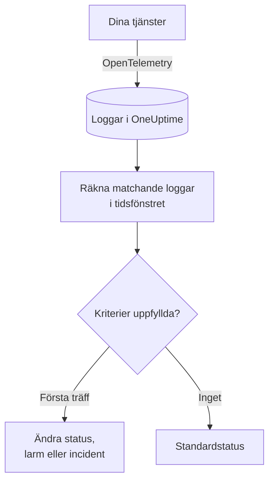
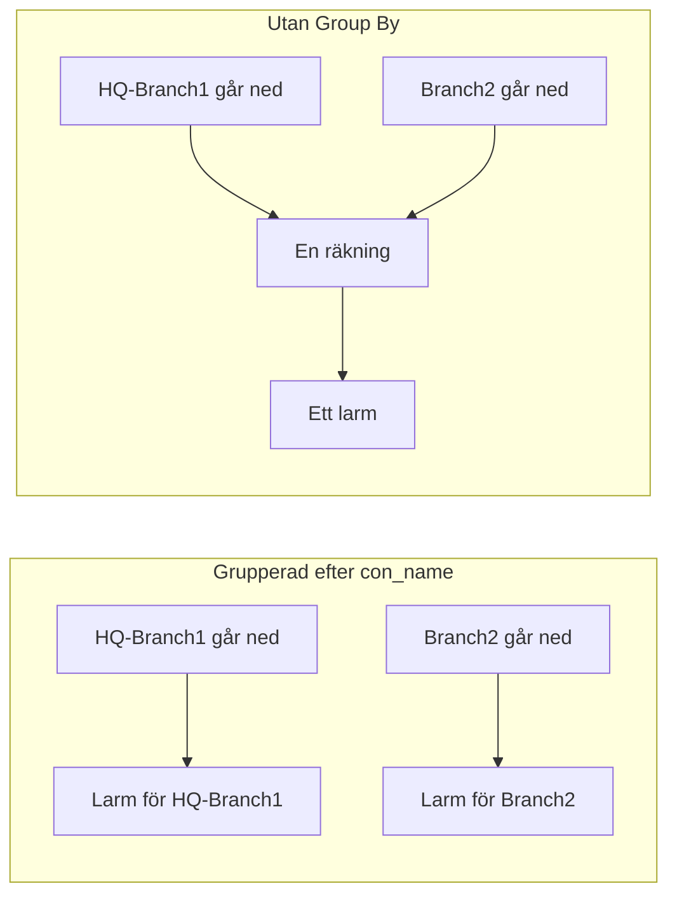

# Loggövervakning

En loggmonitor räknar inom ett tidsfönster de loggar som dina tjänster skickar till OneUptime och som matchar dina filter (text, allvarlighetsgrad, tjänst, attribut). När antalet uppfyller dina kriterier ändrar den monitorns status, skapar ett larm eller deklarerar en incident. Använd den för att upptäcka en ökning av fel, ett visst felmeddelande eller en tjänst som har slutat logga.

:::cards
- [Skapa monitorn](#skapa-en-loggmonitor): Välj vilka loggar som räknas och när du ska varnas.
- [Så utvärderas den](#så-utvärderas-den): Tidsfönstret, räkningen och cykeln på en minut.
- [Kriterier](#kriterier): Tröskelvärden, avvikelsedetektering och standardvärdena.
- [Larm per grupp](#larm-per-grupp-group-by): Ett larm per tunnel, användare eller gränssnitt.
:::

## Så fungerar det



Varje minut räknar OneUptime de loggar som matchar monitorns filter och har kommit in inom dess tidsfönster. Antalet jämförs med monitorns kriterier uppifrån och ned, och det första kriteriet som matchar avgör vad som händer. När inget matchar går monitorn tillbaka till sin standardstatus.

## Innan du börjar

- Dina tjänster skickar loggar till OneUptime via OpenTelemetry (eller en annan loggkälla som OneUptime tar emot). Se [OpenTelemetry](/docs/telemetry/open-telemetry).
- För att filtrera eller gruppera på ett värde inne i loggraden, som namnet på en tunnel eller en användare, gör du först om det till ett attribut med en [loggpipeline](/docs/telemetry/log-pipelines).

## Skapa en loggmonitor

:::steps
### Börja en ny monitor

Gå till **Monitorer** och klicka på **Skapa monitor**. Eller sök i loggutforskaren efter de loggar du vill få veta om och klicka på **Create monitor** i dess verktygsfält: den nya monitorn bevakar från början utforskarens sökning, allvarlighetsgrader, tjänster och attribut.

### Välj Logs

Under **Monitortyp** klickar du på **Fler monitortyper** och väljer **Loggar** under **Telemetri**, eller skriver `logs` i sökrutan. Ange ett **Namn** och klicka sedan på **Nästa**.

### Välj vad monitorn ska berätta om

Under **Vad ska den här övervakningen berätta om?** väljer du **För många fel**, **Ett meddelande dyker upp** eller **Loggar uteblir**. Varje val fyller i loggarna att bevaka och regeln, som du kan ändra längre ned. Välj **Något annat** för att ställa in dem själv.

### Välj vilka loggar som ska räknas

I **Loggar att bevaka** anger du **Loggens allvarlighetsgrad** och **Meddelandet innehåller**. Ett filter som du lämnar tomt matchar alla loggar. **Matchande loggar** under filtren visar de loggar som de matchar just nu.

### Begränsa dem (valfritt)

Öppna **Fler fält** för att filtrera efter telemetritjänst, infrastrukturentitet eller attribut. Vill du ha ett larm per tunnel, användare eller gränssnitt i stället för en för hela monitorn lägger du till attributet under **Group by Attributes** (se [Larm per grupp](#larm-per-grupp-group-by)).

### Säg när det ska larmas

I **När det ska larmas** väljer du ett **Villkor**, **Antal loggar** och ett **Tidsfönster**. Meningen under dem upprepar regeln med vanliga ord. Diagrammet under den räknar de matchande loggarna i varje fönster under de senaste timmarna, ritar regelns tal som en linje och berättar hur ofta regeln skulle ha larmat. Dess knapp föreslår ett tal som regeln inte skulle ha passerat under den tiden.

### Välj vad som händer

I **Vad som händer** väljer du **Skapa ett larm**, **Deklarera en incident** eller **Båda**, och ger det en titel och en allvarlighetsgrad. Medan regeln matchar visar monitorn statusen under **Fler fält**; när den slutar matcha går monitorn tillbaka till sin standardstatus, och larmet eller incidenten löser sig själv.

### Skapa monitorn

Klicka på **Skapa monitor**. Monitorn öppnas på sin sida **Översikt**, och dess första utvärdering körs inom en minut.
:::

## Vad den frågar efter

| Fält | Vad det matchar | Standard |
| --- | --- | --- |
| **Loggens allvarlighetsgrad** | Loggar med någon av de valda allvarlighetsgraderna. | Tomt: alla allvarlighetsgrader |
| **Meddelandet innehåller** | Loggar vars brödtext innehåller denna text, utan skillnad på versaler och gemener. | Tomt: alla loggar |
| **Tidsfönster** (i **När det ska larmas**) | Loggar från de senaste 5 sekunderna upp till de senaste 24 timmarna. | **Senaste 5 minuterna** |
| **Group by Attributes** | Inget filter: räknar varje kombination av dessa attributs värden för sig. | Tomt: en räkning |
| **Löst av attribut** | Inget filter: loggen som löser en grupp. Visas så snart **Group by Attributes** har ett attribut; se [Löst av en logg](#löst-av-en-logg). | Tomt: en grupp löses när dess loggar upphör |
| **Filtrera efter telemetritjänst** (under **Fler fält**) | Loggar från någon av de valda tjänsterna. | Tomt: alla tjänster |
| **Filtrera efter infrastrukturenhet** (under **Fler fält**) | Loggar från någon av de valda värdarna, poddarna, containrarna och andra entiteterna. | Tomt: alla entiteter |
| **Filtrera efter attribut** (under **Fler fält**) | Loggar vars attribut uppfyller alla villkor. Varje villkor har en egen operator, som "är lika med" eller "innehåller". | Tomt: inga villkor |

Alla filter som du anger måste matcha för att en logg ska räknas.

### Loggarnas allvarlighetsgrad

Varje logg lagras med en av sju allvarlighetsgrader. För loggar från OpenTelemetry kommer den från loggens allvarlighetsnummer, så välj efter allvarlighetsgrad och inte efter texten som din loggare skrev ut:

| Allvarlighetsgrad | OpenTelemetrys allvarlighetsnummer |
| --- | --- |
| **Spår** | 1–4 |
| **Debug** | 5–8 |
| **Information** | 9–12 |
| **Warning** | 13–16 |
| **Fel** | 17–20 |
| **Fatal** | 21–24 |
| **Ospecificerad** | Allt annat |

## Så utvärderas den

- **Varje minut.** En loggmonitor kontrolleras inte av sonder, så den har inget intervall att ange och ingen sida **Sonder och intervall**.
- **Ett tal per utvärdering.** Monitorn räknar de loggar som matchar alla filter och har kommit in inom **Tidsfönster** före utvärderingen. Med **Senaste 5 minuterna** ser varje utvärdering fem minuter bakåt, så fönstren för utvärderingar i följd överlappar.
- **Inga loggar är ett antal på 0.** En tjänst som slutar logga ger 0, och det är vad **Loggar uteblir** letar efter.
- **OneUptimes eget avbrott är inte tystnad.** Så länge tidsfönstret innehåller tid då OneUptime självt inte tog emot data (det startade om, uppgraderades eller arbetade ikapp en eftersläpning) väntar kontrollen: statusen ändras inte, och ingen incident eller larm öppnas eller löses. Se [När OneUptime inte tar emot data](/docs/monitor/when-oneuptime-is-not-receiving).
- **Kriterier uppifrån och ned.** Det första kriteriet som matchar avgör, så lägg det allvarligaste överst. En grupperad monitor fungerar annorlunda: den kontrollerar alla kriterier för varje grupp (se [Utvärderingen av kriterier skiljer sig](#utvärderingen-av-kriterier-skiljer-sig)).

Varje statusändring registreras med sin orsak på monitorns **Statustidslinje**.

## Kriterier

En loggmonitors kriterier har en enda **Filtertyp**: **Log Count**, antalet loggar som matchade i fönstret. **När det ska larmas** ställer in ett kriterium, vars **Villkor** är **Fler än**, **Minst**, **Färre än**, **Högst**, **Exakt**, **Ovanligt hög**, **Ovanligt låg** eller **Ovanligt hög eller låg**. För flera kriterier, eller ett med mer än ett filter, klickar du på **Redigera som egna kriterier** under **Fler fält** i **Vad som händer**: varje kriterium där har ett **Filtervillkor** och, för ett tröskelvillkor, ett **Värde**.

| Filtervillkor | Matchar när antalet loggar är… |
| --- | --- |
| **Större än** | över värdet |
| **Större än eller lika med** | lika med värdet eller högre |
| **Mindre än** | under värdet |
| **Mindre än eller lika med** | lika med värdet eller lägre |
| **Lika med** | exakt värdet |
| **Anomalously High** | över det förväntade intervallet för den här timmen i veckan |
| **Anomalously Low** | under det intervallet |
| **Anomalous** | utanför det intervallet, åt vilket håll som helst |

Avvikelsevillkoren har inget **Värde**. Välj en **Känslighet** (Låg, Medel, som är standard, eller Hög) och, i de egna kriterierna, ett **Baslinjefönster** på 14 (standard), 28, 60 eller 90 dagar. OneUptime gör om antalet till en takt per minut och jämför den med samma timme i veckan över det fönstret. Baslinjen omfattar bara monitorns tjänster och allvarlighetsgrader: dess text- och attributfilter ingår inte. Tills den timmen i veckan har tillräcklig historik lär sig kriteriet fortfarande och löser inte ut.

En loggmonitor som skapats i Skapa monitor börjar med regeln för det du valde under **Vad ska den här övervakningen berätta om?**:

| Val | Regel | Vad som händer |
| --- | --- | --- |
| **För många fel** | **Loggens allvarlighetsgrad** **Fel** och **Fatal**, **Fler än** `10` under **Senaste 5 minuterna** | Skapar ett larm, som löser sig själv |
| **Ett meddelande dyker upp** | **Fler än** `0` under **Senaste 5 minuterna** | Skapar ett larm, som löser sig själv |
| **Loggar uteblir** | **Exakt** `0` under **Senaste 10 minuterna** | Deklarerar en incident, som löser sig själv |

En loggmonitor som skapats via API:et eller Terraform utan kriterier börjar med dessa kriterier:

| Kriterium | Filter | Effekt |
| --- | --- | --- |
| Check if … is offline | **Log Count** **Lika med** `0` | Markerar monitorn som offline och deklarerar en incident, som löses automatiskt |
| Check if … is online | **Log Count** **Större än** `0` | Markerar monitorn som online |

## Genomgånget exempel: en ökning av fel

Du vill ha en incident när checkout-tjänsten loggar fler än 50 fel på fem minuter:

- **Loggens allvarlighetsgrad**: **Fel**
- **Tidsfönster**: **Senaste 5 minuterna**
- **Filtrera efter telemetritjänst**: `checkout`
- **När det ska larmas**: **Fler än** `50`
- **Vad som händer**: **Deklarera en incident**

Fyra utvärderingar i följd:

| Tid | Felloggar de senaste 5 minuterna | Matchar regeln? | Vad som händer |
| --- | --- | --- | --- |
| 10:00 | 12 | Nej | Monitorn är online. |
| 10:01 | 64 | Ja | Monitorn går offline och en incident deklareras. |
| 10:02 | 81 | Ja | Förblir offline. Incidenten är redan öppen, så ingen ny deklareras. |
| 10:06 | 9 | Nej | Monitorn är online igen, och incidenten löser sig själv eftersom **Lös incident automatiskt** är aktiverat. |

Eftersom fönstren överlappar håller en enda skur av fel antalet högt i upp till fem minuter efter att den är slut. Använd ett kortare fönster för en monitor som ska återhämta sig snabbare.

## Larm per grupp (Group By)

**Group by Attributes** delar upp en loggmonitors räkning i en räkning per distinkt kombination av attributvärden (en per IPsec-tunnel, per VPN-användare, per brandväggsgränssnitt) och utvärderar kriterierna för varje grupp för sig. Det är loggarnas motsvarighet till en metrikmonitors [Group By](/docs/monitor/metrics-monitor#larm-per-serie-group-by).

### Ett larm per grupp

Utan Group By är en monitor som håller koll på avslutade IPsec-tunnlar en enda räkning för hela monitorn och ger **ett larm för hela monitorn**. Så länge det larmet är öppet ger det inget nytt att ytterligare en tunnel går ned: monitorn varnar redan.

Med Group By på tunnelnamnet öppnar avslutningen av tunneln `HQ-Branch1` sitt eget larm, och avslutningen av tunneln `Branch2` tio minuter senare öppnar en **andra, separat larm** bredvid.



### Oberoende lösning

Varje grupps larm eller incident löses för sig. Så snart en grupp inte längre uppfyller kriterierna (`HQ-Branch1` loggar inga fler avslutningar inom tidsfönstret) löses dess larm, medan larmet för `Branch2` förblir öppen tills även `Branch2` slutar. Att en grupp återhämtar sig stänger aldrig en annan grupps larm.

En loggmonitor ser händelser, inte tillstånd: en grupps larm löses så snart gruppen inte har loggat något som uppfyller kriterierna under ett helt tidsfönster, oavsett om tunneln är uppe igen eller inte - om inte monitorn anger loggen som säger att den är uppe igen, som nedan.

### Löst av en logg

En enhet som rapporterar en tunnel nere rapporterar oftast också när den är uppe igen. **Löst av attribut** anger den loggen: när fältet är satt förblir en grupps larm eller incident öppen tills en logg med de attributen kommer för samma grupp, i stället för att lösas när gruppens loggar upphör.

Ta en monitor som räknar loggar med `event.name` = `vpn.tunnel_down`, grupperade efter `event.device` och `vpn.tunnel.name`, med **Löst av attribut** satt till `event.name` = `vpn.tunnel_up`. När tunneln `HQ-Branch1` går ner öppnas dess larm. Larmet förblir öppen hela natten, trots att brandväggen inte loggar något mer om tunneln, och löses när brandväggen rapporterar `HQ-Branch1` uppe igen. Om tunneln faller igen öppnas ett nytt larm.

- Fältet visas så snart **Group by Attributes** har ett attribut. Det tar upp till 10 attribut, och en lösande logg bär alla.
- En lösande logg hör till en grupp när den har gruppens värden för group by-attributen, så båda sorters loggar måste bära de attributen.
- Monitorns telemetritjänster och tidsfönster gäller också för lösande loggar. Dess text- och allvarlighetsfilter gör det inte: de beskriver problemet.
- En grupp vars nyaste logg är en lösande stängs. En grupp som loggade problemet igen efteråt förblir öppen.
- Du kan fortfarande lösa ett larm själv.

[Nätverkshändelser](/docs/monitor/network-events) skapar de här monitorerna åt dig, ett klick per larm.

### Exempel: ett larm per Sophos-IPsec-tunnel

Det här förutsätter att brandväggens syslog-rader delas upp i attribut med en [Key=Value-parser](/docs/telemetry/log-pipelines#keyvalue-parser) utan målprefix, så att tunnelnamnet är attributet `con_name`:

```text
log_component="IPSec" con_name="HQ-Branch1" status="Terminated" message="IPSec Connection HQ-Branch1 between 10.171.4.117 and 10.171.4.118 for Child HQ-Branch1 terminated."
```

:::steps
1. Skapa en monitor av typen **Loggar** och välj **Ett meddelande dyker upp**.
2. Ställ in **Meddelandet innehåller** på `terminated` och **Tidsfönster** på **Senaste 5 minuterna**.
3. Under **Fler fält** lägger du till attributfiltret `log_component` = `IPSec`.
4. Under **Group by Attributes** lägger du till `con_name`.
5. Behåll regeln på **Fler än** `0`, och ge larmet eller incidenten titeln `IPsec tunnel {{con_name}} terminated`.
:::

Varje tunnel som loggar en avslutning får nu sitt eget larm (`IPsec tunnel HQ-Branch1 terminated`, `IPsec tunnel Branch2 terminated`), och var och en löses för sig.

### Gruppvärden i titlar och beskrivningar

Värdet för varje Group By-attribut är en [mallvariabel](/docs/monitor/incident-alert-templating) i titeln, beskrivningen och åtgärdsanteckningarna för larmet eller incidenten, precis som etiketterna på en metrikserie: gruppering efter `con_name` ger dig `{{con_name}}`. En nyckel med punkter läses som en sökväg, så `sophos.con_name` blir `{{sophos.con_name}}`. När titeln inte redan nämner gruppen läggs gruppen till i den (`IPsec tunnel terminated - Con Name: HQ-Branch1`), och `{{seriesResourceSuffix}}` och `{{seriesResourceSummary}}` fungerar som på metrikmonitorer.

### Så räknas grupper

- Upp till 10 attribut. Varje distinkt kombination av deras värden är en grupp.
- En logg som saknar ett Group By-attribut räknas med ett **tomt värde** för det, så loggar utan attributet bildar en egen grupp, vars larm inte nämner något värde för det. Kommer alla larm utan gruppvärde kontrollerar du attributets nyckel: en loggpipeline med målprefix lagrar `con_name` som `sophos.con_name`.
- Gruppvärden på över 256 tecken kortas till 256.
- Högst **100 grupper** utvärderas per kontroll: de 100 med flest loggar. Matchar fler grupper hoppas resten över i den kontrollen och en varning loggas; begränsa monitorns filter för att täcka dem.

### Utvärderingen av kriterier skiljer sig

- **Alla kriterier utvärderas**, som på en grupperad metrikmonitor, så olika grupper kan uppfylla olika kriterier samtidigt. En grupp som uppfyller två kriterier får ändå bara ett larm, från det första; sortera därför kriterierna från allvarligast till minst allvarligt.
- **En grupp finns bara om den har loggat något i tidsfönstret.** Kriterier som **Lika med 0** och **Mindre än** utlöses därför bara för grupper som har loggat minst en gång; för att varnas när loggar slutar komma helt använder du en monitor utan Group By.
- **Avvikelsedetektering** (**Anomalously High**, **Anomalously Low**, **Anomalous**) utvärderas inte per grupp (dess baslinje omfattar hela monitorn), så de filtren matchar aldrig på en grupperad monitor.
- Monitorns status följer det första kriterium som någon grupp uppfyller. När ingen grupp uppfyller något kriterium går monitorn tillbaka till sin standardstatus.

## Felsökning

:::details Monitorn är offline, men min tjänst loggar
Antalet var 0, så filtren matchar inga av de loggar som tjänsten skickar. Öppna monitorns sida **Kriterier** (under **Konfiguration**) och klicka på **Edit Monitoring Criteria**: **Matchande loggar** visar vad filtren väljer ut just nu, och diagrammet i **När det ska larmas** räknar dem i varje fönster. De vanligaste orsakerna är en allvarlighetsgrad som valts efter texten som loggaren skriver ut i stället för efter dess allvarlighetsnummer (se [Loggarnas allvarlighetsgrad](#loggarnas-allvarlighetsgrad)), ett tjänst- eller attributfilter som inte matchar och ett tidsfönster som är kortare än tiden mellan tjänstens loggar.
:::

:::details Det var en ökning, men ingenting varnade
Kriterierna kontrolleras uppifrån och ned, och den första träffen avgör. Ett brett kriterium ovanför det du väntade dig, som **Log Count** **Större än** `0`, matchar först och stoppar resten. Lägg det allvarligaste kriteriet överst.
:::

:::details Ett avvikelsekriterium utlöses aldrig
Det lär sig fortfarande: timmen i veckan som det jämför med har ännu inte tillräcklig historik. På en monitor med **Group by Attributes** matchar avvikelsevillkor aldrig; använd ett tröskelvärde där.
:::

:::details Grupplarm kommer utan gruppvärde
Loggar som saknar Group By-attributet räknas med ett tomt värde. Kontrollera nyckelns exakta namn i loggutforskaren: en loggpipeline med målprefix lagrar `con_name` som `sophos.con_name`.
:::

## Nästa steg

:::cards
- [Loggpipelines](/docs/telemetry/log-pipelines): Dela upp loggrader i attribut som du kan filtrera och gruppera på.
- [Incident- och larmmallar](/docs/monitor/incident-alert-templating): Lägg in gruppvärden och antal i titlar och beskrivningar.
- [Metrikövervakning](/docs/monitor/metrics-monitor): Varnas om ett mätvärde, per värd eller per container.
- [Spårningsövervakning](/docs/monitor/traces-monitor): Varnas på samma sätt om misslyckade spans.
:::
