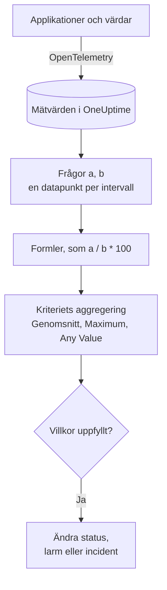

# Metrikövervakning

En metrikmonitor frågar efter de mätvärden som dina applikationer och din infrastruktur skickar till OneUptime, kombinerar dem med formler när du behöver ett förhållande eller en summa, och jämför resultatet med dina kriterier över ett rullande tidsintervall. Använd den för förfrågningstakt, felandelar, ködjup, CPU, minne och disk (vilken numerisk serie som helst), med ett larm per värd eller per container när du grupperar den.

:::cards
- [Skapa monitorn](#skapa-en-metrikmonitor): Frågor, formler, ett tidsintervall och kriterier.
- [Så utvärderas den](#så-utvärderas-den): Datapunkter, formler och kriteriernas aggregering.
- [Genomgånget exempel](#genomgånget-exempel-en-kö-som-växer): Samma data under varje aggregering.
- [Larm per serie](#larm-per-serie-group-by): Ett larm per värd, container eller monteringspunkt.
:::

## Så fungerar det

Varje minut kör OneUptime var och en av monitorns metrikfrågor över dess tidsintervall. En fråga returnerar en datapunkt per tidsintervall, och formler kombinerar frågorna intervall för intervall. Varje kriterium reducerar sedan datapunkterna från den fråga eller formel som det kontrollerar (till deras genomsnitt, deras maximum eller ett test av varje punkt) och jämför resultatet med sitt tröskelvärde.

## Innan du börjar

- Dina applikationer eller din infrastruktur skickar mätvärden till OneUptime via OpenTelemetry. Se [OpenTelemetry](/docs/telemetry/open-telemetry).
- Känn till mätvärdets namn och de attribut som du vill filtrera eller gruppera på. Listorna **Mätvärde** och **Gruppera efter** erbjuder bara namn och attribut som OneUptime har tagit emot.

## Skapa en metrikmonitor

:::steps
### Börja en ny monitor

Gå till **Monitorer** och klicka på **Skapa monitor**. Eller bygg i mätvärdesutforskaren det diagram du vill bevaka och klicka på **Skapa monitor från den här vyn**: den nya monitorn börjar med dess frågor.

### Välj Metrics

Under **Monitortyp** klickar du på **Fler monitortyper** och väljer **Mätvärden** under **Telemetri**, eller skriver `metrics` i sökrutan. Ange ett **Namn** och klicka sedan på **Nästa**.

### Lägg till metrikfrågorna

I **Mätvärde att bevaka** väljer du ett **Mätvärde** och hur det ska aggregeras med **Aggregate by**. Öppna **Filters & grouping** för att filtrera efter attribut eller gruppera med **Gruppera efter**. Klicka på **Lägg till mätvärde** för ännu en fråga, eller på **Lägg till formel** för att kombinera dem. Diagrammet under frågorna visar de senaste timmarna, med regelns värde som en röd linje, så att du ser de värden som regeln kommer att kontrollera.

### Säg när det ska larmas

I **När det ska larmas** väljer du under **Mätt som** hur mätvärdet mäts, och sedan ett **Tidsfönster**, ett **Villkor** och ett **Värde**. När steget har mer än en fråga eller formel väljer du också vilket **Mätvärde** regeln läser. Meningen under dem upprepar regeln med vanliga ord.

### Välj vad som händer

I **Vad som händer** väljer du **Skapa ett larm**, **Deklarera en incident** eller **Båda**, och ger det en titel och en allvarlighetsgrad. Medan regeln matchar visar monitorn statusen under **Fler fält**; när den slutar matcha går monitorn tillbaka till sin standardstatus, och larmet eller incidenten löser sig själv.

### Skapa monitorn

Klicka på **Skapa monitor**. Monitorn öppnas på sin sida **Översikt**, och dess första utvärdering körs inom en minut.
:::

## Vad den frågar efter

### Metrikfrågor

| Fält | Vad det gör | Standard |
| --- | --- | --- |
| **Mätvärde** | Det mätvärde som frågas efter. | Obligatoriskt |
| **Aggregate by** | Hur värdena i varje tidsintervall kombineras till en datapunkt: Genomsn., Summa, Min, Max, Antal eller en percentil (P50, P75, P90, P95 eller P99). | Genomsn. |
| **Filter by attributes** (under **Filters & grouping**) | Bara serier vars attribut uppfyller dessa villkor. | Inget filter |
| **Gruppera efter** (under **Filters & grouping**) | En serie per unikt värde av dessa attribut (se [Larm per serie](#larm-per-serie-group-by)). | En serie |

Varje fråga och formel får en variabel (`a`, `b`, `c` och så vidare) i den ordning du lägger till dem.

### Formler

En formel kombinerar frågevariabler med `+`, `-`, `*`, `/`, `%`, `^` och parenteser, intervall för intervall. Du kan skriva variablerna med eller utan ett inledande `$`:

- `a / b * 100`: den andel av `b` som `a` utgör, i procent
- `a + b`: två mätvärden adderade
- `a - b`: skillnaden mellan dem

### Rullande tidsfönster

**Tidsfönster** i **När det ska larmas** anger hur långt bakåt varje utvärdering ser: **Senaste 1 minuten**, **Senaste 5 minuterna**, **Senaste 10 minuterna**, **Senaste 15 minuterna**, **Senaste 30 minuterna**, **Senaste 1 timmen**, **Senaste 2 timmarna**, **Senaste 3 timmarna**, **Senaste 6 timmarna**, **Senaste 12 timmarna**, **Senaste 24 timmarna**, **Senaste 2 dagarna**, **Senaste 3 dagarna**, **Senaste 7 dagarna**, **Senaste 14 dagarna**, **Senaste 30 dagarna**, **Senaste 60 dagarna**, **Senaste 90 dagarna**, **Senaste 180 dagarna** eller **Senaste 365 dagarna**.

Ju längre fönstret är, desto bredare är varje tidsintervall, så en datapunkt står för mer tid:

| Tidsfönster | En datapunkt per |
| --- | --- |
| Senaste 1 minuten till Senaste 3 timmarna | minut |
| Senaste 6 timmarna, Senaste 12 timmarna | 5 minuter |
| Senaste 24 timmarna | 15 minuter |
| Senaste 2 dagarna, Senaste 3 dagarna | 30 minuter |
| Senaste 7 dagarna | timme |
| Senaste 14 dagarna, Senaste 30 dagarna | dag |
| Senaste 60 dagarna till Senaste 180 dagarna | vecka |
| Senaste 365 dagarna | månad |

## Så utvärderas den

- **Varje minut.** En metrikmonitor kontrolleras inte av sonder, så den har inget intervall att ange och ingen sida **Sonder och intervall**.
- **Först frågor, sedan formler.** Varje fråga returnerar en datapunkt per tidsintervall i tidsintervallet, med sin **Aggregate by**. Formler räknas ut för varje intervall från frågornas datapunkter.
- **Sedan regelns mått.** Regeln reducerar datapunkterna för sitt mätvärde till det som den jämför med sitt värde, som **Mätt som** säger:

| Mätt som | I de egna kriterierna | Villkoret kontrolleras mot… |
| --- | --- | --- |
| Genomsnittet | Genomsnitt | genomsnittet av datapunkterna |
| Summan | Summa | summan av datapunkterna |
| Det högsta värdet | Maximum Value | den högsta datapunkten |
| Det lägsta värdet | Minimum Value | den lägsta datapunkten |
| Varje värde (hela fönstret) | All Values | varje datapunkt: alla måste uppfylla villkoret och täcka hela tidsintervallet |
| Något värde (vid någon tidpunkt) | Any Value | varje datapunkt: det räcker att en av dem uppfyller villkoret |

- **Kriterier uppifrån och ned.** På en monitor utan Group By avgör det första kriteriet som matchar, så lägg det allvarligaste överst. En grupperad monitor kontrollerar alla kriterier för varje serie (se [Utvärderingen av kriterier skiljer sig](#utvärderingen-av-kriterier-skiljer-sig)).
- **Ingen data är inte noll.** När frågan inte returnerar några datapunkter i tidsintervallet gör regeln det som **Om det inte finns några data** säger, under **Fler fält** i **När det ska larmas**: **Ingenting** (standard: regeln matchar inte), **Räkna det som noll** eller **Larma, som om den matchade**.
- **Varje värde behöver hela tidsintervallet.** En serie uppfyller en regel mätt som **Varje värde (hela fönstret)** först när dess datapunkter täcker tidsintervallet, från början till nu, utan en lucka på mer än en saknad datapunkt. När alla monitorns data kommer fram försenade, som CloudWatchs gör, ersätter den nyaste datapunkten nu. En värd, container eller deployment som just har börjat skicka data, eller som har varit tyst en stund, väntar tills den har data för ett helt tidsintervall, och utvärderingsloggen visar hur långt den har kommit: `Waiting for 15 minutes of data: 2 of 15 minutes so far`. En serie vars larm eller incident redan är öppen bedöms bara på sina datapunkter, så en kort lucka i dess data löser den inte. När mätvärdet rapporteras mer sällan än tidsintervallet är långt, räknas en enstaka datapunkt för hela intervallet när den är några minuter gammal; för att bedöma hur länge ett värde varar bör tidsintervallet vara minst två rapporteringsintervall långt.
- **OneUptimes eget avbrott är inte tystnad.** Så länge tidsintervallet innehåller tid då OneUptime självt inte tog emot data (det startade om, uppgraderades eller arbetade ikapp en eftersläpning) väntar kontrollen: statusen ändras inte, och ingen incident eller larm öppnas eller löses, oavsett vad **Om det inte finns några data** säger. Se [När OneUptime inte tar emot data](/docs/monitor/when-oneuptime-is-not-receiving).

## Kriterier

Dessa monitorer utvärderar alltid **Metric Value**: det aggregerade värdet av den konfigurerade metrikfrågan eller formeln. **När det ska larmas** ställer in ett kriterium utifrån **Mätt som**, **Tidsfönster**, **Villkor** och **Värde**. När mätvärdet har en enhet väljer du värdets enhet bredvid det. Dess **Villkor** är **Över**, **På eller över**, **Under**, **På eller under**, **Exakt**, **Ovanligt hög**, **Ovanligt låg** eller **Ovanligt hög eller låg**. För flera kriterier, till exempel allvarlighetsband, klickar du på **Redigera som egna kriterier** under **Fler fält** i **Vad som händer**: varje kriterium där har ett **Mätvärde**, en **Aggregering**, ett **Villkor** och en **Tröskel**.

| Villkor | Matchar när värdet är… |
| --- | --- |
| **Större än** | över tröskelvärdet |
| **Större än eller lika med** | lika med tröskelvärdet eller högre |
| **Mindre än** | under tröskelvärdet |
| **Mindre än eller lika med** | lika med tröskelvärdet eller lägre |
| **Lika med** | exakt tröskelvärdet |
| **Anomalously High** | över det förväntade intervallet för den här timmen i veckan |
| **Anomalously Low** | under det intervallet |
| **Anomalous** | utanför det intervallet, åt vilket håll som helst |
| **Inga data** | frånvarande: frågan skickade ingenting i fönstret |
| **Har data** | närvarande: frågan skickade något i fönstret |

Avvikelsevillkoren har inget tröskelvärde. **När det ska larmas** visar i stället **Känslighet** (Låg, Medel, som är standard, eller Hög), och de egna kriterierna även ett **Baslinjefönster** (14 dagar, som är standard, 28, 60 eller 90), och varje datapunkt jämförs med baslinjen för samma timme i veckan, byggd från det fönstret. Tills den timmen i veckan har tillräcklig historik lär sig kriteriet fortfarande och ger inga larm.

En metrikmonitor som skapats i Skapa monitor börjar med en regel på sin första fråga: **Genomsnittet** över **Senaste 5 minuterna**, **Över** det **Värde** du anger, och **Skapa ett larm**.

En ny metrikmonitor som skapats via API:et eller Terraform utan kriterier börjar med två kriterier på sin första fråga, båda med aggregeringen **Any Value**:

| Kriterium | Villkor | Effekt |
| --- | --- | --- |
| Check if … is offline | **Lika med** `0` | Markerar monitorn som offline och deklarerar en incident, som löses automatiskt |
| Check if … is online | **Större än** `0` | Markerar monitorn som online |

> [!NOTE]
> Offline-kriteriet utlöses av ett rapporterat värde på 0, inte av tystnad. För att varnas när ett mätvärde slutar komma ställer du in dess **Om ingen data** på **Utlösare**.

## Genomgånget exempel: en kö som växer

Du vill ha en incident när checkout-kön förblir djup. Fråga `a` är mätaren `checkout.queue.depth`, med **Aggregate by** Max, och **Tidsfönster** är **Senaste 5 minuterna**. En utvärdering ser dessa fem datapunkter på en minut vardera:

| Minut | 10:01 | 10:02 | 10:03 | 10:04 | 10:05 |
| --- | --- | --- | --- | --- | --- |
| `a` | 640 | 980 | 1 500 | 1 620 | 1 100 |

En regel **Över** `1000` ger ett olika svar för varje val under **Mätt som**:

| Mätt som | Jämfört med 1 000 | Matchar? |
| --- | --- | --- |
| Genomsnittet | 1 168 | Ja |
| Summan | 5 840 | Ja |
| Det högsta värdet | 1 620 | Ja |
| Det lägsta värdet | 640 | Nej |
| Varje värde (hela fönstret) | 640, 980, 1 500, 1 620, 1 100 | Nej: två punkter är inte över 1 000 |
| Något värde (vid någon tidpunkt) | 640, 980, 1 500, 1 620, 1 100 | Ja: 1 500 är det |

**Genomsnittet** larmar om en ihållande eftersläpning och bortser från en enstaka djup minut; **Varje värde (hela fönstret)** väntar tills varje minut i intervallet är djup; **Något värde (vid någon tidpunkt)** larmar vid den första djupa minuten.

## Larm per serie (Group By)

**Gruppera efter** på en metrikfråga delar upp frågan i en serie per unikt attributvärde (en per värd, en per container, en per monteringspunkt), och en monitor med Group By utvärderar varje serie oberoende. Den enda inställningen är skillnaden mellan "flottan mår dåligt" och "`prod-db-01` mår dåligt".

### Ett larm per grupp

Med Group By satt till `host.name` ger en monitor för diskanvändning som håller koll på femtio värdar **ett larm (eller incident) per värd över tröskelvärdet**. När värd A fylls öppnar den sitt eget larm; när värd B fylls tio minuter senare öppnar den en andra, separat larm bredvid.

Utan Group By är samma monitor en enda skalär: frågan slår ihop alla värdar till ett tal och monitorn ger **ett larm för hela monitorn**. Så länge det larmet är öppet ger en andra värd över tröskelvärdet ingenting (monitorn varnar redan, så det finns inget nytt att ge) och jourhavande tekniker får aldrig höra om värd B. **Att ange Group By är sättet att få larm per värd.** Vill du bli larmad per värd, per container eller per monteringspunkt anger du det.

### Oberoende lösning

Varje larm per grupp följer sin egen grupp. När värd A sjunker under tröskelvärdet igen löses dess larm av sig själv, och larmet för värd B förblir öppen tills värd B återhämtar sig. Att en grupp återhämtar sig stänger aldrig en annan grupps larm.

### Utvärderingen av kriterier skiljer sig

- **Grupperade monitorer utvärderar alla kriterier.** Allvarlighetsnivåer kan därför utlösas för olika grupper samtidigt: med "Critical: större än 95" ovanför "Warning: större än 80" öppnar en värd på 96 % en kritisk varning medan en värd på 85 % öppnar en vanlig varning i samma kontroll. En värd som överskrider båda nivåerna får ändå exakt en varning, från det första kriteriet som matchar, så **sortera kriterierna med det allvarligaste först**.
- **Ogrupperade monitorer stannar vid det första kriteriet som matchar.** Bara det kriteriet utlöses, ännu ett skäl att lägga larmkriteriet ovanför det friska: ett brett friskt kriterium överst matchar i nästan varje kontroll och hindrar att larmkriteriet under det någonsin utvärderas.

| Värd | Disk använd | Critical (> 95) | Warning (> 80) | Varning som ges |
| --- | --- | --- | --- | --- |
| `prod-db-01` | 96 % | Ja | Ja | Critical |
| `prod-db-02` | 85 % | Nej | Ja | Warning |
| `prod-db-03` | 40 % | Nej | Nej | Ingen |

### Välj ett attribut att gruppera efter

Gruppera efter ett attribut som verkligen identifierar en separat sak som du skulle larma någon för: värdattributet för ett värdmätvärde i hela flottan, container- eller poddattributet för ett containermätvärde, monteringspunkts- eller enhetsattributet för ett filsystems- eller disk-I/O-mätvärde, gränssnittsattributet för ett nätverksmätvärde. Listrutan **Gruppera efter** fylls med de attribut som din collector faktiskt skickar, så välj från listan i stället för att skriva en nyckel för hand.

Gruppera inte ett mätvärde som redan är en enda skalär för hela systemet (en ledarflagga för hela klustret, en eftersläpning i schemaläggaren eller CPU:n på en enda värd i en monitor för en värd). Att gruppera sådana mätvärden ger exakt en serie och ändrar ingenting utom larmens titlar.

Grupperingsattributets värden finns också som [mallvariabler](/docs/monitor/incident-alert-templating) i titeln, beskrivningen och åtgärdsanteckningarna för larmet eller incidenten: gruppering efter `host.name` låter titeln lyda `Disk almost full on {{host.name}}`.

## Felsökning

:::details Diagrammet visar ett överskridande, men monitorn varnade inte
Kontrollera först **Mätt som**: **Varje värde (hela fönstret)** matchar bara när varje datapunkt i tidsintervallet överskrider värdet, och **Genomsnittet** jämnar ut en kort topp. **Varje värde (hela fönstret)** väntar också tills en serie har data för hela tidsintervallet, så en värd eller deployment som just har börjat skicka data bedöms inte än. Kontrollera sedan att regeln läser den fråga eller formel som du menar (`a` är inte formeln `c`) och att **Värde** är i den enhet du tror.
:::

:::details Mätvärdet slutade komma och ingenting hände
Ett tidsintervall utan datapunkter är inte ett värde på 0. Med **Om det inte finns några data** på standardvärdet, **Ingenting**, matchar regeln inte. Ställ in det på **Larma, som om den matchade** under **Fler fält** i **När det ska larmas** för att larma om tystnad.
:::

:::details Jag får ett larm för hela flottan
Frågan har ingen **Gruppera efter**, så alla värdar slås ihop till ett tal. Gruppera frågan efter värd-, container- eller monteringspunktsattributet (se [Larm per serie](#larm-per-serie-group-by)).
:::

:::details Ett avvikelsekriterium utlöses aldrig
Det lär sig fortfarande: timmen i veckan som det jämför med har ännu inte tillräcklig historik inom **Baslinjefönster**.
:::

## Nästa steg

:::cards
- [Incident- och larmmallar](/docs/monitor/incident-alert-templating): Lägg in värdnamnet och värdet i larmens titlar.
- [Loggövervakning](/docs/monitor/logs-monitor): Varnas om loggvolym och logginnehåll, per grupp.
- [Värdövervakning](/docs/monitor/host-monitor): Färdiga kontroller av CPU, minne och disk för dina värdar.
- [OpenTelemetry](/docs/telemetry/open-telemetry): Skicka mätvärden till OneUptime.
:::
