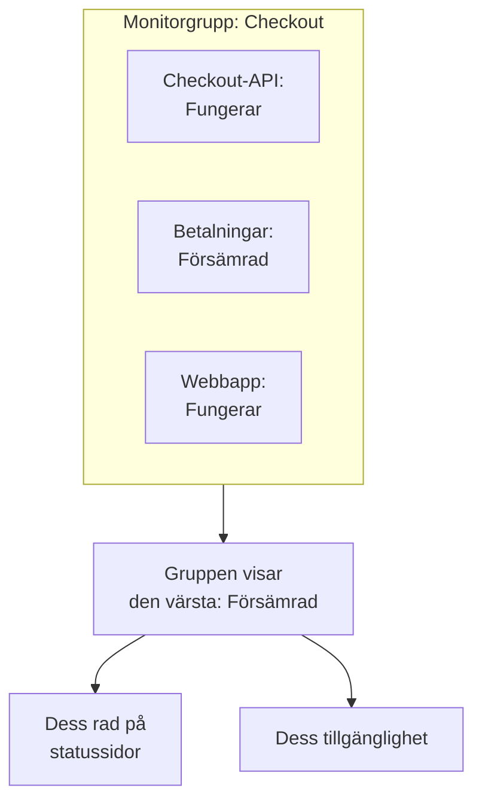

# Monitorgrupper

En monitorgrupp samlar flera monitorer i en status. Gruppera de monitorer som tillsammans utgör en tjänst, som Checkout: dess API, dess betaltjänst och dess webbapp. Gruppen visar den värsta statusen bland dem, har en egen tillgänglighet, och en statussida kan visa hela gruppen som en rad.

:::cards
- [Hur en grupps status beräknas](#hur-en-grupps-status-beräknas): Den värsta statusen bland dess monitorer.
- [Slå på monitorgrupper](#slå-på-monitorgrupper): En brytare i projektinställningarna.
- [Skapa en monitorgrupp](#skapa-en-monitorgrupp): Ge den ett namn och lägg sedan till dess monitorer.
- [Visa en grupp på en statussida](#visa-en-grupp-på-en-statussida): En rad för hela gruppen.
:::

## Hur en grupps status beräknas

En grupp börjar på din fungerande status och tar den värsta statusen bland sina monitorer: den som står längst ned i ditt projekts lista över monitorstatusar. Går en monitor till **Försämrad** blir hela gruppen **Försämrad**; går en till **Offline** blir den **Offline**.

- **Arkiverade monitorer räknas inte.** En arkiverad monitor kontrolleras inte, så dess status är fryst; gruppen utelämnar den.
- **En tom grupp fungerar.** En grupp utan monitorer, eller bara med arkiverade, visar din fungerande status. Tills du lägger till en monitor visar instrumentpanelen **Inga monitorer ännu** i stället för gruppens status.
- **Ordningen är din.** Vilken status som är värst följer ordningen under **Övervakare → Inställningar → Monitorstatus**. Se [Monitorstatusar](/docs/monitor/criteria-and-statuses#monitorstatusar).

En monitorgrupp är inte en statussidegrupp. En statussidegrupp är en rubrik på en statussida som rymmer rader. En monitorgrupp är en rad som står för flera monitorer, och vilken statussida som helst kan visa den.

## Innan du börjar

- **Din plan.** På OneUptime Cloud kräver monitorgrupper Scale-planen.
- **Brytaren.** Monitorgrupper är dolda tills **Monitorgrupper** har slagits på för projektet (se nedan). Att slå på den kräver rollen Project Owner, eller en anpassad roll med behörigheten Edit Project eller Manage Billing.
- **Din roll.** Att skapa, ändra och ta bort grupper kräver rollen Project Owner, Project Admin, Project Member, Monitor Admin eller Monitor Member, eller en anpassad roll med motsvarande behörigheter för monitorgrupper. En Viewer kan se grupper men inte ändra dem.

## Slå på monitorgrupper

:::steps
### Öppna funktionsflaggor

Gå till **Projektinställningar → Avancerad → Funktionsflaggor**. **Avancerad** är hopfällt i sidomenyn: fäll ut det först.

### Slå om brytaren

Slå på brytaren **Monitorgrupper**. Den sparas direkt: **Monitorgrupper** visas i sidomenyn för **Monitorer**, och varje statussidas menyval **Monitorer** heter nu **Resurser**, där du kan lägga till en grupp.
:::

Stänger du av brytaren igen döljs **Monitorgrupper** i menyn. Ingen grupp tas bort.

## Skapa en monitorgrupp

:::steps
### Öppna Monitorgrupper

Gå till **Övervakare → Monitorgrupper**. Kortet **Monitorgrupper** listar varje grupp med dess **Aktuell status**, etiketter och ägare.

### Skapa gruppen

Klicka på **Skapa Monitor Grupp**, ange ett **Namn** och, om du vill, en **Beskrivning**, och klicka på **Skapa Monitor Grupp** längst ned i formuläret. Gruppen börjar utan monitorer.

### Lägg till dess monitorer

Öppna gruppen: tills den har en monitor erbjuder dess **Översikt** **Lägg till monitorer**. Senare klickar du på **Monitorer** i dess sidomeny och sedan på **Lägg till monitorer**. Välj varje monitor i gruppen under **Monitorer** och klicka på **Lägg till monitorer**.

### Kontrollera dess status

Klicka på **Översikt**. **Aktuell status** visar gruppens status just nu, och **Drifttidsgraf** visar dess senaste 90 dagar, en stapel per dag.
:::

För att ta bort en monitor från gruppen klickar du på **Ta bort** på dess rad i **Övervakare i grupp**. Själva monitorn ändras inte. En monitor kan höra till mer än en grupp.

## En grupps sidor

Öppna en grupp för att se dess sidor i sidomenyn:

| Sida | Vad den visar |
| --- | --- |
| **Översikt** | **Detaljer för övervakningsgrupp**, **Aktuell status** och **Drifttidsgraf** med gruppens tillgänglighet i procent under de senaste 90 dagarna. En grupp utan monitorer erbjuder **Lägg till monitorer** i stället för grafen. |
| **Monitorer** | **Övervakare i grupp**, med **Lägg till monitorer** och **Ta bort**. |
| **Incidenter** | Incidenterna på någon monitor i gruppen. |
| **Larm** | Larmen på någon monitor i gruppen. |
| **Ägare** | De personer och team som ansvarar för gruppen. Den ligger under **Avancerad**, som börjar hopfällt. |
| **Granskningsloggar** | Vem som ändrade gruppen, och när, också under **Avancerad**. |
| **Ta bort grupp** | Tar bort gruppen, också under **Avancerad**. |

Tillgängligheten på **Översikt** räknar varje status utom den fungerande som driftstopp. En statussida räknar bara statusarna i sin egen lista **Räknas som driftstopp**: se [Välj vad sidan visar](/docs/status-pages/index#välja-vad-som-visas-på-sidan).

Listan **Monitorgrupper** kan filtrera grupper efter ägare och etikett, sätta etiketter och ägare på många grupper på en gång och exportera eller importera grupper som JSON.

## Visa en grupp på en statussida

:::steps
### Öppna statussidans resurser

Gå till **Statussidor**, öppna sidan och klicka på **Resurser** i dess sidomeny.

### Byt dialogen till en grupp

Klicka på **Lägg till monitor**. Under listrutan med monitorer klickar du på **Add a Monitor Group instead.** Listrutan blir **Monitor Grupp**.

### Välj gruppen och lägg till den

Välj gruppen. **Visningsnamn**, namnet som besökare läser, tar gruppens namn tills du skriver ett eget. Klicka på **Lägg till monitor**: raden visas på sidan med gruppens status.
:::

På statussidan står raden för varje monitor i gruppen:

- **Dess status.** Det är gruppens: den värsta bland dess monitorer.
- **Dess incidenter.** En incident på någon monitor i gruppen visas på sidan, med gruppen nämnd bland de berörda resurserna.
- **Dess prenumeranter.** En prenumerant som väljer gruppen får höra om varje monitor i den. Se [Låt prenumeranter välja resurser och händelsetyper](/docs/status-pages/subscribers#låta-prenumeranter-välja-resurser-och-händelsetyper).

För radens övriga alternativ, som dess tillgänglighet och historikdiagram, se [Statussidans resurser och grupper](/docs/status-pages/resources-and-groups).

> [!WARNING]
> När du tar bort en monitorgrupp tas även dess rad bort från varje statussida som visar den. Gruppens monitorer, och deras incidenter, tas inte bort.

## API och Terraform

En grupp är `/api/monitor-group`, och varje monitor i den är en rad i `/api/monitor-group-resource` som parar ihop ett `monitorGroupId` med ett `monitorId`. I Terraform är de `oneuptime_monitor_group` och `oneuptime_monitor_group_resource`: se [Monitorgrupp](/docs/terraform/examples#monitorgrupp).

## Felsökning

:::details Monitorgrupper finns inte i menyn Monitorer
Brytaren **Monitorgrupper** är avstängd. Slå på den under **Projektinställningar → Avancerad → Funktionsflaggor**. På OneUptime Cloud kräver grupper också Scale-planen.
:::

:::details Gruppen visar Offline, men de flesta av dess monitorer fungerar
Det är regeln: gruppen visar sin värsta monitor. Öppna **Monitorer** i gruppen för att hitta monitorn som är nere, eller ta bort en monitor som inte hör hemma i gruppen.
:::

:::details En statussida kan inte lägga till gruppen
**Add a Monitor Group instead.** visas i dialogen bara så länge brytaren **Monitorgrupper** är påslagen för projektet.
:::

## Nästa steg

:::cards
- [Monitorkriterier och statusar](/docs/monitor/criteria-and-statuses): Vad som sätter varje monitors status.
- [Statussidans resurser och grupper](/docs/status-pages/resources-and-groups): Lägg upp raderna på en statussida.
- [Prenumeranter och meddelanden](/docs/status-pages/subscribers): Berätta för kunderna om en grupps incidenter.
:::
