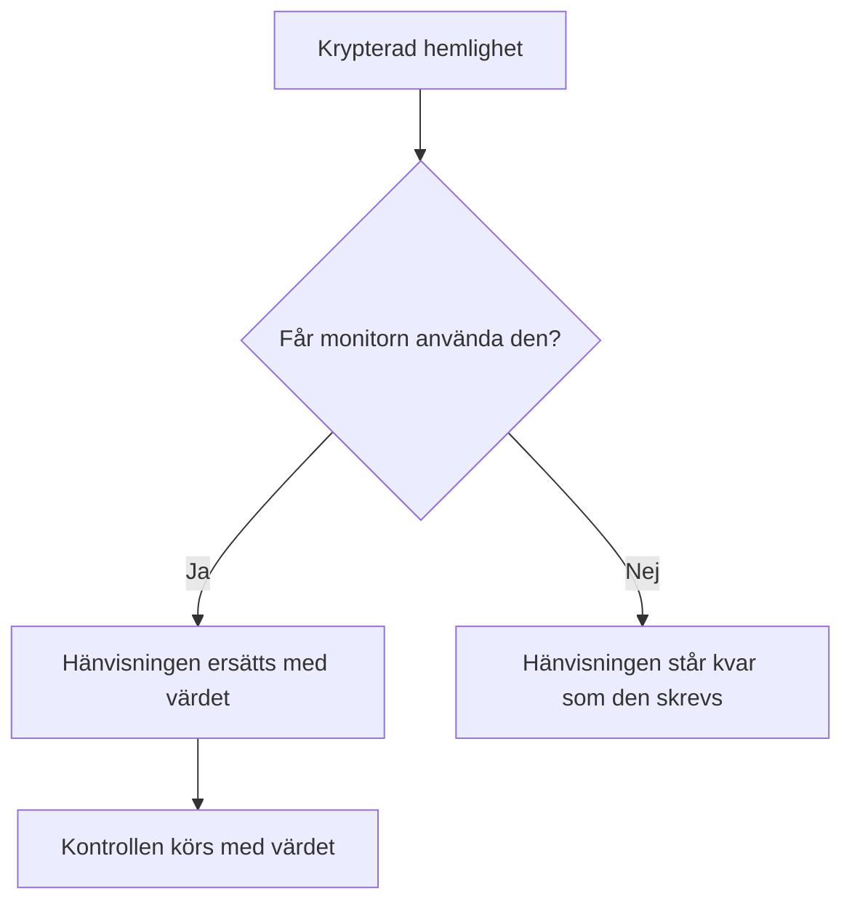

# Övervakningshemligheter

Övervakningshemligheter håller de lösenord, API-nycklar och token som dina monitorer behöver utanför själva monitorn. Du sparar ett värde en gång, krypterat, väljer vilka monitorer som får använda det och hänvisar till det som `{{monitorSecrets.NAME}}` där monitorn behöver det.

:::cards
- [Lägg till en hemlighet](#lägg-till-en-hemlighet): Spara ett värde och välj vem som får använda det.
- [Välj åtkomst](#välj-vilka-monitorer-som-får-använda-en-hemlighet): Alla monitorer, specifika monitorer eller monitorer med etiketter.
- [Använd en hemlighet](#använd-en-hemlighet): Var `{{monitorSecrets.NAME}}` fungerar.
- [Logga in med en engångskod](#logga-in-med-en-engångskod): Låt en monitor logga in på en webbplats som kräver tvåfaktorsautentisering.
:::

## Så når hemligheter en monitor

En hemlighet sparas krypterad och visas aldrig igen efter att du har sparat den. Innan OneUptime lämnar över en monitor till en sond ersätter den varje hänvisning som monitorn får använda med det dekrypterade värdet; en hänvisning som monitorn inte får använda står kvar som den skrevs. En engångskodshemlighet är undantaget: sonden genererar dess kod när kontrollen körs (se [Logga in med en engångskod](#logga-in-med-en-engångskod)).



Sonden som kör kontrollen tar emot värdet, så en monitor som använder en hemlighet bör köras på sonder du litar på: OneUptimes egna, eller en [anpassad sond](/docs/probe/custom-probe) som du själv driver.

## Innan du börjar

- **Growth-abonnemanget eller högre**, på OneUptime Cloud. Egna installationer har inga abonnemang.
- **En roll som kan hantera hemligheter**: Projektägare, Projektadministratör, eller en anpassad roll med behörigheten Create Monitor Secret.

## Arbeta med hemligheter

### Lägg till en hemlighet

:::steps
1. Gå till **Monitorer → Inställningar → Hemligheter** och klicka på **Skapa Monitorhemlighet**.
2. Ange ett **Namn** och **Värde för hemlighet**. Namnet är det du hänvisar till, till exempel `ApiKey`. Det får bara innehålla bokstäver, siffror, bindestreck (`-`) och understreck (`_`), och två hemligheter i ett projekt kan inte ha samma namn. För en webbplats inställningsnyckel för tvåfaktorsautentisering väljer du först **Engångskod (TOTP)** (se [Logga in med en engångskod](#logga-in-med-en-engångskod)).
3. Välj i steget **Åtkomst** vilka monitorer som får använda den (se nästa avsnitt) och klicka sedan på **Skapa Monitorhemlighet**.
:::

> [!IMPORTANT]
> Hemligheter krypteras och lagras säkert. Hemlighetens värde visas aldrig igen efter att det har sparats — inte i tabellen, inte i redigeringsformuläret och inte via API:et. Om du tappar bort värdet måste du hämta det där det kom ifrån och ställa in det igen. För att rotera en hemlighet använder du knappen **Uppdatera hemligt värde** på dess rad; du behöver inte ta bort och skapa om den. Samma knapp ändrar också vad hemligheten innehåller, **Text** eller **Engångskod (TOTP)**, tillsammans med ett nytt värde, och monitorer som använder hemligheten tar den nya typen i bruk vid sin nästa kontroll.

### Välj vilka monitorer som får använda en hemlighet

Varje hemlighet har ett av tre åtkomstalternativ:

| Alternativ | Vilka monitorer som får använda hemligheten | Använd det för |
| --- | --- | --- |
| **Alla monitorer** | Varje monitor i projektet, även monitorer som du skapar senare. | En inloggningsuppgift som många monitorer delar. |
| **Specifika monitorer** | Bara de monitorer du väljer. Det är standard, och hemligheter som skapades innan de här alternativen fanns fungerar så. | En inloggningsuppgift för en eller några få monitorer. |
| **Monitorer med etiketter** | Monitorer som har minst en av de etiketter du väljer. När en av de etiketterna läggs till på en monitor får den åtkomst, och när etiketten tas bort förlorar den åtkomsten nästa gång monitorn körs. | En inloggningsuppgift för en grupp monitorer som ändras över tid. |

Du kan när som helst ändra alternativet med **Redigera** på hemlighetens rad. Bara listan för det valda alternativet behålls: att byta till **Alla monitorer** tömmer hemlighetens listor över monitorer och etiketter, och att byta mellan **Specifika monitorer** och **Monitorer med etiketter** tömmer listan du byter bort från.

En hemlighet är aldrig tillgänglig för monitorer i ett annat projekt.

> [!WARNING]
> Alla som kan redigera en monitor som får använda en hemlighet kan skicka den hemligheten dit monitorn ansluter. Med **Alla monitorer** är det alla som kan skapa eller redigera monitorer i projektet. Med **Monitorer med etiketter** omfattar det även alla som kan lägga till en av de etiketterna på en monitor.

Via API:et är åtkomstalternativet fältet `monitorAccess`: `All Monitors`, `Specific Monitors` eller `Monitors With Labels`. Fälten `monitors` och `labels` innehåller listorna. En hemlighet som skapas utan `monitorAccess` får `Specific Monitors`.

### Använd en hemlighet

För att använda en hemlighet skriver du `{{monitorSecrets.SECRET_NAME}}` i ett fält som tar emot hemligheter. Till exempel skickar huvudet `Authorization: Bearer {{monitorSecrets.ApiKey}}` i en begäran värdet för hemligheten `ApiKey`.

De här monitortyperna och fälten tar emot hemligheter:

| Monitortyp | Fält |
| --- | --- |
| API | URL:en, begärans huvuden och kropp, samt klientcertifikatet, den privata nyckeln och lösenfrasen (mTLS) |
| Webbplats | URL:en, samt klientcertifikatet, den privata nyckeln och lösenfrasen (mTLS) |
| Ping, IP, Port, NTP, SSL-certifikat | Värden eller URL:en som kontrolleras |
| DNS | Domännamnet och DNS-servern |
| DNSSEC, Domän | Domännamnet |
| SQL-fråga | Värden, databasnamnet, användarnamnet, lösenordet och frågan |
| Databashälsa | Värden, databasnamnet, användarnamnet och lösenordet |
| Extern statussida | Statussidans URL |
| Syntetisk monitor, Anpassad JavaScript-kod | Skriptet |
| Nätverksenhet | SNMP-communitysträngen, samt autentiserings- och sekretessnycklarna för SNMPv3 |

Hemligheter fylls i innan skriptet i en monitor av typen Syntetisk monitor eller Anpassad JavaScript-kod körs, så en hänvisning som `{{monitorSecrets.ApiKey}}` i skriptet är det dekrypterade värdet när det körs.

Om en monitor hänvisar till en hemlighet som den inte får använda står hänvisningen kvar som den är och ersätts inte med värdet.

När du testar en monitor innan du sparar den fylls bara hemligheter i som är tillgängliga för **Alla monitorer**, eftersom en ny monitor inte finns på någon lista och inte har några etiketter ännu. När du har sparat monitorn använder testerna varje hemlighet som monitorn får använda.

## Logga in med en engångskod

Vissa webbplatser ber om en kod från en autentiseringsapp när du loggar in. En hemlighet av typen **Engångskod (TOTP)** innehåller webbplatsens inställningsnyckel, så att en monitor kan logga in på samma sätt som du: överallt där monitorn använder hemligheten genererar sonden den aktuella koden utifrån sin egen klocka, i det ögonblick kontrollen behöver den. Inställningsnyckeln sparas krypterad och visas aldrig igen, precis som alla andra hemliga värden, och den skrivs aldrig in i monitorn.

1. Aktivera tvåfaktorsautentisering för det konto som monitorn loggar in med. Där webbplatsen visar en QR-kod ber du i stället om att få ange nyckeln manuellt och kopierar inställningsnyckeln eller länken `otpauth://`.
2. Gå till **Monitorer → Inställningar → Hemligheter**, klicka på **Skapa Monitorhemlighet**, välj **Engångskod (TOTP)** och klistra in nyckeln eller länken i **Inställningsnyckel**.
3. Kontrollera att **Aktuell kod** under fältet stämmer med koden som din autentiseringsapp visar nu, och välj sedan i steget **Åtkomst** vilka monitorer som får använda hemligheten, som för alla hemligheter.

| Det du klistrar in | Koderna som monitorn genererar |
| --- | --- |
| En inställningsnyckel, till exempel `JBSW Y3DP EHPK 3PXP` | SHA1, 6 siffror och en ny kod var 30:e sekund: det som alla autentiseringsappar utgår från |
| En `otpauth://totp/`-länk | Länkens `algorithm` (`SHA1`, `SHA256` eller `SHA512`), `digits` (`6` eller `8`) och `period` i sekunder (`30` när länken inte anger någon) |

| Monitortyp | Var koden hamnar och när den genereras |
| --- | --- |
| API | `{{monitorSecrets.NAME}}` i URL:en, ett huvud i begäran eller begärans kropp, precis innan varje försök skickas |
| Syntetisk monitor, Anpassad JavaScript-kod | `{{monitorSecrets.NAME}}` i skriptet, när skriptet startar, och `await oneuptime.getTotpCode("NAME")`, när skriptet ber om koden |

Alla andra fält behåller `{{monitorSecrets.NAME}}` som det skrevs. I en JSON-kropp i en begäran sätter du hänvisningen inom citattecken, som i `{"otp": "{{monitorSecrets.LoginCode}}"}`, eftersom en kod kan börja med en nolla.

En inloggning ber oftast om koden först några sidor efter att skriptet har startat, så be om koden där. Det här skriptet loggar in med ett lösenord och en engångskod:

```javascript
await page.goto("https://app.example.com/login");
await page.fill("#email", "monitoring@example.com");
await page.fill("#password", "{{monitorSecrets.AppPassword}}");
await page.click("button[type=submit]");

// The code is made now, when the sign-in asks for it.
await page.waitForSelector("#otp");
await page.fill("#otp", await oneuptime.getTotpCode("AppLoginCode"));
await page.click("button[type=submit]");

await page.waitForSelector(".dashboard", { timeout: 10000 });

return {
  data: { signedIn: true },
};
```

Sonden lämnar aldrig ut en kod som har mindre än fem sekunder kvar, eller en tredjedel av perioden när perioden är kortare: den väntar i stället på nästa kod, högst fem sekunder, och räknar inte in den väntan i kontrollens körtid. Varje kod som en kontroll genererar visas som asterisker, till exempel `******`, i dess loggmeddelanden, dess resultat, dess fel och namnen på dess skärmbilder. En skärmbild är en bild av sidan, så ta den innan koden skrivs in eller efter att sidan har gått vidare.

> [!NOTE]
> Det är sonden som genererar koderna, så en anpassad sond behöver OneUptime 17.0.1 eller senare. På en äldre körs inte en kontroll som behöver en kod, utan den misslyckas med en mening som säger att sonden ska uppdateras; monitorns formulär och sondens sida nämner en sond som är för gammal, och [Uppdatera en sond](/docs/probe/custom-probe#uppdatera-en-sond) förklarar hur. Sondens klocka måste också gå rätt, eftersom en sond som går en minut fel genererar koder som webbplatsen redan har gått vidare från.

## Felsökning

:::details `{{monitorSecrets.NAME}}` skickas ordagrant
Monitorn får inte använda hemligheten, eller så stämmer inte namnet. Kontrollera hemlighetens åtkomstalternativ med **Redigera** på dess rad, och att namnet i hänvisningen är exakt hemlighetens namn.
:::

:::details När en ny monitor testas fylls hemligheten inte i
Innan en monitor är sparad fylls bara hemligheter i som är tillgängliga för **Alla monitorer**. Spara monitorn och testa den igen.
:::

:::details Ett fält ignorerar hemligheten
Bara fälten i tabellen ovan tar emot hemligheter. I alla andra fält skickas `{{monitorSecrets.NAME}}` som det skrevs.
:::

:::details Webbplatsen avvisar engångskoden
Kontrollera att **Aktuell kod** stämde med din autentiseringsapp när du sparade hemligheten, att sondens klocka går rätt och att en hänvisning i en JSON-kropp i en begäran står inom citattecken. Om det tar en stund innan inloggningen ber om koden, be om koden där med `oneuptime.getTotpCode`.
:::

:::details Kontrollen säger att sonden är för gammal för att generera engångskoder
Sonden kör en version äldre än OneUptime 17.0.1, som inte kan generera engångskoder, så kontrollen kördes inte på den. Uppdatera sonden (se [Uppdatera en sond](/docs/probe/custom-probe#uppdatera-en-sond)), eller låt sonder med 17.0.1 eller senare kontrollera monitorn.
:::

## Nästa steg

:::cards
- [API-övervakning](/docs/monitor/api-monitor): Skicka en hemlighet i ett huvud i en begäran.
- [Syntetisk övervakning](/docs/monitor/synthetic-monitor): Använd en hemlighet i ett webbläsarskript.
- [SQL-frågeövervakning](/docs/monitor/sql-monitor): Håll ett databaslösenord krypterat.
:::
