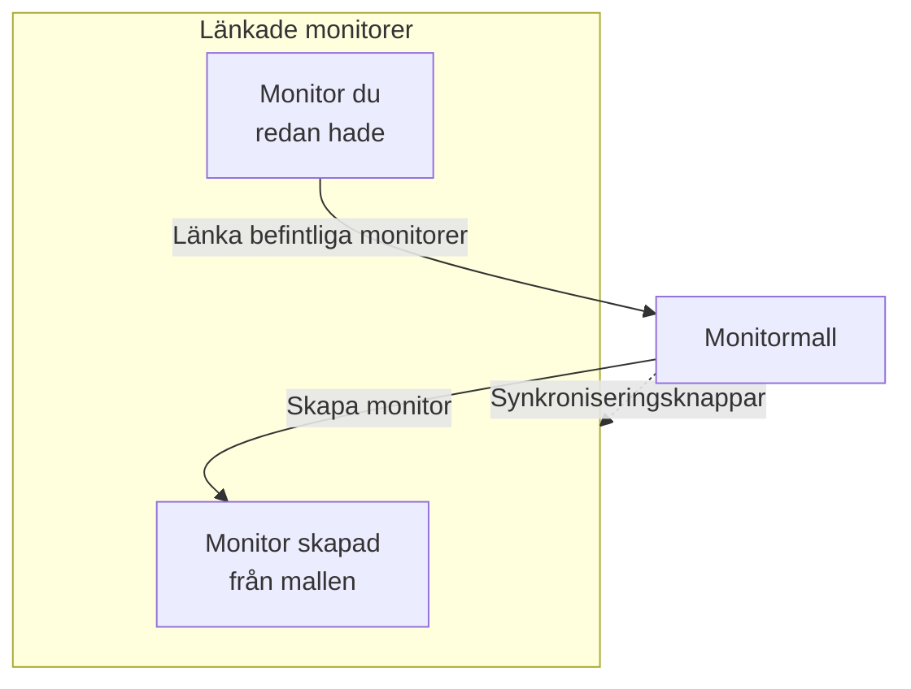

# Monitormallar

En monitormall är en sparad monitorkonfiguration (en typ, kriterier, ett intervall, etiketter och standardvärden för anpassade fält) som du skapar monitorer från med ett klick. Monitorer som skapats från den eller länkats till den förblir anslutna: ändra mallen och synkronisera sedan ändringen till alla. Använd mallar när många monitorer ska bete sig likadant, som samma hälsokontroll på varje tjänst eller samma API-kontroller i produktion och staging.

:::cards
- [Skapa en mall](#skapa-en-mall): Fyra steg, som Skapa monitor.
- [Skapa monitorer från den](#skapa-monitorer-från-en-mall): Ett klick, eller länka monitorer du redan har.
- [Synkronisera ändringar](#synkronisera-ändringar-till-länkade-monitorer): Vad varje synkroniseringsknapp kopierar.
- [Flytta monitorer till en annan mall](#flytta-monitorer-till-en-annan-mall): En bättre mall, och varje monitor behåller sin historik.
- [Behåll värden för varje monitor](#behåll-värden-för-varje-monitor): Skydda ett mål eller huvuden mot en synkronisering.
:::

## Så fungerar mallar

En mall övervakar inget själv. Monitorer skapas från den eller länkas till den, och mallens sida listar dem som **Länkade monitorer**. När du ändrar mallen ändras inget på de monitorerna förrän du synkroniserar: varje synkroniseringsknapp kopierar en del av mallen till varje länkad monitor, och fält du skyddar behåller varje monitors eget värde.



## Innan du börjar

- **En roll som kan skapa mallar**: Projektägare, Projektadministratör, Projektmedlem, Monitoradministratör eller Monitormedlem, eller en anpassad roll med behörigheten Create Monitor Template. Att ändra en mall kräver samma roller eller behörigheten Edit Monitor Template.
- **Behörighet att uppdatera de länkade monitorerna.** En synkronisering skriver till varje länkad monitor som du och hoppar över de monitorer som dina behörigheter inte täcker.

## Skapa en mall

:::steps
### Öppna Mallar

Gå till **Monitorer → Inställningar → Mallar** och klicka på **Skapa Monitormall**.

### Namnge mallen

Under **Mallinformation** anger du ett **Mallnamn**, som `Production API Health`. En **Mallbeskrivning** är valfri. Klicka sedan på **Nästa**.

### Ange monitorns standardvärden

Under **Standardvärden för övervakning** väljer du **Monitortyp** med samma väljare som i Skapa monitor. Ange eventuellt ett **Standardnamn för övervakning**; lämnas det tomt får varje monitor namn efter resursen den övervakar. **Standardbeskrivning för övervakning** och **Etiketter** väntar under **Fler fält**. Klicka på **Nästa**.

### Ange kriterierna och intervallet

Under **Kriterier** fyller du i vad som ska kontrolleras och kriterierna, som i [Skapa monitor](/docs/monitor/create-monitor#kriterier). Med kortet **Inställningar för mallsynkronisering** överst skyddar du fält mot synkroniseringar (se [Behåll värden för varje monitor](#behåll-värden-för-varje-monitor)). För en monitortyp som sonder kontrollerar frågar det sista steget, **Intervall**, efter **Övervakningsintervall**. Klicka på **Skapa Monitormall** på det sista steget.
:::

Mallen läggs till i listan. Öppna den för att se dess sida, med ett kort för varje del: **Mallinformation**, **Standardvärden för övervakning**, **Kriterier**, **Övervakningsintervall** (med **Minsta sondöverensstämmelse**), **Etiketter**, **Standardvärden för anpassade fält** (när projektet har anpassade monitorfält) och **Länkade monitorer**. Du ändrar varje del på sitt eget kort, till exempel med **Redigera kriterier** eller **Redigera intervall**.

## Skapa monitorer från en mall

- **Ny monitor.** Klicka på **Skapa monitor** på mallens rad i listan, eller på **Skapa övervakning från mall** på dess sida. **Skapa monitor** öppnas med mallens typ och inställningar ifyllda; ändra det du behöver och skapa den. Den nya monitorn länkas till mallen.
- **Monitorer du redan har.** Under **Länkade monitorer** klickar du på **Länka befintliga monitorer** och väljer dem. Med **Använd mallens kriterier och intervall** påslaget får de mallens kriterier, intervall och sondöverensstämmelse när de länkas; avstängt behåller de sina inställningar tills du synkroniserar. En monitor som är länkad till en annan mall flyttas till den här.

Värden som angetts under **Standardvärden för anpassade fält** skrivs till varje monitor som skapas från mallen, även monitorer som regler för automatisk import och larmpolicyer skapar från den.

## Synkronisera ändringar till länkade monitorer

Att redigera en mall ändrar bara mallen. För att kopiera en ändring till de länkade monitorerna använder du synkroniseringsknappen på kortet du ändrade. Varje knapp anger hur många monitorer den når, som **Synkronisera kriterier till 3 länkade monitorer**, och är nedtonad så länge inget är länkat. En synkronisering kan inte ångras.

| Knapp | Kopierar till varje länkad monitor | Lämnar orört |
| --- | --- | --- |
| **Synkronisera kriterier till länkade monitorer** | Kriterierna och steginställningarna, som mål och begärandealternativ, utom skyddade fält | Övervakningsintervallet, minsta sondöverensstämmelse, namnet, beskrivningen, etiketterna och värdena i anpassade fält |
| **Synkronisera intervall till länkade monitorer** | Övervakningsintervallet och minsta sondöverensstämmelse | Kriterierna, namnet, beskrivningen, etiketterna och värdena i anpassade fält |
| **Synkronisera etiketter till länkade monitorer** | Etiketterna och inget annat | Allt annat |
| **Synkronisera anpassade fält till länkade monitorer** | De anpassade fält som mallen har ett standardvärde för, i stället för det varje monitor hade | Anpassade fält som mallen lämnar tomma, och allt annat |

För att synkronisera en enskild monitor klickar du på **Synkronisera från mall** på dess rad under **Länkade monitorer**. Det kopierar kriterierna och steginställningarna (utom skyddade fält), övervakningsintervallet, minsta sondöverensstämmelse och etiketterna, och lämnar monitorns namn, beskrivning och värden i anpassade fält orörda. Om du vill koppla loss en monitor, se [Avlänka monitorer från en mall](#avlänka-monitorer-från-en-mall).

Efter en synkronisering anger en sammanfattning hur många monitorer som uppdaterades. **Delvis synkroniserad** betyder att några länkade monitorer fortfarande har den tidigare konfigurationen, oftast för att dina behörigheter inte täcker dem.

## Flytta monitorer till en annan mall

När en bättre mall ersätter en annan flyttar du monitorerna till den i stället för att ta bort dem. Varje monitor behåller sitt namn, sin statushistorik, sina etiketter, ägare och incidenter, och får den nya mallens kriterier.

:::steps
### Välj monitorerna

Öppna mallen som de är länkade till nu. Under **Länkade monitorer** väljer du monitorerna, eller alla. Du kan också välja monitorer i monitorlistan, filtrerad på valfri kolumn.

### Flytta dem

Under **Massåtgärder** klickar du på **Flytta till en annan mall** (i monitorlistan **Länka till mall**). Välj mallen.

### Låt mallens inställningar vara på

Låt **Använd mallens kriterier och intervall** vara påslaget, så att varje monitor får mallens kriterier, steginställningar, intervall och sondöverensstämmelse nu. Avstängt behåller varje monitor sina egna tills du synkroniserar. Bekräfta sedan.
:::

Det här gör flytten:

- Monitorernas kriterier, intervall och sondöverensstämmelse ersätts av mallens. En öppen incident eller ett öppet larm som de gamla kriterierna var inställda på att lösa automatiskt löses, och de nya kriterierna öppnar en ny om problemet finns kvar. Varje monitor för nätverksenheter fortsätter att bevaka sin egen enhet, och varje adress- eller URL-monitor fortsätter att kontrollera sin egen enhets adress.
- Namn, beskrivningar, statushistorik, etiketter, ägare, värden i anpassade fält och kopplingar till incidenter förblir som de är.
- En monitor som en import, en regel för automatisk import eller en larmpolicy för nätverket har skapat behåller mallen den skapades från. Den regeln skapar den aldrig igen, och en larmpolicy släpper den: den tar inte längre bort eller ersätter den.
- En enhet har en monitor från varje mall. När en enhet redan har en monitor som skapats för den från den nya mallen utelämnas dess andra monitor, och ändringen namnger den som står i vägen: ta bort en av de två och flytta sedan igen.
- En monitor av en annan typ än mallens utelämnas.

Ändringen körs på servern, upp till 10 000 monitorer i taget, och visar sitt förlopp: vad som flyttades, vad som utelämnades och varför, och de öppna incidenter och larm den löste. Att stänga dialogrutan stoppar den inte, och mallens sida visar en ändring som fortfarande pågår. **Stoppa** stoppar den före nästa monitor, och **Försök igen** gör ett nytt försök med de monitorer som misslyckades eller inte nåddes.

> [!TIP]
> Ska enheterna från en regel för automatisk import flyttas till en ny mall? Flytta monitorerna först och peka sedan regeln mot den nya mallen. I omvänd ordning ger regeln varje enhet en andra monitor, från den nya mallen, bredvid den den redan har.

## Avlänka monitorer från en mall

Klicka på **Avlänka från mall** på en monitors rad under **Länkade monitorer**, eller välj monitorer där eller i monitorlistan och använd **Avlänka från mall** under **Massåtgärder**. Välj vad monitorerna behåller:

| Val | Vad monitorerna gör efteråt |
| --- | --- |
| **Behåll deras inställningar** | De fortsätter att kontrollera och larma med de kriterier de har nu, som egna monitorer, och får inte längre mallens uppdateringar. |
| **Rensa mallens kriterier från dem** | De fortsätter att kontrollera, men skapar inga incidenter eller larm och sätter ingen status förrän du länkar dem till en mall igen. En öppen incident eller ett öppet larm som deras kriterier var inställda på att lösa automatiskt löses. |

Oavsett val behåller de sina namn, sin statushistorik, sina etiketter, ägare och incidenter, och en regel som skapade dem skapar dem aldrig igen.

## Ta bort en mall

En mall som en larmpolicy för nätverket eller en regel för automatisk import skapar monitorer från kan inte tas bort: peka först policyn eller regeln mot en annan mall. När monitorer är länkade till mallen frågar borttagningen vad som ska hända med dem:

- **Behåll deras inställningar** (standard): borttagningen avlänkar dem, och de fortsätter att kontrollera och larma med de kriterier de har.
- **Rensa den här mallens kriterier från dem**: var och en avlänkas med sina kriterier rensade, som ovan, och sedan tas mallen bort. När en monitor förblir länkad, till exempel en som dina behörigheter inte täcker, behålls mallen, och dialogrutan anger hur många.

Om du hellre vill flytta monitorerna till en annan mall använder du **Flytta till en annan mall** innan du tar bort den.

## Behåll värden för varje monitor

En kriteriesynkronisering kopierar också steginställningar som mål, begärandehuvuden och tidsgränser, om du inte skyddar de fälten. Skydda ett fält så att varje länkad monitor behåller sitt eget värde för det.

:::steps
### Öppna mallen

Gå till **Monitorer → Inställningar → Mallar** och öppna mallen.

### Redigera dess kriterier

Klicka på **Redigera kriterier** på kortet **Kriterier**.

### Skydda fälten

Under **Inställningar för mallsynkronisering** markerar du **Synkronisera inte det här fältet** bredvid varje fält du vill behålla på de länkade monitorerna.

### Spara

Spara dina ändringar. Kortet **Kriterier** och bekräftelsen av båda synkroniseringarna nedan listar de skyddade fälten.

### Synkronisera

Använd **Synkronisera kriterier till länkade monitorer**, eller **Synkronisera från mall** på en enskild länkad monitor.
:::

Skydda till exempel **Monitor-mål** och **Begärandehuvuden** på en API-mall. Produktions- och staging-monitorer behåller sina egna URL:er och huvuden, medan båda får mallens uppdaterade kriterier och övriga oskyddade inställningar.

Vilka alternativ som finns beror på monitortypen. De omfattar mål och portar, alternativ för HTTP-begäranden, databasanslutningar, DNS-inställningar, infrastrukturväljare och telemetrifrågor. Relaterade inloggningsuppgifter, som ett klientcertifikat och dess privata nyckel, hålls ihop.

### Så fungerar undantag

- Markerade fält behåller varje befintlig monitors nuvarande värde, även ett tomt eller oinställt värde. Begärandehuvuden och andra samlingar bevaras i sin helhet.
- Omarkerade fält fortsätter att synkroniseras från mallen. Avmarkera ett skyddat fält och spara för att kopiera dess mallvärde vid nästa synkronisering.
- Undantag gäller för massvisa och enskilda synkroniseringar. De sparas på mallen och väljs inte separat för varje synkronisering.
- Nya monitorer börjar fortfarande med mallens fältvärden. Undantag påverkar bara synkronisering av befintliga monitorer.
- Kriterier synkroniseras alltid. En synkronisering av enbart kriterier lämnar övervakningsintervallet, etiketterna och andra inställningar på monitornivå orörda.
- Befintliga mallar har inga fältundantag förrän du ställer in dem. Monitorer för nätverksenheter behåller fortfarande sin egen enhetskoppling automatiskt, och de Ping-, IP-, Port- och NTP-monitorer som en import från nätverksidentifiering har skapat för enheter fortsätter att kontrollera varje enhets egen adress. De Webbplats-, API- och SSL-certifikatmonitorer som importen har skapat behåller varje enhets adress som värd i sin URL och tar mallens protokoll, port och sökväg.

För mallar med flera steg matchas skyddade värden via steg-ID:na. Fristående skapade monitorer med ett steg kan också ta emot en mall med ett steg. Om ett skyddat steg inte kan matchas avvisas synkroniseringen innan någon monitor uppdateras, så att ett nytt eller omordnat steg inte av misstag kan kopiera ett annat stegs mål eller inloggningsuppgifter.

> [!IMPORTANT]
> Innan du ändrar monitortypen för en sparad mall (med **Redigera monitorns standardvärden**) tar du under **Redigera kriterier** bort de undantag som inte gäller för den nya typen. Alla en malls undantag måste finnas för dess monitortyp.

## Konfiguration via API

Varje mallsteg accepterar en array `doNotSyncFields` i sitt objekt `MonitorStep.value`. För en API-monitor skyddar du dess mål och hela samlingen av huvuden med:

```json title="monitorSteps (excerpt)"
{
  "_type": "MonitorSteps",
  "value": {
    "monitorStepsInstanceArray": [
      {
        "_type": "MonitorStep",
        "value": {
          "id": "<step id>",
          "doNotSyncFields": ["monitorDestination", "requestHeaders"]
        }
      }
    ]
  }
}
```

Utelämna arrayen eller sätt den till `[]` för att synkronisera alla steginställningar som stöds. Fältnamn som inte stöds och fält som inte gäller för mallens monitortyp avvisas. Mallens array styr synkroniseringen; sådana metadata på en länkad monitor åsidosätter den inte.

:::details Fältnamn för doNotSyncFields, per monitortyp
| Monitortyp | Fältnamn |
| --- | --- |
| Webbplats, API, Ping, IP, Port, SSL-certifikat, NTP | `monitorDestination`, `requestTimeoutInMs`, `retryCount` |
| Endast API | `requestHeaders`, `requestType`, `requestBody` |
| Webbplats och API | `doNotFollowRedirects`, `allowSelfSignedCertificates`, `tlsClientAuthentication` (klientcertifikatet, nyckeln och lösenfrasen tillsammans) |
| Port, NTP | `monitorDestinationPort` |
| Syntetisk monitor, Anpassad JavaScript-kod | `customCode` |
| Syntetisk monitor | `browserTypes`, `screenSizeTypes`, `retryCountOnError` |
| DNS | `dnsMonitor.queryName`, `dnsMonitor.recordType`, `dnsMonitor.resolver` (DNS-servern och porten tillsammans), `dnsMonitor.timeout`, `dnsMonitor.retries` |
| Domän | `domainMonitor.domainName`, `domainMonitor.lookupMethod`, `domainMonitor.timeout`, `domainMonitor.retries` |
| DNSSEC | `dnssecMonitor.domainName`, `dnssecMonitor.resolvers`, `dnssecMonitor.checkNameserverConsistency`, `dnssecMonitor.signatureExpiryWarningDays`, `dnssecMonitor.timeout`, `dnssecMonitor.retries` |
| SQL-fråga | `sqlMonitor.connection`, `sqlMonitor.connectionTimeoutInMs`, `sqlMonitor.statementTimeoutInMs`, `sqlMonitor.query`, `sqlMonitor.maxRows` |
| Databashälsa | `databaseMonitor.connection`, `databaseMonitor.connectionTimeoutInMs`, `databaseMonitor.statementTimeoutInMs`, `databaseMonitor.enabledMetricGroups` |
| Extern statussida | `externalStatusPageMonitor.statusPageUrl`, `externalStatusPageMonitor.provider`, `externalStatusPageMonitor.components`, `externalStatusPageMonitor.timeout`, `externalStatusPageMonitor.retries` |
| Loggar, Säkerhetshändelser, Spår, AI / LLM, Mätvärden, Undantag, Profiler | `logMonitor`, `securityEventsMonitor`, `traceMonitor`, `llmMonitor`, `metricMonitor`, `exceptionMonitor`, `profileMonitor` (monitorns hela konfiguration) |
| Sondstatus | `probeStatusMonitor.probeIds` |

Infrastrukturmonitorer (Kubernetes, Docker-container, Värd, Podman-container, Proxmox, Docker Swarm, Ceph, Lagringsarray, IoT-enhet) erbjuder sin resursväljare, filter (alla utom Värd), mätvärdesfrågor och frågans tidsfönster. Deras namn listas under **Inställningar för mallsynkronisering** på en mall av den typen.
:::

## Felsökning

:::details En synkronisering säger "Delvis synkroniserad"
Några länkade monitorer uppdaterades inte, oftast för att dina behörigheter inte täcker dem. Be någon som kan uppdatera alla länkade monitorer att köra synkroniseringen igen.
:::

:::details En synkronisering misslyckas med "a template step cannot be matched to an existing monitor step"
Ett skyddat fält kunde inte matchas mot ett steg på en av monitorerna, så synkroniseringen stoppade innan någon av dem ändrades. Ge mallens steg samma ID:n som monitorernas steg, eller använd en mall med ett steg tillsammans med monitorer med ett steg.
:::

:::details Synkroniseringsknapparna är nedtonade
Ingen monitor är länkad till mallen än. Skapa en monitor från den, eller klicka på **Länka befintliga monitorer** under **Länkade monitorer**.
:::

:::details En flytt utelämnar en monitor: "Enheten som den här monitorn skapades för har redan en monitor länkad till den här mallen"
Enheten har en monitor som skapats för den från mallen du flyttar till, oftast för att en regel för automatisk import pekades mot den mallen före flytten. Ta bort den du inte behöver – den nyare har minst historik – och flytta sedan igen.
:::

:::details Efter att en regel för automatisk import flyttats till en ny mall har enheterna två monitorer
Regeln gav varje enhet den nya mallens monitor bredvid den den hade. Ta bort de nya monitorerna och flytta sedan de gamla till den nya mallen: de behåller sin historik, och regeln skapar inga igen.
:::

:::details Sparandet misslyckas med "Unsupported do not sync field"
Ett namn i `doNotSyncFields` är inte ett fält för mallens monitortyp. Kontrollera det mot fältnamnen ovan.
:::

## Nästa steg

:::cards
- [Skapa en monitor](/docs/monitor/create-monitor): Formuläret som en mall fyller i.
- [API-övervakning](/docs/monitor/api-monitor): Inställningarna som en API-mall har med sig.
- [Övervakningshemligheter](/docs/monitor/monitor-secrets): Dela inloggningsuppgifter mellan monitorer utan att kopiera dem.
- [Terraform-monitorsteg](/docs/terraform/monitor-steps): Hantera monitorer och deras steg som kod.
:::
