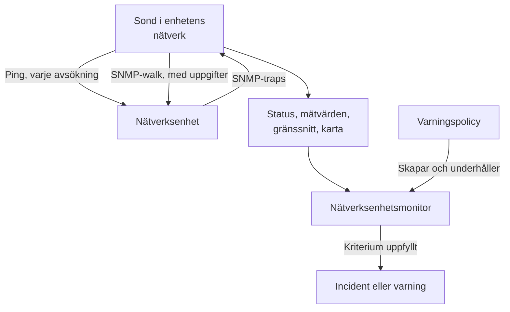
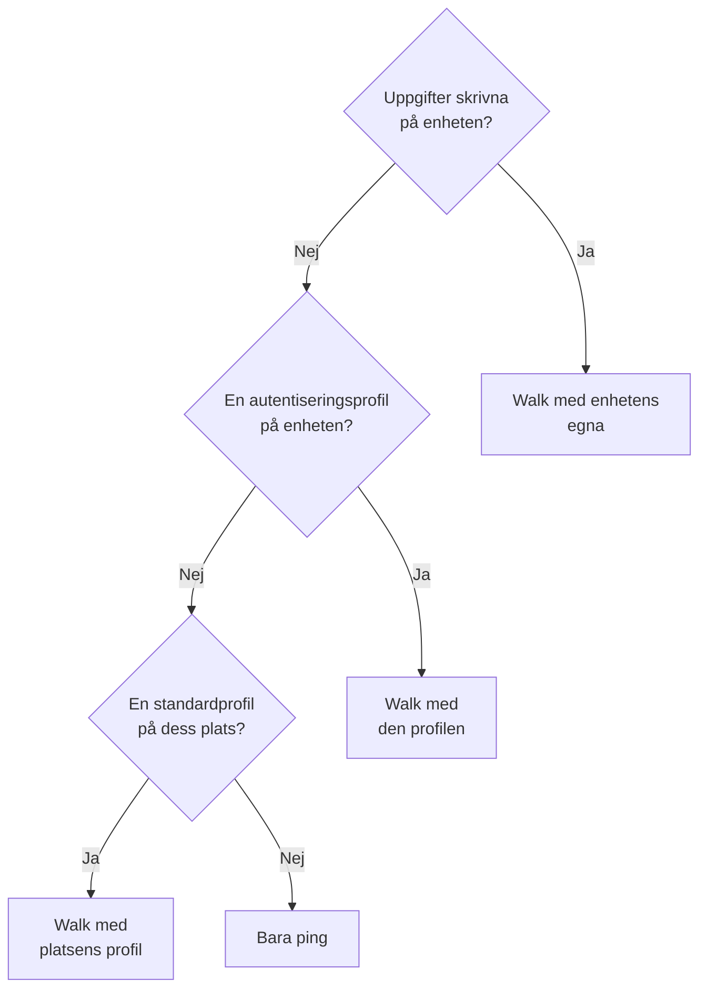
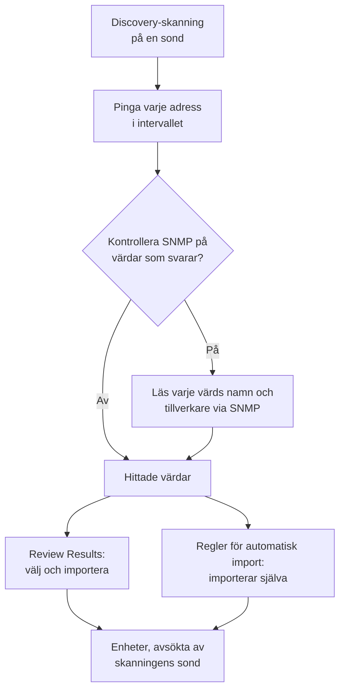
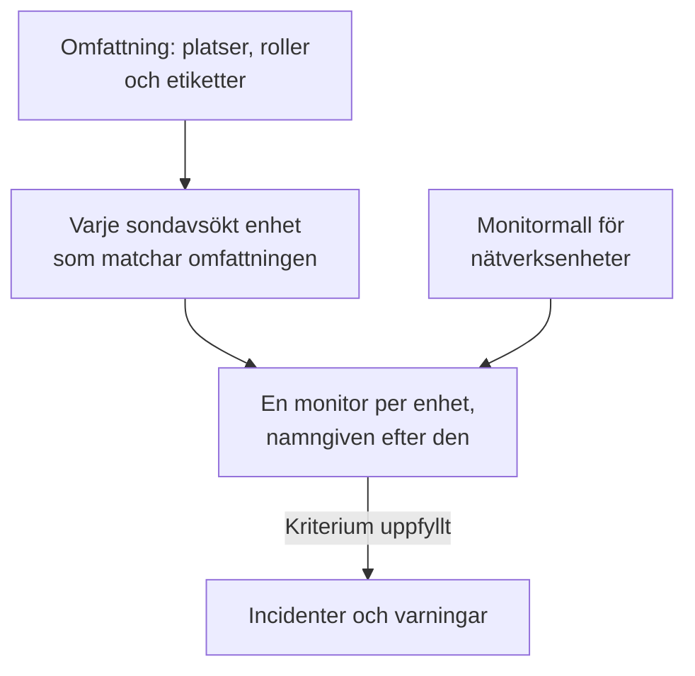
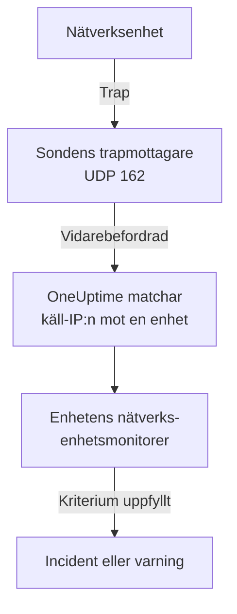

# Nätverksenhets-övervakning

Övervaka switchar, routrar, brandväggar, accesspunkter, PDU:er, kameror och skrivare: allt som har en adress i ditt nätverk, oavsett om det talar SNMP eller inte.

Lägg till en enhet med dess adress och en sond, så pingar sonden den enligt ett schema: enheten får statusen uppe eller nere, en plats på nätverkskartan och en röst i sin plats hälsa. Ge den SNMP-autentiseringsuppgifter så gör samma sond också en SNMP-walk av den: gränssnitt och optiken i dem, hårdvaruinventarium, LLDP- och CDP-grannar och hälso-OID:er. Lägg till en monitor, eller en varningspolicy för en hel flotta, så skapar dess avsökningar och traps incidenter och varningar.

:::cards
- [Lägg till en enhet](#lägg-till-en-nätverksenhet): Dess adress och en sond, på en sida.
- [Upptäck ett nätverk](#upptäck-enheter-med-en-nätverksskanning): Skanna ett adressintervall och importera det som svarar.
- [Läs enheter via SNMP](#snmp-autentiseringsuppgifter-och-autentiseringsprofiler): Gränssnitt, optik, inventarium och hälsa.
- [Få varningar](#varningar): En monitor för en enhet, en policy för en flotta.
- [Se kartan](#nätverkstopologi): Grannar ritade live, exporterade som PDF.
- [Lös ett problem](#felsökning): Enheter som väntar, walks som misslyckas, traps som inte kommer fram.
:::

## Så fungerar det



Enheten och monitorn gör olika jobb:

| Del | Vad den gör | När du behöver den |
| --- | --- | --- |
| Enheten | Dess sond avsöker den enligt enhetens eget schema. Varje avsökning registrerar nåbarhet, pingens svarstid och paketförlust; en avsökning med SNMP-autentiseringsuppgifter läser också enhetens identitet, gränssnitt, grannar och hälso-OID:er. | Alltid: enheten är det du lägger till. |
| En monitor | Utvärderar kriterier mot varje avsökningsresultat och varje trap från enheten, och skapar incidenter och varningar. | Bara för incidenter och varningar. Status, inventarium, diagram och kartan behöver ingen monitor. |

## Innan du börjar

- **En sond som kan nå enheten.** Sonden pingar och walkar enheten från sitt eget nätverk, så en enhet på en privat adress behöver en [anpassad sond](/docs/probe/custom-probe) inne i det nätverket: en sond på det publika internet kan inte nå den.
- **SNMP, för mer än ping.** Valfritt. En v1- eller v2c-community string, eller en SNMPv3-användare, inställd på enheten, med UDP 161 öppen från sonden. Utan det pingas enheten bara.
- **Traps, syslog och flöden.** Valfritt. Sonden tar emot SNMP-traps på UDP 162, syslog på UDP 5140 när du slår på det, och flödesposter på UDP 2055, 4739 och 6343, så öppna dem från dina enheter till sonden.

## Nätverksöversikten

**Nätverk → Översikt** är där Nätverk-området öppnas, och den börjar med svaret: en mening som säger om ditt nätverk mår bra och, när det inte gör det, vad som är fel, de värsta nyheterna först.

| Vad det står | När |
| --- | --- |
| **3 enheter är nere** | En enhets sond eller monitor kan inte nå den. |
| **2 platser behöver uppmärksamhet** | Alla enheter svarar, men en plats hälsa är inte i drift. |
| **5 gränssnitt är nere** | Alla enheter svarar, men portar är mörka. |
| **2 enheter rapporterar inte sina detaljer** | De svarar på ping, men deras SNMP-walk misslyckas, så deras gränssnitt och hälsa uppdateras inte: oftast autentiseringsuppgifterna. |
| **Väntar på första kontrollen** | Enheter har lagts till och deras sond har inte kontrollerat dem än. |
| **Alla 40 enheter är uppe** | Alla enheter svarar. Enheter som fortfarande väntar på sin första kontroll räknas på en egen rad. |

Under den säger en rad om något skapar en incident när en enhet går ner: hur många [varningspolicyer](#varningspolicyer) som är påslagna, eller en länk **Set up alerts** när det inte finns någon. Knapparna **Add Device** och **Discover Devices** bredvid öppnar de formulären, och rutorna och listorna nedanför ger detaljerna: enheter och platser som behöver uppmärksamhet, flottan per tillverkare och de senaste skanningarna.

Innan något har lagts till visar översikten i stället de två sätten att komma igång: **Upptäck enheter** skannar ett adressintervall så att du kan välja vad du vill lägga till, bäst för ett helt nätverk eller en ny plats, och **Lägg till en enda enhet** lägger till en via dess IP-adress eller värdnamn.

Nätverk-menyn håller det du öppnar varje dag synligt: **Översikt**, **Devices**, **Platser**, **Map**, **Traffic** och **Discovery**. Resten är hopfällt i avsnitt, och ett avsnitt fäller ut sig självt på var och en av sina sidor:

| Avsnitt | Sidor |
| --- | --- |
| **Topologi** | **Device Topology**, **Slutpunkter**, **Latency Matrix**, **Site Links**, **Device Links** |
| **Regler** | **Auto Import Rules**, **Site Assignment Rules**, **Ägarregler**, **Etikettregler**, **Link Rules** |
| **Inställningar** | **Alert Policies**, **SNMP-autentiseringsuppgifter**, **Device Roles**, **Site Types**, **OID Collection Templates** |
| **Avancerad** | **Archived Devices** |

## Lägg till en nätverksenhet

:::steps
### Öppna listan över enheter
Gå till **Nätverk → Devices** och klicka på **Add Device**. **Add Device** på Nätverk-**Översikt** öppnar samma formulär.

### Skriv enhetens adress
Skriv dess IP-adress eller värdnamn i **Värdnamn**. Lämna **Namn** tomt för att namnge enheten efter dess värdnamn.

### Kontrollera platsen och sonden
Välj den **Site** som enheten finns på, om du använder platser. **Sond** fyller i sig själv med platsens standardsond, eller med projektets enda anpassade sond; se till att det är en sond som kan nå enheten.

### Lägg till enheten
Klicka på **Add Device**. Inom ett par minuter pingar sonden enheten och dess status blir **Up** eller **Down**. Med SNMP-autentiseringsuppgifter fylls även enhetens översikt i med dess identitet, gränssnitt och hälsa efter den första lyckade walken.
:::

Formuläret är en sida — värdnamnet, ett namn, platsen och sonden — med **SNMP** och **Fler fält** hopfällda nedanför. Det frågar inget om hur enheten övervakas: varje enhet du lägger till avsöks av sin sond, och [åsidosättningen med bunden monitor](#åsidosättningen-med-bunden-monitor) finns på enhetens sida **Inställningar** för de få enheter som behöver den.

En enhets uppgifter — namn, beskrivning, roll, plats, etiketter och adresser — redigeras efteråt på ett ställe: kortet **Device Settings** på dess sida **Inställningar**. Kortet **Enhetsinformation** på dess översikt visar dem, med en länk **Redigera i Inställningar**.

### Enheten

| Fält | Beskrivning | Obligatoriskt |
| --- | --- | --- |
| Värdnamn | IP-adressen eller värdnamnet som sonden pingar, och walkar via SNMP när enheten har autentiseringsuppgifter. | Ja |
| Namn | Ett lättläst namn, till exempel core-switch-01. Lämna det tomt så namnges enheten efter sitt värdnamn. API:et gör likadant: en enhet som skapas utan namn namnges efter sitt värdnamn. | Nej |
| Site | Den [nätverksplats](/docs/monitor/network-sites) som enheten finns på. Platsens hälsa sammanfattas från dess enheter, och en plats med en standardsond fyller i sonden nedan. | Nej |
| Sond | Sonden som pingar enheten, walkar den via SNMP när den har autentiseringsuppgifter och tar emot dess traps, syslog och [flödesposter](/docs/monitor/network-traffic). Den måste nå enheten direkt: en sond på det publika internet kan inte nå en privat adress. | Ja |

**Sond** fyller i sig själv där den kan: ett projekt med exakt en anpassad sond börjar med den, och att välja en plats ersätter den med [platsens standardsond](/docs/monitor/network-sites#standardvärden-för-övervakning). Den skriver aldrig över en sond som du själv har valt. Sätt en standardsond på dina platser så kan en enhet läggas till med bara sin adress.

### Fler fält (hopfällda)

| Fält | Beskrivning | Obligatoriskt |
| --- | --- | --- |
| Beskrivning | Fritext. | Nej |
| Device Role | Kärnswitch, accessswitch, brandvägg och så vidare. Bestämmer enhetens nivå på kartan och avgränsar varningspolicyer. | Nej |
| MAC-adress | Enhetens egen MAC. Kartan använder den för att placera en enhet som varken talar LLDP eller CDP på den switchport som lärde sig den; se [Enheter med bara ping och deras switchport](#enheter-med-bara-ping-och-deras-switchport). Lärs oftast in åt dig från en routers ARP-tabell. | Nej |
| Skapa även en Ping-övervakare för incidenter | Sonden pingar redan enheten och ger den en status; en Ping-monitor är det som gör misslyckade pingar till en incident. Markera rutan så skapas en på värdnamnet, bunden till enheten, när du sparar. Den räknas mot din plan, och dess incidenter är avstängda tills du slår på dem från monitorns sida. | Nej |

När du markerar Ping-monitorn visas **Ping from probes**, monitorns egna sonder. De måste nå enhetens nätverk; lämna fältet tomt för att använda projektets standardsonder. Använd hellre [varningspolicyer](#varningspolicyer) för att varna om många enheter samtidigt.

### SNMP (hopfällt, valfritt)

Lämna det hopfällt så pingas enheten bara: det hopfällda avsnittet säger det i en mening. Enheten får fortfarande en status från sin första avsökning och finns fortfarande på sin plats och på kartan, men har inga gränssnitt, inget inventarium och inga hälso-OID:er förrän den har autentiseringsuppgifter. Fäll ut avsnittet för att skriva en community string eller en v3-användare, eller för att välja en sparad autentiseringsprofil.

:::tabs
@tab SNMP v1 / v2c
| Fält | Beskrivning | Obligatoriskt |
| --- | --- | --- |
| SNMP-version | V1, V2c eller V3. | Ja, börjar på V2c |
| SNMP Community String | v1- eller v2c-community string, till exempel `public`. | Nej: tomt betyder bara ping |
| SNMP Port | UDP-porten som agenten lyssnar på. | Nej, 161 som standard |
| SNMP Credential Profile | En sparad uppsättning autentiseringsuppgifter som används i stället för att skriva uppgifter här. | Nej |
@tab SNMPv3
| Fält | Beskrivning | Obligatoriskt |
| --- | --- | --- |
| SNMP v3 Security Level | No Auth, No Priv; Auth, No Priv; eller Auth, Priv. | Ja |
| SNMP v3 Username | Säkerhetsnamnet (användaren) som är inställt på enheten. | Ja: tomt betyder bara ping |
| SNMP v3 Authentication Protocol | MD5, SHA, SHA-256 eller SHA-512. | Med autentisering |
| SNMP v3 Authentication Key | Lösenfrasen för autentisering. | Med autentisering |
| SNMP v3 Privacy Protocol | DES, AES eller AES-256. | Med sekretess |
| SNMP v3 Privacy Key | Lösenfrasen för sekretess (kryptering). | Med sekretess |
:::

Autentiseringsuppgifter som skrivs på enheten vinner över en autentiseringsprofil som valts bredvid dem, och enhetens plats kan också ha en standardprofil. Autentiseringsuppgifter i en profil är krypterade i vila. Autentiseringsuppgifter som skrivs på en enhet skyddas av samma läsbehörigheter men är inte krypterade i vila: ytterligare ett skäl att hålla delade autentiseringsuppgifter i en profil.

## Ändra många enheter på en gång

En discovery-skanning av en kunds nätverk tar in dussintals enheter som hör till en plats, delar en roll och kommer från en tillverkare. Du öppnar dem inte en i taget: markera dem i listan **Devices**, genom att bocka för rader eller markera alla enheter som filtren matchar, och öppna **Massåtgärder**.

| Åtgärd | Vad den gör |
| --- | --- |
| **Ange plats** / **Rensa plats** | Flyttar varje markerad enhet till den plats du väljer, där den räknas in i platsens hälsa; en enhet utan egen sond tar platsens standardsond. **Rensa plats** tar bort dem från deras platser. En enhet som en platstilldelningsregel matchar går tillbaka till regelns plats vid nästa avsökning, så för enheter som discovery fortsätter att hitta lägger du hellre till en regel under **Nätverk → Regler → Site Assignment Rules**; dialogrutan **Ange plats** länkar dit. |
| **Ange enhetsroll** / **Rensa enhetsroll** | Ger varje markerad enhet samma roll, som de tjugo switchar som alla är "Access Switch". Rollerna är projektets egna, under **Nätverk → Inställningar → Device Roles**, som dialogrutan länkar till. **Rensa enhetsroll** härleder varje enhets roll från dess SNMP-identitet igen. |
| **Tillämpa tillverkarmall** | Lägger till en [tillverkarmalls](#tillverkarnas-hälsomallar) hälso-OID:er och SNMP-tabeller på varje markerad enhet. **Matcha varje enhets tillverkare**, dialogrutans första val, väljer varje enhets egen mall utifrån vad dess SNMP-walk rapporterar, så att ett blandat urval får rätt mall överallt; eller välj en mall för alla. |

Varje åtgärd är en dialogruta och en sparning för hela urvalet, och varje enhet går igenom samma kontroller som en redigering på dess egen sida Inställningar: behörigheter, din rolls etikett- och ägaromfattning och gränserna för vad en enhet får samla in.

**Tillämpa tillverkarmall** visar vad den kommer att göra innan den gör något: hur många enheter som får vilken mall, och hur många den lämnar orörda och varför. Den lägger till det som varje enhet redan samlar in och tar inte bort något, och en enhet som redan har allt i mallen skrivs inte om. Den lämnar orörd en enhet med bunden monitor (inget avsöker den), en enhet som är kopplad till en [OID Collection Template](#oid-collection-templates) (mallen bestämmer vad den samlar in, så lägg till tillverkarens OID:er där) och, vid matchning, en enhet som ännu inte har walkats via SNMP eller vars tillverkare saknar mall.

När en åtgärd är klar listar den hur många enheter som ändrades, vilka som misslyckades och varför — en enhet som din roll inte får redigera, en lista över sin gräns — och vilka den inte ändrade och varför: en enhet som redan fanns på den platsen eller hade den rollen, eller en som tillverkarmallen lämnar orörd.

De övriga massåtgärderna beskrivs där de hör hemma: **Set OID Collection Template** under [OID Collection Templates](#oid-collection-templates), **Set SNMP Credential Profile**, **Switch to Probe Polling** och **Create Ping Monitors** under [I bulk](#i-bulk), och **Shorten Names to Hostname** under [Så namnges upptäckta enheter](#så-namnges-upptäckta-enheter).

## Vad en avsökning faktiskt gör

Varje avsökning av en sondavsökt enhet är en ping. När enheten har användbara SNMP-autentiseringsuppgifter kör sonden också en fullständig SNMP-walk. De två körs sida vid sida och walken väntar aldrig på pingen, så SNMP-utrustning bakom en ACL som kastar ICMP rapporterar ändå **Up**.

| Resultat | Enhet med bara ping | Enhet med SNMP-autentiseringsuppgifter |
| --- | --- | --- |
| Status (Up eller Down) | Från pingen | Från pingen eller walken: det räcker att någon av dem svarar |
| Pingens svarstid och paketförlust | Registreras som enhetsmätvärden | Registreras som enhetsmätvärden |
| SNMP-svarstid | — | Walkens tid, aldrig pingens |
| Gränssnitt, grannar, slutpunkter | — | Från en lyckad walk |
| Systemidentitet, tillverkare, modell, serienummer | — | Från en lyckad walk |
| Hälso-OID:er och SNMP-tabeller | — | Från en lyckad walk |

Användbara autentiseringsuppgifter är en v1- eller v2c-uppsättning med en community string, eller en v3-uppsättning med ett användarnamn, som hittas via [kedjan av autentiseringsuppgifter](#snmp-autentiseringsuppgifter-och-autentiseringsprofiler). En tom uppsättning hoppas över, så en enhet walkas aldrig med en gissad standard-community.

Paketförlusten återanvänder [Ping-monitorns](/docs/monitor/ping-monitor) serie, så den läses likadant i hela produkten. Svarstiden har en egen serie, `oneuptime.monitor.ping.round.trip.time`, eftersom den vanliga svarstiden på en nätverksenhet är SNMP-walkens. Enhetens sida **Mätvärden** visar gränssnittsutnyttjande och hälso-OID:er i diagram; svarstiden för den senaste timmen ritas i enhetens panel på kartan.

### "SNMP failing" är inte "Down"

En enhet som svarar på ping men vars walk misslyckas är **Up**, markerad med **SNMP failing**, och båda halvorna spelar roll:

- Den är uppe eftersom något svarar på den adressen. Att färga den röd skulle lägga en enhet som fungerar utmärkt i din incidentstatistik.
- Den är SNMP failing eftersom dess gränssnitt, inventarium och hälso-OID:er har slutat uppdateras, nästan alltid på grund av autentiseringsuppgifter, en avstängd SNMP-agent eller en ACL. Inget annat på sidan skulle tala om för dig att siffrorna har frusit.

En enhet vars ping och walk båda misslyckas är helt enkelt **Down**, så markeringen visas bara någonsin bredvid en grön status.

### Läsa en enhets status

Varje ställe som visar en enhet — listan Devices, en plats Devices-sida, översikten, kartan — använder samma tre utslag och samma tillägg bredvid dem.

| Utslag | Betyder |
| --- | --- |
| **Up** | Den senaste avsökningen (ping eller SNMP), eller den bundna monitorn, nådde enheten. |
| **Down** | Den senaste avsökningen (ping eller SNMP), eller den bundna monitorn, kunde inte nå enheten. |
| **Väntar** | Inget utslag än: aldrig avsökt, ingen sond tilldelad eller ingen monitor bunden. |

| Tillägg | Visas när | Vad du gör |
| --- | --- | --- |
| **Stale** | Ingen avsökning har försökts på betydligt längre tid än enhetens intervall. | Kontrollera att enhetens sond är online och hinner med sin flotta. |
| **No probe** | Enheten avsöks av en sond men har ingen, eller dess avsökning är avstängd. | Tilldela en sond som kan nå den; inget avsöker den förrän dess. |
| **No monitor** | Enheten använder [åsidosättningen med bunden monitor](#åsidosättningen-med-bunden-monitor) och inget är bundet. | Bind en monitor, eller byt tillbaka den till avsökning via sond. |
| **SNMP failing** | Uppe på ping, men den senaste SNMP-walken misslyckades. | Kontrollera autentiseringsuppgifterna, SNMP-agenten eller en ACL. |

Listan **Devices** har ett filter **SNMP** med tre värden: **OK** (den senaste walken lyckades), **Failing** (den senaste walken misslyckades) och **Not configured** (bara ping, inga autentiseringsuppgifter eller aldrig avsökt). "Vilka enheter har autentiseringsuppgifter som har slutat fungera" är ett klick bort. Listans kolumn **Interfaces (Up / Down)** visar **No SNMP** i stället för `0 / 0` för en enhet som pingas och aldrig walkas: noll fungerande portar vore ett annat påstående, och ett felaktigt.

## SNMP-autentiseringsuppgifter och autentiseringsprofiler

En enhet walkas med den första användbara uppsättning autentiseringsuppgifter som hittas i den här ordningen, och sökningen stannar vid första träffen:



Platssteget läser enhetens egen plats och inget längre: en enhet i en Unit tar inte en profil som är satt på Region ovanför den. En plats standardsond når däremot ned genom trädet, eftersom en sond kopieras till enheten en gång medan autentiseringsuppgifter läses om vid varje avsökning; [Nätverksplatser](/docs/monitor/network-sites#standardvärden-för-övervakning) har detaljerna.

### Sidan SNMP-autentiseringsuppgifter

**Nätverk → Inställningar → SNMP-autentiseringsuppgifter** innehåller projektets autentiseringsprofiler. En profil är en namngiven uppsättning — en v1- eller v2c-community string, eller en v3-användare med sin säkerhetsnivå, sina protokoll och nycklar — som hur många enheter och platser som helst pekar på. Inget kopieras till enheterna, så att byta en community string är en redigering här, och varje enhet som använder profilen tar det nya värdet vid sin nästa avsökning.

Hemligheter i en profil är krypterade i vila, och bara roller som får läsa en enhets egna autentiseringsuppgifter får läsa dem. En enhet eller plats som visar sin profil visar profilens namn och version, aldrig dess hemligheter.

En profil som en enhet eller plats fortfarande pekar på kan inte tas bort: borttagningen nekas med en räkning av det som står i vägen. Flytta de enheterna och platserna till en annan profil, eller rensa profilen på dem, och ta sedan bort den.

### Gör en enhet till bara ping igen

På enhetens sida **Inställningar** har **Redigera inställningar** en kryssruta **Ping only — clear this device's own SNMP credentials** i steget **SNMP-autentiseringsuppgifter**. Den rensar enhetens egen community string och v3-användarnamn när du sparar. Den finns eftersom det inte är självklart vilket fält som ska tömmas: en v3-enhet går fortfarande att walka så länge dess användarnamn finns kvar, vad du än tömmer i övrigt.

Att rensa enhetens egna autentiseringsuppgifter rensar inte en profil. Om enheten eller dess plats fortfarande anger en, fortsätter enheten att walkas med den; rensa även profilen för att enheten bara ska pingas.

### I bulk

Markera enheter i listan **Devices** och använd:

- **Set SNMP Credential Profile** / **Clear SNMP Credential Profile**: koppla en profil till ett urval, eller ta bort den.
- **Switch to Probe Polling**: för enheter med åsidosättningen med bunden monitor. Välj en sond, så pingas varje markerad enhet enligt sitt schema från och med då, och walkas när den har autentiseringsuppgifter. En monitor som redan är bunden förblir bunden; enhetens status kommer nu från sonden.
- **Create Ping Monitors**: för enheter med åsidosättningen med bunden monitor; skapar en Ping-monitor på varje enhets värdnamn och binder den, så att enheten visar Up eller Down.

Sidan **Devices** visar en banderoll när projektet har enheter med åsidosättningen med bunden monitor där inget är bundet — enheter som inget avsöker och som inget rapporterar om — och länkar till det urval som åtgärdar dem.

## Platsens standardvärden för övervakning

En [nätverksplats](/docs/monitor/network-sites#standardvärden-för-övervakning) har två standardvärden för enheterna i den. Dess **Default Probe** kopieras till en enhet som skapas på platsen, eller flyttas dit, utan egen sond. Dess **Default SNMP Credential Profile** läses vid varje avsökning av en enhet på platsen som inte har egna autentiseringsuppgifter. Sätt båda på en plats så kan en enhet där läggas till med bara sin adress, och pingas och walkas från sin första avsökning. Guiden om platser beskriver hur långt ned i platsträdet varje standardvärde når.

## Åsidosättningen med bunden monitor

Viss utrustning kan ingen sond nå eller pinga på ett meningsfullt sätt: en enhet bakom en NAT, en appliance vars hälsa bättre bedöms med en HTTP-kontroll, en tjänst vars verkliga signal är en portkontroll. För dem har **Redigera inställningar** på enhetens sida **Inställningar** en **Monitoring Method**:

| Metod | Vad den betyder |
| --- | --- |
| **Sond** | Standard. Pingas av den tilldelade sonden enligt dess schema, och walkas via SNMP när den har autentiseringsuppgifter. |
| **Bound monitor** | En befintlig monitors status är den här enhetens status. |

Att byta en enhet till **Bound monitor** stoppar avsökningen av den. Sonden, intervallet och avsökningsreglaget försvinner från kortet **Polling & Data Collection**, enhetens gamla avsökningsresultat rensas och dess status kommer från den monitor du binder. Att binda en är valfritt: tills du gör det visar enheten **Väntar**, markerad med **No monitor**.

Att byta tillbaka till **Sond** återställer avsökningen och ber om en sond. En monitor som var bunden förblir bunden och fortsätter att varna; den bestämmer bara inte längre enhetens status.

De flesta enheter behöver inte det här. Varje sondavsökt enhet har redan en nåbarhetsstatus, så du behöver inte binda en Ping-monitor för att få en; bind en monitor när du vill ha den monitorns incidenter.

## Avsökning och datainsamling

Avsökningen finns på enhetens sida **Inställningar**, på kortet **Polling & Data Collection** (**Redigera Polling**). Standardvärdena passar en ny enhet, så den behöver ingen finjustering:

| Inställning | Beskrivning | Standard |
| --- | --- | --- |
| Sond | Sonden som avsöker enheten. | Sätts när enheten läggs till |
| Polling Enabled | Sonden avsöker enheten enligt schemat nedan. Stäng av det för att pausa avsökningen utan att ta bort enheten. | På |
| Polling Interval (Minutes) | Hur ofta sonden avsöker enheten. Minst 1 minut. | 5 |
| Walk Interfaces | Walkar gränssnittstabellerna (IF-MIB) vid varje avsökning: status, bandbredd, utnyttjande och fel för varje port, plus LLDP- och CDP-grannar för kartan. | På |
| Collect Connected Endpoints | Walkar även ARP- och bridge-vidarebefordringstabellerna för att hitta det som är anslutet till enheten: kortterminaler, skrivare, telefoner, bärbara datorer. Från en ARP-tabell fyller den också i MAC-adressen för enheter som är registrerade på de adresserna. Kostar extra walks per avsökning. | Av |
| OID Collection Template | En delad, namngiven OID-lista som enheten samlar in. Att redigera mallen ändrar varje kopplad enhet vid dess nästa avsökning. | Ingen |
| Device-Specific Health OIDs | Extra OID:er som bara den här enheten samlar in, utöver mallens. | Inga |
| Auto-Apply Vendor Health Template | När enhetens tillverkare känns igen och dess egen OID-lista är tom, fylls listan från tillverkarens mall vid nästa avsökning. | Av; på för enheter som discovery importerar |
| Device-Specific SNMP Tables | Extra [SNMP-tabeller](#snmp-tabeller) som bara den här enheten walkar, utöver mallens. En tabell med samma nyckel som en malltabell ersätter den på den här enheten. | Inga |

Allt från **Walk Interfaces** och nedåt kräver SNMP-autentiseringsuppgifter: på en enhet med bara ping behålls de inställningarna och har ingen walk att tillämpas på.

### Walk av gränssnitt

Med **Walk Interfaces** påslaget och autentiseringsuppgifter hittade följer varje avsökning varje gränssnitts drifts- och administrativa status, bitar in och ut, utnyttjande och fel. Samma walk samlar in LLDP- och CDP-grannarna för kartan.

Tysta ett gränssnitt på enhetens sida **Interfaces**, för en labbport eller en länk som är urkopplad med flit, så stannar det i inventariet men lämnar varningar och mätvärden. En misslyckad walk rensar aldrig halva det insamlade: den senaste ögonblicksbilden av gränssnitten ligger kvar, och enheten markeras med **SNMP failing** så att ingen tar den för en aktuell.

### Tillverkarnas hälsomallar

I redigeraren **Health OIDs** tillämpar **Vendor Health Template** en färdig uppsättning OID:er för enhetens tillverkare. Många mallar levererar också [SNMP-tabeller](#snmp-tabeller), som läggs till med **Add a Vendor's Tables** i redigeraren **SNMP Tables**.

| Tillverkarmall | Hälso-OID:er | SNMP-tabeller |
| --- | --- | --- |
| Generic (Host Resources MIB) | CPU-belastning, totalt och tillgängligt RAM, belastningsgenomsnitt | CPU-kärnor (en rad per kärna, hur plattformen än numrerar dem) |
| Arista EOS | CPU-belastning, belastningsgenomsnitt, totalt och tillgängligt RAM | — |
| Cambium Networks cnMatrix | CPU, RAM, flash, temperatur, matningsspänning | Fläktar, PoE-portar, redundant nätaggregat |
| Cambium Networks Enterprise Wi-Fi (cnPilot, XV, XE, XH) | CPU, ledigt minne, Wi-Fi-klienter, anslutning till cnMaestro | Wi-Fi-radior (band, kanal, bredd, sändeffekt, klienter, brusgolv, airtime, tillstånd), SSID:er |
| Cisco IOS / IOS-XE | CPU, använt och ledigt minne, temperatur, fläkttillstånd, nätaggregatstillstånd | — |
| Dell Force10 / OS9 | CPU, minne | — |
| Extreme Networks EXOS / Switch Engine | CPU, temperatur, larm för övertemperatur, strömtillstånd | Nätaggregat, fläktar, minne per kortplats, stackmedlemmar |
| Extreme Networks Fabric Engine / VOSS | vIST-session, antal I-SID:er | Fabric-adjacencies (IS-IS) namngivna efter grannen, CPU och minne per kortplats, temperatursensorer, fläktar, nätaggregat |
| Extreme Networks IQ Engine (HiveOS) Access Points | CPU, minne, Wi-Fi-klienter, temperatur | Wi-Fi-radior (kanal, sändeffekt, brusgolv), SSID:er |
| Extreme Networks Wireless Controller (XIQ-C, ExtremeWireless) | Accesspunkter, aktiva accesspunkter, Wi-Fi-klienter | Accesspunkter (tillstånd, klienter, adress, programvara), Wi-Fi-radior (band, kanal, bredd, brusgolv, upptagen airtime), WLAN:er (SSID, klienter) |
| Fortinet FortiGate | CPU, minne, disk | — |
| HPE / Aruba ProCurve | CPU, totalt och ledigt minne | — |
| HPE Aruba Instant (AOS 8) | Klusternamn, firmwareversion, conductor | Accesspunkter (status, modell, CPU, minne), Wi-Fi-radior namngivna efter accesspunkt (kanal, sändeffekt, brusgolv, utnyttjande, klienter, tillstånd), SSID:er (klienter) |
| HPE Aruba Mobility Controller (AOS 8) | Accesspunkter, Wi-Fi-klienter, kontrollerns roll | Accesspunkter (status, modell, AP-grupp), Wi-Fi-radior namngivna efter accesspunkt (band, kanal, sändeffekt, utnyttjande, klienter, läge), SSID:er (klienter, accesspunkter uppe och nere), processorer, minne |
| Huawei VRP | CPU, minne, temperatur | — |
| Juniper Junos | CPU, minnesbuffert, temperatur | — |
| MikroTik RouterOS | CPU-belastning, temperatur, spänning | — |
| Palo Alto PAN-OS | Hanterings-CPU, sessionsutnyttjande, aktiva sessioner | — |
| Sophos Firewall (SFOS / XGS) | Minne, disk, swap, HA-tillstånd och peerns tillstånd, IPsec-tjänst, CPU-temperatur (SFOS v22 och senare) | IPsec-tunnlar (status kräver SFOS v20 och senare), CPU-kärnor |
| TP-Link Omada Access Points (EAP) | Wi-Fi-klienter | — |
| Ubiquiti EdgeOS / EdgeSwitch / UniFi Switches | CPU-belastning, totalt och tillgängligt RAM | — |
| Ubiquiti UniFi Access Points | Isolerat tillstånd, belastningsgenomsnitt, totalt och tillgängligt RAM | Wi-Fi-radior (band, airtime), SSID:er (band, kanal, klienter, sändeffekt, anslutningskvalitet), CPU-kärnor |

Mallens OID:er kopieras till enhetens egen lista, där du kan beskära eller utöka dem. När den första walken har identifierat tillverkaren föreslår enhetssidan den matchande mallen. Matchningen läser enhetens `sysObjectID`, och dess `sysDescr` där ett enterprisenummer rymmer två operativsystem: Extreme Fabric Engine på universell hårdvara rapporterar samma enterprisenummer (1916) som EXOS, och bara dess beskrivning (`…-FabricEngine (9.0.4.0)`) skiljer dem åt. UniFi-accesspunkter skiljs från Ubiquitis routrar på samma sätt (`U6-Pro 6.6.50.15098`), även när äldre firmware svarar med Net-SNMP:s gren, och IQ Engine-accesspunkter från de Aerohive-switchar som delar deras gren (`AP230, HiveOS 8.2r1`).

Enheter med **Auto-Apply Vendor Health Template** påslaget får mallens OID:er och tabeller vid sin första avsökning: enheter som en regel för automatisk import tar in, och enheter som importeras från **Review Results** med reglaget för tillverkarmall påslaget, vilket det är om du inte stänger av det. För att ge många enheter deras mall på en gång, som en upptäckt flotta från tiden innan reglaget fanns, markerar du dem i listan **Devices** och använder **Tillämpa tillverkarmall** (se [Ändra många enheter på en gång](#ändra-många-enheter-på-en-gång)).

Att tillämpa en tillverkarmall är en engångskopia, så inget sprids när mallen ändras. Använd hellre en **OID Collection Template** för allt utöver en enskild enhet; tillverkarmallarna erbjuds som utgångspunkt när du skapar en.

### OID Collection Templates

En **OID Collection Template** (**Nätverk → Inställningar → OID Collection Templates**) är en namngiven OID-lista, oftast namngiven efter en enhetstyp som "Cisco Catalyst 9300", som hur många enheter som helst kopplas till. Kopplingen är levande, inte en kopia: en enhets OID-lista sätts ihop vid varje avsökning, så att redigera en mall ändrar vad varje kopplad enhet samlar in vid sin nästa avsökning, utan något synkroniseringssteg.

Innan du bygger en, kontrollera att du behöver den. Bitar in och ut per port, driftstatus, utnyttjande och fel per sekund samlas in för varje port vid varje avsökning utan några OID:er alls (se [Walk av gränssnitt](#walk-av-gränssnitt)), och de kan redan ge varningar per port. Mallar är till för det som inte är per port: CPU, minne, temperatur, fläktar, nätaggregat, BGP-peers.

Om du kommer från Zabbix:

| Zabbix | OneUptime |
| --- | --- |
| Template | OID Collection Template |
| Item | En OID i den mallen |
| Discovery-regeln "Network interfaces by SNMP" med item-prototyper | Inbyggt och alltid på för gränssnittsräknarna: inget att skriva |
| Trigger | Monitorkriterier |
| Trigger-prototyp, en per upptäckt gränssnitt | Ett kriterium med **Gränssnitt** satt till `*`, som sprids ut per port |
| Discovery-regel över någon annan SNMP-tabell (tunnlar, radior, fläktar) med item-prototyper | En [SNMP-tabell](#snmp-tabeller) i mallen |
| Trigger-prototyp på en sådan tabell | Ett kriterium SNMP Table Value eller SNMP Table Row Is Unhealthy med **Row** satt till `*` |
| Värdgrupp | Etiketter |
| Åtgärden "Link template on host discovery" | En regels **OID Collection Template** för automatisk import |
| Åtgärd på en värdgrupp ("varna för varje switch") | En [varningspolicy](#varningspolicyer) |

En OID i en mall samlas in som den är skriven, så en OID som anger en rad i en tabell (`…ifSpeed.3`) samlar bara in den raden, vad som än finns på index 3 den dag som avsöks. Allt som är en lista — tunnlar, radior, fläktar, grannar — hör hemma i en [SNMP-tabell](#snmp-tabeller), som walkar varje rad och följer rader när de kommer och går. Gränssnittsdata per port behöver ingetdera: gränssnittswalken registrerar driftstatus, bitar in och ut per sekund, utnyttjande och en sammanlagd felfrekvens per sekund som serier. Fel per riktning, kasserade paket, administrativ status och länkhastighet går till enhetens gränssnittsinventarium, men är inte serier och kan inte ge varningar.

Det finns tre sätt att koppla enheter, och i en flotta som discovery fortsätter att hitta spelar det tredje störst roll:

- En enhet i taget, på enhetens kort **Polling & Data Collection**.
- I bulk, genom att markera enheter i listan **Devices** och använda **Set OID Collection Template**. Listans kolumn **Template** visar vilka enheter som är kopplade till vad.
- Automatiskt, genom att sätta en OID Collection Template på en regel för automatisk import, så att varje enhet som en skanning importerar kopplas i samma ögonblick som den skapas.

En enhet samlar först in mallens OID:er och sedan sina egna **Device-Specific Health OIDs**. När båda anger samma OID samlas den in en gång, med enhetens namn och beskrivning som vinnare, och mallens poster behåller sin plats, så enhetsspecifika tillägg kan aldrig tränga undan dem.

| Gräns | Värde |
| --- | --- |
| Hälso-OID:er som en enhet avsöker | 200 |
| OID:er i en mall | 150 |
| En kopplad enhets egna OID:er | 50 |
| En okopplad enhets egna OID:er | 200 |

Gränserna läggs ihop, så en kopplad enhet kan aldrig avsöka mer än 200 OID:er. Att gå över är ett valideringsfel när du sparar, aldrig en tyst avkortning vid avsökningen, och att koppla en enhet som redan har fler än 50 egna nekas med ett meddelande som säger hur många som måste tas bort.

En mall som enheter fortfarande är kopplade till kan inte tas bort. Koppla bort dem först, till exempel med massåtgärden **Clear OID Collection Template**, så att en borttagning aldrig i tysthet stoppar insamlingen i en hel flotta.

### Egna OID:er

Lägg till de OID:er du vill samla in vid varje avsökning, i en mall eller som enhetsspecifika tillägg:

| Fält | Beskrivning | Obligatoriskt |
| --- | --- | --- |
| OID | Den numeriska OID:n, till exempel 1.3.6.1.2.1.1.1.0. | Ja |
| Namn | Ett lättläst namn för OID:n, till exempel sysDescr. | Nej |
| Beskrivning | Vad OID:n representerar. | Nej |

Insamlade värden visas i diagram på enhetens sida **Mätvärden**, och kriterierna **SNMP OID Value** och **SNMP OID Exists** varnar för dem. OID-väljaren i de kriterierna listar de OID:er som den valda enheten samlar in, mallens och dess egna, så det finns inget att skriva.

Långa OID-listor delas upp på flera SNMP GET-förfrågningar så att varje får plats i ett UDP-datagram. Om du höll dina OID-listor korta för att en äldre version rapporterade en enhet som svarade `tooBig` som offline, behöver du inte det längre.

### SNMP-tabeller

En del av det en enhet vet är en lista: en rad per IPsec-tunnel, Wi-Fi-radio, SSID, fabric-granne, fläkt eller nätaggregat. En SNMP-tabell definieras av sina kolumner, och varje rad walkas vid varje avsökning, så en tunnel som läggs till, byter namn eller tas bort följs utan att någon redigerar något.

| Fält | Vad det gör |
| --- | --- |
| Namn och nyckel | Vad tabellen heter. Nyckeln (bokstäver, siffror och understreck, skapad från namnet när den lämnas tom) är det som kriterier, mätvärden och mallvariabler använder, så att byta namn på en tabell bryter aldrig en varning. |
| Typ | Vad raderna är: VPN-tunnlar, Wi-Fi-accesspunkter, Wi-Fi-radior, Wi-Fi-SSID:er, routinggrannar, hårdvara eller generiskt. Wi-Fi-typerna matar enhetens [Wi-Fi-sida](#fliken-wi-fi). |
| Kolumner | Kolumn-OID:erna som ska samlas in (tabellpostens OID plus kolumnnumret, till exempel `1.3.6.1.4.1.2604.5.1.6.1.1.1.1.9` för en Sophos-tunnels status), var och en med ett namn och eventuellt en enhet, en roll (status, band, kanal, kanalbredd, sändeffekt, klienter, brusgolv, utnyttjande, SSID), värdeetiketter och friska värden. |
| Radnamn | Valfria kolumner vars värden namnger varje rad, till exempel en tunnels anslutningsnamn. Utan dem namnges rader efter sitt index. Ett namn kan komma från en syskontabell som delar indexet (Fabric Engine namnger IS-IS-adjacencies från `rcIsisAdjHostName`), eller från en överordnad tabell vars index inleder den här tabellens (Aruba Instant namnger varje radio efter dess accesspunkt). En tabell som indexeras efter ett namn (ArubaOS indexerar sina SSID:er efter SSID) namnges efter sitt avkodade index. |
| Radgräns | Hur många rader som behålls: 100 som standard, högst 250. |

Tal läses som tal, och text som börjar med ett tal läses som det talet (`"36"`, `"-95 dBm"`, `"80MHz"`), eftersom många tillverkare lägger tal i strängar. Sätt en kolumns värdetyp till **Text only** för värden som bara ser numeriska ut. **Value labels** gör koder till ord (`0=inactive, 1=active`): det råa värdet är fortfarande det som visas i diagram och jämförs, etiketten är det som visas. **Healthy values** (`1`) anger vilka värden som betyder att allt är bra: de färgar raden på enhetens sida **SNMP Tables** och driver kriteriet **SNMP Table Row Is Unhealthy**.

Vissa kolumner i tillverkarmallar **justerar** också talet de läser, för MIB:ar som håller ett värde i en egen enhet: ArubaOS rapporterar sändeffekten fördubblad (läses × 0.5), Aruba Instant brusgolvet utan tecken (× −1), Aerohive brusgolvet plus 256 (− 256) och Extremes kontroller kanalbredden i steg om 20 MHz (× 20). Det justerade talet är det som visas, ritas i diagram och jämförs, så **Noise Floor Greater Than -80** betyder samma sak hos varje tillverkare, och tabellredigeraren visar beräkningen under kolumnen.

Tabeller kommer från en [OID Collection Template](#oid-collection-templates), delad av varje kopplad enhet (upp till 10 tabeller), eller från enheten själv under **Device-Specific SNMP Tables** (upp till 10 till). De slås ihop efter nyckel vid varje avsökning, mallen först, och en enhetstabell med samma nyckel ersätter mallens. Båda redigerarna erbjuder **Add a Vendor's Tables**.

Sonden walkar varje kolumn som ett underträd, inom en budget på 30 sekunder som alla tabeller på enheten delar. En tabell som inte kan walkas säger varför och får aldrig avsökningen att misslyckas: enhetens sida **SNMP Tables** behåller sina senaste bra rader och säger att den senaste walken misslyckades, medan kriterier bara bedömer det som den här walken producerade, så en timeout läses aldrig som en tom tabell. Varje numerisk cell registreras som mätvärdet `oneuptime.monitor.snmp.table.value`, med attributen `snmpTableKey`, `snmpTableName`, `snmpTableColumn`, `snmpTableColumnOid`, `snmpTableRow` och `snmpTableRowIndex`, så en instrumentpanel kan visa varje tunnels status eller varje radios sändeffekt i ett diagram, och en mätvärdesmonitor kan gruppera efter `snmpTableRow`.

### Fliken Wi-Fi

En enhet vars walk innehåller en Wi-Fi-tabell — accesspunkter, radior eller SSID:er, så som Wi-Fi-tillverkarmallarna tar med dem — får en sida **Wi-Fi**. Den öppnas med accesspunkter uppe (på en kontroller), radior påslagna, klienter och SSID:er, och listar sedan varje accesspunkt som en kontroller hanterar med dess tillstånd, radior och klienter; varje radio med band, kanal, frekvens, kanalbredd, sändeffekt, klienter, brusgolv och airtime; och varje SSID med dess band och klienter. Kolumner hittas efter sin roll, så alla tillverkares tabeller som märker sina kolumner visas på samma sätt.

Tillverkare delar upp dessa uppgifter olika, och sidan sätter ihop dem igen:

- Frekvensen beräknas från bandet och kanalen med 802.11-kanalplanen (2.4, 5 och 6 GHz). En kontroller som rapporterar frekvensen där dess MIB säger kanal (Extremes) läses tvärtom.
- En radio som inte rapporterar något band placeras efter sin kanal: 1 till 14 är 2.4 GHz, 32 till 177 är 5 GHz, och ett nummer som bara 6 GHz använder (37, 53, 181…) är 6 GHz.
- UniFi rapporterar kanal, sändeffekt och klienter per SSID: en radio hämtar dem från SSID:erna på sitt band.
- Aruba räknar klienter per radio: en accesspunkts klienter är dess radiors.
- Ett gränssnitt som inte sänder något nätverk (IQ Engine listar varje gränssnitt, med N/A för dem) listas inte som SSID.

På en enhet som inte rapporterar Wi-Fi än nämner sidan dess tillverkares mall, matchad från den senaste avsökningen på samma sätt som automatisk tillämpning matchar den, och tillämpar den med **Tillämpa mall**; radiorna dyker upp efter nästa avsökning.

### Wi-Fi-tillverkare som stöds

Vad varje Wi-Fi-tillverkare rapporterar via SNMP, och vad bara dess moln har:

| Tillverkare | Accesspunkter och kontroller | Tillverkarmall | Läses via SNMP | Kräver tillverkarens moln-API (inte byggt) |
| --- | --- | --- | --- | --- |
| Cambium Networks | Enterprise Wi-Fi-accesspunkter (cnPilot, XV, XE, XH) | Cambium Networks Enterprise Wi-Fi (cnPilot, XV, XE, XH) | Varje radios band, kanal, bredd, sändeffekt, klienter, brusgolv, airtime och tillstånd; SSID:er; CPU, minne | Flottvyer i cnMaestro |
| Ubiquiti UniFi | UniFi-accesspunkter (UAP, U6, U7, UK) | Ubiquiti UniFi Access Points | Varje radios band och airtime; varje SSID:s kanal, klienter och sändeffekt; CPU per kärna, minne | Data per klient och vyer per site i UniFi Network-applikationen |
| HPE Aruba | Instant-kluster (AOS 8), via deras virtuella kontroller | HPE Aruba Instant (AOS 8) | Varje accesspunkts status, CPU och minne; varje radios kanal, sändeffekt, brusgolv, utnyttjande, klienter och tillstånd; SSID:er med klienter | — |
| HPE Aruba | Mobility Controllers (AOS 8) | HPE Aruba Mobility Controller (AOS 8) | Varje hanterad accesspunkts status; varje radios band, kanal, sändeffekt, utnyttjande och klienter; SSID:er med klienter; kontrollerns CPU och minne | — |
| HPE Aruba | Accesspunkter på AOS 10, hanterade av Aruba Central | — | Nåbarhet (ping) | Radior, SSID:er och klienter: Aruba Central-API:et |
| Extreme Networks | IQ Engine-accesspunkter (HiveOS) | Extreme Networks IQ Engine (HiveOS) Access Points | Varje radios kanal, sändeffekt och brusgolv; SSID:er; CPU, minne, klienter, temperatur | Klient- och flottvyer i ExtremeCloud IQ |
| Extreme Networks | ExtremeCloud IQ Controller (tidigare Extreme Campus Controller) och ExtremeWireless-kontroller | Extreme Networks Wireless Controller (XIQ-C, ExtremeWireless) | Varje accesspunkts tillstånd och klienter; varje radios band, kanal, bredd, brusgolv och upptagen airtime; WLAN:er med klienter | — |
| TP-Link | Omada-accesspunkter (EAP) | TP-Link Omada Access Points (EAP) | Antalet klienter, på firmware med TP-Links EAP-klient-MIB | Radior, kanaler och SSID:er: Omada Controller-API:et |
| Juniper | Mist-accesspunkter | — | Nåbarhet (ping); accesspunkter som går upp och ner, via Mists webhooks | Allt annat: Mists moln-API |

Mallarna matchas från varje enhets `sysObjectID` och `sysDescr`, så automatisk tillämpning, **Matcha varje enhets tillverkare** i massåtgärden **Tillämpa tillverkarmall** och Wi-Fi-sidan väljer dem utan att någon säger till, utom TP-Links, som du tillämpar själv. Så slår du på SNMP, per tillverkare:

- **Cambium**: i cnMaestro ställs SNMP in per AP-grupp (Configuration → Wi-Fi Profiles → AP Groups → Management → SNMP), med en v2c-community eller en v3-användare. Lägg till varje accesspunkt.
- **Ubiquiti UniFi**: slå på SNMP i UniFi Network-applikationen, som ställer in det på de enheter den hanterar. Lägg till varje accesspunkt.
- **HPE Aruba Instant**: slå på SNMP för klustret och lägg till dess virtuella kontrollers adress som en enhet; den svarar för varje accesspunkt.
- **HPE Aruba Mobility Controller**: lägg till kontrollern; campus-accesspunkter svarar inte på SNMP själva.
- **Extreme IQ Engine**: slå på SNMP i den nätverkspolicy som ExtremeCloud IQ skickar till accesspunkterna, och lägg till varje accesspunkt.
- **Extreme Wireless Controller**: slå på SNMP i kontrollerns administrationsinställningar och lägg till kontrollern.
- **TP-Link Omada**: slå på SNMP för siten i Omada Controller (Network Config → SNMP), lägg till accesspunkterna och tillämpa mallen från deras sida Inställningar eller med **Tillämpa tillverkarmall**.
- **Juniper Mist**: Mist-accesspunkter svarar inte på SNMP. Lägg till dem som enheter med bara ping för nåbarheten, och skicka Mists webhook `device-updowns` till en [monitor för inkommande förfrågningar](/docs/monitor/incoming-request-monitor) för att göra en accesspunkt som går offline till en incident.

En kontrollers tabell behåller upp till 250 rader: på en kontroller med fler än 250 accesspunkter eller radior listas inte resten, och tabellen säger det. Dess antal accesspunkter och klienter är hälso-OID:er, så de räknar allt.

### Transceivrar

SFP-, SFP+-, SFP28- och QSFP-optiken i en enhets portar läses vid varje avsökning som walkar gränssnitt: det finns inget att slå på och ingen mall att tillämpa. För varje optikmodul behåller OneUptime:

- Vad den är: tillverkare, artikelnummer, serienummer, revision, typ och våglängd, så som modulen rapporterar dem. Tredjepartsmoduler (FS.com, FLEXOPTIX, Carritech och resten) läses likadant som switchtillverkarens egna.
- Dess mätningar: temperatur, matningsspänning, laserns biasström samt sänd och mottagen effekt, från dess digitala optiska övervakning (DOM, även kallad DDM). En QSFP rapporterar effekt och bias per lane.
- Enhetens egna tröskelvärden: de låga och höga varnings- och larmgränser som switchen rapporterar för varje mätning. En modul bedöms mot dem och inget annat; OneUptime hittar aldrig på egna gränser.
- En månads mottagen effekt: dygnsgenomsnittet för den svagaste lanen under de senaste 30 dagarna. En smutsig kontakt, en böjd fiber eller en modul som slits syns här veckor innan länken faller.

Enhetens sida **Interfaces** öppnas med ett kort **Transceivrar**: problemen först, sedan en rad per modul med dess port, vad den är, en status i ord och dess mätningar. En mätning över ett tröskelvärde färgas och namnges (**Lågt larm**, **Hög varning**), och ett litet diagram över månadens mottagna effekt står bredvid RX-värdet; en QSFP:s rad visar dess sämsta lane. Klicka på en rad för att se varje lane mot varje tröskelvärde, trenden för mottagen effekt med den bästa dagen och modulens identitet. En enhet som inte rapporterar någon optik, med bara kopparportar eller en agent som inte exponerar dem, visar inget kort alls.

| Status | Betyder |
| --- | --- |
| Frisk | Varje mätning som enheten har tröskelvärden för ligger innanför dem. |
| Varning | En mätning ligger vid eller över ett varningströskelvärde. |
| Larm | En mätning ligger vid eller över ett larmtröskelvärde, eller enheten flaggar signalförlust eller sändarfel. |
| Inte identifierad | Porten hade en modul och rapporterar inte längre någon, medan porten fortfarande är aktiverad. Sidan nämner fortfarande vad som satt där. |
| Inga tröskelvärden | Modulen rapporterar mätningar, men enheten rapporterar inga gränser att bedöma dem mot. Varna för dem med **SNMP Transceiver Reading**. |
| Identifierad | Modulen rapporterar ingen diagnostik alls: vanligt för koppar-SFP:er och direct-attach-kablar. |
| Port avaktiverad | Porten är avstängd, så dess laser är släckt med avsikt: dess mätningar visas men bedöms aldrig. |

Enhetens `sysObjectID` väljer var mätningarna kommer ifrån: tillverkarens egen tabell först, där den innehåller det som standardtabellen saknar, och ENTITY-SENSOR-MIB som reserv.

| Enheter | Läses från | Tröskelvärden |
| --- | --- | --- |
| Cisco | CISCO-ENTITY-SENSOR-MIB, matchad till portar via ENTITY-MIB | Ja |
| Arista | ENTITY-SENSOR-MIB, med tröskelvärden från ARISTA-ENTITY-SENSOR-MIB | Ja |
| Juniper | JUNIPER-DOM-MIB, med mätningar per lane för moduler med flera lanes | Ja |
| HPE Comware och H3C | HH3C-TRANSCEIVER-INFO-MIB | Ja |
| HPE Aruba ProCurve / ArubaOS-Switch | HP-ICF-TRANSCEIVER-MIB | Ja |
| MikroTik RouterOS | MIKROTIK-MIB (`mtxrOpticalTable`), med flaggor för signalförlust och sändarfel | Nej |
| Cambium Networks cnMatrix (4.5 och senare) | CAMBIUM-NETWORKS-TRANSCEIVER-MIB | Nej |
| Alla andra enheter | ENTITY-SENSOR-MIB (RFC 3433), matchad till portar via ENTITY-MIB | Nej |

Den första avsökningen läser allt. Senare avsökningar läser bara det som ändras — mätningarna, och de serienummer som avslöjar en utbytt modul — och resten (tröskelvärden, identitet, vilken modul som sitter i vilken port) läses om när en modul sätts i, tas ut eller byts, och minst en gång i timmen. En enhet utan någon av dessa MIB:ar kostar en förfrågan per provad MIB. Läsningen har en egen budget på 20 sekunder, och en läsning som får timeout eller avbryts behåller enhetens senaste bra moduler i stället för att rapportera dem som borta.

En modul som saknas i en aktiverad port visas direkt som **Inte identifierad** på sidan, och räknas som saknad för varningar efter två avsökningar i rad, så en agent som svarar tomt en gång kallar inte ut någon. En modul som dras ur en avstängd port glöms helt enkelt bort, och ett tystat gränssnitt behåller sin modul på sidan men ger aldrig varningar.

Varje mätning är också ett enhetsmätvärde, en serie per port och lane, i de enheter som sidan visar: `oneuptime.monitor.snmp.transceiver.temperature` (°C), `oneuptime.monitor.snmp.transceiver.voltage` (V), `oneuptime.monitor.snmp.transceiver.bias.current` (mA), `oneuptime.monitor.snmp.transceiver.tx.power` och `oneuptime.monitor.snmp.transceiver.rx.power` (dBm), med attributen `interfaceName`, `interfaceIndex` och `lane`. En instrumentpanel kan visa en länks ljus över månader, och en mätvärdesmonitor kan varna för det.

En utredning av OneUptime AI av en incident eller varning från en nätverksenhetsmonitor börjar med optiken i de berörda portarna: fortfarande identifierad eller inte, varje mätning mot enhetens tröskelvärden och de senaste veckornas mottagna effekt. AI:n kan också läsa vilken enhets optik som helst när du frågar om den.

### Enhetsidentitet

Efter den första lyckade walken läser OneUptime SNMPv2-systemgruppen och, där enheten stöder det, ENTITY-MIB, och fyller i enhetens post: systemnamn, beskrivning, placering, kontakt, drifttid, tillverkare, modell, serienummer och firmwareversion. Tillverkarens enterprise-OID (`sysObjectID`) är enhetens fingeravtryck: den namnger tillverkaren och väljer den matchande tillverkarmallen. Samma uppgifter visas i [inventariet](/docs/inventory/cmdb-sync#network-device-asset-attributes) tillsammans med alla dina andra tillgångar.

En enhet med bara ping behåller det namn och den adress som du, eller en discovery-skanning, gav den: det finns ingen SNMP-agent att fråga efter något bättre.

## Upptäck enheter med en nätverksskanning

I stället för att lägga till enheter en i taget kan du skanna ett adressintervall från en sond och importera det som svarar.



:::steps
### Öppna Discovery
Gå till **Nätverk → Discovery** och klicka på **Starta skanning**. **Discover Devices** på Nätverk-**Översikt** öppnar samma formulär.

### Ange vad som ska skannas
I steget **Skanningsmål** skriver du intervallet, kontrollerar **Sond** och bestämmer om du vill använda **Check SNMP on hosts that answer**.

### Lägg till autentiseringsuppgifter att prova
Med SNMP påslaget ber steget **SNMP-autentiseringsuppgifter** om de uppsättningar autentiseringsuppgifter som ska provas. Med det avslaget finns inget andra steg: skanningen är en [skanning med bara ping](#skanningar-med-bara-ping), och **Starta skanning** finns på första sidan.

### Starta skanningen
Klicka på **Starta skanning**. Sonden skannar intervallet och rapporterar hur många värdar den skannade och hur många som svarade: hur många som svarade på SNMP, eller, vid en skanning med bara ping, hur många som svarade på ping.

### Importera det den hittade
Klicka på **Review Results** på den färdiga skanningen, markera de enheter du vill ha och klicka på **Import Selected**.
:::

| Fält | Beskrivning | Obligatoriskt |
| --- | --- | --- |
| Skanningsmål | Adresserna som ska skannas, i [CIDR- eller oktettintervallnotation](#notation-för-skanningsmål). | Ja |
| Sond | Sonden som kör skanningen. Den måste nå intervallet direkt. Ett projekt med exakt en anpassad sond börjar med den. | Ja |
| Check SNMP on hosts that answer | En skanning pingar först intervallet; detta avgör om värdarna som svarar sedan tillfrågas via SNMP om sitt namn och sin tillverkare. Stäng av det för en [skanning med bara ping](#skanningar-med-bara-ping). Väljs när skanningen skapas och ligger fast efter det. På som standard. | Nej |
| SNMP Configs | Det andra steget: de uppsättningar autentiseringsuppgifter som ska provas, i ordning. Varje värd tillfrågas med varje uppsättning tills en svarar, så lägg till en uppsättning per grupp av enheter som delar version och community eller v3-användare. | När SNMP-kontrollen är påslagen |

Hopfällda under **Fler fält** i första steget, för de skanningar som behöver dem:

| Fält | Beskrivning | Standard |
| --- | --- | --- |
| Namn | Vad skanningen är till för, så att du kan skilja den från andra skanningar. Listan visar skanningsmålet när detta är tomt. | Tomt |
| Slå upp Windows-namn (NetBIOS) | Fråga varje värd som saknar SNMP-systemnamn efter dess NetBIOS-namn, dess Windows-datornamn, via UDP 137. Det namnet vinner över värdens omvända DNS-namn. Bara privata adresser och anpassade sonder; se [Så namnges upptäckta enheter](#så-namnges-upptäckta-enheter). | På |
| Name devices by their short hostname | Namnge importerade enheter efter första delen av ett fullständigt kvalificerat värdnamn: `core-sw-01` i stället för `core-sw-01.corp.example.com`. | Av |
| Repeat this scan | Kör skanningen igen med ett intervall, **Rescan Interval (Minutes)**, på minst 15 minuter, för att hålla discovery igång; se [regler för automatisk import](#importera-automatiskt-med-regler-för-automatisk-import). Värdar som en upprepad skanning hittar väntar på din granskning om inte en regel för automatisk import matchar dem. | Av |

### Notation för skanningsmål

Skanningsmålet tar två notationer, båda bara IPv4. CIDR är ett sammanhängande subnät:

```text
192.168.1.0/24
10.0.5.0/28
```

Nätverks- och broadcastadresserna hoppas över, så ett `/24` skannar 254 värdar. `/31` och `/32` har ingen nätverks- eller broadcastadress att hoppa över, så varje adress i dem skannas.

I ett oktettintervall får vilken som helst av de fyra oktetterna vara ett inkluderande intervall `low-high` i stället för ett enda tal:

```text
10.16-22.0-255.51-66
10.48-50.0-255.51-66
192.168.1.10-40
10.0.0.5
```

Varje adress i resultatet skannas, och ingen behandlas som en nätverks- eller broadcastadress, eftersom det inte finns någon prefixlängd att härleda den ur: `10.0.0.0-255` innefattar `10.0.0.0` och `10.0.0.255`.

- Varje oktett är ett tal från 0 till 255, eller ett intervall vars nedre gräns kommer först. `10.22-16.0.1` nekas som ett omvänt intervall i stället för att i tysthet skanna ingenting.
- En ensam adress (`10.0.0.5`) skannar exakt den värden.
- En skanning täcker högst 32 768 adresser. Ett större mål nekas när du sparar skanningen: dela upp det i flera skanningar, eller smalna av intervallen.

Mål kontrolleras när skanningen sparas, så ett skrivfel syns i formuläret i stället för minuter senare som en misslyckad skanning.

Oktettintervall finns för nätverk som inte är formade som CIDR-block. `10.16-22.0-255.51-66` skannar `.51` till `.66` i varje `/24` från `10.16` till `10.22`: 28 672 adresser. Skrivet i CIDR kräver det 1 792 skanningar, och det minsta CIDR-block som innehåller det (`10.16.0.0/13`) är 512k adresser, varav 95 % inte är värda att sondera.

### Vad en skanning importerar

Varje värd som en skanning hittar importeras som en sondavsökt enhet, med skanningens sond tilldelad och avsökningen påslagen, så den har en status från sin första avsökning. Det som skiljer sig mellan värdarna är vad de har med sig:

- Värdar som svarade på SNMP importeras med adressen som svarade som värdnamn, namnet valt enligt nedan och de autentiseringsuppgifter som svarade, så en v3-skanning importerar enheter som är redo att walkas via v3 och som genast börjar samla in gränssnitt och inventarium.
- Värdar som svarade på ping men inte på SNMP — varje värd som en [skanning med bara ping](#skanningar-med-bara-ping) hittar, och de värdar som en SNMP-skanning inte kunde identifiera — importeras utan autentiseringsuppgifter. Sonden pingar dem enligt deras schema; lägg till autentiseringsuppgifter senare, på enheten eller som en profil på den eller dess plats, så börjar samma sond också walka dem.

Enheter som redan är registrerade flaggas och hoppas över. Bind bara en [Ping](/docs/monitor/ping-monitor)- eller [IP](/docs/monitor/ip-monitor)-monitor till en importerad enhet om du vill ha den monitorns incidenter; för en flotta är en [varningspolicy](#varningspolicyer) oftast det bättre svaret.

När en skanning hittade SNMP-värdar erbjuder **Review Results** **Tillämpa varje SNMP-värds tillverkarmall vid första avsökningen (rekommenderas)**, påslaget som standard: varje importerad SNMP-enhet får den [tillverkarmall](#tillverkarnas-hälsomallar) som passar det dess första walk rapporterar, dess hälso-OID:er och SNMP-tabeller, precis som enheter som en regel för automatisk import tar in. En enhet vars tillverkare saknar mall lämnas som den är. Stäng av reglaget för en batch som ska börja utan.

### Så namnges upptäckta enheter

En upptäckt värd namnges efter det första av dessa som den har:

1. Dess SNMP-systemnamn (`sysName`), det namn som enheten rapporterar för sig själv. En platshållare som `localhost`, eller en IP-adress, räknas inte.
2. Dess NetBIOS-namn, det datornamn som en Windows- eller Samba-värd rapporterar för sig själv, när skanningen har **Slå upp Windows-namn (NetBIOS)** påslaget. Det behåller värdens versaler och gemener: `WB0024KDS03`.
3. Dess omvända DNS-namn, den PTR-post som sonden slår upp efter skanningen.
4. Dess IP-adress.

Enhetens egna namn kommer först eftersom det är de namn som dess ägare använder: en Windows-värd som heter `WB0024KDS03` behåller det namnet även när dess omvända zon kallar den `wb-0024-kds03.wbhq.com`. Det omvända DNS-namnet behålls också: **Review Results** visar det bredvid adressen, och enheten behåller det som sitt **DNS Name**. NetBIOS kortar ett datornamn till 15 tecken, så ett NetBIOS-namn som är början på ett längre omvänt DNS-namn (`WB-0024-KITCHEN` för `wb-0024-kitchen-display-03.wbhq.com`) får ge vika för det omvända DNS-namnet.

**Review Results** visar det namn en enhet kommer att få, och den får samma namn oavsett om du importerar den där eller om en [regel för automatisk import](#importera-automatiskt-med-regler-för-automatisk-import) gör det. Enhetens värdnamn är alltid dess IP-adress. Så länge en enhets namn fortfarande är det som discovery gav den, visar dess översikt var namnet kom ifrån som **Namnkälla**.

**Name devices by their short hostname** kortar ett fullständigt kvalificerat namn till dess första etikett: `core-sw-01.corp.example.com` importeras som `core-sw-01`. Det gäller ett omvänt DNS-namn och ett `sysName` som är ett fullständigt kvalificerat värdnamn; allt annat (`Core Switch`, `ubuntu-22.04`, en IP-adress) lämnas som det är. Det ändrar bara vad enheter heter, så ingen ny skanning behövs: **Review Results** och regler för automatisk import använder det nästa gång de namnger en värd, och enheter som redan är importerade behåller sina namn.

En enhet som importeras från en värd med ett omvänt DNS-namn behåller hela namnet som sitt **DNS Name**, oavsett om skanningen använder korta namn. Det visas på enhetens översikt, sökningen i listan **Devices** hittar det, och platstilldelningsregler matchar värdnamnsmönster mot det, så en regel `*.store-0660.corp.example.com` fortsätter att placera en enhet vars namn har förlorat sin domän. Ett NetBIOS-namn lagras aldrig som DNS Name: värden rapporterar det om sig själv, och det är inte en DNS-post.

> [!WARNING]
> Etikett- och ägarregler matchar på enhetens namn. Ett mönster som är skrivet för DNS-namn (`*.wbhq.com`) eller fullständiga namn (`*.corp.example.com`) matchar inte en enhet som är namngiven efter sitt eget namn eller sitt korta namn. Platstilldelningsregler provar också DNS Name, så de fortsätter att matcha.

För att korta enheter som du redan har importerat markerar du dem i listan **Devices** och använder **Shorten Names to Hostname**. Bekräftelsen visar hur många enheter som byter namn, med exempel. En enhet utan DNS Name behåller sitt fullständiga namn som DNS Name, om inte det namnet också är dess SNMP-systemnamn eller är tillräckligt långt för att ha kortats vid importen. En enhet hoppas över när en annan enhet redan har dess korta namn, när två markerade enheter skulle få samma korta namn, eller när dess namn har ändrats efter att du markerade den. Platstilldelningsregler körs igen för varje enhet som byter namn; etikett- och ägarregler gör det inte, så använd [Run Now](/docs/configuration/run-rules-now) på en regel som matchar enhetsnamn. Befintliga Ping-monitorer behåller sina namn, och mätvärdesserier märkta med enhetsnamnet börjar en ny serie under det nya namnet.

:::details NetBIOS-namn: så fungerar uppslagningen
Windows- och Samba-värdar saknar ofta SNMP-agent, så utan detta listas de med ett omvänt DNS-namn som deras ägare kanske inte använder, eller med sin adress. Med **Slå upp Windows-namn (NetBIOS)** påslaget frågar sonden efter skanningen varje värd som saknar SNMP-systemnamn efter dess NetBIOS-namn, med en NBSTAT-förfrågan till UDP 137, värdar utan omvänt DNS-namn först. Alternativet är påslaget för nya skanningar och avslaget för skanningar som skapades innan det fanns; att slå på eller av det behåller skanningens resultat och börjar gälla nästa gång skanningen körs. Det görs efter bästa förmåga:

- Bara värdar på privata adresser (`10.0.0.0/8`, `172.16.0.0/12`, `192.168.0.0/16`) och carrier-grade NAT-adresser (`100.64.0.0/10`) tillfrågas. Publika adresser aldrig.
- Globala sonder skickar aldrig förfrågningarna, vad skanningen än säger. Kör skanningen från en [anpassad sond](/docs/probe/custom-probe) inne i nätverket, och tillåt UDP 137 från sonden och svaren tillbaka.
- Namnet behåller värdens versaler och gemener (`FILESRV01`), och används bara när det är 1 till 15 tecken, en giltig värdnamnsetikett och innehåller en bokstav.
- Uppslagningen frågar högst 2 000 värdar per skanning och lägger till upp till ungefär en minut i slutet av skanningen. En anpassad sond kan höja antalet värdar med `PROBE_DISCOVERY_NETBIOS_MAX_HOSTS`. När gränsen eller tidsgränsen stoppar den i förtid säger skanningens statusmeddelande hur många värdar som inte tillfrågades, och en värd som inte svarar behåller sitt omvända DNS-namn, eller sin adress, som namn.
- NBSTAT-förfrågningar till många värdar kan utlösa regler för intrångsdetektering. Stäng av alternativet för skanningar av nätverk där det spelar roll, eller säg till ditt säkerhetsteam först.
:::

:::details När en värd saknar namn
En värd som listas med sin adress i **Review Results** visar **No name found** och ett (i) bredvid. Håll muspekaren över (i), eller ge den fokus, för att se vad varje sätt att namnge den gav:

- SNMP: skanningen kontrollerade inte SNMP, värden svarade inte, eller den svarade utan systemnamn eller med ett som inte kan vara ett namn, som `localhost` eller en IP-adress.
- NetBIOS: alternativet är avslaget för skanningen, skanningen kördes på en global sond, adressen tillfrågades inte (en publik adress, eller värd- eller tidsgränsen nåddes), eller värden svarade inte på UDP 137.
- Omvänd DNS: sondens DNS-server har ingen PTR-post för adressen, returnerade en som inte är ett giltigt värdnamn, svarade inte i tid, misslyckades (SERVFAIL), nekade förfrågan eller gick inte att nå; eller så slogs adressen aldrig upp, eftersom skanningen fick slut på tid för namnuppslagningar eller DNS-servern inte svarade alls.

Sonden slår upp namn via sina egna DNS-servrar, de i `/etc/resolv.conf` där den körs: värdens för de medföljande Docker Compose-sonderna, klustrets DNS för en sond i Kubernetes. De är kanske inte de servrar som din arbetsstation frågar, så när en värd som du vet har en PTR-post inte visar någon, kör `nslookup <address>` inifrån sondens container eller pod för att jämföra. En uppslagning som får timeout eller misslyckas görs om en gång så länge skanningens tid för namnuppslagningar räcker, där varje konfigurerad namnserver tillfrågas i tur och ordning (upp till tre), och bara den första namnserverns "ingen PTR-post" är slutgiltigt. När uppslagningar fortsätter att misslyckas säger skanningens statusmeddelande för hur många värdar, och en ny skanning försöker igen. Namn i sondens `/etc/hosts` används innan DNS tillfrågas.
:::

:::details Bättre namn som hittas senare
En skanning hittar inte alltid en värds bästa namn första gången. De delresultat som en pågående skanning laddar upp har inga namn, eftersom omvända DNS- och NetBIOS-namn slås upp en gång, efter skanningen, så en värd som importeras från dem — av en regel för automatisk import, eller från **Review Results** medan skanningen fortfarande pågår — namnges först efter sin IP-adress. Ett NetBIOS-svar kan gå förlorat, och en värd kan få en SNMP-agent efter att den har importerats.

Därför kommer en enhet som discovery har namngett ihåg var dess namn kom ifrån. När en färdig skanning av dess adress hittar ett bättre namn — dess SNMP-systemnamn eller NetBIOS-namn i stället för dess omvända DNS-namn, vilket namn som helst i stället för dess IP-adress — byter enheten namn till det namn som en import skulle ge den nu, och dess DNS Name fylls i om den saknar ett. Om en annan enhet redan har det namnet namnges enheten med sin adress inom parentes (`FILESRV01 (10.0.0.5)`), och om även det är upptaget behåller den sitt namn.

Ett namn blir bara bättre: en enhet behåller sitt namn när dess DNS-post ändras, eller när en senare skanning inte får något NetBIOS-svar. En enhet med ett DNS-namn byter bara namn genom en skanning som hittar samma DNS-namn på dess adress, så när adressen nu tillhör en annan maskin (ett DHCP-lån som har flyttat, till exempel) tar enheten inte den maskinens namn. En enhet som du har bytt namn på — på dess sida Inställningar, via API:et eller med **Shorten Names to Hostname** — byter aldrig namn genom en skanning. Enheter som importerades innan discovery registrerade var namn kom ifrån behåller sina namn, utom en som en fortfarande pågående skanning importerade med dess IP-adress; den byter namn när skanningen är klar.
:::

### Importera automatiskt med regler för automatisk import

Att granska varje skanning för hand skalar inte förbi de första subnäten. **Nätverk → Regler → Auto Import Rules** är där du skriver ner importen en gång: en regel anger vilka upptäckta värdar den gör anspråk på (ett IP-intervall och valfria mönster för systemnamn, beskrivning och `sysObjectID`) och, valfritt, vilken monitormall och vilken [OID Collection Template](#oid-collection-templates) de enheter den importerar får. En regel som är markerad som undantag gör inte anspråk på något och lägger in veto mot de andra: så skärs skrivare och telefoner ut ur en bred subnätsregel.

Regler har inget eget schema och behöver inget. Aktiverade regler körs själva mot varje skannings resultat när de kommer in, inklusive de delresultat som en lång skanning laddar upp medan den fortfarande pågår, så värdar importeras inom en minut efter att de hittats i stället för i slutet av intervallet. Slå på **Repeat this scan** på en discovery-skanning så blir paret ett stående arrangemang: skanningen skannar sitt intervall igen med ditt intervall, och varje ny värd den hittar importeras utan att någon trycker på något.

Att spara en regel tillämpar den också på resultat som projektet redan har: en regel som du skriver eller aktiverar i dag når värdar som upptäckts under de senaste 24 timmarna inom ungefär en minut, så en regel som skrivs efter en enstaka skanning blir inte stående och väntar på en skanning som aldrig körs igen. Äldre resultat lämnas orörda, eftersom att importera en miljö som upptäcktes förra månaden är ett beslut, inte en bieffekt av att spara en regel. Regelns två knappar är sättet att fatta det beslutet, och de når varje skanning i projektet, hur gammal den än är:

- **Dry Run** utvärderar varje färdig skanning och rapporterar vad regeln skulle importera och övervaka. Inget skrivs, så det är det säkra sättet att se vad en regel skulle göra anspråk på innan du aktiverar den i en miljö i drift. En avaktiverad regel kan köras som Dry Run; bara en riktig körning kräver att den är aktiverad, och därför börjar en regel som skapas i instrumentpanelen med **Aktiverad** avslaget: kör en Dry Run och slå sedan på den.
- **Run Rule** gör samma utvärdering och utför importen.

**Vem får köra en regel.** En körning når varje skanning i projektet, så att trycka på **Dry Run** eller **Run Rule** kräver behörigheter som når hela projektet: behörighet att redigera regeln, att skapa nätverksenheter och - när regeln har en monitormall - att skapa monitorer, var och en med omfattning över alla resurser i projektet. En behörighet som är begränsad till etiketter eller till ägda enheter räcker inte, och ett teams blockering med etiketter på att skapa enheter eller monitorer nekar körningen. **Run Now** för en platstilldelningsregel eller en regel för enhetsetiketter kräver behörighet att redigera regeln och att redigera nätverksenheter, med omfattning över hela projektet på samma sätt (se [Köra regler på befintliga resurser](/docs/configuration/run-rules-now#innan-du-börjar), som namnger varje behörighet).

Stora miljöer importeras i avvägda batcher. Att skapa en enhet eller en monitor kör hela pipelinen — platstilldelning, ägare, etiketter och, för monitorer, planen, statusen och arbetet med statussidor — så en körning skapar några hundra av varje åt gången i stället för tiotusentals på en gång. Ett tryck på **Run Rule** driver så många batcher som miljön behöver och rapporterar totalen, så en skanning av 900 routrar är ett tryck. Om en körning stannar med arbete kvar säger rapporten exakt hur mycket ("Stopped at the run cap with 409 active Network Device monitors still to create"), och att trycka på knappen igen fortsätter: värdar som redan är importerade och monitorer som redan är skapade hoppas över, så att köra igen lägger aldrig till två gånger.

Enheter och monitorer är separat arbete med separata gränser: en regel som får en monitormall efter att dess enheter har importerats skapar inga enheter alls, bara monitorer, och dess rapport säger det.

### Skanningar med bara ping

Stäng av **Check SNMP on hosts that answer** så är skanningen en enkel ICMP-skanning: den pingar varje adress i intervallet, rapporterar dem som svarade och skickar inga SNMP-paket alls. Steget SNMP-autentiseringsuppgifter försvinner från formuläret, så det är en sida med **Starta skanning** på, och ingen version, community string eller v3-autentiseringsuppgift efterfrågas eller lagras på skanningen.

Valet görs när skanningen skapas och kan inte ändras: en skanning som skapas med bara ping förblir med bara ping, även vid varje körning av en upprepad skanning. För att skanna samma intervall på det andra sättet skapar du en andra skanning.

Ta till en när:

- Du inte har några SNMP-autentiseringsuppgifter för intervallet: ett labb, en hyresgästs nätverk, ett subnät som du har ärvt. En skanning med bara ping talar om vad som lever där utan att du först måste gissa en community string.
- Du vill ha en inventarieskanning snarare än en identitetskontroll: vad som svarar i det här intervallet, inte vilken modell det är. Den är också den snabbaste av de två, eftersom den hoppar över SNMP-förfrågan och dess timeout per värd på värdar som svarar på ping men inte vill prata SNMP med dig.

Två saker att veta innan du kör en:

- Sonden behöver en körmiljö som tillåter ICMP. Skanningen kör operativsystemets `ping`, så sondens container behöver kapabiliteten `NET_RAW` och programmet. OneUptimes egna driftsättningar har båda: `docker-compose.base.yml` och Helm-diagrammets `probeContainerSecurityContext` lägger till `NET_RAW`, och sondens avbildning installerar `iputils-ping`. Ett fel här betyder oftast att en härdad Kubernetes-`securityContext` har tagit bort `NET_RAW`, eller att en anpassad sondavbildning har utelämnat `ping`. En skanning med bara ping har då inget mer att prova, så den misslyckas med ett meddelande som säger det, i stället för att rapportera ett tomt intervall. Om ping slutar fungera halvvägs behåller skanningen de värdar den redan har bekräftat och säger att intervallet inte kontrollerades helt.
- Allt den hittar importeras som en sondavsökt enhet utan autentiseringsuppgifter, som pingas av skanningens sond från sin första avsökning. Lägg till autentiseringsuppgifter, på enheten eller som en profil på den eller dess plats, när du har dem, så börjar sonden också walka enheten.

En skanning med bara ping hittar bara värdar som svarar på ICMP-eko. Värdar som kastar ping (Windows-värdar som standard, och ofta hanterings-VLAN:er) förblir osynliga för den även när de svarar på SNMP. En SNMP-skanning täcker det fallet: när dess pingomgång inte hittar någon SNMP-svarare alls går den tillbaka och frågar även de tysta adresserna via SNMP. Så om du förväntar dig hanterade enheter i ett intervall och en skanning med bara ping kommer tillbaka tom, skanna det igen med **Check SNMP on hosts that answer** påslaget.

## Varningar

Avsökning ger dig status, inventarium och diagram. Incidenter, varningar och utkallningar behöver en monitor, och det finns två sätt att få en: en varningspolicy som håller en monitor på varje enhet i en uppsättning, eller en monitor som du skapar för en enhet.

### Varningspolicyer

**Nätverk → Inställningar → Alert Policies** är där en flottas varningar skrivs ner en gång. En policy anger vilka enheter (en omfattning av platser, enhetsroller och etiketter) och vad de varnar för (en monitormall för nätverksenheter), så "varje lagerswitch skapar en incident när den blir onåbar" är en rad i stället för tvåhundra monitorer.



OneUptime håller sedan en nätverksenhetsmonitor per matchande enhet, skapad från mallen, allt eftersom enheter läggs till, flyttas mellan platser, får nya etiketter, arkiveras och tas bort; switch nummer tvåhundraett täcks i samma ögonblick som den upptäcks. En ändring av några få enheter tillämpas direkt, och en omgång var femte minut tar in större ändringar, som att flytta tusen enheter till en plats.

- **Omfattning** är OCH mellan typer och ELLER inom en typ: en enhet måste matcha platserna och rollerna och etiketterna, där "på plats A eller plats B" uppfylls av vilken som helst av dem. En tom typ matchar allt, så en policy med varje typ tom täcker varje enhet i projektet, och tabellen visar **All devices** bredvid den.
- Bara sondavsökta enheter som har en sond täcks. En enhet med åsidosättningen med bunden monitor har redan en egen monitor, och en arkiverad enhet lämnas utanför.
- Skapade monitorer namnges efter enheten och hålls i takt med mallen: redigera mallens kriterier så följer varje monitor med; redigera en skapad monitor för hand så skriver nästa synkronisering över den. Att avaktivera en policy vilar dess monitorer utan att ta bort dem; att ta bort en policy tar bort de monitorer den har skapat.
- En mall kan bara bära en policy, och kan inte samtidigt väljas av en regel för automatisk import, eftersom en skapad monitor tillhör en enhet och en mall. Formuläret nekar de valen med en mening. En policy överlever sin mall: den behåller sitt namn och sin omfattning, skapar inget förrän en annan mall väljs och visas utan mall i tabellen.

> [!IMPORTANT]
> Varje monitor som en policy skapar räknas mot din plan. En policy över en stor miljö är många monitorer från en sparning, så bekräftelsen av den rekommenderade policyn anger projektets antal enheter innan den skapar något.

Tabellens kolumn **Covered Devices** visar **Not counted yet** fram till policyns första synkronisering, och **Last Sync** säger när den var, eller varför den misslyckades.

Utan några policyer ännu erbjuder sidan **Create the recommended policy**: en monitormall **Network device alert pack (recommended)**, som bär det [rekommenderade varningspaketet](#rekommenderat-varningspaket), och en policy **Alert on every device** som tillämpar den på hela projektet. Mallen hittas igen via en markör i dess beskrivning, så åtgärden skapar aldrig en andra kopia, och det är en monitormall som du också kan använda för monitorer du skapar själv. Smalna av policyns omfattning efteråt om hela projektet är för mycket.

### En enhet i taget

Öppna enhetens sida och klicka på **Skapa monitor** på kortet **Monitors alerting on this device**. Monitorformuläret öppnas med typen Network Device och enheten valda, och det [rekommenderade varningspaketet](#rekommenderat-varningspaket) ifyllt: granska det, ange allvarlighetsgrader och jourpolicyer och spara.

För att i stället skapa en från **Monitorer**:

1. Gå till **Monitorer** och klicka på **Skapa monitor**.
2. Välj **Network Device** som monitortyp.
3. Välj den nätverksenhet som ska varnas för. Allt som rör insamling av data — värdnamn, autentiseringsuppgifter, schema, gränssnittswalks, hälso-OID:er — kommer från enheten; monitorn väljer bara vad som ska varnas för, genom sina kriterier.

En nätverksenhetsmonitor har inget eget intervall: den utvärderas varje gång enhetens avsökningsresultat kommer in, och varje gång en trap från enheten kommer in.

### Standardvärden för anpassade fält

Om ditt projekt definierar anpassade monitorfält — tillverkare, konfigurationsobjekt, ansvarig tjänst, vad din CMDB än behöver — kan en monitormall fylla i dem. Öppna mallen från **Monitorer → Inställningar → Mallar** och ange dess **Custom Field Defaults**.

Varje monitor som därefter skapas från den mallen får de värdena: de som du skapar med **Skapa övervakning från mall**, och de som en regel för automatisk import eller en varningspolicy skapar när en [discovery-skanning](#upptäck-enheter-med-en-nätverksskanning) tar in tusen enheter på en gång.

- Ett fält som lämnas tomt i mallen är inget standardvärde: varje monitor fortsätter att fylla i det själv, så en mall kan sätta tillverkaren för en hel switchflotta medan konfigurationsobjektet förblir per enhet.
- Standardvärden gäller när en monitor skapas, inte för monitorer som redan finns. **Sync Custom Fields to Linked Monitors**, på samma kort, för ut dem till de befintliga monitorerna. Den skriver över de fält som mallen anger, inklusive värden som skrivits för hand, och dess bekräftelse namnger de fälten först; fält som mallen lämnar tomma rörs aldrig.

En vanlig **Synkronisera från mall** lämnar anpassade fält orörda: att föra ut kriterier eller ett intervall skriver aldrig om värdena på dina monitorer.

## Övervakningskriterier

Kriterier kontrollerar varje avsökningsresultat och varje trap, och skapar incidenter eller varningar.

### Tillgängliga filtertyper

| Filtertyp | Vad den kontrollerar | Vid en avsökning med bara ping |
| --- | --- | --- |
| SNMP Device Is Online | Om enheten går att nå, via ping eller SNMP: samma utslag som dess status. | Utvärderas |
| SNMP Walk Is Succeeding | Om den senaste SNMP-walken lyckades. Falskt är tillståndet "SNMP failing": nåbar, men gränssnitt och inventarium har slutat uppdateras. | Utvärderas inte |
| SNMP Response Time (in ms) | Walkens svarstid i millisekunder, aldrig pingens. | Utvärderas inte |
| SNMP OID Value | Värdet som en OID returnerade. | Utvärderas inte |
| SNMP OID Exists | Om en OID returnerar ett värde. | Utvärderas inte |
| SNMP Interface Is Down | Sant när ett administrativt aktiverat gränssnitt är nere i drift. | Utvärderas inte |
| SNMP Interface Utilization (in %) | Länkutnyttjandet på det mest belastade gränssnittet. | Utvärderas inte |
| SNMP Interface Errors (per second) | Felfrekvensen på det sämsta gränssnittet. | Utvärderas inte |
| SNMP Transceiver Not Detected | Sant när en port som hade en modul inte har rapporterat någon under två avsökningar i rad, medan porten är aktiverad. | Utvärderas inte |
| SNMP Transceiver Past Alarm Threshold | Sant när en moduls mätning ligger vid eller över ett larmtröskelvärde som enheten rapporterar, eller enheten flaggar signalförlust eller sändarfel. | Utvärderas inte |
| SNMP Transceiver Past Warning Threshold | Samma sak vid varningströskelvärdena; en modul över ett larmtröskelvärde räknas också. | Utvärderas inte |
| SNMP Transceiver RX Power Drop (in dB) | Hur långt under sitt bästa dygnsgenomsnitt för de senaste 30 dagarna en moduls mottagna effekt ligger. | Utvärderas inte |
| SNMP Transceiver Reading | En mätning — RX- eller TX-effekt (dBm), temperatur (°C), matningsspänning (V) eller biasström (mA) — mot ett eget värde, för enheter som inte rapporterar tröskelvärden. Uppfyllt när någon lane på någon modul inom omfattningen matchar. | Utvärderas inte |
| SNMP Table Value | En kolumn i en [SNMP-tabell](#snmp-tabeller), rad för rad. Uppfyllt när någon rad inom omfattningen matchar; Row `*` ger en varning per rad. | Utvärderas inte |
| SNMP Table Row Is Unhealthy | Sant när en rad inom omfattningen har en status utanför kolumnens friska värden. Row `*` ger en varning per rad. | Utvärderas inte |
| SNMP Table Row Count | Hur många rader en tabell, eller raderna inom omfattningen, har. | Utvärderas inte |
| SNMP Trap Received (Trap OID) | Uppfyllt när en trap med den angivna OID:n kommer in från enheten. | Drivs av traps |
| SNMP Trap Varbind Value | De värden som en trap bär, eller en varbind i den. | Drivs av traps |

Vid en avsökning där ingen walk kördes ger kriterierna markerade "Utvärderas inte" inget utslag i stället för ett negativt. Ett kriterium som skapar en incident när SNMP-svarstiden är för hög kan inte utlösas på en enhet som bara pingas, så en enhet med bara ping som bevakas av walkbaserade kriterier ger aldrig falsklarm.

Gränssnittskontrollerna kräver **Walk Interfaces** påslaget i enhetens avsökningsinställningar, vilket det är som standard. OID-kontrollerna läser enhetens konfigurerade hälso-OID:er. Administrativt avaktiverade gränssnitt är nere med avsikt och räknas aldrig som fel.

Kriterier för SNMP-tabeller väljer en tabell, en kolumn (för SNMP Table Value) och en radomfattning. Tomt bedömer varje rad som en sammanslagen varning; `*` ger en separat varning för varje rad, som var och en löses för sig och är namngiven efter sin rad; allt annat namnger en rad efter namn eller index. Tal jämförs som tal, och text jämförs både med det råa värdet och med dess etikett, så Not Equal To `active` och Not Equal To `1` fångar båda en Sophos-tunnel som är nere. En tabell vars walk misslyckades vid den här avsökningen utvärderas inte i stället för att läsas som tom, och tabellkriterier bedömer bara den aktuella walken, inte ett tidsintervall.

Transceiverkriterier har omfattning som gränssnittskontrollerna: tomt bedömer varje modul som en sammanslagen varning, `*` ger en separat varning för varje port med en modul (var och en löses för sig och är namngiven efter sin port), och allt annat namnger en port efter namn eller alias. De bedömer enhetens [transceivrar](#transceivrar) så som de är vid den här avsökningen, som redan bär sin historik — hur många avsökningar en modul har saknats, en månads mottagen effekt — så inte heller de utvärderas över ett tidsintervall. En avsökning vars läsning av transceivrar misslyckades låter dem bedöma den senaste bra läsningen, så en öppen varning löses inte vid en avsökning som inte kunde titta.

### Rekommenderat varningspaket

Klicka på **Add Recommended Alerts** i kriterieformuläret för att lägga till en färdig uppsättning kriterier: de varningar som de flesta nätverksoperatörer vill ha, utan att bygga dem för hand varje gång. Paketet fylls i när du skapar en monitor från enhetens sida, och det är det som mallen i den rekommenderade varningspolicyn bär.

| Kriterium | Utlöses när | Skapar |
| --- | --- | --- |
| Device unreachable | Enheten slutar svara på ping och SNMP. | Incident |
| SNMP walk failing | Enheten svarar på ping men dess SNMP-walk misslyckas. | Varning |
| Interface down | Ett administrativt aktiverat gränssnitt går ner i drift. | Incident |
| Interface saturated | Ett gränssnitt går över 80 % utnyttjande. | Varning |
| Interface errors | Ett gränssnitt registrerar mer än 1 fel per sekund. | Varning |
| Transceiver not detected | En modul identifieras inte längre i en port som fortfarande är aktiverad, under två avsökningar i rad. | Varning |
| Transceiver past its alarm threshold | En moduls mätning ligger över ett larmtröskelvärde som enheten rapporterar, eller enheten flaggar signalförlust eller sändarfel. | Varning |
| Transceiver RX power dropping | En modul tar emot minst 2 dB mindre ljus än på sin bästa dag under de senaste 30. | Varning |

När enheten walkar [SNMP-tabeller](#snmp-tabeller) som anger friska värden lägger paketet också till ett kriterium **SNMP Table Row Is Unhealthy** per sådan tabell, med Row `*`: en incident per rad för tunnlar, routinggrannar och en kontrollers accesspunkter ("IPsec Tunnels: row unhealthy", eller "Access Points: row unhealthy" för en accesspunkt som har försvunnit från sin kontroller), och en varning per rad för hårdvarutabeller och radior.

SNMP walk failing är med avsikt en varning och inte en incident: enheten är inte nere, så att väcka någon klockan 2 på natten för det vore fel, men dess inventarium har slutat uppdateras och någon borde rätta autentiseringsuppgifterna. Den utlöses aldrig på en enhet med bara ping, eftersom kriteriet inte utvärderas när ingen walk kördes.

De tre transceiverkriterierna ger en varning per port (`*`), och är varningar i stället för incidenter av samma skäl: en mörk modul tar redan ner sitt gränssnitt, och Interface down kallar ut jouren för det, medan dessa säger varför, eller varnar innan det händer. 2 dB är ungefär en tredjedel av ljuset borta: långt över de få tiondelar av en dB som en frisk länk svajar med från dag till dag, och tidigt nog att rengöra en kontakt innan länken förlorar sin marginal. Ingen av dem kan utlösas på en enhet som inte rapporterar någon optik.

När du har lagt till paketet väljer du allvarlighetsgrader och jourpolicyer för varje kriterium som vanligt; tröskelvärdena går att redigera som för alla kriterier du bygger själv.

## SNMP-traps

Avsökning fångar ett problem vid nästa avsökning; traps fångar det inom sekunder. Varje sond kör en SNMP-trapmottagare som tar emot v1- och v2c-traps och -informs och vidarebefordrar dem till OneUptime.



### Slå på trapmottagaren

Mottagaren är påslagen som standard och lyssnar på UDP 162. Konfigurera den på sonden med miljövariabler:

| Miljövariabel | Beskrivning | Standard |
| --- | --- | --- |
| `PROBE_SNMP_TRAP_RECEIVER_ENABLED` | Sätt till `false` för att stänga av trapmottagaren. | `true` |
| `PROBE_SNMP_TRAP_RECEIVER_PORT` | UDP-porten som mottagaren lyssnar på. | `162` |
| `PROBE_SNMP_TRAP_RATE_LIMIT_PER_MINUTE` | Hur många traps den vidarebefordrar per minut innan den kastar resten. | `300` |

Om sonden körs i Docker, publicera UDP-porten så att traps kan nå den:

```bash
docker run ... -p 162:162/udp oneuptime/probe
```

Utanför Docker kräver en port under 1024 förhöjda behörigheter: kör sonden med dem, eller sätt `PROBE_SNMP_TRAP_RECEIVER_PORT` till en port över 1024 och skicka dina enheters traps dit. En misslyckad bindning loggas och påverkar aldrig avsökningen.

Peka sedan dina enheters trapdestination mot sonden; på Cisco IOS till exempel:

```text
snmp-server host <probe-ip> traps version 2c <community>
```

### Så kopplas traps till monitorer

Traps matchas via enhetsinventariet:

1. En trap kommer in till en sonds mottagare och vidarebefordras till OneUptime.
2. OneUptime letar efter de nätverksenheter som är tilldelade den sonden vars värdnamn, eller någon av vars **Övriga adresser**, är trapens käll-IP-adress.
3. Trapen loggas i enhetens traphistorik, och varje nätverksenhetsmonitor på en matchande enhet utvärderar den mot sina kriterier, oftast ett filter **SNMP Trap Received (Trap OID)**.

Matchningen sker på adress, inte på autentiseringsuppgifter, så en enhet med bara ping kan ändå ta emot traps: en enhet som du saknar läsuppgifter för kan ändå skicka dem. Registrera enheten med den adress som den skickar traps från, eller lägg till den adressen i dess **Övriga adresser** på dess sida **Inställningar**. Generiska SNMPv1-traps (coldStart, linkDown, linkUp och så vidare) omvandlas till sina standard-SNMPv2-notifierings-OID:er, så linkDown matchar trap-OID `1.3.6.1.6.3.1.1.5.3` oavsett SNMP-version.

#### Exempel: skapa en incident vid linkDown

- **Filtertyp**: SNMP Trap Received (Trap OID)
- **Filtervillkor**: Equal To
- **Värde**: `1.3.6.1.6.3.1.1.5.3`

Filtret erbjuder också Contains, Starts With och Ends With, så ett kriterium kan matcha en familj av enterprise-traps efter OID-prefix.

#### Exempel: skilj åt händelser som delar en trap-OID

Vissa tillverkare skickar varje händelse som samma trap och lägger händelsen i en text-varbind: varje avisering från en Sophos Firewall är `sfosNotification` (`1.3.6.1.4.1.2604.5.1.8.1.1`) med meddelandet i `sfosTrapMessage` (`1.3.6.1.4.1.2604.5.1.8.1.2`). Kombinera de två i ett kriterium:

- **SNMP Trap Received (Trap OID)**: Equal To `1.3.6.1.4.1.2604.5.1.8.1.1`
- **SNMP Trap Varbind Value**: varbind-OID `1.3.6.1.4.1.2604.5.1.8.1.2`, Contains `IPSec`

Ett negativt filter (Not Contains, Not Equal To, Is Empty) är bara uppfyllt när ingen varbind inom omfattningen matchar dess positiva form. Lämna varbind-OID:n tom för att söka i varje varbind som trapen bär.

## Mallvariabler för varningar

Incident- och varningsmallar på en nätverksenhetsmonitor kan använda dessa variabler:

| Variabel | Beskrivning |
| --- | --- |
| `{{isOnline}}` | Om enheten går att nå via ping eller SNMP (true eller false) |
| `{{responseTimeInMs}}` | SNMP-walkens tid i millisekunder |
| `{{failureCause}}` | Felmeddelandet när SNMP-walken misslyckades |
| `{{isTimeout}}` | Om SNMP-walken fick timeout (true eller false) |
| `{{oidResponses}}` | OID-svaren, som en array |
| `{{OID_NAME}}` | En OID:s värde, efter dess namn: `{{sysUpTime}}` |
| `{{sysName}}` | Enhetens namn från SNMP-systemgruppen |
| `{{sysDescr}}` | Enhetens beskrivning från SNMP-systemgruppen |
| `{{sysObjectId}}` | Tillverkarens enterprise-OID (enhetens fingeravtryck) |
| `{{sysLocation}}` | Enhetens placering från SNMP-systemgruppen |
| `{{downInterfaces}}` | De gränssnitt som är administrativt uppe men nere i drift, vart och ett med `name`, `alias` och `interfaceIndex` |
| `{{interfacesTotal}}` | Hur många gränssnitt som walkades |
| `{{interfacesUp}}` | Gränssnitt som är uppe både administrativt och i drift |
| `{{interfacesDown}}` | Gränssnitt som är administrativt uppe men nere i drift |
| `{{interfaceWalkFailure}}` | Felmeddelandet när gränssnittswalken misslyckades |
| `{{trapOid}}` | Trapens OID, vid kontroller som en trap utlöste |
| `{{trapSourceIp}}` | Adressen som trapen kom från, vid kontroller som en trap utlöste |
| `{{trapVarbinds}}` | De varbinds som trapen bar, var och en med `oid` och `value` |
| `{{tables.<key>.rowCount}}` | Raderna som walkades i en [SNMP-tabell](#snmp-tabeller), efter dess nyckel: `{{tables.ipsec_tunnels.rowCount}}` |
| `{{tables.<key>.unhealthyRowCount}}` / `{{tables.<key>.unhealthyRows}}` | Raderna med en status utanför sina friska värden, var och en med `name`, `index` och `values.<column>` |
| `{{tables.<key>.rows}}` | Varje rad (upp till 50), var och en med `name`, `index` och `values.<column>`, med kolumnnamn i gemener och mellanslag som `_` |
| `{{snmpTable}}` / `{{snmpTableRow}}` | Vid en varning per rad (Row `*`), tabellen och raden som det gäller |

`{{isOnline}}` fylls i vid varje avsökning. Alla andra variabler kommer från SNMP-walken, så vid en avsökning med bara ping är de alla tomma: skriv mallar som inleds med `{{isOnline}}` och enhetens namn om en policys omfattning kan omfatta enheter utan autentiseringsuppgifter. Gränssnitts- och systemvariablerna kräver också att gränssnittswalk är påslaget, och trapvariablerna sätts bara när en trap utlöste kontrollen. En incidenttitel som den här:

```text
{{downInterfaces.0.name}} on {{sysName}} is down
```

blir "Gi0/1 on core-switch-01 is down". [Mallar för incidenter och varningar](/docs/monitor/incident-alert-templating) förklarar mallar i allmänhet.

## Nätverkstopologi

**Nätverk → Topologi → Device Topology** är en levande karta över ditt nätverk, byggd från de LLDP-grannar som gränssnittswalks samlar in, med CDP tillagt i Cisco-miljöer. Hanterade enheter är fyllda och ohanterade LLDP-peers är ihåliga; en nods färg är dess enhets status, och ett klick på en hanterad enhet öppnar den.

För att kartan ska fyllas i:

- Ge enheterna SNMP-autentiseringsuppgifter. Granntabeller kommer från walken, så en enhet med bara ping syns på kartan men rapporterar inga egna grannar.
- Håll **Walk Interfaces** påslaget i enheternas avsökningsinställningar: granntabellerna walkas tillsammans med gränssnitten.
- Slå på LLDP, eller CDP på Cisco-enheter, på enheterna själva.

Klicka på en ohanterad peer så registrerar **Add to Monitoring** den som en sondavsökt enhet. Den tar den sond som dess grannar är överens om, så den pingas från sin första avsökning, och du kan lägga till autentiseringsuppgifter senare om den visar sig ha SNMP.

### Exportera kartan som PDF

**Exportera PDF**, överst på kartan, laddar ner kartan som du tittar på som en PDF som du kan bifoga en bedömning, en ändringsbegäran eller en incidentgenomgång, eller läsa offline. Varje vy av enhetskartan har den: **Device Topology**, en plats på **Map** och fliken **Nätverk** under **Topologi**.

PDF:en innehåller:

- Hela kartan, inte bara delen på skärmen, ritad som vektorer så att den förblir skarp vid varje zoomnivå. Varje enhet har sitt namn, formen för sin typ och färgen för sin status (Up, Down eller Unknown). Varje länk ritas i sitt tillstånd, och enheter utan länkar grupperas under **Not linked to anything**.
- Din vy av den: den layout du valde, de enheter du drog och dina filter — dolda nodtyper, slutpunkternas VLAN, ett hälsofilter eller en sökning, som tonar ner de enheter som inte matchar. Sidhuvudet säger vilka filter som var påslagna.
- Teckenförklaringen och ett sidhuvud med projektet, platsen och tidpunkten för exporten.
- Två tabeller: varje enhet (typ, sort, status, tillverkare och modell, adress, gränssnitt och antal länkar), och varje anslutning (porten i varje ände, dess tillstånd, dess utnyttjande och hur den hittades).

En liten plats får plats på en A4-sida. Ett större nätverk får en större första sida, så att enhetsnamnen förblir läsbara när du zoomar in, och tabellerna följer på A4-sidor. PDF:en är alltid ljus, oavsett vilket tema du använder, och skapas i din webbläsare från kartan på skärmen. Dess text är på engelska: namn i skriftsystem som dess inbyggda typsnitt inte kan rita, som kinesiska, japanska eller kyrilliska, ersätts, och PDF:en säger det.

### Ping och traceroute från kartan

Ett klick på en hanterad enhet på kartan öppnar dess panel, och panelens avsnitt **Connectivity** svarar på de två frågor som brukar följa på "är den uppe?": hur har den mått, och kan jag nå den just nu.

- **Round-trip time, past hour** är ett litet diagram över enhetens pingsvarstid från dess egna avsökningar, med det aktuella, genomsnittliga och högsta värdet under och timmens värsta paketförlust bredvid. **Open metrics** öppnar enhetens sida **Mätvärden**. En enhet som inte har pingats den senaste timmen visar **No ping data in the last hour.**
- **Ping** skickar fem ICMP-ekoförfrågningar till enheten och rapporterar om den svarade, lägsta, genomsnittliga och högsta svarstid, jitter och paketförlust. En enhet som svarar på några av dem rapporteras som nåbar, med paketförlust.
- **Traceroute** rapporterar vägen från sonden till enheten hopp för hopp — hoppets nummer, värden som svarade och dess svarstid — med hopp utan svar markerade `* * *` och, när rutten inte nådde enheten, det hopp där den bröts.

Båda körs från enhetens tilldelade sond, inte från OneUptime-servern, så svaret är utsikten från där enheten faktiskt övervakas. Sonden hämtar förfrågan inom ungefär tio sekunder och resultatet visas så snart den rapporterar tillbaka. Om sonden inte har svarat inom två minuter säger panelen det och föreslår att du kontrollerar att sonden är online och kör en version som stöder diagnostik. En enhet utan sond visar en anteckning som pekar på dess sida **Inställningar** i stället för knapparna. Att köra en diagnostik kräver behörigheten **Create Network Device Diagnostic**, som projektmedlemmar har; utan den är knapparna dolda, men svarstidsdiagrammet visas fortfarande.

Resultaten sparas i två dagar och tas sedan bort. Samma verktyg finns på enhetens översikt, på kortet **Connectivity tools**, för när du kommer till enheten i stället för till kartan.

### Enheter med bara ping och deras switchport

En kassa, en handenhet, en kiosk eller en kamera talar varken LLDP eller CDP, så inget som de rapporterar kan placera dem på kartan. Deras switch vet dock: varje walkad switch rapporterar sin vidarebefordringstabell, vilken MAC den lärde sig på vilken port, och kartan använder det för att rita enhetens kabel, från switchen till enhetens egen nod, med den port och det VLAN som den lärdes in på. Länken härleds från den senaste walken varje gång kartan läses in, så när enheten flyttar till en annan port eller switch följer kartan med vid nästa avsökning.

För det måste kartan veta vilken inlärd MAC som är enhetens. Det finns två sätt, och du behöver sällan något av dem för hand:

- Från en ARP-tabell: när en router på platsen, eller vilken walkad enhet som helst vars walk returnerar en ARP-tabell, har **Collect Connected Endpoints** påslaget, binder tabellen varje adress till en MAC, och en registrerad enhet vars värdnamn är den adressen får sin **MAC-adress** ifylld. En MAC som har lärts in så rättas när en senare walk binder adressen till en annan MAC; en MAC som du har skrivit rörs aldrig. Enheter som registreras efter IP-adress, som discovery importerar dem, behöver inget annat.
- Genom att skriva den: ange **MAC-adress** på enheten, på dess sida **Inställningar** eller kortet på översikten, när dess värdnamn är ett DNS-namn eller ingen router på platsen walkas. Alla vanliga skrivsätt accepteras.

Switchen som enheten hänger på behöver också **Collect Connected Endpoints** påslaget: det är därifrån porten kommer. Adresser matchas inom enhetens plats, eftersom varje filial har en `10.0.0.5`; en MAC matchar oavsett plats.

Enhetens översikt har ett kort **Connected to** som namnger switchen, porten och VLAN:et. På kartan visar enhetens panel samma sak under **Connected to**, och länkens panel säger att den lärdes in från switchens vidarebefordringstabell. Parent-Child-vyn ritar enheten under dess switch. En länk som du har ritat för hand under **Device Links** för samma par slås ihop med den inlärda i stället för att dubbleras: den inlärda porten ersätter en felskriven, och en förälder som du har satt på den handritade länken behålls.


## Bästa praxis

- **Registrera allt, lägg till autentiseringsuppgifter där du kan.** En enhet utan SNMP-autentiseringsuppgifter har ändå en status, en plats och en plats på kartan, så utelämna inget medan du letar efter en community string.
- **Ange standardvärden för övervakning på dina platser.** En standardsond och en standardautentiseringsprofil per plats betyder att en ny enhet kan läggas till med bara sin adress, och att ett byte av autentiseringsuppgifter för en hel plats är en redigering.
- **Föredra autentiseringsprofiler framför autentiseringsuppgifter per enhet, och SNMPv3 framför v2c.** Att byta en community string berör då en profil i stället för hundratals enheter, och v3 lägger till autentisering och kryptering.
- **Upptäck, importera sedan.** En discovery-skanning är snabbare och mindre felbenägen än att lägga till enheter för hand, och allt den hittar avsöks från det ögonblick det importeras.
- **Skriv ner en flottas varningar som en policy.** En policy täcker de enheter du är på väg att upptäcka såväl som dem du har; monitorer som byggs för hand täcker bara dem du hade.
- **Registrera enheter med den adress som de skickar traps från**, eller ange den adressen under **Övriga adresser**: traps matchas på käll-IP.
- **Håll gränssnittswalk påslaget för switchar och routrar, och slå på Collect Connected Endpoints på varje plats switchar och router.** Gränssnittswalken driver gränssnittsvarningar, utnyttjande och kartan; slutpunktswalkarna placerar varje enhet med bara ping på den port den är ansluten till.
- **Reservera åsidosättningen med bunden monitor för utrustning som ingen sond kan nå.** Den stänger av avsökningen, och med den gränssnitt, inventarium och enhetens egna mätvärden.

## Felsökning

:::details En enhet står kvar som Väntar
En enhet visar **Väntar** så länge inget har rapporterat om den ännu. Läs tillägget bredvid statusen:

- **No probe**: tilldela en sond, eller slå på **Polling Enabled** igen. Inget avsöker enheten förrän du gör det.
- **No monitor**: enheten har [åsidosättningen med bunden monitor](#åsidosättningen-med-bunden-monitor) utan något bundet. Bind en monitor, eller använd **Switch to Probe Polling** så att dess sond pingar den.
- Inget tillägg alls: enheten har en sond och väntar på sin första avsökning. I en stor flotta delar en sond ut ett begränsat antal enheter per cykel, så den första avsökningen kan ta längre tid än enhetens intervall.

Om en enhet med bara ping står kvar som Väntar i timmar medan enheter med autentiseringsuppgifter på samma sond fungerar, kontrollera den sondens version. En sond från tiden före avsökning med ping först kan inte pinga en enhet, och att ge den en enhet utan autentiseringsuppgifter skulle få den att walka med en standard-community och rapportera en frisk enhet som Down. Därför håller servern tillbaka enheter med bara ping från en gammal sond och loggar en varning per batch som namnger sonden och hur många enheter den höll tillbaka. De enheterna står kvar som Väntar, synligt väntande och aldrig felaktigt Down, tills sonden uppgraderas; då rapporterar de vid nästa cykel utan att något annat behöver göras.
:::

:::details En enhet är Up men markerad med "SNMP failing"
Enheten svarar på ping och dess SNMP-walk gör det inte. I sannolikhetsordning:

- Autentiseringsuppgifterna är fel eller har bytts. Kontrollera [kedjan av autentiseringsuppgifter](#snmp-autentiseringsuppgifter-och-autentiseringsprofiler): enhetens egna autentiseringsuppgifter vinner över dess profil, som vinner över dess plats.
- SNMP är inte aktiverat på enheten, eller agenten har stannat.
- En ACL eller brandvägg blockerar UDP 161 från sonden.
- För v3 matchar inte användarnamnet, autentiseringsprotokollet eller -nyckeln, sekretessprotokollet eller -nyckeln eller säkerhetsnivån enheten.

Enheten behåller under tiden sina senaste gränssnitt och sitt senaste inventarium: de är frusna, inte rensade, vilket är precis vad markeringen säger.
:::

:::details Kolumnen Interfaces visar "No SNMP"
Enheten avsöktes och ingen walk försöktes, eftersom inga användbara autentiseringsuppgifter hittades någonstans i dess kedja. Lägg till autentiseringsuppgifter på enheten, peka den mot en autentiseringsprofil eller ange en standardprofil på dess plats. Det är ett normalt tillstånd för en telefon, en kamera eller en PDU: inte varje enhet behöver walkas.
:::

:::details Gränssnitt visas inte på en enhet med autentiseringsuppgifter
- Kontrollera att **Walk Interfaces** är påslaget i enhetens avsökningsinställningar.
- Kontrollera mallvariabeln `{{interfaceWalkFailure}}` och monitorns loggar: enheten kanske begränsar IF-MIB-underträdet för dina autentiseringsuppgifter.
:::

:::details En enhet med bara ping är inte kopplad till sin switch
Kartan ritar kabeln för en enhet med bara ping från dess switchs vidarebefordringstabell, och för det måste tre saker stämma:

- Switchen samlar in slutpunkter: **Collect Connected Endpoints** påslaget i dess avsökningsinställningar, med autentiseringsuppgifter som låter walken lyckas. Enhetens översikt visar ett kort **Connected to** så snart en switch har lärt sig den.
- Enhetens MAC är känd: dess **MAC-adress** är angiven, eller så samlar en router på platsen in slutpunkter och enhetens värdnamn är den adress som routerns ARP-tabell binder. En enhet som är registrerad efter DNS-namn utan MAC kan inte matchas, så skriv in MAC:en.
- Samma plats: en adress matchas bara mot en enhet på samma plats som switchen som lärde sig den. En enhet utan plats matchas bara på adress när den switchen inte heller har någon plats; om switchen finns på en plats, lägg enheten på samma. En MAC matchar oavsett plats.

Om enheten sitter bakom en ohanterad switch eller en hubb lär sig den hanterade switchen varje MAC bakom den på en port, och det är den port som kartan ritar: den fysiska sanningen så som den hanterade switchen ser den.
:::

:::details Bara några av de upptäckta enheterna importerades
Körningsrapporten svarar på det, i dialogrutan som öppnas när en körning är klar, inte i en logg. En körning som stannade vid sin batchgräns säger det och namnger vad som återstår: tryck på **Run Rule** igen så fortsätter den där den stannade. En körning som blev klar men gjorde anspråk på färre värdar än du väntade dig säger vart resten tog vägen: stoppad av en undantagsregel, redan registrerad på den adressen, eller inte matchad av regelns kriterier.

När enheterna finns där men inte monitorerna: enheter och monitorer är separat arbete, så en regel som fick sin monitormall efter att dess enheter hade importerats rapporterar inga importerade enheter och bara skapade monitorer. Det är regeln som gör precis det arbete som återstod, inte en misslyckad import; se [Importera automatiskt med regler för automatisk import](#importera-automatiskt-med-regler-för-automatisk-import).
:::

:::details En SNMP-tabell visar inga rader
- Enheten returnerade inget under de kolumn-OID:erna. Walka en av dem från sondens nätverk (`snmpwalk -v2c -c <community> <device> <column OID>`): en kolumn som enheten inte implementerar har inga rader.
- Den SNMP-vy som dina autentiseringsuppgifter använder kanske inte innefattar det underträdet; en begränsad v3-användare ser ofta bara systemgruppen och IF-MIB.
- Sophos tunnelstatus kräver SFOS v20 eller senare; Cambiums klientantal visar 0 före firmware 6.5.3.
- En Wi-Fi-tabell förblir tom tills SNMP slås på där tillverkaren ställer in det (se [Wi-Fi-tillverkare som stöds](#wi-fi-tillverkare-som-stöds)); Juniper Mist-accesspunkter och Aruba Centrals AOS 10-accesspunkter svarar inte på SNMP alls.
- En tabell som listas under **Waiting for the first walk** har inte walkats än; den visas efter enhetens nästa lyckade SNMP-avsökning.
:::

:::details Kortet Transceivrar visas inte
- Enheten rapporterar ingen optik, eller ingen som den exponerar via SNMP. Walka ENTITY-SENSOR-MIB från sondens nätverk (`snmpwalk -v2c -c <community> <device> 1.3.6.1.2.1.99.1.1.1.1`): inga rader betyder att agenten inte rapporterar sensorer på det sättet.
- **Walk Interfaces** är avslaget i enhetens avsökningsinställningar: transceivrar läses med gränssnittswalken och matchas mot de portar den hittar.
- Den SNMP-vy som dina autentiseringsuppgifter använder kanske inte innefattar ENTITY-MIB eller tillverkarens transceivertabell; en begränsad v3-användare ser ofta bara systemgruppen och IF-MIB.
- En Cambium cnMatrix-switch rapporterar sina transceivrar från firmware 4.5.
:::

:::details Traps kommer inte fram
- Publicera och tillåt UDP 162 hela vägen till sonden, eller porten i `PROBE_SNMP_TRAP_RECEIVER_PORT`.
- Kontrollera att enhetens värdnamn, eller någon av dess **Övriga adresser**, är den adress som den skickar traps från: det är så traps matchas mot enheter.
- Kontrollera sondens loggar efter bindningsfel: porten används redan, eller behörighet saknas för en port under 1024.
:::

:::details Testa SNMP från sondens nätverk
Innan du lägger till autentiseringsuppgifter på en enhet, testa dem med kommandoradsverktygen från sondens eget nätverk:

:::tabs
@tab SNMP v2c
```bash
snmpget -v2c -c public 192.168.1.1 1.3.6.1.2.1.1.1.0
```
@tab SNMPv3
```bash
snmpget -v3 -u username -l authPriv -a SHA -A authpassword -x AES -X privpassword 192.168.1.1 1.3.6.1.2.1.1.1.0
```
:::

Ett svar med enhetens beskrivning betyder att sonden kan walka den med de autentiseringsuppgifterna.
:::

## Nästa steg

:::cards
- [Nätverksplatser](/docs/monitor/network-sites): Gruppera enheter i platser och sammanfatta deras hälsa uppåt i trädet.
- [Nätverkstrafik](/docs/monitor/network-traffic): Se vem som pratar med vem utifrån dina enheters flödesposter.
- [Guider per nätverksleverantör](/docs/monitor/network-vendor-guides): Sophos, Extreme och Cambium, från början till slut.
- [Paketinspelning](/docs/probe/packet-capture): Spela in paket på en enhets sond för Wireshark.
:::
