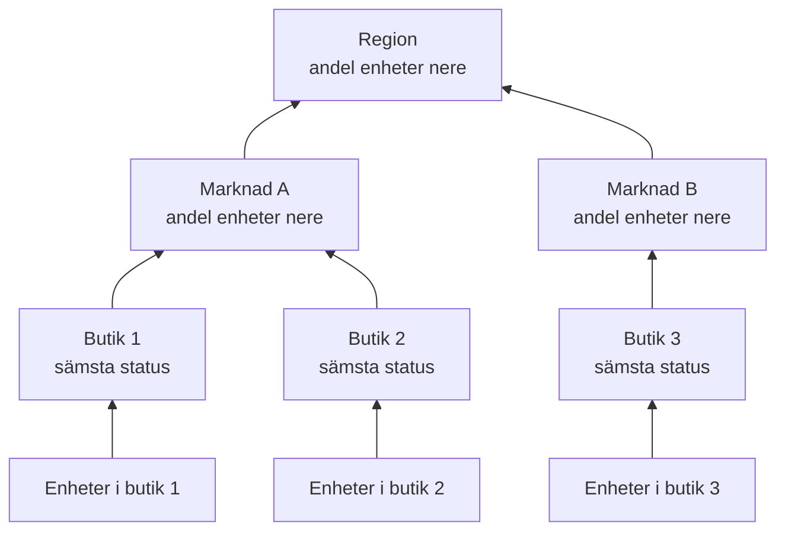

# Nätverksplatser (hälsosammanfattning och upptid)

En nätverksplats är en plats: en region, en marknad, en franchisetagare, ett distributionscenter, en butik. Platser ligger inuti varandra, nätverksenheter kopplas till dem, och OneUptime sammanfattar enheternas hälsa uppåt i trädet, så att en enda status på en region besvarar "är något fel där ute?".

Du hittar dem under **Nätverk → Platser**, och på en karta under **Nätverk → Map**. Den här sidan slår fast hur en plats status räknas fram från det som ligger under den, vad dess upptid betyder och hur schemalagt underhåll ändrar båda.

:::cards
- [Lägg till en plats](#lägg-till-en-plats): Tre steg, eller en CSV-fil för en hel miljö.
- [Ange standardvärden för övervakning](#standardvärden-för-övervakning): En sond och autentiseringsuppgifter för varje enhet på en plats.
- [Välj hur hälsan sammanfattas](#så-beräknas-förälderns-hälsa): Sämsta status för en butik, en andel för en region.
- [Läs upptiden](#upptid): Vad procentsatserna räknar, dag för dag.
:::

## Så fungerar det



Varje plats status kommer från varje enhet i dess underträd, bedömda enligt platsens egen [sammanfattningspolicy](#så-beräknas-förälderns-hälsa). En plats upptid kommer från dess egen statustidslinje, och ett [underhållsfönster](#schemalagt-underhåll-för-nätverksplatser) på en plats tar ut dess enheter ur omröstningen ovanför den.

## Hierarkin

Platser bildar ett träd. Varje plats har en **Site Type** och eventuellt en överordnad plats. Platstyperna är projektets egen lista, under **Nätverk → Inställningar → Site Types**, och ett nytt projekt börjar med Account Type, Region, Franchisee, Market och Unit, i den ordningen uppifrån, plus Data Center och Other. Typerna bildar en egen hierarki (**Parent Site Type**), som avgör vilka platser som kan vara förälder till en plats. En typ som är markerad som **Is Unit Level** är den lägsta nivån i din miljö, den enskilda butiken eller filialen: dess platser innehåller enheter, inte andra platser.

En plats typ, namn, beskrivning, förälder och läge redigeras på ett ställe: kortet **Site Settings** på platsens sida **Inställningar**. Platsens översikt visar dem med en länk **Redigera i Inställningar**, och listan **Platser** lägger till platser men redigerar dem inte.

Varje enhet kopplas till en plats. En plats underträd är platsen själv plus varje plats under den, och underträdets enheter är det som dess hälsa sammanfattas från, så en region utan egna enheter har ändå en status, eftersom enheterna under den har det.

> [!NOTE]
> En sammanfattning räknas om när en enhets status ändras, när en enhet flyttar till en annan plats, när en plats flyttar i trädet, och genom en omgång var femte minut som fångar de fall där bara tidens gång ändrade svaret.

## Lägg till en plats

:::steps
### Börja en ny plats
Gå till **Nätverk → Platser** och klicka på **Lägg till Site**.

### Ange vad platsen är
I steget **Site Details** väljer du **Site Type** (vilken sorts plats det är: en region, en butik, ett datacenter) och skriver ett **Namn**. Beskrivningen, adressen och den latitud och longitud som fäster platsen på kartan är hopfällda under **Fler fält**: fyll i dem nu eller senare.

### Placera den i trädet
I steget **Hierarchy** väljer du **Parent Site** om platsen ligger under en annan. Lämna det tomt för att hålla platsen på översta nivån.

### Ange dess standardvärden
I steget **Monitoring Defaults** väljer du [standardsonden och standardautentiseringsprofilen](#standardvärden-för-övervakning) för enheter som läggs till på platsen, och klickar på **Lägg till Site**.
:::

På en plats egen sida **Child Sites** frågar **Lägg till Underordnad plats** bara efter typen och namnet, på en sida med läget hopfällt, och placerar den nya platsen under den.

### Importera platser från en CSV-fil

För att ta in en hel miljö på en gång öppnar du menyn överst i listan **Platser** och klickar på **Import from CSV**. Filen behöver en rubrikrad; kolumnerna kan komma i valfri ordning och deras namn är inte skiftlägeskänsliga:

```csv title="sites.csv"
name,siteType,parentName,address,latitude,longitude
North,Region,,,,
Leeds,Market,North,,,
Store 0660,Unit,Leeds,"1 High Street, Leeds",53.7997,-1.5492
```

- `name` och `siteType` är obligatoriska. `siteType` måste vara en av projektets platstyper.
- `parentName` namnger den överordnade platsen, som kan finnas i samma fil: rader utan förälder, eller med en förälder som redan finns, går först, sedan deras barn. Lämna det tomt för en plats på översta nivån.
- En rad vars förälder inte kan hittas hoppas över, och resultaten listar den. **Preview Import** visar vad filen kommer att skapa innan något skrivs.

## Kartan

**Nätverk → Map** visar dina platser på en karta, inramad där de än ligger; klicka på en plats för att gå ner i den. En plats med platser under sig visar dem, på kartan och som en graf över länkarna mellan dem. En plats utan platser under sig men med egna enheter, eller en plats vars typ är på enhetsnivå, öppnar de enheternas levande topologi.

Ett projekt som ännu saknar platser har ändå en karta: Map visar i stället dess enheters topologi, och att gruppera enheter i platser placerar dem på kartan efter läge.

## Standardvärden för övervakning

En plats är också där du en gång anger hur enheterna i den övervakas. **Redigera inställningar** på kortet **Site Settings** har ett steg **Monitoring Defaults** med två fält:

| Inställning | Effekt |
| --- | --- |
| **Default Probe** | Sonden som pingar enheter på den här platsen, och walkar dem via SNMP när de har autentiseringsuppgifter. En enhet som skapas på platsen utan egen sond tar den, och det gör även en enhet som flyttas dit utan någon. |
| **Default SNMP Credential Profile** | Den [autentiseringsprofil](/docs/monitor/network-device-monitor#snmp-autentiseringsuppgifter-och-autentiseringsprofiler) som enheter på den här platsen walkas med när varken enheten eller dess egen profil har autentiseringsuppgifter. |

Ange båda på en plats så kan en ny enhet där läggas till med bara sin adress: den pingas från sin första avsökning och walkas från sin första avsökning.

De två beter sig olika, med avsikt:

- Sonden kopieras till enheten när enheten skapas på, eller flyttas till, platsen. Att senare ändra en plats standardsond flyttar inte enheter som redan har en: vilken sond som kan nå en enhet är ett faktum om nätverket, inte en preferens att skriva om i bulk från ett platsformulär.
- Autentiseringsprofilen läses live, vid varje avsökning. Ange en på en plats så börjar varje enhet där utan autentiseringsuppgifter att walkas vid sin nästa avsökning, utan någon redigering per enhet; rensa den så pingas de bara igen.

De når också olika långt ner i trädet:

- Sonden når genom hela trädet. En enhet som hamnar på en plats utan standardsond tar närmaste överordnade plats sond, så en sond som anges på en region täcker varje marknad och enhet under den, och en marknad som anger sin egen åsidosätter den för sitt underträd.
- Autentiseringsprofilen läses bara från enhetens egen plats. En enhet i en Unit tar inte en profil som är angiven på dess Region, så ange den på de platser som enheterna faktiskt är kopplade till.

## Så beräknas förälderns hälsa

Varje plats väljer en av två sammanfattningspolicyer, på kortet **Health Rollup** på dess sida **Inställningar** (**Rollup Policy**).

### Sämsta status för någon enhet (standard)

Den sämsta status som någon enhet i underträdet rapporterar blir platsens status. Hur allvarlig en status är följer av dess prioritet som monitorstatus: ett nytt projekts statusar är Operational (1), Degraded (2) och Offline (3), och högre är värre. En enda offline-enhet gör platsen offline, hur många friska enheter som än står bredvid den.

Det är rätt svar för en Unit. Fyra switchar och en brandvägg i en byggnad är inte oberoende: att en av dem är mörk är ett problem på den adressen, och att räkna medelvärde döljer ett verkligt avbrott.

Det är oftast fel svar för en region över fyrahundra butiker. En mörk switch i butik 12 000 målar hela regionen Offline: sant i snävaste mening och oanvändbart i varje praktisk mening, eftersom regionen då är röd så fort någon butik någonstans har ett problem, och slutar säga något.

### Procent enheter nere

Platsens status avgörs av den andel av underträdets rapporterande enheter som inte har en driftstatus:

| Andel enheter nere | Platsens status |
| --- | --- |
| 0 % | Operational |
| Över 0 %, under tröskelvärdet | Degraded: den projektstatus som varken är i drift eller offline, eller Offline när projektet saknar en sådan |
| Vid eller över tröskelvärdet | Offline |

Tröskelvärdet anges per plats, som **Offline Threshold (%)**, och är 50 som standard.

Inget nere är Operational hur lågt tröskelvärdet än sätts: ett tröskelvärde på 0 betyder "vilken enhet som helst nere gör detta offline", inte "en frisk region är offline".

### Vilka enheter röstar

Båda policyerna är överens här, och det spelar större roll än det låter:

- Arkiverade enheter röstar aldrig. De är avvecklade: de behåller sin plats men hålls utanför.
- Enheter som aldrig har rapporterat något röstar aldrig. En enhet som väntar på sin första avsökning är inget bevis på ett avbrott, så den hålls utanför båda sidorna av andelen, och en region som är halvvägs genom introduktionen bedöms efter den halva som har svarat.
- En sondavsökt enhet, den normala sorten, röstar med utfallet av sin senaste avsökning: nåbar via ping eller SNMP, inte hur länge sedan den senast lyckades. En enhet som svarar på ping medan dess SNMP-walk misslyckas är nåbar och röstar så; platsen säger att den är uppe, och enhetens rad säger **SNMP failing** så att någon rättar autentiseringsuppgifterna.
- En enhet med bunden monitor, en som har bytts till åsidosättningen med bunden monitor på sin sida Inställningar, röstar med statusen för den monitor som är bunden till den, eftersom inget avsöker den. Utan något bundet har den aldrig rapporterat, så den röstar inte alls.

En nätverksenhetsmonitor på en sondavsökt enhet ändrar inte hur enheten röstar. En monitor med ett kriterium "gränssnitt nere, alltså Offline" skulle stämpla Offline på en switch som svarar på varje ping, och en enda mörk port skulle göra en hel plats röd medan varje enhetsrad under den visar Up: platsen skulle säga emot den lista som den sammanfattar. För en avsökt enhet är avsökningen källan till dess hälsa; monitorn finns där för att skapa incidenter.

### Välj en policy

En rimlig start för en franchisemiljö:

| Nivå | Policy | Varför |
| --- | --- | --- |
| Unit eller butik | Sämsta status | En enhet nere är en plats med problem. |
| Marknad | Procent, tröskelvärde runt 50 % | En marknad med hälften av sina butiker nere är nere. |
| Region | Procent, tröskelvärde 25 % till 50 % | Ett fel i en enskild butik gör regionen Degraded, inte Offline, och den blir Offline när något systematiskt händer. |

Policyn anges per plats, så du kan ge regionraderna procentpolicyn och låta allt under dem ha standardpolicyn.

## Upptid

Varje plats har en statustidslinje: en rad per ändring av dess sammanfattade status, öppnad när statusen ändras och stängd när den ändras igen. Upptiden räknas fram från den:

- Tid i en status som inte är markerad som i drift är nertid.
- Överlappande rader slås ihop, så ingen sekund räknas två gånger.
- Tid som inte täcks av någon rad räknas som uppe. Tidslinjen får rader först när en sammanfattning har körts, och avsaknad av bevis är inget avbrott.
- En rad som fortfarande är öppen löper till slutet av det uppmätta fönstret.

Degraded är inte i drift, så det räknas också som nere. Med båda policyerna är alltså en plats upptid den andel av tiden då ingen rapporterande enhet under den var nere: policyn ändrar vilken status ett partiellt avbrott visar, Degraded eller Offline, inte om det räknas.

En plats utan några tidslinjerader alls visar `—` i stället för 100 %: en plats som inget någonsin har sammanfattats för är inte övervakad, inte perfekt.

### Daglig upptid

Bredvid siffran för 30 dagar visar varje plats översikt **Uptime (24h)**, och dess sida **Statustidslinje** visar de senaste 24 timmarna, 7, 30 och 90 dagarna, och en stapel per dag för de senaste 30.

Ett medelvärde över 30 dagar kan inte visa en dålig dag. En hel dags avbrott i ett fönster på 30 dagar kostar 3,3 procentenheter, så en plats som var mörk en hel tisdag rapporterar ändå 96,7 % för månaden, en siffra som ser ut som en avrundning. De dagliga staplarna placerar samma data där en dålig dag är en dålig stapel.

Dagar är glidande skivor på 24 timmar som slutar nu, inte kalenderdagar: enheterna, den som tittar och servern kan var och en befinna sig i olika tidszoner, och det finns ingen "dag" som de skulle vara överens om.

### Förälderns upptid är inte ett medelvärde av barnens upptid

En förälders upptid kommer från förälderns egen tidslinje, som dess sammanfattningspolicy har producerat, inte från medelvärdet av barnens procentsatser.

Ett medelvärde över barn väger en butik med två enheter lika tungt som ett distributionscenter med tvåhundra. En förälders egen tidslinje ger i stället en avläsning som du kan säga i en mening: den andel av tiden då ingenting alls i regionen var nere. Den är sträng med avsikt, så läs den på en stor region tillsammans med de dagliga staplarna, och med statusen, som säger om ett partiellt avbrott var Degraded eller Offline.

## Schemalagt underhåll för nätverksplatser

Koppla platser till ett schemalagt underhåll under **Andra påverkade resurser**, i händelsens steg **Berörda resurser**, som du skulle göra med en värd. En plats egen sida **Schemalagt underhåll** listar de händelser som är kopplade till den, och dess **Skapa schemalagt underhållsevenemang** öppnar formuläret med platsen redan vald.

Ett fönster på en förälder täcker allt under den: ett fönster på en region täcker varje marknad och enhet i den, inklusive platser som skapats efter att fönstret schemalades, så ett regionalt operatörsbyte behöver inte räkna upp fyrahundra butiker.

Täckningen når bara nedåt. Ett fönster på en Unit sätter inte dess region i underhåll: regionen förväntas fortfarande vara uppe, och ett verkligt fel i en annan enhet under samma timmar räknas fortfarande mot den.

### Vad ett underhållsfönster ändrar

| Under fönstret | Vad som händer |
| --- | --- |
| Platsens livestatus | Oförändrad. En enhet som är avstängd för planerat arbete visar fortfarande Offline på kartan och i trädet, med en märkning "Under underhåll" bredvid: den som tittar på den behöver veta att den är avstängd. |
| Platsens upptid | Fönstret tas bort från både nertiden och den uppmätta perioden. Två timmars underhåll gör dagen 22 timmar lång, och inget inom de två timmarna räknas åt något håll. |
| Hälsosammanfattningen för dess överordnade platser | Det underhållna underträdets enheter slutar rösta, så regionen blir inte röd av ett byte som stod i kalendern. |
| Upptiden för dess överordnade platser | Opåverkad, utan något att rätta, eftersom det planerade avbrottet aldrig nådde deras tidslinjer. |

Den sista raden är skälet till att överordnade platser hanteras genom att hålla tillbaka röster i stället för att ta bort fönstret från deras upptid: att ta bort det från regionens period skulle också radera ett verkligt fel någon annanstans i regionen under samma timmar.

Upptiden rättas med händelsens angivna start- och sluttid, inte med när en process flyttade den mellan tillstånd, så siffran kan kontrolleras för hand mot kalendern. En dag som helt faller inom ett fönster ritas som underhåll i de dagliga staplarna i stället för som en perfekt dag, och bidrar inte till medelvärdet.

### Samspel med monitorer

Att koppla en monitor till samma händelse gör fortfarande det det alltid har gjort: den monitorns aktiva övervakning pausas under fönstret. De två är oberoende: koppla platsen för att hålla den utanför sammanfattningen och dess upptid, och koppla monitorerna för att få dem att sluta varna.

## Varningar på en plats

Kortet **Alerting** på en plats sida **Inställningar** har **Alert When Unhealthy**: en varning öppnas när platsens sammanfattning övergår till en status som inte är i drift, och löser sig själv när platsen återhämtar sig. **Varningsallvar** anger dess allvarlighetsgrad; tomt betyder projektets allvarligaste.

Den varnar bara för ändringen: att slå på den för en plats som redan är ohälsosam förbereder nästa ändring i stället för att varna om det förflutna. Degraded är inte i drift, så en plats med procentpolicyn varnar så snart en av dess rapporterande enheter är nere, precis som en plats med policyn för sämsta status; varningen förblir öppen, utan en andra, medan platsen växlar mellan Degraded och Offline, och dess titel namnger den status som platsen nådde först.

## Felsökning

:::details En region är alltid röd
Platsen har policyn för sämsta status, så en enda offline-enhet någonstans under den gör den offline. Byt regionen till **Percentage of devices down** på dess kort **Health Rollup**, med ett tröskelvärde som motsvarar hur mycket av regionen som måste vara nere innan du kallar den nere.
:::

:::details En plats visar — i stället för en upptid
Ingen sammanfattning har någonsin körts för platsen, så den har inga tidslinjerader: den är inte övervakad, inte perfekt. Lägg till enheter på platsen, eller på platserna under den, så startar nästa sammanfattning dess tidslinje.
:::

:::details En enhet räknas inte för sin plats
Arkiverade enheter, och enheter som inte har rapporterat än, röstar aldrig. En enhet med bunden monitor utan någon monitor bunden har inte heller rapporterat. Kontrollera enhetens status: en enhet som står som **Väntar** börjar rösta efter sin första avsökning.
:::

:::details En plats varning utlöstes inte
**Alert When Unhealthy** utlöses vid en övergång från en status i drift till vilken annan som helst, så en plats som redan var ohälsosam när du slog på den varnar vid sin nästa ändring, efter att den har återhämtat sig. Kontrollera också att dess enheter röstar: arkiverade enheter och enheter som väntar på sin första avsökning gör det aldrig, och enheterna på en plats under underhåll röstar inte i sammanfattningarna ovanför den.
:::

## Nästa steg

:::cards
- [Nätverksenhets-övervakning](/docs/monitor/network-device-monitor): Lägg till, avsök och varna för de enheter som kopplas till de här platserna.
- [Nätverkstrafik](/docs/monitor/network-traffic): Se en plats trafik utifrån dess enheters flödesposter.
- [Inventarium](/docs/inventory/overview): Nätverksenheter bredvid alla dina andra tillgångar.
:::
