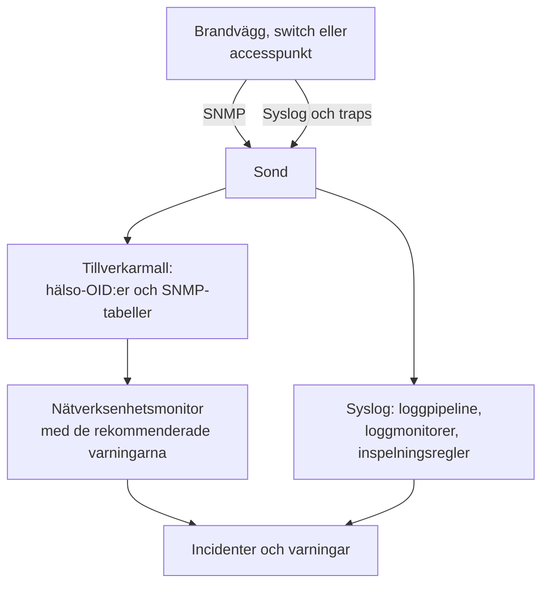

# Guider per nätverksleverantör (Sophos, Extreme, Cambium)

Så övervakar du tre vanliga miljöer från början till slut med OneUptime: en Sophos Firewall (XGS, SFOS) med dess IPsec-tunnlar, WAN-länkar och SD-WAN; Extreme Networks-switchar (EXOS / Switch Engine och Fabric Engine / VOSS) med deras fabric; och Cambium Networks cnMatrix-switchar och Enterprise Wi-Fi-accesspunkter, ända ner till varje radios kanal och sändeffekt.

:::cards
- [Sophos Firewall](#sophos-firewall-xgs-sfos): Tunnlar, WAN-länkar, gateways och SD-WAN.
- [Extreme Networks](#extreme-networks-exos-switch-engine-och-fabric-engine-voss): Switchar, fabricen och dess hårdvara.
- [Cambium Networks](#cambium-networks-enterprise-wi-fi-och-cnmatrix): Accesspunkter ner till varje radio, och cnMatrix-switchar.
:::

## Så fungerar det

Varje guide använder samma delar:

- En [nätverksenhet](/docs/monitor/network-device-monitor) per låda, avsökt av en sond som kan nå den, med en tillverkarmall som tar med rätt hälso-OID:er och [SNMP-tabeller](/docs/monitor/network-device-monitor#snmp-tabeller).
- En nätverksenhetsmonitor per enhet för varningar. Skapa den från enhetens sida så att de [rekommenderade varningarna](/docs/monitor/network-device-monitor#rekommenderat-varningspaket), inklusive en varning per rad för varje tabell som vet hur friskt ser ut, fylls i åt dig. För en flotta håller en [varningspolicy](/docs/monitor/network-device-monitor#varningspolicyer) en på varje enhet.
- För det som en tillverkare bara rapporterar i sina loggar: syslog till sonden, en [loggpipeline](/docs/telemetry/log-pipelines) för att göra varje rad till attribut, [loggmonitorer med Group By](/docs/monitor/logs-monitor#varningar-per-grupp-group-by) för att varna en gång per tunnel eller gateway, och [inspelningsregler för loggar](/docs/telemetry/log-recording-rules) för att visa siffrorna i de loggarna i diagram.

## Sophos Firewall (XGS / SFOS)

| Vad du vill se | Var det kommer ifrån |
| --- | --- |
| Brandväggens hälsa: minne, disk, swap, HA-tillstånd, IPsec-tjänst, CPU per kärna | SNMP, med tillverkarmallen **Sophos Firewall (SFOS / XGS)** |
| Varje IPsec-tunnels status, efter namn | SNMP-tabellen `ipsec_tunnels` (SFOS v20 och senare) |
| Varje WAN-länks status, genomströmning, utnyttjande och fel | Gränssnittswalken av WAN-portarna |
| Varje WAN-länks latens, paketförlust och jitter | Ping-monitorer och enhetsavsökningar från OneUptime-sonder |
| Gateway uppe och nere, SD-WAN-SLA uppfyllt eller inte, ändringar av SD-WAN-rutter | Brandväggens syslog |
| SD-WAN-latens, -jitter och -paketförlust per gateway, som diagram | Inspelningsregler för loggar över SD-WAN:s SLA-loggar |

Sophos rapporterar inte gatewayernas eller SD-WAN:s hälsa via SNMP, i någon SFOS-version: den finns bara i brandväggens loggar och i Sophos Centrals varningar, och därför går de tre sista raderna via syslog.

### Registrera brandväggen

:::steps
1. Slå på SNMP på brandväggen under **Administration → SNMP**: lägg till en SNMPv3-användare, eller en v2c-community, och tillåt sondens adress att fråga den.
2. Gå i OneUptime till **Nätverk → Devices** och klicka på **Add Device**. Skriv brandväggens hanteringsadress, välj en sond som kan nå den och lägg till SNMP-autentiseringsuppgifterna under **SNMP**.
3. På enhetens sida **Inställningar**, under **Polling & Data Collection**, tillämpar du mallen **Sophos Firewall (SFOS / XGS)** från **Vendor Health Template** och lägger till dess tabeller från **Add a Vendor's Tables**. Eller slå på **Auto-Apply Vendor Health Template**, så gör den första avsökningen båda.
:::

Efter nästa avsökning listar enhetens sida **SNMP Tables** varje IPsec-anslutning med dess status (active, inactive, partially active), och CPU-kärnorna. SFOS numrerar sina kärnor från 196608, och därför kommer CPU:n från en tabell i stället för från en enda `hrProcessorLoad.1`.

### Varna för varje IPsec-tunnel

Klicka på **Skapa monitor** på enhetens sida. De rekommenderade varningarna innefattar **IPsec Tunnels: row unhealthy**, ett kriterium **SNMP Table Row Is Unhealthy** på tabellen `ipsec_tunnels` med Row `*`: det skapar en incident per tunnel som inte är aktiv, namngiven efter tunneln, och löser var och en när dess tunnel kommer tillbaka.

En tunnel som Sophos rapporterar som aktiv har bara sina security associations uppe. För att bevisa att trafik går genom den lägger du till en [Ping-monitor](/docs/monitor/ping-monitor) från en sond på en plats till en värd på andra sidan av varje tunnel, och ritar tunneln som en platslänk under **Nätverk → Topologi → Site Links** mellan de två [platserna](/docs/monitor/network-sites), bunden till den monitorn: länken på kartan får då monitorns färg.

### WAN-länkar

- **Portarnas hälsa.** Gränssnittswalken mäter redan varje WAN-ports status, bitar in och ut, utnyttjande och fel. På brandväggens monitor varnar ett kriterium **SNMP Interface Is Down** eller **SNMP Interface Utilization (in %)** med **Gränssnitt** satt till WAN-portens namn, eller `*` för varje port, per länk.
- **Vägens kvalitet.** Varje länks latens, paketförlust och jitter mäts utanför brandväggen: en Ping-monitor från OneUptimes molnsonder till varje WAN-länks publika adress, och en Ping-monitor från en sond på platsen till varje leverantörs gateway. Kriterier för paketförlust och jitter på de monitorerna varnar per länk, och **Nätverk → Topologi → Latency Matrix** visar varje sond mot varje monitor i en överblick.
- **Trafik.** SFOS exporterar NetFlow v5. Skicka det till sonden på UDP 2055, där sondens flödesinsamlare lyssnar som standard, så visar enhetens sida **Traffic** vem som pratar med vem över varje WAN-länk; [Nätverkstrafik](/docs/monitor/network-traffic) har detaljerna.

### Gateways och SD-WAN från syslog

:::steps
1. Slå på sondens syslog-mottagare: sätt `PROBE_SYSLOG_RECEIVER_ENABLED=true` på sonden. Den lyssnar på UDP 5140 som standard (`PROBE_SYSLOG_RECEIVER_PORT` ändrar det); publicera porten om sonden körs i Docker. Meddelanden matchas mot den nätverksenhet vars värdnamn, eller någon av vars **Övriga adresser**, är avsändarens adress, och visas på enhetens sida **Loggar**.
2. Lägg på brandväggen, under **System services → Log settings**, till en syslog-server som pekar på sonden och den porten, och kryssa i loggtyperna **Event** för IPsec och gateways och loggtypen **SD-WAN**: SLA-loggarna förblir avstängda tills den är ikryssad.
3. Skapa under **Loggar → Inställningar → Pipelines** en pipeline vars filter matchar brandväggens loggar, till exempel `attributes.networkDevice.name = 'hq-firewall'`, och lägg till en **Key=Value Parser** med **Target Prefix** `sophos`. Klistra in en rad från brandväggen i dess testare för att se exakt vilka attributnamn din SFOS-version producerar; [Sophos-exemplet](/docs/telemetry/log-pipelines#exempel-sophos-xgs-brandvägg) går igenom det.
4. Skapa [loggmonitorer](/docs/monitor/logs-monitor) på brandväggens loggar, var och en med **Group by Attributes** så att varje tunnel eller gateway varnar för sig, och kriteriet **Log Count** **Greater Than** `0` över några minuter. Raderna nedan är de tre att börja med.
5. Visa SD-WAN-kvaliteten i diagram: med SD-WAN-loggning påslagen skriver brandväggen en SLA-sammanfattning per profil och gateway (`latency`, `jitter`, `packet_loss`). Skapa under **Loggar → Inställningar → Inspelningsregler** en regel per siffra, till exempel medelvärdet av `sophos.latency` grupperat efter `sophos.gw_name` och `sophos.profile_name`, och visa sedan resultaten i diagram, eller varna för dem med en [mätvärdesmonitor](/docs/monitor/metrics-monitor) som grupperar efter gateway. [Inspelningsregler för loggar](/docs/telemetry/log-recording-rules) går igenom det här exemplet.
:::

| Varning | Loggar att räkna | Gruppera efter |
| --- | --- | --- |
| IPsec-tunnel avslutad | Attribut `sophos.log_component` = `IPSec`, brödtexten innehåller `terminated` | `sophos.con_name` |
| Gateway nere | Attribut `sophos.log_component` = `Gateway`, brödtexten innehåller `is Down` | `sophos.gatewayname` |
| SD-WAN-SLA inte uppfyllt | Attribut `sophos.log_type` = `SD-WAN`, brödtexten innehåller `SLA not met` | `sophos.gw_name` |

Syslog-händelserna kompletterar SNMP-tabellen: de kommer i samma ögonblick som en tunnel faller, medan tabellen också fångar en tunnel som aldrig kom upp.

### Traps

Varje avisering från Sophos är samma trap, `sfosNotification` (`1.3.6.1.4.1.2604.5.1.8.1.1`), med händelsen som text i `sfosTrapMessage` (`1.3.6.1.4.1.2604.5.1.8.1.2`). För att varna för en sorts händelse kombinerar du **SNMP Trap Received (Trap OID)** Equal To `1.3.6.1.4.1.2604.5.1.8.1.1` med **SNMP Trap Varbind Value** på den varbinden, Contains `IPSec` till exempel. Sätt brandväggens trapdestination till SNMP v2c: sondens trapmottagare tar emot v1- och v2c-traps.

## Extreme Networks (EXOS / Switch Engine och Fabric Engine / VOSS)

| Vad du vill se | Var det kommer ifrån |
| --- | --- |
| EXOS: CPU, temperatur och dess larm, strömtillstånd, nätaggregat, fläktar, minne per kortplats, stackmedlemmar | Mallen **Extreme Networks EXOS / Switch Engine** |
| Fabric Engine: CPU och minne per kortplats, temperatursensorer, fläktar, nätaggregat, vIST-session, antal I-SID:er | Mallen **Extreme Networks Fabric Engine / VOSS** |
| Varje Fabric Connect-adjacency (IS-IS), namngiven efter grannen | Fabric Engine-mallens tabell `isis_adjacencies` |
| Portar, LLDP-grannar, nätverkskartan | Gränssnittswalken, på båda |

### Vilken mall

Fabric Engine på Extremes universella hårdvara (5000- och 7000-serierna) rapporterar samma enterprisenummer som EXOS: bara dess systembeskrivning (`7520-48Y-8C-FabricEngine (9.0.4.0)`) säger vilket operativsystem som körs. OneUptime läser båda, så automatisk tillämpning och enhetssidans förslag väljer rätt mall, och äldre VSP-switchar rapporterar Avaya/Nortel-grenen och känns igen direkt som Fabric Engine.

### Varningar för fabric och hårdvara

De rekommenderade varningarna på en Fabric Engine-switch innefattar **Fabric Adjacencies (IS-IS): row unhealthy**, en incident per granne vars adjacency inte är uppe. Fabric Engine skickar också en trap när en adjacency ändras, `rcnIsisPlsbAdjStateTrap` (`1.3.6.1.4.1.2272.1.21.0.281`), och ett kriterium **SNMP Trap Received (Trap OID)** på den varnar inom sekunder, före nästa avsökning.

Nätaggregat, fläktar, temperatursensorer och stackmedlemmar är tabeller som anger sina friska värden, så var och en får en varning per rad i de rekommenderade varningarna.

### Flöden och Wi-Fi

EXOS och Fabric Engine exporterar flöden som sFlow och IPFIX. Skicka sFlow till sonden på UDP 6343, eller IPFIX på UDP 4739, så visar enhetens sida **Traffic** dess trafik; se [Nätverkstrafik](/docs/monitor/network-traffic).

IQ Engine-accesspunkter (HiveOS) och ExtremeCloud IQ Controller har egna tillverkarmallar, som fyller enhetens sida **Wi-Fi**. [Wi-Fi-tillverkare som stöds](/docs/monitor/network-device-monitor#wi-fi-tillverkare-som-stöds) tar upp dem, tillsammans med Ubiquiti UniFi, HPE Aruba, TP-Link Omada och Juniper Mist.

## Cambium Networks (Enterprise Wi-Fi och cnMatrix)

### Accesspunkter

:::steps
1. Slå på SNMP på accesspunkterna. I cnMaestro ställs SNMP in per AP-grupp: **Configuration → Wi-Fi Profiles → AP Groups → Management → SNMP**. Slå på det med en v2c-läscommunity eller en SNMPv3-användare.
2. Lägg till varje accesspunkt med dess hanteringsadress och de autentiseringsuppgifterna, och tillämpa mallen **Cambium Networks Enterprise Wi-Fi (cnPilot, XV, XE, XH)**, eller slå på automatisk tillämpning.
3. Öppna enhetens sida **Wi-Fi**. Den visar hur många radior som är påslagna, klienterna och SSID:erna, därefter varje radios band, kanal, frekvens, kanalbredd, sändeffekt, klienter, brusgolv och airtime, och varje SSID med dess klienter. Frekvensen beräknas från bandet och kanalen; accesspunkten rapporterar den inte.
:::

Användbara varningar, alla på tabellen `wifi_radios` med Row `*`, så att varje radio varnar för sig:

| Varning | Kriterium |
| --- | --- |
| En radio avstängd | **SNMP Table Row Is Unhealthy**, en del av de rekommenderade varningarna |
| Sändeffekten ändrad | **SNMP Table Value**, kolumnen TX Power, Not Equal To din planerade effekt |
| En överbelastad radio | **SNMP Table Value**, kolumnen Clients, Greater Than din gräns |
| En brusig kanal | **SNMP Table Value**, kolumnen Noise Floor, Greater Than `-80` |

Varje numeriskt radiovärde är också ett mätvärde (`oneuptime.monitor.snmp.table.value`, en serie per radio och kolumn), så kanal, effekt och klienter kan visas i diagram över tid på en instrumentpanel; en kanal som hela tiden byts är DFS i arbete.

Cambium rapporterar det totala antalet klienter först från firmware 6.5.3; äldre firmware returnerar 0.

### cnMatrix-switchar

Mallen **Cambium Networks cnMatrix** samlar in CPU, RAM, flash, temperatur och matningsspänning, och som tabeller fläktarna, det redundanta nätaggregatet och varje ports PoE-förbrukning. Portar och LLDP-grannar kommer från gränssnittswalken, som på vilken switch som helst.

### cnMaestro-larm

cnMaestro kan skicka sina larm, som en accesspunkt som går offline, till en HTTPS-webhook. Peka den mot en [monitor för inkommande förfrågningar](/docs/monitor/incoming-request-monitor) för att göra de larmen till OneUptime-incidenter bredvid SNMP-datan.

## Felsökning

:::details Tabellen IPsec Tunnels har ingen status
Tunnelstatus kräver SFOS v20 eller senare. Kontrollera också att SNMP-vyn för dina autentiseringsuppgifter innefattar Sophos enterprise-träd (`1.3.6.1.4.1.2604`): en begränsad v3-användare ser ofta bara systemgruppen och IF-MIB.
:::

:::details Ingen syslog kommer från brandväggen
Sondens syslog-mottagare är avstängd som standard: sätt `PROBE_SYSLOG_RECEIVER_ENABLED=true` och publicera UDP 5140, eller din `PROBE_SYSLOG_RECEIVER_PORT`, till sonden. Meddelanden matchas mot en enhet efter avsändarens adress, så brandväggens värdnamn i OneUptime, eller någon av dess **Övriga adresser**, måste vara den adress som den skickar syslog från.
:::

:::details En Fabric Engine-switch fick EXOS-mallen
Mallen väljs utifrån switchens systembeskrivning. Kontrollera att enhetens översikt visar en beskrivning som nämner Fabric Engine (till exempel `7520-48Y-8C-FabricEngine (9.0.4.0)`); om den gör det, ta bort EXOS-OID:erna och -tabellerna och tillämpa **Extreme Networks Fabric Engine / VOSS** från **Vendor Health Template**.
:::

:::details Cambium-accesspunkter rapporterar 0 klienter
Det totala antalet klienter kräver firmware 6.5.3 eller senare. På äldre firmware rapporterar radiorna ändå sin kanal, effekt och sitt brusgolv.
:::

## Nästa steg

:::cards
- [Nätverksenhets-övervakning](/docs/monitor/network-device-monitor): Allt som en enhet samlar in, och varje kriterium som den kan varna för.
- [Loggpipelines](/docs/telemetry/log-pipelines): Dela upp brandväggsloggar i attribut.
- [Loggövervakning](/docs/monitor/logs-monitor): Varna en gång per tunnel eller gateway.
:::
