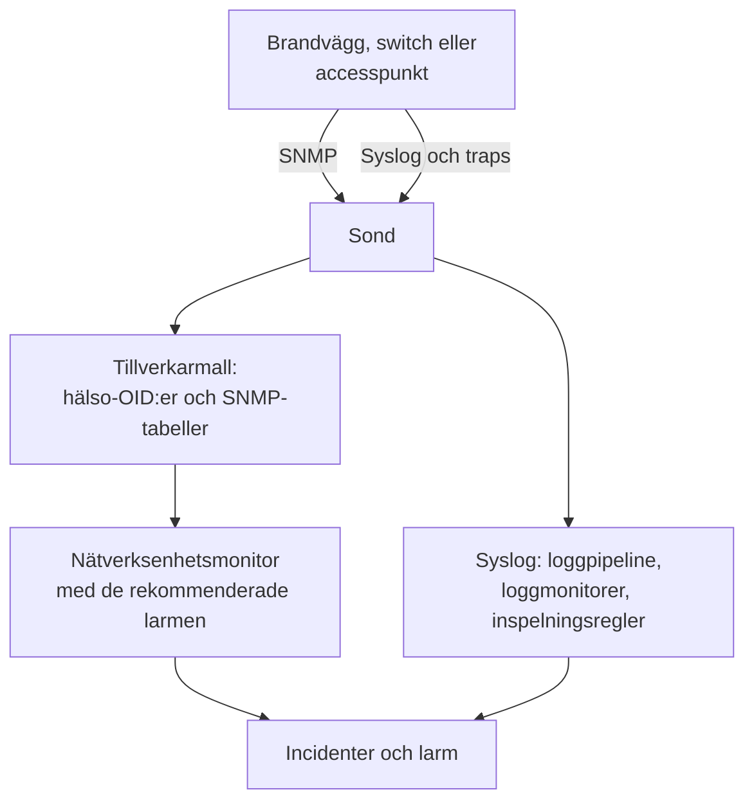

# Guider per nätverksleverantör (Sophos, Extreme, Cambium)

Så övervakar du tre vanliga miljöer från början till slut med OneUptime: en Sophos Firewall (XGS, SFOS) med dess IPsec-tunnlar, WAN-länkar och SD-WAN; Extreme Networks-switchar (EXOS / Switch Engine och Fabric Engine / VOSS) med deras fabric; och Cambium Networks cnMatrix-switchar och Enterprise Wi-Fi-accesspunkter, ända ner till varje radios kanal och sändeffekt. De täcker också SAN-switchar, Brocade Fabric OS och Cisco MDS 9000, ända ner till felen på varje Fibre Channel-port.

:::cards
- [Sophos Firewall](#sophos-firewall-xgs-sfos): Tunnlar, WAN-länkar, gateways och SD-WAN.
- [Extreme Networks](#extreme-networks-exos-switch-engine-och-fabric-engine-voss): Switchar, fabricen och dess hårdvara.
- [Cambium Networks](#cambium-networks-enterprise-wi-fi-och-cnmatrix): Accesspunkter ner till varje radio, och cnMatrix-switchar.
- [Brocade Fabric OS](#brocade-fabric-os): Fibre Channel-portar, optik, sensorer och fabric-händelser.
- [Cisco MDS 9000](#cisco-mds-9000): Fibre Channel-gränssnitt, VSAN:er, slow drain och port-monitor-larm.
:::

## Så fungerar det

Varje guide använder samma delar:



- En [nätverksenhet](/docs/monitor/network-device-monitor) per låda, avsökt av en sond som kan nå den, med en tillverkarmall som tar med rätt hälso-OID:er och [SNMP-tabeller](/docs/monitor/network-device-monitor#snmp-tabeller).
- En nätverksenhetsmonitor per enhet för larm. Skapa den från enhetens sida så att de [rekommenderade larmen](/docs/monitor/network-device-monitor#rekommenderat-larmpaket), inklusive ett larm per rad för varje tabell som vet hur friskt ser ut, fylls i åt dig. För en flotta håller en [larmpolicy](/docs/monitor/network-device-monitor#larmpolicyer) en på varje enhet.
- För det som en tillverkare bara rapporterar i sina loggar: syslog till sonden, som OneUptime själv läser som [nätverkshändelser](/docs/monitor/network-events), [loggmonitorer med Group By](/docs/monitor/logs-monitor#larm-per-grupp-group-by) för att varna en gång per tunnel eller gateway, och [inspelningsregler för loggar](/docs/telemetry/log-recording-rules) för att visa siffrorna i de loggarna i diagram.

## Sophos Firewall (XGS / SFOS)

| Vad du vill se | Var det kommer ifrån |
| --- | --- |
| Brandväggens hälsa: minne, disk, swap, HA-tillstånd, IPsec-tjänst, CPU per kärna | SNMP, med tillverkarmallen **Sophos Firewall (SFOS / XGS)** |
| Varje IPsec-tunnels status, efter namn | SNMP-tabellen `ipsec_tunnels` (SFOS v20 och senare) |
| Varje WAN-länks status, genomströmning, utnyttjande och fel | Gränssnittswalken av WAN-portarna |
| Varje WAN-länks latens, paketförlust och jitter | Ping-monitorer och enhetsavsökningar från OneUptime-sonder |
| Gateway uppe och nere, SD-WAN-SLA uppfyllt eller inte, ändringar av SD-WAN-rutter | Brandväggens syslog |
| SD-WAN-latens, -jitter och -paketförlust per gateway, som diagram | Inspelningsregler för loggar över SD-WAN:s SLA-loggar |

Sophos rapporterar inte gatewayernas eller SD-WAN:s hälsa via SNMP, i någon SFOS-version: den finns bara i brandväggens loggar och i Sophos Centrals larm, och därför går de tre sista raderna via syslog.

### Registrera brandväggen

:::steps
1. Slå på SNMP på brandväggen under **Administration → SNMP**: lägg till en SNMPv3-användare, eller en v2c-community, och tillåt sondens adress att fråga den.
2. Gå i OneUptime till **Nätverk → Enheter** och klicka på **Lägg till enhet**. Skriv brandväggens hanteringsadress, välj en sond som kan nå den och lägg till SNMP-autentiseringsuppgifterna under **SNMP**.
3. På enhetens sida **Inställningar**, under **Polling & Data Collection**, tillämpar du mallen **Sophos Firewall (SFOS / XGS)** från **Vendor Health Template** och lägger till dess tabeller från **Add a Vendor's Tables**. Eller slå på **Auto-Apply Vendor Health Template**, så gör den första avsökningen båda.
:::

Efter nästa avsökning listar enhetens sida **SNMP-tabeller** varje IPsec-anslutning med dess status (active, inactive, partially active), och CPU-kärnorna. SFOS numrerar sina kärnor från 196608, och därför kommer CPU:n från en tabell i stället för från en enda `hrProcessorLoad.1`.

### Varna för varje IPsec-tunnel

Klicka på **Skapa monitor** på enhetens sida. De rekommenderade larmen innefattar **IPsec Tunnels: row unhealthy**, ett kriterium **SNMP-tabellrad är ej felfri** på tabellen `ipsec_tunnels` med Row `*`: det skapar en incident per tunnel som inte är aktiv, namngiven efter tunneln, och löser var och en när dess tunnel kommer tillbaka.

En tunnel som Sophos rapporterar som aktiv har bara sina security associations uppe. För att bevisa att trafik går genom den lägger du till en [Ping-monitor](/docs/monitor/ping-monitor) från en sond på en plats till en värd på andra sidan av varje tunnel, och ritar tunneln som en platslänk under **Nätverk → Topologi → Platslänkar** mellan de två [platserna](/docs/monitor/network-sites), bunden till den monitorn: länken på kartan får då monitorns färg.

### WAN-länkar

- **Portarnas hälsa.** Gränssnittswalken mäter redan varje WAN-ports status, bitar in och ut, utnyttjande och fel. På brandväggens monitor varnar ett kriterium **SNMP-gränssnitt är nere** eller **SNMP-gränssnittsanvändning (i %)** med **Gränssnitt** satt till WAN-portens namn, eller `*` för varje port, per länk.
- **Vägens kvalitet.** Varje länks latens, paketförlust och jitter mäts utanför brandväggen: en Ping-monitor från OneUptimes molnsonder till varje WAN-länks publika adress, och en Ping-monitor från en sond på platsen till varje leverantörs gateway. Kriterier för paketförlust och jitter på de monitorerna varnar per länk, och **Nätverk → Topologi → Latensmatris** visar varje sond mot varje monitor i en överblick.
- **Trafik.** SFOS exporterar NetFlow v5. Skicka det till sonden på UDP 2055, där sondens flödesinsamlare lyssnar som standard, så visar enhetens sida **Trafik** vem som pratar med vem över varje WAN-länk; [Nätverkstrafik](/docs/monitor/network-traffic) har detaljerna.

### Gateways och SD-WAN från syslog

:::steps
1. Sondens syslog-mottagare är påslagen som standard. Den lyssnar på port 5140, över UDP och TCP (`PROBE_SYSLOG_RECEIVER_PORT` ändrar det); publicera porten om sonden körs i Docker. Meddelanden matchas mot den nätverksenhet vars värdnamn, eller någon av vars **Övriga adresser**, är avsändarens adress, och visas på enhetens sidor **Händelser** och **Loggar**.
2. Lägg på brandväggen, under **System services → Log settings**, till en syslog-server som pekar på sonden och den porten, och kryssa i loggtyperna **Event** för IPsec och gateways och loggtypen **SD-WAN**: SLA-loggarna förblir avstängda tills den är ikryssad.
3. Det finns inget att tolka. OneUptime läser brandväggens `key=value`-fält som `sophos.*`-attribut, och läser tunnlar, gatewayer, SD-WAN-SLA-ändringar, failover och inloggningar ur dem som [nätverkshändelser](/docs/monitor/network-events). Öppna en logg på enhetens sida **Loggar** för att se exakt vilka attributnamn din SFOS-version producerar.
4. Klicka på **Skapa larm** på enhetens sida **Händelser** och välj ett larm. Den öppnar en ifylld [loggmonitor](/docs/monitor/logs-monitor), med **Gruppera efter attribut** så att varje tunnel eller gateway varnar för sig, och **Löst av attribut** så att varje larm stängs när brandväggen rapporterar att den är tillbaka. Raderna nedan är de tre att börja med.
5. Visa SD-WAN-kvaliteten i diagram: med SD-WAN-loggning påslagen skriver brandväggen en SLA-sammanfattning per profil och gateway (`latency`, `jitter`, `packet_loss`). Skapa under **Loggar → Inställningar → Inspelningsregler** en regel per siffra, till exempel medelvärdet av `sophos.latency` grupperat efter `sophos.gw_name` och `sophos.profile_name`, och visa sedan resultaten i diagram, eller varna för dem med en [mätvärdesmonitor](/docs/monitor/metrics-monitor) som grupperar efter gateway. [Inspelningsregler för loggar](/docs/telemetry/log-recording-rules) går igenom det här exemplet.
:::

| Larm | Händelse som räknas | Ett larm per | Stängs av |
| --- | --- | --- | --- |
| En VPN-tunnel går ner | `vpn.tunnel_down` | `vpn.tunnel.name` | `vpn.tunnel_up` |
| En WAN-länk går ner | `gateway.down` | `network.gateway.name` | `gateway.up` |
| SD-WAN-länk under sitt SLA | `sdwan.sla_not_met` | `network.gateway.name` | `sdwan.sla_met` |

De två första finns på listan under **Skapa larm**; för den tredje öppnar du en av dess händelser och klickar på **Skapa larm för den här händelsen**. Syslog-händelserna kompletterar SNMP-tabellen: de kommer i samma ögonblick som en tunnel faller, medan tabellen också fångar en tunnel som aldrig kom upp.

### Traps

Varje avisering från Sophos är samma trap, `sfosNotification` (`1.3.6.1.4.1.2604.5.1.8.1.1`), med händelsen som text i `sfosTrapMessage` (`1.3.6.1.4.1.2604.5.1.8.1.2`). För att varna för en sorts händelse kombinerar du **SNMP-trap mottagen (trap-OID)** Lika med `1.3.6.1.4.1.2604.5.1.8.1.1` med **Varbind-värde i SNMP-trap** på den varbinden, Innehåller `IPSec` till exempel. Sätt brandväggens trapdestination till SNMP v2c: sondens trapmottagare tar emot v1- och v2c-traps.

## Extreme Networks (EXOS / Switch Engine och Fabric Engine / VOSS)

| Vad du vill se | Var det kommer ifrån |
| --- | --- |
| EXOS: CPU, temperatur och dess larm, strömtillstånd, nätaggregat, fläktar, minne per kortplats, stackmedlemmar | Mallen **Extreme Networks EXOS / Switch Engine** |
| Fabric Engine: CPU och minne per kortplats, temperatursensorer, fläktar, nätaggregat, vIST-session, antal I-SID:er | Mallen **Extreme Networks Fabric Engine / VOSS** |
| Varje Fabric Connect-adjacency (IS-IS), namngiven efter grannen | Fabric Engine-mallens tabell `isis_adjacencies` |
| Portar, LLDP-grannar, nätverkskartan | Gränssnittswalken, på båda |

### Vilken mall

Fabric Engine på Extremes universella hårdvara (5000- och 7000-serierna) rapporterar samma enterprisenummer som EXOS: bara dess systembeskrivning (`7520-48Y-8C-FabricEngine (9.0.4.0)`) säger vilket operativsystem som körs. OneUptime läser båda, så automatisk tillämpning och enhetssidans förslag väljer rätt mall, och äldre VSP-switchar rapporterar Avaya/Nortel-grenen och känns igen direkt som Fabric Engine.

### Larm för fabric och hårdvara

De rekommenderade larmen på en Fabric Engine-switch innefattar **Fabric Adjacencies (IS-IS): row unhealthy**, en incident per granne vars adjacency inte är uppe. Fabric Engine skickar också en trap när en adjacency ändras, `rcnIsisPlsbAdjStateTrap` (`1.3.6.1.4.1.2272.1.21.0.281`), och ett kriterium **SNMP-trap mottagen (trap-OID)** på den varnar inom sekunder, före nästa avsökning.

Nätaggregat, fläktar, temperatursensorer och stackmedlemmar är tabeller som anger sina friska värden, så var och en får ett larm per rad i de rekommenderade larmen.

### Flöden och Wi-Fi

EXOS och Fabric Engine exporterar flöden som sFlow och IPFIX. Skicka sFlow till sonden på UDP 6343, eller IPFIX på UDP 4739, så visar enhetens sida **Trafik** dess trafik; se [Nätverkstrafik](/docs/monitor/network-traffic).

IQ Engine-accesspunkter (HiveOS) och ExtremeCloud IQ Controller har egna tillverkarmallar, som fyller enhetens sida **Wi-Fi**. [Wi-Fi-tillverkare som stöds](/docs/monitor/network-device-monitor#wi-fi-tillverkare-som-stöds) tar upp dem, tillsammans med Ubiquiti UniFi, HPE Aruba, TP-Link Omada och Juniper Mist.

## Cambium Networks (Enterprise Wi-Fi och cnMatrix)

### Accesspunkter

:::steps
1. Slå på SNMP på accesspunkterna. I cnMaestro ställs SNMP in per AP-grupp: **Configuration → Wi-Fi Profiles → AP Groups → Management → SNMP**. Slå på det med en v2c-läscommunity eller en SNMPv3-användare.
2. Lägg till varje accesspunkt med dess hanteringsadress och de autentiseringsuppgifterna, och tillämpa mallen **Cambium Networks Enterprise Wi-Fi (cnPilot, XV, XE, XH)**, eller slå på automatisk tillämpning.
3. Öppna enhetens sida **Wi-Fi**. Den visar hur många radior som är påslagna, klienterna och SSID:erna, därefter varje radios band, kanal, frekvens, kanalbredd, sändeffekt, klienter, brusgolv och airtime, och varje SSID med dess klienter. Frekvensen beräknas från bandet och kanalen; accesspunkten rapporterar den inte.
:::

Användbara larm, alla på tabellen `wifi_radios` med Row `*`, så att varje radio varnar för sig:

| Larm | Kriterium |
| --- | --- |
| En radio avstängd | **SNMP-tabellrad är ej felfri**, en del av de rekommenderade larmen |
| Sändeffekten ändrad | **SNMP-tabellvärde**, kolumnen TX Power, Inte lika med din planerade effekt |
| En överbelastad radio | **SNMP-tabellvärde**, kolumnen Clients, Större än din gräns |
| En brusig kanal | **SNMP-tabellvärde**, kolumnen Noise Floor, Större än `-80` |

Varje numeriskt radiovärde är också ett mätvärde (`oneuptime.monitor.snmp.table.value`, en serie per radio och kolumn), så kanal, effekt och klienter kan visas i diagram över tid på en instrumentpanel; en kanal som hela tiden byts är DFS i arbete.

Cambium rapporterar det totala antalet klienter först från firmware 6.5.3; äldre firmware returnerar 0.

### cnMatrix-switchar

Mallen **Cambium Networks cnMatrix** samlar in CPU, RAM, flash, temperatur och matningsspänning, och som tabeller fläktarna, det redundanta nätaggregatet och varje ports PoE-förbrukning. Portar och LLDP-grannar kommer från gränssnittswalken, som på vilken switch som helst.

### cnMaestro-larm

cnMaestro kan skicka sina larm, som en accesspunkt som går offline, till en HTTPS-webhook. Peka den mot en [monitor för inkommande förfrågningar](/docs/monitor/incoming-request-monitor) för att göra de larmen till OneUptime-incidenter bredvid SNMP-datan.

## Brocade Fabric OS

| Vad du vill se | Var det kommer ifrån |
| --- | --- |
| Switchens tillstånd, firmware, CPU och minne | SNMP, med leverantörsmallen **Brocade Fabric OS (SAN switches)** |
| Switchens status, dess sensorer och dess utbytbara enheter (FRU:er), rad för rad | Mallens tabeller `switch_status`, `sensors` och `frus` |
| Varje Fibre Channel-ports typ, varför en nere port är nere, och dess fel, kasserade ramar och kreditväntetider per sekund | SW-MIB och FCMGMT-MIB, på enhetens sida **Gränssnitt** |
| Varje optiks mottagna och sända effekt, temperatur, spänning och biasström | FA-EXT-MIB, på kortet **Transceivrar** |
| En nere länk mellan switchar, en delad eller omkonfigurerad fabric, en zoning-ändring, ett MAPS-larm, en ändrad FRU | SNMPv3-traps |

Varje switch och director med Fabric OS rapporterar ett systemobjekt-ID under `1.3.6.1.4.1.1588.2.1.1`, så mallen gäller för alla och för inget annat från Brocade: VDX- och SLX-switchar behåller sin mall.

### Konfigurera SNMP på Fabric OS

:::steps
1. Lägg till en SNMPv3-användare med autentisering och kryptering, SHA och AES: `snmpconfig --set snmpv3` frågar efter användaren, dess protokoll och dess lösenfraser.
2. Slå på FA-MIB med `snmpconfig --set mibCapability`. Den innehåller varje ports 64-bitars felräknare och dess optik; utan den rapporterar en port bara sina CRC-fel, kodningsfel, kasserade klass 3-ramar och kreditväntetider, som 32-bitars räknare.
3. Lägg till switchen i OneUptime med dess hanteringsadress och den användaren. Med **Auto-Apply Vendor Health Template** på tillämpar den första avfrågningen mallen **Brocade Fabric OS (SAN switches)**; annars tillämpar du den från **Vendor Health Template** på enhetens sida **Inställningar**.
:::

Enhetens sida **Gränssnitt** märker sedan varje Fibre Channel-port med dess typ, som E-Port eller F-Port, och säger varför en nere port är nere, som `switchshow` säger det: No light, No module, Disabled. Dess kort **Fibre Channel-portar** visar per sekund varje ports fel, kasserade ramar och krediträknare.

En ports CRC-fel, ogiltiga överföringsord, länkfel och förlust av synkronisering och av signal är dess fel: **SNMP-gränssnittsfel (per sekund)** varnar för dem, och de rekommenderade larmen inkluderar **Fibre Channel port errors**, vid mer än ett fel på tio sekunder. Kasserade ramar och kreditväntetider är inte fel; varna för en av dem med **SNMP Fibre Channel-räknare (per sekund)**.

### Virtual Fabrics

Ett chassi med Virtual Fabrics svarar för varje logisk switch i en egen SNMPv3-kontext: `VF:` och den logiska switchens fabric-ID. Lägg till en enhet per logisk switch, alla på chassits hanteringsadress, och ange för var och en dess **SNMP v3-kontext** (`VF:128`, `VF:20`); en enhet utan kontext läser den logiska standardswitchen.

### Brocade-traps

Fabric OS skickar sina traps över SNMPv3. Lägg med `snmpconfig --set snmpv3` till proben som trap-mottagare för användaren som OneUptime frågar med, på UDP-port 162: proben tar emot SNMPv3-traps från användarna av de enheter den frågar (se [SNMPv3-traps och informs](/docs/monitor/network-device-monitor#snmpv3-traps-och-informs)), och varje logisk switchs traps nämner dess kontext, så de utlöses bara på dess enhet. En uppgradering av Fabric OS kan stänga av enskilda traps igen: kontrollera dem med `snmpconfig --show mibCapability` efter en uppgradering, och slå på en igen med `snmpconfig --enable mibCapability -mib_name SW-MIB -trap_name swFCPortScn`.

De rekommenderade larmen på en Brocade-switch inkluderar ett för varje fabric-händelse som spelar roll: **Inter-switch link down** (en E-Port som går offline), **Fabric segmented**, **Fabric reconfigured**, **Zone configuration changed**, **MAPS alert** och **Field-replaceable unit changed**.

## Cisco MDS 9000

| Vad du vill se | Var det kommer ifrån |
| --- | --- |
| CPU och minne | SNMP, med leverantörsmallen **Cisco MDS 9000 (SAN switches)** |
| Nätaggregat, moduler och fläktlådor, rad för rad | Mallens tabeller `power_supplies`, `modules` och `fan_trays` |
| Varje VSAN, med dess tillstånd | Mallens tabell `vsans` |
| Varje fc-gränssnitts typ, varför ett nere gränssnitt är nere, och dess fel, kasserade ramar, kreditförlust och kreditväntetider per sekund | CISCO-FC-FE-MIB, på enhetens sida **Gränssnitt** |
| Varje optiks mätvärden och larmtrösklar | CISCO-ENTITY-SENSOR-MIB, på kortet **Transceivrar** |
| Port-monitor-larm, nere länkar, ändringar i zoner, VSAN:er, fabric och FRU:er | Traps |

En MDS delar Ciscos enterprise-nummer med alla andra Cisco-enheter, så OneUptime känner igen den på dess modell eller på en systembeskrivning som börjar med `Cisco NX-OS(tm) m9`: IOS-, IOS-XE- och Nexus-switchar behåller sin Cisco-mall.

### Konfigurera SNMP på NX-OS

:::steps
1. Lägg till en SNMPv3-användare med bara läsbehörighet: `snmp-server user oneuptime network-operator auth sha <auth-passphrase> priv aes-128 <priv-passphrase>`. Rollen `network-operator` läser och kan inte ändra något.
2. Skicka traps till proben som den användaren: `snmp-server host <probe-address> traps version 3 priv oneuptime`.
3. Slå på de traps som är avstängda som standard: `snmp-server enable traps zone`, `snmp-server enable traps vsan`, `snmp-server enable traps fcdomain`, `snmp-server enable traps fspf` och, för optiken, `snmp-server enable traps link cisco-xcvr-mon-status-chg`.
4. Lägg till switchen i OneUptime med dess hanteringsadress och den användaren: mallen **Cisco MDS 9000 (SAN switches)** tillämpas på samma sätt.
:::

De rekommenderade larmen på en MDS inkluderar **Credit loss (slow drain)** och **Timeout discards (slow drain)**, en gång per gränssnitt: en värd eller en array som slutar lämna tillbaka buffertkredit bromsar varje flöde bakom sig, och de här räknarna visar det först.

### Port-monitor-larm

En port-monitor-policy på en MDS utlöser ett RMON-larm när en ports räknare passerar sitt tröskelvärde. De rekommenderade larmen inkluderar **Port monitor alarm**, vars larm nämner räknaren och gränssnittet, som "Port monitor: Credit loss rising on fc1/5". En policy som håller koll på slow drain:

```text
port-monitor name slow-drain
  logical-type edge
  counter credit-loss-reco poll-interval 1 delta rising-threshold 1 event 4 falling-threshold 0 event 4
  counter timeout-discards poll-interval 60 delta rising-threshold 200 event 4 falling-threshold 10 event 4
port-monitor activate slow-drain
```

## Felsökning

:::details Tabellen IPsec Tunnels har ingen status
Tunnelstatus kräver SFOS v20 eller senare. Kontrollera också att SNMP-vyn för dina autentiseringsuppgifter innefattar Sophos enterprise-träd (`1.3.6.1.4.1.2604`): en begränsad v3-användare ser ofta bara systemgruppen och IF-MIB.
:::

:::details Ingen syslog kommer från brandväggen
Sonden lyssnar efter syslog på port 5140, över UDP och TCP, om den inte har startats med `PROBE_SYSLOG_RECEIVER_ENABLED=false`: publicera den porten, eller din `PROBE_SYSLOG_RECEIVER_PORT`, om sonden körs i Docker. Meddelanden matchas mot en enhet efter avsändarens adress, så brandväggens värdnamn i OneUptime, eller någon av dess **Övriga adresser**, måste vara den adress som den skickar syslog från; tills dess listas de på nätverkets sida **Händelser** som **Ännu inte en enhet**.
:::

:::details En Fabric Engine-switch fick EXOS-mallen
Mallen väljs utifrån switchens systembeskrivning. Kontrollera att enhetens översikt visar en beskrivning som nämner Fabric Engine (till exempel `7520-48Y-8C-FabricEngine (9.0.4.0)`); om den gör det, ta bort EXOS-OID:erna och -tabellerna och tillämpa **Extreme Networks Fabric Engine / VOSS** från **Vendor Health Template**.
:::

:::details Cambium-accesspunkter rapporterar 0 klienter
Det totala antalet klienter kräver firmware 6.5.3 eller senare. På äldre firmware rapporterar radiorna ändå sin kanal, effekt och sitt brusgolv.
:::

## Nästa steg

:::cards
- [Nätverksenhets-övervakning](/docs/monitor/network-device-monitor): Allt som en enhet samlar in, och varje kriterium som den kan varna för.
- [Nätverkshändelser](/docs/monitor/network-events): Vad varje tillverkares syslog säger, som händelser och larm.
- [Loggpipelines](/docs/telemetry/log-pipelines): Dela upp brandväggsloggar i attribut.
- [Loggövervakning](/docs/monitor/logs-monitor): Varna en gång per tunnel eller gateway.
:::
