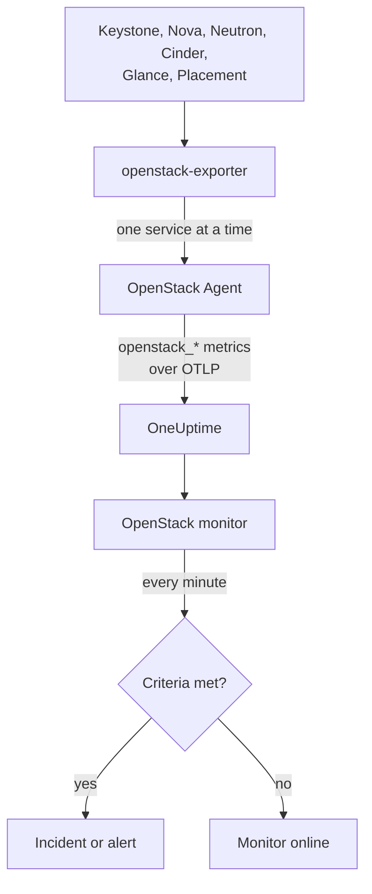

# OpenStack-övervakning

En OpenStack-monitor bevakar ett moln - dess API:er, arbetarprocesserna bakom dem, hypervisorer, instanser, nätverk, lagringspooler och projektkvoter - och talar om när ett API slutar svara, en arbetarprocess går ner, en hypervisor inte har något utrymme kvar eller en pool blir full. Den läser `openstack_*`-serierna som OneUptimes OpenStack-agent samlar in från openstack-exporter, eller som en sond samlar in från molnets API:er.

:::cards
- [Skapa monitorn](#skapa-en-openstack-monitor): Sex steg i instrumentpanelen.
- [Mallar](#färdiga-larmmallar): Färdiga larm, en incident per arbetarprocess, instans, nätverk eller region.
- [Kontroller utifrån](#kontroller-utifrån): Om någon faktiskt kan starta en instans, sett från en sond utanför molnet.
- [Identitetsattribut](#identitetsattribut): Så riktar du in dig på en region, värd eller ett projekt.
- [Mätvärden](#insamlade-mätvärden): Alla serier som monitorn kan larma på.
:::

## Så fungerar det

Agenten är en OpenTelemetry Collector och en openstack-exporter som du kör på en maskin som når molnets API:er. Den läser varje OpenStack-tjänst i en egen insamling, så att en Nova som fallerar bara kostar Novas serier, och den läser försiktigt: compute, network, volume och placement var 2:a minut, identity och image var 5:e.

Varje serie stämplas med molnets namn, `openstack.cloud.name`, och varje datapunkt med `openstack.region.name` och `openstack_service`. Ett moln är en Keystone, och en OpenStack-monitor är knuten till ett moln. Varje minut kör den sin fråga över molnets mätvärden och jämför resultatet med sina kriterier.



## Innan du börjar

- **Samla in molnets mätvärden** med OpenStack-agenten eller [en sond](/docs/telemetry/openstack-agentless). **Dokumentation**, under **Produkter → Infrastruktur → OpenStack**, guidar dig genom installationen av agenten.
- **Kontrollera att molnet är registrerat.** Det visas under **Produkter → Infrastruktur → OpenStack**, med namnet från agentens `OPENSTACK_CLOUD_NAME`, efter sin första insamling.

## Skapa en OpenStack-monitor

:::steps
### Starta en ny monitor

Gå till **Monitorer** och klicka på **Skapa monitor**.

### Välj OpenStack

Under **Monitortyp** klickar du på **Fler monitortyper** och väljer **OpenStack** under **Infrastruktur**, eller skriver `openstack` i sökrutan. Ange ett **Namn** - det används i titlarna på incidenter och larm - och klicka på **Nästa**.

### Välj molnet

Under **OpenStack Monitor Configuration** väljer du molnet i **OpenStack-moln**. Alla moln som har skickat data finns i listan. När du har valt ett visar en rad under fältet om data kommer in.

### Välj vad som ska bevakas

En ny monitor startar med **Cloud Stopped Reporting**, under **Vad som ska larmas om**. Så här bevakar du något annat:

- **Ändra** - välj en annan [mall](#färdiga-larmmallar). Den anger mätvärde, attributfilter, aggregering, tidsintervall, gruppering och trösklar, och ersätter kriterierna nedan med sina egna. Du kan fortfarande ändra **Tidsintervall**.
- **Custom Metric** (under **Fler fält**) - välj ett mätvärde i **OpenStack-mätvärde**, ställ sedan in **Aggregering** och **Tidsintervall**, och avgränsa med [filtren](#monitorinställningar).
- **Avancerad** (under **Fler fält**) - bygg frågor och formler själv under **Välj mått**, med filter på attribut som `status`, `adminState` eller `resourcetype`. Använd **Gruppera efter** ett [identitetsattribut](#identitetsattribut) för att bedöma varje del för sig.

### Kontrollera kriterierna

Öppna varje kriterium under **Kriterier** och kontrollera dess **Mätvärde**, **Aggregering**, **Villkor** och **Tröskel**. En mall fyller i dessa. Med **Custom Metric** eller **Avancerad** startar monitorn med standardkriterierna, som bara märker att mätvärdet inte skickar någon data, så ange din egen tröskel.

### Skapa monitorn

Klicka på **Skapa monitor**. OneUptime öppnar monitorns sida och utvärderar den varje minut. Incidenter och larm som den skapar visas också på molnets sidor **Incidenter** och **Larm**.
:::

> [!TIP]
> Om du vill konfigurera flera mallar på en gång öppnar du molnet via **Produkter → Infrastruktur → OpenStack** och går till **Rekommendationer**. Välj de mallar du vill ha, välj vem som ska larmas, så skapar OneUptime en monitor per mall.

## Monitorinställningar

| Fält | Flik | Vad det gör |
| --- | --- | --- |
| **OpenStack-moln** | Alla | Obligatoriskt. Avgränsar varje fråga till `resource.openstack.cloud.name`. |
| **Region** | Eget mätvärde, Avancerad | Valfritt. En region: `openstack.region.name`. Varje serie har den. |
| **Tillgänglighetszon** | Eget mätvärde, Avancerad | Valfritt. En zon: `availability_zone` på hypervisorer, instanser, volymer och Neutron-agenter, `zone` på Novas och Cinders arbetarprocesser. |
| **Hypervisor** | Eget mätvärde, Avancerad | Valfritt. En värd: `hostname` på arbetarprocesser, hypervisorer och Placement, `hypervisor_hostname` på instanser. Novas arbetarprocesser anger värdens korta namn, och hypervisorer, Placement och instanser dess fullständiga namn, så använd det som serien anger. |
| **Tjänst** | Eget mätvärde, Avancerad | Valfritt. En arbetarprocess binärfil, till exempel `nova-compute`: `service`. |
| **Projekt-ID** | Eget mätvärde, Avancerad | Valfritt. Ett projekt: `tenant_id` på Novas och Cinders serier samt på nätverk och subnät, `project_id` på flytande IP-adresser, routrar och adresstillgänglighet. |
| **OpenStack-mätvärde** | Eget mätvärde | Ett mätvärde från [katalogen](#insamlade-mätvärden). |
| **Aggregering** | Eget mätvärde | Hur värden kombineras: **Genomsnitt**, **Maximum**, **Minimum**, **Summa** eller **Antal**. Börjar på mätvärdets vanliga aggregering. |
| **Tidsintervall** | Alla | Det rullande fönster som frågan läser, från **Past 1 Minute** till **Past 365 Days**. En ny monitor börjar på **Senaste 15 minuterna**; mallar anger sitt eget. |
| **Välj mått** | Avancerad | Frågebyggaren: **Mätvärde**, **Aggregate by**, **Filter by attributes**, **Gruppera efter**, plus **Lägg till mätvärde** och **Lägg till formel** för att kombinera frågor. |

Ett filter avgränsar bara en serie som har dess etikett: `openstack_nova_up` har inget projekt, så ett projektfilter låter den vara som den är.

Låt fönstret vara minst tre insamlingar av det du läser: 6 minuter för compute, network, volume och placement, 15 för identity och image. Ett kortare fönster rymmer inte tillräckligt många insamlingar för att **Alla värden** ska kunna betyda en varaktighet.

## Identitetsattribut

Varje serie har `openstack.cloud.name` som ett **resursattribut**, och `openstack.region.name` och `openstack_service` som datapunktsattribut. Exporterns egna etiketter anger resten:

| Del | Serie | Etiketter som identifierar den |
| --- | --- | --- |
| API | `openstack_*_up` | `openstack.region.name`, `openstack_service` |
| Arbetarprocess | `openstack_nova_agent_state`, `openstack_neutron_agent_state`, `openstack_cinder_agent_state` | `hostname`, `service`. `adminState` anger om en operatör lämnade den påslagen. Gruppera aldrig efter `uuid` på Cinders: exportern hittar på en ny vid varje insamling |
| Hypervisor | `openstack_placement_resource_*`, `openstack_nova_vcpus_*` | `hostname` (dess fullständiga namn), `resourcetype` på Placements |
| Instans | `openstack_nova_server_status` | `uuid`, `name`, `tenant_id`, `hypervisor_hostname`, `status`. Värdet är en kod: filtrera på ordet i `status` |
| Volym | `openstack_cinder_volume_gb` | `id`, `name`, `tenant_id`, `status` |
| Lagringspool | `openstack_cinder_pool_capacity_*` | `name`, `volume_backend_name` |
| Nätverk | `openstack_neutron_network_ip_availabilities_*` | `network_id`, `network_name`, `cidr`, `ip_version` |
| Router | `openstack_neutron_l3_agent_of_router` | `router_id`, `agent_host`, `ha_state`, `agent_alive`, `agent_admin_up` |
| Projekt | `openstack_nova_limits_*`, `openstack_cinder_limits_*` | `tenant_id`, `tenant` |

I monitorfilter och grupperingsnycklar börjar ett resursattribut med `resource.` (`resource.openstack.cloud.name`), och ett datapunktsattribut gör det inte (`openstack.region.name`, `hostname`, `status`). En tom etikett når inte OneUptime, så `disabledReason` finns bara på en arbetarprocess som någon har inaktiverat.

## Färdiga larmmallar

OneUptime levereras med 120 mallar för vanliga OpenStack-problem, och listan **Vad som ska larmas om** erbjuder dem. Ett molns sida Rekommendationer erbjuder bara en mall för Heat, Magnum, Ironic, Manila, Octavia, Trove, Designate, Gnocchi eller Swift till ett moln som kör tjänsten, en mall över en serie som bara en sond skickar till ett moln som en sond samlar in från, och en mall över en [kontroll utifrån](#kontroller-utifrån) till ett moln där den kontrollen är påslagen: i alla andra moln finns inte dess serier, så den skulle aldrig kunna utlösas. Varje mall bygger en komplett monitor: mätvärdesfrågan, attributfiltren, en gruppering på det som en incident handlar om, ett kriterium som utlöses och ett som återställs. Trösklarna är samma gränser som molnets egna sidor ritar, och är startpunkter som du kan ändra.

Varje mall läser minst tre insamlingar av det den bevakar och utlöses bara när villkoret gäller under hela fönstret. En tröskel för en andel återställs 10 % bortom sin gräns, så att ett värde som pendlar där inte fladdrar.

| Mall | Kategori | Allvarlighetsgrad | Bevakar | Utlöses när | Återställs när |
| --- | --- | --- | --- | --- | --- |
| Molnet slutade rapportera | Tillgänglighet | Kritisk | `openstack_identity_up`, Antal över hela molnet, **senaste 15 minuterna** | Inga data under hela fönstret: agenten stannade eller når inte OneUptime, eller exportern kan inte logga in i Keystone | Data kommer in igen |
| Identity-API nere | Tillgänglighet | Kritisk | `openstack_identity_up` och `scrape_samples_scraped` för `identity`, Min per region, **senaste 15 minuterna** | Alla anrop misslyckades, eller insamlingen kom tillbaka tom eftersom exportern inte kunde logga in | Båda visar 1 eller mer |
| Compute-API nere | Tillgänglighet | Kritisk | `openstack_nova_up` och `scrape_samples_scraped` för `compute`, Min per region, **senaste 10 minuterna** | Alla anrop misslyckades, eller insamlingen kom tillbaka tom eftersom exportern inte nådde Novas API | Båda visar 1 eller mer |
| Nätverks-API nere | Tillgänglighet | Kritisk | `openstack_neutron_up` och `up` för `network`, Min per region, **senaste 10 minuterna** | Alla anrop misslyckades, eller exportern svarade inte | Båda visar 1 |
| Blocklagrings-API nere | Tillgänglighet | Kritisk | `openstack_cinder_up` och `up` för `volume`, Min per region, **senaste 10 minuterna** | Alla anrop misslyckades, eller exportern svarade inte | Båda visar 1 |
| Image-API nere | Tillgänglighet | Kritisk | `openstack_glance_up` och `up` för `image`, Min per region, **senaste 15 minuterna** | Alla anrop misslyckades, eller exportern svarade inte | Båda visar 1 |
| Placement-API nere | Tillgänglighet | Kritisk | `openstack_placement_up` och `up` för `placement`, Min per region, **senaste 10 minuterna** | Alla anrop misslyckades, eller exportern svarade inte | Båda visar 1 |
| Compute-tjänst nere | Kontrollplan | Kritisk | `openstack_nova_agent_state` filtrerad på `service = nova-compute` och `adminState = enabled`, Min per värd, **senaste 10 minuterna** | Under 1: en aktiverad nova-compute är nere. En som någon har inaktiverat utlöser aldrig | Uppe, eller inaktiverad |
| Compute-tjänst inaktiverad | Kontrollplan | Varning | `openstack_nova_agent_state` filtrerad på `service = nova-compute` och `adminState = disabled`, ett Antal per värd, **senaste 10 minuterna** | Över 0: en `nova-compute` inaktiverades, och ingen pågående underhållshändelse täcker dess värd, dess tillgänglighetszon eller molnet. En som inaktiverade sig själv eftersom libvirt försvann (dess orsak börjar med `AUTO:`) förblir tyst medan libvirt-tjänst nere är öppen. Projekten får inte besked om den | Den aktiveras igen, eller en händelse täcker den |
| Scheduler eller Conductor nere | Kontrollplan | Varning | `openstack_nova_agent_state` filtrerad på `nova-scheduler` eller `nova-conductor` och `adminState = enabled`, Min per värd och binärfil, **senaste 10 minuterna** | Under 1. De andra fortsätter så länge någon finns kvar | Uppe, eller inaktiverad |
| Alla Scheduler eller Conductor nere | Kontrollplan | Kritisk | Samma, Max per region och binärfil, **senaste 10 minuterna** | Under 1: ingen lever, så ingenting nytt kan startas | En är uppe |
| Nätverksagent nere | Kontrollplan | Kritisk | `openstack_neutron_agent_state` filtrerad på `adminState = up`, Min per värd och binärfil, **senaste 10 minuterna** | Under 1: en agent som är satt till upp lever inte. En som någon satt till ner utlöser aldrig | Lever, eller satt till ner |
| Blocklagringstjänst nere | Kontrollplan | Kritisk | `openstack_cinder_agent_state` filtrerad på `adminState = enabled`, Min per värd och binärfil, **senaste 10 minuterna** | Under 1: en aktiverad Cinder-tjänst är nere. En som någon har inaktiverat utlöser aldrig | Uppe, eller inaktiverad |
| vCPU-allokering hög | Compute | Varning | `openstack_placement_resource_*` filtrerad på `resourcetype = VCPU`, användning / ((total - reserverad) x kvot), per hypervisor, **senaste 10 minuterna** | Över 90 %: allokering, inte belastning | Vid eller under 81 % |
| Minnesallokering hög | Compute | Varning | Samma, `resourcetype = MEMORY_MB` | Över 90 % | Vid eller under 81 % |
| Lokal diskallokering hög | Compute | Varning | Samma, `resourcetype = DISK_GB` | Över 90 % | Vid eller under 81 % |
| Hypervisorns CPU mättad | Compute | Varning | `openstack.hypervisor.instances.cpu.utilization`, per hypervisor, **senaste 15 minuterna**. Kräver libvirts eller Ceilometers exporter | Över 90 % av dess CPU-trådar: belastning, inte allokering. Dess sida anger vilka instanser som orsakar det | Vid eller under 81 % |
| Hypervisorns minnestryck | Compute | Varning | `openstack.hypervisor.instances.memory.utilization`, per hypervisor, **senaste 15 minuterna**. Kräver libvirts exporter, eller Ceilometers insamling av `memory.resident` | Över 90 % av dess minne: i bruk, inte utlovat | Vid eller under 81 % |
| Instansens CPU mättad | Compute | Varning | `openstack.instance.cpu.utilization`, Max per instans, **senaste 15 minuterna**. Kräver libvirts eller Ceilometers exporter | Över 95 % av dess vCPU:er | Vid eller under 85,5 % |
| Instansens disklatens hög | Compute | Varning | `openstack.instance.disk.read.latency` och `openstack.instance.disk.write.latency`, Max per instans och disk, **senaste 15 minuterna**. Kräver libvirts exporter, eller Ceilometers insamling av `disk.device.read.latency` och `disk.device.write.latency` | Över 50 ms per förfrågan. En disk utan förfrågningar har ingen latens, så en overksam disk utlöser aldrig | Vid eller under 45 ms, eller den slutar användas |
| Instanser i fel | Compute | Varning | `openstack_nova_server_status` filtrerad på `status = ERROR`, Antal per region, **senaste 10 minuterna** | Över 0 | Inga kvar |
| Instans fastnat i byggande | Compute | Varning | `openstack_nova_server_status` filtrerad på `status = BUILD` eller `BUILD(spawning)`, Max per instans, **senaste 1 timmen** | I den statusen vid varje insamling under en timme | Lämnade den |
| Instans fastnat i övergång | Compute | Varning | Samma för `REBUILD`, `RESIZE`, `REVERT_RESIZE`, `MIGRATING`, `REBOOT`, `HARD_REBOOT` och `PASSWORD`, **senaste 1 timmen** | I en av dem vid varje insamling under en timme | Lämnade den |
| Instans fastnat i Verify Resize | Compute | Varning | Samma för `VERIFY_RESIZE`, **senaste 1 timmen** | Väntar på att någon ska bekräfta eller ångra under en timme | Bekräftad eller ångrad |
| Router inte aktiv | Nätverk | Varning | `openstack_neutron_routers_not_active`, Max per region, **senaste 10 minuterna** | Över 0 | Vid 0 |
| Flytande IP inte aktiv | Nätverk | Varning | `openstack_neutron_floating_ips_associated_not_active`, Max per region, **senaste 10 minuterna** | Över 0: en som används är inte ACTIVE. En reserv är avsedd att vara nere | Vid 0 |
| Externa IP-poolen nästan full | Nätverk | Varning | `openstack_neutron_network_ip_availabilities_*` för `ip_version = 4`, tillsammans med `is_external = true` på `openstack_neutron_network`, per nätverk, **senaste 10 minuterna** | Över 90 % av ett externt nätverks IPv4-adresser. En tenants nätverk utlöser aldrig | Vid eller under 81 % |
| Nätverket har slut på IP-adresser | Nätverk | Kritisk | Samma | Vid 100 %: ingen adress kvar | Under 90 % |
| Router utan aktiv agent | Nätverk | Kritisk | `openstack_neutron_l3_agent_of_router` filtrerad på `agent_admin_up = true`, Max per router, **senaste 10 minuterna** | Under 1: ingen agent som håller den lever. Tyst på OVN, som inte har sådana agenter | En lever |
| Router med två aktiva agenter | Nätverk | Kritisk | Samma filtrerad på `ha_state = active` och `agent_alive = true`, Antal per router, **senaste 10 minuterna** | Över 1: en split brain. Tyst på OVN | Vid eller under 1 |
| Lagringspool varning | Lagring | Varning | `openstack_cinder_pool_capacity_*`, (total - ledig) / total, per pool, **senaste 10 minuterna** | Över 85 % | Vid eller under 76,5 % |
| Lagringspool kritisk | Lagring | Kritisk | Samma | Över 95 % | Vid eller under 85,5 % |
| Volymer i fel | Lagring | Varning | `openstack_cinder_volume_status_counter` för varje felord, Max per region och ord, **senaste 10 minuterna** | Över 0 | Vid 0 |
| Volym fastnat | Lagring | Varning | `openstack_cinder_volume_gb` för varje godkänt statusord, Max per volym, **senaste 30 minuterna** | I den statusen vid varje insamling under 30 minuter | Lämnade den |
| Image fastnat | Lagring | Varning | `openstack_glance_image_created_at` för varje godkänt statusord, Max per image, **senaste 1 timmen** | I den statusen vid varje insamling under en timme | Lämnade den, eller togs bort |
| Orchestration-API nere | Tillgänglighet | Kritisk | `openstack_heat_up` och `up` för `orchestration`, Min per region, **senaste 15 minuterna** | Alla anrop misslyckades, vilket även en stoppad `heat-engine` ser ut som, eller exportern svarade inte | Båda visar 1 |
| Kubernetes-kluster-API nere | Tillgänglighet | Kritisk | `openstack_container_infra_up` och `up` för `container-infra`, Min per region, **senaste 15 minuterna** | Alla anrop misslyckades, eller exportern svarade inte | Båda visar 1 |
| Rating-API nere | Tillgänglighet | Kritisk | `openstack_cloudkitty_up` och `up` för `rating`, Min per region, **senaste 15 minuterna**. Skickas bara av en sond | CloudKittys API svarar inte, så det som varje projekt har debiterats slutar röra sig | Båda visar 1 |
| Heat Engine nere | Kontrollplan | Varning | `openstack_heat_agent_state`, Min per värd, **senaste 15 minuterna**. Skickas bara av en sond | Heat listar en `heat-engine` som nere. Med alla engines stoppade kan Heat inte lista dem, och Orchestration-API nere utlöses i stället | Den visar 1, eller Heat tar bort sin post | 
| Magnum Conductor nere | Kontrollplan | Kritisk | `openstack_container_infra_agent_state` med `adminState=enabled`, Min per värd, **senaste 15 minuterna**. Skickas bara av en sond | Magnum listar en aktiverad `magnum-conductor` som nere. Magnums API fortsätter svara, så ingenting annat visar detta | Den visar 1, eller någon inaktiverar den |
| Stack misslyckad | Orkestrering | Varning | `openstack_heat_stack_status` med varje `*_FAILED`-status, per stack, **senaste 15 minuterna** | En stack har en misslyckad status under hela fönstret | Den uppdateras eller tas bort |
| Stack fastnat under pågående åtgärd | Orkestrering | Varning | `openstack_heat_stack_status` med varje `*_IN_PROGRESS`-status, per stack, **senaste 2 timmarna** | En stack har en pågående status under hela fönstret, längre än den timme Heat ger en om ingen valt längre | Den når sin nästa status, eller tas bort |
| Kubernetes-kluster misslyckat | Orkestrering | Varning | `openstack_container_infra_cluster_status` med varje `*_FAILED`-status, per kluster, **senaste 15 minuterna** | Ett kluster har en misslyckad status under hela fönstret | Det uppdateras eller tas bort |
| Kubernetes-kluster fastnat | Orkestrering | Varning | `openstack_container_infra_cluster_status` med varje `*_IN_PROGRESS`-status, per kluster, **senaste 2 timmarna** | Ett kluster har en pågående status under hela fönstret. Bara Magnums conductor flyttar det vidare | Det når sin nästa status, eller tas bort |
| Shared File Systems-API nere | Tillgänglighet | Kritisk | `openstack_sharev2_up` och `up` för `sharev2`, Min per region, **senaste 15 minuterna** | Alla anrop misslyckades, eller exportern svarade inte. Varje inloggningsuppgift som kan logga in visar 1, så det kan inte bero på att en inloggningsuppgift nekas | Båda visar 1 |
| Manila-tjänst nere | Kontrollplan | Varning | `openstack_sharev2_agent_state` med `adminState=enabled`, Min per värd och tjänst, **senaste 15 minuterna**. Skickas bara av en sond | Manila listar en aktiverad tjänst som stoppad eller nere. Dess API fortsätter svara, så ingenting annat visar detta | Den visar 1, eller någon inaktiverar den |
| Share i fel | Lagring | Varning | `openstack_sharev2_share_gb` med varje felstatus, per share, **senaste 15 minuterna** | En share har en felstatus under hela fönstret | Den åtgärdas eller tas bort |
| Share fastnat | Lagring | Varning | `openstack_sharev2_share_gb` med varje godkänd status, per share, **senaste 1 timmen** | En share har en godkänd status under hela fönstret. Manila har ingen egen tidsgräns för en långsam backend. En som migreras eller säkerhetskopieras bevakas inte | Den når sin nästa status, eller tas bort |
| Lastbalanserar-API nere | Lastbalanserare | Kritisk | `openstack_loadbalancer_up`, Min per region, **senaste 15 minuterna** | Under 1. Ett stoppat Octavia-API ger agentens exporter ett tomt svar i stället för en 0, på samma sätt som ett moln utan Octavia, så på en agents moln förblir den tyst och molnets sidor anger när Octavia senast hördes av | Visar 1, eller har försvunnit |
| Lastbalanserare i fel | Lastbalanserare | Kritisk | `openstack_loadbalancer_loadbalancer_status` med `provisioning_status=ERROR`, Antal per lastbalanserare, **senaste 15 minuterna** | En lastbalanserare har provisioning ERROR under hela fönstret. Octavia försöker inte om någon av dessa | Den är tillbaka på ACTIVE, eller borttagen |
| Lastbalanserare fastnat i pending | Lastbalanserare | Varning | `openstack_loadbalancer_loadbalancer_status` med varje `PENDING_*`-provisioning-status, Antal per lastbalanserare, **senaste 1 timmen** | En lastbalanserare har en PENDING-status under hela fönstret: Octavias worker är stoppad, eller tappade begäran | Den når ACTIVE eller ERROR, eller tas bort |
| Lastbalanserare med två masters | Lastbalanserare | Kritisk | `openstack_loadbalancer_amphora_status` med `role=MASTER` och `status=ALLOCATED`, Antal per lastbalanserare, **senaste 15 minuterna**. Kräver en inloggningsuppgift som får lista amphorae | Fler än en allokerad amphora anger MASTER för en lastbalanserare | Bara en gör det |
| Amphora i fel | Lastbalanserare | Kritisk | `openstack_loadbalancer_amphora_status` med `status=ERROR`, Antal per amphora, **senaste 15 minuterna**. Kräver en inloggningsuppgift som får lista amphorae | En amphora har ERROR under hela fönstret: health manager kunde inte ersätta den | Den ersätts |
| Pool utan friska medlemmar | Lastbalanserare | Kritisk | `openstack_loadbalancer_pool_status` med `operating_status=ERROR`, Antal per pool, **senaste 15 minuterna** | Varje medlem i en pool misslyckas med sin hälsokontroll, medan poolen och dess lastbalanserare fortfarande provisioneras som ACTIVE | En medlem är frisk igen |
| DNS-API nere | Tillgänglighet | Kritisk | `openstack_designate_up`, Min per region, **senaste 15 minuterna**. Erbjuds bara av en sond | Under 1. En stoppad Designate ger agentens exporter ett tomt svar, på samma sätt som ett moln utan Designate, så ett moln som agenten samlar in från kan bara visa att det blev tyst | Visar 1 |
| DNS-zon i fel | Nätverk | Varning | Ett antal av `openstack_designate_zone_status` med `status=ERROR`, per zon, **senaste 15 minuterna** | En zon visar `ERROR` under hela fönstret: dess worker gav upp att skriva den till en DNS-server | Den visar något annat |
| DNS-zon fastnat i pending | Nätverk | Varning | Ett antal av `openstack_designate_zone_status` med `status=PENDING`, per zon, **senaste 30 minuterna** | En zon visar `PENDING` under hela fönstret. Dess worker ger upp efter några minuter, så ingenting arbetar med den | Den visar något annat |
| DNS-recordset i fel | Nätverk | Varning | Ett antal av `openstack_designate_recordsets_status` med `status=ERROR` och varje typ någon ber om, per zon, **senaste 15 minuterna** | Ett recordset som inte är en zons egna SOA och NS visar `ERROR`. Dessa två visar `ERROR` tillsammans med sin zon, så DNS-zon i fel anger det | Det visar något annat |
| Mätvärdes-API nere | Tillgänglighet | Kritisk | `openstack_gnocchi_up` och `up` för `gnocchi`, Min per region, **senaste 15 minuterna** | Exporterns läsning av Gnocchi misslyckades, eller exportern svarade inte. En inloggningsuppgift som Gnocchi nekar visar samma sak, så ett moln vars inloggningsuppgift aldrig har läst Gnocchi erbjuds inte denna | Båda visar 1 |
| Gnocchi utan processorer | Mätvärden | Kritisk | `openstack_gnocchi_status_metricd_processors`, Max per region, **senaste 15 minuterna** | Gnocchis status anger ingen processor. Dess API fortsätter svara och ta emot mätningar, så **Metrics API Down** säger ingenting om detta | Den anger en |
| Gnocchi-backlog växer | Mätvärden | Varning | `openstack_gnocchi_status_measures_to_process`, en linje genom de **senaste 2 timmarna** | Linjen passerar 10 000 mätningar inom nästa timme. En backlog som är större än så och minskar utlöser inte | Linjen når inte längre 9 000 |
| Objektlagrings-API nere | Tillgänglighet | Kritisk | `openstack_object_store_up` och `up` för `object-store`, Min per region, **senaste 15 minuterna** | Exporterns läsning av Swift misslyckades, eller exportern svarade inte. En inloggningsuppgift som Swift nekar visar samma sak, så ett moln vars inloggningsuppgift aldrig har läst Swift erbjuds inte denna | Båda visar 1 |
| Prognos för objektcontainerns tillväxt | Lagring | Varning | `openstack_object_store_bytes`, en linje genom de **senaste 7 dagarna**, per container | Linjen passerar 1 TiB inom nästa vecka. Ändra den till det ditt moln bör höra om | Linjen når inte längre 90 % av det |
| Key Manager-API nere | Tillgänglighet | Kritisk | `openstack_barbican_up`, Min per region, **senaste 15 minuterna**. Erbjuds bara av en sond | Under 1. Exportern har ingen läsare för Barbican alls | Visar 1 |
| Swift-lagringsserver svarar inte | Lagring | Varning | `openstack_object_store_recon_up`, Min per server, **senaste 15 minuterna**. Erbjuds bara av en sond, där molnets inställningar anger dess lagringsservrar | Servern svarar inte på `/recon`. Swifts proxy fortsätter svara utan den | Den svarar |
| Swift-ringar skiljer sig | Lagring | Varning | `openstack_object_store_recon_rings_differ`, Min per ring, **senaste 15 minuterna**. Erbjuds bara av en sond | De angivna servrarna rapporterar olika kontrollsummor för en ring | De stämmer överens |
| Swift-replikering inaktuell | Lagring | Varning | `openstack_object_store_recon_replication_age_seconds`, Min per server och ring, **senaste 15 minuterna**. Erbjuds bara av en sond | En server avslutade senast en omgång för mer än 6 timmar sedan | En avslutar en |
| Databas-API nere | Tillgänglighet | Kritisk | `openstack_trove_up` och `up` för `database`, Min per region, **senaste 15 minuterna** | Exporterns läsning av Trove misslyckades, eller exportern svarade inte. Den läser Troves mgmt-API, så en nekad inloggningsuppgift visar samma sak som ett stoppat API, och ett moln vars inloggningsuppgift aldrig har läst Trove erbjuds inte denna | Båda visar 1 |
| Databasinstans i fel | Databaser | Varning | Ett antal av `openstack_trove_instance_status` med varje felstatus, per instans, **senaste 15 minuterna** | En instans har en felstatus under hela fönstret | Den åtgärdas eller tas bort |
| Databasinstans fastnat | Databaser | Varning | Ett antal av `openstack_trove_instance_status` med varje godkänd status, per instans, **senaste 1 timmen** | En instans har en godkänd status under hela fönstret. Trove har ingen lista över sina workers, så detta är det som visar att `trove-taskmanager` stoppade | Den når sin nästa status, eller tas bort |
| Databasvolym nästan full | Databaser | Varning | `openstack_trove_instance_volume_used_gb` delat med `openstack_trove_instance_volume_size_gb`, per instans, **senaste 15 minuterna** | Vid eller över 85 %. En instans som inte körs visar 0 använt. Ingen inspelning innehåller en som körs | Den ändras i storlek, eller krymper |
| Bare metal-API nere | Bare metal | Kritisk | `openstack_ironic_up`, Min per region, **senaste 15 minuterna** | Under 1. Hörs bara där en läsning av Ironic kan säga det: en sond, eller exporter 1.7.0. En stoppad Ironic ger agentens exporter ingenting att läsa, på samma sätt som ett moln utan Ironic, så där förblir den tyst och molnets sidor anger när Ironic senast hördes av | Visar 1, eller har försvunnit |
| Bare metal-conductor nere | Bare metal | Varning | `openstack_ironic_agent_state`, Min per värd, **senaste 15 minuterna**. Skickas bara av en sond, och bara där molnets policy låter dess inloggningsuppgift läsa Ironics conductors: som standard nekar den ett projekts | Ironic listar en conductor som inte lever. Dess API fortsätter svara, och varje nod visar som förut, så ingenting annat visar detta | Den visar 1, eller Ironic tar bort sin post |
| Bare metal-nod i fel | Bare metal | Varning | `openstack_ironic_node` för varje misslyckad `provision_state`, Max per nod, **senaste 15 minuterna** | I det tillståndet vid varje insamling under 15 minuter, i underhåll eller inte | Lämnade det, eller togs bort |
| Bare metal-nod fastnat i övergång | Bare metal | Varning | `openstack_ironic_node` för varje godkänd `provision_state` med `maintenance = false`, Max per nod, **senaste 2 timmarna** | I det tillståndet vid varje insamling under 2 timmar. En lång diskradering kan ärligt talat ta så lång tid, vilket en nods sida kan visa och detta inte kan | Lämnade det, eller togs bort |
| Bare metal-nod för länge i underhåll | Bare metal | Varning | `openstack_ironic_node` med `maintenance = true`, Max per nod, **senaste 7 dagarna** | I underhåll vid varje insamling under 7 dagar. Kräver att dina mätvärden sparas så länge | Ur underhåll, eller togs bort |
| Bare metal-strömtillstånd oväntat | Bare metal | Varning | `openstack_ironic_node` med `provision_state = active`, `power_state = power off` och `maintenance = false`, Max per nod, **senaste 15 minuterna** | Vid varje insamling under 15 minuter. En instans som dess ägare stoppade visar samma sak, vilket en nods sida kan visa och detta inte kan | Påslagen, eller inte längre driftsatt |
| Projektkvot nästan nådd | Projekt | Varning | `openstack_nova_limits_*` och `openstack_cinder_limits_volume_*`, använt / max per projekt, **senaste 3 timmarna** | Över 90 % av dess kvot för vCPU, minne, instanser eller volymer. Kräver att [limits-serierna är påslagna](#slå-på-limits-serierna) | Vid eller under 81 % |
| Tokenutfärdande misslyckas | Tillgänglighet | Kritisk | `openstack_check_token_success`, Min per region, **senaste 5 minuterna**. Kräver att API-kontroller är påslagna | Under 1: Keystone utfärdade ingen token till sonden | En token utfärdas |
| Tjänstens API-kontroll misslyckas | Tillgänglighet | Kritisk | `openstack_check_api_success`, Min per region och `service_type`, **senaste 5 minuterna**. Kräver att API-kontroller är påslagna | Under 1: den tjänsten svarade inte, för någon tjänst i katalogen | Den svarar, eller lämnar katalogen |
| Publikt certifikat går ut om 30 dagar | Tillgänglighet | Varning | `openstack_check_certificate_expiry_days`, Min per region, värd och port, **senaste 5 minuterna**. Kräver att API-kontroller är påslagna | Under 30 dagar kvar | 33 dagar eller mer kvar, eller slutpunkten lämnar katalogen |
| Publikt certifikat går ut om 7 dagar | Tillgänglighet | Kritisk | Samma | Under 7 dagar kvar | 7,7 dagar eller mer kvar, eller slutpunkten lämnar katalogen |
| Instansstart misslyckas | Compute | Kritisk | `openstack_check_lifecycle_phase_success` filtrerad på `phase = boot`, Min per region, **senaste 5 minuterna**. Kräver att livscykelkontrollen är på | Under 1: den senaste körningen kunde inte starta en instans | En körning startar en |
| Instansstart långsam | Compute | Varning | `openstack_check_lifecycle_step_duration_seconds` filtrerad på `step = server_active`, Max per region, **senaste 5 minuterna**. Kräver att livscykelkontrollen är på | Över 300 sekunder, Tempests eget `build_timeout` | Vid eller under 270 sekunder, eller en körning som inte startade, vilket Instansstart misslyckas talar för |
| Volymanslutning misslyckas | Lagring | Kritisk | `openstack_check_lifecycle_phase_success` filtrerad på `phase = volume`, Min per region, **senaste 5 minuterna**. Kräver att kontrollens volymdel är på | Under 1: den senaste körningen kunde inte skapa eller ansluta en volym | En körning ansluter en |
| Flytande IP onåbar | Nätverk | Kritisk | `openstack_check_lifecycle_phase_success` filtrerad på `phase = floating_ip`, Min per region, **senaste 5 minuterna**. Kräver att kontrollens del för flytande IP är på | Under 1: den senaste körningen kunde inte nå sin server via en flytande IP | En körning når en |
| Flavor kan inte längre placeras | Kapacitet | Varning | `openstack_capacity_flavor_fits`, **per flavor och region** | Ingen värd har plats för en till, i 10 minuter. Bara flavors som någon kan begära, och aldrig en som är för stor för alla värdar, eller vars enda plats finns på en värd som någon har inaktiverat | En värd har plats, eller flavorn bevakas inte längre |
| Kapacitetsprognos under 14 dagar | Kapacitet | Varning | `openstack_capacity_days_until_full`, **per zon och resursklass, externt nätverk eller lagringspool** | Under 14 dagar till full vid dess tillväxt den senaste veckan, i 10 minuter. Tyst med mindre än en dags historik, eller när den inte växer | Över 15,4 dagar, eller ingen prognos längre |
| Reserverat utrymme borta | Kapacitet | Varning | `openstack_capacity_can_lose_a_host`, **per zon** | Den kunde inte förlora sin största värd och ändå rymma det som körs på den, i 10 minuter. Tyst på en zon med en värd, eller med en värd som någon har inaktiverat | Den kunde, eller zonen bedöms inte längre |

**Allvarlighetsgrad** är etiketten som väljaren visar. Incidenten och larmet som en mall skapar börjar på ditt projekts allvarligaste incident- och larmnivå; ändra dem i kriterierna.

- **Serier för upp, lever och tillstånd använder Min**, så att en enda som är nere visar 0. **Antal och info-serier använder Max.** Ingenting använder Summa, eftersom en monitor läser minutlånga hinkar över serier och insamlingar, och en Summa lägger ihop dem.
- **Varje mall utom Molnet slutade rapportera grupperar efter det en incident handlar om:** en arbetarprocess värd och binärfil, ett API:s region, en instans, en router, ett nätverk, en pool, ett projekt. Incidenten namnger det, med [kommandona att köra härnäst](#kommandon-att-köra-härnäst).
- **En statusserie har en kod som värde**, inte ett antal: `openstack_nova_server_status` visar 4 för en instans i ERROR. Mallarna filtrerar på ordet i `status`.
- **En serie som precis har dykt upp väntar ett helt fönster,** så en instans, volym eller image som setts en gång på väg till något annat ger ingenting. Varje mall vet hur ofta dess tjänst samlas in från den tjänstens egen `_up`-serie.
- **En serie som försvinner räknas som återställd:** en arbetarprocess som någon har inaktiverat, den sista instansen i ERROR som tas bort, en pool som tas bort. Varje mall läser sin tjänsts egen `_up`-serie vid sidan av sin egen, så att den kan skilja en del som försvunnit från ett moln som blivit tyst. När ingenting kommer in alls förblir dess incidenter öppna och **Cloud Stopped Reporting** talar i stället.
- **När ett API är nere försvinner också dess egna serier**, så att den tjänstens andra mallar återställs, och utlöses igen ett fönster efter att det är tillbaka om felet fortfarande finns. Om alla API:er visar nere samtidigt, titta på exportern först.
- **Ett moln som inte har en sådan tjänst förblir tyst.** Exportern svarar med ingenting för en tjänst som inte finns i molnets katalog, och **Nätverk**, **Blocklagring**, **Bild** och **Placement API Down** tolkar inte det som ett avbrott. **Identitet** och **Compute API Down** gör det, eftersom det också är så exportern rapporterar att Keystones eller Novas API har stoppat helt, och varje moln har dem.

### När en utlöses

När `nova-compute` är stoppad går dess rad på molnets sida **Tjänster** ner inom några minuter:


När det har varat under mallens hela fönster öppnar **Compute Service Down** en incident, som namnger värden och återställs av sig själv när tjänsten är tillbaka:


### Vad tjänsterna säger

Sju mallar till läser ett moln loggar i stället för dess mätvärden, så de är Logs-monitorer, och de kräver agentens [loggprofil](/docs/telemetry/openstack#tjänstloggar). Var och en läser bara det här molnets loggar, räknar det den letar efter och återställs av sig själv när antalet sjunker.

| Mall | Kategori | Allvarlighetsgrad | Läser | Utlöses när | Återställs när |
| --- | --- | --- | --- | --- | --- |
| Ingen giltig värd | Tjänstloggar | Varning | Rader som en tjänst skrev på nivån `WARNING` eller värre med texten `No valid host was found`, **senaste 15 minuterna** | En eller fler | Inga kvar i fönstret |
| RabbitMQ-anslutning förlorad | Tjänstloggar | Kritisk | `AMQP server on <host> is unreachable`, `Unable to connect to AMQP server`, oslo.messagings `Connection failed` eller `MessagingTimeout`, **senaste 5 minuterna** | 5 eller fler | Färre än 5 |
| Databasanslutning förlorad | Tjänstloggar | Kritisk | `DBConnectionError`, `SQL connection failed`, eller MySQL:s `Lost connection` och `Can't connect`, **senaste 5 minuterna** | 5 eller fler | Färre än 5 |
| För många fel från en tjänst | Tjänstloggar | Varning | Raderna `ERROR` och `CRITICAL`, per tjänst och maskin, **senaste 5 minuterna** | 50 eller fler | Färre än 50 |
| Tokenvalidering misslyckas | Tjänstloggar | Kritisk | En tjänsts `Authorization failed for token`, **senaste 5 minuterna** | 10 eller fler. En är någons gamla session. En controller vars Fernet-nycklar skiljer sig från de andras visar detta och ingen rad säger mer, så jämför `/etc/keystone/fernet-keys` på var och en | Färre än 10 |
| Instansåtgärd misslyckades | Händelser | Varning | `compute.exception` och varje `instance.*.error`, per instans, händelse och orsak, **senaste 15 minuterna**. Kräver [notifieringar](/docs/telemetry/openstack#slå-på-notiser) eller en sond | En eller fler | Inga kvar i fönstret |
| Schemaläggning misslyckades | Händelser | Varning | En compute-uppgifts fel som nämner `NoValidHost`, till exempel `compute_task.build_instances.error`, vilket är vad Nova skickar. Även Cinders `scheduler.create_volume`, och `scheduler.select_destinations.error`, som Novas dokumentation nämner och våra testmoln aldrig skickade. Per instans, händelse och orsak, **senaste 15 minuterna**. Kräver samma | En eller fler | Inga kvar i fönstret |

### Vad molnet vilar på

Dessa läser det som [agenten läser under molnet](/docs/telemetry/openstack#vad-molnet-vilar-på), när du har angett det. Ett fönster läser minst tre insamlingar. Ingenting använder Summa, och en serie som försvinner räknas som återställd. Var och en skrevs utifrån vad riktiga kluster sa när de med avsikt förstördes.

| Mall | Allvarlighetsgrad | Bevakar | Utlöses när | En incident per |
| --- | --- | --- | --- | --- |
| RabbitMQ nere | Kritisk | `up`, **senaste 5 minuterna** | Ingen nod svarar | Region |
| RabbitMQ-nod nere | Varning | `up`, **senaste 10 minuterna** | En nod svarar inte | Maskin |
| RabbitMQ-partition upptäckt | Kritisk | `erlang_vm_dist_node_state`, **senaste 5 minuterna** | Varje nod svarar, och en länk mellan två är inte uppe | Region |
| RabbitMQ-minneslarm | Kritisk | `rabbitmq_alarms_memory_used_watermark`, **senaste 5 minuterna** | Över 0: den har slutat ta emot meddelanden | Maskin |
| RabbitMQ-disklarm | Kritisk | `rabbitmq_alarms_free_disk_space_watermark`, **senaste 5 minuterna** | Över 0: den har slutat ta emot meddelanden | Maskin |
| RabbitMQ-filbeskrivare höga | Varning | Öppna mot tillåtna, **senaste 5 minuterna** | Över 90 % | Maskin |
| RabbitMQ-meddelanden obekräftade | Varning | `rabbitmq_queue_messages_unacked`, **senaste 10 minuterna** | Över 1000 | Maskin |
| RabbitMQ-kö utan konsumenter | Varning | Varje kö från `/metrics/detailed`, **senaste 10 minuterna** | Meddelanden redo och ingen som läser. En svars- eller fanout-kö lämnas utanför | Kö |
| MariaDB-kluster nere | Kritisk | `up`, `mysql_up` och `wsrep_cluster_status`, **senaste 5 minuterna** | Ingen nod svarar, eller ingen nod finns i Primary-komponenten | Region |
| Galera-klusterstorlek minskade | Varning | Noder läst mot `wsrep_cluster_size`, **senaste 10 minuterna** | Galera räknar färre noder än du angav | Region |
| Galera-nod inte redo | Varning | `wsrep_ready`, **senaste 10 minuterna** | Under 1 med Galera på | Maskin |
| Galera-nod osynkroniserad | Varning | `wsrep_local_state`, **senaste 10 minuterna** | Inte Synced, om inte `wsrep_desync` visar att någon bad om det, som en säkerhetskopiering gör | Maskin |
| MariaDB för många anslutningar | Varning | Anslutna mot tillåtna, **senaste 5 minuterna** | Över 80 % | Maskin |
| MariaDB långsamma frågor | Varning | `mysql_slow_queries_increase`, **senaste 10 minuterna** | Över 10 i minuten | Maskin |
| Memcached-kluster nere | Varning | `memcached_up`, **senaste 5 minuterna** | Ingen svarar. Ingenting stannar, och API:erna blir långsammare | Region |
| Memcached inga anslutningar | Varning | `memcached_current_connections` och kommandon, **senaste 15 minuterna** | Under 10 anslutningar och ingen som frågar. Den visar aldrig 0: dess egna lyssnare och exportern håller några | Region |
| Memcached många evictions | Varning | `memcached_items_evicted_increase`, **senaste 10 minuterna** | Över 100 i minuten | Maskin |
| HAProxy nere | Kritisk | `up`, **senaste 5 minuterna** | Ingen svarar | Region |
| HAProxy-backend nere | Kritisk | `haproxy_backend_status` för `DOWN`, **senaste 5 minuterna** | Nere på varje lastbalanserare som svarar | Backend |
| HAProxy-server nere | Varning | `haproxy_server_status` för `DOWN`, **senaste 10 minuterna** | En server är nere och dess backend har andra | Backend |
| Hög andel API 5xx | Kritisk | `haproxy_backend_http_responses_increase`, **senaste 5 minuterna** | Över 5 %, med servrar kvar som kan svara | Backend |
| Hög andel API 4xx | Varning | Samma, **senaste 5 minuterna** | Över 25 %. HAProxy räknar per klass, så det är här en störtflod av 401 syns | Backend |
| OVN Controller körs inte | Kritisk | `ovnc_encap_ip` och `ovnc_rconn_queued`, **senaste 5 minuterna** | Ett chassi som hade en har ingen | Maskin |
| Northbound- eller Southbound-databas utan ledare | Kritisk | `ovn_raft_cluster_leader`, **senaste 5 minuterna** | Ingen medlem säger att den leder | Databas |
| OVN Northd inte aktiv | Kritisk | `ovn_northd_status`, **senaste 10 minuterna** | Ingen är aktiv, vilket också är hur OVN:s databaser som alla stannar ser ut | Region |
| Geneve-sändningsfel | Varning | `ovs_interface_tx_errors_increase` för `type = geneve`, **senaste 10 minuterna** | Fel varje minut | Maskin |
| Open vSwitch-tjänst nere | Kritisk | `ovs_memory_rules_total`, **senaste 5 minuterna** | Borta från en maskin som hade den, medan exportern svarar | Maskin |
| Exportern tappade Open vSwitchs databas | Varning | `ovs_build_info`, **senaste 10 minuterna** | Borta från en maskin som hade den, medan Open vSwitch svarar. Starta om exportern | Maskin |
| Nätverksexporterns mål nere | Varning | `up`, **senaste 10 minuterna** | openstack-network-exporter svarar inte | Maskin |
| libvirt-tjänst nere | Kritisk | `libvirt_up`, **senaste 5 minuterna** | Under 1. nova-compute inaktiverar sig själv, så Compute-tjänst nere och Compute-tjänst inaktiverad förblir tysta | Maskin |
| libvirt-exporterns mål nere | Varning | `up`, **senaste 10 minuterna** | prometheus-libvirt-exporter svarar inte | Maskin |

**Ett fel öppnar en incident.** En stoppad RabbitMQ drar med sig `nova-compute` och, på ML2/OVS, Neutrons agenter, var och en med en egen mall. Allt som följer med något annat väntar därför längre än det, och dess monitor länkas till den som den väntar på: ett monitorberoende, som skapas åt dig när båda kommer från dessa mallar, oavsett vilken du skapar först. Medan RabbitMQ nere är öppen i en region öppnar det som beror på den ingenting där, och visas som nere på sin egen sida. Det fortsätter vänta i 10 minuter efter att RabbitMQ nere har återställts, eftersom agenten läser de arbetarprocesserna var 2:a till 5:e minut, och en arbetarprocess som fortfarande är nere efter det har något annat fel.

| Det som går ner | Det som väntar på den |
| --- | --- |
| RabbitMQ nere | RabbitMQ-nod nere, varje mall för arbetarprocesser och API:er, samt loggarnas RabbitMQ-anslutning förlorad och För många fel från en tjänst |
| MariaDB-kluster nere | Galeras nod- och storleksmallar, varje mall för arbetarprocesser och API:er, Molnet slutade rapportera, samt loggarnas Databasanslutning förlorad, Tokenvalidering misslyckas och För många fel från en tjänst |
| HAProxy nere | HAProxys andra mallar, varje API-mall och Molnet slutade rapportera |
| OVN Controller körs inte, Open vSwitch-tjänst nere | Nätverksagent nere, för `ovn-controller`, `neutron-ovn-agent` och `neutron-openvswitch-agent` och inga andra, i den regionen |
| Northbound- eller Southbound-databas utan ledare | OVN Northd inte aktiv |

En exporter namnger en maskin med den adress den når den på och Neutron med dess värdnamn, så de två kan inte matchas per maskin. Medan en maskins ovn-controller är nere väntar en `ovn-controller`-agent som är nere på en annan maskin i regionen tillsammans med den.

Incidenten anger vad den tar ner, och ett larm på en arbetarprocess medan dess beroende är nere anger vad det troligen orsakas av.

### Slå på limits-serierna

De tre **Kapacitet**-mallarna läser serier som OneUptime själv skriver utifrån molnets inventarie, var annan minut medan molnet rapporterar. Ingen exporterserie har en zon eller en flavors antal i sig. Se [Kapacitet](/docs/telemetry/openstack#kapacitet) för vad de betyder. Alla tre handlar om allokering, det som har utlovats, och ingen handlar om belastning.

**Project Quota Nearly Reached** läser `openstack_nova_limits_*` och `openstack_cinder_limits_*`, som är avstängda som standard eftersom de kostar API-anrop per projekt. Mallen förblir tyst tills du slår på dem: kör agentens `install.sh` igen med `OPENSTACK_COLLECT_QUOTAS=true`. En andra exporter läser dem då en gång i timmen, och mallen väntar på tre av de avläsningarna. På ett moln som en sond läser slår du på **Projektgränser** under **Datainsamling** på dess sida **Inställningar**.

### Kommandon att köra härnäst

En incident som en mall öppnar anger vad som ska köras för den del den namnger, alltid skrivskyddat och för sin egen region. Till exempel:

| Incidenten namnger | Den föreslår |
| --- | --- |
| En nova-compute | `openstack compute service list --host <host> --service nova-compute --long`, `openstack server list --all-projects --host <host>` |
| En Neutron-agent | `openstack network agent list --host <host> --long` |
| En Cinder-tjänst | `openstack volume service list --host <host> --service <binary> --long` |
| En hypervisor | `openstack hypervisor show <hypervisor>` |
| En instans | `openstack server show <instance>`, `openstack server event list <instance> --long` |
| En router | `openstack router show <router>`, `openstack network agent list --router <router> --long` |
| Ett nätverk | `openstack ip availability show <network>`, `openstack floating ip list --network <network> --long` |
| Ett projekt | `openstack limits show --absolute --project <project>` |
| En bare metal-nod | `openstack baremetal node show <node>`, `openstack baremetal node maintenance unset <node>` när den är klar |

## Insamlade mätvärden

Mätvärdena nedan är katalogen som monitorformuläret erbjuder. **Läsningar** är dess vanliga aggregering, som ett formulär börjar på. Storlekar i GiB och MiB är det OpenStacks egna `_gb`- och `_mb`-fält innehåller.

### Tillgänglighet

| Mätvärde | Enhet | Läsningar | Beskrivning |
| --- | --- | --- | --- |
| `up` | - | Min | Om exportern alls svarade på den här insamlingen (1) eller inte (0): den stoppades, fick timeout eller svarade med ett fel. 1 säger ingenting om själva API:et, eftersom exportern svarar även när den inte kunde nå det. Rapporteras av agentens collector, en serie per tjänst och region. |
| `scrape_samples_scraped` | `count` | Min | Hur många serier exportern svarade på en insamling med. 0 betyder att den inte hade något att säga: den kunde inte logga in i Keystone, eller kunde inte nå Novas API för att komma överens om en mikroversion, och de felen lämnar inga serier alls från exportern. Rapporteras av agentens collector, en serie per tjänst och region. |
| `openstack_identity_up` | - | Min | Om Keystones API svarade på exporterns anrop (1) eller om alla misslyckades (0). När det inte går att logga in i Keystone alls svarar exportern med ingenting, så den här serien försvinner i stället för att visa 0. |
| `openstack_nova_up` | - | Min | Om Novas API svarade på exporterns anrop (1) eller om alla misslyckades (0). När Novas API inte kan nås alls svarar exportern med ingenting, så den här serien försvinner i stället för att visa 0. |
| `openstack_neutron_up` | - | Min | Om Neutrons API svarade på exporterns anrop (1) eller om alla misslyckades (0). |
| `openstack_cinder_up` | - | Min | Om Cinders API svarade på exporterns anrop (1) eller om alla misslyckades (0). |
| `openstack_glance_up` | - | Min | Om Glances API svarade på exporterns anrop (1) eller om alla misslyckades (0). |
| `openstack_placement_up` | - | Min | Om Placements API svarade på exporterns anrop (1) eller om alla misslyckades (0). |

### Kontrollplan

| Mätvärde | Enhet | Läsningar | Beskrivning |
| --- | --- | --- | --- |
| `openstack_nova_agent_state` | - | Min | Om en Nova-arbetarprocess (nova-compute, nova-scheduler, nova-conductor) är uppe (1) eller nere (0), en serie per arbetarprocess. adminState anger enabled eller disabled, och en inaktiverad är planerat arbete, med sin orsak i disabledReason. hostname är Novas korta värdnamn, där hypervisor- och Placement-serier anger det fullständiga namnet. forced_down anger att en operatör har sagt åt Nova att den är nere: skickas bara av en sond. |
| `openstack_neutron_agent_state` | - | Min | Om en Neutron-agent lever (1) eller inte (0), en serie per värd och binärfil. adminState anger up eller down, och en som är satt till down är planerat arbete. dhcp_network_count anger hur många nätverk en DHCP-agent betjänar: skickas bara av en sond. |
| `openstack_cinder_agent_state` | - | Min | Om en Cinder-tjänst (cinder-volume, cinder-scheduler, cinder-backup) är uppe (1) eller nere (0), en serie per värd och binärfil. adminState anger enabled eller disabled, och en inaktiverad är planerat arbete. Etiketten uuid hittas på på nytt vid varje insamling, så gruppera aldrig efter den. |

### RabbitMQ

| Mätvärde | Enhet | Läsningar | Beskrivning |
| --- | --- | --- | --- |
| `erlang_vm_dist_node_state` | - | Min | Tillståndet för den här nodens länk till en annan: 3 är uppe, 1 är pending, vilket en peer som skurits av av en partition visar. En peer som stoppats har ingen serie alls. |
| `rabbitmq_alarms_memory_used_watermark` | - | Max | 1 medan den här noden har passerat sin minnesgräns. RabbitMQ stoppar alla publicerare i klustret så länge det varar. |
| `rabbitmq_alarms_free_disk_space_watermark` | - | Max | 1 medan den här noden har mindre ledigt disk än sin gräns. RabbitMQ stoppar alla publicerare i klustret så länge det varar. |
| `rabbitmq_process_open_fds` | `count` | Max | Filbeskrivare som den här noden har öppna. Varje anslutning håller en. |
| `rabbitmq_process_max_fds` | `count` | Max | Hur många filbeskrivare den här noden får öppna. |
| `rabbitmq_queue_messages_unacked` | `count` | Max | Meddelanden som den här nodens köer har levererat och inte fått bekräftade. Ett antal som bara stiger är en konsument som har slutat fungera utan att släppa taget. |
| `rabbitmq_queue_messages` | `count` | Max | Meddelanden i den här nodens köer, redo eller obekräftade. |
| `rabbitmq_connections` | `count` | Max | Anslutningar som den här noden håller. |
| `rabbitmq_detailed_queue_messages_ready` | `count` | Max | Meddelanden som väntar i en kö, från RabbitMQs detaljerade endpoint. Svars- och fanout-köer lämnas utanför. |
| `rabbitmq_detailed_queue_consumers` | `count` | Max | Konsumenter på en kö, från RabbitMQs detaljerade endpoint. Svars- och fanout-köer lämnas utanför. |

### MariaDB och Galera

| Mätvärde | Enhet | Läsningar | Beskrivning |
| --- | --- | --- | --- |
| `mysql_up` | - | Min | Om MariaDB svarade sin exporter (1) eller inte (0). Exportern sitter bredvid den, så en stoppad MariaDB lämnar detta på 0 i stället för att serien försvinner. |
| `mysql_global_status_wsrep_cluster_status` | - | Max | 1 medan den här noden är i Primary-komponenten, annars 0. En MariaDB som ingen har klustrat visar också 0, så läs den tillsammans med Galera On. |
| `mysql_global_variables_wsrep_on` | - | Max | 1 där Galera är på. MariaDBs paket bygger in Galera, så en server som ingen har klustrat rapporterar också resten av de här serierna, med detta på 0. |
| `mysql_global_status_wsrep_cluster_size` | `count` | Min | Hur många noder den här noden säger att klustret har. |
| `mysql_global_status_wsrep_ready` | - | Min | 1 medan den här noden tar emot frågor, 0 medan den nekar dem. |
| `mysql_global_status_wsrep_local_state` | - | Min | Var den här noden står, som en kod snarare än ett antal: 4 är Synced, 3 Joined, 2 Donor eller Desynced, 1 Joining, och 0 utanför Primary-komponenten. |
| `mysql_global_variables_wsrep_desync` | - | Max | 1 medan någon har sagt åt den här noden att hamna ur takt, oftast för en säkerhetskopiering. Det är planerat arbete, och inget larm utlöses av det. |
| `mysql_global_status_threads_connected` | `count` | Max | Anslutningar som den här noden håller. |
| `mysql_global_variables_max_connections` | `count` | Max | Hur många anslutningar den här noden tar emot. |
| `mysql_slow_queries_increase` | `count` | Max | Hur många frågor över long_query_time den här noden har räknat sedan senaste insamlingen: hur mycket mysql_global_status_slow_queries har vuxit. |

### Memcached

| Mätvärde | Enhet | Läsningar | Beskrivning |
| --- | --- | --- | --- |
| `memcached_up` | - | Min | Om Memcached svarade sin exporter (1) eller inte (0). Exportern sitter bredvid den, så en stoppad Memcached lämnar detta på 0 i stället för att serien försvinner. |
| `memcached_current_connections` | `count` | Max | Anslutningar som den här Memcached håller. Den visar aldrig 0, eftersom dess egna lyssnare och exportern håller några. |
| `memcached_commands_increase` | `count` | Max | Hur många gånger den här Memcached har ombetts göra varje sak sedan senaste insamlingen: hur mycket memcached_commands_total har vuxit. |
| `memcached_items_evicted_increase` | `count` | Max | Hur många objekt den här Memcached har kastat ut i förtid för att göra plats sedan senaste insamlingen: hur mycket memcached_items_evicted_total har vuxit. |

### HAProxy

| Mätvärde | Enhet | Läsningar | Beskrivning |
| --- | --- | --- | --- |
| `haproxy_backend_status` | - | Max | En serie per tillstånd som en backend kan vara i, med 1 på det tillstånd den är i. Etiketten state är ordet. |
| `haproxy_server_status` | - | Max | En serie per tillstånd som en backends server kan vara i, med 1 på det tillstånd den är i. Etiketten state är ordet. Maintenance visas varken som uppe eller nere. |
| `haproxy_backend_active_servers` | `count` | Min | Hur många servrar varje backend har uppe. En sektion utan servrar visar 0 för alltid, så detta ensamt säger aldrig att en backend är nere. |
| `haproxy_backend_http_responses_increase` | `count` | Max | Hur många svar varje backend gav sedan senaste insamlingen, per klass: 2xx, 3xx, 4xx och 5xx. HAProxy räknar dem inte finare, så en 401 är en 4xx. |

### OVN och Open vSwitch

| Mätvärde | Enhet | Läsningar | Beskrivning |
| --- | --- | --- | --- |
| `ovnc_encap_ip` | - | Min | 1 på en maskin som är konfigurerad som OVN-chassi, märkt med sin tunneladress. Den läses från Open vSwitch, så den finns kvar medan ovn-controller är stoppad och försvinner med Open vSwitch. |
| `ovnc_rconn_queued` | `count` | Max | Hur många OpenFlow-meddelanden ovn-controller har köat sedan den startade. Bara en ovn-controller som körs har den här serien, vilket är vad den läses för här. |
| `ovn_raft_cluster_leader` | - | Max | 1 på den medlem av en OVN-databas som leder den, och 0 på de andra. openstack-network-exporter läser Southbound på en maskin med båda databasernas sockets, så Northbound visas bara där en maskin saknar Southbound att läsa. |
| `ovn_northd_status` | - | Max | 1 på den ovn-northd som är aktiv, och 0 på en standby. Den visar 0 överallt när OVN:s databaser är stoppade. |
| `ovs_memory_rules_total` | `count` | Max | Hur många OpenFlow-regler ovs-vswitchd håller. Den frågas över ovs-vswitchds egen socket, så den försvinner när den stoppas och kommer direkt tillbaka när den startar. |
| `ovs_build_info` | - | Max | 1 medan openstack-network-exporter kan läsa Open vSwitchs databas, märkt med dess version. Version 0.3.0 ansluter till den databasen en gång, så efter att Open vSwitch startat om förblir den borta tills exportern också startas om. |
| `ovs_interface_tx_errors_increase` | `count` | Max | Hur många sändningsfel en maskins Geneve-tunnlar rapporterade sedan senaste insamlingen. Agenten behåller Geneves gränssnitt och inga andra, eftersom en maskin har ett gränssnitt per port. |

### libvirt

| Mätvärde | Enhet | Läsningar | Beskrivning |
| --- | --- | --- | --- |
| `libvirt_up` | - | Min | Om libvirt svarade sin exporter (1) eller inte (0). Exportern sitter bredvid den, så en stoppad libvirt lämnar den svarande med detta på 0. |

### Compute

| Mätvärde | Enhet | Läsningar | Beskrivning |
| --- | --- | --- | --- |
| `openstack_placement_resource_total` | - | Max | Hur mycket av en resurs en hypervisor har, före någon allokeringskvot: vCPU:er för VCPU, MiB för MEMORY_MB, GiB för DISK_GB, enligt etiketten resourcetype. hostname är hypervisorns fullständiga namn. |
| `openstack_placement_resource_reserved` | - | Max | Hur mycket av en resurs Placement håller undan från instanser på en hypervisor, i samma enheter som Placement Capacity. |
| `openstack_placement_resource_allocation_ratio` | `ratio` | Max | Hur många gånger om Placement lovar ut en hypervisors resurs. Det den lovar ut är (kapacitet - reserverat) x denna kvot. |
| `openstack_placement_resource_usage` | - | Max | Hur mycket av en resurs Placement har lovat till instanser på en hypervisor. Det här är allokering, inte belastning: en overksam instans håller allt. |
| `openstack_placement_resource_generation` | `count` | Max | Hur många gånger en hypervisors inventarie har ändrats, enligt Placements räkning. Den stiger vid varje ändring, så den säger att något ändrades, inte vad. |
| `openstack_placement_resource_provider_allocations` | - | Max | Hur mycket av en resurs en konsument, dess uuid, håller på en hypervisor. |
| `openstack_placement_flavor_fits` | `count` | Max | Hur många fler av en flavor Placement säger skulle få plats, räknat värd för värd, från `GET /allocation_candidates`: en serie för regionen och en för varje zon och aggregat. Läses i omgångar, några flavors per insamling, och skickas som senast läst däremellan. Bara en sond frågar detta. |
| `openstack_nova_vcpus_available` | `count` | Max | De vCPU:er en hypervisor har, vad namnet än säger, före någon allokeringskvot. Nova slutade rapportera detta vid mikroversion 2.88, så Placements serier är de att lita på. |
| `openstack_nova_vcpus_used` | `count` | Max | De vCPU:er Nova har lovat till instanser på en hypervisor. Allokering, inte belastning. |
| `openstack_nova_memory_available_bytes` | `bytes` | Max | Det minne en hypervisor har, vad namnet än säger, före någon allokeringskvot. |
| `openstack_nova_memory_used_bytes` | `bytes` | Max | Det minne Nova har lovat till instanser på en hypervisor. Allokering, inte belastning. |
| `openstack_nova_local_storage_available_bytes` | `bytes` | Max | Den lokala disk en hypervisor har, vad namnet än säger, före någon allokeringskvot. |
| `openstack_nova_local_storage_used_bytes` | `bytes` | Max | Den lokala disk Nova har lovat till instanser på en hypervisor. Allokering, inte användning. |
| `openstack_nova_free_disk_bytes` | `bytes` | Min | Den lokala disk Nova räknar som ledig på en hypervisor. Den kan bli negativ när en hypervisor har lovat mer än den har. |
| `openstack_nova_current_workload` | `count` | Max | Hur många build-, resize-, snapshot-, migrate- och rescue-operationer som körs på en hypervisor. Det är inte CPU-belastning. |
| `openstack_nova_running_vms` | `count` | Max | Hur många ACTIVE-instanser en hypervisor har. hostname är hypervisorns fullständiga namn. |
| `openstack_nova_server_status` | - | Max | En serie per instans, vars värde är en numerisk kod för dess status: ACTIVE är 0, BUILD är 1, ERROR är 4. Läs ordet från etiketten status och filtrera på det: koden är inte ett antal och inte en allvarlighetsgrad. Agentens exporter lämnar address_ipv4 och address_ipv6 tomma i ett riktigt moln, och en sond fyller i dem från de adresser Nova listar. hypervisor_hostname, host_id och availability_zone är tomma tills instansen har schemalagts. image_id namnger den image den startade från: skickas bara av en sond, och inte för en instans som startats från en volym. network_names listar de nätverk den har en adress på, som en JSON-array med deras namn: skickas bara av en sond. |
| `openstack_nova_server_local_gb` | `GiB` | Max | Den lokala disk en instans håller. _Avstängd som standard:_ ta bort `--disable-metric=nova-server_local_gb` från exportern. |
| `openstack_nova_total_vms` | `count` | Max | Hur många instanser regionen har, i valfri status. |
| `openstack_nova_instances_by_status` | `count` | Max | Hur många instanser som är i varje status, en serie per status i varje region. Ett moln över sammanfattningsstorleken behåller denna i stället för en serie per instans. Andra moln skickar den inte. |
| `openstack_nova_instances_by_project` | `count` | Max | Hur många instanser varje projekt håller, en serie per projekt i varje region. Ett moln över sammanfattningsstorleken behåller denna i stället för en serie per instans. Andra moln skickar den inte. |
| `openstack_nova_flavors` | `count` | Max | Hur många flavors regionen har. |
| `openstack_nova_flavor` | `count` | Max | En serie per flavor, alltid 1, med dess storlek i etiketterna vcpus, ram (MiB) och disk (GiB). |
| `openstack_nova_availability_zones` | `count` | Max | Hur många tillgänglighetszoner Nova har i regionen. |
| `openstack_nova_security_groups` | `count` | Max | Hur många säkerhetsgrupper Nova rapporterar i regionen. Agenten lämnar den utanför med `--disable-metric=nova-security_groups`, eftersom Nova inte längre har den vägen. |
| `openstack.instance.cpu.usage` | `{cpu}` | Max | Hur många av hypervisorns CPU-trådar den här instansen använder, beräknat från dess kumulativa CPU-tid. Rapporteras bara där libvirts eller Ceilometers exporter läses. |
| `openstack.instance.cpu.utilization` | `%` | Max | Den CPU:n som en andel av instansens egna vCPU:er. 100 är att varje vCPU är upptagen, och den kan visa över 100 medan QEMU:s egna trådar arbetar åt den. Rapporteras bara där libvirts eller Ceilometers exporter läses. |
| `openstack.instance.cpu.contention` | `%` | Max | Hur stor del av tiden instansens vCPU:er ville köra och hypervisorn lät dem vänta, som en andel av dess vCPU:er: gästen kallar detta steal. Den säger att en granne är problemet snarare än instansen. Från libvirts exporter. Ingen utgiven Ceilometer har sin mätare `cpu.delay` än, och den läses när en har det. |
| `openstack.instance.memory.usage` | `By` | Max | Vad gästen säger att den använder, från dess balloon-drivrutin. En gäst utan en har ingen sådan avläsning. Rapporteras bara där libvirts eller Ceilometers exporter läses. |
| `openstack.instance.memory.resident` | `By` | Max | Vad instansen verkligen håller av hypervisorns minne, vad gästen än säger att den använder, vilket är mer än dess flavors storlek eftersom QEMU självt finns i det. Rapporteras där libvirts exporter läses, eller Ceilometer hämtar `memory.resident`. |
| `openstack.instance.disk.read.rate` | `By/s` | Max | Byte per sekund som den här instansen läser från en disk, dess `device`. Rapporteras bara där libvirts eller Ceilometers exporter läses. |
| `openstack.instance.disk.write.rate` | `By/s` | Max | Byte per sekund som den här instansen skriver till en disk. Rapporteras bara där libvirts eller Ceilometers exporter läses. |
| `openstack.instance.disk.read.operations` | `{operation}/s` | Max | Läsförfrågningar per sekund på en disk i den här instansen. Rapporteras bara där libvirts eller Ceilometers exporter läses. |
| `openstack.instance.disk.write.operations` | `{operation}/s` | Max | Skrivförfrågningar per sekund på en disk i den här instansen. Rapporteras bara där libvirts eller Ceilometers exporter läses. |
| `openstack.instance.disk.read.latency` | `ms` | Max | Hur lång tid en läsning tog på en disk i den här instansen, i genomsnitt. En disk utan läsningar har ingen avläsning, i stället för att visa 0. Rapporteras bara där libvirts eller Ceilometers exporter läses. |
| `openstack.instance.disk.write.latency` | `ms` | Max | Hur lång tid en skrivning tog på en disk i den här instansen, i genomsnitt. En disk utan skrivningar har ingen avläsning, i stället för att visa 0. Rapporteras bara där libvirts eller Ceilometers exporter läses. |
| `openstack.instance.network.receive.rate` | `By/s` | Max | Byte per sekund som når den här instansen på ett nätverksgränssnitt, dess `device`. Rapporteras bara där libvirts eller Ceilometers exporter läses. |
| `openstack.instance.network.transmit.rate` | `By/s` | Max | Byte per sekund som lämnar den här instansen på ett nätverksgränssnitt. Rapporteras bara där libvirts eller Ceilometers exporter läses. |
| `openstack.hypervisor.instances.cpu.usage` | `{cpu}` | Max | Hur många av hypervisorns CPU-trådar dess instanser använder tillsammans. Värdens egna processer ingår inte: produkten Host har dem, där OneUptimes agent körs på den. Rapporteras bara där libvirts eller Ceilometers exporter läses. |
| `openstack.hypervisor.instances.cpu.utilization` | `%` | Max | Det som en andel av de CPU-trådar hypervisorn har, före någon allokeringskvot. 100 är att varje tråd är upptagen. Rapporteras bara där libvirts eller Ceilometers exporter läses, och när inventariet vet vad hypervisorn har. |
| `openstack.hypervisor.instances.memory.resident` | `By` | Max | Vad hypervisorns instanser verkligen håller av dess minne tillsammans, vad de än har blivit lovade. Rapporteras bara där libvirts eller Ceilometers exporter läses. |
| `openstack.hypervisor.instances.memory.utilization` | `%` | Max | Det som en andel av det minne hypervisorn har, före någon allokeringskvot. Rapporteras bara där libvirts eller Ceilometers exporter läses, och när inventariet vet vad hypervisorn har. |
| `openstack.hypervisor.instances.reporting` | `{instance}` | Max | Hur många instanser de serierna summerar till, så att en total kan skiljas från en total där några saknas. Rapporteras bara där libvirts eller Ceilometers exporter läses. |

### Nätverk

| Mätvärde | Enhet | Läsningar | Beskrivning |
| --- | --- | --- | --- |
| `openstack_neutron_routers_not_active` | `count` | Max | Hur många routrar i regionen som har en annan status än ACTIVE. Visar 0 när allt är bra. |
| `openstack_neutron_floating_ips_associated_not_active` | `count` | Max | Hur många flytande IP-adresser i regionen som är kopplade till något och inte är ACTIVE. En reserv är avsedd att vara nere, så den räknas inte här. Visar 0 när allt är bra. |
| `openstack_neutron_l3_agent_of_router` | - | Max | En serie per router och L3-agent som håller den: 1 medan agenten lever, 0 när den inte gör det, med etiketterna ha_state (active eller standby) och agent_admin_up. En router är i ordning så länge någon agent lever, så läs den med Max per router. Ett moln på OVN har inga sådana agenter, och därmed ingen sådan serie. |
| `openstack_neutron_network_ip_availabilities_total` | `count` | Max | Hur många adresser ett subnät har, en serie per subnät i varje nätverk. |
| `openstack_neutron_network_ip_availabilities_used` | `count` | Max | Hur många av ett subnäts adresser som är tagna, en serie per subnät i varje nätverk. |
| `openstack_neutron_network` | - | Max | En serie per nätverk, vars värde är en numerisk kod för dess status: ACTIVE är 0, BUILD är 1, DOWN är 2, ERROR är 3. Om det är externt står i etiketten is_external. |
| `openstack_neutron_networks` | `count` | Max | Hur många nätverk regionen har. |
| `openstack_neutron_subnet` | `count` | Max | En serie per subnät, alltid 1, med detaljerna i etiketter. |
| `openstack_neutron_subnets` | `count` | Max | Hur många subnät regionen har. |
| `openstack_neutron_subnets_total` | `count` | Max | Hur många subnät av en prefixlängd en subnätpool totalt kunde rymma. _Avstängd som standard:_ ta bort `--disable-metric=neutron-subnets_total` från exportern. |
| `openstack_neutron_subnets_used` | `count` | Max | Hur många subnät av en prefixlängd en subnätpool har delat ut. _Avstängd som standard:_ ta bort `--disable-metric=neutron-subnets_total` från exportern. |
| `openstack_neutron_subnets_free` | `count` | Min | Hur många subnät av en prefixlängd en subnätpool har kvar att dela ut. _Avstängd som standard:_ ta bort `--disable-metric=neutron-subnets_total` från exportern. |
| `openstack_neutron_router` | `count` | Max | En serie per router, alltid 1, med etiketterna status och admin_state_up. |
| `openstack_neutron_routers` | `count` | Max | Hur många routrar regionen har. |
| `openstack_neutron_floating_ip` | `count` | Max | En serie per flytande IP, alltid 1, med dess status och den router den går genom i etiketter. En reserv visar DOWN utan router_id. |
| `openstack_neutron_floating_ips` | `count` | Max | Hur många flytande IP-adresser regionen har. |
| `openstack_neutron_security_groups` | `count` | Max | Hur många säkerhetsgrupper Neutron har i regionen. |
| `openstack_neutron_port` | `count` | Max | En serie per port, alltid 1, med etiketterna status och binding_vif_type. Agenten håller den avstängd, eftersom en lista över varje port med en admin-inloggningsuppgift kan överbelasta Neutron i ett stort moln. _Avstängd som standard:_ ta bort `--disable-metric=neutron-port` från exportern. |
| `openstack_neutron_ports` | `count` | Max | Hur många portar regionen har. Agenten håller den avstängd, eftersom en lista över varje port med en admin-inloggningsuppgift kan överbelasta Neutron i ett stort moln. _Avstängd som standard:_ ta bort `--disable-metric=neutron-ports` från exportern. |
| `openstack_neutron_ports_no_ips` | `count` | Max | Hur många ACTIVE-portar som saknar adress. Agenten håller den avstängd, tillsammans med de andra portserierna. _Avstängd som standard:_ ta bort `--disable-metric=neutron-ports_no_ips` från exportern. |
| `openstack_neutron_ports_lb_not_active` | `count` | Max | Hur många lastbalanserarportar som inte är ACTIVE. Agenten håller den avstängd, tillsammans med de andra portserierna. _Avstängd som standard:_ ta bort `--disable-metric=neutron-ports_lb_not_active` från exportern. |
| `openstack_neutron_vpn_endpoint_groups` | `count` | Max | Hur många VPN-endpointgrupper regionen har. |
| `openstack_neutron_vpn_ike_policies` | `count` | Max | Hur många VPN IKE-policyer regionen har. |
| `openstack_neutron_vpn_ipsec_policies` | `count` | Max | Hur många VPN IPsec-policyer regionen har. |
| `openstack_neutron_vpn_services` | `count` | Max | Hur många VPN-tjänster regionen har. |
| `openstack_neutron_vpn_service` | - | Max | En serie per VPN-tjänst, vars värde är en numerisk kod för dess status: ACTIVE är 0, DOWN är 1, BUILD är 2, ERROR är 3. |
| `openstack_neutron_vpn_siteconnections` | `count` | Max | Hur många VPN-platsanslutningar regionen har. |
| `openstack_neutron_vpn_siteconnection` | - | Max | En serie per VPN-platsanslutning, vars värde är en numerisk kod för dess status: ACTIVE är 0, DOWN är 1, BUILD är 2, ERROR är 3. |

### Lagring

| Mätvärde | Enhet | Läsningar | Beskrivning |
| --- | --- | --- | --- |
| `openstack_cinder_pool_capacity_total_gb` | `GiB` | Max | Hur mycket en Cinder-lagringspool rymmer, enligt dess backend. |
| `openstack_cinder_pool_capacity_free_gb` | `GiB` | Min | Hur mycket av en Cinder-lagringspool som är ledigt, enligt dess backend. |
| `openstack_cinder_volume_status_counter` | `count` | Max | Hur många volymer som är i varje status, en serie per statusord i etiketten status. En känd status utan volymer visar 0. |
| `openstack_cinder_volume_gb` | `GiB` | Max | En serie per volym, vars värde är dess storlek, med dess statusord i etiketten status. På ett moln som en sond samlar in från anger etiketten pool vilken pool som håller den, för en inloggningsuppgift som Cinder behandlar som admin. |
| `openstack_cinder_volume_status` | - | Max | En serie per volym, vars värde är en numerisk kod för dess status. Exportern har fasat ut den: läs etiketten status på Volymstorlek, eller Volymer per status. |
| `openstack_cinder_volumes` | `count` | Max | Hur många volymer regionen har. |
| `openstack_cinder_snapshots` | `count` | Max | Hur många volymögonblicksbilder regionen har. |
| `openstack_cinder_snapshot_gb` | `GiB` | Max | En serie per volymögonblicksbild, vars värde är dess storlek, med dess statusord i etiketten status. Skickas bara av en sond: agentens exporter räknar bara ögonblicksbilder. |
| `openstack_cinder_backup_gb` | `GiB` | Max | En serie per volymsäkerhetskopia, vars värde är dess storlek, med dess statusord i etiketten status, så att en säkerhetskopia som ständigt misslyckas kan ses. Skickas bara av en sond: agentens exporter har inga säkerhetskopior. |

### Kapacitet

OneUptime skriver dessa själv, utifrån molnets inventarie, var annan minut medan molnet rapporterar. Ingenting samlar in dem. Var och en är allokering, det som har utlovats, och ingen av dem är belastning.

| Mätvärde | Enhet | Läsningar | Vad den innehåller |
| --- | --- | --- | --- |
| `openstack_capacity_allocated` | - | Max | Vad som är allokerat av något som fylls upp: en zons resursklass, ett externt nätverks IPv4-adresser eller en lagringspools byte. `capacity_scope`, `capacity_name` och `resourcetype` anger vilket. Räknar det som förlorade och inaktiverade värdar håller, eftersom de instanserna finns. |
| `openstack_capacity_total` | - | Max | Vad som kan allokeras av det, från de värdar som kan ge: (total - reserverat) x allokeringskvot, för en zon. |
| `openstack_capacity_days_until_full` | `d` | Max | Hur många dagar tills den är full, vid dess tillväxt den senaste veckan, och 0 när den är det. Ingen serie med mindre än en dags historik, eller när den inte växer. |
| `openstack_capacity_flavor_fits` | `count` | Max | Hur många fler av en flavor som får plats, räknat värd för värd, i varje region. `source` anger om Placement svarade eller om inventarier lades ihop. Bara flavors som någon kan begära, och ingen som är för stor för alla värdar. |
| `openstack_capacity_can_lose_a_host` | - | Min | 1 när en zon kunde förlora sin största värd och ändå rymma det som körs på den, och 0 när den inte kunde, per resursklass. Ingen serie för en zon med en värd, eller med en värd som någon har inaktiverat. |

### Images

| Mätvärde | Enhet | Läsningar | Beskrivning |
| --- | --- | --- | --- |
| `openstack_glance_images` | `count` | Max | Hur många images regionen har. |
| `openstack_glance_image_bytes` | `bytes` | Max | En serie per image, vars värde är dess storlek. |
| `openstack_glance_image_created_at` | `seconds` | Max | En serie per image, vars värde är när den skapades, som Unix-tid. |

### Identitet

| Mätvärde | Enhet | Läsningar | Beskrivning |
| --- | --- | --- | --- |
| `openstack_identity_project_info` | `count` | Max | En serie per projekt, alltid 1, med etiketterna name, domain och enabled. |
| `openstack_identity_projects` | `count` | Max | Hur många projekt molnet har. |
| `openstack_identity_domain_info` | `count` | Max | En serie per domän, alltid 1, med etiketterna name och enabled. |
| `openstack_identity_domains` | `count` | Max | Hur många domäner molnet har. |
| `openstack_identity_users` | `count` | Max | Hur många användare molnet har. |
| `openstack_identity_groups` | `count` | Max | Hur många grupper molnet har. |
| `openstack_identity_regions` | `count` | Max | Hur många regioner Keystone känner till. |

### Orkestrering

Ett moln som kör Heat eller Magnum har dessa. Ett moln som inte gör det har ingen av dem, och inga av dess sidor eller rekommendationer nämner dem.

| Mätvärde | Enhet | Läsningar | Beskrivning |
| --- | --- | --- | --- |
| `openstack_heat_up` | | Min | Om Heats API svarade. En stoppad `heat-engine` visar också 0, eftersom Heats API ber en engine om sina listor. |
| `openstack_heat_stack_status` | | Max | En serie per stack, med `id`, `name`, `project_id` och `status`. Dess värde är en kod, så läs dess etikett `status`. `project_id` är tomt för allt under admin. |
| `openstack_heat_stack_status_counter` | `count` | Max | Hur många stackar som har varje status, per region. |
| `openstack_heat_agent_state` | | Min | Om Heat listar varje `heat-engine` som uppe. Skickas bara av en sond. |
| `openstack_container_infra_up` | | Min | Om Magnums API svarade. En stoppad `magnum-conductor` lämnar den på 1. |
| `openstack_cloudkitty_up` | | Min | Om CloudKittys API svarade, på ett moln som kör det. Skickas bara av en sond. |
| `openstack_cloudkitty_rated` | | Max | Vad CloudKitty debiterade ett projekt för en månad, en gång i timmen, per projekt och månad. Ett tal, i den enhet dess priser är i. Skickas bara av en sond. |
| `openstack_container_infra_total_clusters` | `count` | Max | Hur många kluster Magnum listade för den här inloggningsuppgiften. |
| `openstack_container_infra_cluster_status` | | Max | En serie per kluster, med `uuid`, `name`, `stack_id`, `status`, `node_count`, `master_count` och `project_id`. Dess värde är en kod, så läs dess etikett `status`. `project_id` är tomt från exportern. |
| `openstack_container_infra_cluster_masters` | `count` | Max | Hur många kontrollplansnoder varje kluster begärdes med. |
| `openstack_container_infra_cluster_nodes` | `count` | Max | Hur många arbetarnoder varje kluster begärdes med. |
| `openstack_container_infra_agent_state` | | Min | Om Magnum listar varje `magnum-conductor` som uppe. Skickas bara av en sond. |

### Shared File Systems

Bara ett moln som kör Manila skickar dessa, och ett moln utan det visar inga spår av dem.

| Mätvärde | Enhet | Läsningar | Beskrivning |
| --- | --- | --- | --- |
| `openstack_sharev2_up` | | Min | Om Manilas API svarade. Ett stoppat API visar 0, och varje inloggningsuppgift som kan logga in visar 1. En stoppad `manila-share` lämnar detta på 1. |
| `openstack_sharev2_share_gb` | `GiB` | Max | En serie per share, med `id`, `name`, `project_id`, `availability_zone`, `share_proto`, `share_type` och `status`. Dess värde är aldrig 0, så den säger att en share har en status en stund. |
| `openstack_sharev2_share_status` | | Max | En serie per share. Dess värde är en kod, och `creating` har 0, så läs dess etikett `status`. |
| `openstack_sharev2_share_status_counter` | `count` | Max | Hur många shares som har varje status, per region. |
| `openstack_sharev2_shares_counter` | `count` | Max | Hur många shares Manila listade för den här inloggningsuppgiften, per region. |
| `openstack_sharev2_agent_state` | | Min | Om Manila listar varje tjänst som uppe, där `state` anger `stopped` för en som stängdes ner rent och `down` för en som dog. Skickas bara av en sond. |

### Lastbalanserare

Bara ett moln som kör Octavia skickar dessa, och ett moln utan det visar inga spår av dem. Octavias serier bär sin status i etiketter och en kod i sitt värde, och en frisks kod är 0, så en mall läser vilka serier som finns och aldrig värdet.

| Mätvärde | Enhet | Läsningar | Beskrivning |
| --- | --- | --- | --- |
| `openstack_loadbalancer_up` | | Min | Om en läsning av Octavia kom tillräckligt långt för att kunna säga något. Ett stoppat API ger ingen 0, bara ett tomt svar. |
| `openstack_loadbalancer_loadbalancer_status` | | Max | En serie per lastbalanserare, med `provisioning_status`, `operating_status`, `provider`, `vip_address` och `project_id`. Dess värde är en kod för driftstatusen: läs orden. |
| `openstack_loadbalancer_pool_status` | | Max | En serie per pool, med `provisioning_status`, `operating_status`, `protocol` och `lb_algorithm`. En pool vars medlemmar alla är nere visar fortfarande 0: läs `operating_status`. |
| `openstack_loadbalancer_amphora_status` | | Max | En serie per amphora, med `status`, `role`, `compute_id`, `loadbalancer_id` och `cert_expiration`, en text och inte ett tal. Bara en admin får lista amphorae. |
| `openstack_loadbalancer_listener_status` | | Max | En serie per listener, alltid 1, med `provisioning_status`, `operating_status`, `protocol`, `protocol_port` och `loadbalancer_id`. Skickas bara av en sond. |
| `openstack_loadbalancer_member_status` | | Max | En serie per poolmedlem, alltid 1, med `operating_status` framför allt, `pool_id`, `address`, `protocol_port` och `weight`. Skickas bara av en sond. |
| `openstack_loadbalancer_stats_active_connections` | `{connection}` | Max | Anslutningar som är öppna vid avläsningen, per lastbalanserare. Skickas bara av en sond: den läser Octavias API. |
| `openstack_loadbalancer_stats_connections_per_second` | `{connection}/s` | Max | Anslutningar som öppnas varje sekund, per lastbalanserare, mellan två avläsningar. Skickas bara av en sond. |
| `openstack_loadbalancer_stats_bytes_in_per_second` | `By/s` | Max | Byte som kom in varje sekund, per lastbalanserare. Skickas bara av en sond. |
| `openstack_loadbalancer_stats_bytes_out_per_second` | `By/s` | Max | Byte som skickades varje sekund, per lastbalanserare. Skickas bara av en sond. |
| `openstack_loadbalancer_stats_request_errors_per_second` | `{request}/s` | Max | Förfrågningar som misslyckades varje sekund, per lastbalanserare. Skickas bara av en sond. |
| `openstack_loadbalancer_listener_stats_active_connections` | `{connection}` | Max | Samma, per listener. Skickas bara av en sond. |
| `openstack_loadbalancer_listener_stats_connections_per_second` | `{connection}/s` | Max | Samma, per listener. Skickas bara av en sond. |
| `openstack_loadbalancer_listener_stats_bytes_in_per_second` | `By/s` | Max | Samma, per listener. Skickas bara av en sond. |
| `openstack_loadbalancer_listener_stats_bytes_out_per_second` | `By/s` | Max | Samma, per listener. Skickas bara av en sond. |
| `openstack_loadbalancer_listener_stats_request_errors_per_second` | `{request}/s` | Max | Samma, per listener. Skickas bara av en sond. |
| `openstack_loadbalancer_total_loadbalancers` | `count` | Max | Hur många lastbalanserare Octavia listade för den här inloggningsuppgiften, per region. |
| `openstack_loadbalancer_total_pools` | `count` | Max | Hur många pooler Octavia listade för den här inloggningsuppgiften, per region. |
| `openstack_loadbalancer_total_amphorae` | `count` | Max | Hur många amphorae Octavia listade för den här inloggningsuppgiften, per region. |

### DNS

Bara ett moln som kör Designate skickar dessa, och ett moln utan det visar inga spår av dem.

| Mätvärde | Enhet | Läsningar | Beskrivning |
| --- | --- | --- | --- |
| `openstack_designate_up` | | Min | 1 när exportern läste Designates zoner. Ett stoppat API säger ingenting alls, så den här blir tyst i stället för att visa 0. Alltså betyder 0 att Designate svarade och nekade zonerna, vilket är vad varje inloggningsuppgift under en admins får. |
| `openstack_designate_zones` | `count` | Max | Hur många zoner Designate listade, per region. |
| `openstack_designate_zone_status` | | Max | En serie per zon, med `id`, `name`, `tenant_id`, `type` och `status`. Dess värde är en kod, och `PENDING` har 0, så läs dess etikett `status`. |
| `openstack_designate_recordsets` | `count` | Max | Hur många recordsets varje zon håller. Exportern gör ett anrop per zon för att säga detta, vid varje insamling. |
| `openstack_designate_recordsets_status` | | Max | En serie per recordset, med `id`, `name`, `type`, `zone_id`, `zone_name` och `status`. Dess värde är en kod, och `PENDING` har 0, så läs dess etikett `status`. |
| `openstack_designate_agent_state` | | Min | Om Designate listar var och en av sina tjänster som uppe. Skickas bara av en sond. |

### Mätvärden

Bara ett moln som kör Gnocchi skickar dessa, och ett moln utan det visar inga spår av dem.

| Mätvärde | Enhet | Läsningar | Beskrivning |
| --- | --- | --- | --- |
| `openstack_gnocchi_up` | | Min | Om exporterns läsning av Gnocchi svarade. Den läser Gnocchis status, vilket bara en admin får, så varje inloggningsuppgift under det visar 0 precis som ett stoppat API. |
| `openstack_gnocchi_status_measures_to_process` | `count` | Max | Hur många mätningar `gnocchi-metricd` har kvar att bearbeta. |
| `openstack_gnocchi_status_metric_having_measures_to_process` | `count` | Max | Hur många mätvärden som har mätningar som väntar. |
| `openstack_gnocchi_status_metricd_processors` | `count` | Max | Hur många processorer Gnocchis status namnger. |

### Objektlagring

Bara ett moln som kör Swift skickar dessa, och ett moln utan det visar inga spår av dem.

| Mätvärde | Enhet | Läsningar | Beskrivning |
| --- | --- | --- | --- |
| `openstack_object_store_up` | | Min | Om exporterns läsning av Swift svarade. En inloggningsuppgift som Swift nekar visar 0 precis som en stoppad proxy. |
| `openstack_object_store_bytes` | `bytes` | Max | Hur mycket en container håller, med `container_name`. Bara inloggningsuppgiftens eget projekts, utan projektetikett. |
| `openstack_object_store_recon_servers` | `count` | Max | Hur många av Swifts lagringsservrar som molnets inställningar anger för `/recon`. Skickas bara av en sond. |
| `openstack_object_store_recon_up` | | Min | Om en angiven server svarade på `/recon`, med `address`. Skickas bara av en sond. |
| `openstack_object_store_recon_servers_not_answering` | `count` | Max | Hur många av de angivna servrarna som inte svarar. Skickas bara av en sond. |
| `openstack_object_store_recon_replication_age_seconds` | `s` | Min | Hur länge sedan en server senast avslutade en replikeringsomgång, med `address` och `ring`. Skickas bara av en sond. |
| `openstack_object_store_recon_replication_failures` | `count` | Max | Hur många av den omgångens försök som misslyckades, med `address` och `ring`. Skickas bara av en sond. |
| `openstack_object_store_recon_oldest_replication_seconds` | `s` | Max | Den längsta väntan av dessa. Skickas bara av en sond. |
| `openstack_object_store_recon_unmounted_drives` | `count` | Max | Hur många diskar en server säger inte är monterade, med `address`. Skickas bara av en sond. |
| `openstack_object_store_recon_rings_differ` | | Min | Om de angivna servrarna rapporterar olika kontrollsummor för en ring, med `ring`. Skickas bara av en sond. |
| `openstack_object_store_recon_rings_differing` | `count` | Max | Hur många ringar de gör det för. Skickas bara av en sond. |
| `openstack_object_store_objects` | `count` | Max | Hur många objekt en container håller, med `container_name`. Bara inloggningsuppgiftens eget projekts, utan projektetikett. |

### Nyckelhanterare

Bara en sond skickar dessa, på ett moln vars katalog namnger Barbican: exportern har ingen läsare för det. Ett moln utan det visar inga spår av dem, och det gör inte heller ett moln som agenten samlar in från.

| Mätvärde | Enhet | Läsningar | Beskrivning |
| --- | --- | --- | --- |
| `openstack_barbican_up` | | Min | Om Barbicans API svarade. En inloggningsuppgift som det nekar visar 1, eftersom det svarade. Skickas bara av en sond. |
| `openstack_barbican_secrets` | `count` | Max | Hur många hemligheter den här inloggningsuppgiftens eget projekt håller. Skickas bara av en sond. |
| `openstack_barbican_orders` | `count` | Max | Hur många beställningar den här inloggningsuppgiftens eget projekt håller. Skickas bara av en sond. |
| `openstack_barbican_containers` | `count` | Max | Hur många hemlighetscontainrar den här inloggningsuppgiftens eget projekt håller. Skickas bara av en sond. |

### Databaser

Bara ett moln som kör Trove skickar dessa, och ett moln utan det visar inga spår av dem.

| Mätvärde | Enhet | Läsningar | Beskrivning |
| --- | --- | --- | --- |
| `openstack_trove_up` | | Min | Om exporterns läsning av Trove svarade. Den läser Troves mgmt-API, vilket bara en admin får, så varje inloggningsuppgift under det visar 0 precis som ett stoppat API. En stoppad `trove-taskmanager` lämnar detta på 1. |
| `openstack_trove_total_instances` | `count` | Max | Hur många databasinstanser Trove listade, per region. |
| `openstack_trove_instance_status` | | Max | En serie per instans, med `id`, `name`, `tenant_id`, `datastore_type`, `datastore_version` och `status`. Dess värde är en kod, så läs dess etikett `status`. |
| `openstack_trove_instance_volume_size_gb` | `GiB` | Max | Hur många GiB varje instans volym rymmer. |
| `openstack_trove_instance_volume_used_gb` | `GiB` | Max | Hur många GiB av varje instans volym dess databas har använt. En instans som inte körs visar 0, vad den än håller. |

### Bare metal

Bara ett moln som kör Ironic skickar dessa, och ett moln utan det visar inga spår av dem.

| Mätvärde | Enhet | Läsningar | Beskrivning |
| --- | --- | --- | --- |
| `openstack_ironic_up` | | Min | 1 när en läsning av Ironic kom tillräckligt långt för att kunna säga något. När den är stoppad svarar exportern som OpenStack-agenten kör med ett tomt 200, som för ett moln utan Ironic, så den här serien blir tyst i stället för att visa 0: en sond och exporter 1.7.0 kan säga 0. |
| `openstack_ironic_node` | | Max | En serie per nod som Ironic visar för den här inloggningsuppgiften, alltid 1: vad den säger finns i dess etiketter, dess provisioneringstillstånd, strömtillstånd och om den är i underhåll. Ironic visar ett projekt bara de noder det äger. |
| `openstack_ironic_node_provision_updated_at` | `seconds` | Max | När Ironic senast såg den här nodens provisioneringstillstånd röra sig, som Unix-tid. En deploy-agents heartbeats rör det också, så en lång radering är inte en nod som fastnat. En nod som aldrig har rört sig har ingen sådan serie. |
| `openstack_ironic_node_updated_at` | `seconds` | Max | När den här nodens post senast ändrades, som Unix-tid. En nod som aldrig har ändrats har ingen sådan serie. |
| `openstack_ironic_agent_state` | | Min | 1 medan Ironic kallar en conductor levande, 0 när dess heartbeat har åldrats ut. Skickas bara av en sond: exportern har ingen sådan serie, och en inloggningsuppgift begränsad till ett projekt nekas listan. |

### Projekt

| Mätvärde | Enhet | Läsningar | Beskrivning |
| --- | --- | --- | --- |
| `openstack_nova_limits_vcpus_max` | `count` | Max | Hur många vCPU:er ett projekt får använda, och -1 för ingen gräns. _Avstängd som standard:_ kör agentens `install.sh` med `OPENSTACK_COLLECT_QUOTAS=true` för att läsa den en gång i timmen. |
| `openstack_nova_limits_vcpus_used` | `count` | Max | Hur många vCPU:er ett projekts instanser håller. _Avstängd som standard:_ kör agentens `install.sh` med `OPENSTACK_COLLECT_QUOTAS=true` för att läsa den en gång i timmen. |
| `openstack_nova_limits_memory_max` | `MiB` | Max | Hur mycket minne, i MiB, ett projekt får använda, och -1 för ingen gräns. _Avstängd som standard:_ kör agentens `install.sh` med `OPENSTACK_COLLECT_QUOTAS=true` för att läsa den en gång i timmen. |
| `openstack_nova_limits_memory_used` | `MiB` | Max | Hur mycket minne, i MiB, ett projekts instanser håller. _Avstängd som standard:_ kör agentens `install.sh` med `OPENSTACK_COLLECT_QUOTAS=true` för att läsa den en gång i timmen. |
| `openstack_nova_limits_instances_max` | `count` | Max | Hur många instanser ett projekt får ha, och -1 för ingen gräns. _Avstängd som standard:_ kör agentens `install.sh` med `OPENSTACK_COLLECT_QUOTAS=true` för att läsa den en gång i timmen. |
| `openstack_nova_limits_instances_used` | `count` | Max | Hur många instanser ett projekt har. _Avstängd som standard:_ kör agentens `install.sh` med `OPENSTACK_COLLECT_QUOTAS=true` för att läsa den en gång i timmen. |
| `openstack_cinder_limits_volume_max_gb` | `GiB` | Max | Hur mycket volymutrymme ett projekt får använda, och -1 för ingen gräns. _Avstängd som standard:_ kör agentens `install.sh` med `OPENSTACK_COLLECT_QUOTAS=true` för att läsa den en gång i timmen. |
| `openstack_cinder_limits_volume_used_gb` | `GiB` | Max | Hur mycket volymutrymme ett projekt håller. _Avstängd som standard:_ kör agentens `install.sh` med `OPENSTACK_COLLECT_QUOTAS=true` för att läsa den en gång i timmen. |
| `openstack_cinder_limits_backup_max_gb` | `GiB` | Max | Hur mycket säkerhetskopieutrymme ett projekt får använda, och -1 för ingen gräns. _Avstängd som standard:_ kör agentens `install.sh` med `OPENSTACK_COLLECT_QUOTAS=true` för att läsa den en gång i timmen. |
| `openstack_cinder_limits_backup_used_gb` | `GiB` | Max | Hur mycket säkerhetskopieutrymme ett projekt håller. _Avstängd som standard:_ kör agentens `install.sh` med `OPENSTACK_COLLECT_QUOTAS=true` för att läsa den en gång i timmen. |
| `openstack_cinder_volume_type_quota_gigabytes` | `GiB` | Max | Hur mycket av en volymtyp ett projekt får använda. _Avstängd som standard:_ kör agentens `install.sh` med `OPENSTACK_COLLECT_QUOTAS=true` för att läsa den en gång i timmen. |
| `openstack_nova_quota_cores` | `count` | Max | Ett projekts vCPU-kvot. Etiketten type anger vilket tal det är: in_use, reserved eller limit. _Avstängd som standard:_ ta bort `--disable-metric=nova-quota_cores` från exportern. |
| `openstack_nova_quota_instances` | `count` | Max | Ett projekts instanskvot. Etiketten type anger vilket tal det är: in_use, reserved eller limit. _Avstängd som standard:_ ta bort `--disable-metric=nova-quota_cores` från exportern. |
| `openstack_nova_quota_ram` | `MiB` | Max | Ett projekts minneskvot i MiB. Etiketten type anger vilket tal det är: in_use, reserved eller limit. _Avstängd som standard:_ ta bort `--disable-metric=nova-quota_cores` från exportern. |
| `openstack_nova_quota_key_pairs` | `count` | Max | Ett projekts kvot för nyckelpar. Etiketten type anger vilket tal det är: in_use, reserved eller limit. _Avstängd som standard:_ ta bort `--disable-metric=nova-quota_cores` från exportern. |
| `openstack_nova_quota_metadata_items` | `count` | Max | Ett projekts kvot för metadataobjekt per instans. Etiketten type anger vilket tal det är: in_use, reserved eller limit. _Avstängd som standard:_ ta bort `--disable-metric=nova-quota_cores` från exportern. |
| `openstack_nova_quota_server_groups` | `count` | Max | Ett projekts kvot för servergrupper. Etiketten type anger vilket tal det är: in_use, reserved eller limit. _Avstängd som standard:_ ta bort `--disable-metric=nova-quota_cores` från exportern. |
| `openstack_nova_quota_server_group_members` | `count` | Max | Ett projekts kvot för medlemmar per servergrupp. Etiketten type anger vilket tal det är: in_use, reserved eller limit. _Avstängd som standard:_ ta bort `--disable-metric=nova-quota_cores` från exportern. |
| `openstack_nova_quota_fixed_ips` | `count` | Max | Ett projekts kvot för fasta IP-adresser i Nova, som moderna moln överlåter åt Neutron. Etiketten type anger vilket tal det är: in_use, reserved eller limit. _Avstängd som standard:_ ta bort `--disable-metric=nova-quota_cores` från exportern. |
| `openstack_nova_quota_floating_ips` | `count` | Max | Ett projekts kvot för flytande IP-adresser i Nova, som moderna moln överlåter åt Neutron. Etiketten type anger vilket tal det är: in_use, reserved eller limit. _Avstängd som standard:_ ta bort `--disable-metric=nova-quota_cores` från exportern. |
| `openstack_nova_quota_security_groups` | `count` | Max | Ett projekts kvot för säkerhetsgrupper i Nova, som moderna moln överlåter åt Neutron. Etiketten type anger vilket tal det är: in_use, reserved eller limit. _Avstängd som standard:_ ta bort `--disable-metric=nova-quota_cores` från exportern. |
| `openstack_nova_quota_security_group_rules` | `count` | Max | Ett projekts kvot för säkerhetsgruppsregler i Nova, som moderna moln överlåter åt Neutron. Etiketten type anger vilket tal det är: in_use, reserved eller limit. _Avstängd som standard:_ ta bort `--disable-metric=nova-quota_cores` från exportern. |
| `openstack_nova_quota_injected_files` | `count` | Max | Ett projekts kvot för filer som injiceras per instans. Etiketten type anger vilket tal det är: in_use, reserved eller limit. _Avstängd som standard:_ ta bort `--disable-metric=nova-quota_cores` från exportern. |
| `openstack_nova_quota_injected_file_content_bytes` | `bytes` | Max | Ett projekts kvot för storleken på en injicerad fil. Etiketten type anger vilket tal det är: in_use, reserved eller limit. _Avstängd som standard:_ ta bort `--disable-metric=nova-quota_cores` från exportern. |
| `openstack_nova_quota_injected_file_path_bytes` | `bytes` | Max | Ett projekts kvot för längden på en injicerad fils sökväg. Etiketten type anger vilket tal det är: in_use, reserved eller limit. _Avstängd som standard:_ ta bort `--disable-metric=nova-quota_cores` från exportern. |
| `openstack_neutron_quota_network` | `count` | Max | Ett projekts nätverkskvot. Etiketten type anger vilket tal det är: used, reserved eller limit. _Avstängd som standard:_ kör agentens `install.sh` med `OPENSTACK_COLLECT_QUOTAS=true` för att läsa den en gång i timmen. |
| `openstack_neutron_quota_subnet` | `count` | Max | Ett projekts subnätkvot. Etiketten type anger vilket tal det är: used, reserved eller limit. _Avstängd som standard:_ kör agentens `install.sh` med `OPENSTACK_COLLECT_QUOTAS=true` för att läsa den en gång i timmen. |
| `openstack_neutron_quota_subnetpool` | `count` | Max | Ett projekts kvot för subnätpooler. Etiketten type anger vilket tal det är: used, reserved eller limit. _Avstängd som standard:_ kör agentens `install.sh` med `OPENSTACK_COLLECT_QUOTAS=true` för att läsa den en gång i timmen. |
| `openstack_neutron_quota_port` | `count` | Max | Ett projekts portkvot. Etiketten type anger vilket tal det är: used, reserved eller limit. _Avstängd som standard:_ kör agentens `install.sh` med `OPENSTACK_COLLECT_QUOTAS=true` för att läsa den en gång i timmen. |
| `openstack_neutron_quota_router` | `count` | Max | Ett projekts routerkvot. Etiketten type anger vilket tal det är: used, reserved eller limit. _Avstängd som standard:_ kör agentens `install.sh` med `OPENSTACK_COLLECT_QUOTAS=true` för att läsa den en gång i timmen. |
| `openstack_neutron_quota_floatingip` | `count` | Max | Ett projekts kvot för flytande IP-adresser. Etiketten type anger vilket tal det är: used, reserved eller limit. _Avstängd som standard:_ kör agentens `install.sh` med `OPENSTACK_COLLECT_QUOTAS=true` för att läsa den en gång i timmen. |
| `openstack_neutron_quota_security_group` | `count` | Max | Ett projekts kvot för säkerhetsgrupper. Etiketten type anger vilket tal det är: used, reserved eller limit. _Avstängd som standard:_ kör agentens `install.sh` med `OPENSTACK_COLLECT_QUOTAS=true` för att läsa den en gång i timmen. |
| `openstack_neutron_quota_security_group_rule` | `count` | Max | Ett projekts kvot för säkerhetsgruppsregler. Etiketten type anger vilket tal det är: used, reserved eller limit. _Avstängd som standard:_ kör agentens `install.sh` med `OPENSTACK_COLLECT_QUOTAS=true` för att läsa den en gång i timmen. |
| `openstack_neutron_quota_rbac_policy` | `count` | Max | Ett projekts kvot för RBAC-policyer. Etiketten type anger vilket tal det är: used, reserved eller limit. _Avstängd som standard:_ kör agentens `install.sh` med `OPENSTACK_COLLECT_QUOTAS=true` för att läsa den en gång i timmen. |

### Kontroller

Det en sond hittar utifrån molnet: se [Kontroller utifrån](#kontroller-utifrån). Ingenting samlar in dessa, så de är tomma tills någon slår på kontrollerna. Alla har `openstack.region.name`.

| Mätvärde | Enhet | Läsningar | Beskrivning |
| --- | --- | --- | --- |
| `openstack_check_token_success` | - | Min | Om Keystone utfärdade en token till sonden som kontrollerar det här molnet utifrån: 1 när den gjorde det, 0 när den inte gjorde det. |
| `openstack_check_token_duration_seconds` | `s` | Max | Hur lång tid Keystone tog på sig att utfärda den token. |
| `openstack_check_api_success` | - | Min | Om en tjänst i katalogen svarade på en läsning av en rad: 1 när den svarade, eller nekade den här inloggningsuppgiften, för då fungerar dess API, och 0 när den misslyckades, fick timeout eller inte kunde nås. Etiketter `service_type`, `service_name`, `outcome`. |
| `openstack_check_api_duration_seconds` | `s` | Max | Hur lång tid den tjänsten tog på sig att svara. Etiketter `service_type`, `service_name`. |
| `openstack_check_certificate_expiry_days` | `d` | Min | Dagar tills certifikatet på en endpoint som katalogen namnger går ut, negativt när det har gjort det. Etiketter `host`, `port`. |
| `openstack_check_lifecycle_success` | - | Min | Om den senaste livscykelkörningen som blev klar i en region klarade varje steg: 1 eller 0. Sägs om varje minut tills nästa körning blir klar, så dess genomsnitt över en månad är hur stor del av månaden någon kunde ha startat en instans. |
| `openstack_check_lifecycle_phase_success` | - | Min | Vad varje del av livscykelkontrollen senast kom fram till: etiketten `phase`, en av `credential`, `boot`, `floating_ip`, `volume` och `cleanup`. En del som en körning inte nådde behåller det den senast kom fram till. |
| `openstack_check_lifecycle_step_success` | - | Min | Om varje steg i den senaste körningen klarades: etiketten `step`. Steg den inte nådde har ingen serie. |
| `openstack_check_lifecycle_step_duration_seconds` | `s` | Max | Hur lång tid varje steg i den senaste körningen tog, för de steg som klarades: etiketten `step`. `server_active` är själva starten. |
| `openstack_check_lifecycle_run_duration_seconds` | `s` | Max | Hur lång tid den senaste körningen tog, från dess första förfrågan till dess sista. |
| `openstack_check_lifecycle_run_age_seconds` | `s` | Max | Hur länge sedan den senaste körningen blev klar. |
| `openstack_check_lifecycle_leftovers` | `count` | Max | Hur många saker den senaste körningen inte kunde ta bort. |
| `openstack_check_lifecycle_janitor_removed` | `count` | Max | Hur många saker städaren tog bort i början av den senaste körningen: det som en körning som dog lämnade kvar. |
| `openstack_check_lifecycle_refused` | - | Max | 1 medan kontrollen vägrar skriva med sin inloggningsuppgift, så att ingen körning får ett utslag. |

## Kontroller utifrån

Varje tjänst kan rapportera frisk medan ingen kan starta en instans. `oslo.middleware`s `/healthcheck` visar bara att en tjänst går att nå, så det sannaste provet är att göra det användare gör. En sond gör det utanför molnet, eftersom en kontroll inuti ett havererat moln inte säger något. Slå på dem från molnets sida **Kontroller**. [Guiden](/docs/telemetry/openstack#kontrollera-molnet-utifrån) förklarar hur, och exakt vad livscykelkontrollen skapar och får röra.

- **API-kontroller** körs varje minut som standard och läser bara. Keystone utfärdar en token, varje tjänst i katalogen svarar på en autentiserad läsning av en rad, och varje endpoints certifikat läses för att se när det går ut. Det finns ingen lista att underhålla: en tjänst som någon lägger till i katalogen kontrolleras från och med då.
- **Livscykelkontrollen** körs var 30:e minut som standard, och bara om du väljer det. I ett projekt som den har för sig själv: skapa en server, vänta på `ACTIVE`, koppla eventuellt en flytande IP och pinga den, skapa och koppla eventuellt en volym, och ta sedan bort allt. Varje stegs varaktighet är en serie.

### En incident per region, från en misslyckad körning till en lyckad

En livscykelkörning rapporterar en gång var 30:e minut, och en mall läser flera insamlingar. Därför sägs det som den senaste körningen hittade om igen med varje minuts API-kontroll, så länge den är den senaste. En incident öppnas inom några minuter efter en misslyckad körning, och stängs inom några minuter efter nästa körning som lyckas, oavsett intervall. En misslyckad körnings incident namnger steget och felet som Nova eller Cinder gav, läst från det körningen rapporterade. Ett fel är fri text, så det är inte en etikett: en start som misslyckas på ett annat sätt nästa gång är fortfarande samma incident.

Tystnad är inte återhämtning. Ett utslag som är äldre än två och ett halvt intervall sägs inte längre, och inte heller något alls när sonden slutar, så en öppen incident förblir öppen i stället för att visas som löst.

### Att bygga på de här serierna

Namnen och etiketterna är stabila, och SLO:er och statussidor kan bygga på dem.

- `openstack_check_lifecycle_success` är den sannaste signalen att en region fungerar. Vid varje tidpunkt visar den om den senaste körningen klarades, så dess genomsnitt över en månad är den andel av månaden någon kunde ha startat en instans.
- `openstack_check_api_success` och `openstack_check_token_success` svarar på samma sak för varje API, en gång i minuten.
- En kontroll som nekas sin egen inloggningsuppgift, eller hoppades över eftersom en annan körning kan pågå, säger ingenting om molnet och lämnar de här serierna som de var.

## Monitorkriterier

Ett kriterium jämför en av monitorns frågor eller formler med en tröskel. En OpenStack-monitors kriterier har ingen **Filtertyp**: varje regel kontrollerar mätvärdet, med de här fälten.

| Fält | Vad det gör |
| --- | --- |
| **Mätvärde** | Frågan eller formeln som ska kontrolleras, med sitt variabelnamn. |
| **Aggregering** | Hur värdena i fönstret blir ett svar: **Genomsnitt**, **Summa**, **Maxvärde**, **Minvärde**, **Alla värden** (varje värde måste stämma, över hela fönstret) eller **Minst ett värde** (ett räcker). |
| **Villkor** | **Större än**, **Mindre än**, **Större än eller lika med**, **Mindre än eller lika med** eller **Lika med** — eller ett anomalivillkor: **Onormalt hög**, **Onormalt låg** eller **Avvikande**. **Inga data** stämmer när frågan inte skickade något i fönstret, **Har data** när den skickade något. **Väntas stiga över** och **Väntas sjunka under** stämmer när mätvärdets trend över fönstret kommer att ha passerat tröskeln vid slutet av **Tidshorisont**. |
| **Tröskel** | Värdet att jämföra med. En enhetslista finns bredvid när mätvärdet har en enhet. Visas inte för anomalivillkor. |
| **Känslighet** | Bara anomalivillkor. **Låg** (4σ), **Medel** (3σ, standard) eller **Hög** (2σ). |
| **Baslinjefönster** | Bara anomalivillkor. 14 dagar (standard), 28, 60 eller 90 dagars historik. |
| **Om ingen data** | Under **Fler fält**. Vad som händer när fönstret saknar värden: **Ignore** (standard), **Treat As Zero** eller **Utlösare**. |

Anomalivillkor jämför varje värde med samma timme i veckan i baslinjen. De förblir i läget "Learning", och ger ingenting, tills baslinjefönstret innehåller tillräckligt med historik. Den här monitorn filtrerar sina frågor på attribut, så varje fråga, och varje serie i en grupperad, jämförs med sin egen historik, så långt tillbaka som dina mätvärden sparas. Om det är under två veckor förblir en Summa, ett Antal eller en fråga på ett histogram i det läget för gott, och allt annat jämförs med varje serie av mätvärdet. En percentil av ett histogram förblir alltid i det läget.

Några kriterier att utgå från:

- **En zons nova-compute är nere:** `openstack_nova_agent_state` filtrerad på `service = nova-compute`, `adminState = enabled` och `zone = nova`, Minimum, grupperad efter `hostname`, **Mindre än** `1`, under de senaste 10 minuterna.
- **En värd bär för många instanser:** `openstack_nova_running_vms`, Maximum, grupperad efter `hostname`, **Större än** det antal en värd bör bära.
- **En lagringspool har lite utrymme kvar:** `openstack_cinder_pool_capacity_free_gb`, Minimum, grupperad efter `name`, **Mindre än** `100`.
- **För många instanser byggs samtidigt:** `openstack_nova_server_status` filtrerad på `status = BUILD`, Antal, grupperad efter `openstack.region.name`, **Större än** `20`.

### Standardkriterier

En monitor som du inte bygger från en mall startar med två kriterier:

| Ordning | Kriterium | Stämmer när | Då |
| --- | --- | --- | --- |
| 1 | Check if _monitor name_ is offline | Den första frågan saknar data under hela fönstret | Markerar monitorn som **Offline** och skapar incidenten "_monitor name_ is offline", som löser sig själv när monitorn återhämtar sig. |
| 2 | Check if _monitor name_ is online | Den första frågan har data | Markerar monitorn som **Fungerar**. |

> [!IMPORTANT]
> Värdet `0` är data, så ett mätvärde som ofta är noll, till exempel omstarter eller fel, gör inte monitorn offline. Om du vill larma på ett värde, utgå från en mall eller lägg till ett kriterium med en tröskel. När ingen data kommer in alls och inget kriterium stämmer behåller monitorn sin status och öppna incidenter förblir öppna: tystnad är inte återhämtning. Tid då OneUptime självt inte tog emot något är aldrig ingen data: en kontroll vars fönster innehåller den väntar i stället, som [När OneUptime inte tar emot data](/docs/monitor/when-oneuptime-is-not-receiving) förklarar.

## Terraform

[OneUptimes Terraform-provider](/docs/terraform/monitor-steps) bär en OpenStack-monitorstegs konfiguration i attributet `openstack_monitor`: den råa JSON:en för konfigurationen `openstackMonitor` (`cloudIdentifier`, `resourceFilters`, `metricViewConfig`, `rollingTime`).

```hcl title="main.tf"
monitor_steps = [{
  openstack_monitor = jsonencode({
    cloudIdentifier = "production"
    resourceFilters = { regionName = "RegionOne" }
    rollingTime     = "Past 10 Minutes"
    metricViewConfig = {
      queryConfigs = [{
        metricAliasData = { metricVariable = "compute_service_up", title = "Compute Service", description = "", legend = "" }
        metricQueryData = {
          filterData = {
            metricName     = "openstack_nova_agent_state"
            attributes     = { service = "nova-compute", adminState = "enabled" }
            aggegationType = "Min"
            aggregateBy    = {}
          }
          groupByAttributeKeys = ["openstack.region.name", "hostname", "service"]
        }
      }]
      formulaConfigs = []
    }
  })
  criteria = [ /* ... */ ]
}]
```

`cloudIdentifier` är molnets `openstack.cloud.name` - den `OPENSTACK_CLOUD_NAME` som agenten startades med - inte dess OneUptime-ID.

## Felsökning

:::details Molnet finns inte i molnlistan
Ett moln registrerar sig själv utifrån agentens data. Kontrollera att agentens containrar körs och att den når OneUptime med sin token.
:::

:::details Projektkvot nästan nådd utlöses aldrig
Dess serier är avstängda som standard. Se [Slå på limits-serierna](#slå-på-limits-serierna).
:::

:::details Router utan aktiv agent utlöses aldrig
Ett moln på OVN har inga L3-agenter, så `openstack_neutron_l3_agent_of_router` finns inte där, och de två mallarna för routeragenter förblir tysta.
:::

:::details Blocklagrings-API nere utlöstes inte när Keystone gick ner
Utan Keystone kan exportern inte läsa något, för någon tjänst, och svarar på varje insamling med ingenting. **Identity API Down** och **Cloud Stopped Reporting** är de som utlöses.
:::

:::details En arbetarprocess jag inaktiverade syns fortfarande i ett diagram
Mallar filtrerar en arbetarprocess på `adminState`, så en som någon inaktiverat utlöser aldrig, men ett diagram utan filter ritar den ändå. Dess `disabledReason` anger varför den inaktiverades.
:::

:::details Ett filter på en värd matchar ingenting
Novas arbetarprocesser anger värdens korta namn i `hostname`, medan hypervisorer, Placement och instanser anger dess fullständiga namn. Använd det namn som serien anger.
:::

## Nästa steg

:::cards
- [Proxmox-monitor](/docs/monitor/proxmox-monitor): Samma typ av monitor för Proxmox VE.
- [VMware-monitor](/docs/monitor/vmware-monitor): Samma typ av monitor för vCenter.
- [Incidenter](/docs/incidents/index): Vad som händer efter att ett kriterium skapar en incident.
:::
