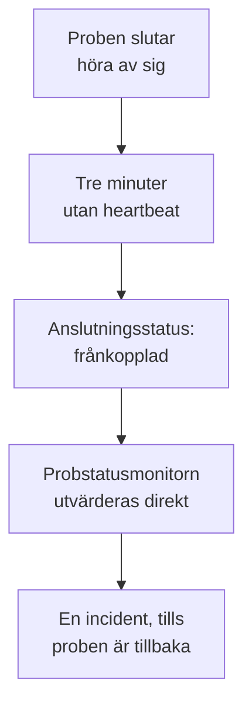

# Probstatusmonitor

En probstatusmonitor talar om för dig när en prob slutar höra av sig: en incident när den tappar anslutningen, som löser sig själv när den är tillbaka. Rikta den mot dina anpassade prober eller, på en egen OneUptime-installation, mot den globala prob som varje monitor körs på, så att en prob som tystnar aldrig lämnar sina monitorer okontrollerade utan att någon vet om det.

:::cards
- [Skapa en](#skapa-en-probstatusmonitor): Välj proberna och behåll standardkriterierna.
- [Kriterier](#kriterier): Räkna de anslutna eller frånkopplade proberna, nu eller över ett tidsfönster.
- [Mätvärden](#mätvärden): Hur många prober som var anslutna, minut för minut.
:::

## Så fungerar det

OneUptime utvärderar varje probstatusmonitor en gång i minuten, och igen i samma stund som en av dess prober ansluter eller kopplas från. Den läser varje probs anslutningsstatus, samma som probens sida visar: en prob är frånkopplad när inget har hörts från den på tre minuter. När OneUptime självt har legat nere eller inte tagit emot data väntar den tre hela minuter innan den kallar någon prob frånkopplad, så en uppgradering av OneUptime öppnar aldrig en incident.

En prob som förblir nere är en enda incident, inte en per minut. Monitorn förblir offline, med sin incident öppen, tills varje prob den bevakar är ansluten igen; då löser sig incidenten själv.

En monitor kan bevaka sitt eget projekts prober och de globala proberna. En borttagen prob räknas inte åt något håll. När ingen av de prober en monitor bevakar finns kvar behåller den sin status, och dess översikt säger det efter en dag.

## Skapa en probstatusmonitor

:::steps
### Påbörja en ny monitor

Gå till **Monitorer** och klicka på **Skapa monitor**.

### Välj probstatus

Under **Monitortyp** klickar du på **Fler monitortyper** och väljer **Sondstatus** under **Annat**. Fyll i **Namn** och klicka på **Nästa**.

### Välj proberna

Under **Prober att bevaka** väljer du proberna. En ny monitor börjar med ditt projekts egna prober. En egen OneUptime-installation utan egna prober börjar med sina globala prober; på OneUptime Cloud drivs de globala proberna av OneUptime, så ett projekt väljer dem själv om det vill bevaka dem.

### Skapa monitorn

Behåll standardkriterierna, som beskrivs nedan, och klicka på **Skapa monitor**. Monitorn utvärderas direkt, och dess översikt listar varje prob den bevakar, frånkopplade först.
:::

> [!TIP]
> **Övervaka den här proben**, på en probs sida och i menyn på dess rad under **Monitorer → Inställningar → Sonder**, öppnar **Skapa monitor** med en probstatusmonitor som bevakar den proben och är döpt efter den.

## Kriterier

En probstatusmonitors filter räknar prober:

| Filter | Vad det räknar |
| --- | --- |
| **Disconnected Probes** | De bevakade proberna som är frånkopplade. |
| **Connected Probes** | De bevakade proberna som är anslutna. |

Båda är heltal som jämförs med **Större än**, **Mindre än**, **Lika med** och de övriga jämförelserna. En ny monitor börjar med två kriterier:

| Kriterium | Filter | Vad det gör |
| --- | --- | --- |
| Check if a probe is disconnected | **Disconnected Probes** större än `0` | Sätter monitorn offline och deklarerar en incident med titeln `Probe disconnected: {{disconnectedProbeNames}}`, som löser sig själv. |
| Check if every probe is connected | **Disconnected Probes** lika med `0` | Sätter monitorn till i drift. |

**Connected Probes** passar en monitor som bevakar flera prober och klarar att förlora en: **Connected Probes** mindre än `2` deklarerar en incident först när färre än två finns kvar.

### Vänta längre före en incident

En prob är frånkopplad först efter tre minuters tystnad, så en snabb omstart öppnar ingenting. För att vänta längre kryssar du i **Utvärdera dessa kriterier över en tidsperiod** under filtret, väljer **All Values** under **Utvärdera** och ett fönster under **Under de senaste (i minuter)**. Med fem minuter måste en prob vara frånkopplad i ytterligare fem minuter innan incidenten deklareras.

## Mätvärden

Varje utvärdering registrerar två serier på monitorn: `oneuptime.monitor.probes.connected` och `oneuptime.monitor.probes.disconnected`, antalet bevakade prober som var anslutna och frånkopplade. De visas i diagram på monitorns sida **Mätvärden**, och en instrumentpanel eller en mätvärdesmonitor läser dem som vilken annan serie som helst.

## Mallvariabler

En probstatusmonitors incident- och larmmallar kan använda de här variablerna, utöver dem som varje monitor har:

| Variabel | Värde |
| --- | --- |
| `{{disconnectedProbeNames}}` | Namnen på de frånkopplade proberna, åtskilda med kommatecken. |
| `{{disconnectedProbeCount}}` | Hur många av proberna som är frånkopplade. |
| `{{connectedProbeNames}}` | Namnen på de anslutna proberna, åtskilda med kommatecken. |
| `{{connectedProbeCount}}` | Hur många av proberna som är anslutna. |
| `{{probeStatusSummary}}` | En mening som namnger de frånkopplade proberna, som `1 of 3 probes is disconnected: EU Probe.`, eller säger att alla prober är anslutna. |
| `{{probes}}` | Varje prob, med `probeName`, `isConnected`, `isGlobalProbe` och `lastAliveAt`. |

## Felsökning

:::details Monitorn säger att den väntar på data
En ny monitor visar sin första utvärdering inom en minut eller två. Om den inte bevakar någon prob visar den i stället **Not set up**: välj proberna under **Kriterier**.
:::

:::details En prob gick ner och ingen incident deklarerades
En prob är frånkopplad efter tre minuter utan heartbeat, och ännu senare efter att OneUptime självt har legat nere. Kontrollera att monitorn inte är inaktiverad eller i ett underhållsfönster, och att dess kriterier fortfarande deklarerar en incident.
:::

## Nästa steg

:::cards
- [Anpassade prober](/docs/probe/custom-probe): Kör en prob i ditt eget nätverk.
- [Monitorkriterier och statusar](/docs/monitor/criteria-and-statuses): Hur kriterier avgör en monitors status.
- [Mallar för incidenter och larm](/docs/monitor/incident-alert-templating): Formulera incidenten som en monitor deklarerar.
:::
