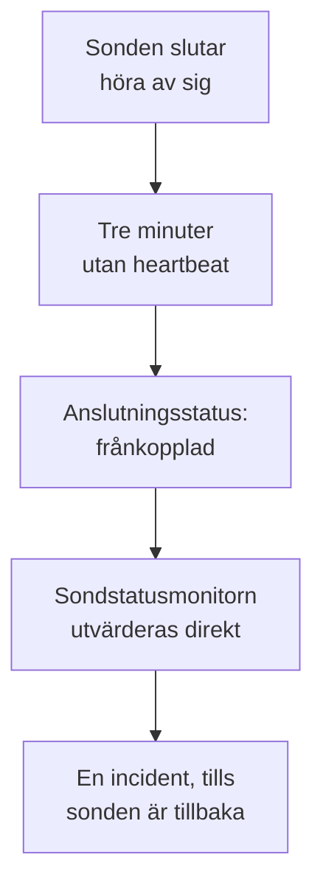

# Sondstatusmonitor

En sondstatusmonitor talar om för dig när en sond slutar höra av sig: en incident när den tappar anslutningen, som löser sig själv när den är tillbaka. Rikta den mot dina anpassade sonder eller, på en egen OneUptime-installation, mot den globala sond som varje monitor körs på, så att en sond som tystnar aldrig lämnar sina monitorer okontrollerade utan att någon vet om det. En ny monitor larmar också när en av dess sonder hamnar efter, så att dess monitorer kontrolleras, eller dess nätverksenheter avfrågas, mer sällan än inställt.

:::cards
- [Skapa en](#skapa-en-sondstatusmonitor): Välj sonderna och behåll standardkriterierna.
- [Kriterier](#kriterier): Räkna de anslutna, frånkopplade eller efterliggande sonderna, nu eller över ett tidsfönster.
- [Mätvärden](#mätvärden): Hur många sonder som var anslutna, minut för minut.
:::

## Så fungerar det

OneUptime utvärderar varje sondstatusmonitor en gång i minuten, och igen i samma stund som en av dess sonder ansluter eller kopplas från. Den läser varje sonds anslutningsstatus, samma som sondens sida visar: en sond är frånkopplad när inget har hörts från den på tre minuter. När OneUptime självt har legat nere eller inte tagit emot data väntar den tre hela minuter innan den kallar någon sond frånkopplad, så en uppgradering av OneUptime öppnar aldrig en incident. Den läser också om varje ansluten sond ligger efter, så som sondens sida säger det ([En sond ligger efter](/docs/probe/custom-probe#en-sond-ligger-efter)), och utvärderar monitorn igen i samma stund som en hamnar efter eller kommer ikapp.

En sond som förblir nere är en enda incident, inte en per minut. Monitorn förblir offline, med sin incident öppen, tills varje sond den bevakar är ansluten igen; då löser sig incidenten själv.

En monitor kan bevaka sitt eget projekts sonder och de globala sonderna. En borttagen sond räknas inte åt något håll. När ingen av de sonder en monitor bevakar finns kvar behåller den sin status, och dess översikt säger det efter en dag.

## Skapa en sondstatusmonitor

:::steps
### Påbörja en ny monitor

Gå till **Monitorer** och klicka på **Skapa monitor**.

### Välj sondstatus

Under **Monitortyp** klickar du på **Fler monitortyper** och väljer **Sondstatus** under **Annat**. Fyll i **Namn** och klicka på **Nästa**.

### Välj sonderna

Under **Sonder att bevaka** väljer du sonderna. En ny monitor börjar med ditt projekts egna sonder. En egen OneUptime-installation utan egna sonder börjar med sina globala sonder; på OneUptime Cloud drivs de globala sonderna av OneUptime, så ett projekt väljer dem själv om det vill bevaka dem.

### Skapa monitorn

Behåll standardkriterierna, som beskrivs nedan, och klicka på **Skapa monitor**. Monitorn utvärderas direkt, och dess översikt listar varje sond den bevakar, frånkopplade först.
:::

> [!TIP]
> **Övervaka den här sonden**, på en sonds sida och i menyn på dess rad under **Monitorer → Inställningar → Sonder**, öppnar **Skapa monitor** med en sondstatusmonitor som bevakar den sonden och är döpt efter den.

## Kriterier

En sondstatusmonitors filter räknar sonder:

| Filter | Vad det räknar |
| --- | --- |
| **Frånkopplade sonder** | De bevakade sonderna som är frånkopplade. |
| **Anslutna sonder** | De bevakade sonderna som är anslutna. |
| **Sonder som ligger efter** | De bevakade sonderna som är anslutna men ligger efter: deras monitorer kontrolleras, eller deras nätverksenheter avfrågas, mer sällan än inställt. |

Alla tre är heltal som jämförs med **Större än**, **Mindre än**, **Lika med** och de övriga jämförelserna. En ny monitor börjar med tre kriterier:

| Kriterium | Filter | Vad det gör |
| --- | --- | --- |
| Kontrollera om en sond är frånkopplad | **Frånkopplade sonder** större än `0` | Sätter monitorn offline och deklarerar en incident med titeln "Sond frånkopplad: {{disconnectedProbeNames}}", som löser sig själv. |
| Kontrollera om en sond ligger efter | **Sonder som ligger efter** större än `0` | Larmar med titeln "Sond ligger efter: {{behindProbeNames}}", som löser sig själv. Det ändrar inte monitorns status och deklarerar ingen incident: sonden hör fortfarande av sig. |
| Kontrollera om alla sonder är anslutna | **Frånkopplade sonder** lika med `0` | Sätter monitorn till i drift. |

En monitor som skapades innan **Sonder som ligger efter** fanns behåller sina kriterier, och får därför inte veta när en sond hamnar efter förrän du lägger till kontrollen i dess kriterier.

Filtret **Anslutna sonder** passar en monitor som bevakar flera sonder och klarar att förlora en: **Anslutna sonder** mindre än `2` deklarerar en incident först när färre än två finns kvar.

### Vänta längre före en incident

En sond är frånkopplad först efter tre minuters tystnad, så en snabb omstart öppnar ingenting. För att vänta längre kryssar du i **Utvärdera dessa kriterier över en tidsperiod** under filtret, väljer **Alla värden** under **Utvärdera** och ett fönster under **Under de senaste (i minuter)**. Med fem minuter måste en sond vara frånkopplad i ytterligare fem minuter innan incidenten deklareras.

## Mätvärden

Varje utvärdering registrerar tre serier på monitorn: `oneuptime.monitor.probes.connected`, `oneuptime.monitor.probes.disconnected` och `oneuptime.monitor.probes.behind`, antalet bevakade sonder som var anslutna, frånkopplade och låg efter. De visas i diagram på monitorns sida **Mätvärden**, och en instrumentpanel eller en mätvärdesmonitor läser dem som vilken annan serie som helst.

## Mallvariabler

En sondstatusmonitors incident- och larmmallar kan använda de här variablerna, utöver dem som varje monitor har:

| Variabel | Värde |
| --- | --- |
| `{{disconnectedProbeNames}}` | Namnen på de frånkopplade sonderna, åtskilda med kommatecken. |
| `{{disconnectedProbeCount}}` | Hur många av sonderna som är frånkopplade. |
| `{{connectedProbeNames}}` | Namnen på de anslutna sonderna, åtskilda med kommatecken. |
| `{{connectedProbeCount}}` | Hur många av sonderna som är anslutna. |
| `{{behindProbeNames}}` | Namnen på de anslutna sonderna som ligger efter, åtskilda med kommatecken. |
| `{{behindProbeCount}}` | Hur många av sonderna som ligger efter. |
| `{{probeStatusSummary}}` | En mening som namnger de frånkopplade sonderna, som `1 of 3 probes is disconnected: EU Probe.`, annars de som ligger efter, eller säger att alla sonder är anslutna. |
| `{{probes}}` | Varje sond, med `probeName`, `isConnected`, `isBehind`, `isGlobalProbe` och `lastAliveAt`. |

## Felsökning

:::details Monitorn säger att den väntar på data
En ny monitor visar sin första utvärdering inom en minut eller två. Om den inte bevakar någon sond visar den i stället **Inte konfigurerad**: välj sonderna under **Kriterier**.
:::

:::details En sond gick ner och ingen incident deklarerades
En sond är frånkopplad efter tre minuter utan heartbeat, och ännu senare efter att OneUptime självt har legat nere. Kontrollera att monitorn inte är inaktiverad eller i ett underhållsfönster, och att dess kriterier fortfarande deklarerar en incident.
:::

## Nästa steg

:::cards
- [Anpassade sonder](/docs/probe/custom-probe): Kör en sond i ditt eget nätverk.
- [Kriterier och statusar](/docs/monitor/criteria-and-statuses): Hur kriterier avgör en monitors status.
- [Mallar för incidenter och larm](/docs/monitor/incident-alert-templating): Formulera incidenten som en monitor deklarerar.
:::
