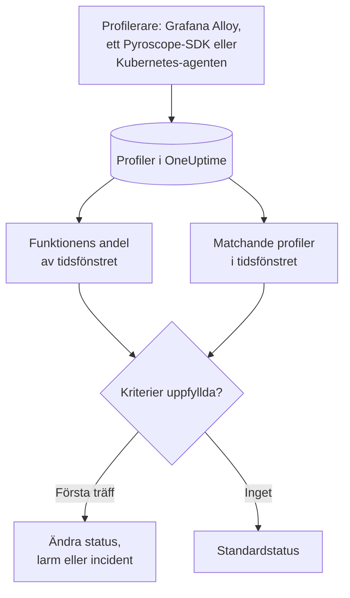

# Profilövervakning

En profilmonitor läser de kontinuerliga profiler som dina tjänster skickar till OneUptime och varnar för två saker: en funktion som tar en större andel av tiden än den borde, som en parser som blev tyngre efter en driftsättning, och profiler som slutar komma från en tjänst. Varje minut mäter den hur mycket av sitt tidsfönster som gick genom funktionen du anger, räknar de profiler som matchar dess filter, och ändrar monitorns status, skapar ett larm eller deklarerar en incident när dina kriterier uppfylls.

:::cards
- [Skapa monitorn](#skapa-en-profilmonitor): Från en funktion i profileraren eller från Skapa monitor.
- [Vad den frågar efter](#vad-den-frågar-efter): Funktionen, profiltypen, tjänsterna och fönstret.
- [Kriterier](#kriterier): En funktions andel av fönstret eller antalet profiler.
- [En funktion blir tyngre](#genomgånget-exempel-en-funktion-blir-tyngre): Varnas när en funktions andel rusar.
:::

## Så fungerar det



Varje minut läser OneUptime de profiler som matchar monitorns filter och startade inom dess tidsfönster. Det räknar dem och mäter, när monitorn anger en funktion, den andel av fönstrets tid som gick genom funktionen. Det jämför talen med monitorns kriterier uppifrån och ned, och det första kriteriet som matchar avgör vad som händer. När inget matchar återgår monitorn till sin standardstatus.

## Innan du börjar

- Dina tjänster skickar kontinuerliga profileringsdata till OneUptime via Grafana Alloy (eBPF), ett Pyroscope-SDK eller OneUptimes Kubernetes-agent. Se [Kontinuerlig profilering](/docs/telemetry/profiles).
- För att bevaka en funktion känner du till dess namn, eller en del av dess fil- eller paketsökväg, så som profileraren visar den.

## Skapa en profilmonitor

:::steps
### Börja från profileraren eller från Skapa monitor

Snabbast är att utgå från själva funktionen: öppna funktionen i **Prestandaprofiler** och klicka på länken som erbjuder ett larm för dess andel. **Skapa monitor** öppnas med monitorn ifylld för funktionen och dess tjänst, med ett tröskelvärde över det den tar i dag, som beskrivs i [Genomgånget exempel: en funktion blir tyngre](#genomgånget-exempel-en-funktion-blir-tyngre). Annars går du till **Monitorer** och klickar på **Skapa monitor**.

### Välj Profiles

Under **Monitortyp** klickar du på **Fler monitortyper** och väljer **Profiler** under **Telemetri**, eller skriver `profiles` i sökrutan. Ange ett **Namn** och klicka sedan på **Nästa**.

### Välj vad den läser

I **Konfiguration av profilmonitor** anger du i **Funktion** funktionen att bevaka, i **Vad som ska analyseras** profiltypen och i **Övervaka profiler under (tid)** fönstret. En ny monitor läser **CPU-tid** under de **Senaste 5 minuterna**. **Vad den här monitorn läser nu**, under fälten, visar hur många profiler som matchar och hur mycket av fönstret funktionen tar i dag, så att du kan sätta tröskelvärdet över det. Öppna **Fler fält** för att filtrera efter telemetritjänst eller infrastrukturenhet.

### Ange kriterierna

En monitor som startats från **Skapa monitor** har två kriterier: offline, med en incident, när **Antal profiler** är 0, och online när det är över 0. För att varnas för funktionen lägger du till ett filter **Funktionsandel (i %)**: se [Kriterier](#kriterier).

### Skapa monitorn

Klicka på **Skapa monitor**. Monitorn öppnas på sin sida **Översikt**, och dess första utvärdering körs inom en minut.
:::

### Skapa den via API:et eller Terraform

En monitors steg innehåller samma inställningar som dess konfiguration `profileMonitor`. Den här bevakar `parseOrder` i en tjänsts CPU-profiler under de senaste fem minuterna:

```json
{
  "profileMonitor": {
    "telemetryServiceIds": [],
    "profileTypes": ["cpu"],
    "profileType": "",
    "functionName": "parseOrder",
    "attributes": {},
    "lastXSecondsOfProfiles": 300
  }
}
```

Lägg tjänstens ID i `telemetryServiceIds`, eller lämna listan tom för att läsa profiler från alla tjänster, och lämna `functionName` tomt för att bara räkna profiler. Skapa en monitor med monitortypen `Profiles` och ett steg som innehåller den här konfigurationen och minst ett kriterium, via [API:et](/docs/api-reference/api-reference) eller [Terraform](/docs/terraform/monitor-steps). I Terraform skickar du konfigurationen som stegets attribut `profile_monitor`, skriven med `jsonencode()`.

## Vad den frågar efter

| Fält | Vad det matchar | Standard |
| --- | --- | --- |
| `profileTypes` | Profiler av någon av dessa typer, jämförda exakt, som `cpu`. | Tomt: alla typer |
| `profileType` | Profiler vars typ innehåller den här texten, oavsett skiftläge. När den är satt ignoreras `profileTypes`. | Tomt |
| `functionName` | Koden vars andel **Funktionsandel (i %)** mäter: stackramar vars funktionsnamn eller filsökväg innehåller den här texten, oavsett skiftläge. | Tomt: ingen andel mäts |
| `telemetryServiceIds` | Profiler från någon av dessa telemetritjänster. | Tomt: alla tjänster |
| `entityKeys` | Profiler från någon av dessa värdar, poddar, containrar och andra infrastrukturenheter. | Tomt: alla enheter |
| `attributes` | Profiler vars attribut har dessa värden. | Tomt: inget villkor |
| `lastXSecondsOfProfiles` | Profiler som startade inom detta antal sekunder före utvärderingen. | Inget: ange det alltid, annars räknas varje lagrad profil och antalet sjunker aldrig till 0 |

Alla filter som du anger måste matcha för att en profil ska läsas. I formuläret anger **Funktion** `functionName`, **Vad som ska analyseras** anger `profileTypes` (**Alla typer av profiler** lämnar det tomt), **Övervaka profiler under (tid)** anger `lastXSecondsOfProfiles`, och **Filtrera efter telemetritjänst** och **Filtrera efter infrastrukturenhet** anger `telemetryServiceIds` och `entityKeys`.

## Så utvärderas den

- **Varje minut.** En profilmonitor kontrolleras inte av sonder, så den har inget intervall att ange och ingen sida **Sonder och intervall**.
- **Två tal per utvärdering.** Monitorn räknar de profiler som matchar alla filter och startade inom `lastXSecondsOfProfiles`, och mäter funktionens andel av samma profiler. En profilerare laddar upp med ett jämnt intervall, så ge fönstret utrymme för flera uppladdningar.
- **En enhet i taget.** En andel summerar samples av en enda enhet: när de typer den läser blandar enheter, som CPU-tid i nanosekunder från ett SDK och antal samples från eBPF, läser den enheten med flest samples i fönstret.
- **Inga profiler är ett antal på 0 och ingen andel.** En tjänst vars profilerare slutar ladda upp ger antalet 0, och ett kriterium **Funktionsandel (i %)** matchar inte ett tomt fönster: varna för **Antal profiler** för att veta att profileringen har stoppat.
- **OneUptimes eget avbrott är inte tystnad.** Så länge tidsfönstret innehåller tid då OneUptime självt inte tog emot data (det startade om, uppgraderades eller arbetade ikapp en eftersläpning) väntar kontrollen: statusen ändras inte, och ingen incident eller larm öppnas eller löses. Se [När OneUptime inte tar emot data](/docs/monitor/when-oneuptime-is-not-receiving).
- **Kriterier uppifrån och ned.** Det första kriteriet som matchar avgör, så lägg det allvarligaste överst.

Varje statusändring registreras med sin orsak på monitorns **Statustidslinje**.

## Kriterier

En profilmonitors kriterier jämför ett av två tal med ett värde.

**Funktionsandel (i %)** är den andel av fönstrets tid, från 0 till 100, som gick genom monitorns funktion: varje stack med en ram som matchar `functionName` räknas en gång, oavsett djup, så både funktionens egen kod och allt den anropar ingår.

| Filtervillkor | Matchar när funktionens andel är… |
| --- | --- |
| **Större än** | över värdet |
| **Större än eller lika med** | värdet eller högre |
| **Mindre än** | under värdet |
| **Mindre än eller lika med** | värdet eller lägre |

**Antal profiler** är antalet profiler som matchade i fönstret:

| Filtervillkor | Matchar när antalet profiler är… |
| --- | --- |
| **Större än** | över värdet |
| **Större än eller lika med** | värdet eller högre |
| **Mindre än** | under värdet |
| **Mindre än eller lika med** | värdet eller lägre |
| **Lika med** | exakt värdet |
| **Inte lika med** | allt utom värdet |

Antal profiler har inga avvikelsevillkor: det finns ingen baslinje att jämföra dem med.

## Genomgånget exempel: en funktion blir tyngre

I checkout-tjänsten tar `parseOrder` 18 % av dess CPU-tid. En driftsättning som parsar en större nyttolast ska inte passera obemärkt:

1. Välj checkout-tjänsten i **Prestandaprofiler** och öppna `parseOrder`.
2. Klicka på länken som erbjuder ett larm för dess andel. Profileraren föreslår 30 %: hälften över dagens andel, minst 10 enheter mer, avrundat uppåt till en multipel av 5.
3. **Skapa monitor** öppnas med en profilmonitor för checkout-tjänsten som läser **CPU-tid** under de **Senaste 5 minuterna**, med två kriterier: **Funktionsandel (i %)** **Större än** `30` utlöser ett larm, som löser sig själv, och markerar monitorn som försämrad; **Mindre än eller lika med** `30` markerar den som i drift. Incidenten är ifylld men avstängd: slå på den för att larma någon.
4. Klicka på **Skapa monitor**.

När driftsättningen får `parseOrder` att ta 45 % av CPU-tiden utlöser nästa utvärdering larmet. När en rättning får den under 30 % igen löser larmet sig själv.

## Genomgånget exempel: profiler slutar komma

Checkout-tjänsten kör ett Pyroscope-SDK som laddar upp CPU-profiler. Du vill ha en incident när de uteblir i fem minuter:

- `profileTypes`: `["cpu"]`, `telemetryServiceIds`: checkout-tjänsten, `lastXSecondsOfProfiles`: `300`
- Kriterium 1: **Antal profiler** **Lika med** `0`: markera monitorn som offline och deklarera en incident
- Kriterium 2: **Antal profiler** **Större än** `0`: markera monitorn som online

Medan SDK:t laddar upp räknar varje utvärdering några profiler och kriterium 2 håller monitorn online. När tjänsten driftsätts utan SDK:t sjunker antalet till 0 fem minuter efter den senaste uppladdningen, kriterium 1 matchar och incidenten deklareras. Den första uppladdningen efter rättningen för antalet över 0 igen, och incidenten löser sig själv om **Lös incident automatiskt** är aktiverat för den.

## Felsökning

:::details Monitorn räknar 0, men profiler visas i OneUptime
Jämför filtren med de profiler som du ser: `profileTypes` måste matcha typen exakt, och `telemetryServiceIds` måste innehålla rätt tjänst-ID:n. Ett kort `lastXSecondsOfProfiles` kan också hamna mellan två uppladdningar.
:::

:::details Funktionens andel stannar på 0 %
Ingen ram i fönstret innehåller funktionstexten. Öppna funktionen i profileraren och kopiera dess namn så som det visas där; en del av namnet fungerar, och skiftläget spelar ingen roll. Kontrollera sedan att tjänsten skickar den profiltyp som **Vad som ska analyseras** läser.
:::

## Nästa steg

:::cards
- [Kontinuerlig profilering](/docs/telemetry/profiles): Skicka profiler och läs dem i profileraren.
- [Monitorsteg](/docs/terraform/monitor-steps): Skicka stegets konfiguration från Terraform.
- [Spårningsövervakning](/docs/monitor/traces-monitor): Varnas om misslyckade spans.
- [Metrikövervakning](/docs/monitor/metrics-monitor): Varnas om CPU, minne och andra mätvärden.
:::
