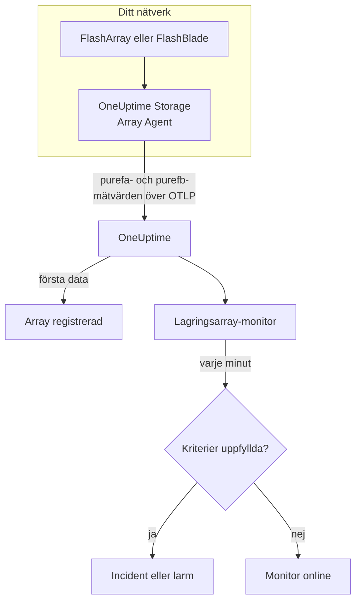

# Lagringsarray-övervakning

En lagringsarray-monitor bevakar en lagringsarray och säger till när arrayen själv skickar ut ett larm, får slut på utrymme, blir långsam, förlorar hårdvara eller en värdsökväg, eller släpar efter med replikeringen. Den fungerar med Pure Storage FlashArray, Pure Storage FlashBlade och NetApp ONTAP (inklusive Amazon FSx for NetApp ONTAP) och läser mätvärdena som OneUptime Storage Array Agent samlar in: Pures serier `purefa_*` och `purefb_*`, och serierna `netapp_*` som NetApp Harvest läser från ett ONTAP-kluster.

Den fungerar också med Dell PowerStore (`dell.powerstore`), utifrån Dells serier `powerstore_*`.

Den fungerar också med Dell PowerScale (`dell.powerscale`), utifrån Dells serier `powerscale_*`.

:::cards
- [Skapa monitorn](#skapa-en-lagringsarray-monitor): Sex steg i instrumentpanelen.
- [Mallar](#färdiga-larmmallar): Färdiga larm, en incident per volym, värd, appliance eller komponent.
- [Så fungerar Pures serier](#så-är-pures-serier-uppbyggda): Ett mätvärdesnamn, många värden. ONTAP:s serier [har ett eget avsnitt](#så-är-ontaps-serier-uppbyggda).
- [Mätvärden](#insamlade-mätvärden): Varje serie som monitorn kan varna på.
:::

## Så fungerar det

OneUptime Storage Array Agent körs på en maskin som når arrayens administrationsgränssnitt. Den läser arrayens mätvärden med en skrivskyddad API-token (en PowerScales över SNMP, med en skrivskyddad community eller SNMPv3-användare), märker dem med arrayens namn, `storage.array.name`, och plattformen, `storage.system`, och skickar dem till OneUptime över OTLP. Första gången data kommer in registreras arrayen.

En Dell PowerMax (`dell.powermax`) behöver ingen agent: en OneUptime-sond loggar in i Unisphere for PowerMax med ett skrivskyddat konto var 5:e minut och skickar varje array som den hanterar på samma sätt, med namn efter sitt Symmetrix ID tills du byter namn på den ([Dell PowerMax](/docs/telemetry/storage-arrays#dell-powermax)).

En lagringsarray-monitor är kopplad till en array. Varje minut kör den sin fråga mot den arrayens mätvärden och jämför resultatet med sina kriterier.



## Innan du börjar

- **Installera Storage Array Agent** någonstans där den når arrayen över HTTPS, med API-token för en användare som har arrayens roll **readonly**. [Guiden för Storage Array Agent](/docs/telemetry/storage-arrays) går igenom användaren, token och installationen, med `ONEUPTIME_URL`, `ONEUPTIME_TELEMETRY_INGESTION_KEY`, `STORAGE_ARRAY_NAME` och arrayens adress och token (`PURE_FA_ENDPOINT` och `PURE_FA_API_TOKEN`, eller `PURE_FB_ENDPOINT` och `PURE_FB_API_TOKEN`), eller för ONTAP klustrets adress och en skrivskyddad REST-användare (`NETAPP_ONTAP_ENDPOINT`, `NETAPP_ONTAP_USERNAME` och `NETAPP_ONTAP_PASSWORD`).
- **Kontrollera att arrayen är registrerad.** Den visas under **Produkter → Infrastruktur → Lagringsarrayer → Alla lagringsarrayer**, med namnet från agentens `STORAGE_ARRAY_NAME`, ungefär en minut efter den första avläsningen.
- **För en Dell PowerMax** ansluter du i stället den Unisphere for PowerMax som hanterar den under **Produkter → Infrastruktur → Lagringsarrayer → Anslutningar**, som [Dell PowerMax](/docs/telemetry/storage-arrays#dell-powermax) förklarar.

## Skapa en lagringsarray-monitor

:::steps
### Starta en ny monitor

Gå till **Monitorer** och klicka på **Skapa monitor**.

### Välj Lagringsarray

Klicka på **Fler monitortyper** under **Monitortyp** och välj **Lagringsarray** under **Infrastruktur**, eller skriv `storage` i sökfältet. Ange ett **Namn** - det används i titlarna på incidenter och larm - och klicka på **Nästa**.

### Välj arrayen

Välj arrayen i **Lagringsarray** under **Storage Array Monitor Configuration**. Varje array som har skickat data finns i listan. Plattformen avgör vilka mätvärden och mallar formuläret erbjuder. När du har valt visar en rad under fältet om data kommer in. **Lägg till lagringsarray** öppnar installationssteg med dina nycklar ifyllda, som väntar tills data kommer in.

### Välj vad som ska bevakas

En ny monitor börjar med **Array Stopped Reporting** under **Vad som ska larmas om**. Så här övervakar du något annat:

- **Ändra** - välj en annan [mall](#färdiga-larmmallar). Den sätter mätvärdet, etikettfiltren, aggregeringen, tidsintervallet och tröskelvärdena och ersätter kriterierna nedan med sina egna. Du kan fortfarande ändra **Tidsintervall**.
- **Custom Metric** (under **Fler fält**) - välj ett mätvärde i **Storage Array Metric** och sätt sedan **Aggregering** och **Tidsintervall**. [Filtren](#monitorinställningar) begränsar det till en volym, en värd, en podd, en komponent, ett filsystem eller en bucket.
- **Avancerad** (under **Fler fält**) - bygg frågor och formler själv under **Välj mätvärden**, till exempel använd kapacitet som `purefa_array_space_bytes` filtrerat till `space=capacity` minus samma mätvärde filtrerat till `space=empty`. Använd **Gruppera efter** med ett objekts etikett för att bedöma varje objekt för sig.

### Kontrollera kriterierna

Öppna varje kriterium under **Kriterier** och kontrollera dess **Mätvärde**, **Aggregering**, **Villkor** och **Tröskel**. En mall fyller i dem. Med **Custom Metric** eller **Avancerad** startar monitorn med [standardkriterierna](#standardkriterier), som bara märker att ett mätvärde inte skickar data, så sätt ditt eget tröskelvärde.

### Skapa monitorn

Klicka på **Skapa monitor**. OneUptime öppnar monitorns sida och utvärderar den varje minut. Incidenter och larm som den skapar visas också på arrayens sidor **Incidenter** och **Larm**.
:::

> [!TIP]
> För att sätta upp flera mallar på en gång öppnar du arrayen från **Produkter → Infrastruktur → Lagringsarrayer** och går till **Rekommendationer**. Välj de mallar du vill ha, välj vem som ska larmas, och OneUptime skapar en monitor per mall.

## Monitorinställningar

| Fält | Flik | Vad det gör |
| --- | --- | --- |
| **Lagringsarray** | Alla | Krävs. Begränsar varje fråga till `resource.storage.array.name`, så två arrayer som båda har en volym som heter `vol-01` blandas aldrig ihop. |
| **Volym** | Custom Metric, Avancerad | En volym: på en FlashArray via etiketten `name`, som `vol-db-01` (en volym i en podd eller en volymgrupp heter `pod::volume` eller `group/volume`); på ONTAP via etiketten `volume`, som två SVM:ar kan dela; på en PowerMax via etiketten `volume`, dess enhets-ID, som `00847`. |
| **Värd** | Custom Metric, Avancerad | Bara FlashArray. En värd så som arrayen känner den, via etiketten `host`, som `esxi-01`. |
| **Podd** | Custom Metric, Avancerad | Bara FlashArray. En ActiveCluster- eller ActiveDR-podd, via etiketten `name`, eller `local_pod` på serier för replikalänkar. |
| **Maskinvarukomponent** | Custom Metric, Avancerad | En hårdvarukomponent, som `CH0.BAY1` eller `CT0`: etiketten `component_name` på en FlashArray, `name` på en FlashBlade, på ONTAP den etikett som dess serie namnger den med (`node`, `disk`, `shelf` eller `port`) och `component` på en PowerMax, en director som `FA-1D` eller en port som `FA-1D:4`. På en PowerScale en nod via etiketten `node`, som `ps-prod-2`. |
| **Filsystem** | Custom Metric, Avancerad | FlashBlade och PowerScale. Ett filsystem via etiketten `name` på en FlashBlade; en kvot via etiketten `quota` på en PowerScale, som `/ifs/data/home`. |
| **Bucket** | Custom Metric, Avancerad | Bara FlashBlade. En bucket för objektlagring, via etiketten `name`. |
| **Storage Array Metric** | Custom Metric | Ett mätvärde från [katalogen](#insamlade-mätvärden). Formuläret lägger till etikettfiltret som ger det dess betydelse och grupperar det efter objektet det beskriver, så varje volym, värd eller komponent bedöms för sig. |
| **Aggregering** | Custom Metric | Hur stickprov kombineras: **Genomsnitt**, **Maximum**, **Minimum**, **Summa** eller **Antal**. Börjar på mätvärdets vanliga aggregering. |
| **Tidsintervall** | Alla | Det glidande fönstret som frågan läser, från **Past 1 Minute** till **Past 365 Days**. En ny monitor börjar på **Senaste 5 minuterna**; ett anpassat mätvärde för ett filsystem eller en bucket på **Senaste 15 minuterna**; mallar sätter sitt eget. |
| **Välj mätvärden** | Avancerad | Frågebyggaren: **Mätvärde**, **Aggregera efter**, **Filtrera på attribut**, **Gruppera efter**, plus **Lägg till mätvärde** och **Lägg till formel** för att kombinera frågor. |

Agenten läser arrayens endpoint var 60:e sekund, och volymer, värdar och poddar var 2:a minut, så ett fönster på 5 minuter alltid innehåller ett stickprov. En FlashBlades filsystem och buckets läser den var 5:e minut, därav 15, och FlashArray-kataloger var 30:e minut: ge en katalogmonitor ett fönster på 60 minuter. På ONTAP läser Harvest klustrets prestanda varje minut och dess konfiguration, tillstånd och EMS-händelser var 3:e minut, så ett fönster på 5 minuter innehåller alltid ett stickprov. Ett PowerScale-kluster och var och en av dess noder avfrågar den var 60:e sekund, och dess kvoter var 5:e minut: ge en kvotmonitor ett fönster på 15 minuter.

Den läser en PowerStore var 5:e minut, och dess klusters tillstånd var 60:e sekund: ge en PowerStore-monitor ett fönster på 15 minuter.

## Så är Pures serier uppbyggda

Pure lägger flera värden på **ett** mätvärdesnamn och skiljer dem åt med en etikett:

- **`dimension`** på prestandaserierna. `purefa_array_performance_latency_usec` bär läslatensen (`usec_per_read_op`), skrivlatensen (`usec_per_write_op`), latensen för speglade skrivningar och SAN-, kö-, QoS- och tjänstetiden för var och en av dem. Filtrera alltid på en `dimension`: ett genomsnitt över dem blandar en läslatens på 200 µs med ett kövärde.
- **`space`** på kapacitetsserierna: `capacity`, `empty`, `snapshots`, `total_provisioned`, `total_physical`, `available_ratio` med flera.

Flera serier bär sitt tillstånd i en **etikett**, med ett värde som alltid är 1:

| Serie | Tillståndsetikett | En serie per |
| --- | --- | --- |
| `purefa_alerts_open` | `severity`, med `summary`, `code` och `component_type` | Öppen larm |
| `purefa_hw_component_status` | `component_status` | Hårdvarukomponent |
| `purefa_host_connectivity_info` | `status`, med `details` | Värd |
| `purefa_drive_capacity_bytes` | `component_status` (värdet är diskens kapacitet) | Disk |

En serie som är filtrerad till ett dåligt tillstånd finns bara så länge något är i det tillståndet, så ingen serie betyder att allt är friskt. Därför är **Max över 0 utlöser och 0 återhämtar** rätt form för dem, och så är mallarna byggda: deras återhämtningskriterier räknar en saknad serie som noll. När inga serier alls finns kvar återställs en sådan mall bara om `purefa_info`, `purefb_info` eller `powermax_array_info` kom i samma fönster, så en array som har slutat rapportera stänger ingenting.

Serierna från en PowerMax har ett värde var och är namngivna efter det: `powermax_array_response_time_usec` skiljer läsningar från skrivningar med `operation`. Dess tillståndsserier finns på samma sätt bara medan något är fel: `powermax_alert_open` medan Unisphere har ett öppet larm, `powermax_director_offline` medan en director inte är online, `powermax_port_offline` medan en port som någon är beroende av är nere, och `powermax_srdf_group_not_healthy` medan en SRDF-grupp är suspenderad eller offline.

I monitorfilter och grupperingsnycklar börjar agentens attribut med `resource.` (`resource.storage.array.name`, `resource.storage.system`), medan Pures egna etiketter inte gör det (`name`, `host`, `component_name`, `dimension`, `space`, `severity`), och inte heller etiketterna för PowerMax (`storage_group`, `volume`, `director`, `port_id`, `srdf_group`) eller PowerScale (`node`, `quota`, `drive`, `protocol`).

## Så är PowerStores serier uppbyggda

Dells exportör skriver ett värde per mätvärdesnamn, så en PowerStore-serie behöver inget etikettfilter. Dess etiketter namnger objektet: `appliance_id` en appliance, `name` en del, en volym eller ett filsystem, och `volume_id`, `fc_port_id`, `eth_port_id`, `nas_id` eller `volume_group_id` objektet för en prestandaserie. Dess tillståndsserier är 1 medan allt är friskt och annars 0, så mallarna utlöses under 1. Dess egna larm kommer via syslog, och deras mallar, loggmonitorer, listas efter dess tabell nedan.

## Så är ONTAP:s serier uppbyggda

NetApp Harvest namnger varje serie `netapp_<object>_<counter>` och namnger objektet med dess etiketter: en volym med `volume` inom sin `svm`, ett aggregat med `aggr`, en LUN med `lun` inom sin `volume` och `svm`, en nod med `node`, en disk med `disk`, en hylla med `shelf`, en SnapMirror-relation med `destination_location`. Latenser är mikrosekunder per operation, `_ops` operationer per sekund och `_data` byte per sekund.

ONTAP:s tillstånd kommer på tre sätt:

| Serie | Tillstånd | En serie per |
| --- | --- | --- |
| `netapp_*_new_status` | 1 felfri, online, uppe eller körs, annars 0 | Objekt, vid varje avläsning |
| `netapp_health_*_alerts` | Värde 1, med `severity` (`error` eller `warning`) och orsaken i sina etiketter | Öppet problem: en trasig disk, ett hyllfel, en nod som inte kan ta över sin partner, en port som är nere, ett larm om systemhälsa |
| `netapp_ems_events` | Värde 1, med `message`, `severity` och händelsens parametrar | EMS-händelse, för den enda avläsning som samlade in den; när en parad händelse upphävs exporteras den en gång till som 0 |

Ett tillstånd som är ett tal utlöser när varje avläsning i fönstret är under 1, och återhämtar sig så snart en avläsning är 1 igen. Ett öppet problem utlöser så länge dess serie finns och återhämtar sig när den är borta, förutsatt att `netapp_cluster_new_status` fortfarande kommer in, så en stoppad agent stänger ingenting. En EMS-händelse utlöser på sin enda avläsning och förblir öppen så länge den ligger inom mallens timme; den återhämtar sig när en timme går utan någon ny.

## Färdiga larmmallar

OneUptime levererar 93 mallar — 12 för FlashArray, 8 för FlashBlade, 16 för PowerStore, 31 för ONTAP, 13 för PowerMax och 13 för PowerScale — och listan under **Vad som ska larmas om** erbjuder dem för arrayens plattform. Var och en bygger en komplett monitor: mätvärdesfrågan, etikettfiltren, en gruppering på objektets egen etikett, ett kriterium som utlöser och ett som återhämtar. Tröskelvärdena är utgångspunkter som du kan redigera.

Ett kriterium utlöser bara när villkoret gäller för **varje** värde i fönstret, utom i en EMS-mall för ONTAP: Harvest exporterar en händelse för en enda avläsning, så en avläsning räcker. En monitor som utlöstes på ett tröskelvärde för kapacitet, latens, eftersläpning eller kvot återhämtar sig först 10 % förbi det, så ett värde som pendlar kring tröskeln inte växlar fram och tillbaka. Mallarna för larm, hårdvara och anslutning utlöses när ett tillstånd har synts under hela deras fönster på 5 minuter, och återhämtar sig ungefär 5 minuter efter att det försvunnit.

### FlashArray

| Mall | Kategori | Allvarlighetsgrad | Bevakar | Utlöser när |
| --- | --- | --- | --- | --- |
| Array Stopped Reporting | Tillgänglighet | Kritisk | `purefa_info`, Count, senaste 10 minuterna | Inga data under hela fönstret — Storage Array Agent har stoppat, tappat sin väg till OneUptime eller fått sin token återkallad, eller så har arrayen slutat svara den; återhämtar när data kommer in igen |
| Critical Array Alert | Arrayhälsa | Kritisk | `purefa_alerts_open` filtrerat till `severity=critical`, Max per `summary`, senaste 5 minuterna | > 0 — arrayen har en öppen kritiskt larm (en trasig komponent, en kapacitetskris, ett replikeringsfel). En incident per larm; återhämtar när larmet stängs |
| Warning Array Alert | Arrayhälsa | Varning | `purefa_alerts_open` filtrerat till `severity=warning`, Max per `summary`, senaste 5 minuterna | > 0 — arrayen har en öppen varning på nivån warning. En incident per varning; återhämtar när varningen stängs |
| Capacity Above 80% | Kapacitet | Varning | `purefa_array_space_utilization`, Max, senaste 15 minuterna | > 80 — Pures egen första kapacitetströskel; återhämtar vid ≤ 72 |
| Capacity Above 90% | Kapacitet | Kritisk | `purefa_array_space_utilization`, Max, senaste 5 minuterna | > 90 — arrayen är nära att avvisa skrivningar; återhämtar vid ≤ 81 |
| High Read Latency | Prestanda | Varning | `purefa_array_performance_latency_usec` filtrerat till `dimension=usec_per_read_op`, Avg, senaste 10 minuterna | > 5000 µs (5 ms) — läsningar på en FlashArray tar normalt långt under 1 ms; återhämtar vid ≤ 4500 |
| High Write Latency | Prestanda | Varning | `purefa_array_performance_latency_usec` filtrerat till `dimension=usec_per_write_op`, Avg, senaste 10 minuterna | > 5000 µs (5 ms); återhämtar vid ≤ 4500 |
| Hardware Component Failed | Hårdvara | Kritisk | `purefa_hw_component_status` filtrerat till `component_status=critical`, Max per `component_name`, senaste 5 minuterna | > 0 — en kontroller, ett nätaggregat, en fläkt, ett fack eller en port är kritisk och redundansen är borta. En incident per komponent; återhämtar när den rapporterar ok |
| Hardware Component Degraded | Hårdvara | Varning | `purefa_hw_component_status` filtrerat till `component_status=degraded`, Max per `component_name`, senaste 5 minuterna | > 0 — en komponent är degraderad. En incident per komponent; återhämtar när den rapporterar ok |
| Drive Failed | Hårdvara | Kritisk | `purefa_drive_capacity_bytes` filtrerat till `component_status=failed`, Max per `component_name`, senaste 5 minuterna | > 0 — en DirectFlash-modul eller en SSD har gått sönder och arrayen bygger om på de andra. En incident per disk; återhämtar när den har bytts |
| Host Lost Redundant Paths | Värdar | Varning | `purefa_host_connectivity_info` filtrerat till `status=critical`, Max per `host`, senaste 5 minuterna | > 0 — värden når arrayen genom en kontroller eller ingen; en failover mellan kontrollerna skulle ta dess lagring offline. En incident per värd; återhämtar när sökvägarna är tillbaka |
| Replication Lag Above 1 Minute | Replikering | Varning | `purefa_pod_replica_links_lag_max_msec`, Max per `local_pod`, senaste 10 minuterna | > 60000 ms (60 s) — en failover nu skulle förlora fler nya skrivningar än planerat. En incident per podd; återhämtar vid ≤ 54000 |

### FlashBlade

| Mall | Kategori | Allvarlighetsgrad | Bevakar | Utlöser när |
| --- | --- | --- | --- | --- |
| Array Stopped Reporting | Tillgänglighet | Kritisk | `purefb_info`, Count, senaste 10 minuterna | Inga data under hela fönstret — agenten, dess exporter eller FlashBladen har slutat svara; återhämtar när data kommer in igen |
| Critical Array Alert | Arrayhälsa | Kritisk | `purefb_alerts_open` filtrerat till `severity=critical`, Max per `summary`, senaste 5 minuterna | > 0 — FlashBladen har en öppen kritiskt larm. En incident per larm; återhämtar när larmet stängs |
| Warning Array Alert | Arrayhälsa | Varning | `purefb_alerts_open` filtrerat till `severity=warning`, Max per `summary`, senaste 5 minuterna | > 0 — FlashBladen har en öppen varning på nivån warning. En incident per varning; återhämtar när varningen stängs |
| Capacity Above 80% | Kapacitet | Varning | `purefb_array_space_utilization` filtrerat till `type=array`, Max, senaste 15 minuterna | > 80; återhämtar vid ≤ 72 |
| Capacity Above 90% | Kapacitet | Kritisk | `purefb_array_space_utilization` filtrerat till `type=array`, Max, senaste 5 minuterna | > 90 — skrivningar misslyckas för varje klient när den blir full; återhämtar vid ≤ 81 |
| Hardware Component Unhealthy | Hårdvara | Kritisk | `purefb_hardware_health`, Min per `name`, senaste 5 minuterna | < 1 — ett blad, en fabric-modul, ett nätaggregat eller en fläkt har problem (en tom plats rapporterar 2). En incident per komponent; återhämtar vid ≥ 1 |
| High Read Latency | Prestanda | Varning | `purefb_array_performance_latency_usec` filtrerat till `dimension=usec_per_read_op` och `protocol=all`, Avg, senaste 10 minuterna | > 10000 µs (10 ms) över alla protokoll; återhämtar vid ≤ 9000 |
| File System Near Full | Filsystem | Varning | `purefb_file_systems_space_bytes` filtrerat till `space=available_ratio`, Min per `name`, senaste 15 minuterna | < 0.1 — det är mindre än 10 % kvar av ett filsystems tilldelade storlek. En incident per filsystem; återhämtar vid ≥ 0.11 |

### PowerStore

| Mall | Kategori | Allvarlighetsgrad | Bevakar | Utlöser när |
| --- | --- | --- | --- | --- |
| Array Stopped Reporting | Tillgänglighet | Kritisk | `powerstore_cluster`, Count, senaste 10 minuterna | Inga data under hela fönstret — agenten, Dells exportör eller klustret slutade svara; återhämtar när data kommer igen |
| Capacity Above 80% | Kapacitet | Varning | `powerstore_cap_physical_used_percent`, Max per `appliance_id`, senaste 15 minuterna | > 80 — en appliances kapacitet fylls; återhämtar vid ≤ 72 |
| Capacity Above 90% | Kapacitet | Kritisk | `powerstore_cap_physical_used_percent`, Max per `appliance_id`, senaste 15 minuterna | > 90 — en appliance är nära att vägra skrivningar; återhämtar vid ≤ 81 |
| High Read Latency | Prestanda | Varning | `powerstore_perf_avg_read_latency`, Avg per `appliance_id`, senaste 15 minuterna | > 5000 µs (5 ms); återhämtar vid ≤ 4500 |
| High Write Latency | Prestanda | Varning | `powerstore_perf_avg_write_latency`, Avg per `appliance_id`, senaste 15 minuterna | > 5000 µs (5 ms); återhämtar vid ≤ 4500 |
| Drive Failed | Hårdvara | Kritisk | `powerstore_hardware_Drive_state`, Min per `name`, senaste 10 minuterna | < 1 — en disk har gått sönder eller tagits bort; återhämtar vid ≥ 1 |
| Node Unhealthy | Hårdvara | Kritisk | `powerstore_hardware_node_state`, Min per `name`, senaste 10 minuterna | < 1 — en nod är inte Healthy; återhämtar vid ≥ 1 |
| Power Supply Unhealthy | Hårdvara | Varning | `powerstore_hardware_Power_Supply_state`, Min per `name`, senaste 10 minuterna | < 1 — ett nätaggregat har gått sönder eller förlorat ström; återhämtar vid ≥ 1 |
| Fan Unhealthy | Hårdvara | Varning | `powerstore_hardware_Fan_state`, Min per `name`, senaste 10 minuterna | < 1 — en fläkt har gått sönder; återhämtar vid ≥ 1 |
| Battery Unhealthy | Hårdvara | Varning | `powerstore_hardware_Battery_state`, Min per `name`, senaste 10 minuterna | < 1 — en batteribackupmodul har fel; återhämtar vid ≥ 1 |
| Drive Wearing Out | Hårdvara | Varning | `powerstore_wear_metrics_by_drive`, Min per `name`, senaste 15 minuterna | < 10 — en disk har mindre än 10 % av sin uthållighet kvar; återhämtar vid ≥ 11 |
| NAS Server Not Started | Filsystem | Varning | `powerstore_nas_server_operational_status`, Max per `name`, senaste 10 minuterna | < 1 — en NAS-server är stoppad eller försämrad; återhämtar vid ≥ 1 |
| Volume Not Ready | Arrayhälsa | Varning | `powerstore_volume_state`, Max per `name`, senaste 15 minuterna | < 1 — en volym är offline; återhämtar vid ≥ 1 |
| File System Near Full | Filsystem | Varning | `powerstore_filesystem_logical_used_percent`, Max per `name`, senaste 15 minuterna | > 90 — ett filsystem är nästan fullt; återhämtar vid ≤ 81 |
| Cluster Not Configured | Arrayhälsa | Varning | `powerstore_cluster`, Max, senaste 10 minuterna | < 1 — klustret är inte Configured; återhämtar vid ≥ 1 |
| Metro Witness Not Connected | Replikering | Varning | `powerstore_metro_witness_status`, Min per `name`, senaste 10 minuterna | > 0 — ett Metro-vittne är inte anslutet; återhämtar när det är OK igen |

### PowerStore-larm via syslog

En PowerStores egna larm kommer som loggar, så deras mallar är monitorer av typen **Loggar**, som erbjuds på arrayens sida **Rekommendationer** under **Arraylarm**. Varje mall öppnar ett larm per PowerStore-larm, grupperat efter `powerstore.resource.name` och `powerstore.alert.id`, och löser det när PowerStore rensar larmet:

| Mall | Allvarlighetsgrad | Öppnas på en rad med | Löses av |
| --- | --- | --- | --- |
| Critical Array Alert | Kritisk | `powerstore.alert.severity=Critical` | `powerstore.alert.state=Cleared` |
| Major Array Alert | Varning | `powerstore.alert.severity=Major` | `powerstore.alert.state=Cleared` |
| Port Link Down | Varning | `powerstore.event.code=0x00307404` | `powerstore.alert.state=Cleared` |

### ONTAP

| Mall | Kategori | Allvarlighetsgrad | Bevakar | Utlöser när |
| --- | --- | --- | --- | --- |
| Array Stopped Reporting | Tillgänglighet | Kritisk | `netapp_cluster_new_status`, Count, senaste 10 minuterna | Inga data under hela fönstret — agenten eller Harvest har stoppat, eller så har klustret slutat svara Harvest; återhämtar när data kommer in igen |
| Cluster Not Healthy | Arrayhälsa | Varning | `netapp_cluster_new_status`, Max, senaste 10 minuterna | < 1 — ONTAP rapporterar klustret som ej felfritt; återhämtar vid ≥ 1 |
| System Health Alert | Arrayhälsa | Varning | `netapp_health_support_alerts`, Max per `name`, senaste 5 minuterna | > 0 — ONTAP:s systemhälsoövervakning har skickat ut ett larm (en saknad sökväg till en hylla, ett anslutningsproblem för en nod). En incident per larm; återhämtar när ONTAP rensar det |
| Emergency EMS Event | Arrayhälsa | Kritisk | `netapp_ems_events` filtrerat till `severity=emergency`, Max per `message`, senaste 1 timmen, minst en avläsning | > 0 — ONTAP har loggat en händelse på nivån emergency. En incident per händelse; återhämtar när en timme går utan någon ny |
| Alert EMS Event | Arrayhälsa | Kritisk | `netapp_ems_events` filtrerat till `severity=alert`, Max per `message`, senaste 1 timmen, minst en avläsning | > 0 — ONTAP har loggat en händelse på nivån alert (en fläkt har gått sönder); återhämtar när en timme går utan någon ny |
| Disk Out of Service | Hårdvara | Varning | `netapp_ems_events` filtrerat till `message=disk.outOfService`, Max per `disk`, senaste 1 timmen, minst en avläsning | > 0 — ONTAP har tagit en disk ur drift; återhämtar när en timme går utan någon ny |
| Node Panic | Hårdvara | Kritisk | `netapp_ems_events` filtrerat till `message=sk.panic`, Max per `node`, senaste 1 timmen, minst en avläsning | > 0 — en nod drabbades av panic och startade om, och dess partner tog över dess lagring; återhämtar när en timme går utan någon ny |
| Aggregate Above 80% | Kapacitet | Varning | `netapp_aggr_space_used_percent`, Max per `aggr`, senaste 15 minuterna | > 80; återhämtar vid ≤ 72 |
| Aggregate Above 90% | Kapacitet | Kritisk | `netapp_aggr_space_used_percent`, Max per `aggr`, senaste 5 minuterna | > 90 — volymerna på det kan inte längre växa; återhämtar vid ≤ 81 |
| Volume Above 90% | Kapacitet | Varning | `netapp_volume_size_used_percent`, Max per `volume` och `svm`, senaste 15 minuterna | > 90; återhämtar vid ≤ 81 |
| Volume Above 98% | Kapacitet | Kritisk | `netapp_volume_size_used_percent`, Max per `volume` och `svm`, senaste 5 minuterna | > 98 — klienter får fel om slut på utrymme, och en LUN i volymen kan gå offline; återhämtar vid ≤ 88.2 |
| High Read Latency | Prestanda | Varning | `netapp_cluster_read_latency`, Avg, senaste 15 minuterna | > 10000 µs (10 ms); återhämtar vid ≤ 9000 |
| High Write Latency | Prestanda | Varning | `netapp_cluster_write_latency`, Avg, senaste 15 minuterna | > 10000 µs (10 ms); återhämtar vid ≤ 9000 |
| Volume Latency Above 20 ms | Prestanda | Varning | `netapp_volume_read_latency`, Avg per `volume` och `svm`, senaste 15 minuterna | > 20000 µs; återhämtar vid ≤ 18000 |
| Node Not Healthy | Hårdvara | Kritisk | `netapp_node_new_status`, Max per `node`, senaste 10 minuterna | < 1 — ONTAP rapporterar noden som ej felfri; återhämtar vid ≥ 1 |
| Takeover Not Possible | Hårdvara | Kritisk | `netapp_health_ha_alerts`, Max per `node`, senaste 5 minuterna | > 0 — en nod kan inte ta över sin HA-partner, så ett fel skulle ta partnerns lagring offline; återhämtar när den kan igen |
| Disk Failed | Hårdvara | Kritisk | `netapp_health_disk_alerts` filtrerat till `container_type=broken`, Max per `disk`, senaste 5 minuterna | > 0 — en disk är trasig; återhämtar när den har bytts |
| Shelf Fault | Hårdvara | Kritisk | `netapp_health_shelf_alerts` filtrerat till `severity=error`, Max per `shelf`, senaste 5 minuterna | > 0 — ONTAP rapporterar ett fel på en diskhylla (ett nätaggregat, en modul, en sökväg); återhämtar när ONTAP rensar det |
| Node Fan Failed | Hårdvara | Varning | `netapp_node_failed_fan`, Max per `node`, senaste 10 minuterna | > 0 trasiga fläktar; återhämtar vid ≤ 0 |
| Node Power Supply Failed | Hårdvara | Kritisk | `netapp_node_failed_power`, Max per `node`, senaste 10 minuterna | > 0 trasiga nätaggregat; återhämtar vid ≤ 0 |
| Shelf Power Supply Failed | Hårdvara | Kritisk | `netapp_shelf_psu_status`, Max per `shelf`, senaste 10 minuterna | < 1 — en hyllas nätaggregat är inte i normalt tillstånd; återhämtar vid ≥ 1 |
| Shelf Fan Failed | Hårdvara | Varning | `netapp_shelf_fan_status`, Max per `shelf`, senaste 10 minuterna | < 1 — en hyllas fläkt är inte i normalt tillstånd; återhämtar vid ≥ 1 |
| Ethernet Port Down | Hårdvara | Varning | `netapp_health_network_ethernet_port_alerts`, Max per `port` och `node`, senaste 5 minuterna | > 0 — en aktiverad Ethernet-port är nere; återhämtar när dess länk är uppe igen |
| FC Port Link Failures | Hårdvara | Varning | `netapp_fcp_link_failure`, Max per `port` och `node`, senaste 15 minuterna | > 0 — länken på en Fibre Channel-port föll bort under fönstret; återhämtar vid ≤ 0 |
| SnapMirror Behind Schedule | Replikering | Varning | `netapp_snapmirror_lag_time` delat med `netapp_snapmirror_schedule_seconds`, Max per `destination_location`, senaste 15 minuterna | > 1.5 — en relation ligger mer än ett och ett halvt schemaintervall efter (för ett schema per timme 90 minuter); återhämtar vid ≤ 1.35 |
| SnapMirror Relationship Unhealthy | Replikering | Kritisk | `netapp_snapmirror_labels` filtrerat till `healthy=false`, Max per `destination_location`, senaste 5 minuterna | > 0 — ONTAP rapporterar relationen som ej felfri, med orsaken i dess etikett `unhealthy_reason`; återhämtar när ONTAP rapporterar den som felfri |
| SnapMirror Lag Above 1 Day | Replikering | Varning | `netapp_snapmirror_lag_time`, Max per `destination_location`, senaste 15 minuterna | > 86400 s, oavsett schema; återhämtar vid ≤ 77760 |
| Aggregate Offline | Tillgänglighet | Kritisk | `netapp_aggr_new_status`, Max per `aggr`, senaste 10 minuterna | < 1 — ett aggregat är inte online, så ingen av dess volymer kan nås; återhämtar vid ≥ 1 |
| Volume Offline | Tillgänglighet | Varning | `netapp_volume_new_status`, Max per `volume` och `svm`, senaste 10 minuterna | < 1 — en volym är inte online; återhämtar vid ≥ 1 |
| LUN Offline | Tillgänglighet | Kritisk | `netapp_lun_new_status`, Max per `lun`, `volume` och `svm`, senaste 10 minuterna | < 1 — en LUN är inte online, och dess värdar har förlorat disken; återhämtar vid ≥ 1 |
| SVM Stopped | Tillgänglighet | Varning | `netapp_svm_labels` filtrerat till `state=stopped` och `type=data`, Max per `svm`, senaste 10 minuterna | > 0 — en data-SVM är stoppad; återhämtar när den körs igen. De SVM:ar som ONTAP har för eget bruk bevakas aldrig |

### PowerMax

| Mall | Kategori | Allvarlighetsgrad | Bevakar | Utlöser när |
| --- | --- | --- | --- | --- |
| Array Stopped Reporting | Tillgänglighet | Kritisk | `powermax_array_info`, Count, senaste 10 minuterna | Inga data under hela fönstret — sonden har slutat samla in arrayen: dess anslutning misslyckas (dess sida under **Anslutningar** säger varför), sonden är frånkopplad, eller Unisphere hanterar inte längre arrayen; återhämtar när data kommer in igen |
| Critical Unisphere Alert | Arrayhälsa | Kritisk | `powermax_alert_open` filtrerat till `severity=critical`, Max per `description`, senaste 10 minuterna | > 0 — Unisphere har ett öppet larm med allvarlighetsgraden Critical eller Fatal för arrayen. En incident per larm; återhämtar när larmet bekräftas eller rensas i Unisphere |
| Warning Unisphere Alert | Arrayhälsa | Varning | `powermax_alert_open` filtrerat till `severity=warning`, Max per `description`, senaste 10 minuterna | > 0 — Unisphere har ett öppet larm med allvarlighetsgraden Warning eller Minor. En incident per larm; återhämtar när larmet bekräftas eller rensas |
| Performance Collection Off | Arrayhälsa | Varning | `powermax_array_performance_collection`, Min, senaste 15 minuterna | < 1 — Unisphere samlar inte in arrayens 5-minutersprestanda, så ingen svarstid, IOPS eller genomströmning visas i diagram eller larmas på; återhämtar vid ≥ 1 |
| Storage Resource Pool Above 80% | Kapacitet | Varning | `powermax_srp_capacity_used_percent`, Max per `srp`, senaste 15 minuterna | > 80 — poolens lagringsgrupper slutar ta emot nya skrivningar när den blir full. En incident per pool; återhämtar vid ≤ 72 |
| Storage Resource Pool Above 90% | Kapacitet | Kritisk | `powermax_srp_capacity_used_percent`, Max per `srp`, senaste 15 minuterna | > 90 — skrivningar till dess lagringsgrupper misslyckas så snart den är full. En incident per pool; återhämtar vid ≤ 81 |
| Storage Group Response Time Above 5 ms | Prestanda | Varning | `powermax_storage_group_response_time_usec`, Avg per `storage_group`, senaste 15 minuterna | > 5000 µs (5 ms) — en PowerMax svarar normalt på långt under en millisekund. En incident per lagringsgrupp; återhämtar vid ≤ 4500 |
| High Read Response Time | Prestanda | Varning | `powermax_array_response_time_usec` filtrerat till `operation=read`, Avg, senaste 15 minuterna | > 3000 µs (3 ms); återhämtar vid ≤ 2700 |
| High Write Response Time | Prestanda | Varning | `powermax_array_response_time_usec` filtrerat till `operation=write`, Avg, senaste 15 minuterna | > 3000 µs (3 ms) — synkron SRDF lägger till tur och retur till fjärrarrayen för varje skrivning; återhämtar vid ≤ 2700 |
| Director Not Online | Hårdvara | Kritisk | `powermax_director_offline`, Max per `component`, senaste 10 minuterna | > 0 — en director är inte online, och arrayen körs på de andra. En incident per director; återhämtar när den är online igen |
| Port Down | Hårdvara | Varning | `powermax_port_offline`, Max per `component`, senaste 10 minuterna | > 0 — en port i en port group, masking view eller SRDF-grupp är inte uppe. En incident per port; återhämtar när den är uppe igen |
| SRDF Group Suspended or Offline | Replikering | Kritisk | `powermax_srdf_group_not_healthy`, Max per `srdf_group`, senaste 10 minuterna | > 0 — gruppens länk är offline eller dess par är suspenderade, delade eller i failover, så fjärrkopian hålls inte aktuell. En incident per grupp; återhämtar när den är synkroniserad igen |
| SRDF/A Lag Above 2 Minutes | Replikering | Varning | `powermax_srdf_group_lag_seconds`, Avg per `srdf_group`, senaste 15 minuterna | > 120 (2 minuter) — en failover nu skulle förlora fler nya skrivningar än planerat. En incident per grupp; återhämtar vid ≤ 108 |

### PowerScale

| Mall | Kategori | Allvarlighetsgrad | Bevakar | Utlöser när |
| --- | --- | --- | --- | --- |
| Array Stopped Reporting | Tillgänglighet | Kritisk | `powerscale_cluster_health`, Count, senaste 10 minuterna | Inga data under hela fönstret — Storage Array Agent har stoppat, tappat sin väg till OneUptime eller fått sin token återkallad, eller så har klustret slutat svara på dess avfrågningar; återhämtar när data kommer in igen |
| Cluster Needs Attention | Arrayhälsa | Varning | `powerscale_cluster_health`, Max, senaste 5 minuterna | > 0 — OneFS rapporterar att klustret kräver uppmärksamhet, är nere eller ogiltigt, och `isi event groups list` säger varför; återhämtar vid ≤ 0 |
| Cluster Down | Arrayhälsa | Kritisk | `powerscale_cluster_health`, Max, senaste 5 minuterna | ≥ 2 — OneFS rapporterar klustret som nere eller ogiltigt; återhämtar vid < 2 |
| Node Offline | Hårdvara | Kritisk | `powerscale_cluster_offline_nodes`, Max, senaste 5 minuterna | > 0 — en nod i klustret är offline, och `offline_nodes` anger vilken; återhämtar vid ≤ 0 |
| Node Needs Attention | Hårdvara | Varning | `powerscale_node_health`, Max per `node`, senaste 5 minuterna | > 0 — en nod rapporterar att den kräver uppmärksamhet, är nere eller ogiltig. En incident per nod; återhämtar vid ≤ 0 |
| Node Read-Only | Hårdvara | Varning | `powerscale_node_read_only`, Max per `node`, senaste 5 minuterna | > 0 — en nod är i skrivskyddat läge, och klienter som är anslutna till den kan inte skriva. En incident per nod; återhämtar vid ≤ 0 |
| Drive Failed | Hårdvara | Kritisk | `powerscale_drive_size_bytes` filtrerat till `status=DEAD`, Count per `drive`, senaste 5 minuterna | > 0 — en disk är död, och OneFS skyddar dess data igen på de andra. En incident per disk; återhämtar när den rapporterar en annan status |
| Drive Smartfailed | Hårdvara | Varning | `powerscale_drive_size_bytes` filtrerat till `status=SMARTFAIL`, Count per `drive`, senaste 5 minuterna | > 0 — OneFS flyttar data från en disk som håller på att gå sönder innan den byts. En incident per disk; återhämtar när den rapporterar en annan status |
| Capacity Above 80% | Kapacitet | Varning | `powerscale_ifs_used_percent`, Max, senaste 15 minuterna | > 80, inräknat utrymmet som hålls undan för virtuella hot spares; återhämtar vid ≤ 72 |
| Capacity Above 90% | Kapacitet | Kritisk | `powerscale_ifs_used_percent`, Max, senaste 5 minuterna | > 90 — klustret är nära att avvisa skrivningar; återhämtar vid ≤ 81 |
| Quota Near Its Limit | Kapacitet | Varning | `powerscale_quota_used_percent`, Max per `quota`, senaste 15 minuterna | > 90 av dess hårda gräns, eller av dess mjuka gräns när den saknar en hård. En incident per kvot; återhämtar vid ≤ 81 |
| Quota Full | Kapacitet | Kritisk | `powerscale_quota_used_percent`, Max per `quota`, senaste 5 minuterna | ≥ 100 — skrivningar under kvotens sökväg misslyckas vid en hård gräns. En incident per kvot; återhämtar vid < 90 |
| High Protocol Latency | Prestanda | Varning | `powerscale_protocol_latency_microseconds`, Max per `protocol`, senaste 10 minuterna | > 20000 µs (20 ms) på den långsammaste noden. En incident per protokoll; återhämtar vid ≤ 18000 |

**Allvarlighetsgrad** är etiketten som väljaren visar. Incidenten och larmet som en mall skapar börjar på projektets allvarligaste incident- och larmnivå; ändra dem i kriteriet.

- **Array Stopped Reporting** räknar plattformens identitetsserie (`purefa_info` eller `purefb_info`, som varje endpoint som agenten läser av exporterar vid varje avläsning, eller `powermax_array_info`, som varje PowerMax-insamling skriver); för en PowerScale är det `powerscale_cluster_health`, som agentens avfrågning av klustret skickar varje minut. När data upphör har de andra mallarna inget att jämföra och behåller sin senaste status, så det är den här mallen som säger till.
- **Öppna larm och hårdvarutillstånd använder Max** av en serie som bara finns så länge larmet är öppet eller komponenten är i det tillståndet, så tillståndet passerar tröskeln när det har synts under hela fönstret på 5 minuter.
- **Varje mall per objekt grupperar på objektets egen etikett** (`summary`, `component_name`, `host`, `local_pod`, `name` och på en PowerMax `description`, `component`, `srp`, `srdf_group` och `storage_group`, och en PowerScales `node`, `drive`, `quota` och `protocol`), så det utlöses en incident per berört objekt, och incidenten nämner det.
- **Latensmallar använder Avg** av arrayens eget genomsnitt per operation, och kapacitetsmallar **Max** av dess egen utnyttjandeprocent. Latenser är låsta till mikrosekunder och kapacitet till procent.
- **Hardware Component Unhealthy använder Min** per komponent: hälsan är 1 när komponenten är frisk och sjunker till 0 när den inte är det.

Det finns ingen FlashArray-mall för varje volyms latens, eftersom rätt tröskel beror på arbetsbelastningen: bygg den från katalogen med en gruppering på `name`. Kapacitetsprognoser behöver en tillväxtkurva snarare än ett tröskelvärde, och slitage på diskar har ingen serie att varna på.

## Insamlade mätvärden

Agenten skickar allt som arrayen exporterar, och en sond allt den läser från en PowerMax, i samma enheter (Unispheres millisekunder som mikrosekunder, dess MB per sekund som byte per sekund); serierna nedan är katalogen som monitorformuläret erbjuder. Varje värde är en gauge som arrayen själv beräknar - latenser är mikrosekunder per operation och genomströmning är per sekund -, så ingen frekvensberäkning behövs. **Filter** är etikettfiltret som ger serien den betydelse som raden anger; formuläret tillämpar det åt dig.

### Arrayhälsa

| Mätvärde | Filter | Plattform | Enhet | Beskrivning |
| --- | --- | --- | --- | --- |
| `purefa_alerts_open` | — | FlashArray | `count` | En serie per öppen varning på arrayen (värde 1), med etiketterna `severity` (`critical`, `warning`, `info`, `hidden`), `category`, `code`, `component_type` och `summary` |
| `purefb_alerts_open` | — | FlashBlade | `count` | En serie per öppen varning på FlashBladen (värde 1), med etiketterna `severity` (`info`, `warning`, `critical`), `code`, `component_name`, `component_type`, `summary` och `kburl` (Pures artikel i kunskapsbasen) |
| `powerstore_cluster` | — | PowerStore | `count` | 1 medan PowerStore-klustret är Configured (bildat och i drift), 0 i alla andra tillstånd: Configuring, Expanding, Removing, Clustering_Failed eller Unconfigured. |
| `netapp_cluster_new_status` | — | ONTAP | — | 1 så länge ONTAP rapporterar klustret som felfritt; visar också att agenten fortfarande läser det |
| `netapp_cluster_subsystem_outstanding_alerts` | — | ONTAP | `count` | Öppna larm i vart och ett av ONTAP:s hälsodelsystem, efter `subsystem` |
| `netapp_health_support_alerts` | — | ONTAP | `count` | En serie per larm som ONTAP:s systemhälsoövervakning har öppet, så länge det är öppet |
| `netapp_ems_events` | — | ONTAP | `count` | En serie per EMS-händelse, för den avläsning som samlade in den; när en parad händelse upphävs exporteras den en gång till som 0 |
| `powermax_alert_open` | — | PowerMax | `count` | En serie per larm som Unisphere har öppet för arrayen (värde 1): inte bekräftat, inte rensat och Minor eller värre. Dess etikett severity är critical (Critical och Fatal) eller warning (Warning och Minor); dess etiketter alert_type, object och description talar om vad det gäller. Bekräfta larmet i Unisphere så försvinner serien |
| `powermax_array_health_score` | — | PowerMax | `score` | Unispheres hälsopoäng för arrayen, från 0 till 100, per health_metric: totalt och för varje område som den bedömer (kapacitet, konfiguration, prestanda, efterlevnad av servicenivå) |
| `powermax_array_performance_collection` | — | PowerMax | `count` | 1 medan Unisphere samlar in 5-minuters prestandadata för arrayen, 0 medan det inte sker. När det är avstängt visar OneUptime fortfarande arrayens inventarie och larm, men ritar inga prestandadiagram. Slå på det i Unisphere under Settings > Performance > System Registrations |
| `powerscale_cluster_health` | — | PowerScale | — | Hälsan som OneFS rapporterar för klustret: 0 är OK, 1 kräver uppmärksamhet, 2 är nere och 3 är ogiltig. Ta maximum för att se varje förändring |
| `powerscale_cluster_offline_nodes` | — | PowerScale | `count` | Hur många av klustrets noder som är offline; etiketten `offline_nodes` listar deras logiska nodnummer |

### Kapacitet

| Mätvärde | Filter | Plattform | Enhet | Beskrivning |
| --- | --- | --- | --- | --- |
| `purefa_array_space_utilization` | — | FlashArray | `%` | Andelen av arrayens användbara kapacitet som används. Pure skickar själv ut kapacitetslarm vid 80 %, 90 % och 100 % |
| `purefa_array_space_bytes` | `space=capacity` | FlashArray | `bytes` | Arrayens användbara kapacitet |
| `purefa_array_space_bytes` | `space=empty` | FlashArray | `bytes` | Oanvänd kapacitet — följ trenden för att förutsäga när arrayen blir full |
| `purefa_array_space_bytes` | `space=snapshots` | FlashArray | `bytes` | Fysiskt utrymme som bara snapshots upptar; en snabb ökning betyder oftast att en skyddsgrupp behåller fler snapshots än planerat |
| `purefa_array_space_data_reduction_ratio` | — | FlashArray | `ratio` | Deduplicering och komprimering över hela arrayen, t.ex. 4.2 för 4.2:1. Ett ihållande fall betyder att nya data reduceras dåligt |
| `purefb_array_space_utilization` | `type=array` | FlashBlade | `%` | Andelen av FlashBladens användbara kapacitet som används |
| `purefb_array_space_bytes` | `type=array`, `space=empty` | FlashBlade | `bytes` | FlashBladens oanvända kapacitet |
| `purefb_array_space_data_reduction_ratio` | `type=array` | FlashBlade | `ratio` | Datareduktion över hela FlashBladen |
| `powerstore_cap_physical_used_percent` | — | PowerStore | `%` | Andelen av varje appliances fysiska kapacitet som används, i procent: dess fysiskt använda utrymme delat med dess fysiska totalkapacitet, från PowerStores dagliga utrymmessammanställning. PowerStore utlöser egna kapacitetslarm från 70 %. Gruppera efter appliance_id. |
| `powerstore_cap_last_physical_total` | — | PowerStore | `bytes` | Användbar fysisk kapacitet för varje appliance i byte. |
| `powerstore_cap_last_physical_used` | — | PowerStore | `bytes` | Fysisk kapacitet som varje appliance använder, i byte, efter deduplicering och komprimering. Följ trenden för att förutse när en appliance blir full. |
| `powerstore_cap_last_logical_provisioned` | — | PowerStore | `bytes` | Logisk kapacitet tilldelad på varje appliance i byte: storleken på varje volym, filsystem och vVol den rymmer, som kan ligga långt över dess fysiska kapacitet. |
| `powerstore_cap_last_logical_used` | — | PowerStore | `bytes` | Data som värdar har skrivit till varje appliance i byte, före deduplicering och komprimering. |
| `powerstore_cap_last_data_reduction` | — | PowerStore | `ratio` | Deduplicering och komprimering på varje appliance, till exempel 3.4 för 3.4:1. En ihållande nedgång betyder att nyskrivna data reduceras dåligt: krypterade eller redan komprimerade data. |
| `powerstore_cap_last_efficiency_ratio` | — | PowerStore | `ratio` | Total effektivitet för varje appliance: datareduktionen tillsammans med besparingarna från ögonblicksbilder och tunn allokering. |
| `netapp_aggr_space_used_percent` | — | ONTAP | `%` | Andel av varje aggregats användbara utrymme som används — gruppera efter `aggr` |
| `netapp_aggr_space_total` | — | ONTAP | `bytes` | Användbart utrymme i varje aggregat; klustrets kapacitet är summan av dem |
| `netapp_aggr_space_used` | — | ONTAP | `bytes` | Utrymme som varje aggregat har i bruk eller reserverat |
| `netapp_aggr_space_available` | — | ONTAP | `bytes` | Utrymme som är kvar på varje aggregat — följ trenden för att förutse när det blir fullt |
| `netapp_aggr_inode_used_percent` | — | ONTAP | `%` | Andel av varje aggregats filer (inoder) som används |
| `netapp_aggr_new_status` | — | ONTAP | — | 1 så länge ett aggregat är online |
| `netapp_aggr_logical_used_wo_snapshots_flexclones` | — | ONTAP | `bytes` | Vad varje aggregats data skulle ta utan lagringseffektivitet, snapshots och FlexClones oräknade |
| `netapp_aggr_physical_used_wo_snapshots_flexclones` | — | ONTAP | `bytes` | Vad varje aggregats data tar på disk efter lagringseffektivitet |
| `powermax_array_capacity_used_percent` | — | PowerMax | `%` | Andelen av arrayens användbara kapacitet som används, i procent, över alla dess lagringsresurspooler |
| `powermax_array_capacity_usable_bytes` | — | PowerMax | `bytes` | Arrayens användbara kapacitet, i byte, så som Unisphere rapporterar den |
| `powermax_array_capacity_used_bytes` | — | PowerMax | `bytes` | Den del av arrayens användbara kapacitet som används, i byte |
| `powermax_array_capacity_subscribed_bytes` | — | PowerMax | `bytes` | Kapaciteten för alla thin-volymer på arrayen, i byte: det som värdarna har blivit lovade, vilket kan överstiga den användbara kapaciteten |
| `powermax_array_data_reduction_ratio` | — | PowerMax | `ratio` | Hur många gånger större de data som värdarna skrev är än utrymmet de tar efter komprimering och deduplicering, så som Unisphere rapporterar det |
| `powermax_srp_capacity_used_percent` | — | PowerMax | `%` | Andelen av varje lagringsresurspools användbara kapacitet som används, i procent, efter dess etikett srp. En pool som blir full slutar ta emot nya skrivningar för alla lagringsgrupper i den |
| `powermax_srp_capacity_used_bytes` | — | PowerMax | `bytes` | Den del av varje lagringsresurspools användbara kapacitet som används, i byte, efter dess etikett srp |
| `powerscale_ifs_used_percent` | — | PowerScale | `%` | Andel av klustrets kapacitet som inte längre är tillgänglig för skrivningar: det som används, plus utrymmet som OneFS håller undan för virtuella hot spares |
| `powerscale_ifs_available_bytes` | — | PowerScale | `bytes` | Utrymme som fortfarande är tillgängligt för skrivningar på `/ifs` |
| `powerscale_ifs_used_bytes` | — | PowerScale | `bytes` | Utrymme som används på `/ifs`, så som OneFS räknar det |
| `powerscale_ifs_total_bytes` | — | PowerScale | `bytes` | Storleken på `/ifs` över hela klustret |
| `powerscale_quota_used_percent` | — | PowerScale | `%` | Varje kvots användning som andel av dess hårda gräns, eller av dess mjuka gräns när den saknar en hård (etiketten `limit` anger vilken) — gruppera efter `quota` |
| `powerscale_quota_usage_bytes` | — | PowerScale | `bytes` | Vad varje kvot rymmer, så som OneFS räknar det mot kvoten |

### Prestanda

| Mätvärde | Filter | Plattform | Enhet | Beskrivning |
| --- | --- | --- | --- | --- |
| `purefa_array_performance_latency_usec` | `dimension=usec_per_read_op` | FlashArray | `µs` | Genomsnittlig latens för en läsning som värdarna ser den; läsningar på en FlashArray tar oftast långt under 1 ms |
| `purefa_array_performance_latency_usec` | `dimension=usec_per_write_op` | FlashArray | `µs` | Genomsnittlig latens för en skrivning som värdarna ser den |
| `purefa_array_performance_latency_usec` | `dimension=usec_per_mirrored_write_op` | FlashArray | `µs` | Genomsnittlig latens för en skrivning till en utsträckt ActiveCluster-podd, inklusive tur och retur till partnerarrayen |
| `purefa_array_performance_latency_usec` | `dimension=san_usec_per_read_op` | FlashArray | `µs` | Tiden en läsning tillbringar i SAN:et; hög SAN-latens med låg tjänstelatens pekar mot fabricen eller värden |
| `purefa_array_performance_throughput_iops` | `dimension=reads_per_sec` | FlashArray | `ops/s` | Läsoperationer per sekund |
| `purefa_array_performance_throughput_iops` | `dimension=writes_per_sec` | FlashArray | `ops/s` | Skrivoperationer per sekund |
| `purefa_array_performance_bandwidth_bytes` | `dimension=read_bytes_per_sec` | FlashArray | `bytes/s` | Lästa byte per sekund |
| `purefa_array_performance_bandwidth_bytes` | `dimension=write_bytes_per_sec` | FlashArray | `bytes/s` | Skrivna byte per sekund |
| `purefa_array_performance_queue_depth_ops` | — | FlashArray | `ops` | Operationer i kö på arrayen; en växande kö med stigande latens betyder att värdarna skickar mer än arrayen hinner med |
| `purefa_array_performance_average_bytes` | `dimension=bytes_per_op` | FlashArray | `bytes` | Genomsnittlig storlek på en operation — stor I/O höjer latensen utan att något är fel |
| `purefb_array_performance_latency_usec` | `dimension=usec_per_read_op`, `protocol=all` | FlashBlade | `µs` | Genomsnittlig läslatens över alla protokoll |
| `purefb_array_performance_latency_usec` | `dimension=usec_per_write_op`, `protocol=all` | FlashBlade | `µs` | Genomsnittlig skrivlatens över alla protokoll |
| `purefb_array_performance_throughput_iops` | `dimension=reads_per_sec`, `protocol=all` | FlashBlade | `ops/s` | Läsoperationer per sekund över alla protokoll |
| `purefb_array_performance_throughput_iops` | `dimension=writes_per_sec`, `protocol=all` | FlashBlade | `ops/s` | Skrivoperationer per sekund över alla protokoll |
| `purefb_array_performance_bandwidth_bytes` | `dimension=read_bytes_per_sec`, `protocol=all` | FlashBlade | `bytes/s` | Lästa byte per sekund över alla protokoll |
| `purefb_array_performance_bandwidth_bytes` | `dimension=write_bytes_per_sec`, `protocol=all` | FlashBlade | `bytes/s` | Skrivna byte per sekund över alla protokoll |
| `powerstore_perf_avg_read_latency` | — | PowerStore | `µs` | Genomsnittlig latens för en läsning på varje appliance, i mikrosekunder, över PowerStores senaste femminutersprov. Läsningar på PowerStore blir vanligen klara långt under 1 ms. |
| `powerstore_perf_avg_write_latency` | — | PowerStore | `µs` | Genomsnittlig latens för en skrivning på varje appliance, i mikrosekunder. |
| `powerstore_perf_avg_read_iops` | — | PowerStore | `ops/s` | Läsoperationer per sekund på varje appliance. |
| `powerstore_perf_avg_write_iops` | — | PowerStore | `ops/s` | Skrivoperationer per sekund på varje appliance. |
| `powerstore_perf_avg_read_bandwidth` | — | PowerStore | `bytes/s` | Byte lästa per sekund på varje appliance. |
| `powerstore_perf_avg_write_bandwidth` | — | PowerStore | `bytes/s` | Byte skrivna per sekund på varje appliance. |
| `powerstore_perf_avg_io_workload_cpu_utilization` | — | PowerStore | `%` | Andelen av de CPU-kärnor varje appliance avsätter för lagrings-I/O som är upptagna, i procent. Ihållande höga värden betyder att appliancen är nära den belastning den kan betjäna. |
| `netapp_cluster_read_latency` | — | ONTAP | `µs` | Genomsnittlig latens för en läsning i hela klustret |
| `netapp_cluster_write_latency` | — | ONTAP | `µs` | Genomsnittlig latens för en skrivning i hela klustret |
| `netapp_cluster_read_ops` | — | ONTAP | `ops/s` | Läsoperationer per sekund i hela klustret |
| `netapp_cluster_write_ops` | — | ONTAP | `ops/s` | Skrivoperationer per sekund i hela klustret |
| `netapp_cluster_total_ops` | — | ONTAP | `ops/s` | Alla operationer per sekund i hela klustret, inklusive metadata |
| `netapp_cluster_read_data` | — | ONTAP | `bytes/s` | Lästa byte per sekund i hela klustret |
| `netapp_cluster_write_data` | — | ONTAP | `bytes/s` | Skrivna byte per sekund i hela klustret |
| `netapp_aggr_read_latency` | — | ONTAP | `µs` | Genomsnittlig latens för en läsning på varje aggregat |
| `netapp_aggr_write_latency` | — | ONTAP | `µs` | Genomsnittlig latens för en skrivning på varje aggregat |
| `netapp_aggr_read_ops` | — | ONTAP | `ops/s` | Läsoperationer per sekund på varje aggregat |
| `netapp_aggr_write_ops` | — | ONTAP | `ops/s` | Skrivoperationer per sekund på varje aggregat |
| `netapp_svm_vol_read_latency` | — | ONTAP | `µs` | Genomsnittlig latens för en läsning på varje SVM:s volymer |
| `netapp_svm_vol_write_latency` | — | ONTAP | `µs` | Genomsnittlig latens för en skrivning på varje SVM:s volymer |
| `netapp_svm_vol_read_ops` | — | ONTAP | `ops/s` | Läsoperationer per sekund på varje SVM:s volymer |
| `netapp_svm_vol_write_ops` | — | ONTAP | `ops/s` | Skrivoperationer per sekund på varje SVM:s volymer |
| `netapp_svm_vol_read_data` | — | ONTAP | `bytes/s` | Byte per sekund som läses från varje SVM:s volymer |
| `netapp_svm_vol_write_data` | — | ONTAP | `bytes/s` | Byte per sekund som skrivs till varje SVM:s volymer |
| `powermax_array_response_time_usec` | `operation=read` | PowerMax | `µs` | Genomsnittlig tid för en värdläsning på arrayen i mikrosekunder, över Unispheres senaste 5-minutersintervall (operation read) |
| `powermax_array_response_time_usec` | `operation=write` | PowerMax | `µs` | Genomsnittlig tid för en värdskrivning på arrayen i mikrosekunder, över Unispheres senaste 5-minutersintervall (operation write) |
| `powermax_array_read_iops` | — | PowerMax | `ops/s` | Värdläsningar per sekund på arrayen: Unispheres värd-IO:er gånger deras andel läsningar |
| `powermax_array_write_iops` | — | PowerMax | `ops/s` | Värdskrivningar per sekund på arrayen: Unispheres värd-IO:er gånger deras andel skrivningar |
| `powermax_array_read_throughput_bytes` | — | PowerMax | `bytes/s` | Byte per sekund som värdar läser från arrayen |
| `powermax_array_write_throughput_bytes` | — | PowerMax | `bytes/s` | Byte per sekund som värdar skriver till arrayen |
| `powermax_array_cache_hit_percent` | — | PowerMax | `%` | Andelen av värd-I/O som arrayen besvarade från cachen, i procent |
| `powermax_array_write_pending_percent` | — | PowerMax | `%` | Andelen av arrayens cache som håller skrivningar som ännu inte har skrivits till dess diskar, i procent. Nära sin gräns gör arrayen värdskrivningar långsammare |
| `powermax_array_frontend_busy_percent` | — | PowerMax | `%` | Hur belastade de directorer som betjänar värdar är, i procent |
| `powermax_array_backend_busy_percent` | — | PowerMax | `%` | Hur belastade de directorer som betjänar diskarna är, i procent |
| `powermax_array_srdf_busy_percent` | — | PowerMax | `%` | Hur belastade de directorer som replikerar till andra arrayer är, i procent |
| `powermax_srp_response_time_usec` | — | PowerMax | `µs` | Genomsnittlig tid för en I/O i varje lagringsresurspool i mikrosekunder, efter dess etikett srp |
| `powerscale_cluster_ifs_read_bytes_per_second` | — | PowerScale | `bytes/s` | Byte per sekund som läses från `/ifs`, över hela klustret |
| `powerscale_cluster_ifs_write_bytes_per_second` | — | PowerScale | `bytes/s` | Byte per sekund som skrivs till `/ifs`, över hela klustret |
| `powerscale_cluster_network_in_bytes_per_second` | — | PowerScale | `bytes/s` | Byte per sekund som klustrets front-end-portar tar emot |
| `powerscale_cluster_network_out_bytes_per_second` | — | PowerScale | `bytes/s` | Byte per sekund som klustrets front-end-portar skickar |
| `powerscale_cluster_cpu_busy_percent` | — | PowerScale | `%` | Andel av CPU-tiden som används, i genomsnitt över klustrets noder |
| `powerscale_protocol_latency_microseconds` | — | PowerScale | `µs` | Genomsnittlig tid för en operation per protokoll (NFS, SMB, HDFS, ...) på varje nod; maximum är den långsammaste noden — gruppera efter `protocol` eller `node` |
| `powerscale_protocol_latency_max_microseconds` | — | PowerScale | `µs` | Den långsammaste enskilda operationen per protokoll på varje nod |
| `powerscale_protocol_operations_per_second` | — | PowerScale | `ops/s` | Operationer per sekund per protokoll på varje nod; maximum är den mest belastade noden |
| `powerscale_protocol_in_bytes_per_second` | — | PowerScale | `bytes/s` | Byte per sekund som klienter skickar via varje protokoll till varje nod: skrivningar och förfrågningar |
| `powerscale_protocol_out_bytes_per_second` | — | PowerScale | `bytes/s` | Byte per sekund som varje nod skickar till klienter via varje protokoll: läsningar och svar |

### Volymer

| Mätvärde | Filter | Plattform | Enhet | Beskrivning |
| --- | --- | --- | --- | --- |
| `purefa_volume_performance_latency_usec` | `dimension=usec_per_read_op` | FlashArray | `µs` | Genomsnittlig läslatens för varje volym — gruppera efter `name` |
| `purefa_volume_performance_latency_usec` | `dimension=usec_per_write_op` | FlashArray | `µs` | Genomsnittlig skrivlatens för varje volym |
| `purefa_volume_performance_throughput_iops` | `dimension=reads_per_sec` | FlashArray | `ops/s` | Läsoperationer per sekund för varje volym |
| `purefa_volume_performance_throughput_iops` | `dimension=writes_per_sec` | FlashArray | `ops/s` | Skrivoperationer per sekund för varje volym |
| `purefa_volume_performance_bandwidth_bytes` | `dimension=read_bytes_per_sec` | FlashArray | `bytes/s` | Byte per sekund som läses från varje volym |
| `purefa_volume_performance_bandwidth_bytes` | `dimension=write_bytes_per_sec` | FlashArray | `bytes/s` | Byte per sekund som skrivs till varje volym |
| `purefa_volume_space_bytes` | `space=total_provisioned` | FlashArray | `bytes` | Storleken på varje volym som värdarna ser den |
| `purefa_volume_space_bytes` | `space=total_physical` | FlashArray | `bytes` | Fysiskt utrymme som varje volym använder efter datareduktion |
| `purefa_volume_space_data_reduction_ratio` | — | FlashArray | `ratio` | Varje volyms datareduktionskvot |
| `powerstore_volume_state` | — | PowerStore | `count` | 1 medan en volym är Ready, 0 medan den är Initializing, Offline eller håller på att tas bort. Gruppera efter name för att hitta volymen som värdar inte når. |
| `powerstore_volume_size` | — | PowerStore | `bytes` | Storleken på varje volym som värdarna ser den, i byte. |
| `powerstore_volume_logical_used` | — | PowerStore | `bytes` | Data som värdar har skrivit till varje volym i byte, före deduplicering och komprimering. |
| `powerstore_metricVolume_avg_read_latency` | — | PowerStore | `µs` | Genomsnittlig läslatens för varje volym i mikrosekunder. Gruppera efter volume_id, som innehåller volymens namn, för att hitta den långsamma volymen. |
| `powerstore_metricVolume_avg_write_latency` | — | PowerStore | `µs` | Genomsnittlig skrivlatens för varje volym i mikrosekunder. |
| `powerstore_metricVolume_avg_read_iops` | — | PowerStore | `ops/s` | Läsoperationer per sekund för varje volym. |
| `powerstore_metricVolume_avg_write_iops` | — | PowerStore | `ops/s` | Skrivoperationer per sekund för varje volym. |
| `powerstore_metricVolume_avg_read_bandwidth` | — | PowerStore | `bytes/s` | Byte lästa per sekund från varje volym. |
| `powerstore_metricVolume_avg_write_bandwidth` | — | PowerStore | `bytes/s` | Byte skrivna per sekund till varje volym. |
| `powerstore_volumegroup_logical_provisioned` | — | PowerStore | `bytes` | Kapacitet tilldelad volymerna i varje volymgrupp, i byte. Gruppera efter name. |
| `powerstore_volumegroup_logical_used` | — | PowerStore | `bytes` | Data som värdar har skrivit till volymerna i varje volymgrupp i byte, före deduplicering och komprimering. |
| `powerstore_metricVg_avg_read_latency` | — | PowerStore | `µs` | Genomsnittlig läslatens över volymerna i varje volymgrupp, i mikrosekunder. Gruppera efter volume_group_id, som innehåller gruppens namn. |
| `powerstore_metricVg_avg_write_latency` | — | PowerStore | `µs` | Genomsnittlig skrivlatens över volymerna i varje volymgrupp, i mikrosekunder. |
| `powerstore_metricVg_avg_total_iops` | — | PowerStore | `ops/s` | Läs- och skrivoperationer per sekund över volymerna i varje volymgrupp. |
| `netapp_svm_new_status` | — | ONTAP | — | 1 så länge en SVM körs — gruppera efter `svm` |
| `netapp_svm_labels` | `state=stopped`, `type=data` | ONTAP | — | En serie per data-SVM som är stoppad |
| `netapp_volume_size_used_percent` | — | ONTAP | `%` | Andel av varje volyms utrymme som används, så som `volume show` rapporterar det — gruppera efter `volume` och `svm` |
| `netapp_volume_size_total` | — | ONTAP | `bytes` | Varje volyms användbara storlek, utan dess snapshot-reserv |
| `netapp_volume_size_used` | — | ONTAP | `bytes` | Utrymme som varje volym har i bruk |
| `netapp_volume_size_available` | — | ONTAP | `bytes` | Utrymme som är kvar i varje volym |
| `netapp_volume_snapshots_size_used` | — | ONTAP | `bytes` | Utrymme som varje volyms snapshots använder |
| `netapp_volume_inode_used_percent` | — | ONTAP | `%` | Andel av varje volyms filer (inoder) som används |
| `netapp_volume_sis_total_saved_percent` | — | ONTAP | `%` | Andel av varje volyms data som deduplicering och komprimering sparar |
| `netapp_volume_new_status` | — | ONTAP | — | 1 så länge en volym är online |
| `netapp_volume_read_latency` | — | ONTAP | `µs` | Genomsnittlig latens för en läsning på varje volym |
| `netapp_volume_write_latency` | — | ONTAP | `µs` | Genomsnittlig latens för en skrivning på varje volym |
| `netapp_volume_read_ops` | — | ONTAP | `ops/s` | Läsoperationer per sekund på varje volym |
| `netapp_volume_write_ops` | — | ONTAP | `ops/s` | Skrivoperationer per sekund på varje volym |
| `netapp_volume_read_data` | — | ONTAP | `bytes/s` | Byte per sekund som läses från varje volym |
| `netapp_volume_write_data` | — | ONTAP | `bytes/s` | Byte per sekund som skrivs till varje volym |
| `netapp_lun_size_used_percent` | — | ONTAP | `%` | Andel av varje LUN:s storlek som dess värd har skrivit |
| `netapp_lun_size` | — | ONTAP | `bytes` | Storleken som varje LUN visar för sina värdar |
| `netapp_lun_size_used` | — | ONTAP | `bytes` | Utrymme som varje LUN använder i sin volym |
| `netapp_lun_new_status` | — | ONTAP | — | 1 så länge en LUN är online |
| `netapp_lun_avg_read_latency` | — | ONTAP | `µs` | Genomsnittlig latens för en läsning på varje LUN |
| `netapp_lun_avg_write_latency` | — | ONTAP | `µs` | Genomsnittlig latens för en skrivning på varje LUN |
| `netapp_lun_read_ops` | — | ONTAP | `ops/s` | Läsoperationer per sekund på varje LUN |
| `netapp_lun_write_ops` | — | ONTAP | `ops/s` | Skrivoperationer per sekund på varje LUN |
| `netapp_lun_read_data` | — | ONTAP | `bytes/s` | Byte per sekund som läses från varje LUN |
| `netapp_lun_write_data` | — | ONTAP | `bytes/s` | Byte per sekund som skrivs till varje LUN |
| `powermax_storage_group_response_time_usec` | — | PowerMax | `µs` | Genomsnittlig tid för en I/O för varje lagringsgrupp i mikrosekunder, efter dess etikett storage_group, över Unispheres senaste 5-minutersintervall |
| `powermax_storage_group_read_response_time_usec` | — | PowerMax | `µs` | Genomsnittlig tid för en läsning för varje lagringsgrupp i mikrosekunder, efter dess etikett storage_group |
| `powermax_storage_group_write_response_time_usec` | — | PowerMax | `µs` | Genomsnittlig tid för en skrivning för varje lagringsgrupp i mikrosekunder, efter dess etikett storage_group |
| `powermax_storage_group_iops` | — | PowerMax | `ops/s` | Värd-I/O:er per sekund för varje lagringsgrupp, efter dess etikett storage_group |
| `powermax_storage_group_throughput_bytes` | — | PowerMax | `bytes/s` | Byte per sekund som värdar läser och skriver för varje lagringsgrupp, efter dess etikett storage_group |
| `powermax_storage_group_used_bytes` | — | PowerMax | `bytes` | Kapaciteten som volymerna i varje lagringsgrupp använder, i byte, efter dess etikett storage_group |
| `powermax_storage_group_host_io_limit_exceeded_percent` | — | PowerMax | `%` | Andelen av intervallet då varje lagringsgrupp hölls tillbaka av sin värd-I/O-gräns, i procent. Bara lagringsgrupper med en angiven gräns rapporterar den |
| `powermax_storage_group_realtime_read_response_time_usec` | — | PowerMax | `µs` | Svarstid för läsningar för de lagringsgrupper som är registrerade för insamling i realtid i Unisphere, i mikrosekunder, var 5:e sekund. Upp till 100 lagringsgrupper per array kan registreras |
| `powermax_storage_group_realtime_write_response_time_usec` | — | PowerMax | `µs` | Svarstid för skrivningar för de lagringsgrupper som är registrerade för insamling i realtid i Unisphere, i mikrosekunder, var 5:e sekund |
| `powermax_storage_group_realtime_iops` | — | PowerMax | `ops/s` | Värd-I/O:er per sekund för de lagringsgrupper som är registrerade för insamling i realtid, var 5:e sekund |
| `powermax_storage_group_realtime_throughput_bytes` | — | PowerMax | `bytes/s` | Byte per sekund för de lagringsgrupper som är registrerade för insamling i realtid, var 5:e sekund |
| `powermax_volume_response_time_usec` | — | PowerMax | `µs` | Genomsnittlig tid för en I/O för varje volym i mikrosekunder, efter dess etikett volume. Unisphere rapporterar den bara för volymer i lagringsgrupper som är registrerade för insamling i realtid |
| `powermax_volume_iops` | — | PowerMax | `ops/s` | Värd-I/O:er per sekund för varje volym, efter dess etikett volume, för volymer i lagringsgrupper som är registrerade för insamling i realtid |
| `powermax_volume_used_bytes` | — | PowerMax | `bytes` | Kapaciteten som varje volym använder, i byte, efter dess etikett volume |

### Värdar

| Mätvärde | Filter | Plattform | Enhet | Beskrivning |
| --- | --- | --- | --- | --- |
| `purefa_host_connectivity_info` | — | FlashArray | `count` | En serie per värd (värde 1) med anslutningens etikett `status` (`healthy`, `critical`, `unused`) och `details` (`Redundant`, `Single Controller`, `None`, ...) |
| `purefa_host_performance_latency_usec` | `dimension=usec_per_read_op` | FlashArray | `µs` | Genomsnittlig läslatens som varje värd ser — gruppera efter `host` |
| `purefa_host_performance_latency_usec` | `dimension=usec_per_write_op` | FlashArray | `µs` | Genomsnittlig skrivlatens som varje värd ser |
| `purefa_host_performance_throughput_iops` | `dimension=reads_per_sec` | FlashArray | `ops/s` | Läsoperationer per sekund för varje värd |
| `purefa_host_performance_throughput_iops` | `dimension=writes_per_sec` | FlashArray | `ops/s` | Skrivoperationer per sekund för varje värd |

### Replikering

| Mätvärde | Filter | Plattform | Enhet | Beskrivning |
| --- | --- | --- | --- | --- |
| `purefa_pod_replica_links_lag_max_msec` | — | FlashArray | `ms` | Största replikeringseftersläpningen för varje poddreplikalänk (ActiveDR / asynkron), med etiketterna `local_pod`, `remote_pod`, `remote`, `direction` och `status` — gruppera efter `local_pod` |
| `purefa_pod_replica_links_lag_average_msec` | — | FlashArray | `ms` | Genomsnittlig replikeringseftersläpning för varje poddreplikalänk |
| `purefa_pod_performance_replication_bandwidth_bytes` | `direction=total` | FlashArray | `bytes/s` | Replikeringstrafiken för varje podd, med etiketterna `direction` och `dimension` |
| `purefa_pod_performance_latency_usec` | `dimension=usec_per_mirrored_write_op` | FlashArray | `µs` | Genomsnittlig latens för speglade skrivningar för varje ActiveCluster-podd |
| `powerstore_metro_witness_status` | — | PowerStore | `count` | Tillståndet för varje Metro-vittne: 0 OK, 1 delvis anslutet, 2 frånkopplat, 3 tas bort, 4 initieras. Över 0 kanske en Metro-session inte växlar över av sig själv. |
| `netapp_snapmirror_lag_time` | — | ONTAP | `s` | Hur långt varje SnapMirror-relations mål ligger efter sin källa |
| `netapp_snapmirror_schedule_seconds` | — | ONTAP | `s` | Hur ofta varje relations schema överför; agenten skriver den utifrån schemats namn |
| `netapp_snapmirror_last_transfer_duration` | — | ONTAP | `s` | Hur lång tid varje relations senaste överföring tog |
| `netapp_snapmirror_last_transfer_size` | — | ONTAP | `bytes` | Hur mycket varje relations senaste överföring skickade |
| `netapp_snapmirror_update_failed_count` | — | ONTAP | `count` | Hur många av varje relations uppdateringar som har misslyckats; värdet bara växer |
| `netapp_snapmirror_labels` | `healthy=false` | ONTAP | — | En serie per relation som ONTAP rapporterar som ej felfri, med orsaken i `unhealthy_reason` |
| `powermax_srdf_group_not_healthy` | — | PowerMax | `count` | En serie per SRDF-grupp vars länk är offline eller vars par är suspenderade, partitionerade, delade, i failover eller ogiltiga (värde 1), med dess etiketter srdf_group, state och remote_symmetrix_id. Serien saknas så länge gruppen replikerar |
| `powermax_srdf_group_lag_seconds` | — | PowerMax | `s` | Hur långt efter fjärrkopian av varje asynkron SRDF-grupp ligger, i sekunder, efter dess etikett srdf_group. En failover nu skulle förlora skrivningarna från så lång tid |
| `powermax_srdf_group_throughput_bytes` | — | PowerMax | `bytes/s` | Byte per sekund som varje SRDF-grupp skickar till sin fjärrarray, efter dess etikett srdf_group |
| `powermax_srdf_group_response_time_usec` | — | PowerMax | `µs` | Genomsnittlig tid innan en replikerad skrivning når fjärrarrayen, för varje SRDF-grupp i mikrosekunder, efter dess etikett srdf_group |

### Hårdvara

| Mätvärde | Filter | Plattform | Enhet | Beskrivning |
| --- | --- | --- | --- | --- |
| `purefa_hw_component_status` | — | FlashArray | `count` | En serie per hårdvarukomponent (värde 1) — chassi, kontroller, disk- och NVRAM-fack, nätaggregat, fläktar, temperatursensorer, Ethernet- och Fibre Channel-portar — med etiketten `component_status` (`ok`, `critical`, `degraded`, `device_off`, `identifying`, `not_installed`, `unknown`) |
| `purefa_hw_component_temperature_celsius` | — | FlashArray | `°C` | Temperaturen för varje sensor — gruppera efter `component_name` |
| `purefa_drive_capacity_bytes` | — | FlashArray | `bytes` | Rå kapacitet för varje disk, med etiketten för dess `component_status` (`healthy`, `failed`, `missing`, `recovering`, `unhealthy`, `empty`, ...) och typ |
| `purefa_network_interface_performance_errors` | `dimension=total_errors_per_sec` | FlashArray | `errors/s` | Fel per sekund på varje Ethernet- och Fibre Channel-gränssnitt — ihållande fel betyder oftast en dålig kabel, optik eller switchport |
| `purefb_hardware_health` | — | FlashBlade | — | Hälsan för varje hårdvarukomponent (blad, fabric-moduler, nätaggregat, fläktar, ...): 1 = frisk, 2 = oanvänd, 0 = inte frisk. Ta minimum per `name` |
| `powerstore_hardware_node_state` | — | PowerStore | `count` | 1 medan en nod i en appliance är Healthy, 0 i alla andra tillstånd, som dess etikett state anger (Failed, Disconnected, Initializing...). Gruppera efter name och appliance_id. |
| `powerstore_hardware_Drive_state` | — | PowerStore | `count` | 1 medan en disk är Healthy, 0 när den har gått sönder, tagits bort eller inte är redo. Gruppera efter name för att utlösa en incident per disk. |
| `powerstore_wear_metrics_by_drive` | — | PowerStore | `%` | Andelen av varje disks skrivuthållighet som återstår, i procent. En disk nära 0 är nära slutet av sin livslängd: planera utbytet. |
| `powerstore_hardware_Fan_state` | — | PowerStore | `count` | 1 medan en nods fläktmodul är Healthy, 0 när den har gått sönder eller tagits bort. |
| `powerstore_hardware_Power_Supply_state` | — | PowerStore | `count` | 1 medan en nods nätaggregat är Healthy, 0 när det har gått sönder, förlorat inkommande ström eller kopplats från. |
| `powerstore_hardware_Battery_state` | — | PowerStore | `count` | 1 medan en nods batteribackupmodul är Healthy, 0 när den har fel eller är frånkopplad. |
| `powerstore_fc_port_is_link_up` | — | PowerStore | `count` | 1 medan länken på en Fibre Channel-port är uppe, 0 medan den är nere, vilket en port utan kabel alltid är. Gruppera efter fc_port_id, som innehåller portens namn. |
| `powerstore_eth_port_is_link_up` | — | PowerStore | `count` | 1 medan länken på en Ethernet-port är uppe, 0 medan den är nere. Gruppera efter eth_port_id, som innehåller portens namn. |
| `powerstore_metricFcPort_avg_read_latency` | — | PowerStore | `µs` | Genomsnittlig latens för en läsning genom varje Fibre Channel-port, i mikrosekunder. |
| `powerstore_metricFcPort_avg_write_latency` | — | PowerStore | `µs` | Genomsnittlig latens för en skrivning genom varje Fibre Channel-port, i mikrosekunder. |
| `powerstore_metricFcPort_avg_total_iops` | — | PowerStore | `ops/s` | Läs- och skrivoperationer per sekund genom varje Fibre Channel-port. |
| `powerstore_metricFcPort_avg_total_bandwidth` | — | PowerStore | `bytes/s` | Byte lästa och skrivna per sekund genom varje Fibre Channel-port. |
| `powerstore_metricFcPort_avg_invalid_crc_count_ps` | — | PowerStore | `errors/s` | Ramar mottagna med ogiltig CRC per sekund på varje Fibre Channel-port. Ihållande fel betyder oftast en dålig kabel, optik eller switchport. |
| `powerstore_metricFcPort_avg_link_failure_count_ps` | — | PowerStore | `errors/s` | Länkfel per sekund på varje Fibre Channel-port. Varje fel är värt en titt på portens kabel, optik och switch. |
| `powerstore_metricEthPort_avg_bytes_rx_ps` | — | PowerStore | `bytes/s` | Byte mottagna per sekund på varje Ethernet-port. |
| `powerstore_metricEthPort_avg_bytes_tx_ps` | — | PowerStore | `bytes/s` | Byte skickade per sekund på varje Ethernet-port. |
| `powerstore_metricEthPort_avg_pkt_rx_crc_error_ps` | — | PowerStore | `errors/s` | Paket mottagna med CRC-fel per sekund på varje Ethernet-port. Ihållande fel betyder oftast en dålig kabel, optik eller switchport. |
| `netapp_node_new_status` | — | ONTAP | — | 1 så länge ONTAP rapporterar en nod som felfri — gruppera efter `node` |
| `netapp_node_avg_processor_busy` | — | ONTAP | `%` | Hur belastade varje nods processorer är |
| `netapp_node_failed_fan` | — | ONTAP | `count` | Trasiga fläktar på varje nod |
| `netapp_node_failed_power` | — | ONTAP | `count` | Trasiga nätaggregat på varje nod |
| `netapp_node_uptime` | — | ONTAP | `s` | Hur länge varje nod har varit igång; ett fall är en omstart eller en giveback |
| `netapp_disk_new_status` | — | ONTAP | — | 1 så länge en disk inte rapporterar något avbrott — gruppera efter `disk` |
| `netapp_health_disk_alerts` | — | ONTAP | `count` | En serie per disk som ONTAP rapporterar som trasig eller ej tilldelad, så länge det gäller |
| `netapp_shelf_new_status` | — | ONTAP | — | 1 så länge en diskhylla är online |
| `netapp_health_shelf_alerts` | — | ONTAP | `count` | En serie per fel som ONTAP rapporterar på en diskhylla, så länge felet består |
| `netapp_shelf_psu_status` | — | ONTAP | — | 1 så länge en hyllas nätaggregat är i normalt tillstånd |
| `netapp_shelf_fan_status` | — | ONTAP | — | 1 så länge en hyllas fläkt är i normalt tillstånd |
| `netapp_shelf_temperature_status` | — | ONTAP | — | 1 så länge en hyllas temperatursensor ligger inom sina tröskelvärden |
| `netapp_shelf_temperature_reading` | — | ONTAP | `°C` | Vad varje temperatursensor i en hylla visar |
| `netapp_environment_sensor_status` | — | ONTAP | — | 1 så länge en nods miljösensor ligger inom sina tröskelvärden |
| `netapp_health_node_alerts` | — | ONTAP | `count` | En serie per nod som ONTAP rapporterar som ej felfri, så länge det gäller |
| `netapp_health_ha_alerts` | — | ONTAP | `count` | En serie per nod som inte kan ta över sin HA-partner, så länge den inte kan det |
| `netapp_net_port_status` | — | ONTAP | — | 1 så länge en Ethernet-ports länk är uppe |
| `netapp_health_network_ethernet_port_alerts` | — | ONTAP | `count` | En serie per aktiverad Ethernet-port som är nere, så länge den är det |
| `netapp_nic_rx_bytes` | — | ONTAP | `bytes/s` | Byte som varje Ethernet-port tar emot per sekund |
| `netapp_nic_tx_bytes` | — | ONTAP | `bytes/s` | Byte som varje Ethernet-port skickar per sekund |
| `netapp_nic_util_percent` | — | ONTAP | `%` | Hur mycket av varje Ethernet-ports hastighet som används |
| `netapp_nic_rx_total_errors` | — | ONTAP | `count` | Mottagningsfel som varje Ethernet-port har räknat under den senaste minuten |
| `netapp_fcp_read_data` | — | ONTAP | `bytes/s` | Byte per sekund som läses via varje Fibre Channel-port |
| `netapp_fcp_write_data` | — | ONTAP | `bytes/s` | Byte per sekund som skrivs via varje Fibre Channel-port |
| `netapp_fcp_util_percent` | — | ONTAP | `%` | Hur mycket av varje Fibre Channel-ports hastighet som används |
| `netapp_fcp_link_failure` | — | ONTAP | `count` | Länkfel som varje Fibre Channel-port har räknat under den senaste minuten |
| `powermax_director_offline` | — | PowerMax | `count` | En serie per director som inte är online (värde 1), med dess etiketter director, role och status. Serien saknas så länge alla directorer är online |
| `powermax_director_busy_percent` | — | PowerMax | `%` | Hur belastad varje director är, i procent, efter dess etikett component (till exempel FA-1D) |
| `powermax_port_offline` | — | PowerMax | `count` | En serie per port som betjänar värdar eller SRDF (i en port group, en masking view eller en SRDF-grupp) men inte är uppe (värde 1), med dess etiketter component, protocol och status. Portar som ingen använder utelämnas: de kan vara avstängda med avsikt |
| `powermax_port_busy_percent` | — | PowerMax | `%` | Hur belastad varje port är, i procent, efter dess etikett component (till exempel FA-1D:4) |
| `powermax_port_read_throughput_bytes` | — | PowerMax | `bytes/s` | Byte per sekund som läses genom varje port, efter dess etikett component |
| `powermax_port_rx_power_milliwatts` | — | PowerMax | `mW` | Ljuseffekten som varje optisk port tar emot, i milliwatt, efter dess etikett component. Ett fallande värde är en optik eller kabel som håller på att gå sönder. Kräver Unisphere 10.3 eller senare |
| `powerscale_node_health` | — | PowerScale | — | Hälsan som varje nod rapporterar: 0 är OK, 1 kräver uppmärksamhet, 2 är nere och 3 är ogiltig — gruppera efter `node` |
| `powerscale_node_read_only` | — | PowerScale | — | 1 så länge en nod är i skrivskyddat läge, annars 0 — gruppera efter `node` |
| `powerscale_node_cpu_busy_percent` | — | PowerScale | `%` | Andel av varje nods CPU-tid som används — gruppera efter `node` |
| `powerscale_node_ifs_read_bytes_per_second` | — | PowerScale | `bytes/s` | Byte per sekund som läses från `/ifs` genom varje nod |
| `powerscale_node_ifs_write_bytes_per_second` | — | PowerScale | `bytes/s` | Byte per sekund som skrivs till `/ifs` genom varje nod |
| `powerscale_drive_size_bytes` | — | PowerScale | `bytes` | En serie per diskplats, med diskens storlek som värde och etiketterna `status` (`HEALTHY`, `SMARTFAIL`, `DEAD`, ...), `model` och `serial` |
| `powerscale_drive_operations_per_second` | — | PowerScale | `ops/s` | Operationer per sekund som varje disk betjänar — gruppera efter `drive` |
| `powerscale_temperature_celsius` | — | PowerScale | `°C` | Varje temperatursensors avläsning på varje nod; maximum per nod är dess varmaste sensor |
| `powerscale_fan_speed_rpm` | — | PowerScale | `rpm` | Varje fläkts hastighet på varje nod; minimum hittar en fläkt som saktar in |
| `powerscale_interface_status` | — | PowerScale | — | Varje nodports tillstånd: 1 är uppe, 2 är nere, 7 är nere under porten (ingen länk); `admin_status` är 1 för en port som ska vara uppe |

### Filsystem

| Mätvärde | Filter | Plattform | Enhet | Beskrivning |
| --- | --- | --- | --- | --- |
| `purefb_file_systems_performance_latency_usec` | `dimension=usec_per_read_op` | FlashBlade | `µs` | Genomsnittlig läslatens för varje filsystem — gruppera efter `name` |
| `purefb_file_systems_performance_latency_usec` | `dimension=usec_per_write_op` | FlashBlade | `µs` | Genomsnittlig skrivlatens för varje filsystem |
| `purefb_file_systems_space_bytes` | `space=total_physical` | FlashBlade | `bytes` | Fysiskt utrymme som varje filsystem använder |
| `purefb_file_systems_space_bytes` | `space=available_ratio` | FlashBlade | `ratio` | Andelen av varje filsystems tilldelade storlek som fortfarande är ledig, från 0 till 1 — nära 0 håller filsystemet på att fylla sin kvot |
| `powerstore_nas_server_operational_status` | — | PowerStore | `count` | 1 medan en NAS-server är Started, 0 medan den är Stopped, Starting, Stopping, övertagen eller Degraded (körs utan sin reservnod). Gruppera efter name. |
| `powerstore_metricNas_avg_read_latency` | — | PowerStore | `µs` | Genomsnittlig latens för en läsning som varje NAS-server betjänar, i mikrosekunder. Gruppera efter nas_id, som innehåller serverns namn. |
| `powerstore_metricNas_avg_write_latency` | — | PowerStore | `µs` | Genomsnittlig latens för en skrivning som varje NAS-server betjänar, i mikrosekunder. |
| `powerstore_metricNas_avg_total_iops` | — | PowerStore | `ops/s` | Läs- och skrivoperationer per sekund som varje NAS-server betjänar. |
| `powerstore_filesystem_logical_used_percent` | — | PowerStore | `%` | Andelen av varje filsystems storlek som används, i procent: dess logiskt använda utrymme delat med dess tilldelade storlek. Gruppera efter name. |
| `powerstore_filesystem_logical_provisioned` | — | PowerStore | `bytes` | Storleken på varje filsystem som klienterna ser den, i byte. |
| `powerstore_filesystem_logical_used` | — | PowerStore | `bytes` | Data som klienter har skrivit till varje filsystem, i byte. |
| `powerstore_metricFilesystem_avg_read_latency` | — | PowerStore | `µs` | Genomsnittlig latens för en läsning från varje filsystem, i mikrosekunder. Gruppera efter name. |
| `powerstore_metricFilesystem_avg_write_latency` | — | PowerStore | `µs` | Genomsnittlig latens för en skrivning till varje filsystem, i mikrosekunder. |
| `powerstore_metricFilesystem_avg_read_iops` | — | PowerStore | `ops/s` | Läsoperationer per sekund för varje filsystem. |
| `powerstore_metricFilesystem_avg_write_iops` | — | PowerStore | `ops/s` | Skrivoperationer per sekund för varje filsystem. |

### Buckets

| Mätvärde | Filter | Plattform | Enhet | Beskrivning |
| --- | --- | --- | --- | --- |
| `purefb_buckets_performance_latency_usec` | `dimension=usec_per_read_op` | FlashBlade | `µs` | Genomsnittlig läslatens för varje bucket — gruppera efter `name` |
| `purefb_buckets_space_bytes` | `space=total_physical` | FlashBlade | `bytes` | Fysiskt utrymme som varje bucket använder |
| `purefb_buckets_object_count` | — | FlashBlade | `count` | Antal objekt i varje bucket |

## Övervakningskriterier

Ett kriterium jämför en av monitorns frågor eller formler med ett tröskelvärde. Kriterierna för en lagringsarray-monitor har ingen **Filtertyp**: varje regel kontrollerar mätvärdets värde, med de här fälten.

| Fält | Vad det gör |
| --- | --- |
| **Mätvärde** | Frågan eller formeln som ska kontrolleras, efter variabelnamnet. |
| **Aggregering** | Hur värdena i fönstret blir ett svar: **Genomsnitt**, **Summa**, **Maxvärde**, **Minvärde**, **Alla värden** (varje värde måste matcha, i hela fönstret) eller **Minst ett värde** (ett räcker). |
| **Villkor** | **Större än**, **Mindre än**, **Större än eller lika med**, **Mindre än eller lika med**, **Lika med** eller **Inte lika med** — eller ett anomalivillkor: **Onormalt hög**, **Onormalt låg** eller **Avvikande**. **Inga data** stämmer när frågan inte gav något i fönstret, och **Har data** när den gav något. **Väntas stiga över** och **Väntas sjunka under** matchar när mätvärdets trend i fönstret har passerat tröskeln vid slutet av **Tidshorisont**. |
| **Tröskel** | Värdet som det jämförs med. En enhetslista står bredvid när mätvärdet har en enhet. Visas inte för anomalivillkor. |
| **Känslighet** | Bara anomalivillkor. **Låg** (4σ), **Medel** (3σ, standard) eller **Hög** (2σ). |
| **Baslinjefönster** | Bara anomalivillkor. 14 dagar (standard), 28, 60 eller 90 dagars historik. |
| **Om ingen data** | Under **Fler fält**. Vad som händer när fönstret inte har några stickprov: **Ignore** (standard), **Treat As Zero** eller **Utlösare**. |

Anomalivillkor jämför varje värde med samma timme i veckan i baslinjen. De stannar i tillståndet "Learning", och skickar inte ut något, tills baslinjefönstret innehåller tillräckligt med historik. Den här monitorn filtrerar sina frågor på attribut, så varje fråga, och varje serie i en grupperad fråga, jämförs med sin egen historik, så långt tillbaka som dina metriker sparas. Är det under två veckor stannar en summa, ett antal eller en fråga på ett histogram i det tillståndet för alltid, och allt annat jämförs med alla serier i metriken. En percentil av ett histogram stannar alltid i det tillståndet.

Några kriterier att börja med:

- **En volym är långsam:** `purefa_volume_performance_latency_usec` filtrerat till `dimension=usec_per_read_op`, Genomsnitt, grupperat efter `name`, **Större än** `2000`, över de senaste 10 minuterna.
- **Arrayen håller på att bli full:** `purefa_array_space_utilization`, Maximum, **Större än** `85`, över de senaste 15 minuterna.
- **En värd körs på en enda kontroller:** `purefa_host_connectivity_info` filtrerat till `status=critical`, Maximum, grupperat efter `host`, **Större än** `0`.
- **Ett FlashBlade-filsystem är nästan fullt:** `purefb_file_systems_space_bytes` filtrerat till `space=available_ratio`, Minimum, grupperat efter `name`, **Mindre än** `0.05`.

### Standardkriterier

En monitor som du inte bygger från en mall börjar med två kriterier:

| Ordning | Kriterium | Matchar när | Sedan |
| --- | --- | --- | --- |
| 1 | Kontrollera om _monitornamn_ är offline | Den första frågan har inga data under hela fönstret | Markerar monitorn som **Offline** och deklarerar incidenten "_monitornamn_ är offline", som löser sig själv när monitorn återhämtar sig. |
| 2 | Kontrollera om _monitornamn_ är online | Den första frågan har data | Markerar monitorn som **Fungerar**. |

> [!IMPORTANT]
> Ett värde på `0` är data, så ett mätvärde som ofta är noll, som omstarter eller fel, gör inte monitorn offline. För att larma på ett värde, börja från en mall eller lägg till ett kriterium med ett tröskelvärde. När inga data alls kommer och inget kriterium stämmer behåller monitorn sin status, och öppna incidenter förblir öppna: tystnad är ingen återhämtning. Tid då OneUptime självt inte tog emot data räknas aldrig som saknade data: en kontroll vars fönster innehåller sådan tid väntar i stället, som [När OneUptime inte tar emot data](/docs/monitor/when-oneuptime-is-not-receiving) förklarar.

## Terraform

[OneUptimes Terraform-provider](/docs/terraform/monitor-steps) bär konfigurationen för ett steg i en lagringsarray-monitor i attributet `storage_array_monitor`: den råa JSON:en för konfigurationen `storageArrayMonitor` (`arrayIdentifier`, `storageSystem`, `resourceFilters`, `metricViewConfig`, `rollingTime`), skriven med `jsonencode()`:

```hcl title="main.tf"
monitor_steps = [{
  storage_array_monitor = jsonencode({
    arrayIdentifier = "my-storage-array"
    storageSystem   = "purestorage.flasharray"
    resourceFilters = {}
    rollingTime     = "Past 15 Minutes"
    metricViewConfig = {
      queryConfigs = [{
        metricAliasData = { metricVariable = "capacity_used_percent", title = "Capacity Used", description = "", legend = "" }
        metricQueryData = {
          filterData = {
            metricName     = "purefa_array_space_utilization"
            attributes     = {}
            aggegationType = "Max"
            aggregateBy    = {}
          }
        }
      }]
      formulaConfigs = []
    }
  })
  criteria = [ /* ... */ ]
}]
```

`arrayIdentifier` är arrayens `storage.array.name` - det `STORAGE_ARRAY_NAME` som agenten startades med -, inte dess OneUptime-ID. `storageSystem` är `purestorage.flasharray`, `purestorage.flashblade` eller `netapp.ontap`. Det avgör vilken katalog och vilka mallar formuläret visar, och vilken etikett ett volym- eller hårdvarufilter läser.

## Felsökning

:::details Arrayen finns inte i listan Lagringsarray
Arrayer registrerar sig själva utifrån agentens data. Kontrollera att agenten körs och skickar data (se [guiden för Storage Array Agent](/docs/telemetry/storage-arrays)), och att `STORAGE_ARRAY_NAME` är satt.
:::

:::details En larm- eller hårdvarumall utlöser aldrig
Det är det friska fallet. `purefa_alerts_open`, `purefa_hw_component_status`, `purefa_drive_capacity_bytes` och `purefa_host_connectivity_info` bär sitt tillstånd i en etikett, och en serie filtrerad till ett dåligt tillstånd (`severity=critical`, `component_status=failed`) finns bara så länge något är i det tillståndet. För att se serien bakom en mall kör du dess fråga utan filtret på sidan **Mätvärden**.
:::

:::details En latensmonitor visar fel värden
Pure lägger läs-, skriv-, speglad skriv-, SAN-, kö- och QoS-värden på ett mätvärdesnamn, bara åtskilda av etiketten `dimension`, och en fråga utan ett `dimension`-filter tar genomsnittet av dem alla. Filtrera på en dimension, som mallarna och formulärets katalog gör. Serier per volym och per värd behåller bara `usec_per_read_op`, `usec_per_write_op` och `usec_per_mirrored_write_op`: agenten kastar resten för att spara serier, och bara den arrayövergripande `purefa_array_performance_latency_usec` behåller alla.
:::

:::details En ONTAP-mall för en EMS-händelse utlöser aldrig
En EMS-mall utlöser bara medan en händelse av dess slag ligger inom dess fönster: Harvest exporterar en händelse en gång, för den avläsning som samlade in den. Kontrollera att agentens Harvest kör insamlaren `Ems` (det gör den som den levereras), och att händelsen finns i Harvests standardlista: `sk.panic`, `disk.outOfService` och händelserna på nivåerna alert och emergency gör det. Ett ONTAP-fel som består (en trasig disk, ett hyllfel, en nod som inte kan ta över sin partner) bevakas också av sin mall för öppna problem, som förblir öppen tills ONTAP rensar felet.
:::

:::details Ett fönster på 1 minut visar inga data
Agenten läser volymer, värdar och poddar var 2:a minut, en FlashBlades filsystem och buckets var 5:e och FlashArray-kataloger var 30:e, så ett fönster på 1 minut innehåller kanske inget stickprov. Använd 5 minuter eller mer: 15 för filsystem och buckets, 60 för kataloger.
:::

:::details En PowerMax-monitor visar inga data
En sond läser en PowerMax var 5:e minut, så använd ett fönster på 10 minuter eller mer. Svarstider, IOPS och genomströmning kräver Unispheres prestandainsamling, som mallen **Performance Collection Off** bevakar, och en volyms värden kräver att dess lagringsgrupp är registrerad för realtid i Unisphere. Anslutningens sida under **Produkter → Infrastruktur → Lagringsarrayer → Anslutningar** säger vad den senaste insamlingen inte kunde läsa.
:::

:::details Incidenter utlöses en gång för hela arrayen i stället för en gång per volym
Gruppera frågan efter objektets etikett: `name` för volymer, poddar, kataloger, filsystem och buckets, `host` för värdar och `component_name` för FlashArray-hårdvara; på en PowerMax `storage_group`, `volume`, `component` eller `srdf_group`. Etiketterna för Pure och PowerMax har inget prefix, så `resource.name` matchar ingenting.
:::

## Nästa steg

:::cards
- [Lagringsarray-agent](/docs/telemetry/storage-arrays): Installera agenten som skickar mätvärdena.
- [Ceph-övervakning](/docs/monitor/ceph-monitor): Samma typ av monitor för Ceph-lagringskluster.
- [Metrikövervakning](/docs/monitor/metrics-monitor): Varna på vilket mätvärde som helst, från vilken källa som helst.
- [Incidenter – Översikt](/docs/incidents/index): Vad som händer efter att ett kriterium har deklarerat en incident.
:::
