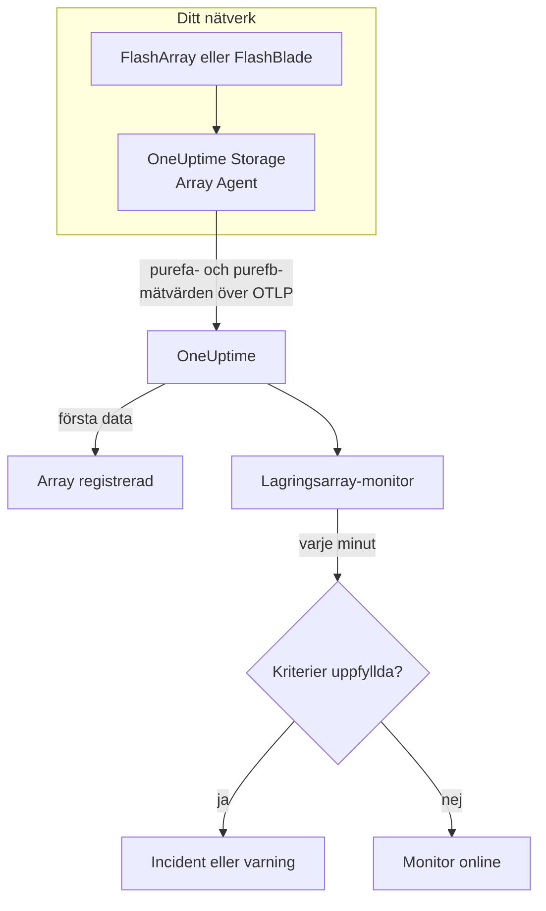

# Lagringsarray-övervakning

En lagringsarray-monitor bevakar en lagringsarray och säger till när arrayen själv skickar ut en varning, får slut på utrymme, blir långsam, förlorar hårdvara eller en värdsökväg, eller släpar efter med replikeringen. Den fungerar med Pure Storage FlashArray och Pure Storage FlashBlade och läser mätvärdena som arrayen själv exporterar - Pures serier `purefa_*` och `purefb_*` -, som OneUptime Storage Array Agent samlar in.

:::cards
- [Skapa monitorn](#skapa-en-lagringsarray-monitor): Sex steg i instrumentpanelen.
- [Mallar](#färdiga-varningsmallar): Arton färdiga varningar, en incident per volym, värd eller komponent.
- [Så fungerar Pures serier](#så-är-pures-serier-uppbyggda): Ett mätvärdesnamn, många värden.
- [Mätvärden](#insamlade-mätvärden): Varje serie som monitorn kan varna på.
:::

## Så fungerar det

OneUptime Storage Array Agent körs på en maskin som når arrayens administrationsgränssnitt. Den läser arrayens mätvärden med en skrivskyddad API-token, märker dem med arrayens namn, `storage.array.name`, och plattformen, `storage.system`, och skickar dem till OneUptime över OTLP. Första gången data kommer in registreras arrayen.

En lagringsarray-monitor är kopplad till en array. Varje minut kör den sin fråga mot den arrayens mätvärden och jämför resultatet med sina kriterier.



## Innan du börjar

- **Installera Storage Array Agent** någonstans där den når arrayen över HTTPS, med API-token för en användare som har arrayens roll **readonly**. [Guiden för Storage Array Agent](/docs/telemetry/storage-arrays) går igenom användaren, token och installationen, med `ONEUPTIME_URL`, `ONEUPTIME_TELEMETRY_INGESTION_KEY`, `STORAGE_ARRAY_NAME` och arrayens adress och token (`PURE_FA_ENDPOINT` och `PURE_FA_API_TOKEN`, eller `PURE_FB_ENDPOINT` och `PURE_FB_API_TOKEN`).
- **Kontrollera att arrayen är registrerad.** Den visas under **Produkter → Infrastruktur → Storage Arrays → All Storage Arrays**, med namnet från agentens `STORAGE_ARRAY_NAME`, ungefär en minut efter den första avläsningen.

## Skapa en lagringsarray-monitor

:::steps
### Starta en ny monitor

Gå till **Monitorer** och klicka på **Skapa monitor**.

### Välj Lagringsarray

Klicka på **Fler monitortyper** under **Monitortyp** och välj **Lagringsarray** under **Infrastruktur**, eller skriv `storage` i sökfältet. Ange ett **Namn** - det används i titlarna på incidenter och varningar - och klicka på **Nästa**.

### Välj arrayen

Välj arrayen i **Lagringsarray** under **Storage Array Monitor Configuration**. Varje array som har skickat data finns i listan. Plattformen avgör vilka mätvärden och mallar formuläret erbjuder.

### Välj vad som ska bevakas

Välj en av de tre flikarna:

- **Quick Setup** - klicka på en [mall](#färdiga-varningsmallar). Den sätter mätvärdet, etikettfiltren, aggregeringen, tidsintervallet och tröskelvärdena och ersätter kriterierna nedan med sina egna. Du kan fortfarande ändra **Tidsintervall**.
- **Custom Metric** - välj ett mätvärde i **Storage Array Metric** och sätt sedan **Aggregering** och **Tidsintervall**. [Filtren](#monitorinställningar) begränsar det till en volym, en värd, en podd, en komponent, ett filsystem eller en bucket.
- **Avancerad** - bygg frågor och formler själv under **Välj mått**, till exempel använd kapacitet som `purefa_array_space_bytes` filtrerat till `space=capacity` minus samma mätvärde filtrerat till `space=empty`. Använd **Group by** med ett objekts etikett för att bedöma varje objekt för sig.

### Kontrollera kriterierna

Öppna varje kriterium under **Monitorkriterier** och kontrollera dess **Mätvärde**, **Aggregering**, **Villkor** och **Threshold**. En mall fyller i dem. Med **Custom Metric** eller **Avancerad** startar monitorn med [standardkriterierna](#standardkriterier), som bara märker att ett mätvärde sjunker till noll, så sätt ditt eget tröskelvärde.

### Skapa monitorn

Klicka på **Skapa monitor**. OneUptime öppnar monitorns sida och utvärderar den varje minut. Incidenter och varningar som den skapar visas också på arrayens sidor **Incidenter** och **Varningar**.
:::

> [!TIP]
> För att sätta upp flera mallar på en gång öppnar du arrayen från **Produkter → Infrastruktur → Storage Arrays** och går till **Recommendations**. Välj de mallar du vill ha, välj vem som ska larmas, och OneUptime skapar en monitor per mall.

## Monitorinställningar

| Fält | Flik | Vad det gör |
| --- | --- | --- |
| **Lagringsarray** | Alla | Krävs. Begränsar varje fråga till `resource.storage.array.name`, så två arrayer som båda har en volym som heter `vol-01` blandas aldrig ihop. |
| **Volym** | Custom Metric, Avancerad | Bara FlashArray. En volym, via etiketten `name`, som `vol-db-01`. En volym i en podd eller en volymgrupp heter `pod::volume` eller `group/volume`. |
| **Värd** | Custom Metric, Avancerad | Bara FlashArray. En värd så som arrayen känner den, via etiketten `host`, som `esxi-01`. |
| **Podd** | Custom Metric, Avancerad | Bara FlashArray. En ActiveCluster- eller ActiveDR-podd, via etiketten `name`, eller `local_pod` på serier för replikalänkar. |
| **Hardware Component** | Custom Metric, Avancerad | En hårdvarukomponent, som `CH0.BAY1` eller `CT0`: etiketten `component_name` på en FlashArray, `name` på en FlashBlade. |
| **File System** | Custom Metric, Avancerad | Bara FlashBlade. Ett filsystem, via etiketten `name`. |
| **Bucket** | Custom Metric, Avancerad | Bara FlashBlade. En bucket för objektlagring, via etiketten `name`. |
| **Storage Array Metric** | Custom Metric | Ett mätvärde från [katalogen](#insamlade-mätvärden). Formuläret lägger till etikettfiltret som ger det dess betydelse och grupperar det efter objektet det beskriver, så varje volym, värd eller komponent bedöms för sig. |
| **Aggregering** | Custom Metric | Hur stickprov kombineras: **Genomsnitt**, **Maximum**, **Minimum**, **Summa** eller **Antal**. Börjar på mätvärdets vanliga aggregering. |
| **Tidsintervall** | Alla | Det glidande fönstret som frågan läser, från **Past 1 Minute** till **Past 365 Days**. En ny monitor börjar på **Past 5 Minutes**; ett anpassat mätvärde för ett filsystem eller en bucket på **Past 15 Minutes**; mallar sätter sitt eget. |
| **Välj mått** | Avancerad | Frågebyggaren: **Mätvärde**, **Aggregate by**, **Filter by attributes**, **Group by**, plus **Lägg till mätvärde** och **Lägg till formel** för att kombinera frågor. |

Agenten läser arrayens endpoint var 60:e sekund, och volymer, värdar och poddar var 2:a minut, så ett fönster på 5 minuter alltid innehåller ett stickprov. En FlashBlades filsystem och buckets läser den var 5:e minut, därav 15, och FlashArray-kataloger var 30:e minut: ge en katalogmonitor ett fönster på 60 minuter.

## Så är Pures serier uppbyggda

Pure lägger flera värden på **ett** mätvärdesnamn och skiljer dem åt med en etikett:

- **`dimension`** på prestandaserierna. `purefa_array_performance_latency_usec` bär läslatensen (`usec_per_read_op`), skrivlatensen (`usec_per_write_op`), latensen för speglade skrivningar och SAN-, kö-, QoS- och tjänstetiden för var och en av dem. Filtrera alltid på en `dimension`: ett genomsnitt över dem blandar en läslatens på 200 µs med ett kövärde.
- **`space`** på kapacitetsserierna: `capacity`, `empty`, `snapshots`, `total_provisioned`, `total_physical`, `available_ratio` med flera.

Flera serier bär sitt tillstånd i en **etikett**, med ett värde som alltid är 1:

| Serie | Tillståndsetikett | En serie per |
| --- | --- | --- |
| `purefa_alerts_open` | `severity`, med `summary`, `code` och `component_type` | Öppen varning |
| `purefa_hw_component_status` | `component_status` | Hårdvarukomponent |
| `purefa_host_connectivity_info` | `status`, med `details` | Värd |
| `purefa_drive_capacity_bytes` | `component_status` (värdet är diskens kapacitet) | Disk |

En serie som är filtrerad till ett dåligt tillstånd finns bara så länge något är i det tillståndet, så ingen serie betyder att allt är friskt. Därför är **Max över 0 utlöser och 0 återhämtar** rätt form för dem, och så är mallarna byggda: deras återhämtningskriterier räknar en saknad serie som noll.

I monitorfilter och grupperingsnycklar börjar agentens attribut med `resource.` (`resource.storage.array.name`, `resource.storage.system`), medan Pures egna etiketter inte gör det (`name`, `host`, `component_name`, `dimension`, `space`, `severity`).

## Färdiga varningsmallar

OneUptime levererar 18 mallar — 11 för FlashArray och 7 för FlashBlade — och **Quick Setup** erbjuder dem för arrayens plattform. Var och en bygger en komplett monitor: mätvärdesfrågan, etikettfiltren, en gruppering på objektets egen etikett, ett kriterium som utlöser och ett som återhämtar. Tröskelvärdena är utgångspunkter som du kan redigera.

Ett kriterium utlöser bara när villkoret gäller för **varje** värde i fönstret. En monitor som utlöstes på ett tröskelvärde för kapacitet, latens, eftersläpning eller kvot återhämtar sig först 10 % förbi det, så ett värde som pendlar kring tröskeln inte växlar fram och tillbaka; mallarna för varningar och hårdvara återhämtar sig så snart tillståndet försvinner.

### FlashArray

| Mall | Kategori | Allvarlighetsgrad | Bevakar | Utlöser när |
| --- | --- | --- | --- | --- |
| Critical Array Alert | Array Health | Kritisk | `purefa_alerts_open` filtrerat till `severity=critical`, Max per `summary`, senaste 5 minuterna | > 0 — arrayen har en öppen kritisk varning (en trasig komponent, en kapacitetskris, ett replikeringsfel). En incident per varning; återhämtar när varningen stängs |
| Warning Array Alert | Array Health | Warning | `purefa_alerts_open` filtrerat till `severity=warning`, Max per `summary`, senaste 5 minuterna | > 0 — arrayen har en öppen varning på nivån warning. En incident per varning; återhämtar när varningen stängs |
| Capacity Above 80% | Kapacitet | Warning | `purefa_array_space_utilization`, Max, senaste 15 minuterna | > 80 — Pures egen första kapacitetströskel; återhämtar vid ≤ 72 |
| Capacity Above 90% | Kapacitet | Kritisk | `purefa_array_space_utilization`, Max, senaste 5 minuterna | > 90 — arrayen är nära att avvisa skrivningar; återhämtar vid ≤ 81 |
| High Read Latency | Performance | Warning | `purefa_array_performance_latency_usec` filtrerat till `dimension=usec_per_read_op`, Avg, senaste 10 minuterna | > 5000 µs (5 ms) — läsningar på en FlashArray tar normalt långt under 1 ms; återhämtar vid ≤ 4500 |
| High Write Latency | Performance | Warning | `purefa_array_performance_latency_usec` filtrerat till `dimension=usec_per_write_op`, Avg, senaste 10 minuterna | > 5000 µs (5 ms); återhämtar vid ≤ 4500 |
| Hardware Component Failed | Hardware | Kritisk | `purefa_hw_component_status` filtrerat till `component_status=critical`, Max per `component_name`, senaste 5 minuterna | > 0 — en kontroller, ett nätaggregat, en fläkt, ett fack eller en port är kritisk och redundansen är borta. En incident per komponent; återhämtar när den rapporterar ok |
| Hardware Component Degraded | Hardware | Warning | `purefa_hw_component_status` filtrerat till `component_status=degraded`, Max per `component_name`, senaste 5 minuterna | > 0 — en komponent är degraderad. En incident per komponent; återhämtar när den rapporterar ok |
| Drive Failed | Hardware | Kritisk | `purefa_drive_capacity_bytes` filtrerat till `component_status=failed`, Max per `component_name`, senaste 5 minuterna | > 0 — en DirectFlash-modul eller en SSD har gått sönder och arrayen bygger om på de andra. En incident per disk; återhämtar när den har bytts |
| Host Lost Redundant Paths | Värdar | Warning | `purefa_host_connectivity_info` filtrerat till `status=critical`, Max per `host`, senaste 5 minuterna | > 0 — värden når arrayen genom en kontroller eller ingen; en failover mellan kontrollerna skulle ta dess lagring offline. En incident per värd; återhämtar när sökvägarna är tillbaka |
| Replication Lag Above 1 Minute | Replication | Warning | `purefa_pod_replica_links_lag_max_msec`, Max per `local_pod`, senaste 10 minuterna | > 60000 ms (60 s) — en failover nu skulle förlora fler nya skrivningar än planerat. En incident per podd; återhämtar vid ≤ 54000 |

### FlashBlade

| Mall | Kategori | Allvarlighetsgrad | Bevakar | Utlöser när |
| --- | --- | --- | --- | --- |
| Critical Array Alert | Array Health | Kritisk | `purefb_alerts_open` filtrerat till `severity=critical`, Max per `summary`, senaste 5 minuterna | > 0 — FlashBladen har en öppen kritisk varning. En incident per varning; återhämtar när varningen stängs |
| Warning Array Alert | Array Health | Warning | `purefb_alerts_open` filtrerat till `severity=warning`, Max per `summary`, senaste 5 minuterna | > 0 — FlashBladen har en öppen varning på nivån warning. En incident per varning; återhämtar när varningen stängs |
| Capacity Above 80% | Kapacitet | Warning | `purefb_array_space_utilization` filtrerat till `type=array`, Max, senaste 15 minuterna | > 80; återhämtar vid ≤ 72 |
| Capacity Above 90% | Kapacitet | Kritisk | `purefb_array_space_utilization` filtrerat till `type=array`, Max, senaste 5 minuterna | > 90 — skrivningar misslyckas för varje klient när den blir full; återhämtar vid ≤ 81 |
| Hardware Component Unhealthy | Hardware | Kritisk | `purefb_hardware_health`, Min per `name`, senaste 5 minuterna | < 1 — ett blad, en fabric-modul, ett nätaggregat eller en fläkt har problem (en tom plats rapporterar 2). En incident per komponent; återhämtar vid ≥ 1 |
| High Read Latency | Performance | Warning | `purefb_array_performance_latency_usec` filtrerat till `dimension=usec_per_read_op` och `protocol=all`, Avg, senaste 10 minuterna | > 10000 µs (10 ms) över alla protokoll; återhämtar vid ≤ 9000 |
| File System Near Full | File Systems | Warning | `purefb_file_systems_space_bytes` filtrerat till `space=available_ratio`, Min per `name`, senaste 15 minuterna | < 0.1 — det är mindre än 10 % kvar av ett filsystems tilldelade storlek. En incident per filsystem; återhämtar vid ≥ 0.11 |

**Allvarlighetsgrad** är etiketten som väljaren visar. Incidenten och varningen som en mall skapar börjar på projektets allvarligaste incident- och varningsnivå; ändra dem i kriteriet.

- **Öppna varningar och hårdvarutillstånd använder Max** av en serie som bara finns så länge varningen är öppen eller komponenten är i det tillståndet, så en enda avläsning som visar den passerar tröskeln.
- **Varje mall per objekt grupperar på objektets egen etikett** (`summary`, `component_name`, `host`, `local_pod`, `name`), så det utlöses en incident per berört objekt, och incidenten nämner det.
- **Latensmallar använder Avg** av arrayens eget genomsnitt per operation, och kapacitetsmallar **Max** av dess egen utnyttjandeprocent. Latenser är låsta till mikrosekunder och kapacitet till procent.
- **Hardware Component Unhealthy använder Min** per komponent: hälsan är 1 när komponenten är frisk och sjunker till 0 när den inte är det.

Det finns ingen mall för varje volyms latens, eftersom rätt tröskel beror på arbetsbelastningen: bygg den från katalogen med en gruppering på `name`. Kapacitetsprognoser behöver en tillväxtkurva snarare än ett tröskelvärde, och slitage på diskar har ingen serie att varna på.

## Insamlade mätvärden

Agenten skickar allt som arrayen exporterar; serierna nedan är katalogen som monitorformuläret erbjuder. Varje värde är en gauge som arrayen själv beräknar - latenser är mikrosekunder per operation och genomströmning är per sekund -, så ingen frekvensberäkning behövs. **Filter** är etikettfiltret som ger serien den betydelse som raden anger; formuläret tillämpar det åt dig.

### Array Health

| Mätvärde | Filter | Plattform | Enhet | Beskrivning |
| --- | --- | --- | --- | --- |
| `purefa_alerts_open` | — | FlashArray | `count` | En serie per öppen varning på arrayen (värde 1), med etiketterna `severity` (`critical`, `warning`, `info`, `hidden`), `category`, `code`, `component_type` och `summary` |
| `purefb_alerts_open` | — | FlashBlade | `count` | En serie per öppen varning på FlashBladen (värde 1), med etiketterna `severity` (`info`, `warning`, `critical`), `code`, `component_name`, `component_type`, `summary` och `kburl` (Pures artikel i kunskapsbasen) |

### Capacity

| Mätvärde | Filter | Plattform | Enhet | Beskrivning |
| --- | --- | --- | --- | --- |
| `purefa_array_space_utilization` | — | FlashArray | `%` | Andelen av arrayens användbara kapacitet som används. Pure skickar själv ut kapacitetsvarningar vid 80 %, 90 % och 100 % |
| `purefa_array_space_bytes` | `space=capacity` | FlashArray | `bytes` | Arrayens användbara kapacitet |
| `purefa_array_space_bytes` | `space=empty` | FlashArray | `bytes` | Oanvänd kapacitet — följ trenden för att förutsäga när arrayen blir full |
| `purefa_array_space_bytes` | `space=snapshots` | FlashArray | `bytes` | Fysiskt utrymme som bara snapshots upptar; en snabb ökning betyder oftast att en skyddsgrupp behåller fler snapshots än planerat |
| `purefa_array_space_data_reduction_ratio` | — | FlashArray | `ratio` | Deduplicering och komprimering över hela arrayen, t.ex. 4.2 för 4.2:1. Ett ihållande fall betyder att nya data reduceras dåligt |
| `purefb_array_space_utilization` | `type=array` | FlashBlade | `%` | Andelen av FlashBladens användbara kapacitet som används |
| `purefb_array_space_bytes` | `type=array`, `space=empty` | FlashBlade | `bytes` | FlashBladens oanvända kapacitet |
| `purefb_array_space_data_reduction_ratio` | `type=array` | FlashBlade | `ratio` | Datareduktion över hela FlashBladen |

### Performance

| Mätvärde | Filter | Plattform | Enhet | Beskrivning |
| --- | --- | --- | --- | --- |
| `purefa_array_performance_latency_usec` | `dimension=usec_per_read_op` | FlashArray | `µs` | Genomsnittlig latens för en läsning som värdarna ser den; läsningar på en FlashArray tar oftast långt under 1 ms |
| `purefa_array_performance_latency_usec` | `dimension=usec_per_write_op` | FlashArray | `µs` | Genomsnittlig latens för en skrivning som värdarna ser den |
| `purefa_array_performance_latency_usec` | `dimension=usec_per_mirrored_write_op` | FlashArray | `µs` | Genomsnittlig latens för en skrivning till en utsträckt ActiveCluster-podd, inklusive tur och retur till partnerarrayen |
| `purefa_array_performance_latency_usec` | `dimension=san_usec_per_read_op` | FlashArray | `µs` | Tiden en läsning tillbringar i SAN:et; hög SAN-latens med låg tjänstelatens pekar mot fabricen eller värden |
| `purefa_array_performance_throughput_iops` | `dimension=reads_per_sec` | FlashArray | `ops/s` | Läsoperationer per sekund |
| `purefa_array_performance_throughput_iops` | `dimension=writes_per_sec` | FlashArray | `ops/s` | Skrivoperationer per sekund |
| `purefa_array_performance_bandwidth_bytes` | `dimension=read_bytes_per_sec` | FlashArray | `bytes/s` | Lästa byte per sekund |
| `purefa_array_performance_bandwidth_bytes` | `dimension=write_bytes_per_sec` | FlashArray | `bytes/s` | Skrivna byte per sekund |
| `purefa_array_performance_queue_depth_ops` | — | FlashArray | `ops` | Operationer i kö på arrayen; en växande kö med stigande latens betyder att värdarna skickar mer än arrayen hinner med |
| `purefa_array_performance_average_bytes` | `dimension=bytes_per_op` | FlashArray | `bytes` | Genomsnittlig storlek på en operation — stor I/O höjer latensen utan att något är fel |
| `purefb_array_performance_latency_usec` | `dimension=usec_per_read_op`, `protocol=all` | FlashBlade | `µs` | Genomsnittlig läslatens över alla protokoll |
| `purefb_array_performance_latency_usec` | `dimension=usec_per_write_op`, `protocol=all` | FlashBlade | `µs` | Genomsnittlig skrivlatens över alla protokoll |
| `purefb_array_performance_throughput_iops` | `dimension=reads_per_sec`, `protocol=all` | FlashBlade | `ops/s` | Läsoperationer per sekund över alla protokoll |
| `purefb_array_performance_throughput_iops` | `dimension=writes_per_sec`, `protocol=all` | FlashBlade | `ops/s` | Skrivoperationer per sekund över alla protokoll |
| `purefb_array_performance_bandwidth_bytes` | `dimension=read_bytes_per_sec`, `protocol=all` | FlashBlade | `bytes/s` | Lästa byte per sekund över alla protokoll |
| `purefb_array_performance_bandwidth_bytes` | `dimension=write_bytes_per_sec`, `protocol=all` | FlashBlade | `bytes/s` | Skrivna byte per sekund över alla protokoll |

### Volumes

| Mätvärde | Filter | Plattform | Enhet | Beskrivning |
| --- | --- | --- | --- | --- |
| `purefa_volume_performance_latency_usec` | `dimension=usec_per_read_op` | FlashArray | `µs` | Genomsnittlig läslatens för varje volym — gruppera efter `name` |
| `purefa_volume_performance_latency_usec` | `dimension=usec_per_write_op` | FlashArray | `µs` | Genomsnittlig skrivlatens för varje volym |
| `purefa_volume_performance_throughput_iops` | `dimension=reads_per_sec` | FlashArray | `ops/s` | Läsoperationer per sekund för varje volym |
| `purefa_volume_performance_throughput_iops` | `dimension=writes_per_sec` | FlashArray | `ops/s` | Skrivoperationer per sekund för varje volym |
| `purefa_volume_performance_bandwidth_bytes` | `dimension=read_bytes_per_sec` | FlashArray | `bytes/s` | Byte per sekund som läses från varje volym |
| `purefa_volume_performance_bandwidth_bytes` | `dimension=write_bytes_per_sec` | FlashArray | `bytes/s` | Byte per sekund som skrivs till varje volym |
| `purefa_volume_space_bytes` | `space=total_provisioned` | FlashArray | `bytes` | Storleken på varje volym som värdarna ser den |
| `purefa_volume_space_bytes` | `space=total_physical` | FlashArray | `bytes` | Fysiskt utrymme som varje volym använder efter datareduktion |
| `purefa_volume_space_data_reduction_ratio` | — | FlashArray | `ratio` | Varje volyms datareduktionskvot |

### Hosts

| Mätvärde | Filter | Plattform | Enhet | Beskrivning |
| --- | --- | --- | --- | --- |
| `purefa_host_connectivity_info` | — | FlashArray | `count` | En serie per värd (värde 1) med anslutningens etikett `status` (`healthy`, `critical`, `unused`) och `details` (`Redundant`, `Single Controller`, `None`, ...) |
| `purefa_host_performance_latency_usec` | `dimension=usec_per_read_op` | FlashArray | `µs` | Genomsnittlig läslatens som varje värd ser — gruppera efter `host` |
| `purefa_host_performance_latency_usec` | `dimension=usec_per_write_op` | FlashArray | `µs` | Genomsnittlig skrivlatens som varje värd ser |
| `purefa_host_performance_throughput_iops` | `dimension=reads_per_sec` | FlashArray | `ops/s` | Läsoperationer per sekund för varje värd |
| `purefa_host_performance_throughput_iops` | `dimension=writes_per_sec` | FlashArray | `ops/s` | Skrivoperationer per sekund för varje värd |

### Replication

| Mätvärde | Filter | Plattform | Enhet | Beskrivning |
| --- | --- | --- | --- | --- |
| `purefa_pod_replica_links_lag_max_msec` | — | FlashArray | `ms` | Största replikeringseftersläpningen för varje poddreplikalänk (ActiveDR / asynkron), med etiketterna `local_pod`, `remote_pod`, `remote`, `direction` och `status` — gruppera efter `local_pod` |
| `purefa_pod_replica_links_lag_average_msec` | — | FlashArray | `ms` | Genomsnittlig replikeringseftersläpning för varje poddreplikalänk |
| `purefa_pod_performance_replication_bandwidth_bytes` | — | FlashArray | `bytes/s` | Replikeringstrafiken för varje podd, med etiketterna `direction` och `dimension` |
| `purefa_pod_performance_latency_usec` | `dimension=usec_per_mirrored_write_op` | FlashArray | `µs` | Genomsnittlig latens för speglade skrivningar för varje ActiveCluster-podd |

### Hardware

| Mätvärde | Filter | Plattform | Enhet | Beskrivning |
| --- | --- | --- | --- | --- |
| `purefa_hw_component_status` | — | FlashArray | `count` | En serie per hårdvarukomponent (värde 1) — chassi, kontroller, disk- och NVRAM-fack, nätaggregat, fläktar, temperatursensorer, Ethernet- och Fibre Channel-portar — med etiketten `component_status` (`ok`, `critical`, `degraded`, `device_off`, `identifying`, `not_installed`, `unknown`) |
| `purefa_hw_component_temperature_celsius` | — | FlashArray | `°C` | Temperaturen för varje sensor — gruppera efter `component_name` |
| `purefa_drive_capacity_bytes` | — | FlashArray | `bytes` | Rå kapacitet för varje disk, med etiketten för dess `component_status` (`healthy`, `failed`, `missing`, `recovering`, `unhealthy`, `empty`, ...) och typ |
| `purefa_network_interface_performance_errors` | `dimension=total_errors_per_sec` | FlashArray | `errors/s` | Fel per sekund på varje Ethernet- och Fibre Channel-gränssnitt — ihållande fel betyder oftast en dålig kabel, optik eller switchport |
| `purefb_hardware_health` | — | FlashBlade | — | Hälsan för varje hårdvarukomponent (blad, fabric-moduler, nätaggregat, fläktar, ...): 1 = frisk, 2 = oanvänd, 0 = inte frisk. Ta minimum per `name` |

### File Systems

| Mätvärde | Filter | Plattform | Enhet | Beskrivning |
| --- | --- | --- | --- | --- |
| `purefb_file_systems_performance_latency_usec` | `dimension=usec_per_read_op` | FlashBlade | `µs` | Genomsnittlig läslatens för varje filsystem — gruppera efter `name` |
| `purefb_file_systems_performance_latency_usec` | `dimension=usec_per_write_op` | FlashBlade | `µs` | Genomsnittlig skrivlatens för varje filsystem |
| `purefb_file_systems_space_bytes` | `space=total_physical` | FlashBlade | `bytes` | Fysiskt utrymme som varje filsystem använder |
| `purefb_file_systems_space_bytes` | `space=available_ratio` | FlashBlade | `ratio` | Andelen av varje filsystems tilldelade storlek som fortfarande är ledig, från 0 till 1 — nära 0 håller filsystemet på att fylla sin kvot |

### Buckets

| Mätvärde | Filter | Plattform | Enhet | Beskrivning |
| --- | --- | --- | --- | --- |
| `purefb_buckets_performance_latency_usec` | `dimension=usec_per_read_op` | FlashBlade | `µs` | Genomsnittlig läslatens för varje bucket — gruppera efter `name` |
| `purefb_buckets_space_bytes` | `space=total_physical` | FlashBlade | `bytes` | Fysiskt utrymme som varje bucket använder |
| `purefb_buckets_object_count` | — | FlashBlade | `count` | Antal objekt i varje bucket |

## Övervakningskriterier

Ett kriterium jämför en av monitorns frågor eller formler med ett tröskelvärde. Kriterierna för en lagringsarray-monitor har ingen **Filtertyp**: varje regel kontrollerar mätvärdets värde, med de här fälten.

| Fält | Vad det gör |
| --- | --- |
| **Mätvärde** | Frågan eller formeln som ska kontrolleras, efter variabelnamnet. |
| **Aggregering** | Hur värdena i fönstret blir ett svar: **Genomsnitt**, **Summa**, **Maximum Value**, **Minimum Value**, **All Values** (varje värde måste matcha) eller **Any Value** (ett räcker). |
| **Villkor** | **Greater Than**, **Less Than**, **Greater Than Or Equal To**, **Less Than Or Equal To** eller **Equal To** — eller ett anomalivillkor: **Anomalously High**, **Anomalously Low** eller **Anomalous**. |
| **Threshold** | Värdet som det jämförs med. En enhetslista står bredvid när mätvärdet har en enhet. Visas inte för anomalivillkor. |
| **Känslighet** | Bara anomalivillkor. **Låg** (4σ), **Medel** (3σ, standard) eller **Hög** (2σ). |
| **Baslinjefönster** | Bara anomalivillkor. 14 dagar (standard), 28, 60 eller 90 dagars historik. |
| **Om ingen data** | Under **Fler fält**. Vad som händer när fönstret inte har några stickprov: **Ignore** (standard), **Treat As Zero** eller **Utlösare**. |

Anomalivillkor jämför varje värde med samma timme i veckan i baslinjen. De stannar i tillståndet "Learning", och skickar inte ut något, tills baslinjefönstret innehåller tillräckligt med historik.

Några kriterier att börja med:

- **En volym är långsam:** `purefa_volume_performance_latency_usec` filtrerat till `dimension=usec_per_read_op`, Genomsnitt, grupperat efter `name`, **Greater Than** `2000`, över de senaste 10 minuterna.
- **Arrayen håller på att bli full:** `purefa_array_space_utilization`, Maximum, **Greater Than** `85`, över de senaste 15 minuterna.
- **En värd körs på en enda kontroller:** `purefa_host_connectivity_info` filtrerat till `status=critical`, Maximum, grupperat efter `host`, **Greater Than** `0`.
- **Ett FlashBlade-filsystem är nästan fullt:** `purefb_file_systems_space_bytes` filtrerat till `space=available_ratio`, Minimum, grupperat efter `name`, **Less Than** `0.05`.

### Standardkriterier

En monitor som du inte bygger från en mall börjar med två kriterier:

| Ordning | Kriterium | Matchar när | Sedan |
| --- | --- | --- | --- |
| 1 | Check if _monitor name_ is offline | Vilket värde som helst i den första frågan är `0` | Markerar monitorn som **Offline** och deklarerar incidenten "_monitor name_ is offline", som löser sig själv när monitorn återhämtar sig. |
| 2 | Check if _monitor name_ is online | Vilket värde som helst är över `0` | Markerar monitorn som **Fungerar**. |

> [!IMPORTANT]
> Tystnad matchar inget av kriterierna: en array som slutar skicka data lämnar monitorn som den var. För att få veta när data uteblir sätter du **Om ingen data** till **Utlösare** på ett kriterium. Tid då OneUptime själv inte tog emot något räknas aldrig som saknade data: en kontroll vars fönster innehåller den tiden väntar i stället, som [När OneUptime inte tar emot data](/docs/monitor/when-oneuptime-is-not-receiving) förklarar.

## Terraform

[OneUptimes Terraform-provider](/docs/terraform/monitor-steps) bär konfigurationen för ett steg i en lagringsarray-monitor i attributet `storage_array_monitor`: den råa JSON:en för konfigurationen `storageArrayMonitor` (`arrayIdentifier`, `storageSystem`, `resourceFilters`, `metricViewConfig`, `rollingTime`), skriven med `jsonencode()`:

```hcl title="main.tf"
monitor_steps = [{
  storage_array_monitor = jsonencode({
    arrayIdentifier = "my-storage-array"
    storageSystem   = "purestorage.flasharray"
    resourceFilters = {}
    rollingTime     = "Past 15 Minutes"
    metricViewConfig = {
      queryConfigs = [{
        metricAliasData = { metricVariable = "capacity_used_percent", title = "Capacity Used", description = "", legend = "" }
        metricQueryData = {
          filterData = {
            metricName     = "purefa_array_space_utilization"
            attributes     = {}
            aggegationType = "Max"
            aggregateBy    = {}
          }
        }
      }]
      formulaConfigs = []
    }
  })
  criteria = [ /* ... */ ]
}]
```

`arrayIdentifier` är arrayens `storage.array.name` - det `STORAGE_ARRAY_NAME` som agenten startades med -, inte dess OneUptime-ID. `storageSystem` är `purestorage.flasharray` eller `purestorage.flashblade`. Det avgör vilken katalog och vilka mallar formuläret visar, och om ett hårdvarufilter läser `component_name` eller `name`.

## Felsökning

:::details Arrayen finns inte i listan Lagringsarray
Arrayer registrerar sig själva utifrån agentens data. Kontrollera att agenten körs och skickar data (se [guiden för Storage Array Agent](/docs/telemetry/storage-arrays)), och att `STORAGE_ARRAY_NAME` är satt.
:::

:::details En varnings- eller hårdvarumall utlöser aldrig
Det är det friska fallet. `purefa_alerts_open`, `purefa_hw_component_status`, `purefa_drive_capacity_bytes` och `purefa_host_connectivity_info` bär sitt tillstånd i en etikett, och en serie filtrerad till ett dåligt tillstånd (`severity=critical`, `component_status=failed`) finns bara så länge något är i det tillståndet. För att se serien bakom en mall kör du dess fråga utan filtret på sidan **Mätvärden**.
:::

:::details En latensmonitor visar fel värden
Pure lägger läs-, skriv-, speglad skriv-, SAN-, kö- och QoS-värden på ett mätvärdesnamn, bara åtskilda av etiketten `dimension`, och en fråga utan ett `dimension`-filter tar genomsnittet av dem alla. Filtrera på en dimension, som mallarna och formulärets katalog gör. Serier per volym och per värd behåller bara `usec_per_read_op`, `usec_per_write_op` och `usec_per_mirrored_write_op`: agenten kastar resten för att spara serier, och bara den arrayövergripande `purefa_array_performance_latency_usec` behåller alla.
:::

:::details Ett fönster på 1 minut visar inga data
Agenten läser volymer, värdar och poddar var 2:a minut, en FlashBlades filsystem och buckets var 5:e och FlashArray-kataloger var 30:e, så ett fönster på 1 minut innehåller kanske inget stickprov. Använd 5 minuter eller mer: 15 för filsystem och buckets, 60 för kataloger.
:::

:::details Incidenter utlöses en gång för hela arrayen i stället för en gång per volym
Gruppera frågan efter objektets etikett: `name` för volymer, poddar, kataloger, filsystem och buckets, `host` för värdar och `component_name` för FlashArray-hårdvara. Pures etiketter har inget prefix, så `resource.name` matchar ingenting.
:::

## Nästa steg

:::cards
- [Lagringsarray-agent](/docs/telemetry/storage-arrays): Installera agenten som skickar mätvärdena.
- [Ceph-övervakning](/docs/monitor/ceph-monitor): Samma typ av monitor för Ceph-lagringskluster.
- [Metrikövervakning](/docs/monitor/metrics-monitor): Varna på vilket mätvärde som helst, från vilken källa som helst.
- [Incidenter – Översikt](/docs/incidents/index): Vad som händer efter att ett kriterium har deklarerat en incident.
:::
