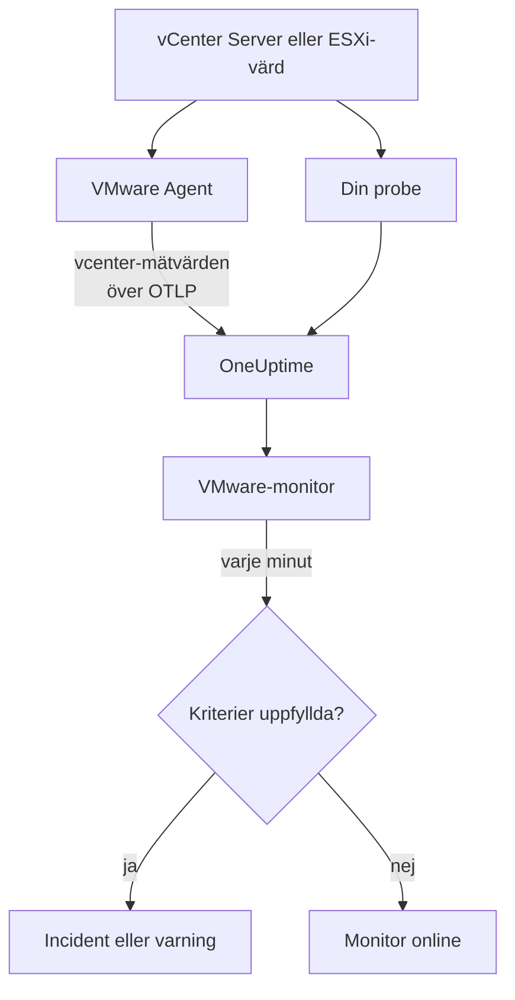

# VMware-övervakning

En VMware-monitor bevakar ett vCenter - datacenter, kluster, ESXi-värdar, virtuella maskiner, datastores, resurspooler och vSAN - och säger till när en värd blir mättad, en virtuell maskin har för lite CPU eller minne, en datastore blir full eller vSphere skickar ut ett larm. Den läser `vcenter.*`-mätvärdena som OneUptime VMware Agent samlar in, eller som en av dina prober samlar in utan en agent.

:::cards
- [Skapa monitorn](#skapa-en-vmware-monitor): Sex steg i instrumentpanelen.
- [Mallar](#färdiga-varningsmallar): Tjugotre färdiga varningar, en incident per värd, VM eller datastore.
- [Identitetsattribut](#identitetsattribut): Så träffar du en värd, VM eller datastore.
- [Mätvärden](#insamlade-mätvärden): Varje `vcenter.*`-serie som monitorn kan varna på.
:::

## Så fungerar det

Mätvärdena kommer från vCenters API och läses med ett skrivskyddat konto på ett av två sätt:

- **VMware Agent**, en OpenTelemetry Collector med receivern `vcenter`, som du kör på en maskin som når vCenter. Se [VMware-agent](/docs/telemetry/vmware).
- **En probe**, utan något att installera: du ansluter ditt vCenter i OneUptime och väljer den probe som når det. Se [VMware utan agent](/docs/telemetry/vmware-agentless).

Båda skickar samma serier varje insamlingsintervall (2 minuter som standard), märkta med vCentrets namn, `vmware.vcenter.name`. Ett vCenter är en vSphere-endpoint: en vCenter Server eller en fristående ESXi-värd. En VMware-monitor är kopplad till ett vCenter. Varje minut kör den sin fråga mot det vCentrets mätvärden och jämför resultatet med sina kriterier.



## Innan du börjar

- **Samla in vCentrets mätvärden**, med [VMware Agent](/docs/telemetry/vmware) eller [utan en agent](/docs/telemetry/vmware-agentless). Båda använder en vSphere-användare med rollen **Read-Only** på det översta vCenter-objektet, med **Propagate to children** ikryssat. Agenten läser `ONEUPTIME_URL`, `ONEUPTIME_TELEMETRY_INGESTION_KEY`, `VMWARE_VCENTER_NAME`, `VCENTER_ENDPOINT`, `VCENTER_USERNAME` och `VCENTER_PASSWORD`.
- **Kontrollera att vCentret är registrerat.** Det visas under **Produkter → Infrastruktur → VMware → Alla vCenter**: via agenten, med namnet från dess `VMWARE_VCENTER_NAME`, efter den första fullständiga insamlingen; utan agent från det ögonblick du ansluter det.

## Skapa en VMware-monitor

:::steps
### Starta en ny monitor

Gå till **Monitorer** och klicka på **Skapa monitor**.

### Välj VMware

Klicka på **Fler monitortyper** under **Monitortyp** och välj **VMware** under **Infrastruktur**, eller skriv `vmware` i sökfältet. Ange ett **Namn** - det används i titlarna på incidenter och varningar - och klicka på **Nästa**.

### Välj vCentret

Välj vCentret i **vCenter** under **VMware Monitor Configuration**. Varje vCenter som har skickat data, eller som du har anslutit utan en agent, finns i listan.

### Välj vad som ska bevakas

Välj en av de tre flikarna:

- **Quick Setup** - klicka på en [mall](#färdiga-varningsmallar). Den sätter mätvärdet, attributfiltren, aggregeringen, tidsintervallet, grupperingen och tröskelvärdena och ersätter kriterierna nedan med sina egna. Du kan fortfarande ändra **Tidsintervall**.
- **Custom Metric** - välj ett mätvärde i **VMware Metric** och sätt sedan **Aggregering** och **Tidsintervall**. Formuläret grupperar det efter objektet det beskriver, så varje värd, VM eller datastore bedöms för sig, och [filtren](#monitorinställningar) begränsar det till ett datacenter, ett kluster, en värd, en VM, en datastore eller en resurspool.
- **Avancerad** - bygg frågor och formler själv under **Välj mått**, med filter på attribut som `disk_state`, `power_state` eller `status`. Använd **Group by** med ett [identitetsattribut](#identitetsattribut) för att bedöma varje objekt för sig.

### Kontrollera kriterierna

Öppna varje kriterium under **Monitorkriterier** och kontrollera dess **Mätvärde**, **Aggregering**, **Villkor** och **Threshold**. En mall fyller i dem. Med **Custom Metric** eller **Avancerad** startar monitorn med [standardkriterierna](#standardkriterier), som bara märker att ett mätvärde sjunker till noll, så sätt ditt eget tröskelvärde.

### Skapa monitorn

Klicka på **Skapa monitor**. OneUptime öppnar monitorns sida och utvärderar den varje minut. Incidenter och varningar som den skapar visas också på vCentrets sidor **Incidenter** och **Varningar**.
:::

> [!TIP]
> För att sätta upp flera mallar på en gång öppnar du vCentret från **Produkter → Infrastruktur → VMware** och går till **Recommendations**. Välj de mallar du vill ha, välj vem som ska larmas, och OneUptime skapar en monitor per mall.

## Monitorinställningar

| Fält | Flik | Vad det gör |
| --- | --- | --- |
| **vCenter** | Alla | Krävs. Begränsar varje fråga till `resource.vmware.vcenter.name`. |
| **Datacenter** | Custom Metric, Avancerad | Valfritt. Ett datacenter: `resource.vcenter.datacenter.name`. Varje serie bär det. |
| **Kluster** | Custom Metric, Avancerad | Valfritt. Ett kluster: `resource.vcenter.cluster.name`. Matchar klustrets egna serier och serierna för värdarna, de virtuella maskinerna och resurspoolerna i det; en fristående ESXi-värd har inget. |
| **ESXi Host** | Custom Metric, Avancerad | Valfritt. En ESXi-värd: `resource.vcenter.host.name`. Matchar värdens egna serier **och** serierna för varje VM som den kör, eftersom en VM bär namnet på sin värd. |
| **Virtual Machine** | Custom Metric, Avancerad | Valfritt. En VM: `resource.vcenter.vm.name`. VM-namn behöver inte vara unika: lägg till en värd eller ett kluster när två virtuella maskiner delar ett namn. |
| **Datastore** | Custom Metric, Avancerad | Valfritt. En datastore: `resource.vcenter.datastore.name`. |
| **Resource Pool Path** | Custom Metric, Avancerad | Valfritt. En resurspool, via inventariesökvägen (`/DC/host/Cluster/Resources/pool`): `resource.vcenter.resource_pool.inventory_path`. En sökväg, eftersom poolnamn bara är unika inom det överordnade objektet. |
| **VMware Metric** | Custom Metric | Ett mätvärde från [katalogen](#insamlade-mätvärden). |
| **Aggregering** | Custom Metric | Hur stickprov kombineras: **Genomsnitt**, **Maximum**, **Minimum**, **Summa** eller **Antal**. Börjar på mätvärdets vanliga aggregering. |
| **Tidsintervall** | Alla | Det glidande fönstret som frågan läser, från **Past 1 Minute** till **Past 365 Days**. En ny monitor börjar på **Past 5 Minutes**; mallar sätter sitt eget. |
| **Välj mått** | Avancerad | Frågebyggaren: **Mätvärde**, **Aggregate by**, **Filter by attributes**, **Group by**, plus **Lägg till mätvärde** och **Lägg till formel** för att kombinera frågor. |

vCenter läses en gång per insamlingsintervall, 2 minuter som standard, så ett fönster på 1 minut innehåller kanske inget stickprov alls. Håll fönstret på 5 minuter eller mer, och längre om du har ökat insamlingsintervallet för ett stort inventarium.

## Identitetsattribut

Receivern `vcenter` skickar en OpenTelemetry-resurs per vSphere-objekt och namnger den med **resursattribut**. Vilka av dem en serie bär talar om vilken typ av objekt den beskriver:

| vSphere-objekt | Resursattribut för identitet |
| --- | --- |
| Datacenter | `vcenter.datacenter.name` |
| Kluster | `vcenter.datacenter.name`, `vcenter.cluster.name` |
| ESXi-värd | `vcenter.datacenter.name`, `vcenter.host.name` (+ `vcenter.cluster.name` när den ingår i ett kluster) |
| Virtuell maskin | `vcenter.datacenter.name`, `vcenter.host.name`, `vcenter.vm.name`, `vcenter.vm.id` (+ `vcenter.cluster.name`; `vcenter.resource_pool.*` eller `vcenter.virtual_app.*`) |
| VM-mall | `vcenter.datacenter.name`, `vcenter.host.name`, `vcenter.vm_template.name`, `vcenter.vm_template.id` |
| Datastore | `vcenter.datacenter.name`, `vcenter.datastore.name` |
| Resurspool | `vcenter.datacenter.name`, `vcenter.resource_pool.name`, `vcenter.resource_pool.inventory_path` (+ `vcenter.cluster.name` eller `vcenter.host.name`) |

I monitorfilter och grupperingsnycklar börjar resursattribut med `resource.` (`resource.vcenter.host.name`), medan datapunktsattribut inte gör det (`disk_state`, `power_state`, `status`, `effective`, `direction`, `object`, `type`). Det booleska attributet `effective` lagras som texten `"true"` eller `"false"`, så filtrera det med texten. Filtrera på ett identitetsattribut för att träffa ett objekt, och gruppera efter det för att bedöma varje objekt för sig.

## Färdiga varningsmallar

OneUptime levererar 23 mallar för vanliga VMware-problem, och **Quick Setup** erbjuder alla. Var och en bygger en komplett monitor: mätvärdesfrågan, attributfiltren, en gruppering på objektets eget identitetsattribut, ett kriterium som utlöser och ett som återhämtar. Tröskelvärdena är utgångspunkter som du kan redigera.

Mallarna läser de senaste 5 minuterna, om inte tabellen säger något annat. Ett kriterium utlöser bara när villkoret gäller för varje minut i fönstret, och ett tröskelkriterium återhämtar sig 10 % förbi tröskeln, så ett värde som pendlar kring linjen inte växlar fram och tillbaka.

| Mall | Kategori | Allvarlighetsgrad | Bevakar | Utlöser när | Återhämtar när |
| --- | --- | --- | --- | --- | --- |
| Host CPU Saturation | Värd | Warning | `vcenter.host.cpu.utilization`, Avg per `resource.vcenter.host.name` | Över 90 %: varje VM på värden konkurrerar om kärnor och visar CPU-ready-tid | Vid 81 % eller mindre |
| Host Memory Saturation | Värd | Warning | `vcenter.host.memory.utilization`, Avg per värd | Över 90 %: värden börjar ta tillbaka minne med ballooning, komprimering och swappning | Vid 81 % eller mindre |
| Host Disk Latency High | Värd | Warning | `vcenter.host.disk.latency.max`, Max per värd | Över 50 ms: varje VM med diskar på den sökvägen väntar på lagring. Kräver prestandaräknarnivå 3 | Vid 45 ms eller mindre |
| Host Network Packet Errors | Värd | Warning | `vcenter.host.network.packet.error.rate`, Max per värd | Över 0: nästan alltid ett fel i kabel, SFP eller switchport | Vid 0 |
| Host Network Packet Drops | Värd | Warning | `vcenter.host.network.packet.drop.rate`, Max per värd | Över 0: en överbokad uplink, eller ringbuffertar i nätverkskortet som svämmar över | Vid 0 |
| VM CPU Saturation | Virtual Machine | Warning | `vcenter.vm.cpu.utilization`, Avg per `resource.vcenter.vm.name`, **senaste 15 minuterna** | Över 90 % av VM:ens vCPU:er under alla 15 minuterna: en VM får använda det den har tilldelats, så bara en som aldrig går ner larmar | Vid 81 % eller mindre |
| VM CPU Ready Contention | Virtual Machine | Warning | `vcenter.vm.cpu.readiness`, Avg per VM | Över 10 %: VM:en var redo att köra men värden hade ingen fysisk kärna åt den. Osynligt inifrån gästen | Vid 9 % eller mindre |
| VM Memory Saturation | Virtual Machine | Warning | `vcenter.vm.memory.utilization`, Avg per VM | Över 90 % av minnet: gästen är på väg att börja paga ut minne | Vid 81 % eller mindre |
| VM Memory Ballooning | Virtual Machine | Warning | `vcenter.vm.memory.ballooned`, Max per VM | Över 0: värden har ont om minne och tar tillbaka det från den här gästen | Vid 0 |
| VM Memory Swapping | Virtual Machine | Kritisk | `vcenter.vm.memory.swapped`, Max per VM | Över 0: värden swappar VM:ens minne, sista utvägen efter ballooning och komprimering | Vid 0 |
| VM Disk Latency High | Virtual Machine | Warning | `vcenter.vm.disk.latency.max`, Max per VM | Över 50 ms: program i gästen får timeout på I/O | Vid 45 ms eller mindre |
| VM Disk Usage High | Virtual Machine | Warning | `vcenter.vm.disk.utilization`, Avg per VM | Över 90 % av den tilldelade lagringen används: en tunt provisionerad VM är på väg att ta hela sin storlek i anspråk | Vid 81 % eller mindre |
| Datastore Capacity Warning | Datastore | Warning | `vcenter.datastore.disk.utilization`, Avg per `resource.vcenter.datastore.name` | Över 80 %: en tidig varning, eftersom tunna diskar och snapshots snabbt förbrukar resten | Vid 72 % eller mindre |
| Datastore Capacity Critical | Datastore | Kritisk | `vcenter.datastore.disk.utilization`, Avg per datastore | Över 90 %: en full datastore pausar varje VM som har en disk på den | Vid 81 % eller mindre |
| Cluster Host Not Effective | Kluster | Kritisk | `vcenter.cluster.host.count` filtrerat till `effective = false`, Max per `resource.vcenter.cluster.name` | Över 0: en värd är i underhållsläge, frånkopplad eller svarar inte, så klustret körs med mindre kapacitet än det är dimensionerat för | Vid 0 |
| Datacenter Hosts Unhealthy | Datacenter | Kritisk | `vcenter.datacenter.host.count` filtrerat till `status = red`, Max per `resource.vcenter.datacenter.name` | Över 0: en värd har ett kritiskt larm, som en hårdvarusensor, en förlorad lagringssökväg eller ett fel i HA-agenten | Vid 0 |
| Datacenter Hosts Degraded | Datacenter | Warning | `vcenter.datacenter.host.count` filtrerat till `status = yellow`, Max per datacenter | Över 0: en värd har ett varningslarm | Vid 0 |
| Datacenter Hosts Powered Off | Datacenter | Warning | `vcenter.datacenter.host.count` filtrerat till `power_state = off`, Max per datacenter | Över 0: en värd är avstängd - den kraschade, förlorade strömmen eller försattes i standby av DPM | Vid 0 |
| Datacenter VMs Unhealthy | Datacenter | Warning | `vcenter.datacenter.vm.count` filtrerat till `status = red`, Max per datacenter | Över 0: en VM har ett kritiskt larm, som en misslyckad HA-omstart, en förlorad datastore eller ett förlorat Tools-heartbeat | Vid 0 |
| Datacenter Clusters Unhealthy | Datacenter | Kritisk | `vcenter.datacenter.cluster.count` filtrerat till `status = red`, Max per datacenter | Över 0: ett kluster har ett kritiskt larm, som för få resurser för HA-failover, ett misslyckat HA-val eller en kritisk vSAN-hälsokontroll | Vid 0 |
| vSAN Latency High | vSAN | Warning | `vcenter.cluster.vsan.latency.avg`, Avg per kluster | Över 20 000 µs (20 ms): lagringen blir långsammare för varje VM på vSAN-datastoren. Tyst på kluster utan vSAN | Vid 18 000 µs eller mindre |
| vSAN Congestion | vSAN | Warning | `vcenter.cluster.vsan.congestions`, Max per kluster | Över 0: en diskgrupp hänger inte med, och vSAN stryper I/O:n till sina klienter | Vid 0 |
| Resource Pool Memory Swapped | Kluster | Warning | `vcenter.resource_pool.memory.swapped`, Max per `resource.vcenter.resource_pool.inventory_path` | Över 0: poolens virtuella maskiner tar minne från värdens swap, oftast för att poolens minnesgräns eller -andelar är för låga | Vid 0 |

**Allvarlighetsgrad** är etiketten som väljaren visar. Incidenten och varningen som en mall skapar börjar på projektets allvarligaste incident- och varningsnivå; ändra dem i kriteriet.

- **Utnyttjandemallar använder Avg:** receivern rapporterar en äkta procentsats från 0 till 100 för varje objekt, så genomsnittet under en minut är det ihållande utnyttjandet.
- **Latensmallar använder Max:** mätvärdet är redan den sämsta latensen över objektets diskar, så det högsta stickprovet är det ärliga.
- **Antals- och tillståndsmallar använder Max**, så en enda insamling som visar tillståndet utlöser dem: paketfel, ballooning, swappning, röd och gul status, värdar som inte är effektiva, överbelastning.
- **Varje mall grupperar på objektets eget identitetsattribut**, så det utlöses en incident per berört objekt, och incidenten nämner det.
- **Tröskelvärden är låsta till sin enhet** (`%`, `ms`, `us`), så de behåller sin betydelse oavsett vilken enhet ett diagram visar.

## Insamlade mätvärden

Mätvärdena nedan är katalogen som monitorformuläret erbjuder. Enheterna är receiverns egna: `MHz`, `%`, `MiBy` (mebibyte), `By` (byte), `KiBy`, `ms`, `us` (mikrosekunder), `{KiBy/s}`, `By/s` och antal. Ett mätvärde markerat _av som standard_ samlas inte in förrän du slår på det i agentens `otel-collector-config.yaml`; den medföljande konfigurationen slår redan på `vcenter.host.memory.capacity`.

### Datacenter

| Mätvärde | Enhet | Beskrivning |
| --- | --- | --- |
| `vcenter.datacenter.cluster.count` | `{clusters}` | Kluster i datacentret, uppdelade efter `status` (`red` / `yellow` / `green` / `gray`). Summera för totalen; filtrera `status = red` för kluster med ett kritiskt larm |
| `vcenter.datacenter.cpu.limit` | `MHz` | Total CPU tillgänglig för datacentret över alla ESXi-värdar |
| `vcenter.datacenter.datastore.count` | `{datastores}` | Datastores i datacentret |
| `vcenter.datacenter.disk.space` | `By` | Datastore-utrymme över hela datacentret, uppdelat efter `disk_state` (`used` / `available`). used ÷ (used + available) är lagringsutnyttjandet för hela datacentret |
| `vcenter.datacenter.host.count` | `{hosts}` | ESXi-värdar i datacentret, uppdelade efter `status` och `power_state` (`on` / `off` / `standby` / `unknown`). Filtrera `status = red` eller `power_state = off` |
| `vcenter.datacenter.memory.limit` | `By` | Totalt fysiskt minne tillgängligt för datacentret över alla ESXi-värdar |
| `vcenter.datacenter.vm.count` | `{virtual_machines}` | Virtuella maskiner i datacentret, uppdelade efter `status` och `power_state` (`on` / `off` / `suspended` / `unknown`). Filtrera `power_state = on` för virtuella maskiner som körs |

### Kluster

| Mätvärde | Enhet | Beskrivning |
| --- | --- | --- |
| `vcenter.cluster.cpu.effective` | `MHz` | CPU som klustret faktiskt kan schemalägga — utan värdar i underhållsläge eller värdar som inte svarar. Jämför med `vcenter.cluster.cpu.limit` för kapacitet som är ur drift |
| `vcenter.cluster.cpu.limit` | `MHz` | Total CPU för varje ESXi-värd i klustret, oavsett värdens tillstånd |
| `vcenter.cluster.host.count` | `{hosts}` | ESXi-värdar i klustret, uppdelade efter `effective` (`"true"` / `"false"`). En värd är inte effektiv medan den är i underhållsläge, frånkopplad eller inte svarar |
| `vcenter.cluster.memory.effective` | `By` | Minne som klustret faktiskt kan tilldela virtuella maskiner — utan värdar i underhåll eller värdar som inte svarar, och utan ESXi:s eget reserverade minne |
| `vcenter.cluster.memory.limit` | `By` | Totalt fysiskt minne för varje ESXi-värd i klustret |
| `vcenter.cluster.vm.count` | `{virtual_machines}` | Virtuella maskiner i klustret, uppdelade efter `power_state`. Summera för totalen; filtrera `power_state = on` för virtuella maskiner som körs |
| `vcenter.cluster.vm_template.count` | `{virtual_machine_templates}` | Mallar för virtuella maskiner i klustret |

### Värd (ESXi)

| Mätvärde | Enhet | Beskrivning |
| --- | --- | --- |
| `vcenter.host.cpu.capacity` | `MHz` | ESXi-värdens totala CPU-kapacitet (kärnor × klockfrekvens) — nämnaren för `vcenter.host.cpu.usage` |
| `vcenter.host.cpu.reserved` | `MHz` | CPU reserverad för virtuella maskiner, uppdelad efter `cpu_reservation_type` (`total` / `used`). När `used` närmar sig `total` misslyckas nya reservationer i tillträdeskontrollen |
| `vcenter.host.cpu.usage` | `MHz` | CPU som just nu förbrukas på värden av alla virtuella maskiner och själva hypervisorn |
| `vcenter.host.cpu.utilization` | `%` | Värdens CPU-utnyttjande i procent (0–100) av kapaciteten |
| `vcenter.host.disk.latency.avg` | `ms` | Genomsnittlig disklatens (enhets- + kärntid), uppdelad efter `direction` (`read` / `write`) och `object` (diskenhet). Kräver prestandaräknarnivå 2 |
| `vcenter.host.disk.latency.max` | `ms` | Högsta latens som setts över alla diskar som värden använder, per `object`, under det senaste intervallet på 20 s. Kräver prestandaräknarnivå 3 |
| `vcenter.host.disk.throughput` | `{KiBy/s}` | Kilobyte per sekund som läses från eller skrivs till värdens diskar, efter `direction` och `object`. Kräver prestandaräknarnivå 4 |
| `vcenter.host.memory.active` | `MiBy` | Minne som värdens påslagna virtuella maskiner aktivt använder. _Av som standard_ — slå på `vcenter.host.memory.active` i agentkonfigurationen |
| `vcenter.host.memory.ballooned` | `MiBy` | Gästminne som balloon-drivrutinen har tagit tillbaka från värdens virtuella maskiner; över 0 betyder minnestryck på värden. _Av som standard_ |
| `vcenter.host.memory.capacity` | `MiBy` | Värdens totala fysiska minne — nämnaren för `vcenter.host.memory.usage`. Av som standard uppströms; den medföljande agentkonfigurationen slår på det |
| `vcenter.host.memory.granted` | `MiBy` | Maskinminne som tilldelats de påslagna virtuella maskinerna på värden. _Av som standard_ |
| `vcenter.host.memory.usage` | `MiBy` | Minne som just nu förbrukas på värden, inklusive hypervisorns egen overhead |
| `vcenter.host.memory.utilization` | `%` | Värdens minnesutnyttjande i procent (0–100) av den fysiska kapaciteten |
| `vcenter.host.network.packet.drop.rate` | `{packets/s}` | Paket per sekund som kastas på varje fysiskt nätverkskort, efter `direction` (`transmitted` / `received`) och `object` (t.ex. `vmnic0`) — en överbokad uplink eller ett nätverkskort som håller på att gå sönder |
| `vcenter.host.network.packet.error.rate` | `{errors/s}` | Paketfel per sekund på värdens fysiska nätverkskort, efter `direction` och `object` — nästan alltid ett fel i kabel, SFP eller switchport |
| `vcenter.host.network.packet.rate` | `{packets/s}` | Paket per sekund som skickas eller tas emot på varje fysiskt nätverkskort, efter `direction` och `object` |
| `vcenter.host.network.throughput` | `{KiBy/s}` | Kilobyte per sekund som skickas eller tas emot av värden, efter `direction` och `object` |
| `vcenter.host.network.usage` | `{KiBy/s}` | Sammanlagd sänd- och mottagningshastighet över värdens nätverkskort, per `object` |

### Virtuell maskin

| Mätvärde | Enhet | Beskrivning |
| --- | --- | --- |
| `vcenter.vm.cpu.readiness` | `%` | Andelen av tiden som VM:en var redo att köra men inte kunde schemaläggas på en fysisk CPU (CPU ready). Över 5 % känns gästen långsam; över 10 % är värden överbokad. Bara påslagna virtuella maskiner |
| `vcenter.vm.cpu.time` | `%` | Tid som VM:ens vCPU:er tillbringade i varje tillstånd, efter `cpu_state` (`idle` / `ready` / `wait`) och `object` (vCPU). _Av som standard_ — slå på `vcenter.vm.cpu.time` |
| `vcenter.vm.cpu.usage` | `MHz` | CPU som förbrukas av VM:en. Bara påslagna virtuella maskiner — närvaron är hur OneUptime härleder en VM:s strömläge |
| `vcenter.vm.cpu.utilization` | `%` | VM:ens CPU-utnyttjande i procent (0–100) av de konfigurerade vCPU:erna. Bara påslagna virtuella maskiner |
| `vcenter.vm.disk.latency.avg` | `ms` | Genomsnittlig disklatens, efter `direction` (`read` / `write`), `disk_type` (`virtual` / `physical`) och `object` (virtuell disk). Kräver prestandaräknarnivå 2 |
| `vcenter.vm.disk.latency.max` | `ms` | Högsta totala latens (enhets- + kärntid) som VM:en såg på en disk under ett intervall på 20 s, per `object` |
| `vcenter.vm.disk.throughput` | `{KiBy/s}` | Kilobyte per sekund som läses från eller skrivs till VM:ens diskar, efter `direction` och `object`. Kräver prestandaräknarnivå 2 |
| `vcenter.vm.disk.usage` | `By` | Datastore-utrymme som VM:ens filer använder, uppdelat efter `disk_state` (`used` / `available`). Skickas även för VM-mallar. Filtrera `disk_state = used` för den använda storleken |
| `vcenter.vm.disk.utilization` | `%` | Procentandel (0–100) av VM:ens tilldelade lagring som används på datastoren — en tunt provisionerad VM nära 100 % är på väg att ta hela sin storlek i anspråk |
| `vcenter.vm.memory.ballooned` | `MiBy` | Gästminne som balloon-drivrutinen (VMware Tools) har tagit tillbaka från VM:en. Över 0 betyder att ESXi-värden har ont om minne |
| `vcenter.vm.memory.granted` | `MiBy` | Maskinminne som värden har tilldelat VM:en. _Av som standard_ — slå på `vcenter.vm.memory.granted` |
| `vcenter.vm.memory.swapped` | `MiBy` | Minne som VM:en får från värdens swapfil — sista utvägen efter ballooning och komprimering; varje värde över 0 betyder att VM:en betalar disklatens för RAM |
| `vcenter.vm.memory.swapped_ssd` | `KiBy` | VM:ens minne som swappats till värdens flash-swapcache — mindre smärtsamt än swapfilen, men fortfarande minnestryck |
| `vcenter.vm.memory.usage` | `MiBy` | Minne som VM:ens gäst aktivt använder. Skickas för både påslagna och avstängda virtuella maskiner (0 när den är av) |
| `vcenter.vm.memory.utilization` | `%` | VM:ens minnesutnyttjande i procent (0–100) av det konfigurerade minnet |
| `vcenter.vm.network.broadcast.packet.rate` | `{packets/s}` | Broadcast-paket per sekund per vNIC, efter `direction` och `object`. _Av som standard_ |
| `vcenter.vm.network.multicast.packet.rate` | `{packets/s}` | Multicast-paket per sekund per vNIC, efter `direction` och `object`. _Av som standard_ |
| `vcenter.vm.network.packet.drop.rate` | `{packets/s}` | Paket per sekund som varje vNIC kastar, efter `direction` och `object`. Förluster på mottagarsidan betyder oftast att gästen inte tömmer sin ringbuffert tillräckligt snabbt |
| `vcenter.vm.network.packet.rate` | `{packets/s}` | Paket per sekund som skickas eller tas emot av varje vNIC, efter `direction` och `object` |
| `vcenter.vm.network.throughput` | `By/s` | Byte per sekund som skickas eller tas emot över VM:ens nätverk, efter `direction` och `object` |
| `vcenter.vm.network.usage` | `{KiBy/s}` | VM:ens sammanlagda sänd- och mottagningshastighet, per `object` |

### Datastore

| Mätvärde | Enhet | Beskrivning |
| --- | --- | --- |
| `vcenter.datastore.disk.usage` | `By` | Utrymme på datastoren, uppdelat efter `disk_state` (`used` / `available`). used + available är datastorens kapacitet |
| `vcenter.datastore.disk.utilization` | `%` | Procentandel (0–100) av datastorens kapacitet som används. En full datastore pausar varje VM som skriver till den, så varna i god tid före 100 % |

### Resurspool

| Mätvärde | Enhet | Beskrivning |
| --- | --- | --- |
| `vcenter.resource_pool.cpu.shares` | `{shares}` | CPU-andelar som är konfigurerade på poolen — dess relativa prioritet mot syskonpooler när det överordnade objektet är under press |
| `vcenter.resource_pool.cpu.usage` | `MHz` | CPU som förbrukas av varje VM i poolen (och dess underpooler) |
| `vcenter.resource_pool.memory.ballooned` | `MiBy` | Minne som balloon-drivrutinen har tagit tillbaka från alla virtuella maskiner i poolen |
| `vcenter.resource_pool.memory.granted` | `MiBy` | Värdminne som tilldelats poolens virtuella maskiner, uppdelat efter `type` (`private` / `shared` — delade sidor dedupliceras av transparent page sharing) |
| `vcenter.resource_pool.memory.shares` | `{shares}` | Minnesandelar som är konfigurerade på poolen |
| `vcenter.resource_pool.memory.swapped` | `MiBy` | Minne som poolens virtuella maskiner får från ESXi-värdarnas swaputrymme — varje värde över 0 betyder att minst en VM i poolen swappas av värden |
| `vcenter.resource_pool.memory.usage` | `MiBy` | Minne som används av poolen, uppdelat efter `type` (`guest` / `host` / `overhead`) i nyare collector-byggen; äldre byggen skickar en serie utan typ. Filtrera `type = guest` |

### vSAN

Skickas bara för kluster med vSAN, värdarna i dem och de virtuella maskinerna på en vSAN-datastore. Latenser är i **mikrosekunder** (`us`), till skillnad från latenserna i millisekunder för värdar och virtuella maskiner:

| Mätvärde | Enhet | Beskrivning |
| --- | --- | --- |
| `vcenter.cluster.vsan.congestions` | `{congestions/s}` | Överbelastningshändelser per sekund riktade mot I/O från varje vSAN-klient i klustret — vSAN:s egen signal för mottryck |
| `vcenter.cluster.vsan.latency.avg` | `us` | Genomsnittlig latens som klustret ser vid åtkomst till vSAN-lagring, efter `type` (`read` / `write`). 20 000 µs = 20 ms |
| `vcenter.cluster.vsan.operations` | `{operations/s}` | vSAN-I/O-operationer per sekund över hela klustret, efter `type` (`read` / `write` / `unmap`) |
| `vcenter.cluster.vsan.throughput` | `By/s` | Klustrets vSAN-genomströmning, efter `direction` (`read` / `write`) |
| `vcenter.host.vsan.cache.hit_rate` | `%` | Andelen av värdens vSAN-läs-I/O som betjänades från den lokala klientcachen under det senaste intervallet på 5 min — en sjunkande andel betyder att läsningar når kapacitetsnivån |
| `vcenter.host.vsan.congestions` | `{congestions/s}` | Överbelastningshändelser per sekund riktade mot värdens vSAN-I/O |
| `vcenter.host.vsan.latency.avg` | `us` | Genomsnittlig latens som värden ser vid åtkomst till vSAN-lagring, efter `type` |
| `vcenter.host.vsan.operations` | `{operations/s}` | vSAN-I/O-operationer per sekund som värden utfärdar, efter `type` |
| `vcenter.host.vsan.throughput` | `By/s` | Värdens vSAN-genomströmning, efter `direction` |
| `vcenter.vm.vsan.latency.avg` | `us` | Genomsnittlig latens som VM:en ser vid åtkomst till vSAN-lagring, efter `type` |
| `vcenter.vm.vsan.operations` | `{operations/s}` | vSAN-I/O-operationer per sekund som VM:en utfärdar, efter `type` |
| `vcenter.vm.vsan.throughput` | `By/s` | VM:ens vSAN-genomströmning, efter `direction` |

> [!NOTE]
> En VM:s strömläge är inte ett mätvärde. Receivern skickar bara `vcenter.vm.cpu.*` för påslagna virtuella maskiner, så OneUptime skiljer **Powered on** från **Powered off** utifrån om CPU-data kom i samma insamling som VM:ens minnes- och diskdata; vCentrets sida **Virtual Machines** visar resultatet. För att varna om avstängda värdar eller om hur många virtuella maskiner som körs använder du attributet `power_state` på `vcenter.datacenter.host.count`, `vcenter.datacenter.vm.count` eller `vcenter.cluster.vm.count`.

## Övervakningskriterier

Ett kriterium jämför en av monitorns frågor eller formler med ett tröskelvärde. Kriterierna för en VMware-monitor har ingen **Filtertyp**: varje regel kontrollerar mätvärdets värde, med de här fälten.

| Fält | Vad det gör |
| --- | --- |
| **Mätvärde** | Frågan eller formeln som ska kontrolleras, efter variabelnamnet. |
| **Aggregering** | Hur värdena i fönstret blir ett svar: **Genomsnitt**, **Summa**, **Maximum Value**, **Minimum Value**, **All Values** (varje värde måste matcha) eller **Any Value** (ett räcker). |
| **Villkor** | **Greater Than**, **Less Than**, **Greater Than Or Equal To**, **Less Than Or Equal To** eller **Equal To** — eller ett anomalivillkor: **Anomalously High**, **Anomalously Low** eller **Anomalous**. |
| **Threshold** | Värdet som det jämförs med. En enhetslista står bredvid när mätvärdet har en enhet. Visas inte för anomalivillkor. |
| **Känslighet** | Bara anomalivillkor. **Låg** (4σ), **Medel** (3σ, standard) eller **Hög** (2σ). |
| **Baslinjefönster** | Bara anomalivillkor. 14 dagar (standard), 28, 60 eller 90 dagars historik. |
| **Om ingen data** | Under **Fler fält**. Vad som händer när fönstret inte har några stickprov: **Ignore** (standard), **Treat As Zero** eller **Utlösare**. |

Anomalivillkor jämför varje värde med samma timme i veckan i baslinjen. De stannar i tillståndet "Learning", och skickar inte ut något, tills baslinjefönstret innehåller tillräckligt med historik.

Några kriterier att börja med:

- **En värd är mättad:** `vcenter.host.cpu.utilization`, Genomsnitt, grupperat efter `resource.vcenter.host.name`, **Greater Than** `90`, över de senaste 5 minuterna.
- **En datastore håller på att bli full:** `vcenter.datastore.disk.utilization`, Genomsnitt, grupperat efter `resource.vcenter.datastore.name`, **Greater Than** `80`.
- **Ett kluster har förlorat en värd:** `vcenter.cluster.host.count` filtrerat till `effective = false`, Maximum, grupperat efter `resource.vcenter.cluster.name`, **Greater Than** `0`.
- **Färre virtuella maskiner körs än förväntat:** `vcenter.cluster.vm.count` filtrerat till `power_state = on` och `resource.vcenter.cluster.name = Production`, Summa, **Less Than** antalet du förväntar dig.
- **En VM swappas av värden:** `vcenter.vm.memory.swapped`, Maximum, grupperat efter `resource.vcenter.vm.name`, **Greater Than** `0`.

### Standardkriterier

En monitor som du inte bygger från en mall börjar med två kriterier:

| Ordning | Kriterium | Matchar när | Sedan |
| --- | --- | --- | --- |
| 1 | Check if _monitor name_ is offline | Vilket värde som helst i den första frågan är `0` | Markerar monitorn som **Offline** och deklarerar incidenten "_monitor name_ is offline", som löser sig själv när monitorn återhämtar sig. |
| 2 | Check if _monitor name_ is online | Vilket värde som helst är över `0` | Markerar monitorn som **Fungerar**. |

> [!IMPORTANT]
> Tystnad matchar inget av kriterierna: ett vCenter som slutar skicka data lämnar monitorn som den var. För att få veta när data uteblir sätter du **Om ingen data** till **Utlösare** på ett kriterium. Tid då OneUptime själv inte tog emot något räknas aldrig som saknade data: en kontroll vars fönster innehåller den tiden väntar i stället, som [När OneUptime inte tar emot data](/docs/monitor/when-oneuptime-is-not-receiving) förklarar.

## Terraform

[OneUptimes Terraform-provider](/docs/terraform/monitor-steps) bär konfigurationen för ett steg i en VMware-monitor i attributet `vmware_monitor`: den råa JSON:en för konfigurationen `vmwareMonitor` (`vcenterIdentifier`, `resourceFilters`, `metricViewConfig`, `rollingTime`), skriven med `jsonencode()`:

```hcl title="main.tf"
monitor_steps = [{
  vmware_monitor = jsonencode({
    vcenterIdentifier = "prod-vcenter"
    resourceFilters   = { clusterName = "Production" }
    rollingTime       = "Past 5 Minutes"
    metricViewConfig = {
      queryConfigs = [{
        metricAliasData = { metricVariable = "host_cpu", title = "Host CPU", description = "", legend = "" }
        metricQueryData = {
          filterData = {
            metricName     = "vcenter.host.cpu.utilization"
            attributes     = {}
            aggegationType = "Avg"
            aggregateBy    = {}
          }
          groupByAttributeKeys = ["resource.vcenter.host.name"]
        }
      }]
      formulaConfigs = []
    }
  })
  criteria = [ /* ... */ ]
}]
```

`vcenterIdentifier` är vCentrets `vmware.vcenter.name` - det `VMWARE_VCENTER_NAME` som agenten startades med -, inte dess OneUptime-ID.

## Felsökning

:::details vCentret finns inte i listan vCenter
Ett vCenter som agenten samlar in från registrerar sig självt utifrån agentens data. Kontrollera att agenten körs och skickar data (se [Verifiera installationen](/docs/telemetry/vmware#verify-the-installation)), att `VMWARE_VCENTER_NAME` är satt och att ett insamlingsintervall har gått: ingenting skickas förrän den första fullständiga genomgången av inventariet är klar.
:::

:::details Värdar har mätvärden, men virtuella maskiner, datastores eller kluster har det inte
Den skrivskyddade vSphere-användaren fick sin roll utan **Propagate to children**, eller på ett objekt under vCentrets rot. Objekt som användaren inte kan se saknas helt enkelt i mätvärdena. Sätt behörigheten på det översta vCenter-objektet, med vidarespridning ikryssad.
:::

:::details Host CPU Saturation utlöser aldrig
Mallen tar genomsnittet av `vcenter.host.cpu.utilization` per `resource.vcenter.host.name`, så varje värd kontrolleras för sig. Om du byggde din egen fråga grupperar du den efter identitetsattributet med prefixet `resource.`: det nakna `vcenter.host.name` matchar ingenting, och ett genomsnitt över alla värdar dras ner av de inaktiva.
:::

:::details vSAN-mallarna utlöser aldrig
`vcenter.cluster.vsan.*`, `vcenter.host.vsan.*` och `vcenter.vm.vsan.*` skickas bara för kluster med vSAN, värdarna i dem och de virtuella maskinerna på en vSAN-datastore. Utan vSAN finns serierna inte, och mallarna förblir tysta.
:::

:::details Ett kriterium filtrerat på effective matchar ingenting
Receiverns booleska attribut `effective` lagras som texten `"true"` eller `"false"`. Filtrera det med texten, inte med ett booleskt värde.
:::

:::details Mätvärden för disklatens eller genomströmning saknas
`vcenter.host.disk.latency.avg` och `vcenter.vm.disk.*` kräver vCenters statistiknivå 2, `vcenter.host.disk.latency.max` kräver nivå 3, och `vcenter.host.disk.throughput` nivå 4. Höj statistiknivån för 5-minutersintervallet under _vCenter → Configure → General → Statistics_.
:::

:::details Ett fönster på 1 minut visar inga data
vCenter läses en gång per insamlingsintervall, 2 minuter som standard och ofta längre för ett stort inventarium, så ett fönster på 1 minut innehåller kanske inget stickprov. Använd 5 minuter eller mer.
:::

## Nästa steg

:::cards
- [VMware-agent](/docs/telemetry/vmware): Installera agenten som samlar in från vCenter.
- [VMware utan agent](/docs/telemetry/vmware-agentless): Låt en probe samla in i stället.
- [Proxmox-övervakning](/docs/monitor/proxmox-monitor): Samma typ av monitor för Proxmox VE.
- [Incidenter – Översikt](/docs/incidents/index): Vad som händer efter att ett kriterium har deklarerat en incident.
:::
