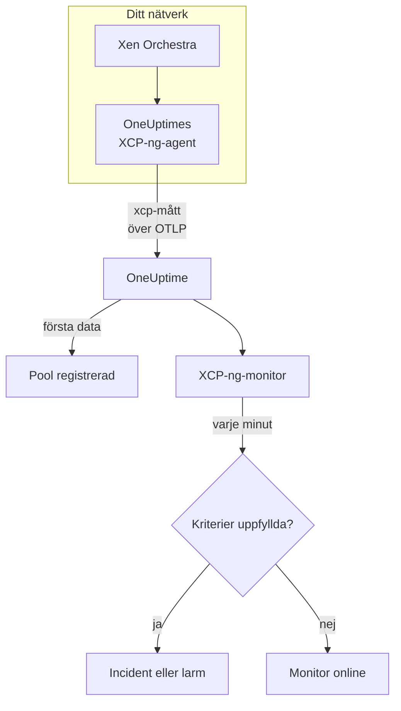

# XCP-ng-övervakning

En XCP-ng-monitor övervakar en XCP-ng-pool – dess värdar, VM:ar, lagringsrepositoryn och virtuella diskar – och säger till när Xen Orchestra tappar poolen, en värd går offline eller förblir inaktiverad, en VM som körde stannar eller får för lite CPU, eller ett lagringsrepository fylls eller blir långsamt. Den läser serierna `xcp_*` från Xen Orchestras OpenMetrics-plugin, som OneUptimes XCP-ng-agent samlar in, och de hälsoserier som OneUptime härleder ur dem, så ingenting undersöks utifrån.

:::cards
- [Skapa monitorn](#skapa-en-xcp-ng-monitor): Sex steg i instrumentpanelen.
- [Mallar](#färdiga-larmmallar): Tio färdiga larm, en incident per värd, VM eller lagringsrepository.
- [Resursidentitet](#resursidentitet): Så riktar du in dig på en värd, VM eller ett lagringsrepository.
- [Mätvärden](#insamlade-mätvärden): Varje serie som monitorn kan varna på.
:::

## Så fungerar det

OneUptimes XCP-ng-agent körs på en maskin som når Xen Orchestra. Var 60:e sekund läser den Xen Orchestras OpenMetrics-plugin, som läser varje värd i varje pool som Xen Orchestra hanterar, och skickar serierna till OneUptime över OTLP, en resurs per pool, stämplade med poolens UUID, `xcp_ng.pool.id`. De första data registrerar varje pool.

En XCP-ng-monitor är knuten till en pool. Varje minut kör den sin fråga över poolens mätvärden och jämför resultatet med sina kriterier.



## Innan du börjar

- **Installera XCP-ng-agenten** där den når Xen Orchestra, med hemligheten för Xen Orchestras OpenMetrics-plugin. [Guiden för XCP-ng-agenten](/docs/telemetry/xcp-ng) beskriver pluginet, Xen Orchestras certifikat och installationen.
- **Kontrollera att poolen är registrerad.** Den visas under **Produkter → Infrastruktur → XCP-ng → Alla pooler**, namngiven som Xen Orchestra namnger den, ungefär en minut efter den första insamlingen.

## Skapa en XCP-ng-monitor

:::steps
### Starta en ny monitor

Gå till **Monitorer** och klicka på **Skapa monitor**.

### Välj XCP-ng

Klicka på **Fler monitortyper** under **Monitortyp** och välj **XCP-ng** under **Infrastruktur**, eller skriv `xcp` i sökrutan. Ange ett **Namn** – det används i titlar på incidenter och larm – och klicka på **Nästa**.

### Välj poolen

Välj poolen i **XCP-ng-pool** under **XCP-ng Monitor Configuration**. Varje pool som har skickat data finns i listan. När du har valt visar en rad under fältet om data kommer in. **Lägg till XCP-ng-pool** öppnar installationssteg med dina nycklar ifyllda, som väntar tills data kommer in.

### Välj vad som ska övervakas

En ny monitor börjar med **Pool Disconnected** under **Vad som ska larmas om**. Så här övervakar du något annat:

- **Ändra** – välj en annan [mall](#färdiga-larmmallar). Den anger mätvärdena, filtren, aggregeringen, tidsintervallet och trösklarna och ersätter kriterierna nedan med sina egna. Du kan fortfarande ändra **Tidsintervall**.
- **Custom Metric** (under **Fler fält**) – välj ett mätvärde i **XCP-ng Metric** och ange sedan **Aggregering** och **Tidsintervall**. [Filtren](#monitorinställningar) begränsar det till en typ av objekt eller till ett objekt.
- **Avancerad** (under **Fler fält**) – bygg frågor och formler själv under **Välj mätvärden**, till exempel den använda andelen av ett lagringsrepository från `xcp_sr_physical_usage_bytes / xcp_sr_physical_size_bytes`. Använd **Gruppera efter** `xcp_ng.id` för att bedöma varje objekt för sig.

### Kontrollera kriterierna

Öppna varje kriterium under **Kriterier** och kontrollera dess **Mätvärde**, **Aggregering**, **Villkor** och **Tröskel**. En mall fyller i dem. Med **Custom Metric** eller **Avancerad** börjar monitorn med [standardkriterierna](#standardkriterier), som bara märker att ett mätvärde inte skickar data, så ange din egen tröskel.

### Skapa monitorn

Klicka på **Skapa monitor**. OneUptime öppnar monitorns sida och utvärderar den varje minut. Incidenter och larm som den öppnar visas också på poolens sidor **Incidenter** och **Larm**.
:::

> [!TIP]
> För att ställa in flera mallar på en gång öppnar du poolen från **Produkter → Infrastruktur → XCP-ng** och går till **Rekommendationer**. Välj de mallar du vill ha och vem som ska larmas, så skapar OneUptime en monitor per mall.

## Monitorinställningar

| Fält | Flik | Vad det gör |
| --- | --- | --- |
| **XCP-ng-pool** | Alla | Krävs. Begränsar varje fråga till `resource.xcp_ng.pool.id`, poolens UUID, så att två pooler med samma namn aldrig blandas. |
| **Resursomfattning** | Custom Metric, Avancerad | Valfritt. **Värd**, **VM**, **Lagringsrepository**, **Virtuell disk**, **XOSTOR** eller **XCP-ng-pool** – en exakt matchning mot `xcp_ng.scope`. |
| **UUID** | Custom Metric, Avancerad | Valfritt. Exakt matchning mot `xcp_ng.id`: UUID för en värd, VM, ett lagringsrepository eller en virtuell disk, som Xen Orchestra visar det. Kombinera det med en omfattning för att rikta in dig på ett objekt. |
| **Värdens namn** | Custom Metric, Avancerad | Valfritt. Exakt matchning mot Xen Orchestras etikett `host_name`: värdens egna serier och serierna för de VM:ar som körs på den. |
| **XCP-ng Metric** | Custom Metric | Ett mätvärde från [katalogen](#insamlade-mätvärden). |
| **Aggregering** | Custom Metric | Hur mätningar kombineras: **Genomsnitt**, **Maximum**, **Minimum**, **Summa** eller **Antal**. Börjar på mätvärdets vanliga aggregering. |
| **Tidsintervall** | Alla | Det glidande fönster som frågan läser, från **Past 1 Minute** till **Past 365 Days**. En ny monitor börjar på **Past 1 Minute**; mallar anger sitt eget. |
| **Välj mätvärden** | Avancerad | Frågebyggaren: **Mätvärde**, **Aggregera efter**, **Filtrera på attribut**, **Gruppera efter**, plus **Lägg till mätvärde** och **Lägg till formel** för att kombinera frågor. |

Agenten läser Xen Orchestra var 60:e sekund, och Xen Orchestra läser sina värdar med en upplösning på 60 sekunder, så ett fönster på 1 minut innehåller ungefär en mätning; mallarna läser 5 minuter eller mer.

## Resursidentitet

Xen Orchestra namnger en värd eller en VM med etiketten `uuid`, ett lagringsrepository med `sr_uuid` och en virtuell disk med `vdi_uuid`. OneUptime sätter två attribut på varje datapunkt när den kommer in, så att ett filter läser varje serie för ett objekt, oavsett vilken etikett som namngav det. Mallarna bygger på dem:

| Attribut | Värden | För en VM |
| --- | --- | --- |
| `xcp_ng.scope` | `pool`, `host`, `vm`, `sr` (ett lagringsrepository), `vdi` (en virtuell disk), `xostor` | `vm` |
| `xcp_ng.id` | Objektets UUID, med gemener: `uuid` för en värd eller VM, `sr_uuid` för ett lagringsrepository eller ett XOSTOR-kluster, `vdi_uuid` för en virtuell disk, och poolens eget UUID på poolens serier | `5c6d7e8f-1a2b-4c3d-9e8f-0a1b2c3d4e5f` |

Filtrera på `xcp_ng.scope` för en typ av objekt, på `xcp_ng.id` för ett objekt, och gruppera efter `xcp_ng.id` för att bedöma varje objekt för sig. Xen Orchestras egna etiketter förblir som den skickar dem: `host_name` namnger en värd på dess serier och en VM:s värd på VM:ens, `vm_name`, `sr_name` och `vdi_name` namnger resten, `power_state` och `enabled` bär en värds eller en VM:s tillstånd på statusserierna, och `is_control_domain` är `true` på ett kontrolldomäns VM-serier.

Själva poolen är den resurs som serierna kommer in på, så dess attribut får prefixet `resource.` i filter och grupperingsnycklar: `resource.xcp_ng.pool.id` (dess UUID), `resource.xcp_ng.pool.name` (dess namn i Xen Orchestra) och `resource.xen_orchestra.name` (den Xen Orchestra som den läses från).

## Färdiga larmmallar

Listan under **Vad som ska larmas om** erbjuder 10 mallar. Varje mall bygger en komplett monitor – frågor, attributfilter, en gruppering, ett kriterium som utlöses och ett som återställer. De flesta grupperar efter `xcp_ng.id`, så att varje värd, VM eller lagringsrepository får en egen incident och ett eget larm. Trösklarna är utgångspunkter som du kan redigera.

Ett kriterium utlöses bara när villkoret gäller varje minut i fönstret, och ett tröskelkriterium återställs 10 % förbi sin tröskel, så att ett värde som pendlar vid gränsen inte fladdrar. En 0/1-serie återställs vid det andra värdet.

| Mall | Kategori | Allvarlighetsgrad | Övervakar | Utlöses när | Återställs när |
| --- | --- | --- | --- | --- | --- |
| Pool Disconnected | Tillgänglighet | Kritisk | `xcp_pool_connected`, Count över hela poolen, senaste 10 minuterna | Inga data under hela fönstret | Data kommer in igen |
| Host Offline | Tillgänglighet | Kritisk | `xcp_ng.host.running` för `xcp_ng.scope = host`, Min per `xcp_ng.id`, senaste 5 minuterna | Under 1 | Vid 1 |
| VM Stopped | VM | Varning | `xcp_ng.vm.stopped_after_running` för `xcp_ng.scope = vm`, Min per `xcp_ng.id`, senaste 5 minuterna | Över 0 | Vid 0 |
| Storage Repository Near Full | Lagring | Kritisk | `xcp_sr_physical_usage_bytes` ÷ `xcp_sr_physical_size_bytes` × 100 för `xcp_ng.scope = sr` (båda Summa), per `xcp_ng.id`, senaste 5 minuterna | Över 90 % | Vid eller under 81 % |
| Host Disabled | Värd | Varning | `xcp_ng.host.enabled` för `xcp_ng.scope = host`, Max per `xcp_ng.id`, senaste 30 minuterna | Under 1 | Vid 1 |
| Host Restarted | Värd | Varning | `xcp_host_uptime_seconds` och `xcp_ng.host.running` för `xcp_ng.scope = host`, Min per `xcp_ng.id`, senaste 5 minuterna | `xcp_host_uptime_seconds` är under 900 (15 minuter) medan `xcp_ng.host.running` är 1 | `xcp_host_uptime_seconds` är 990 eller mer, eller `xcp_ng.host.running` är 0 |
| High Host CPU Usage | Värd | Varning | `xcp_host_cpu_average` för `xcp_ng.scope = host`, Avg per `xcp_ng.id`, senaste 10 minuterna | Över 0,9 (90 % av värdens CPU) | Vid eller under 0,81 |
| High Host Memory Usage | Värd | Varning | (`xcp_host_memory_total_bytes` − `xcp_host_memory_free_bytes`) ÷ `xcp_host_memory_total_bytes` × 100 för `xcp_ng.scope = host` (båda Summa), per `xcp_ng.id`, senaste 10 minuterna | Över 95 % | Vid eller under 85,5 % |
| VM Starved of CPU | VM | Varning | `xcp_vm_runstate_full_contention` för `xcp_ng.scope = vm`, Avg per `xcp_ng.id`, senaste 15 minuterna | Över 0,1 (10 % av tiden) | Vid eller under 0,09 |
| Storage Repository Slow | Lagring | Varning | `xcp_host_disk_latency_seconds` för `xcp_ng.scope = host`, Avg per `sr`, senaste 15 minuterna | Över 0,05 (50 ms) | Vid eller under 0,045 |

**Allvarlighetsgrad** är etiketten som väljaren visar. Incidenten och larmet som en mall skapar börjar på projektets allvarligaste incident- och larmgrad; ändra dem i kriterierna.

- **Pool Disconnected** utlöses när `xcp_pool_connected` slutar komma i tio minuter. Xen Orchestra skickar den vid varje insamling så länge den är ansluten till poolen, och slutar skicka den, i stället för att skicka 0, när den tappar poolens master; den slutar också när Xen Orchestra, dess plugin eller XCP-ng-agenten stannar, eller agenten tappar sin väg till OneUptime. Den återställs när serien kommer tillbaka. När data slutar komma har de andra mallarna inget att jämföra och behåller sin senaste status, så det är den här som säger till dig.
- **Host Offline** läser `xcp_ng.host.running`, som OneUptime härleder ur `xcp_host_status`: 0 medan Xen Orchestra rapporterar värden som Halted, eller dess tillstånd som Unknown eftersom pool-mastern tappade kontakten med den. De VM:ar som kördes på värden är också nere, om inte HA startade om dem någon annanstans.
- **VM Stopped** läser `xcp_ng.vm.stopped_after_running`: 1 medan en VM som kördes under de senaste 24 timmarna är Halted eller Paused. En VM som har varit avstängd i mer än ett dygn räknas som avstängd med avsikt och slutar larma, en försatt VM larmar aldrig, och kontrolldomäner och VM-mallar utelämnas.
- **Host Disabled** utlöses för en värd som förblir inaktiverad i 30 minuter: i underhållsläge, eller kvarlämnad inaktiverad av en evakuering. XAPI startar ingen VM på den och HA kan inte flytta något till den. Trettio minuter låter en planerad omstart eller uppdatering passera utan att larma någon.
- **Host Restarted** utlöses för en värd som är uppe men har varit igång i mindre än 15 minuter: den har startats om, eller den kraschade och kom tillbaka. Den återställs när värden har varit uppe i 16,5 minuter, 10 % förbi tröskeln; en värd som är nere utlöser **Host Offline** i stället.
- **Kvotformler** tar **Summa** av båda sidor. Båda kommer från samma insamling, så resultatet är en äkta procentsats. Ett lagringsrepository som rapporterar storleken 0, som vissa ISO-bibliotek och flyttbara medier gör, utlöses aldrig.
- **VM Starved of CPU** läser full konkurrens: andelen av tiden då alla en VM:s vCPU:er var redo att köras men väntade på en fysisk CPU. Dess värd har fler körbara vCPU:er än CPU-trådar, så VM:en körs långsammare än dess egen CPU-användning antyder.
- **Storage Repository Slow** grupperar efter `sr`, Xen Orchestras korta id för ett lagringsrepository på varje värds diskserier, så att varje lagringsrepository får en incident, med sin latens som medelvärde över de värdar som läser och skriver på det.

Pluginet rapporterar inga larm utöver XOSTOR:s, inget HA-tillstånd, ingen pool-master, inga saknade patchar och inga säkerhetskopior, så ingen mall bevakar dem ännu: se [Vad pluginet inte täcker ännu](/docs/telemetry/xcp-ng#vad-pluginet-inte-täcker-ännu).

## Insamlade mätvärden

Agenten läser varje serie från Xen Orchestras OpenMetrics-plugin var 60:e sekund; serierna nedan är katalogen som monitorformuläret erbjuder. Xen Orchestra gör redan om XAPI:s KiB, MiB/s och mikrosekunder till byte, byte per sekund och sekunder. Åtta serier som den kallar `_total` och typar som räknare innehåller takter per sekund, och OneUptime lagrar dem som de takter de är, som [guiden för XCP-ng-agenten](/docs/telemetry/xcp-ng#vad-agenten-samlar-in) förklarar. De fyra serierna `xcp_ng.*` är OneUptimes egna, härledda ur Xen Orchestras statusserier när de kommer in.

### Tillgänglighet

| Mätvärde | Enhet | Beskrivning |
| --- | --- | --- |
| `xcp_pool_connected` | — | 1 medan Xen Orchestra är ansluten till poolen. Xen Orchestra slutar skicka den när den tappar poolen, i stället för att skicka 0: bevaka att den slutar. |
| `xcp_ng.host.running` | — | 1 medan Xen Orchestra rapporterar en värd som Running, 0 medan den är Halted eller dess tillstånd är Unknown. Härlett av OneUptime ur värdens status. |
| `xcp_ng.host.enabled` | — | 1 medan en värd är aktiverad, 0 medan den är i underhållsläge eller evakueras, när XAPI inte startar någon VM på den. Härlett av OneUptime ur värdens status. |
| `xcp_ng.vm.running` | — | 1 medan en VM är Running, 0 medan den är Halted, Paused eller Suspended. Kontrolldomäner utelämnas. Härlett av OneUptime ur VM:ens status. |
| `xcp_ng.vm.stopped_after_running` | — | 1 medan en VM som kördes under de senaste 24 timmarna är Halted eller Paused, annars 0. En VM som ingen har sett köras på ett dygn räknas som avstängd med avsikt, och en försatt VM räknas aldrig. Härlett av OneUptime. |
| `xcp_host_status` | count | Alltid 1 för varje värd, igång eller inte; värdens tillstånd finns i etiketterna `power_state` (Running, Halted, Unknown) och `enabled`. |
| `xcp_vm_status` | count | Alltid 1 för varje VM utom kontrolldomäner och VM-mallar; VM:ens tillstånd finns i etiketten `power_state` (Running, Halted, Paused, Suspended). |
| `xcp_host_uptime_seconds` | seconds | Hur länge en värd har varit uppe sedan den startade. |
| `xcp_vm_uptime_seconds` | seconds | Hur länge en körande VM har varit uppe sedan den startade. Rapporteras bara medan VM:en körs. |

### Värd

| Mätvärde | Enhet | Beskrivning |
| --- | --- | --- |
| `xcp_host_cpu_average` | ratio | En värds CPU-användning som medelvärde över dess kärnor, som en kvot från 0 till 1. |
| `xcp_host_cpu_core_usage` | ratio | En CPU-tråds användning på en värd, som en kvot från 0 till 1; etiketten `core` anger vilken. |
| `xcp_host_load` | — | De vCPU:er som körs eller väntar på att köras på en värd, per fysisk CPU. Över 1 väntar VM:ar på en CPU. |
| `xcp_host_load_average` | — | Load average för en värds kontrolldomän (dom0). |
| `xcp_host_memory_total_bytes` | bytes | En värds fysiska minne. |
| `xcp_host_memory_free_bytes` | bytes | En värds minne som inte är tilldelat någon VM. Jämför det med `xcp_host_memory_total_bytes` för att se hur full värden är. |
| `xcp_host_memory_reclaimed_bytes` | bytes | Minne som dynamisk minneshantering har återtagit från en värds VM:ar. |
| `xcp_host_memory_reclaimed_max_bytes` | bytes | Det mesta minne som dynamisk minneshantering kunde återta från en värds VM:ar. |
| `xcp_host_running_vcpus` | count | vCPU:erna för de VM:ar som körs på en värd, sammanlagda. |
| `xcp_host_power_consumption_watts` | W | En värds strömförbrukning, läst från dess DCMI-sensor. Där Xen Orchestra i stället läser den via IPMI skickar den mätningen utan dess pool, så agenten behåller den inte; varje VM:s uppskattade andel av den behålls. |

### VM

| Mätvärde | Enhet | Beskrivning |
| --- | --- | --- |
| `xcp_vm_cpu_usage` | ratio | En VM:s CPU-användning som medelvärde över dess vCPU:er, som en kvot från 0 till 1. |
| `xcp_vm_cpu_core_usage` | ratio | En vCPU:s användning, som en kvot från 0 till 1; etiketten `core` anger vilken. |
| `xcp_vm_runstate_full_contention` | ratio | Andelen av tiden då alla en VM:s vCPU:er var redo att köras men väntade på en fysisk CPU, från 0 till 1. Ett högt värde betyder att VM:en får för lite CPU på grund av sina grannar. |
| `xcp_vm_runstate_partial_contention` | ratio | Andelen av tiden då några av en VM:s vCPU:er väntade på en fysisk CPU medan resten var blockerade, från 0 till 1. |
| `xcp_vm_runstate_concurrency_hazard` | ratio | Andelen av tiden då några av en VM:s vCPU:er kördes medan andra väntade på en fysisk CPU, från 0 till 1. |
| `xcp_vm_runstate_fullrun` | ratio | Andelen av tiden då alla en VM:s vCPU:er kördes, från 0 till 1. |
| `xcp_vm_runstate_partial_run` | ratio | Andelen av tiden då några av en VM:s vCPU:er kördes och resten var blockerade, från 0 till 1. |
| `xcp_vm_runstate_blocked` | ratio | Andelen av tiden då alla en VM:s vCPU:er var blockerade, utan något att göra eller i väntan på I/O, från 0 till 1. |
| `xcp_vm_memory_bytes` | bytes | Minnet som en VM har tilldelats. |
| `xcp_vm_memory_target_bytes` | bytes | Minnet som dynamisk minneshantering siktar på att ge en VM. |
| `xcp_vm_memory_internal_free_bytes` | bytes | Minnet som gästen rapporterar som ledigt. Kräver gästverktygen i VM:en. |
| `xcp_vm_power_consumption_watts` | W | Xen Orchestras uppskattning av en VM:s andel av dess värds strömförbrukning, fördelad efter CPU-belastning. Dess etikett `data_complete` är `false` när VM:ens CPU-mätning saknades. |

### Lagring

| Mätvärde | Enhet | Beskrivning |
| --- | --- | --- |
| `xcp_sr_physical_size_bytes` | bytes | Ett lagringsrepositorys fysiska storlek. Vissa ISO-bibliotek och flyttbara medier rapporterar 0. |
| `xcp_sr_physical_usage_bytes` | bytes | Det använda utrymmet på ett lagringsrepository. Dela det med storleken för att se hur fullt det är. |
| `xcp_sr_virtual_size_bytes` | bytes | Den virtuella storleken för varje disk på ett lagringsrepository, sammanlagd. Över dess storlek är repositoryt tilldelat över vad det rymmer, via thin provisioning. |
| `xcp_vdi_virtual_size_bytes` | bytes | En virtuell disks storlek som dess VM ser den. |
| `xcp_vdi_physical_usage_bytes` | bytes | Utrymmet som en virtuell disk tar på sitt lagringsrepository. |
| `xcp_host_disk_iops_read` | ops/s | Läsoperationer per sekund från en värd till ett lagringsrepository; etiketten `sr_name` anger vilket. |
| `xcp_host_disk_iops_write` | ops/s | Skrivoperationer per sekund från en värd till ett lagringsrepository. |
| `xcp_host_disk_iops_total` | ops/s | Läs- och skrivoperationer per sekund från en värd till ett lagringsrepository. |
| `xcp_host_disk_throughput_read_bytes` | bytes/s | Byte per sekund som en värd läser från ett lagringsrepository. |
| `xcp_host_disk_throughput_write_bytes` | bytes/s | Byte per sekund som en värd skriver till ett lagringsrepository. |
| `xcp_host_disk_throughput_total_bytes` | bytes/s | Byte per sekund som en värd läser från och skriver till ett lagringsrepository. |
| `xcp_host_disk_read_latency_seconds` | seconds | Hur lång tid en värds läsningar från ett lagringsrepository tar. |
| `xcp_host_disk_write_latency_seconds` | seconds | Hur lång tid en värds skrivningar till ett lagringsrepository tar. |
| `xcp_host_disk_latency_seconds` | seconds | Hur lång tid en värds läsningar och skrivningar på ett lagringsrepository tar. |
| `xcp_host_disk_iowait` | ratio | Andelen av tiden då en värd väntade på ett lagringsrepository, från 0 till 1. |
| `xcp_vm_disk_read_bytes_total` | bytes/s | Byte per sekund som en VM läser från en av sina diskar; etiketten `device` anger vilken. En takt, fast Xen Orchestra kallar den `_total` och typar den som en räknare. |
| `xcp_vm_disk_write_bytes_total` | bytes/s | Byte per sekund som en VM skriver till en av sina diskar. En takt, fast Xen Orchestra kallar den `_total` och typar den som en räknare. |
| `xcp_vm_disk_iops_read` | ops/s | Läsoperationer per sekund på en VM:s disk. |
| `xcp_vm_disk_iops_write` | ops/s | Skrivoperationer per sekund på en VM:s disk. |
| `xcp_vm_disk_iops_total` | ops/s | Läs- och skrivoperationer per sekund på en VM:s disk. |
| `xcp_vm_disk_throughput_read_bytes` | bytes/s | Byte per sekund som läses från en VM:s disk. |
| `xcp_vm_disk_throughput_write_bytes` | bytes/s | Byte per sekund som skrivs till en VM:s disk. |
| `xcp_vm_disk_throughput_total_bytes` | bytes/s | Byte per sekund som läses från och skrivs till en VM:s disk. |
| `xcp_vm_disk_read_latency_seconds` | seconds | Hur lång tid läsningar från en VM:s disk tar. |
| `xcp_vm_disk_write_latency_seconds` | seconds | Hur lång tid skrivningar till en VM:s disk tar. |
| `xcp_vm_disk_latency_seconds` | seconds | Hur lång tid läsningar och skrivningar på en VM:s disk tar i genomsnitt. |
| `xcp_vm_disk_iowait` | ratio | Andelen av tiden då en VM väntade på en av sina diskar, från 0 till 1. |
| `xcp_vm_disk_inflight` | count | De förfrågningar på en VM:s disk som inte har besvarats ännu. |
| `xcp_vm_disk_queue_size` | count | Den genomsnittliga kön av förfrågningar på en VM:s disk. |

### Nätverk

| Mätvärde | Enhet | Beskrivning |
| --- | --- | --- |
| `xcp_host_network_receive_bytes_total` | bytes/s | Byte per sekund som en värd tar emot på ett fysiskt gränssnitt; etiketten `interface` anger vilket. En takt, fast Xen Orchestra kallar den `_total` och typar den som en räknare. |
| `xcp_host_network_transmit_bytes_total` | bytes/s | Byte per sekund som en värd skickar på ett fysiskt gränssnitt. En takt, fast Xen Orchestra kallar den `_total` och typar den som en räknare. |
| `xcp_host_network_aggregated_receive_bytes` | bytes/s | Byte per sekund som en värd tar emot på alla sina fysiska gränssnitt. |
| `xcp_host_network_aggregated_transmit_bytes` | bytes/s | Byte per sekund som en värd skickar på alla sina fysiska gränssnitt. |
| `xcp_vm_network_receive_bytes_total` | bytes/s | Byte per sekund som en VM tar emot på ett av sina nätverksgränssnitt; etiketten `vif` anger vilket. En takt, fast Xen Orchestra kallar den `_total` och typar den som en räknare. |
| `xcp_vm_network_transmit_bytes_total` | bytes/s | Byte per sekund som en VM skickar på ett av sina nätverksgränssnitt. En takt, fast Xen Orchestra kallar den `_total` och typar den som en räknare. |
| `xcp_vm_network_receive_errors_total` | errors/s | Mottagningsfel per sekund på ett av en VM:s nätverksgränssnitt. En takt, fast Xen Orchestra typar den som en räknare. |
| `xcp_vm_network_transmit_errors_total` | errors/s | Sändningsfel per sekund på ett av en VM:s nätverksgränssnitt. En takt, fast Xen Orchestra typar den som en räknare. |

### XOSTOR

Skickas bara för pooler som kör XOSTOR, Vates replikerade lagring byggd på LINSTOR.

| Mätvärde | Enhet | Beskrivning |
| --- | --- | --- |
| `xcp_xostor_up` | — | 1 när Xen Orchestra kunde läsa ett XOSTOR-klusters hälsa, 0 när den inte kunde. |
| `xcp_xostor_node_status` | count | Alltid 1 för varje nod i ett XOSTOR-kluster; dess roll och tillstånd finns i etiketterna `role` och `state`. |
| `xcp_xostor_resource_total` | count | De LINSTOR-resurser som ett XOSTOR-kluster definierar. |
| `xcp_xostor_resource_state_count` | count | Ett XOSTOR-klusters resursrepliker i varje disktillstånd; etiketten `state` anger vilket. |
| `xcp_xostor_alarms_up` | — | 1 när Xen Orchestra kunde läsa ett XOSTOR-klusters larm, 0 när den inte kunde. |
| `xcp_xostor_alarms_count` | count | Aktiva XAPI-larm på ett XOSTOR-lagringsrepository eller dess värdar, efter `alarm_name` och `target_type`. Saknas när inget har utlösts. |
| `xcp_xostor_smart_up` | — | 1 när Xen Orchestra kunde läsa en värds SMART-data för XOSTOR, 0 när den inte kunde. |
| `xcp_xostor_disk_smart_status` | count | Alltid 1 för varje disk på en XOSTOR-värd; dess SMART-hälsa finns i etiketten `status`. |
| `xcp_xostor_updates_up` | — | 1 när en värds XOSTOR-uppdateringskontroll svarade, 0 när den misslyckades. |
| `xcp_xostor_package_update_available` | count | 1 för varje XOSTOR-paket med en uppdatering som väntar på en värd; etiketten `package` anger vilket. |

## Övervakningskriterier

Ett kriterium jämför en av monitorns frågor eller formler med en tröskel. En XCP-ng-monitors kriterier har ingen **Filtertyp**: varje regel kontrollerar mätvärdet, med de här fälten.

| Fält | Vad det gör |
| --- | --- |
| **Mätvärde** | Frågan eller formeln som kontrolleras, efter dess variabelnamn. |
| **Aggregering** | Hur värdena i fönstret blir ett svar: **Genomsnitt**, **Summa**, **Maxvärde**, **Minvärde**, **Alla värden** (varje värde måste matcha, i hela fönstret) eller **Minst ett värde** (ett räcker). |
| **Villkor** | **Större än**, **Mindre än**, **Större än eller lika med**, **Mindre än eller lika med**, **Lika med** eller **Inte lika med** – eller ett avvikelsevillkor: **Onormalt hög**, **Onormalt låg** eller **Avvikande**. **Inga data** stämmer när frågan inte gav något i fönstret, och **Har data** när den gav något. **Väntas stiga över** och **Väntas sjunka under** matchar när mätvärdets trend i fönstret har passerat tröskeln vid slutet av **Tidshorisont**. |
| **Tröskel** | Värdet att jämföra med. En lista med enheter står bredvid när mätvärdet har en enhet. Visas inte för avvikelsevillkor. |
| **Känslighet** | Bara avvikelsevillkor. **Låg** (4σ), **Medel** (3σ, standard) eller **Hög** (2σ). |
| **Baslinjefönster** | Bara avvikelsevillkor. 14 dagar (standard), 28, 60 eller 90 dagars historik. |
| **Om ingen data** | Under **Fler fält**. Vad som händer när fönstret saknar mätningar: **Ignore** (standard), **Treat As Zero** eller **Utlösare**. |

Avvikelsevillkor jämför varje värde med samma timme i veckan i baslinjen. De stannar i ett "Learning"-läge och ger ingenting förrän baslinjefönstret innehåller tillräckligt med historik. Den här monitorn filtrerar sina frågor på attribut, så varje fråga, och varje serie i en grupperad fråga, jämförs med sin egen historik, så långt tillbaka som dina metriker sparas. Är det under två veckor stannar en summa, ett antal eller en fråga på ett histogram i det tillståndet för alltid, och allt annat jämförs med alla serier i metriken. En percentil av ett histogram stannar alltid i det tillståndet.

Varje kriterium anger också vad som ska hända när det matchar: ändra monitorns status, skapa ett larm eller deklarera en incident. Kriterierna kontrolleras uppifrån och ned, och det första som matchar avgör.

### Standardkriterier

En monitor som du inte bygger från en mall börjar med två kriterier:

| Ordning | Kriterium | Matchar när | Sedan |
| --- | --- | --- | --- |
| 1 | Kontrollera om _monitornamn_ är offline | Den första frågan har inga data under hela fönstret | Markerar monitorn som **Offline** och deklarerar incidenten "_monitornamn_ är offline", som löser sig själv när monitorn återhämtar sig. |
| 2 | Kontrollera om _monitornamn_ är online | Den första frågan har data | Markerar monitorn som **Fungerar**. |

> [!IMPORTANT]
> Ett värde på `0` är data, så ett mätvärde som ofta är noll, som en VM:s nätverksfel, gör inte monitorn offline. För att larma på ett värde, börja från en mall eller lägg till ett kriterium med ett tröskelvärde. När inga data alls kommer och inget kriterium stämmer behåller monitorn sin status, och öppna incidenter förblir öppna: tystnad är ingen återhämtning. Tid då OneUptime självt inte tog emot data räknas aldrig som saknade data: en kontroll vars fönster innehåller sådan tid väntar i stället, som [När OneUptime inte tar emot data](/docs/monitor/when-oneuptime-is-not-receiving) förklarar.

## Terraform

[OneUptimes Terraform-provider](/docs/terraform/monitor-steps) bär konfigurationen för ett steg i en XCP-ng-monitor i attributet `xcp_ng_monitor`: den råa JSON:en för konfigurationen `xcpNgMonitor` (`poolIdentifier`, `resourceFilters`, `metricViewConfig`, `rollingTime`), skriven med `jsonencode()`:

```hcl title="main.tf"
monitor_steps = [{
  xcp_ng_monitor = jsonencode({
    poolIdentifier  = "b7569d99-30f8-178a-7d94-801de3e29b5b"
    resourceFilters = { scope = "host" }
    rollingTime     = "Past 10 Minutes"
    metricViewConfig = {
      queryConfigs = [{
        metricAliasData = { metricVariable = "host_cpu", title = "Host CPU", description = "", legend = "" }
        metricQueryData = {
          filterData = {
            metricName     = "xcp_host_cpu_average"
            attributes     = {}
            aggegationType = "Avg"
            aggregateBy    = {}
          }
          groupByAttributeKeys = ["xcp_ng.id"]
        }
      }]
      formulaConfigs = []
    }
  })
  criteria = [ /* ... */ ]
}]
```

`poolIdentifier` är poolens UUID, dess `xcp_ng.pool.id` som poolens **Inställningar** visar det, inte dess OneUptime-ID. `resourceFilters` innehåller de [filter](#monitorinställningar) som formuläret kallar **Resursomfattning**, **UUID** och **Värdens namn**: `scope` (`host`, `vm`, `sr`, `vdi`, `xostor` eller `pool`), `xcpNgId` och `hostName`.

## Felsökning

:::details Poolen finns inte i listan XCP-ng-pool
Pooler registrerar sig själva från agentens data. Kontrollera att agenten körs och skickar data (se [guiden för XCP-ng-agenten](/docs/telemetry/xcp-ng)), och att Xen Orchestra är ansluten till poolen: en pool som Xen Orchestra inte rapporterar når aldrig OneUptime.
:::

:::details Host Offline eller VM Stopped utlöses aldrig
De läser `xcp_ng.host.running` och `xcp_ng.vm.stopped_after_running`, som OneUptime härleder ur `xcp_host_status` och `xcp_vm_status`. Båda statusserierna kommer från OpenMetrics-pluginet i Xen Orchestra 6.9 eller senare: uppgradera en äldre Xen Orchestra. **VM Stopped** förblir också tyst för en VM som ingen har sett köras under de senaste 24 timmarna, och för en försatt.
:::

:::details Incidenter utlöses en gång för hela poolen i stället för en gång per värd
Gruppera frågan efter `xcp_ng.id`, som mallarna gör. Utan gruppering läser frågan varje värd, VM eller lagringsrepository i poolen som en serie, och ett medelvärde över dem döljer den som har problem.
:::

:::details Ett genomströmningsdiagram visar alldeles för högt, eller sjunker under noll
De åtta serierna `_total` som innehåller takter lagras som gauges i byte eller fel per sekund, de värden som Xen Orchestra levererar. Läs dem som de är, med **Genomsnitt** eller **Maximum**: **Räkna om till takt per sekund** i frågebyggaren skulle ta en takt av en takt. En collector som du har konfigurerat själv måste också göra dem till gauges, som agentens processor `transform/xcp-ng-rates` gör; OneUptime konverterar också alla som fortfarande kommer som räknare.
:::

:::details Pool Disconnected utlöses för alla pooler i en Xen Orchestra samtidigt
Agenten, Xen Orchestra eller dess OpenMetrics-plugin stannade, eller agenten tappade sin väg till OneUptime: alla pooler i den Xen Orchestra tystnade samtidigt. Agentens `troubleshoot.sh` anger steget som misslyckas, som [guiden för XCP-ng-agenten](/docs/telemetry/xcp-ng#felsökning) förklarar.
:::

## Nästa steg

:::cards
- [XCP-ng-agent](/docs/telemetry/xcp-ng): Installera agenten som skickar mätvärdena.
- [Proxmox-övervakning](/docs/monitor/proxmox-monitor): Samma typ av monitor för Proxmox VE.
- [VMware-övervakning](/docs/monitor/vmware-monitor): Samma typ av monitor för vSphere.
- [Incidenter – Översikt](/docs/incidents/index): Vad som händer efter att ett kriterium har deklarerat en incident.
:::
