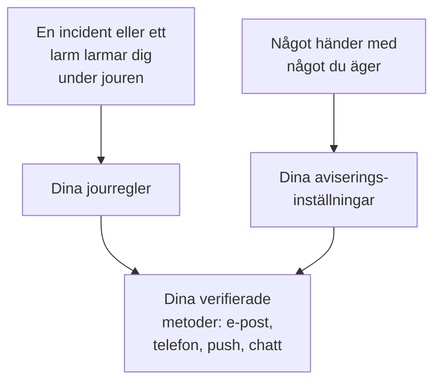

# Så når OneUptime dig

OneUptime når dig på två sätt. Det larmar dig när en incident eller ett larm utlöses medan du har jour, och det håller dig uppdaterad om det du äger: en anteckning på din incident, en övervakning som bytte status, ditt nästa jourpass. Båda kommer fram till adresserna du har i **Användarinställningar**, projekt för projekt. Den här sidan förklarar hur delarna hänger ihop, var de finns och vad du börjar med.

:::cards
- [Tre sidor, tre frågor](#tre-sidor-tre-frågor): Metoder, jourregler och aviseringsinställningar, och vad var och en avgör.
- [Var du hittar dem](#var-du-hittar-dem): Sidorna i användarinställningarna, avsnitt för avsnitt.
- [Det här börjar du med](#det-här-börjar-du-med): Metoderna, reglerna och inställningarna som en ny medlem får.
- [När ingen regel matchar](#när-ingen-regel-matchar): Hur ett larm ändå når dig, och vem som får veta det.
:::

## Så fungerar det

- En jourpolicy larmar dig när en av dess eskaleringsregler nämner dig, ett team du är med i eller ett schema där du har jour. Dina jourregler avgör då vilka av dina metoder OneUptime försöker med, och efter hur lång tid.
- När något händer med något du äger, eller med dina jourpass, avgör dina aviseringsinställningar vilka kanaler uppdateringen går via.
- I båda fallen använder OneUptime bara metoder som du har verifierat, i projektet som larmet eller uppdateringen kommer från.

## Tre sidor, tre frågor

| Sida | Vad den innehåller | Frågan den besvarar |
| --- | --- | --- |
| **Aviseringsmetoder** | Dina e-postadresser, telefonnummer, WhatsApp-nummer, Telegram-, Slack- och Microsoft Teams-konton, push-enheter och webhooks | Var kan OneUptime nå mig? |
| **Jourregler** | För varje typ av larm och varje allvarlighetsgrad: vilken metod som provas och efter hur lång tid | Hur larmas jag när jag har jour? |
| **Aviseringsinställningar** | För varje händelse om något du äger eller om dina jourpass: vilka kanaler som används | Vad mer får jag veta om, och var? |

De är åtskilda med flit. Att slå på alla kanaler i **Aviseringsinställningar** larmar dig aldrig, och en metod som du inte har verifierat används aldrig, vad dina regler än säger.

> [!IMPORTANT]
> Metoder, regler och inställningar hör till ett projekt. Ställ in dem i varje projekt du arbetar i: **Användarinställningar** visar alltid projektet du befinner dig i.

## Var du hittar dem

Öppna **Användarinställningar**, till höger i fältet under det översta fältet. Sidomenyn samlar allt om hur OneUptime når dig:

| Avsnitt | Sidor |
| --- | --- |
| **Kom igång** | **Checklista för konfiguration**: det som återstår att ställa in, i den ordning som spelar roll |
| **Larm och aviseringar** | **Aviseringsmetoder**, **Jourregler**, **Aviseringsinställningar** och **E-postinställningar**, där du bestämmer hur många e-postmeddelanden dina uppdateringar blir |
| **Jourloggar** | **Jourloggar**: varje gång du larmades i det här projektet, och vad som skickades |
| **Inkommande samtalspolicy** | **Inkommande telefonnummer**: numret som en policy för inkommande samtal ringer dig på |
| **Kalender** | **Kalenderflöde**: dina jourpass i din kalenderapp, och påminnelser innan de börjar |
| **Profil** | **Anpassade fält**: uppgifter som ditt projekt ber sina medlemmar om |
| **Arbetsyta** | **Slack** och **Microsoft Teams**: ditt eget konto, i varje arbetsyta som projektet har anslutit |

**Kom igång** och **Larm och aviseringar** är öppna; de andra avsnitten börjar ihopfällda, och ett avsnitt öppnas av sig självt när du är på en av dess sidor. **Arbetsyta** visas bara när projektet har anslutit Slack eller Microsoft Teams.

Projektägare och administratörer kan också se din konfiguration: under **Användare** öppnar de din rad och dess avsnitt **Jour**, med **Beredskap**, **Aviseringsmetoder** och **Jourregler**. De kan lägga till en metod åt dig där, men koden går till själva metoden, så bara du kan verifiera den.

## Det här börjar du med

När du går med i ett projekt med en verifierad inloggnings-e-post ställer OneUptime in dig så att ett larm alltid kan nå dig:

1. Din inloggnings-e-post läggs till som en verifierad e-postmetod.
2. För varje allvarlighetsgrad, på var och en av de fyra flikarna i **Jourregler**, skickar en regel ett e-postmeddelande till dig så snart du larmas.
3. En rad uppdateringar om det du äger, och om dina jourpass, är påslagna via e-post. Se [Aviseringsinställningar](/docs/notifications/notification-settings#vad-som-är-påslaget-för-en-ny-medlem).

Varje metod som du verifierar senare får samma regler: en regel för varje allvarlighetsgrad, skickad så snart du larmas. Att verifiera ett telefonnummer för SMS betyder alltså att varje larm också skickar ett SMS till dig. Vill du bara ha SMS för kritiska larm tar du bort SMS-reglerna för de andra allvarlighetsgraderna. Se [Personliga jourregler](/docs/notifications/on-call-rules#reglerna-du-börjar-med).

## Checklistan för konfiguration

**Användarinställningar → Checklista för konfiguration** öppnar **Your setup checklist**: allt som OneUptime behöver för att nå dig, i den ordning som spelar roll. Ett steg länkar till sidan där det görs, och **Kontrollera igen** läser in allt igen.

| Avsnitt | Vad det kontrollerar |
| --- | --- |
| **So we can reach you** | Du har en metod, varje metod du har lagt till är verifierad, och minst en av dem ligger på en kanal som projektet har slagit på |
| **How you want to be paged** | Varje allvarlighetsgrad har en regel, på var och en av de fyra flikarna i **Jourregler** |
| **Staying informed** | Du får veta när ett jourpass börjar, och bakom varje kanal som du har slagit på i **Aviseringsinställningar** finns en verifierad metod |
| **Nice to have** | Ett nummer för inkommande samtal, dina Slack- och Microsoft Teams-konton, en kalenderlänk och dina profilfält |

**Staying informed** nämner bara push för en uppdatering som inte når dig på något annat sätt: varje uppdatering som en ny medlem får via push kommer också via e-post.

**Nice to have** räknas inte in i förloppsindikatorn, och det gör inte heller ett steg som bara någon annan kan åtgärda. Raden högst upp sammanfattar:

| Rubrik | Vad den betyder |
| --- | --- |
| **Allt är klart** | Larm når dig, och det finns inget kvar att göra |
| **Några saker behöver fortfarande konfigureras** | En allvarlighetsgrad saknar regel, eller ett steg är inte gjort än |
| **Inget kan nå dig än** | Ingen av dina metoder kan användas: ingen är verifierad, eller varje verifierad metod ligger på en kanal som det här projektet har stängt av |
| **Du är konfigurerad och har inte jour just nu** | Allt är klart för den dag en policy nämner dig |

## När ingen regel matchar

Ett larm kan nå dig för en typ och en allvarlighetsgrad som du inte har någon regel för, till exempel en allvarlighetsgrad som lades till efter att du gick med. OneUptime larmar dig ändå, via det du har verifierat:

1. Varje kostnadsfri metod du har: push-enheter, e-postadresser, Slack och Microsoft Teams.
2. Har du ingen av dem, en betald metod, i den här ordningen: SMS, ett telefonsamtal, WhatsApp, Telegram. Det är den första som du har verifierat, på en kanal som projektet har slagit på.
3. Har du ingen av dem heller, en webhook.

Du får ett e-postmeddelande om det, och det får även jourpolicyns ägare, eller projektets ägare om policyn inte har några. Är ingenting verifierat kan larmet inte levereras, och e-postmeddelandet säger det i stället. De här e-postmeddelandena hålls tillbaka medan larmen fortsätter komma, så att en storm av larm inte blir en storm av e-post. Hur du lägger till den saknade regeln står under [Personliga jourregler](/docs/notifications/on-call-rules#när-en-allvarlighetsgrad-saknar-regel).

## Felsökning

:::details Jag hade jour, men inget nådde mig
Öppna **Användarinställningar → Jourloggar**. Ingen rad för incidenten betyder att dess jourpolicy aldrig larmade dig: kontrollera dess eskaleringsregler och vem som hade jour. För en rad med statusen **Fel** berättar **Visa statusmeddelande** varför, till exempel en kanal som projektet har stängt av. Kontrollera sedan att dina metoder är verifierade och att **Your setup checklist** inte har något kvar under **So we can reach you**.
:::

:::details Jag får e-post om saker som jag aldrig har bett om
Du äger saken, direkt eller via ett team, eller så har saken inga ägare och du är projektägare. Stäng av händelsen under **Användarinställningar → Aviseringsinställningar**, eller minska mängden under **Användarinställningar → E-postinställningar**.
:::

:::details Jag lade till ett telefonnummer, men det finns inte i mina regler
Ett nummer kommer in i dina regler när det är verifierat. Klicka på **Verifiera** på dess rad och ange koden. Saknar dess kort en knapp för att lägga till har projektet stängt av den kanalen. Se [Aviseringsmetoder](/docs/notifications/notification-methods#slå-på-en-kanal-för-ditt-projekt).
:::

## Nästa steg

:::cards
- [Aviseringsmetoder](/docs/notifications/notification-methods): Lägg till och verifiera adresserna som OneUptime får nå dig på.
- [Personliga jourregler](/docs/notifications/on-call-rules): Bestäm vilken metod varje larm försöker med, och när.
- [Aviseringsinställningar](/docs/notifications/notification-settings): Välj uppdateringarna du får veta om, och via vilka kanaler.
- [Eskaleringsregler](/docs/on-call/escalation-rules): Hur en jourpolicy avgör vem som larmas, nivå för nivå.
:::
