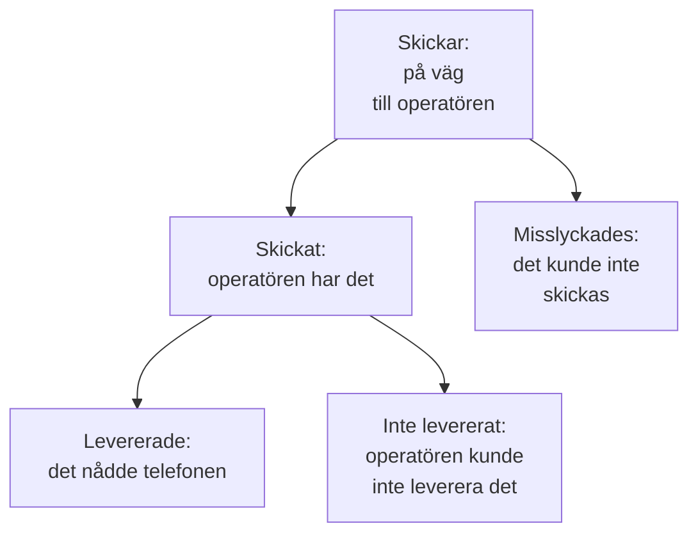

# Aviseringsloggar

Aviseringsloggar visar varje meddelande som OneUptime har skickat för ditt projekt, med en flik per kanal, och vad som hände med vart och ett: om det gick ut, om det kom fram och, om inte, varför. Öppna dem under **Projektinställningar → Aviseringar → Aviseringsloggar**, eller under **Aviseringsloggar** på en incident, ett larm, en underhållshändelse, en statussida eller en jourpolicy, för det som skickades om den.

:::cards
- [Så läser du en status](#så-läser-du-en-status): Färgen visar var meddelandet är, och pekar du på den säger den vad den betyder.
- [Sms](#sms): Skickar, sedan Skickat, sedan Levererade, så som operatören rapporterar det.
- [Samtal](#samtal): Ringer, och sedan hur samtalet slutade.
- [WhatsApp och Telegram](#whatsapp-och-telegram): Vad varje app rapporterar efter att den tagit emot ett meddelande.
- [E-post, push, webhooks och arbetsytor](#e-post-push-webhooks-och-arbetsytor): Framgång, eller Fel och varför.
- [När ett sms blir kvar på Skickat](#när-ett-sms-blir-kvar-på-skickat): Operatörer som aldrig rapporterar tillbaka, och rapporter som aldrig kommer fram.
:::

## Så läser du en status

Varje status är en etikett vars färg visar var meddelandet är:

| Färg | Var meddelandet är |
| --- | --- |
| Grå | Överlämnat, och inget har kommit tillbaka ännu, som **Skickar**. |
| Blå | Leverantören har det och har ännu inte sagt hur det slutade, som **Skickat** för ett sms eller **Ringer** för ett samtal. |
| Grön | Det nådde personen, som **Levererade**, eller så är detta den sista status det får. |
| Gul | Det nådde telefonen och ingen svarade, som **Missat samtal**, eller så gick det ut med en varning. |
| Röd | Det nådde inte personen, som **Inte levererat**, **Misslyckades**, **Fel** eller **För lågt saldo**. |

Peka på en status, tryck på den eller gå till den med Tabb-tangenten, så säger den vad den betyder och vad som kommer sedan. **Visa statusmeddelande** i radens meny visar vad leverantören svarade, som meddelandets ID eller varför det misslyckades. Filtret **Status** på varje flik listar varje status som fliken kan visa, i den ordning ett meddelande går igenom dem.

## Sms

| Status | Vad det betyder |
| --- | --- |
| **Skickar** | OneUptime lämnade över sms:et till Twilio, som skickar det vidare till operatören. |
| **Skickat** | Operatören tog emot sms:et. Det går till **Levererade** eller **Inte levererat** så snart operatören rapporterar tillbaka. |
| **Levererade** | Operatören bekräftade att sms:et nådde telefonen. Det är den sista statusen för ett sms som kom fram. |
| **Inte levererat** | Operatören kunde inte leverera det. **Felkod** visar varför: `30003` är en telefon som är avstängd eller utom räckhåll, `30005` ett nummer som inte finns, `30006` en fast telefon och `30007` ett meddelande som operatören filtrerade. |
| **Misslyckades** | Twilio kunde inte skicka det. **Felkod** visar varför. |
| **Fel** | Det skickades inte, till exempel för att sms är avstängt för projektet eller för att Twilio avvisade numret. **Visa statusmeddelande** visar varför. |
| **För lågt saldo** | Det skickades inte: projektets saldo var för lågt för att betala för det. |
| **Framgång** | Det skickades innan OneUptime följde leveransen, och Twilio tog emot det. |

Ett sms som serverns egen sms- och samtalsgateway tog emot blir kvar på **Skickat**, i grönt: gatewayen rapporterar inte leverans, så det är dess sista status.

Twilio rapporterar varje ändring till OneUptime så snart den sker, signerad med auth-token för kontot som sms:et gick ut från, och OneUptime avvisar varje rapport som inte kommer från Twilio. För det måste Twilio kunna nå din server: se [Twilio-integration](/docs/self-hosted/twilio-integration).

## Samtal

| Status | Vad det betyder |
| --- | --- |
| **Ringer** | Twilio ringde upp. Det ändras så snart Twilio rapporterar hur samtalet slutade. |
| **Framgång** | Samtalet besvarades, och **Visa statusmeddelande** visar hur länge det varade. Ett samtal som serverns egen sms- och samtalsgateway tog emot är **Framgång** så snart gatewayen accepterar det. |
| **Missat samtal** | Samtalet ringde ut: ingen svarade. |
| **Upptagen** | Linjen var upptagen, eller så avvisades samtalet. |
| **Röstbrevlåda** | Röstbrevlådan svarade på ett joursamtal. **Visa statusmeddelande** visar om ett meddelande lämnades. |
| **Fel** | Samtalet kunde inte ringas eller kopplas. |
| **För lågt saldo** | Det ringdes inte: projektets saldo var för lågt för att betala för det. |

## WhatsApp och Telegram

Ett WhatsApp-meddelande är **I kö** medan OneUptime lämnar över det, **Skickat** så snart WhatsApp tar emot det, **Levererade** så snart det når telefonen och **Läst** så snart det öppnas, om personen delar läskvitton. **Misslyckades** är ett meddelande som WhatsApp inte kunde leverera, och **Varning** ett som det skickade med en varning: **Visa statusmeddelande** visar vad WhatsApp rapporterade. **Fel** och **För lågt saldo** betyder att det inte skickades, precis som för ett sms.

Telegram rapporterar inget efter att det tagit emot ett meddelande, så **Skickat** är grönt för ett Telegram-meddelande: Telegram publicerade det i chatten, och det är dess sista status.

## E-post, push, webhooks och arbetsytor

De här flikarna visar **Framgång** eller **Fel**. **Framgång** är den sista statusen: e-postservern tog emot e-postmeddelandet, push-tjänsten aviseringen, webhookens adress svarade att den tagit emot begäran, eller arbetsytan gjorde det som efterfrågades. OneUptime följer inte ett e-postmeddelande efter att e-postservern tagit emot det, och en push-avisering går till **Fel** om push-tjänsten senare rapporterar att den inte levererades. **Visa statusmeddelande** visar varför ett meddelande är **Fel**, så som **Orsak** gör på fliken **Arbetsyta**.

## När ett sms blir kvar på Skickat

**Skickat** betyder att operatören har sms:et och ännu inte har rapporterat tillbaka. De flesta operatörer rapporterar inom sekunder eller minuter, men vissa gör det aldrig: då behåller även Twilio sms:et på `sent`, som dess meddelandeloggar visar, och OneUptime kan inte veta om det kom fram.

Ett sms som blir kvar på **Skickar** är något annat: Twilios rapporter når inte OneUptime. Kontrollera att Twilio kan nå din server, och leta i serverns logg efter rader som börjar med `Twilio callback refused`: se [Twilio-integration](/docs/self-hosted/twilio-integration).

## Nästa steg

:::cards
- [Twilio-integration](/docs/self-hosted/twilio-integration): Anslut Twilio, och låt dess leveransrapporter nå OneUptime.
- [SMS- och samtalsgateway](/docs/self-hosted/sms-and-call-gateway): Skicka sms och samtal genom en egen gateway.
- [Mätvärden för aviseringsleverans](/docs/self-hosted/notification-delivery-metrics): Räkna vad som levererades i hela installationen.
:::
