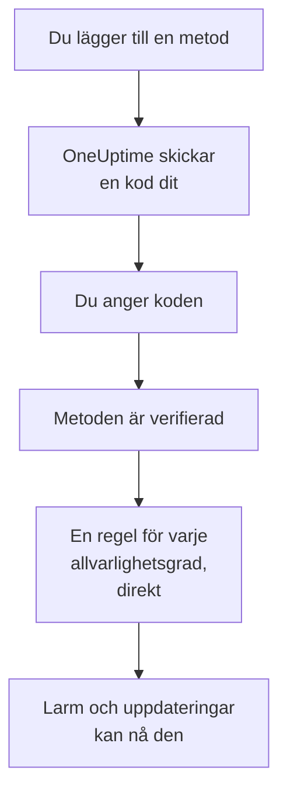

# Aviseringsmetoder

En aviseringsmetod är en adress som OneUptime får nå dig på i ett projekt: en e-postadress, ett telefonnummer för SMS eller samtal, ett WhatsApp-nummer, ett Telegram-konto, ditt Slack- eller Microsoft Teams-konto, en telefon eller webbläsare för push-aviseringar, eller en webhook. Du lägger till dem under **Användarinställningar → Aviseringsmetoder**, verifierar dem, och OneUptime börjar genast använda dem för dina larm.

:::cards
- [Välj en metod](#välj-en-metod): Vad varje metod behöver, och hur den verifieras.
- [Lägg till och verifiera en metod](#lägg-till-och-verifiera-en-metod): E-post, SMS, samtal och WhatsApp, med en sexsiffrig kod.
- [Webhooks](#webhooks): Skicka larm till din egen slutpunkt, signerade om du vill.
- [Slå på en kanal för ditt projekt](#slå-på-en-kanal-för-ditt-projekt): Varför SMS, samtal, WhatsApp eller Telegram kan saknas.
:::

## Så blir en metod aktiv



En metod som du inte har verifierat används aldrig. Push-enheter, Slack, Microsoft Teams och webhooks klarar sig utan kod: att registrera en enhet eller ansluta ditt konto bevisar att den är din, och en webhook behöver inget bevis. Att verifiera en metod lägger direkt till dina [standardregler](/docs/notifications/on-call-rules#reglerna-du-börjar-med) för den, så ett nytt telefonnummer larmar dig för varje allvarlighetsgrad tills du ändrar dess regler.

## Välj en metod

Varje flik i **Aviseringsmetoder** innehåller ett eller flera kort, ett per typ av metod:

| Kort | Flik | Vad du lägger till | Hur den verifieras |
| --- | --- | --- | --- |
| **E-postmeddelanden för aviseringar** | **Direct Contact** | En e-postadress | En kod via e-post |
| **Telefonnummer för SMS-aviseringar** | **Direct Contact** | Ett telefonnummer | En kod via SMS |
| **Telefonnummer för samtalsaviseringar** | **Direct Contact** | Ett telefonnummer | En kod som läses upp i ett samtal, eller ingen för ett nummer som är verifierat för SMS |
| **WhatsApp-nummer för aviseringar** | **Direct Contact** | Ett WhatsApp-nummer | En kod via WhatsApp |
| **Telegram-konton för aviseringar** | **Direct Contact** | Ditt Telegram-konto | Ett meddelande till OneUptime-boten |
| **Slack Account for Notifications** | **Workspace Apps** | Ditt Slack-konto | Att ansluta ditt konto till projektets arbetsyta |
| **Microsoft Teams Account for Notifications** | **Workspace Apps** | Ditt Microsoft Teams-konto | Att ansluta ditt konto till projektets arbetsyta |
| **Enheter för push-aviseringar** | **Push Notifications** | En telefon med appen OneUptime On-Call, eller en webbläsare | Att registrera enheten |
| **Webhooks för aviseringar** | **Webhooks** | En egen HTTPS-slutpunkt | Ingen |

**Workspace Apps** visas bara när projektet har anslutit Slack eller Microsoft Teams, och innehåller bara de anslutna. SMS, samtal, WhatsApp och Telegram kan vara avstängda för hela projektet; se [Slå på en kanal för ditt projekt](#slå-på-en-kanal-för-ditt-projekt).

## Lägg till och verifiera en metod

E-postadresser, SMS-nummer, samtalsnummer och WhatsApp-nummer verifieras med en sexsiffrig kod.

:::steps
### Öppna dina metoder

Gå till **Användarinställningar → Aviseringsmetoder**. **Direct Contact** är den första fliken.

### Lägg till adressen

Klicka på metodens knapp för att lägga till i dess kort, till exempel **Lägg till Telefonnummer för SMS-aviseringar**. Ange **E-post**, eller **Telefonnummer** i internationellt format, till exempel `+11234567890`, och spara.

### Ange koden

Verifieringsdialogen öppnas av sig själv och visar vart koden skickades och hur länge den gäller. Skriv koden i **Verifieringskod** och klicka på **Verifiera**.

### Kontrollera raden

Raden är nu markerad som **Verifierad**. Stängde du dialogen för tidigt? Klicka på **Verifiera** på raden för att öppna den igen.
:::

- En kod gäller i 15 minuter. Fem felaktiga försök ogiltigförklarar den, och du behöver en ny.
- **Send a new code**, eller **Call me with a new code** för ett samtalsnummer, finns i dialogen. Du kan be om en ny en minut efter den förra.
- Ett nummer som du har verifierat för SMS är också verifierat för samtal. Att lägga till det under **Telefonnummer för samtalsaviseringar** kräver ingen kod, och att verifiera ett SMS-nummer verifierar också samtalsnumret som du har lagt till för det.
- Din inloggnings-e-post finns redan där, verifierad, sedan dagen du gick med i projektet.

## Anslut Telegram

:::steps
### Lägg till kontot

Klicka på **Lägg till Telegram-konto** i **Telegram-konton för aviseringar**. **Telegram-användarnamn (valfritt)** är bara en etikett för dig själv och kan lämnas tomt.

### Skriv till boten

Klicka på **Verifiera** på den nya raden. Dialogen **Verifiera Telegram-konto** ger dig tre sätt att nå OneUptime-boten: skanna QR-koden med telefonen, klicka på **Open in Telegram**, eller sök upp boten i Telegram och skicka den kommandot `/start` som dialogen visar.

### Bekräfta

Tillbaka i OneUptime klickar du på **I've sent the message — check**. Så snart boten har fått ditt meddelande är kontot verifierat.
:::

**Rotera kod** skapar en ny kod för ett konto som ännu inte är verifierat. QR-koden och länken som du öppnade tidigare slutar då fungera. I en självhostad OneUptime ansluter serverns administratör en Telegram-bot innan någon kan ansluta ett konto.

## Slack och Microsoft Teams

1. Anslut ditt eget konto till projektets arbetsyta: **Användarinställningar → Arbetsyta → Slack**, eller **Microsoft Teams**. Se [Slack](/docs/workspace-connections/slack) och [Microsoft Teams](/docs/workspace-connections/microsoft-teams).
2. Klicka på **Add Slack Account** eller **Add Microsoft Teams Account** på fliken **Workspace Apps**. Kontot är verifierat så snart det har lagts till.
3. Klicka på **Send Test Message** på dess rad. Larm kommer som direktmeddelanden från OneUptime-appen.

## Push-aviseringar

Fliken **Push Notifications** listar dina **Enheter för push-aviseringar**.

- **En telefon.** Installera appen OneUptime On-Call, anslut den till ditt OneUptime, logga in och tillåt aviseringar: telefonen lägger själv till sig i listan. Se [Appar – Översikt](/docs/mobile-desktop-apps/index).
- **Den här webbläsaren.** Klicka på **Registrera enhet**, fyll i **Enhetsnamn**, och tillåt aviseringar när webbläsaren frågar.
- **Testavisering** på en enhets rad skickar en push till den direkt.
- **Kritiska larm** visar om telefonens larm tar sig igenom tyst läge och Stör ej. Det slås på i appen, aldrig här, och en webbläsare kan inte göra det. Se [Kritiska jourlarm](/docs/self-hosted/push-notifications#kritiska-jourlarm-åsidosätter-tyst-läge).
- En enhet som är märkt **Tar inte emot aviseringar** får ingenting skickat. Öppna appen på den telefonen, eller registrera webbläsaren igen, så är den med igen.

## Webhooks

En webhook skickar varje larm som JSON till en HTTPS-slutpunkt du äger, så att ett eget verktyg kan agera på det.

:::steps
### Lägg till webhooken

Klicka på **Lägg till Webhook** på fliken **Webhooks**. Fyll i **Namn** med något du känner igen, sedan **Webhook-URL** och **Signeringshemlighet (valfritt)**.

### Skicka ett test

Klicka på **Skicka test** på dess rad. Din slutpunkt tar emot en händelse där `eventType` är `test`.

### Kontrollera vad som kommer fram

Ett larm är en JSON-`POST` som den nedan. Svara med valfri `2xx`-status inom 10 sekunder; omdirigeringar följs inte.
:::

```json title="A page, as your endpoint receives it"
{
  "eventType": "on-call.incident.created",
  "timestamp": "2026-10-15T09:30:00.000Z",
  "projectId": "6a3f0d2e-1c4b-4e8a-9b7d-2f5c8e1a0b3c",
  "userId": "0c9e8d7f-6b5a-4c3d-8e2f-1a0b9c8d7e6f",
  "incident": {
    "id": "5b4a3c2d-1e0f-4a9b-8c7d-6e5f4a3b2c1d",
    "title": "Checkout API is down",
    "description": "Health check failed from 3 probes.",
    "incidentNumber": 42,
    "incidentNumberWithPrefix": "INC-42",
    "severity": "Critical Incident",
    "state": "Identified"
  },
  "onCallPolicyId": "7d6c5b4a-3e2f-4d1c-9b8a-7f6e5d4c3b2a",
  "onCallPolicyEscalationRuleId": "8e7d6c5b-4a3f-4e2d-8c1b-9a8f7e6d5c4b"
}
```

| `eventType` | Skickas för | Postens nyckel |
| --- | --- | --- |
| `on-call.incident.created` | En incident | `incident` |
| `on-call.alert.created` | Ett larm | `alert` |
| `on-call.incidentEpisode.created` | En incidentepisod | `incidentEpisode` |
| `on-call.alertEpisode.created` | En larmepisod | `alertEpisode` |

Uppdateringarna som du slår på för Webhook i **Aviseringsinställningar** kommer till samma slutpunkt, med inställningens händelse i `eventType` och en kort sammanfattning i `subject` och `message`.

Varje begäran innehåller `X-OneUptime-Event`, händelsetypen. Med en signeringshemlighet innehåller den också `X-OneUptime-Signature`: `sha256=` följt av HMAC-SHA256 för den råa bodyn, i hex. Kontrollera den innan du litar på begäran:

```javascript title="verify-signature.js"
const crypto = require("crypto");

// rawBody: the request body exactly as it arrived, before any JSON parsing.
function isFromOneUptime(rawBody, signatureHeader, secret) {
  const expected =
    "sha256=" + crypto.createHmac("sha256", secret).update(rawBody).digest("hex");
  const received = Buffer.from(signatureHeader || "");
  const wanted = Buffer.from(expected);
  return received.length === wanted.length && crypto.timingSafeEqual(received, wanted);
}
```

En webhook behöver ingen verifiering, så när du lägger till den läggs dess regler till direkt. Privata och interna adresser avvisas, om inte administratören för en självhostad server tillåter dem: se [Åtkomst till privat nätverk](/docs/self-hosted/private-network-access#webhooks-och-arbetsflöden).

## Slå på en kanal för ditt projekt

**SMS**, **Telefonsamtal**, **WhatsApp** och **Telegram** är avstängda i varje nytt projekt, eftersom varje meddelande kostar pengar: i OneUptime Cloud betalas det från projektets saldo, och SMS och samtal går i stället via projektets eget Twilio-konto när standardkontot skickar dem. E-post, push, Slack, Microsoft Teams och webhooks är alltid påslagna.

Så länge en kanal är avstängd kan ingen i projektet lägga till en metod på den: dess kort saknar knapp för att lägga till och berättar vem som kan slå på den. En projektägare, en **Faktureringsadministratör** eller någon med **Manage Billing** slår på den, i kortet **Aviseringskanaler** under **Projektinställningar → Aviseringar → Aviseringsinställningar**. En projektadministratör kan inte göra det. I en självhostad OneUptime behöver SMS och samtal dessutom ett Twilio-konto, och Telegram en bot som serverns administratör ansluter; se [Twilio-integration](/docs/self-hosted/twilio-integration).

## Ta bort en metod

Klicka på **Ta bort** på metodens rad. Att ta bort en metod tar bort varje jourregel som använder den, så dialogen räknar först de reglerna och nämner varje allvarlighetsgrad som borttagningen skulle lämna helt utan regel.

## Felsökning

:::details Ett kort saknar knapp för att lägga till
Den kanalen är avstängd i det här projektet. Kortet berättar vem som kan slå på den; se [Slå på en kanal för ditt projekt](#slå-på-en-kanal-för-ditt-projekt).
:::

:::details Koden kom aldrig fram
E-post kan ta några minuter och hamnar ibland i skräpposten; SMS kan ta en minut. Vänta en minut och klicka sedan på **Send a new code** i dialogen. **Projektinställningar → Aviseringar → Aviseringsloggar** visar vad som hände med meddelandet.
:::

:::details Det går inte att lägga till mitt Slack-konto
Anslut först ditt konto under **Användarinställningar → Arbetsyta → Slack**, och klicka sedan på **Add Slack Account** igen. Feldialogen har en knapp som tar dig dit.
:::

:::details Min telefon får inga push-aviseringar
Kontrollera att telefonen finns under **Enheter för push-aviseringar**, och skicka den en **Testavisering**. Se [Vanliga frågor och felsökning](/docs/mobile-desktop-apps/faq-troubleshooting#aviseringar).
:::

## Nästa steg

:::cards
- [Personliga jourregler](/docs/notifications/on-call-rules): Bestäm vilken metod varje larm försöker med, och när.
- [Aviseringsinställningar](/docs/notifications/notification-settings): Välj uppdateringarna du får veta om, och via vilka kanaler.
- [Appar – Översikt](/docs/mobile-desktop-apps/index): Få larm på din telefon eller dator.
- [Så når OneUptime dig](/docs/notifications/index): Hur metoder, regler och inställningar hänger ihop.
:::
