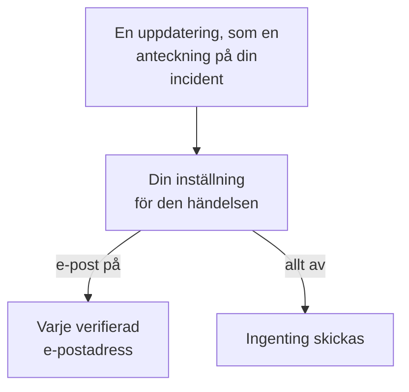

# Aviseringsinställningar

Aviseringsinställningar avgör vilka uppdateringar som når dig om det du äger, som en incident, en övervakning eller en statussida, och om dina egna jourpass, och via vilka kanaler. De larmar dig aldrig: att larma är dina jourreglers uppgift. Du ställer in dem under **Användarinställningar → Aviseringsinställningar**, med en brytare per händelse och kanal.

:::cards
- [Så fungerar inställningarna](#så-fungerar-inställningarna): En brytare per händelse och kanal, skickad till varje verifierad metod.
- [Ändra en inställning](#ändra-en-inställning): Tre klick, sparat direkt.
- [Vad som är påslaget för en ny medlem](#vad-som-är-påslaget-för-en-ny-medlem): Standardinställningarna, flik för flik.
- [Färre e-postmeddelanden](#färre-e-postmeddelanden): Samla ihop skurarna, eller skippa rutinmejlen.
:::

## Så fungerar inställningarna

- Varje rad är en händelse, och varje kolumn en kanal: E-post, SMS, Samtal, Push, WhatsApp, Telegram, Slack och Microsoft Teams samt Webhook. Slack och Microsoft Teams är bara kolumner när projektet har anslutit dem.
- En kanal som är påslagen skickar till varje verifierad metod du har på den i det här projektet, inte bara till en.
- En kanal som är påslagen utan någon verifierad metod bakom sig skickar ingenting. **Your setup checklist** säger det under **Staying informed**.
- En uppdatering går till sakens ägare: personerna som är angivna som ägare, och medlemmarna i dess ägarteam. Har en sak inga ägare går den i stället till projektets ägare. En händelse om att ha lagts till som ägare går bara till personen som lades till.
- Säkerhetsärenden har inga ägare. Ett nytt ärende går till alla som kan se projektets ärenden, från den prioritet som var och en av dem väljer, och ett tilldelat ärende till dem som det är tilldelat. Se [Säkerhetsärenden](/docs/telemetry/security-cases#aviseringar).
- Varje e-postmeddelande till ägare slutar med en länk, "Manage notification preferences", tillbaka till den här sidan.

## Ändra en inställning

:::steps
### Öppna dina inställningar

Gå till **Användarinställningar → Aviseringsinställningar**. Flikarna är **Incidenter**, **Larm**, **Övervakning**, **Statussidor**, **Schemalagt underhåll**, **Jour** och **Säkerhet**.

### Hitta händelsen

Varje flik har ett eller flera kort, som **Incident Episoder** på fliken **Incidenter**. Varje rad är en händelse, med en rad text som säger när den skickas.

### Klicka på en kanal

Klicka på en kanals cirkel för att slå på den, och igen för att stänga av den. En bock betyder påslagen. Ändringar sparas automatiskt.
:::

## Vad som är påslaget för en ny medlem

När du går med i ett projekt är de här händelserna påslagna, via e-post. Allt annat börjar avstängt och skickar ingenting förrän du slår på en kanal.

| Flik | Påslagna via e-post | Avstängda tills du slår på dem |
| --- | --- | --- |
| **Incidenter** | **Incident skapad**, **Incidenttillstånd ändrat**, **Incident reminder**, **Incidentens SLA överskridet**, **Incidentepisod skapad**, **Tillstånd för incidentepisod ändrat**, **Incident tillagd i incidentepisod** | **Incidentanteckning publicerad**, **Tillagd som ägare av incident**, **Tilldelad till en incident**, **Anteckning för incidentepisod publicerad**, **Tillagd som ägare av incidentepisod** |
| **Larm** | **Larm skapat**, **Larmtillstånd ändrades**, **Alert reminder**, **Larmepisod skapad**, **Tillstånd för larmepisod ändrades**, **Larm tillagt i larmepisod** | **Larmanteckning publicerad**, **Tillagd som ägare av larm**, **Anteckning för larmepisod publicerad**, **Tillagd som ägare av larmepisod** |
| **Övervakning** | **Sondstatus ändrad för din övervakning**, **Övervakningen har inga aktiva sonder**, **SLO status changed**, **Added as SLO owner**, **Sondstatus ändrad**, **Tillagd som ägare av sond** | **Övervakning skapad**, **Övervakningsstatus ändrad**, **Tillagd som ägare av övervakning**, **Status för AI-agent ändrades**, **Tillagd som ägare av AI-agent** |
| **Statussidor** | Inga | **Statussida skapad**, **Statussidemeddelande publicerat**, **Tillagd som ägare av statussida** |
| **Schemalagt underhåll** | **Maintenance reminder** | **Underhållshändelse skapad**, **Underhållstillstånd ändrat**, **Underhållsanteckning publicerad**, **Tillagd som ägare av underhåll** |
| **Jour** | **Du går på jour**, **Du är näst på tur i jouren**, **Du går av jour**, **Tillagd i jourpolicy**, **Borttagen från jourpolicy**, **Missat samtal**, och även via push: **Innan mitt jourpass börjar**, **Mitt kommande jourpass tilldelas någon annan** | Inga |
| **Säkerhet** | Även via push: **Nytt säkerhetsärende** (ärenden med High och Critical), **Säkerhetsärende tilldelat mig**, **Playbook-steg väntar på mitt godkännande** | Inga |

> [!IMPORTANT]
> **Övervakningsstatus ändrad** börjar avstängd. För att få veta när en övervakning du äger går ned eller kommer tillbaka slår du på den på fliken **Övervakning**.

## Dina jourpass

Fliken **Jour** handlar om dig, inte om det du äger:

- **Du går på jour**, **Du är näst på tur i jouren** och **Du går av jour** följer dina turer i jourschemana du är med i.
- **Tillagd i jourpolicy** och **Borttagen från jourpolicy** berättar när en jourpolicy börjar eller slutar nämna dig.
- **Innan mitt jourpass börjar** skickar påminnelser vid de tider du väljer under **Användarinställningar → Kalender → Kalenderflöde**, och **Mitt kommande jourpass tilldelas någon annan** berättar när någon annan täcker ett jourpass som du har påmints om. Se [Kalenderflöden](/docs/on-call/calendar-feeds#påminnelser-och-meddelanden-om-ny-tilldelning).
- **Missat samtal**, på kortet **Inkommande samtalspolicyer**, berättar för ägarna av en policy för inkommande samtal att någon som ringde inte nådde någon. Se [Policy för inkommande samtal](/docs/on-call/incoming-call-policy#missade-samtal).

## Säkerhetsärenden

Fliken **Säkerhet** handlar om de säkerhetsärenden du kan se:

- **Nytt säkerhetsärende** har en prioritet under sitt namn: den lägsta prioritet ett ärende ska ha för att du ska aviseras. Den är **Hög och högre** om du inte väljer **Endast Kritisk**, **Medel och högre**, **Låg och högre** eller **Alla ärenden**.
- **Säkerhetsärende tilldelat mig** följer ärendena som tilldelas dig och de team du tillhör.
- **Playbook-steg väntar på mitt godkännande** ber dig godkänna eller avvisa ett playbook-steg i ett ärende där du får godkänna steg.

Se [Säkerhetsärenden](/docs/telemetry/security-cases#aviseringar).

## Färre e-postmeddelanden

De här brytarna avgör vilka uppdateringar som når dig, inte hur många e-postmeddelanden de blir. **Användarinställningar → E-postinställningar** har två kort för det, båda bara för dig, i det här projektet:

- **Email Rollup** samlar en skur av uppdateringar i ett enda e-postmeddelande: de första kommer fortfarande en i taget, resten tillsammans några minuter senare.
- **Fewer routine emails** stänger med **Reduce routine emails** av e-posten om anteckningar, nya ägare, nya övervakningar och statussidor, tillägg i episoder och ändringar i jourpolicyer.

Se [Aviseringssammanfattning](/docs/emails/notification-rollup).

## Felsökning

:::details En brytare är påslagen, men ingenting kommer fram
Kontrollera att du har en verifierad metod på den kanalen under **Användarinställningar → Aviseringsmetoder**. För SMS, samtal, WhatsApp och Telegram måste projektet också ha slagit på kanalen.
:::

:::details Jag äger en övervakning, men får aldrig veta när den går ned
**Övervakningsstatus ändrad** börjar avstängd. Slå på en kanal för den, på fliken **Övervakning**.
:::

:::details Jag får fortfarande e-post efter att ha stängt av allt
Larm följer dina jourregler, inte de här brytarna, och e-post om inloggning, säkerhet och fakturering är inte uppdateringar om saker. Varje projekt har egna inställningar, så kontrollera projektet som e-postmeddelandet kom från. Se [Personliga jourregler](/docs/notifications/on-call-rules).
:::

## Nästa steg

:::cards
- [Aviseringsmetoder](/docs/notifications/notification-methods): Lägg till metoderna som dina inställningar skickar till.
- [Personliga jourregler](/docs/notifications/on-call-rules): Bestäm hur ett larm når dig.
- [Aviseringssammanfattning](/docs/emails/notification-rollup): Färre, fylligare e-postmeddelanden under en skur.
- [Så når OneUptime dig](/docs/notifications/index): Hur metoder, regler och inställningar hänger ihop.
:::
