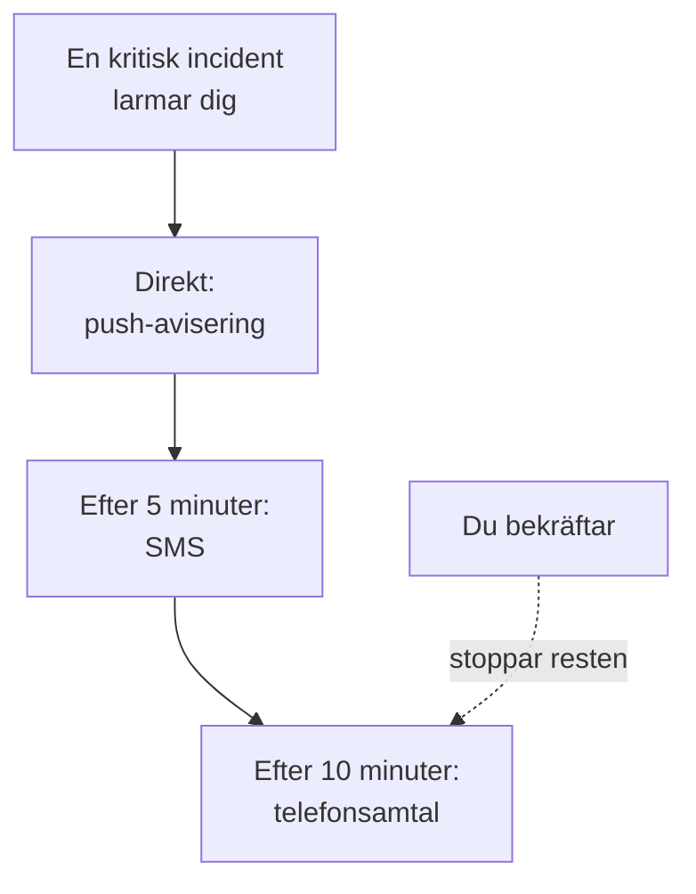

# Personliga jourregler

Dina jourregler avgör hur ett larm når dig: vilka av dina aviseringsmetoder OneUptime försöker med, och hur lång tid efter att larmet startade. Varje typ av larm har egna regler, en uppsättning per allvarlighetsgrad, så att en kritisk incident kan ringa dig direkt medan ett lågt larm väntar på ett e-postmeddelande. Du ställer in dem under **Användarinställningar → Jourregler**.

> [!NOTE]
> De här reglerna är bara dina. **Jourregler** under **Incidenter → Regler** och **Larm → Regler** är något annat: de avgör vilka jourpolicyer en ny incident eller ett nytt larm kör.

:::cards
- [Så når ett larm dig](#så-når-ett-larm-dig): Dina regler för ett larm, steg för steg.
- [Reglerna du börjar med](#reglerna-du-börjar-med): Vad varje verifierad metod lägger till, och hur du skalar ned det.
- [Lägg till en regel](#lägg-till-en-regel): En metod och en väntetid för en allvarlighetsgrad.
- [Push-regler](#push-regler): Ta dig igenom tyst läge, och upprepa tills någon bekräftar.
:::

## Så når ett larm dig

En jourpolicy larmar dig när en av dess eskaleringsregler nämner dig, ett team du är med i eller ett schema där du har jour. OneUptime går då igenom dina regler för den typen av larm och dess allvarlighetsgrad: varje regel utlöses via sin egen metod när dess väntetid har gått, räknat från larmets start. Att bekräfta incidenten eller larmet, från vilket meddelande som helst eller i OneUptime, stoppar varje regel som ännu inte har utlösts.

De flesta meddelanden kan bekräfta larmet: e-post, SMS och meddelanden i WhatsApp, Telegram, Slack och Microsoft Teams har en bekräftelselänk, och ett samtal ber dig trycka 1. Kan du inte ta ett larm kan du eskalera det från samma meddelanden, och ett samtal ber dig trycka 2: policyn larmar nästa nivå direkt, och du larmas inte om det igen. Se [Eskalera ett larm](/docs/on-call/escalation-rules#eskalera-ett-larm). Varje larm du får finns under **Användarinställningar → Jourloggar**, där **Visa tidslinje** visar varje skickat meddelande och om det levererades.

## De fyra flikarna

**Användarinställningar → Jourregler** har en flik för varje typ av larm. Varje flik har ett kort per allvarlighetsgrad, med det namn och den färg som ditt projekt har gett den:

| Flik | Larm för | Kort för |
| --- | --- | --- |
| **Incidenter** | Incidenter | Allvarlighetsgrader för incidenter |
| **Incident Episoder** | Episoder som samlar incidenter | Allvarlighetsgrader för incidenter |
| **Larm** | Larm | Allvarlighetsgrader för larm |
| **Larm Episoder** | Episoder som samlar larm | Allvarlighetsgrader för larm |

En episod larmar dig genom sina egna jourpolicyer, separat från incidenterna eller larmen i den, så dess regler har en egen flik. Sidans adress anger den öppna fliken, till exempel `/dashboard/{projectId}/user-settings/on-call-rules?type=alerts`; de andra värdena är `incident-episodes` och `alert-episodes`, och utan `type` öppnas sidan på **Incidenter**.

## Reglerna du börjar med

Varje metod som du verifierar får en regel på varje kort på varje flik, skickad så snart du larmas. Din inloggnings-e-post har dem sedan dagen du gick med, så att ett larm alltid når dig. Verifiera ett telefonnummer för SMS, så skickar varje larm också ett SMS till dig.

Det är en säker början, och oftast för mycket. Skala ned det till vad varje allvarlighetsgrad förtjänar:

| Allvarlighetsgrad | En rimlig uppsättning |
| --- | --- |
| Kritisk | Push direkt, ett samtal efter 5 minuter |
| Allvarlig | Push direkt, ett SMS efter 10 minuter |
| Mindre eller låg | Ett e-postmeddelande direkt |

Dina egna regler har inga tysta timmar: håll låga allvarlighetsgrader på e-post, eller på en push-regel inställd på **Normal**, så att de aldrig väcker dig. För att låta larmet för en låg allvarlighetsgrad vänta på arbetstid för alla ställer du jourregeln som larmar på **Endast under arbetstid**: se [Jourregler](/docs/alerts/settings#jourregler).

## Lägg till en regel

:::steps
### Öppna kortet

Gå till **Användarinställningar → Jourregler**, öppna fliken för typen av larm och hitta kortet för allvarlighetsgraden.

### Välj metoden

Klicka på **Lägg till Avisering Regel**. Välj under **Aviseringsmetod** en av dina verifierade metoder; en metod som du inte har verifierat erbjuds inte.

### Välj hur en push låter

För en telefon väljer du under **Push-avisering** antingen **Kritiskt larm** eller **Normal**. För alla push-enheter väljer du **Upprepa tills bekräftad**. Se [Push-regler](#push-regler).

### Ställ in väntetiden

Välj **Avisera mig efter**: **Omedelbart**, **5 minuter**, **10 minuter**, **15 minuter**, **30 minuter** eller **1 timme**. Klicka sedan på **Lägg till Avisering Regel** i dialogen.
:::

Kortet listar sina regler i ordning efter väntetid, med **Aviseringsmetod** och **Avisera efter** för var och en.

## Ändra eller ta bort en regel

- **Redigera** på en regels rad ändrar dess väntetid. För att skicka en regel till en annan metod tar du bort den och lägger till en ny.
- Klicka på etiketten under metoden på en push-regel för att växla mellan **Kritiskt larm** och **Normal**, eller för att ändra hur ofta den upprepas. Det sparas direkt.
- **Ta bort** frågar först, och berättar om allvarlighetsgraden blir utan regel. En allvarlighetsgrad utan regel faller tillbaka på dina verifierade metoder; se [När en allvarlighetsgrad saknar regel](#när-en-allvarlighetsgrad-saknar-regel).

## Push-regler

En regel som larmar en telefon bestämmer hur dess push låter:

| Val | Vad telefonen gör |
| --- | --- |
| **Kritiskt larm** | Ringer även när telefonen är på ljudlöst eller i Stör ej, när Critical On-Call Alerts är påslaget i appen OneUptime On-Call. En ny telefonregel börjar här. |
| **Normal** | Följer telefonens inställningar för ljud, ljudlöst och Stör ej. |

En push-regel, för en telefon eller en webbläsare, kan också skicka sin push igen tills någon bekräftar: **Upprepa inte**, standardvalet, eller **Varje minut**, **Varannan minut**, **Var 3:e minut**, **Var 5:e minut**, **Var 10:e minut**, **Var 15:e minut** eller **Var 30:e minut**. Den upprepas upp till 10 gånger till och stoppar så snart incidenten, larmet eller episoden har bekräftats. Se [Kritiska jourlarm](/docs/self-hosted/push-notifications#kritiska-jourlarm-åsidosätter-tyst-läge).

## När en allvarlighetsgrad saknar regel

En allvarlighetsgrad som ditt projekt lägger till senare får regler inom några minuter, skapade utifrån de val du redan har gjort på den fliken: samma metoder, efter samma väntetider. Hade du inga regler på den fliken får den din verifierade e-post, direkt.

Ett larm som ändå inte hittar någon regel skickas till dina verifierade metoder i alla fall, och du får ett e-postmeddelande om det; se [När ingen regel matchar](/docs/notifications/index#när-ingen-regel-matchar).

:::details Stäng av en allvarlighetsgrad med avsikt
API:et kan spara en avregistreringsregel, med `isOptOut` satt och utan metod: då larmas du inte alls för den typen av larm och den allvarlighetsgraden, och ingenting tar över. Raden visar **Muted - notifications turned off for this rule**, och att ta bort den slår på larmen igen. En allvarlighetsgrad som läggs till senare blir också tyst när varje regel du har på den fliken är en avregistrering.
:::

:::details Stäng av reservlösningen för ett helt projekt
En projektägare, eller någon med **Manage Billing**, kan ställa in projektets `disableOnCallNotificationFallback` via API:et. Ett larm som inte hittar någon regel levereras då inte, och dess logg säger att användaren ska lägga till regler under **Användarinställningar → Jourregler**.
:::

## En kollegas regler

Projektägare och administratörer kan se och ändra samma sida för alla i projektet: under **Användare** öppnar de personen och sedan **Jourregler** i avsnittet **Jour**. **Beredskap**, bredvid, visar om varje allvarlighetsgrad når personen. När någon annan lägger till, ändrar eller tar bort dina regler får du ett e-postmeddelande om det, och varje ändring finns i projektets granskningslogg.

## Felsökning

:::details Min telefon var tyst vid ett kritiskt larm
Kontrollera att regelns push är **Kritiskt larm** och inte **Normal**, och att **Kritiska larm** är påslaget för telefonen under **Användarinställningar → Aviseringsmetoder**, på fliken **Push Notifications**.
:::

:::details Jag larmas två gånger för varje incident
Varje verifierad metod har en regel för varje allvarlighetsgrad, skickad direkt. Ta bort reglerna du inte vill ha, eller ge dem en väntetid. En incident i en episod kan larma dig en gång för incidenten och en gång för episoden, via två policyer.
:::

:::details Jag fick ett e-postmeddelande fast min regel säger SMS
Larmet hittade ingen regel för sin typ eller allvarlighetsgrad och föll tillbaka på dina kostnadsfria metoder: lägg till regeln på rätt flik och rätt kort. Eller så var e-postmeddelandet en uppdatering om något du äger, och den följer **Aviseringsinställningar**, inte dina regler. Dina **Jourloggar** listar bara larm.
:::

## Nästa steg

:::cards
- [Aviseringsmetoder](/docs/notifications/notification-methods): Lägg till och verifiera metoderna som dina regler pekar på.
- [Eskaleringsregler](/docs/on-call/escalation-rules): Hur en jourpolicy larmar personer, nivå för nivå.
- [Push-aviseringar](/docs/self-hosted/push-notifications): Kritiska larm, larmljud och upprepningar på telefoner.
- [Så når OneUptime dig](/docs/notifications/index): Hur metoder, regler och inställningar hänger ihop.
:::
