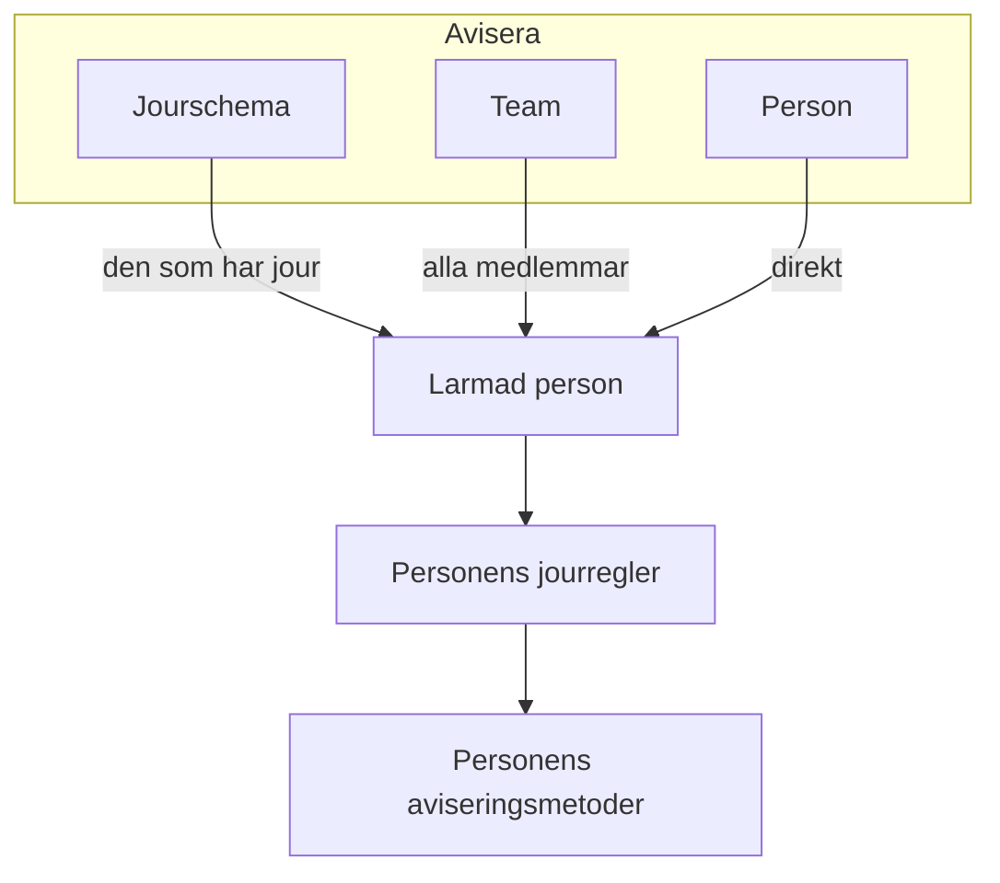

# Eskaleringsregler

En jourpolicy larmar personer i nivåer. Varje eskaleringsregel är ett nivå: vem som larmas och hur länge det väntas på att någon bekräftar innan nästa nivå larmas. En policys regler visas i ordning på dess sida **Eskaleringsregler**.

```mermaid title="En jourpolicy larmar nivå för nivå tills någon bekräftar"
flowchart TB
    trigger["Incident eller larm"] --> level1["Level 1 larmar"]
    level1 --> ack1{"Bekräftat<br/>i tid?"}
    ack1 -->|"Ja"| stop["Larmandet slutar"]
    ack1 -->|"Nej"| level2["Level 2 larmar"]
    level2 --> ack2{"Bekräftat<br/>i tid?"}
    ack2 -->|"Ja"| stop
    ack2 -->|"Nej, sista nivån"| repeat{"Upprepa policyn?"}
    repeat -->|"Ja"| level1
    repeat -->|"Nej"| done["Policyn slutar"]
```

:::cards
- [Vem som larmas först](#vem-som-larmas-först): Skapa en policy med dess första nivå.
- [Lägg till en eskaleringsregel](#lägg-till-en-eskaleringsregel): Lägg till nästa nivå, steg för steg.
- [Så larmar nivåerna personer](#så-larmar-nivåerna-personer): Tider, upprepningar och hur varje person nås.
- [Nästa person i rotationen](#eskalera-till-nästa-person-i-rotationen): Larma backupen för den som har jour, från samma rotation.
- [Eskalera ett larm](#eskalera-ett-larm): Kan du inte ta ett larm? Låt nästa nivå larmas direkt.
- [API och Terraform](#skapa-regler-med-apiet-eller-terraform): Skapa policyer och regler som kod.
:::

## Vem som larmas först

När du skapar en jourpolicy på sidan **Jourpolicyer** frågar formuläret efter dess **Namn** och **Vem larmas först?**. Frågan använder samma väljare som **Avisera**: jourscheman, team och personer, så många du behöver. De du väljer blir policyns första eskaleringsregel, **Level 1**, som väntar **30 minuter** på en bekräftelse innan nästa nivå larmas.

:::steps
1. Gå till **Jourtjänst** > **Jourpolicyer** och klicka på **Skapa Jourpolicy**.
2. Ange ett **Namn**.
3. Klicka på **Lägg till mottagare** under **Vem larmas först?** och välj de jourscheman, team och personer som ska larmas först.
4. Klicka på **Skapa Jourpolicy**. Den nya policyn öppnas sedan på sin sida **Eskaleringsregler**, där du kan lägga till fler nivåer.
:::

**Vem larmas först?** är valfritt. Lämnar du det tomt börjar policyn utan eskaleringsregler: den larmar ingen förrän du lägger till en, och dess översikt säger det. Beskrivningen och etiketterna finns under **Fler fält**. Frågan ställs bara till dem som får lägga till eskaleringsregler.

## Lägg till en eskaleringsregel

:::steps
### Öppna policyns eskaleringsregler

Öppna jourpolicyn, välj **Eskaleringsregler** i dess sidomeny och klicka på **Lägg till eskaleringsregel**. Dialogen är en kort sida.

### Välj vem som ska aviseras

Klicka på **Lägg till mottagare** under **Avisera**, sök och välj så många jourscheman, team och personer som den här nivån ska larma. Lägg till minst en.

| Mottagare | Vem som larmas när nivån körs |
| --- | --- |
| Ett **jourschema** | Den som har jour i det när nivån körs, inte en fast person. |
| Ett jourschemas **Nästa i rotationen** | Personen efter den som har jour i det, från samma rotation. Se [Eskalera till nästa person i rotationen](#eskalera-till-nästa-person-i-rotationen). |
| Ett **team** | Alla medlemmar i teamet. |
| En **person** | Den personen, direkt. |

### Ange hur länge det ska väntas

**Eskalera efter (i minuter)** är hur länge det väntas på en bekräftelse innan nästa nivå larmas. Den börjar på **30 minuter**; ändra den till det som passar nivån.

### Ge regeln ett namn, om du vill

Allt annat finns under **Fler fält**, hopfällt tills du öppnar det:

- **Namn**: valfritt. En regel som du inte namnger får sitt nivås namn: den första regeln i en policy är **Level 1**, den andra **Level 2** och så vidare. Namnfältet visar det namn regeln får.
- **Beskrivning**: valfria anteckningar, till exempel vem den här nivån larmar och varför.

Hopfälld nämner rubriken för **Fler fält** de två och visar dem som regeln har: en beskrivning eller ett eget namn.

### Skapa regeln

Klicka på **Create Rule**. Regeln läggs till under de andra, som policyns nästa nivå.
:::

## Så larmar nivåerna personer

När en incident eller ett larm når policyn larmar **Level 1** sina mottagare direkt. Om ingen bekräftar inom väntetiden larmas **Level 2**, och så vidare nedåt i listan. När den sista nivåns väntetid har gått utan bekräftelse börjar policyn om från **Level 1** om dess **Upprepningspolicy** (under reglerna) säger att den ska upprepas, så många gånger som den tillåter, och annars slutar den. Att bekräfta eller lösa incidenten eller larmet stoppar larmandet på vilken nivå som helst. Den som larmas och inte kan ta det kan eskalera larmet, och nästa nivå larmas utan att vänta: se [Eskalera ett larm](#eskalera-ett-larm).

En incident, ett larm eller en episod som skapas redan bekräftad eller löst — registrerad i efterhand — kör ingen av sina policyer: ingen larmas, och dess feed säger det och nämner dem vid namn. Se [Deklarerad redan bekräftad eller löst](/docs/incidents/declaring-incidents#deklarerad-redan-bekräftad-eller-löst).

För att upprepa en policy klickar du på **Redigera** på kortet **Upprepningspolicy**, väljer **Börja om från Level 1** och anger **Hur många gånger till?**.

### Eskaleringsöversikten

Översikten högst upp på sidan **Eskaleringsregler** visar hela stegen: när varje nivå larmas, vem den larmar och vad som händer efter den sista. En nivå vars mottagare inte alla kan larmas säger det på sitt kort; klicka på etiketten för att se vem och varför.

### Så nås varje person

Varje person som en nivå larmar nås på det sätt som personens egna jourregler säger: **Användarinställningar** > **Jourregler**, med en flik för incidenter, incidentepisoder, larm och larmepisoder, och ett kort per allvarlighetsgrad som visar vilken aviseringsmetod som prövas och efter hur lång tid. En projektadministratör kan se och ändra en medlems regler under **Användare** > medlemmen > **Jourregler**. Se [Personliga jourregler](/docs/notifications/on-call-rules).



En användaråsidosättning som gäller för en person skickar personens larm till den som täcker upp för personen i stället. En åsidosättning som inte anger någon som täcker upp hoppar över personen: personen larmas inte, policyns körning visar att personen är borta och till när, och i ett jourschema går vart och ett av personens pass till nästa person i rotationen. Se [Användaråsidosättningar](/docs/on-call/user-overrides).

Varje meddelande är ett som leverantören tar emot, så ett larm går alltid ut. Så här mycket bär varje kanal:

| Kanal | Det längsta meddelandet den bär |
| --- | --- |
| SMS | 1 600 tecken |
| Telefonsamtal | Det som ryms i Twilios samtalsskript på 4 000 tecken |
| Pushavisering | 4 KB, varav titel, text och data tar upp till 3 KB |
| WhatsApp | 1 024 tecken |
| Telegram | 4 096 tecken |

Ett längre meddelande, med en lång titel eller en lång beskrivning som en mall har lagt in, kortas och slutar med en notering om att hela texten finns i OneUptime: "… (truncated — see OneUptime for the full text)". Texten i ett WhatsApp-meddelande är en fast mall, så där kortas i stället de längsta värdena, vart och ett med "…" på slutet. Länkarna i ett meddelande kortas aldrig.

### Vad ett larms sms säger

Ett sms skickas, och debiteras, i delar om 160 tecken. Ett larm via sms skrivs så att det ryms i en del där det går, och säger bara det du behöver på en låst telefon: vem som skickar det, vad som har hänt och den enda länken för att bekräfta larmet eller eskalera det. På en telefon ser det ut så här:

```text
OneUptime: Critical Incident INC-42 in Acme Prod: Checkout API is down.
Ack or escalate: https://oneuptime.com/l/XJlaZRsd
```

Det anger allvarlighetsgraden och vad som har hänt (en incident, ett larm eller en episod av någon av dem), dess nummer, projektet och titeln, i den ordningen. När inte allt ryms i en del:

1. Först utelämnas projektet.
2. Sedan kortas titeln och slutar med `...`.

Allvarlighetsgraden, numret och länken kortas aldrig. En titel behåller minst 20 tecken: ryms inte ens det, till exempel med en mycket lång adress eller ett mycket långt produktnamn, tar sms:et en del till och säger allt.

När en policy larmar igen för att en bekräftad incident eller ett bekräftat larm fortfarande inte är löst, säger sms:et det efter numret och projektet, och de orden kortas heller aldrig:

```text
OneUptime: Critical Incident INC-42 in Acme Prod is still not resolved:
Checkout API is down. Ack or escalate: https://oneuptime.com/l/XJlaZRsd
```

Ett enda tecken utanför sms:ets enkla alfabet gör att hela meddelandet går ut i delar om 70 tecken. Därför skrivs typografiska citattecken och tankstreck som `"`, `'` och `-`, `…` som `...`, och bokstäver som `ç` och `ł` förlorar sina accenter; emojier utelämnas. En titel i en annan skrift, som japanska eller ryska, skickas som den är skriven och tar två delar eller fler.

De andra sms som OneUptime skickar till dig, till exempel om en ändring i en incident du äger eller början på ditt jourpass, börjar också med `OneUptime:` och slutar med `Turn off in User Settings > Notification Settings.`, en mening som utelämnas när det är det som gör att sms:et ryms i en del.

### När ett larm inte skickas

Ett larm som inte skickas säger varför i personens **Jourloggar** (Användarinställningar): raden visar **Fel**, och statusmeddelandet anger orsaken. Det blir inte längre stående på **Skickar**. Meddelandet säger något av detta:

- projektets saldo kunde inte betala för det, och vem som kan fylla på saldot;
- kanalen är avstängd i projektet, och vem som kan slå på den.

Projektets ägare får ett e-postmeddelande om det en gång, tills saldot har fyllts på eller kanalen är på igen.

På OneUptime Cloud betalas varje SMS, samtal, WhatsApp- och Telegram-meddelande från projektets saldo på **Projektinställningar > Aviseringar > Aviseringsinställningar**: den exakta kostnaden dras från saldot när leverantören tar emot meddelandet, oavsett hur många meddelanden som går ut samtidigt.

- Med **Automatisk påfyllning** påslaget där lägger meddelandet som hittar saldot under tröskeln först till det belopp som automatisk påfyllning är inställd på och debiterar projektets kort; meddelanden som hittar saldot lågt i samma ögonblick debiterar kortet en gång.
- Om debiteringen misslyckas (det finns ingen betalningsmetod eller kortet nekades) försöker automatisk påfyllning med kortet igen en timme senare, och **Aviseringsinställningar** säger det högst upp tills dess. Att fylla på saldot för hand, eller att spara automatisk påfyllning igen, försöker direkt.
- Larmen fortsätter att gå ut på det saldo som finns kvar medan automatisk påfyllning inte kan debitera kortet.

> [!IMPORTANT]
> SMS, telefonsamtal, WhatsApp och Telegram är avstängda i ett nytt projekt: på OneUptime Cloud betalas varje meddelande från projektets saldo, och en egen installation behöver först ett Twilio-konto eller en Telegram-bot. Så länge en kanal är avstängd kan ingen i projektet lägga till en metod på den. Bara en projektägare, en **Billing Admin** eller någon med behörigheten **Manage Billing** kan slå på en, i kortet **Aviseringskanaler** på **Projektinställningar > Aviseringar > Aviseringsinställningar** — en projektadministratör kan inte. Alla andra får veta exakt vem som kan, överallt där en kanal är avstängd: ovanför sin egen lista med metoder på den, i sin checklista för att komma igång och i meddelandet de får när något behöver den.

## Eskalera till nästa person i rotationen

En nivå kan larma nästa person i ett jourschemas rotation: personen efter den som har jour i det. Så kan en policy först larma den som har jour, sedan dennes backup från samma rotation och sedan ett team eller en chef, allt från ett enda schema.

| Nivå | Avisera | Vem som larmas |
| --- | --- | --- |
| **Level 1** | Jourschemat Payments primary | Den som har jour i det, till exempel Alex |
| **Level 2** | Samma jourschemas **Nästa i rotationen** | Personen efter Alex i rotationen, till exempel Sam |
| **Level 3** | Teamet Platform | Alla medlemmar i teamet |

:::steps
1. Se till att policyns första nivå, **Level 1**, aviserar jourschemat.
2. Klicka på **Lägg till eskaleringsregel**, sedan på **Lägg till mottagare**, och välj samma schema under **Nästa i rotationen**. Ange **Eskalera efter (i minuter)** och klicka på **Create Rule**.
3. Lägg till ytterligare en nivå för teamet eller chefen som ska få veta härnäst.
:::

Nästa person bestäms när nivån körs, utifrån schemat som det ser ut då:

- Det är personen efter den som har jour, i den ordning som rotationens personer turas om. Efter den sista personen kommer den första igen.
- Personer som är borta hoppas över, oavsett om någon täcker upp för dem eller inte, och detsamma gäller den som har jour i någon annans ställe.
- Det är alltid någon från samma rotation: med flera lager det lager som den som har jour kommer från. En rotation utan någon annan i, eller där alla andra är borta, har ingen nästa person, och nivån larmar ingen där och säger det.
- När ingen alls har jour i schemat finns det inte heller någon nästa person, och nivån försöks igen i några minuter, som för själva schemat.

Körningens meddelande i Slack och Microsoft Teams, incidentens feed och **Tidslinje för körningen** visar vem som larmades som nästa i rotationen, och från vilket schema: "Sam Lee (next in the Payments primary rotation)".

> [!TIP]
> Ett schema räcker: det finns inget andra backupschema att hålla i takt med det första, och den frånvaro som dess personer bokar gäller för båda nivåerna.

## Eskalera ett larm

Den som larmas och inte kan ta det, för att hen sover, sitter på ett flyg eller redan arbetar med en annan incident, kan eskalera larmet i stället för att låta det ringa ut. Policyn larmar då nästa nivå direkt, utan att vänta ut nivåns **Eskalera efter (i minuter)**, och hen larmas inte om det igen.

```mermaid title="Ett eskalerat larm flyttar policyn direkt till nästa nivå"
flowchart TB
    page["Level 1 larmar Alex"] --> take{"Kan Alex<br/>ta det?"}
    take -->|"Ja"| ack["Alex bekräftar:<br/>larmandet stoppar"]
    take -->|"Nej"| pass["Alex eskalerar det"]
    pass --> others{"Larmas någon annan<br/>på Level 1 fortfarande?"}
    others -->|"Ja"| wait["Policyn väntar på<br/>dem, som förut"]
    others -->|"Nej"| next["Level 2 larmas<br/>nu"]
```

Varje larm kan eskaleras därifrån det nådde dig:

| Var | Så eskalerar du det |
| --- | --- |
| E-post | Knappen **Escalate**, sedan **Escalate** på sidan den öppnar |
| SMS och WhatsApp | Länken i meddelandet öppnar bekräftelsesidan, som också har **Escalate** |
| Telegram, Slack och Microsoft Teams | Länken "Can't take it? Escalate", sedan **Escalate** på sidan den öppnar |
| Telefonsamtal | Tryck 2. Samtalet säger sedan vad som hände |
| Pushnotis | Tryck på den: incidenten, larmet eller episoden öppnas i OneUptime On-Call-appen, med **Escalate** under sig |
| OneUptime | **Eskalera** högst upp i incidenten, larmet eller episoden, efter dess tillståndsknappar |

Alla vägar utom samtalet frågar innan de gör något och säger vad som kommer att hända, till exempel "This will immediately page Platform leads (Level 2 of 3), without waiting."; i ett samtal är det svaret att trycka 2. Bara den som larmas kan eskalera sitt larm: knappen i OneUptime visas bara för hen, och länken i ett meddelande eskalerar bara det larm den skickades om, för den person den skickades till, i 7 dagar.

Vad som händer sedan beror på vilka andra som larmas:

- Andra på samma nivå larmas fortfarande: policyn väntar på dem, som förut. Den går vidare när nivåns väntetid går ut, eller så snart den sista av dem också eskalerar larmet.
- Ingen annan finns kvar på nivån: nästa nivå larmas direkt.
- Det var den sista nivån: om **Upprepningspolicy** säger att den ska upprepas börjar policyn om från **Level 1** direkt. Annars stoppar larmandet, och någon måste ta hand om det.

Att eskalera ett larm bekräftar det inte: incidenten eller larmet väntar fortfarande på att någon bekräftar, och den som eskalerade det kan fortfarande bekräfta själv. Den här körningen larmar inte hen om det igen: en senare nivå, eller en upprepning, som nämner hen hoppar över hen. När alla som den larmade har eskalerat det och ingen finns kvar att larma stoppar larmandet, och incidentens feed säger det.

Ett larm som ett arbetsflöde skickar direkt till personer har inga nivåer: eskalerar du det larmas du inte mer, och när alla som det larmade har eskalerat det stoppar larmandet.

Varje gång ett larm eskaleras registreras det. Körningens **Tidslinje för körningen** markerar personens rad **Eskalerad**, incidentens feed säger "Alex Kim escalated the page from on-call policy Payments at Level 1 of 3.", körningens meddelande i Slack och Microsoft Teams säger att hen eskalerade det, och hens **Jourloggar** visar larmet som **Eskalerad**.

## Redigera, ändra ordning på och ta bort regler

Varje regels kort har **Edit rule** och en **⋯**-meny med de andra åtgärderna:

- **Edit rule** öppnar samma dialog på en sida, ifylld med regeln som den är: dess mottagare, dess väntetid och dess namn och beskrivning under **Fler fält**. Lägg till eller ta bort mottagare och klicka på **Spara ändringar**. Rensar du namnet får regeln sitt nivås namn igen.
- **Flytta upp** och **Flytta ned** i en regels **⋯**-meny ändrar dess nivå. En regel som har sitt nivås namn behåller ett namn som stämmer med dess plats: när **Level 3** flyttas upp förbi **Level 2** byter de två namn. Ett namn du själv har valt, till exempel **Chefer**, förblir detsamma var regeln än hamnar.
- **Delete rule** frågar först och säger vem nivån larmar. Tar du bort en nivå flyttas nivåerna under den upp, och regler som har sitt nivås namn byter namn så att de stämmer.

## Skapa regler med API:et eller Terraform

Eskaleringsregler är resursen `/api/on-call-duty-policy-escalation-rule`; de personer, team och jourscheman som en regel larmar är resurserna `/api/on-call-duty-policy-escalation-rule-user`, `-team` och `-schedule`.

- En regel som skapas utan `name` får sitt nivås namn, som i instrumentpanelen: **Level 3** för en regel som blir den tredje nivån i sin policy. Terraforms resurs för eskaleringsregler kräver fortfarande ett namn.
- `escalateAfterInMinutes` har inget standardvärde utanför instrumentpanelen. En regel som skapas utan det väntar inte: nästa nivå larmas så snart den här har körts. Ange det uttryckligen — 30 är det som instrumentpanelen föreslår.
- En regel som skapas med `onCallSchedules`, `teams` eller `users` (listor med id:n) i sina `miscDataProps` får de mottagarna; det är så instrumentpanelens väljare **Avisera** skickar dem. En regel som skapas utan dem larmar ingen förrän du lägger till mottagare via resurserna ovan.
- En regel som skapas med `nextInRotationSchedules` (en lista med schema-id:n) i sina `miscDataProps` larmar nästa person i rotationen för vart och ett av de schemana. På resursen `-schedule` gör en rad med `pageNextInRotation` satt till `true` samma sak; värdet sätts när raden skapas.
- Regler som har sitt nivås namn byter namn när du flyttar eller tar bort regler i instrumentpanelen. Att ändra `order` via API:et eller Terraform ändrar bara ordningen.
- Att skapa en jourpolicy på `/api/on-call-duty-policy` med `onCallSchedules`, `teams` eller `users` (listor med id:n) i dess `miscDataProps` ger den dess första eskaleringsregel, som instrumentpanelen gör: **Level 1**, som larmar dem, med en `escalateAfterInMinutes` på 30. Varje id måste höra till projektet och anroparen måste få skapa eskaleringsregler, annars skapas inte policyn. En policy som skapas utan dem har inga regler, som tidigare; Terraforms resurs för policyer skickar dem inte.

```bash
curl -X POST https://oneuptime.com/api/on-call-duty-policy \
  -H "apikey: $ONEUPTIME_API_KEY" \
  -H "Content-Type: application/json" \
  -d '{
    "data": {
      "projectId": "<project-id>",
      "name": "Production on-call"
    },
    "miscDataProps": {
      "onCallSchedules": ["<schedule-id>"],
      "users": ["<user-id>"]
    }
  }'
```

## Nästa steg

:::cards
- [Jourscheman](/docs/on-call/schedules): Bygg de rotationer som en nivå larmar.
- [Tidslinje för jourscheman](/docs/on-call/schedule-timeline): Se vem som har jour i alla scheman och hitta täckningsluckor.
- [Policy för inkommande samtal](/docs/on-call/incoming-call-policy): Låt uppringare nå jourhavande tekniker via telefon.
:::
