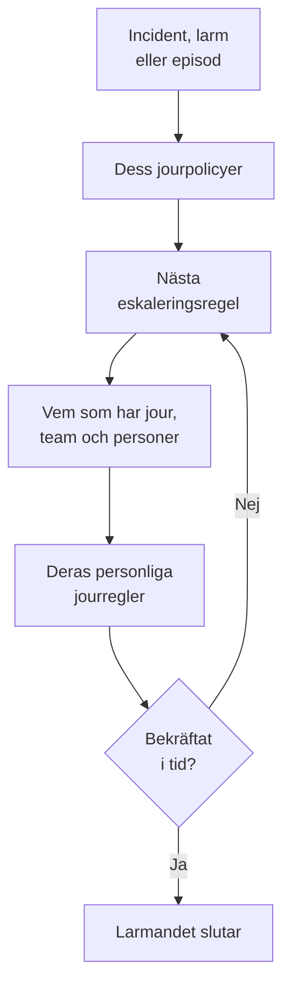

# Jour – Översikt

Jour är hur OneUptime får en person att ta tag i ett problem, när som helst på dygnet. När en incident, ett larm eller en episod behöver någon larmar dess jourpolicyer personer nivå för nivå tills någon bekräftar, och varje person nås på det sätt hen har valt: en pushavisering, ett SMS, ett samtal, ett e-postmeddelande eller ett chattmeddelande. Den här sidan visar hur delarna hänger ihop och var var och en finns.

:::cards
- [Så når en utlarmning någon](#så-når-en-utlarmning-någon): Från en ny incident till personen som svarar.
- [Byggstenarna](#byggstenarna): Policyer, eskaleringsregler, scheman, åsidosättningar och personliga regler.
- [Konfigurera jour](#konfigurera-jour): Från ingenting till ett team som larmas, i fem steg.
- [Var jouren finns](#var-jouren-finns): Menyn Jourtjänst, avsnitt för avsnitt.
:::

## Så når en utlarmning någon

1. En ny incident, ett nytt larm eller en ny episod kör sina jourpolicyer direkt: de som valts på den och de som dess jourregler lägger till. Varje policy körs för sig. En jourregel inställd på **Endast under arbetstid** låter de policyer den lägger till vänta tills arbetstiden börjar.
2. En policys första eskaleringsregel larmar direkt: den som har jour i dess scheman just nu, varje medlem i dess team och personerna den nämner.
3. Om någon av dem är borta skickar en användaråsidosättning utlarmningen till personen som täcker upp för hen, eller hoppar över hen.
4. Varje person nås via sina personliga jourregler: vilken av hens metoder som provas, och efter hur lång tid. En utlarmning utan regel når ändå personen på de metoder hen har verifierat.
5. Om ingen bekräftar innan regelns väntetid har gått ut larmar nästa regel. Efter den sista börjar policyn om ifall den upprepas, och annars slutar den.

Att bekräfta eller lösa incidenten, larmet eller episoden stoppar varje policy som fortfarande larmar för den. OneUptime för körande policyer ett steg vidare varje minut och registrerar varje körning, regel för regel, i **Exekveringsloggar**.

Första gången en utlarmning når någon registrerar OneUptime det på incidenten, larmet eller episoden som `First Paged At`. En mätning kan räkna från det: **Tid till bekräftelse efter utlarmning** mäter hur lång tid det tog för personerna att svara när de väl hade larmats, inte hur länge det dröjde innan någon larmades. Se [Tid till bekräftelse efter utlarmning](/docs/incidents/settings#tid-till-bekräftelse-efter-utlarmning).

> [!NOTE]
> En incident, ett larm eller en episod som skapas redan bekräftad eller löst kör ingen av sina policyer, och dess flöde säger det. Se [Skapat redan bekräftat eller löst](/docs/alerts/index#skapat-redan-bekräftat-eller-löst).

## Byggstenarna

| Del | Vad den avgör | Läs mer |
| --- | --- | --- |
| Jourpolicy | Vem som larmas om en incident eller ett larm, nivå för nivå | [Jourpolicyer](/docs/on-call/policies) |
| Eskaleringsregel | En nivå i en policy: vem den larmar, och hur länge den väntar på en bekräftelse | [Eskaleringsregler](/docs/on-call/escalation-rules) |
| Jourschema | Vem som har jour vid varje tidpunkt, när personer turas om | [Jourscheman](/docs/on-call/schedules) |
| Användaråsidosättning | Vem som täcker upp för någon medan hen är borta | [Användaråsidosättningar](/docs/on-call/user-overrides) |
| Personliga jourregler | Hur en person nås: vilken metod, och efter hur lång tid | [Personliga jourregler](/docs/notifications/on-call-rules) |
| Policy för inkommande samtal | Ett telefonnummer som ringer till den som har jour | [Policy för inkommande samtal](/docs/on-call/incoming-call-policy) |

Policyer, eskaleringsregler, scheman och åsidosättningar hör till projektet, under **Jourtjänst**. Aviseringsmetoder och personliga jourregler hör till varje person, under **Användarinställningar**: en administratör kan titta på någons inställningar, men bara personen själv kan verifiera sin telefon eller e-post. Se [Så når OneUptime dig](/docs/notifications/index).

## Konfigurera jour

:::steps
### Bygg ett schema

Öppna **Jourtjänst** från menyn **Produkter** och gå till **Jourscheman**. Klicka på **Skapa jourschema**, ge det ett namn och välj personerna under **Vilka turas om?** i den ordning de turas om. Se [Jourscheman](/docs/on-call/schedules).

### Skapa en policy

Gå till **Jourpolicyer** och klicka på **Skapa Jourpolicy**. Välj schemat under **Vem larmas först?**. Det blir policyns första eskaleringsregel, **Level 1**, som väntar 30 minuter på en bekräftelse.

### Lägg till nästa nivåer

Klicka på **Lägg till eskaleringsregel** på policyns sida **Eskaleringsregler** för varje nivå efter den första: nästa person i samma schemas rotation, en teamledare, en chef. Se [Eskaleringsregler](/docs/on-call/escalation-rules).

### Kör policyn automatiskt

Ett projekts första policy kan göra det redan när den skapas: låt **Utlös den vid varje ny incident och varje nytt larm** vara påslaget. För alla andra policyer går du till **Incidenter → Regler → Jourregler** eller **Larm → Regler → Jourregler** och lägger till en regel som kör den för de incidenter eller larm som den matchar, till exempel varje kritisk incident. Se [Vad som kör en policy](/docs/on-call/policies#vad-som-kör-en-policy).

### Kontrollera att alla kan nås

Öppna **Jourtjänst → Beredskap**. Alla som dina policyer kan larma listas som **Klar**, **Behöver konfigureras** eller **Onåbar**, med det som saknas. Se [Beredskap och rapporter](/docs/on-call/readiness).
:::

> [!NOTE]
> I OneUptime Cloud ingår jourpolicyer och eskaleringsregler i alla abonnemang. Jourscheman, användaråsidosättningar, exekveringsloggar och rapporten över jourtid kräver abonnemanget **Growth**.

## Var jouren finns

Öppna **Jourtjänst** från menyn **Produkter** i det övre fältet. Den öppnas på **Jourpolicyer**, på `/dashboard/{projectId}/on-call-duty/policies`, och dess sidomeny innehåller resten:

| Avsnitt | Sidor |
| --- | --- |
| **Policyer** | **Jourpolicyer** och **Beredskap**: vem dina policyer faktiskt kan nå |
| **Scheman** | **Jourscheman**, **Tidslinje för jourscheman** och **Kalenderflöden** |
| **Inkommande samtal** | **Inkommande samtalspolicyer**: ett telefonnummer som ringer till den som har jour |
| **Avancerad** | **Användaråsidosättningar**, **Exekveringsloggar** och **Arkiverade policyer** |
| **Rapporter** | **Användarens jourtid**: hur länge varje person hade jour |
| **Arbetsyta** | **Slack** och **Microsoft Teams**: regler som publicerar jourhändelser i en kanal |
| **Inställningar** | **Anpassade fält**, **Etikettregler** och **Ägarregler** |
| **Utvecklare** | **Terraform**, **API** och **AI-assistenter**: jour konfigurerad från kod |

**Policyer**, **Scheman** och **Inkommande samtal** är öppna; de andra avsnitten börjar ihopfällda, och ett avsnitt öppnas av sig självt när du är på någon av dess sidor. **Arbetsyta** visar chattverktygen som projektet har anslutit, eller **Anslut Slack eller Teams** när det inte har några.

När du har jour för en policy visar klockan uppe till höger det. Klicka på den för att öppna **Mina jourpolicyer**: varje policy du har jour för, i alla dina projekt, och om du är nämnd direkt, via ett team eller via ett schema.

## Felsökning

:::details Ingen larmades för en ny incident
Öppna incidentens sida **Jourexekveringar**. Är den tom hade incidenten ingen jourpolicy: ingen valdes på den, och ingen jourregel matchade den. En körning med **Execution Completed - No One Notified** gick igenom varje eskaleringsregel utan att hitta någon: oftast ett schema där ingen har jour. Se [Exekveringsloggar](/docs/on-call/policies#exekveringsloggar). En körning med **Väntar** väntar på arbetstid för en jourregel inställd på **Endast under arbetstid** och larmar ingen förrän den börjar.
:::

:::details Någon larmades på fel kanal, eller inte alls
Öppna **Jourtjänst → Beredskap** och klicka på **Coverage** på personens rad. Den visar metoderna personen har verifierat och varje allvarlighetsgrad som hen saknar regel för. Bara personen själv kan åtgärda det, under **Användarinställningar**: skicka en påminnelse om inställningarna från samma sida. Se [Beredskap och rapporter](/docs/on-call/readiness). På OneUptime Cloud kan en telefon som blockerar okända uppringare tysta ett larm: lägg till [OneUptimes nummer](/docs/on-call/phone-number-whitelist) i dess lista över tillåtna.
:::

:::details En person på semester larmas fortfarande
Lägg till en användaråsidosättning med personen under **Vem är borta?**. En under **Jourtjänst → Avancerad → Användaråsidosättningar** gäller för varje policy; en på en policys egen sida **Användaråsidosättningar** gäller bara för den policyn. Se [Användaråsidosättningar](/docs/on-call/user-overrides).
:::

## Nästa steg

:::cards
- [Jourpolicyer](/docs/on-call/policies): Skapa en policy, bestäm vad som kör den och läs vad den gjorde.
- [Eskaleringsregler](/docs/on-call/escalation-rules): Larma personer nivå för nivå tills någon svarar.
- [Jourscheman](/docs/on-call/schedules): Rotationer, lager och överlämningar.
- [Så når OneUptime dig](/docs/notifications/index): Metoderna och reglerna som avgör hur varje person nås.
:::
