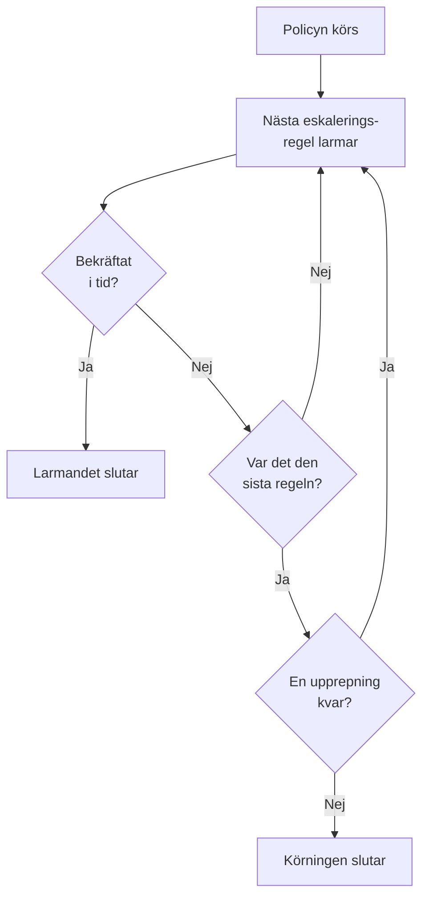

# Jourpolicyer

En jourpolicy avgör vem som larmas om en incident eller ett larm, och vem som står på tur om ingen bekräftar. Dess eskaleringsregler är dess nivåer, och incidenterna, larmen och episoderna som använder den kör den. Den här sidan handlar om hur du skapar en policy, vad som kör den, vad dess sidor visar och hur varje körning registreras.

:::cards
- [Skapa en policy](#skapa-en-policy): Ett namn, och vem som larmas först.
- [Vad som kör en policy](#vad-som-kör-en-policy): Regler, mallar, övervakningar, chatt och du själv.
- [Exekveringsloggar](#exekveringsloggar): Varje körning, regel för regel, och varför den slutade.
- [Arkivera eller ta bort en policy](#arkivera-eller-ta-bort-en-policy): Ta en policy ur drift.
:::

## Skapa en policy

:::steps
1. Gå till **Jourtjänst → Jourpolicyer** och klicka på **Skapa Jourpolicy**.
2. Ange ett **Namn**, till exempel "Betalningar primär".
3. Klicka på **Lägg till mottagare** under **Vem larmas först?** och välj de jourscheman, team och personer som ska larmas först.
4. Klicka på **Skapa Jourpolicy**. Policyn öppnas på sin sida **Eskaleringsregler**, med **Level 1** på plats.
:::

**Vem larmas först?** är valfritt och visas bara för personer som får lägga till eskaleringsregler: lämnas det tomt larmar policyn ingen förrän den har en regel. **Beskrivning** och **Etiketter** väntar under **Fler fält**. Se [Eskaleringsregler](/docs/on-call/escalation-rules) för att lägga till nästa nivåer.

Listan **Jourpolicyer** visar varje policys **Namn**, **Beskrivning**, **Etiketter** och **Ägare**. Markera policyer för att använda **Add Labels**, **Remove Labels**, **Add Owner**, **Remove Owner**, **Arkivera** eller **Exportera JSON**, eller för att ta bort dem. **Import JSON** skapar policyer från en export: en export innehåller en policys egna inställningar, inte dess eskaleringsregler eller ägare.

## Vad som kör en policy

En policy larmar ingen förrän något kör den. Varje incident, varje larm och varje episod kör sina policyer så snart den har skapats:

| Vad | Hur policyn läggs till | Läs mer |
| --- | --- | --- |
| Själva posten | Fältet **Jourpolicy** när en incident eller ett larm skapas, en incidentmall, eller den hopfällda delen **Jour** i en övervaknings kriterier | [Deklarera en incident](/docs/incidents/declaring-incidents) |
| Jourregler | **Incidenter → Regler → Jourregler** och **Varningar → Regler → Jourregler** lägger till policyerna från varje regel som matchar | [Jourregler för incidenter](/docs/incidents/settings#jourregler-för-incidenter) |
| Grupperingsregler | En grupperingsregel kör sina policyer när den öppnar en episod | [Larmepisoder och grupperingsregler](/docs/alerts/episodes) |
| Manuellt | **Kör jourpolicy**, i menyn **Åtgärder** i ett flöde, eller på ett meddelande i Slack eller Microsoft Teams | [Incidentens flöde](/docs/incidents/notes-owners-and-feed#incidentens-flöde) |
| Chatt och arbetsflöden | `/oneuptime page` i Slack eller Microsoft Teams, och ett arbetsflödes steg **Page an On-Call Policy** | [Paging](/docs/workflows/components#paging) |

En policy som flera regler lägger till körs en gång. En allvarlighetsgrad kör aldrig en policy på egen hand: det gör en jourregel som matchar allvarlighetsgraden. En incident eller ett larm som skapas redan bekräftat eller löst kör ingen av sina policyer. En jourregel inställd på **Endast under arbetstid** låter de policyer den lägger till vänta tills arbetstiden börjar.

## En policys sidor

Öppna en policy från listan. Dess sidomeny innehåller allt om den:

| Avsnitt | Sidor |
| --- | --- |
| **Grundläggande** | **Översikt**, **Eskaleringsregler** och **Ägare** |
| **Loggar** | **Exekveringsloggar** och **Aviseringsloggar** |
| **Utvecklare** | **Terraform**, **API** och **AI-assistenter** |
| **Avancerad** | **Användaråsidosättningar**, **Anpassade fält**, **Inställningar**, **Granskningsloggar** och **Ta bort policy** |

**Grundläggande** är öppet; de andra avsnitten börjar ihopfällda tills du klickar på dem.

- **Översikt** visar **Detaljer för jourpolicy** och sedan **Policy at a glance**: hur många nivåer och mottagare policyn har, hur lång tid det dröjer till dess sista nivå och hur ofta den upprepas. **Responder readiness** säger om alla som den kan larma kan nås nu, och **Jourpolicyns flöde** visar vad som har ändrats: personer, team och scheman som lagts till eller tagits bort, åsidosättningar och överlämningar.
- **Ägare** är personerna och teamen som ansvarar för policyn. När en utlarmning från den inte hittar någon regel för någon, eller inte kan levereras, får de ett e-postmeddelande; en policy utan ägare skickar i stället e-post till projektets ägare.
- **Aviseringsloggar** visar varje meddelande som policyn har skickat, med en flik per kanal.
- **Användaråsidosättningar** täcker upp för personer bara i den här policyn. Se [Användaråsidosättningar](/docs/on-call/user-overrides).
- **Inställningar** har **Exportera Jourpolicy** och kortet som arkiverar policyn.

## Upprepa en policy

När den sista nivåns väntetid går ut utan att någon har bekräftat slutar en policy, om den inte upprepas. För att välja öppnar du policyns sida **Eskaleringsregler** och klickar på **Redigera** på kortet **Upprepningspolicy** under reglerna. **Redigera upprepningspolicy** frågar **Om ingen bekräftar efter den sista nivån**:

| Svar | Vad det gör |
| --- | --- |
| **Sluta larma** | Ingen larmas igen, så policyn körs en gång. En ny policy börjar med det här svaret. |
| **Börja om från Level 1** | Varje nivå larmas igen, i tur och ordning. **Hur många gånger till?** anger hur många: 1 eller fler. |

En policy som börjar om tre gånger till går igenom sina nivåer fyra gånger totalt. Kortets rad **Efter den sista nivån** säger vad policyn gör, och **Policy at a glance** på **Översikt** säger samma sak i ord.

## Larma igen om den inte blir löst

En bekräftelse stoppar en policys larm för gott, även om ingen löser incidenten eller larmet efteråt. En policy kan i stället larma igen: öppna dess sida **Eskaleringsregler**, öppna **Fler inställningar** längst ned och klicka på **Redigera** på kortet **Tidsgräns efter bekräftelse**. **Redigera tidsgräns efter bekräftelse** frågar **Om den är bekräftad men inte löst**:

| Svar | Vad det gör |
| --- | --- |
| **Larma inte igen** | En bekräftelse stoppar larmen för gott. En ny policy börjar med det här svaret. |
| **Larma igen** | Larmar den som bekräftade och den som har jour nu. **Efter hur många minuter?** anger när: från 5 till 1440, först 30. |

Minuterna räknas från varje bekräftelse, och en policy larmar igen högst 5 gånger om samma incident, larm eller episod. Ett nytt larm börjar på den nivå som larmade när det bekräftades, larmar den som har jour där nu och fortsätter genom nivåerna som den första körningen. Incidenten eller larmet förblir bekräftat: det nya larmet är en egen körning, i flödet och i policyns exekveringsloggar, där dess **Status** säger "Larmad igen (1 av 5)".

Den som larmas igen bekräftar från meddelandet eller med **Bekräfta igen** på incidentens eller larmets sida, och minuterna börjar om; **Eskalera** skickar larmet vidare till nästa nivå. Att lösa eller ta bort incidenten eller larmet, arkivera eller ta bort policyn eller välja **Larma inte igen** stoppar det. Kortets rad **Efter en bekräftelse** säger vad policyn gör, och **Fler inställningar** visar minuterna medan det är hopfällt. **Policy at a glance** på **Översikt** och **Escalation summary** säger samma sak i ord.

## Exekveringsloggar

Varje gång en policy körs skriver den en exekveringslogg, och loggen går igenom sina statusar medan körningen pågår:

| Status | Vad den betyder |
| --- | --- |
| **Väntar** | En jourregel inställd på **Endast under arbetstid** låter körningen vänta tills arbetstiden börjar: den säger när larmningen börjar och larmar ingen fram till dess. Den avslutas utan larm om incidenten eller larmet bekräftas eller löses först. Den börjar larma genast om incidenten eller larmet ändras och nu matchar en jourregel som larmar direkt. |
| **Schemalagd**, **Startade** | Körningen förbereds. En som fortfarande står här efter 5 minuter stoppas som **Fel**. |
| **Executing** | Körningen larmar. OneUptime för den ett steg vidare varje minut. |
| **Execution Completed** | Någon bekräftade, incidenten eller larmet löstes, varje regel och upprepning användes, eller policyn arkiverades. |
| **Execution Completed - No One Notified** | Körningen gick igenom varje regel och larmade ingen: oftast ett schema där ingen har jour. |
| **Fel** | Körningen misslyckades. **Visa statusmeddelande** säger varför. |

Du hittar exekveringsloggar på tre ställen:

- i policyns egna **Exekveringsloggar**, under **Loggar**;
- under **Jourtjänst → Avancerad → Exekveringsloggar**, för varje policy, där direkta utlarmningar från arbetsflöden och chatt visas som **Direkt utlarmning**;
- på en incidents eller ett larms sida **Jourexekveringar**.

Varje rad visar vad som startade körningen, när, dess **Status** och vem som bekräftade den. **View Timeline** öppnar dess **Tidslinje för körningen**: varje eskaleringsregel, vem den larmade, via vilket schema och hur varje utlarmning slutade. Ett schema där ingen har jour visar **No one was on call** i stället för en person. I OneUptime Cloud kräver exekveringsloggar abonnemanget **Growth**.

## Arkivera eller ta bort en policy

Att arkivera tar en policy ur drift och behåller allt: öppna policyns **Inställningar** och klicka på **Arkivera** på dess arkiveringskort, eller markera policyer i listan och välj **Arkivera**.

- En arkiverad policy larmar ingen. Incidenter och larm som använder den hoppar över den, och en körning som fortfarande eskalerar slutar vid sitt nästa steg.
- Den lämnar listan **Jourpolicyer** för **Jourtjänst → Avancerad → Arkiverade policyer**, där **Avarkivera** sätter den i drift igen.

**Ta bort policy**, under **Avancerad**, tar bort policyn med dess eskaleringsregler och användaråsidosättningar. Borttagning från listan frågar först och föreslår att arkivera i stället.

## Vem som får ändra en policy

**Project Owner**, **Project Admin**, **Project Member**, **On-Call Admin** och **On-Call Member** får skapa, ändra och ta bort policyer; **Viewer** och **On-Call Viewer** får läsa dem. I en anpassad roll heter behörigheterna **Create On-Call Duty Policy**, **Edit On-Call Duty Policy**, **Delete On-Call Duty Policy** och **Read On-Call Duty Policy**, och en roll som är begränsad till vissa etiketter når bara de policyer som har dem. Att lägga till ägare och anpassade fält kräver abonnemanget **Growth** i OneUptime Cloud.

## API och Terraform

Jourpolicyer är resursen `/api/on-call-duty-policy`, och resursen `oneuptime_on_call_policy` i Terraform:

| Inställning | API-fält |
| --- | --- |
| **Namn** | `name` |
| **Beskrivning** | `description` |
| **Om ingen bekräftar efter den sista nivån** | `repeatPolicyIfNoOneAcknowledges` |
| **Hur många gånger till?** | `repeatPolicyIfNoOneAcknowledgesNoOfTimes` |
| **Efter hur många minuter?** | `acknowledgementTimeoutInMinutes` |
| Arkiverad | `isArchived` |

`repeatPolicyIfNoOneAcknowledges` är `false` för **Sluta larma** och `true` för **Börja om från Level 1**. Med `true` måste `repeatPolicyIfNoOneAcknowledgesNoOfTimes` vara ett heltal på 1 eller mer: OneUptime avvisar `0`. En äldre policy som sparats med `0` upprepas aldrig, och instrumentpanelen visar den som **Sluta larma**.

`acknowledgementTimeoutInMinutes` är `null` för **Larma inte igen** och ett helt antal minuter från 5 till 1440 för **Larma igen**. OneUptime avvisar allt annat.

Se [Skapa regler med API:et eller Terraform](/docs/on-call/escalation-rules#skapa-regler-med-apiet-eller-terraform) för att skapa en policy med dess första nivå i en enda begäran.

## Felsökning

:::details En policy kördes, men ingen larmades
Dess körning visar **Execution Completed - No One Notified**. Öppna **View Timeline**: en rad med **No one was on call** pekar på ett schema med en lucka, och statusmeddelandet på en rad med **Hoppade över** säger varför, till exempel någon som var borta utan någon som täckte upp. **Jourtjänst → Beredskap** visar vem som inte kunde nås.
:::

:::details Nästa nivå larmades en minut efter sin väntetid
OneUptime för körande policyer ett steg vidare en gång i minuten, så en nivå larmas vid den första kontrollen efter att väntetiden har gått ut.
:::

:::details En incident visar en policy som inte larmade någon
Policyn är arkiverad: en arkiverad policy finns kvar på incidenterna och larmen som använder den, larmar ingen, och dess exekveringslogg säger att den inte kördes. Avarkivera den under **Jourtjänst → Avancerad → Arkiverade policyer**.
:::

## Nästa steg

:::cards
- [Eskaleringsregler](/docs/on-call/escalation-rules): Lägg till nivåerna som en policy larmar, och hur länge var och en väntar.
- [Användaråsidosättningar](/docs/on-call/user-overrides): Skicka någons utlarmningar till en kollega medan hen är borta.
- [Beredskap och rapporter](/docs/on-call/readiness): Kontrollera att alla som en policy larmar kan nås.
:::
