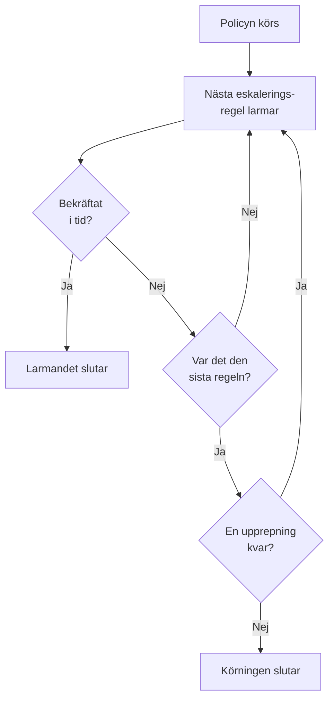

# Jourpolicyer

En jourpolicy avgör vem som larmas om en incident eller ett larm, och vem som står på tur om ingen bekräftar. Dess eskaleringsregler är dess nivåer, och incidenterna, larmen och episoderna som använder den kör den. Den här sidan handlar om hur du skapar en policy, vad som kör den, vad dess sidor visar och hur varje körning registreras.

:::cards
- [Skapa en policy](#skapa-en-policy): Ett namn, och vem som larmas först.
- [Vad som kör en policy](#vad-som-kör-en-policy): Regler, mallar, övervakningar, chatt och du själv.
- [Exekveringsloggar](#exekveringsloggar): Varje körning, regel för regel, och varför den slutade.
- [Arkivera eller ta bort en policy](#arkivera-eller-ta-bort-en-policy): Ta en policy ur drift.
:::

## Skapa en policy

:::steps
1. Gå till **Jour → Jourpolicyer** och klicka på **Skapa jourpolicy**.
2. Ange ett **Namn**, till exempel "Betalningar primär".
3. Klicka på **Lägg till mottagare** under **Vem larmas först?** och välj de jourscheman, team och personer som ska larmas först.
4. Klicka på **Skapa jourpolicy**. Policyn öppnas på sin sida **Eskaleringsregler**, med **Level 1** på plats.
:::

**Vem larmas först?** är valfritt och visas bara för personer som får lägga till eskaleringsregler: lämnas det tomt larmar policyn ingen förrän den har en regel. **Beskrivning** och **Etiketter** väntar under **Fler fält**. Se [Eskaleringsregler](/docs/on-call/escalation-rules) för att lägga till nästa nivåer.

Formuläret frågar också **Utlös den vid varje ny incident och varje nytt larm**, om du får lägga till jourregler. Det lägger till en regel under **Incidenter → Regler → Jourregler** och en under **Larm → Regler → Jourregler**, som var och en matchar allt och kör den här policyn. Det är påslaget från början för ett projekts första policy, så länge projektet varken har en jourpolicy eller en jourregel, och avslaget för senare policyer: att utlösa två policyer vid varje ny incident och varje nytt larm är ett val att göra. Avslaget larmar policyn ingen förrän en regel, en övervakning eller en person kör den.

Vill du hellre guidas steg för steg, från din telefon till ett testlarm, klickar du på **Guidad installation**: på den tomma listan **Jourpolicyer** eller under **Så fungerar det**. Se [Bli larmad via samtal, SMS eller push](/docs/guides/paging).

Listan **Jourpolicyer** visar varje policys **Namn**, **Larmas först**, **Beskrivning**, **Etiketter** och **Ägare**. **Larmas först** visar vem policyns första eskaleringsregel larmar: dess jourscheman, vart och ett med den som har jour i det just nu, dess team och personerna den nämner, eller **Inga eskaleringsregler** eller **Inga mottagare** när den inte larmar någon. Markera policyer för att använda **Lägg till etiketter**, **Ta bort etiketter**, **Lägg till ägare**, **Ta bort ägare**, **Arkivera** eller **Exportera JSON**, eller för att ta bort dem. **Importera JSON** skapar policyer från en export: en export innehåller en policys egna inställningar, inte dess eskaleringsregler eller ägare.

## Vad som kör en policy

En policy larmar ingen förrän något kör den. Varje incident, varje larm och varje episod kör sina policyer så snart den har skapats:

| Vad | Hur policyn läggs till | Läs mer |
| --- | --- | --- |
| Själva posten | Fältet **Jourpolicy** när en incident eller ett larm skapas, en incidentmall, eller den hopfällda delen **Jour** i en övervaknings kriterier | [Deklarera en incident](/docs/incidents/declaring-incidents) |
| Jourregler | **Incidenter → Regler → Jourregler** och **Larm → Regler → Jourregler** lägger till policyerna från varje regel som matchar | [Jourregler för incidenter](/docs/incidents/settings#jourregler-för-incidenter) |
| Grupperingsregler | En grupperingsregel kör sina policyer när den öppnar en episod | [Larmepisoder och grupperingsregler](/docs/alerts/episodes) |
| Manuellt | **Kör jourpolicy**, i menyn **Åtgärder** i ett flöde, eller på ett meddelande i Slack eller Microsoft Teams | [Incidentens flöde](/docs/incidents/notes-owners-and-feed#incidentens-flöde) |
| Chatt och arbetsflöden | `/oneuptime page` i Slack eller Microsoft Teams, och ett arbetsflödes steg **Page an On-Call Policy** | [Paging](/docs/workflows/components#paging) |

En policy som flera regler lägger till körs en gång. En allvarlighetsgrad kör aldrig en policy på egen hand: det gör en jourregel som matchar allvarlighetsgraden. En incident eller ett larm som skapas redan bekräftat eller löst kör ingen av sina policyer. En jourregel inställd på **Endast under arbetstid** låter de policyer den lägger till vänta tills arbetstiden börjar.

## En policys sidor

Öppna en policy från listan. Dess sidomeny innehåller allt om den:

| Avsnitt | Sidor |
| --- | --- |
| **Grundläggande** | **Översikt**, **Eskaleringsregler** och **Ägare** |
| **Loggar** | **Exekveringsloggar** och **Aviseringsloggar** |
| **Utvecklare** | **Terraform**, **API**, **CLI** och **AI-assistenter** |
| **Avancerad** | **Användaråsidosättningar**, **Anpassade fält**, **Inställningar**, **Granskningsloggar** och **Ta bort policy** |

**Grundläggande** är öppet; de andra avsnitten börjar ihopfällda tills du klickar på dem.

- **Översikt** visar **Detaljer för jourpolicy** och sedan **Policyn i korthet**: hur många nivåer och mottagare policyn har, hur lång tid det dröjer till dess sista nivå och hur ofta den upprepas. **Mottagarnas beredskap** säger om alla som den kan larma kan nås nu, och **Jourpolicyns flöde** visar vad som har ändrats: personer, team och scheman som lagts till eller tagits bort, åsidosättningar och överlämningar. Dess regler för Slack, Microsoft Teams och Mattermost publicerar dem i dina kanaler, en överlämning på en rad: se [Jourmeddelanden](/docs/workspace-connections/slack#jourmeddelanden).
- **Ägare** är personerna och teamen som ansvarar för policyn. När en utlarmning från den inte hittar någon regel för någon, eller inte kan levereras, får de ett e-postmeddelande; en policy utan ägare skickar i stället e-post till Projektägare.
- **Aviseringsloggar** visar varje meddelande som policyn har skickat, med en flik per kanal.
- **Användaråsidosättningar** täcker upp för personer bara i den här policyn. Se [Användaråsidosättningar](/docs/on-call/user-overrides).
- **Inställningar** har **Exportera Jourpolicy** och kortet som arkiverar policyn.

**Vad som utlöser den här policyn**, på **Översikt**, listar jourreglerna, monitorerna vars kriterier utlöser policyn, mallarna och andra regler som utlöser den, och arbetsflödena som gör det, var och en med en länk. En avstängd regel visar **Av**. När inget utlöser policyn säger kortet det: den larmar ingen förrän något utlöser den. När du tar bort eller arkiverar policyn sägs samma sak först. Det du inte får öppna räknas men namnges inte.

## Upprepa en policy

När den sista nivåns väntetid går ut utan att någon har bekräftat slutar en policy, om den inte upprepas. För att välja öppnar du policyns sida **Eskaleringsregler** och klickar på **Redigera** på kortet **Upprepningspolicy** under reglerna. **Redigera upprepningspolicy** frågar **Om ingen bekräftar efter den sista nivån**:

| Svar | Vad det gör |
| --- | --- |
| **Sluta larma** | Ingen larmas igen, så policyn körs en gång. En ny policy börjar med det här svaret. |
| **Börja om från Level 1** | Varje nivå larmas igen, i tur och ordning. **Hur många gånger till?** anger hur många: 1 eller fler. |

En policy som börjar om tre gånger till går igenom sina nivåer fyra gånger totalt. En omgång där ingen nivå hade någon att larma upprepas inte: en till skulle inte heller larma någon, så policyn slutar. Kortets rad **Efter den sista nivån** säger vad policyn gör, och **Policyn i korthet** på **Översikt** säger samma sak i ord.

## Larma igen om den inte blir löst

En bekräftelse stoppar en policys larm för gott, även om ingen löser incidenten eller larmet efteråt. En policy kan i stället larma igen: öppna dess sida **Eskaleringsregler**, öppna **Fler inställningar** längst ned och klicka på **Redigera** på kortet **Tidsgräns efter bekräftelse**. **Redigera tidsgräns efter bekräftelse** frågar **Om den är bekräftad men inte löst**:

| Svar | Vad det gör |
| --- | --- |
| **Larma inte igen** | En bekräftelse stoppar larmen för gott. En ny policy börjar med det här svaret. |
| **Larma igen** | Larmar den som bekräftade och den som har jour nu. **Efter hur många minuter?** anger när: från 5 till 1440, först 30. |

Minuterna räknas från varje bekräftelse, och en policy larmar igen högst 5 gånger om samma incident, larm eller episod. Ett nytt larm börjar på den nivå som larmade när det bekräftades, larmar den som har jour där nu och fortsätter genom nivåerna som den första körningen. Incidenten eller larmet förblir bekräftat: det nya larmet är en egen körning, i flödet och i policyns exekveringsloggar, där dess **Status** säger "Larmad igen (1 av 5)".

Den som larmas igen bekräftar från meddelandet eller med **Bekräfta igen** på incidentens eller larmets sida, och minuterna börjar om; **Eskalera** skickar larmet vidare till nästa nivå. Att lösa eller ta bort incidenten eller larmet, arkivera eller ta bort policyn eller välja **Larma inte igen** stoppar det. Kortets rad **Efter en bekräftelse** säger vad policyn gör, och **Fler inställningar** visar minuterna medan det är hopfällt. **Policyn i korthet** på **Översikt** och **Översikt över eskalering** säger samma sak i ord.

## När flera policyer larmar

En incident, ett larm eller en episod kör var och en av sina policyer för sig, samtidigt.

- Den som har jour i två av dem larmas bara en gång. När en policys nivå når någon som en annan policy redan larmar om den, larmas personen inte en gång till: policyns exekveringslogg visar personen som **Redan larmad**, och incidentens flöde och policyns meddelande i Slack och Microsoft Teams nämner den policy som larmar personen. Nivån väntar ändå ut sina minuter före nästa nivå, precis som för alla den har larmat. Ett svar på det enda larmet gäller för båda policyerna. Inom en policy larmas den som en nivå nämner två gånger, personligen och via ett team eller ett schema, bara en gång.
- Ett larm som skickas direkt till personer räknas också. När en policys nivå når någon som ett larm från Slack eller Microsoft Teams, eller ett arbetsflödes larmblock, redan larmar om den, larmas personen inte en gång till: policyns exekveringslogg anger vem som skickade det larmet, eller arbetsflödet. Ett arbetsflödes larmblock larmar inte heller någon en gång till som en policy eller ett annat larm redan larmar.
- En bekräftelse av incidenten eller larmet stoppar inom en minut alla policyer som körs för den, var den än bekräftas: från vilket larm om den som helst, på dess egen sida, i mobilappen eller i Slack eller Microsoft Teams. Ingen nästa nivå larmas, och inga samtal eller sms som fortfarande väntar går ut. Aviseringar som redan har skickats förblir skickade.

Ingen går miste om ett larm för att hen bara larmas en gång. Personens larm kan sluta utan att hen har svarat: hen eskalerar det från ett av dess meddelanden, vilket bara eskalerar det larmet, det går inte att skicka, eller det slutar. Då larmar den andra policyn, eller arbetsflödets block, själv personen inom en minut, utan att skicka om det som redan har nått hen. **Eskalera** på incidentens sida eller i mobilappen eskalerar båda. Ett nytt larm, en policy som har startats manuellt och ett larm som någon har skickat från Slack eller Microsoft Teams larmar alltid sina personer själva, även den som en annan policy larmar. Ett larm till observatörer och ett larm till mottagare slås aldrig ihop.

Vissa larm fortsätter efter bekräftelsen, tills någon de har larmat svarar eller den är löst: ett nytt larm, ett larm till observatörer, ett larm som någon har skickat till personer från Slack eller Microsoft Teams, och en policy som har startats manuellt.

En policy som har startats manuellt är en som startats med **Kör jourpolicy**, eller av ett larm från Slack eller Microsoft Teams som nämner den. Den larmar nivå för nivå som varje körning, med samtal och upprepade push-aviseringar, och att någon annan bekräftar incidenten stoppar den inte: så larmar du ytterligare ett team till en incident som någon redan arbetar med. Den som den har larmat svarar från meddelandet i sitt larm, ett samtal eller ett sms, eller genom att själv bekräfta incidenten; när incidenten är bekräftad erbjuder incidentens sida personen **Bekräfta igen**. **Eskalera** skickar den vidare till nästa nivå. På en incident, ett larm eller en episod som är löst startas ingenting, och du får veta varför: instrumentpanelen stänger av **Kör jourpolicy** och visar skälet. Dess aviseringar säger vem som startade vilken policy, och har med meddelandet som skickades med ett larm från Slack eller Microsoft Teams.

## Testa en policy

**Testa den här policyn**, i en policys eskaleringsregler, larmar dess första nivå som ett test, utan någon incident bakom: varje meddelande är märkt TEST, och ingen statussida, prenumerant eller kanal får veta något. Slå på **Gå igenom varje eskaleringsnivå** för att larma varje nivå i tur och ordning, högst 2 minuter isär, tills någon bekräftar. Innan något skickas visar dialogen vem testet larmar och hur, och vad det kostar på OneUptime Cloud.

**Skicka testlarm** förblir avstängd så länge testet inte skulle nå någon: alla som det larmar har valt bort allvarlighetsgraden, har ingen regel för den och inget att falla tillbaka på, eller har bara metoder som inte är verifierade eller är avstängda i projektet. En rad under listan säger varför. Kan bara en senare nivå nås, erbjuder raden **Gå igenom varje eskaleringsnivå** med ett klick.

Den som larmas bekräftar testet från vilket som helst av dess meddelanden: länken i ett e-postmeddelande, ett sms eller ett chattmeddelande, 1 i ett samtal eller pushnotisen i OneUptime On-Call-appen, i versioner nyare än 1.6.0. En policy kan testas en gång var 5:e minut, och ett projekt skickar högst 20 test i timmen.

### Håll en beredskapsövning för en monitor

**Håll en beredskapsövning**, på kortet **När den går ner** för en monitor, övar ett av dess fel: en incident eller ett larm som ett av dess kriterier öppnar, eller den incident som en incidentregel för larm skapar av ett sådant larm. Den testar varje jourpolicy som felet skulle larma, var och en som **Testa den här policyn** testar den, och inget offentligt händer: ingen incident eller inget larm skapas, och ingen statussida, prenumerant eller kanal får veta något. Innan något skickas namnger dialogen felet, varje policy och vem den policyn larmar just nu. För en skapad incident namnger den också regeln och hur länge larmet först står öppet: övningen testar incidentens policyer direkt, utan den väntetiden.

En övning larmar varje policys första nivå. Under **Fler fält** kan du slå på **Gå igenom varje eskaleringsnivå** för att larma varje policys nivåer i tur och ordning, högst 2 minuter isär, tills någon bekräftar: dialogen visar då varje nivå som varje policy når, och vad genomgången som mest kostar. När ingen på de första nivåerna kan nås men en senare nivå kan, erbjuder raden under listan **Gå igenom varje eskaleringsnivå** med ett klick.

**Starta beredskapsövning** förblir avstängd så länge en av de policyerna är en som du inte kan testa, eftersom du inte kan redigera den, eller så länge ingen som de larmar kan nås. Varje policy i en övning räknas som ett eget test: en policy som testats under de senaste 5 minuterna stoppar hela övningen, och en övning med tre policyer tar tre av projektets 20 test i timmen.

När dialogen är stängd säger **Senaste beredskapsövning** på kortet vilket fel monitorns senaste övning övade, när och av vem den startades och hur många av dess test som bekräftades. **Visa detaljer** visar varje policys test: om det bekräftades, av vem, hur och hur snabbt. Varje test finns kvar i sin policys exekveringsloggar, märkt som en beredskapsövning för monitorn. En övnings resultat visas för den som kan läsa monitorn och var och en av de exekveringsloggarna.

## Exekveringsloggar

Varje gång en policy körs skriver den en exekveringslogg, och loggen går igenom sina statusar medan körningen pågår:

| Status | Vad den betyder |
| --- | --- |
| **Väntar** | En jourregel inställd på **Endast under arbetstid** låter körningen vänta tills arbetstiden börjar: den säger när larmningen börjar och larmar ingen fram till dess. Den avslutas utan larm om incidenten eller larmet bekräftas eller löses först. Den börjar larma genast om incidenten eller larmet ändras och nu matchar en jourregel som larmar direkt. |
| **Schemalagd**, **Startade** | Körningen förbereds. En som fortfarande står här efter 5 minuter blev inte klar med att starta: den går vidare till **Utförs** och larmar därifrån starten stannade. En direkt utlarmning eller en testutlarmning som fortfarande står här stoppas som **Fel**. |
| **Utförs** | Körningen larmar. OneUptime för den ett steg vidare varje minut. Ett steg som misslyckas en kort stund, till exempel för att databasen inte gick att nå, försöks igen en minut senare, sedan efter 2 och 4 minuter och därefter var 5:e minut. |
| **Exekvering slutförd** | Någon bekräftade, incidenten eller larmet löstes, varje regel och upprepning användes, eller policyn arkiverades. |
| **Exekvering slutförd - ingen aviserad** | Körningen gick igenom varje regel och larmade ingen: oftast ett schema där ingen har jour, eller en nivå utan mottagare. |
| **Fel** | Körningen misslyckades: ett steg misslyckades på ett sätt som ett nytt försök inte kan rätta, till exempel en borttagen eskaleringsregel, eller misslyckades 10 försök i rad under ungefär 37 minuter. **Visa statusmeddelande** säger varför. |

Du hittar exekveringsloggar på tre ställen:

- i policyns egna **Exekveringsloggar**, under **Loggar**;
- under **Jour → Avancerad → Exekveringsloggar**, för varje policy, där direkta utlarmningar från arbetsflöden och chatt visas som **Direkt utlarmning**;
- på en incidents eller ett larms sida **Jourexekveringar**.

Varje rad visar vad som startade körningen, när, dess **Status** och vem som bekräftade den. **Visa tidslinje** öppnar dess **Tidslinje för körningen**: varje eskaleringsregel, vem den larmade, via vilket schema och hur varje utlarmning slutade. **Aviserad via** visar hur varje utlarmning nådde personen: telefonsamtal, SMS, e-post, push-avisering och så vidare. Ett schema där ingen har jour visar **Ingen hade jour** i stället för en person. En nivå som inte larmade någon säger varför, med **Gick vidare direkt** under: policyn väntade inte på den. En person som en annan policy eller ett direkt larm redan larmade visar **Redan larmad**: se [När flera policyer larmar](#när-flera-policyer-larmar). I OneUptime Cloud kräver exekveringsloggar abonnemanget **Growth**.

## Arkivera eller ta bort en policy

Att arkivera tar en policy ur drift och behåller allt: öppna policyns **Inställningar** och klicka på **Arkivera** på dess arkiveringskort, eller markera policyer i listan och välj **Arkivera**.

- En arkiverad policy larmar ingen. Incidenter och larm som använder den hoppar över den, och en körning som fortfarande eskalerar slutar vid sitt nästa steg.
- Den lämnar listan **Jourpolicyer** för **Jour → Avancerad → Arkiverade policyer**, där **Avarkivera** sätter den i drift igen.

**Ta bort policy**, under **Avancerad**, tar bort policyn med dess eskaleringsregler och användaråsidosättningar. Borttagning från listan frågar först och föreslår att arkivera i stället.

## Vem som får ändra en policy

**Projektägare**, **Projektadministratör**, **Projektmedlem**, **Jouradministratör** och **Jourmedlem** får skapa, ändra och ta bort policyer; **Tittare** och **Jourtittare** får läsa dem. I en anpassad roll heter behörigheterna **Create On-Call Policy**, **Edit On-Call Policy**, **Delete On-Call Policy** och **Read On-Call Policy**, och en roll som är begränsad till vissa etiketter når bara de policyer som har dem. Att lägga till ägare och anpassade fält kräver abonnemanget **Growth** i OneUptime Cloud.

## API och Terraform

Jourpolicyer är resursen `/api/on-call-duty-policy`, och resursen `oneuptime_on_call_policy` i Terraform:

| Inställning | API-fält |
| --- | --- |
| **Namn** | `name` |
| **Beskrivning** | `description` |
| **Om ingen bekräftar efter den sista nivån** | `repeatPolicyIfNoOneAcknowledges` |
| **Hur många gånger till?** | `repeatPolicyIfNoOneAcknowledgesNoOfTimes` |
| **Efter hur många minuter?** | `acknowledgementTimeoutInMinutes` |
| Arkiverad | `isArchived` |

`repeatPolicyIfNoOneAcknowledges` är `false` för **Sluta larma** och `true` för **Börja om från Level 1**. Med `true` måste `repeatPolicyIfNoOneAcknowledgesNoOfTimes` vara ett heltal på 1 eller mer: OneUptime avvisar `0`. En äldre policy som sparats med `0` upprepas aldrig, och instrumentpanelen visar den som **Sluta larma**.

`acknowledgementTimeoutInMinutes` är `null` för **Larma inte igen** och ett helt antal minuter från 5 till 1440 för **Larma igen**. OneUptime avvisar allt annat.

Se [Skapa regler med API:et eller Terraform](/docs/on-call/escalation-rules#skapa-regler-med-apiet-eller-terraform) för att skapa en policy med dess första nivå i en enda begäran.

## Felsökning

:::details En policy kördes, men ingen larmades
Dess körning visar **Exekvering slutförd - ingen aviserad**. Öppna **Visa tidslinje**: en rad med **Ingen hade jour** pekar på ett schema med en lucka, och statusmeddelandet på en rad med **Hoppade över** säger varför, till exempel någon som var borta utan någon som täckte upp. **Jour → Beredskap** visar vem som inte kunde nås.
:::

:::details Nästa nivå larmades en minut efter sin väntetid
OneUptime för körande policyer ett steg vidare en gång i minuten, så en nivå larmas vid den första kontrollen efter att väntetiden har gått ut.
:::

:::details Nästa nivå larmades direkt, utan väntetid
Nivån före hade ingen att larma: inga mottagare, ingen med jour i dess scheman eller ingen som kunde nås. En nivå som inte larmar någon har ingen väntetid, så nästa nivå larmas så snart policyn når den. **Visa tidslinje** visar varför den nivån inte larmade någon.
:::

:::details En incident visar en policy som inte larmade någon
Policyn är arkiverad: en arkiverad policy finns kvar på incidenterna och larmen som använder den, larmar ingen, och dess exekveringslogg säger att den inte kördes. Avarkivera den under **Jour → Avancerad → Arkiverade policyer**.
:::

:::details Någon larmades två gånger om en incident
Den som har jour i två av de policyer som incidenten kör larmas bara en gång, av den första policyn som når personen, och detsamma gäller den som både en policy och ett larm från Slack, Microsoft Teams eller ett arbetsflöde når. Den andra larmar personen också när den är ett nytt larm, en policy som har startats manuellt, ett larm som skickats från Slack eller Microsoft Teams eller ett larm till observatörer, som larmar sina personer själva, eller när personens första larm var över innan den andra nådde hen: hen eskalerade det, eller det hade slutat. En person som det andra larmet inte larmade en gång till visar **Redan larmad** i dess **Visa tidslinje**.
:::

:::details En policy fortsatte att larma efter att incidenten bekräftats
Den startades manuellt, eller så är det ett nytt larm: den fortsätter tills någon den har larmat svarar, eller incidenten är löst. Se [När flera policyer larmar](#när-flera-policyer-larmar).
:::

## Nästa steg

:::cards
- [Eskaleringsregler](/docs/on-call/escalation-rules): Lägg till nivåerna som en policy larmar, och hur länge var och en väntar.
- [Användaråsidosättningar](/docs/on-call/user-overrides): Skicka någons utlarmningar till en kollega medan hen är borta.
- [Beredskap och rapporter](/docs/on-call/readiness): Kontrollera att alla som en policy larmar kan nås.
:::
